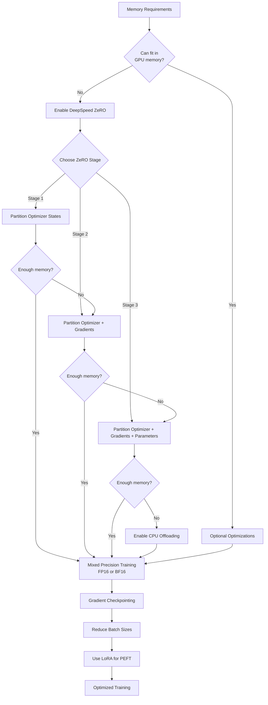
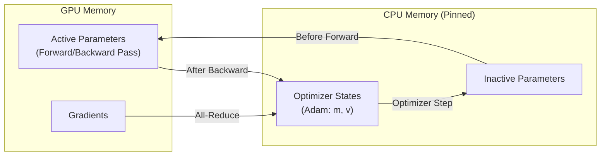
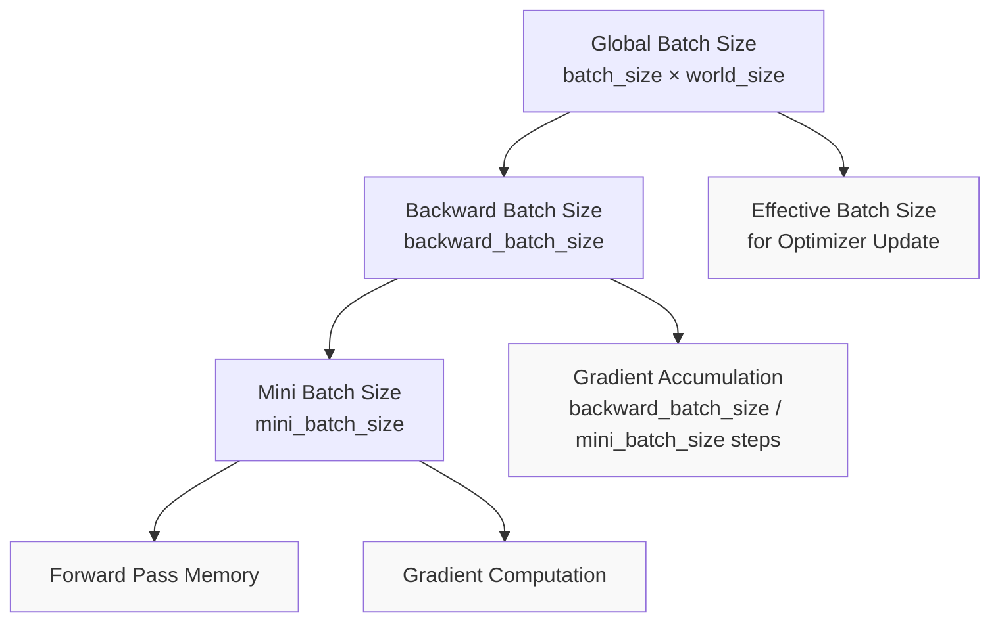
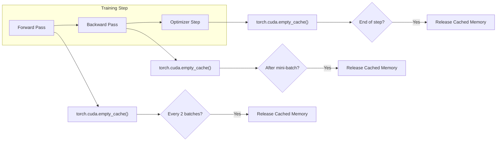
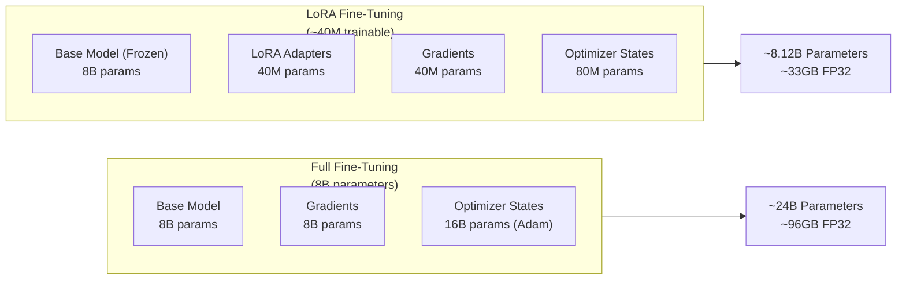

<!-- source: DeepWiki mcp.deepwiki.com · repo microsoft/Text2Grad · page 8.4 Memory Optimization · fetched 2026-10-26 -->

# Memory Optimization

<details>
<summary>Relevant source files</summary>

The following files were used as context for generating this wiki page:

- [nl_gradiant_policy_optimization/ultrafeedback/text2grad_trainer.py](nl_gradiant_policy_optimization/ultrafeedback/text2grad_trainer.py)
- [nl_reward_model/kodcode/train_rm.py](nl_reward_model/kodcode/train_rm.py)

</details>


This page documents strategies for reducing memory consumption during training and inference in the Text2Grad system. Memory optimization is critical when working with large language models (8B+ parameters) and enables training on consumer-grade GPUs or scaling to larger batch sizes.

For general hyperparameter tuning guidance, see [Hyperparameter Tuning](#8.3). For multi-GPU setup details, see [Multi-GPU Configuration](#8.1). For LoRA configuration specifics, see [LoRA and DeepSpeed Configuration](#5.2).

---

## Memory Optimization Strategy Overview

Text2Grad employs a multi-layered memory optimization approach combining DeepSpeed ZeRO, gradient checkpointing, mixed precision training, and explicit memory management. The system is designed to train 8B parameter models on GPUs with 24-48GB VRAM.

### Memory Optimization Hierarchy



**Sources:** [nl_gradiant_policy_optimization/ultrafeedback/text2grad_trainer.py:307-310](), [nl_reward_model/kodcode/train_rm.py:237-253]()

---

## DeepSpeed ZeRO Configuration

DeepSpeed's ZeRO (Zero Redundancy Optimizer) is the primary memory optimization technique. It partitions optimizer states, gradients, and model parameters across GPUs.

### ZeRO Stage Comparison

| Stage | Optimizer States | Gradients | Parameters | Memory Reduction | Communication Overhead |
|-------|-----------------|-----------|------------|-----------------|----------------------|
| 0 | Replicated | Replicated | Replicated | None | Minimal |
| 1 | Partitioned | Replicated | Replicated | ~4x | Low |
| 2 | Partitioned | Partitioned | Replicated | ~8x | Moderate |
| 3 | Partitioned | Partitioned | Partitioned | ~Linear with GPUs | High |

### ZeRO Stage 3 Configuration (Reward Model Training)

The reward model training uses ZeRO Stage 3 with CPU offloading for maximum memory efficiency:

```python
{
    "zero_optimization": {
        "stage": 3,
        "offload_optimizer": {
            "device": "cpu",
            "pin_memory": True
        },
        "offload_param": {
            "device": "cpu", 
            "pin_memory": True
        },
        "overlap_comm": True,
        "contiguous_gradients": True,
        "sub_group_size": 1e9,
        "stage3_max_live_parameters": 1e9,
        "stage3_max_reuse_distance": 1e9,
        "stage3_gather_16bit_weights_on_model_save": True
    }
}
```

**Key parameters:**
- `stage3_max_live_parameters`: Limits maximum parameters in GPU memory simultaneously
- `stage3_max_reuse_distance`: Controls parameter prefetching strategy
- `stage3_gather_16bit_weights_on_model_save`: Gathers FP16 weights during checkpointing (reduces checkpoint size)
- `overlap_comm`: Overlaps communication with computation for efficiency

**Sources:** [nl_reward_model/kodcode/train_rm.py:237-253]()

### Dynamic ZeRO Stage Configuration (Policy Training)

The policy training dynamically adapts ZeRO configuration based on model architecture:

```python
def _prepare_deepspeed(self, model: PreTrainedModelWrapper):
    deepspeed_plugin = self.accelerator.state.deepspeed_plugin
    config_kwargs = deepspeed_plugin.deepspeed_config
    if model is not None:
        if hasattr(model, "config"):
            hidden_size = (
                max(model.config.hidden_sizes)
                if getattr(model.config, "hidden_sizes", None)
                else getattr(model.config, "hidden_size", None)
            )
            if hidden_size is not None and config_kwargs["zero_optimization"]["stage"] == 3:
                config_kwargs.update({
                    "zero_optimization.reduce_bucket_size": hidden_size * hidden_size,
                    "zero_optimization.stage3_param_persistence_threshold": 10 * hidden_size,
                    "zero_optimization.stage3_prefetch_bucket_size": 0.9 * hidden_size * hidden_size,
                })
```

This adjusts bucket sizes based on model hidden dimensions for optimal communication patterns.

**Sources:** [nl_gradiant_policy_optimization/ultrafeedback/text2grad_trainer.py:1804-1828]()

---

## Mixed Precision Training

Mixed precision training reduces memory usage and increases training speed by using FP16 or BF16 for most operations while maintaining FP32 for critical computations.

### FP16 Configuration

The reward model training uses FP16 with dynamic loss scaling:

```python
"fp16": {
    "enabled": True,
    "loss_scale": 0,  # Dynamic loss scaling
    "loss_scale_window": 1000,
    "hysteresis": 2,
    "min_loss_scale": 1
}
```

**Dynamic loss scaling** automatically adjusts the loss scale to prevent gradient underflow/overflow, which is crucial for stable FP16 training.

**Sources:** [nl_reward_model/kodcode/train_rm.py:221-227]()

### BF16 vs FP16

The system handles both FP16 and BF16 tensors, converting BF16 to FP32 when logging:

```python
for k, v in logs.items():
    if isinstance(v, torch.Tensor) and v.dtype == torch.bfloat16:
        logs[k] = v.float()
```

**BF16 advantages:**
- Larger dynamic range (no loss scaling needed)
- More stable training for large models
- Better for models with extreme gradients

**FP16 advantages:**
- Better hardware support (older GPUs)
- Slightly faster on some architectures

**Sources:** [nl_gradiant_policy_optimization/ultrafeedback/text2grad_trainer.py:1749-1752]()

---

## CPU Offloading Strategies

CPU offloading moves optimizer states and model parameters to CPU memory when not actively being used, dramatically reducing GPU memory requirements at the cost of increased data transfer.

### Offloading Configuration



**Memory savings:**
- Optimizer states: ~2x model size (Adam stores momentum and variance)
- Parameters: Model size (when using ZeRO Stage 3)

**Pinned memory** (`pin_memory: True`) enables faster CPU-GPU transfers using direct memory access (DMA), reducing transfer overhead by ~2-3x.

**Sources:** [nl_reward_model/kodcode/train_rm.py:239-246]()

---

## Batch Size Configuration

Batch size management is critical for memory optimization. Text2Grad uses a three-level batch size hierarchy:

### Batch Size Hierarchy



### Configuration in TEXT2GRADTrainer

The trainer calculates global batch sizes based on world size:

```python
config.world_size = self.accelerator.num_processes
config.global_backward_batch_size = config.backward_batch_size * config.world_size
config.global_batch_size = config.batch_size * config.world_size
```

**Sources:** [nl_gradiant_policy_optimization/ultrafeedback/text2grad_trainer.py:194-196]()

### Recommended Configurations

| GPU Memory | batch_size | backward_batch_size | mini_batch_size | Gradient Accumulation |
|-----------|-----------|-------------------|-----------------|---------------------|
| 24GB | 1 | 1 | 1 | None |
| 40GB | 2-4 | 2 | 1 | 2 steps |
| 80GB | 4-8 | 4 | 2 | 2 steps |
| Multi-GPU | 2-4 per GPU | 8-16 | 2-4 | 2-4 steps |

**Key insight:** Reducing `mini_batch_size` has the most direct impact on peak memory usage during forward/backward passes.

**Sources:** [nl_gradiant_policy_optimization/ultrafeedback/text2grad_trainer.py:417-423](), [nl_reward_model/kodcode/train_rm.py:254-257]()

---

## Explicit Memory Management in Training Loop

Text2Grad implements aggressive explicit memory management to prevent memory leaks and reduce fragmentation.

### Cache Clearing Strategy



### Implementation in batched_forward_pass

The forward pass clears cache periodically to prevent accumulation:

```python
del input_kwargs, query_batch, response_batch
if response_masks is not None:
    del response_masks_batch
del token_ids, token_ids_list
if torch.cuda.is_available() and i % 2 == 1:  # Every 2 batches
    torch.cuda.empty_cache()
```

**Why every 2 batches?** Balancing between memory efficiency and performance overhead. Clearing too frequently adds latency.

**Sources:** [nl_gradiant_policy_optimization/ultrafeedback/text2grad_trainer.py:1205-1210]()

### Tensor Deletion Pattern

The training loop systematically deletes intermediate tensors:

```python
# After computing rewards
del active_full_logprobs, ref_full_logprobs
if torch.cuda.is_available():
    torch.cuda.empty_cache()

# After computing advantages  
del rewards
if torch.cuda.is_available():
    torch.cuda.empty_cache()

# After creating batch_dict
del all_logprobs, values, advantages, returns
if torch.cuda.is_available():
    torch.cuda.empty_cache()
```

**Critical deletions:**
- Large activation tensors after forward pass
- Gradients after optimizer step
- Intermediate reward computations
- Batch dictionaries after processing

**Sources:** [nl_gradiant_policy_optimization/ultrafeedback/text2grad_trainer.py:796-810](), [nl_gradiant_policy_optimization/ultrafeedback/text2grad_trainer.py:822-843]()

### Memory-Efficient Mini-Batch Processing

```python
for mini_batch_start in range(0, self.config.backward_batch_size, self.config.mini_batch_size):
    mini_batch_end = mini_batch_start + self.config.mini_batch_size
    mini_batch_inds = backward_batch_inds[mini_batch_start:mini_batch_end]
    
    # Create mini_batch_dict with only required data
    mini_batch_dict = {
        "logprobs": batch_dict["logprobs"][mini_batch_inds],
        "values": batch_dict["values"][mini_batch_inds],
        # ... other fields
    }
    
    # Process mini-batch
    # ...
    
    del mini_batch_dict  # Immediately delete after use
    if torch.cuda.is_available():
        torch.cuda.empty_cache()
```

**Pattern:** Create mini-batches, process, delete immediately. Never keep multiple mini-batches in memory simultaneously.

**Sources:** [nl_gradiant_policy_optimization/ultrafeedback/text2grad_trainer.py:864-932]()

---

## Parameter-Efficient Fine-Tuning with LoRA

LoRA (Low-Rank Adaptation) dramatically reduces trainable parameters and memory requirements by freezing the base model and training only small adapter matrices.

### LoRA Memory Savings



### LoRA Configuration in Reward Model

```python
lora_config = LoraConfig(
    r=16,  # Rank: controls adapter size
    lora_alpha=32,  # Scaling factor: alpha/r
    target_modules=["q_proj", "k_proj", "v_proj", "o_proj"],  # Attention layers
    lora_dropout=0.1,
    bias="none",
    task_type="CAUSAL_LM"
)
model = get_peft_model(model, lora_config)
```

**Memory calculation:**
- Each LoRA adapter: `hidden_size × r × 2` parameters
- For Llama 8B with r=16: ~40M trainable parameters
- Memory reduction: **~200x fewer trainable parameters**

**Sources:** [nl_reward_model/kodcode/train_rm.py:183-206]()

### LoRA in Policy Training

The policy trainer uses LoRA context management to switch between base and adapter:

```python
self.optional_peft_ctx = (
    self.accelerator.unwrap_model(self.model).pretrained_model.disable_adapter
    if self.is_peft_model
    else nullcontext
)

# During reference model forward pass
with self.optional_peft_ctx():
    ref_logprobs, ref_logits_or_none, _, _, _ = self.batched_forward_pass(
        self.model if self.is_peft_model else self.ref_model,
        queries, responses, model_inputs,
        return_logits=full_kl_penalty,
    )
```

This temporarily disables LoRA adapters to get reference model outputs without loading a separate model.

**Sources:** [nl_gradiant_policy_optimization/ultrafeedback/text2grad_trainer.py:228-232](), [nl_gradiant_policy_optimization/ultrafeedback/text2grad_trainer.py:766-773]()

---

## Gradient Accumulation

Gradient accumulation allows training with larger effective batch sizes without increasing memory requirements by accumulating gradients over multiple forward/backward passes.

### Gradient Accumulation in Accelerator

```python
self.accelerator = Accelerator(
    log_with=config.log_with,
    gradient_accumulation_steps=config.gradient_accumulation_steps,
    project_config=ProjectConfiguration(**config.project_kwargs),
    **config.accelerator_kwargs,
)
```

**Sources:** [nl_gradiant_policy_optimization/ultrafeedback/text2grad_trainer.py:187-192]()

### Accumulation Context

The trainer uses the accelerator's accumulation context for proper gradient handling:

```python
with self.accelerator.accumulate(self.model):
    model_inputs = {k: mini_batch_dict[k] for k in model_inputs_names}
    
    logprobs, logits, vpreds, _, _ = self.batched_forward_pass(
        self.model, mini_batch_dict["queries"],
        mini_batch_dict["responses"], model_inputs,
        return_logits=True,
    )
    train_stats, loss_p, loss_v = self.train_minibatch(
        mini_batch_dict["logprobs"], mini_batch_dict["values"],
        logprobs, logits, vpreds, mini_batch_dict["masks"],
        mini_batch_dict["advantages"], mini_batch_dict["returns"],
        mask_loss
    )
```

**How it works:**
1. Gradients are scaled by `1/gradient_accumulation_steps`
2. Optimizer step only occurs after all accumulation steps
3. Memory usage remains constant (only one forward/backward pass at a time)

**Sources:** [nl_gradiant_policy_optimization/ultrafeedback/text2grad_trainer.py:905-926]()

---

## Memory Profiling and Debugging

### Monitoring Memory Usage

The system includes checks for empty tensors and batches:

```python
if bs == 0:
    raise ValueError("Empty batch received in batched_forward_pass")

for i in range(math.ceil(bs / fbs)):
    # ... batch processing
    
    if len(query_batch) == 0 or len(response_batch) == 0:
        print(f"Warning: Empty batch at index {i}, skipping")
        continue
    
    for k, v in input_kwargs.items():
        if isinstance(v, torch.Tensor) and v.numel() == 0:
            print(f"Warning: Empty tensor for {k} at batch {i}")
```

**Sources:** [nl_gradiant_policy_optimization/ultrafeedback/text2grad_trainer.py:1116-1134]()

### DeepSpeed Memory Profiling

Enable profiling in DeepSpeed config:

```python
"wall_clock_breakdown": False  # Set to True for detailed profiling
```

This provides breakdown of time spent in:
- Forward pass
- Backward pass
- Optimizer step
- Communication (all-reduce, broadcast)
- CPU-GPU transfers

**Sources:** [nl_reward_model/kodcode/train_rm.py:259]()

### Common Memory Issues and Solutions

| Issue | Symptom | Solution |
|-------|---------|----------|
| OOM during forward pass | Crashes at model generation | Reduce `mini_batch_size` |
| OOM during backward pass | Crashes during loss.backward() | Enable gradient checkpointing, reduce batch size |
| Gradual memory growth | Memory usage increases over time | Add more `torch.cuda.empty_cache()` calls |
| OOM with DeepSpeed | Fails with "allocation failed" | Enable CPU offloading, increase `stage3_max_live_parameters` |
| Checkpoint loading OOM | Fails loading saved model | Use `stage3_gather_16bit_weights_on_model_save: True` |

**Sources:** [nl_gradiant_policy_optimization/ultrafeedback/text2grad_trainer.py:676-678](), [nl_gradiant_policy_optimization/ultrafeedback/text2grad_trainer.py:1103-1104]()

---

## DummyOptim for DeepSpeed Compatibility

The trainer explicitly creates `DummyOptim` instances for DeepSpeed compatibility in distributed settings:

```python
print(f"Creating DummyOptim for DeepSpeed compatibility (distributed: {self.accelerator.num_processes > 1})")
if optimizer is not None:
    try:
        lr = optimizer.param_groups[0]['lr']
        weight_decay = optimizer.param_groups[0].get('weight_decay', 0.0)
        betas = optimizer.param_groups[0].get('betas', (0.9, 0.999))
        eps = optimizer.param_groups[0].get('eps', 1e-8)
        
        self.optimizer = DummyOptim(
            params=filter(lambda p: p.requires_grad, model.parameters()),
            lr=lr, weight_decay=weight_decay, betas=betas, eps=eps
        )
    except Exception as e:
        print(f"Error creating DummyOptim from optimizer: {str(e)}")
        self.optimizer = DummyOptim(
            params=filter(lambda p: p.requires_grad, model.parameters()),
            lr=config.learning_rate, weight_decay=0.0
        )
```

`DummyOptim` is a placeholder optimizer that allows DeepSpeed to manage the actual optimizer state while maintaining the Trainer API.

**Sources:** [nl_gradiant_policy_optimization/ultrafeedback/text2grad_trainer.py:311-341]()

---

## Practical Memory Optimization Checklist

1. **Start with LoRA**: Always use LoRA for fine-tuning (200x parameter reduction)
2. **Enable ZeRO Stage 3**: For models >7B parameters
3. **Use Mixed Precision**: FP16 or BF16 (2x memory reduction)
4. **Configure CPU Offloading**: If still OOM after ZeRO Stage 3
5. **Tune Batch Sizes**: Start with `mini_batch_size=1`, increase gradually
6. **Add Gradient Accumulation**: To maintain effective batch size
7. **Enable Gradient Checkpointing**: For very large models (trades compute for memory)
8. **Monitor Cache Usage**: Add `torch.cuda.empty_cache()` if memory grows
9. **Profile Training**: Use DeepSpeed profiling to identify bottlenecks
10. **Test Incrementally**: Start small, scale up gradually

**Sources:** [nl_gradiant_policy_optimization/ultrafeedback/text2grad_trainer.py:187-388](), [nl_reward_model/kodcode/train_rm.py:209-261]()

---

