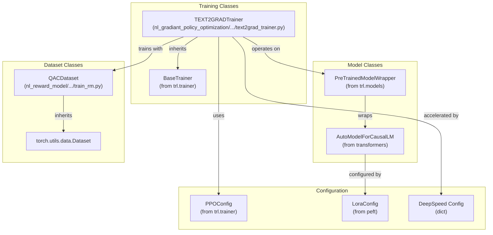
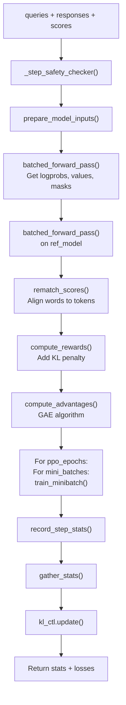
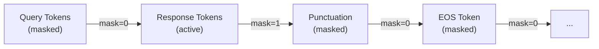
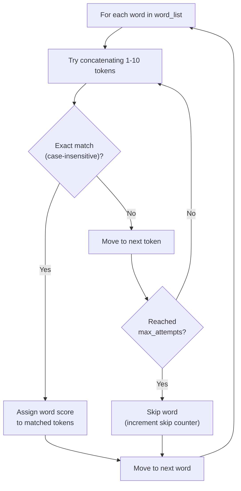
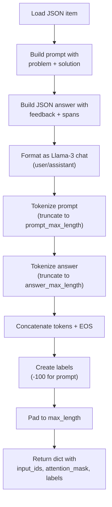
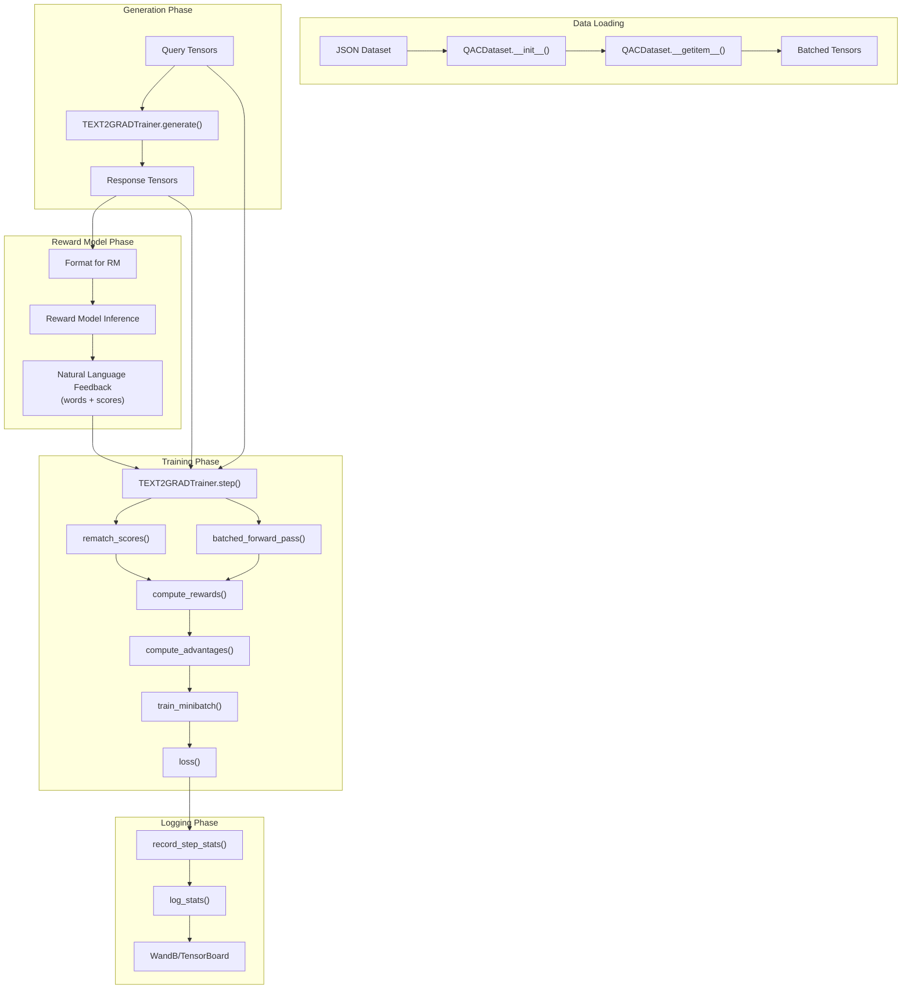

<!-- source: DeepWiki mcp.deepwiki.com · repo microsoft/Text2Grad · page 9 API Reference · fetched 2026-10-26 -->

# API Reference

<details>
<summary>Relevant source files</summary>

The following files were used as context for generating this wiki page:

- [nl_gradiant_policy_optimization/ultrafeedback/text2grad_trainer.py](nl_gradiant_policy_optimization/ultrafeedback/text2grad_trainer.py)
- [nl_reward_model/kodcode/train_rm.py](nl_reward_model/kodcode/train_rm.py)

</details>


This page provides comprehensive API documentation for the core classes, methods, and configuration objects in the Text2Grad framework. It covers the `TEXT2GRADTrainer` class that implements PPO training with natural language gradients, dataset classes for loading and preprocessing data, and configuration objects that control training behavior.

For task-specific training scripts and workflows, see [Task-Specific Guides](#7). For detailed explanations of training concepts, see [Policy Optimization](#6).

---

## Core Class Architecture

The following diagram shows the primary classes and their relationships in the Text2Grad framework:



**Sources:** [nl_gradiant_policy_optimization/ultrafeedback/text2grad_trainer.py:104-135](), [nl_reward_model/kodcode/train_rm.py:22-121]()

---

## TEXT2GRADTrainer

The `TEXT2GRADTrainer` class is the core training engine that implements Proximal Policy Optimization (PPO) with natural language gradients. It extends TRL's `BaseTrainer` to support word-level and span-level reward signals.

### Class Definition

```python
class TEXT2GRADTrainer(BaseTrainer)
```

**Location:** [nl_gradiant_policy_optimization/ultrafeedback/text2grad_trainer.py:104]()

**Inherits:** `trl.trainer.BaseTrainer`

**Purpose:** Orchestrates PPO training with fine-grained natural language feedback. Handles generation, reward computation, advantage estimation, and policy updates.

**Sources:** [nl_gradiant_policy_optimization/ultrafeedback/text2grad_trainer.py:104-136]()

---

### Constructor: `__init__()`

```python
def __init__(
    self,
    config: Optional[PPOConfig] = None,
    model: Optional[PreTrainedModelWrapper] = None,
    ref_model: Optional[PreTrainedModelWrapper] = None,
    tokenizer: Optional[PreTrainedTokenizerBase] = None,
    dataset: Optional[Union[torch.utils.data.Dataset, Dataset]] = None,
    optimizer: Optional[torch.optim.Optimizer] = None,
    data_collator: Optional[typing.Callable] = None,
    num_shared_layers: Optional[int] = None,
    lr_scheduler: Optional[torch.optim.lr_scheduler._LRScheduler] = None,
)
```

**Parameters:**

| Parameter | Type | Description |
|-----------|------|-------------|
| `config` | `PPOConfig` | Configuration object containing hyperparameters (learning rate, batch size, KL penalty coefficients, etc.) |
| `model` | `PreTrainedModelWrapper` | Policy model with value head to be optimized |
| `ref_model` | `PreTrainedModelWrapper` | Reference model for KL divergence computation. If `None` and not using PEFT, creates shared-layer reference model |
| `tokenizer` | `PreTrainedTokenizerBase` | Tokenizer for encoding/decoding text |
| `dataset` | `torch.utils.data.Dataset` or `datasets.Dataset` | Training dataset. If `None`, user must provide dataloader manually |
| `optimizer` | `torch.optim.Optimizer` | Optimizer for training. If `None`, creates Adam optimizer |
| `data_collator` | `Callable` | Function for batching data. Defaults to `DataCollatorForLanguageModeling` |
| `num_shared_layers` | `int` | Number of layers to share between model and reference model if creating reference model |
| `lr_scheduler` | `torch.optim.lr_scheduler._LRScheduler` | Learning rate scheduler |

**Key Initialization Steps:**

1. **Accelerator Setup** ([lines 187-192]()): Creates `accelerate.Accelerator` for distributed training with gradient accumulation
2. **Model Preparation** ([lines 198-205]()): Sets model parameters and detects PEFT/encoder-decoder configurations
3. **Reference Model** ([lines 214-232]()): Creates or assigns reference model for KL penalty computation
4. **Optimizer Creation** ([lines 264-342]()): Creates `DummyOptim` for DeepSpeed compatibility or uses provided optimizer
5. **KL Controller** ([lines 302-305]()): Initializes adaptive or fixed KL coefficient controller
6. **Accelerator Prepare** ([lines 360-381]()): Prepares models, optimizers, and dataloaders for distributed training

**Sources:** [nl_gradiant_policy_optimization/ultrafeedback/text2grad_trainer.py:138-387]()

---

### Method: `generate()`

Generates responses from the policy model given query tensors.

```python
def generate(
    self,
    query_tensor: Union[torch.Tensor, List[torch.Tensor]],
    length_sampler: Optional[Callable] = None,
    batch_size: int = 4,
    return_prompt: bool = True,
    generate_ref_response: bool = False,
    **generation_kwargs,
) -> torch.LongTensor
```

**Parameters:**

| Parameter | Type | Description |
|-----------|------|-------------|
| `query_tensor` | `torch.LongTensor` or `List[torch.LongTensor]` | Query tokens of shape `(seq_len)` or list of tensors |
| `length_sampler` | `Callable` | Function that returns number of tokens to generate |
| `batch_size` | `int` | Batch size for batched generation (default: 4) |
| `return_prompt` | `bool` | Whether to include prompt in returned tokens (default: `True`) |
| `generate_ref_response` | `bool` | Whether to also generate reference model response (default: `False`) |
| `**generation_kwargs` | `dict` | Additional arguments passed to model's `generate()` method |

**Returns:** `torch.LongTensor` of shape `(batch_size, gen_len)` containing generated tokens

**Special Features:**
- **Special Token Cleaning** ([lines 550-569]()): Removes Llama-3 special tokens (`<|start_header_id|>`, `<|end_header_id|>`, `<|eot_id|>`)
- **EOS Truncation** ([lines 599-604]()): Truncates output at first EOS token
- **Batched Processing** ([lines 532-612]()): Efficiently processes multiple queries in batches

**Sources:** [nl_gradiant_policy_optimization/ultrafeedback/text2grad_trainer.py:452-612]()

---

### Method: `step()`

Executes one PPO training step. This is the main training loop that orchestrates generation, reward computation, and policy updates.

```python
@PPODecorators.empty_device_cache()
def step(
    self,
    queries: List[torch.LongTensor],
    responses: List[torch.LongTensor],
    scores: List[torch.FloatTensor],
    words: List[List[str]] = None,
    response_masks: Optional[List[torch.LongTensor]] = None,
    mask_loss: str = "",
) -> Tuple[dict, float, float, float]
```

**Parameters:**

| Parameter | Type | Description |
|-----------|------|-------------|
| `queries` | `List[torch.LongTensor]` | List of query tensors, each of shape `(query_length)` |
| `responses` | `List[torch.LongTensor]` | List of response tensors, each of shape `(response_length)` |
| `scores` | `List[torch.FloatTensor]` | Word-level scores from reward model (values: -1, 0, or +1) |
| `words` | `List[List[str]]` | Word lists for matching scores to tokens |
| `response_masks` | `List[torch.LongTensor]` | Optional masks for responses |
| `mask_loss` | `str` | Which loss to mask: `"loss_p"` (mask policy loss) or `"loss_v"` (mask value loss) |

**Returns:** `Tuple[dict, float, float, float]`
- `stats`: Dictionary of training statistics
- `avg_policy_loss`: Average policy loss across mini-batches
- `avg_value_loss`: Average value loss across mini-batches
- `avg_advantages`: Average advantages

**Processing Flow:**



**Key Steps:**

1. **Safety Checking** ([lines 681-683]()): Validates input shapes and moves tensors to device
2. **Score Normalization** ([lines 687-704]()): Optionally normalizes scores and clips outliers
3. **Forward Pass** ([lines 754-776]()): Computes logprobs, values, and masks for current and reference policies
4. **Score Rematching** ([lines 780-784]()): Aligns word-level scores to token-level using fuzzy matching
5. **Reward Computation** ([lines 788-802]()): Combines word scores with KL penalty
6. **Advantage Estimation** ([lines 804-806]()): Computes GAE advantages for policy gradient
7. **Mini-batch Updates** ([lines 855-945]()): Performs multiple PPO epochs with mini-batch updates
8. **Statistics Recording** ([lines 967-978]()): Aggregates and records training metrics

**Sources:** [nl_gradiant_policy_optimization/ultrafeedback/text2grad_trainer.py:663-1018]()

---

### Method: `batched_forward_pass()`

Performs forward pass through the model in batches, computing log probabilities, values, and attention masks.

```python
@PPODecorators.empty_device_cache()
def batched_forward_pass(
    self,
    model: PreTrainedModelWrapper,
    queries: torch.Tensor,
    responses: torch.Tensor,
    model_inputs: dict,
    return_logits: bool = False,
    response_masks: Optional[torch.Tensor] = None,
) -> Tuple[torch.Tensor, torch.Tensor, torch.Tensor, torch.Tensor, List[List[str]]]
```

**Parameters:**

| Parameter | Type | Description |
|-----------|------|-------------|
| `model` | `PreTrainedModelWrapper` | Model to perform forward pass on |
| `queries` | `List[torch.Tensor]` | Query tensors |
| `responses` | `List[torch.Tensor]` | Response tensors |
| `model_inputs` | `dict` | Dictionary with `input_ids` and `attention_mask` |
| `return_logits` | `bool` | Whether to return full logits (for full KL penalty) |
| `response_masks` | `torch.Tensor` | Optional response masks |

**Returns:** `Tuple` containing:
- `all_logprobs`: Log probabilities tensor of shape `(batch_size, seq_len-1)`
- `all_logits`: Logits tensor (if `return_logits=True`) or `None`
- `all_values`: Value head predictions of shape `(batch_size, seq_len-1)`
- `all_masks`: Attention masks of shape `(batch_size, seq_len-1)`
- `all_tokens`: List of decoded token strings for each sequence

**Masking Strategy:**

The method implements sophisticated masking to ensure only response tokens contribute to loss:



1. **Query Masking** ([lines 1192-1193]()): Sets mask to 0 for all query tokens
2. **Response Activation** ([lines 1178-1191]()): Sets mask to 1 for response region
3. **Punctuation Masking** ([lines 1167-1171]()): Zeros out comma, period, question mark tokens
4. **EOS Detection** ([lines 1188-1191]()): Truncates mask at `<|eot_id|>` token
5. **Optional Response Masks** ([lines 1194-1195]()): Applies user-provided masks to response region

**Sources:** [nl_gradiant_policy_optimization/ultrafeedback/text2grad_trainer.py:1091-1224]()

---

### Method: `rematch_scores()`

Aligns word-level scores from the reward model to token-level scores for the policy model. This is a critical component that bridges the natural language feedback space with the token-level training space.

```python
def rematch_scores(
    self,
    scores: List[torch.FloatTensor],
    words: List[List[str]],
    all_tokens: List[List[str]]
) -> Tuple[List[torch.Tensor], List[List[str]], List[int], List[float]]
```

**Parameters:**

| Parameter | Type | Description |
|-----------|------|-------------|
| `scores` | `List[torch.FloatTensor]` | Word-level scores for each sample |
| `words` | `List[List[str]]` | Word lists for each sample |
| `all_tokens` | `List[List[str]]` | Token lists for each sample (decoded from tokenizer) |

**Returns:** `Tuple` containing:
- `token_scores`: Token-level scores aligned to model tokens
- `answers_tokens`: Extracted answer tokens (after assistant header)
- `answer_indices_tokens`: Starting indices of answers in token lists
- `total_skip_words_nums`: Percentage of words that couldn't be matched

**Matching Algorithm:**

The method uses fuzzy string matching to handle tokenization mismatches:



**Key Features:**

1. **Assistant Marker Detection** ([lines 1398-1408]()): Finds `<|start_header_id|>assistant<|end_header_id|>` sequence
2. **Multi-Token Matching** ([lines 1336-1357]()): Tries concatenating 1-10 tokens to match each word
3. **Case-Insensitive Comparison** ([lines 1344]()): Normalizes to lowercase for matching
4. **Special Character Filtering** ([lines 1370-1377]()): Assigns score 0 to punctuation and special tokens
5. **Skip Tracking** ([lines 1359-1363]()): Records percentage of words that couldn't be matched

**Sources:** [nl_gradiant_policy_optimization/ultrafeedback/text2grad_trainer.py:1389-1445]()

---

### Method: `compute_rewards()`

Computes per-token rewards by combining word-level scores with KL divergence penalty.

```python
def compute_rewards(
    self,
    scores: torch.FloatTensor,
    logprobs: torch.FloatTensor,
    ref_logprobs: torch.FloatTensor,
    masks: torch.LongTensor,
    all_tokens: List[List[str]],
    words: List[List[str]] = None
) -> Tuple[torch.FloatTensor, torch.FloatTensor, torch.FloatTensor]
```

**Parameters:**

| Parameter | Type | Description |
|-----------|------|-------------|
| `scores` | `torch.FloatTensor` | Token-level scores from `rematch_scores()` |
| `logprobs` | `torch.FloatTensor` | Log probabilities from current policy |
| `ref_logprobs` | `torch.FloatTensor` | Log probabilities from reference policy |
| `masks` | `torch.LongTensor` | Attention masks |
| `all_tokens` | `List[List[str]]` | Decoded tokens (for debugging) |
| `words` | `List[List[str]]` | Word lists (for debugging) |

**Returns:** `Tuple` containing:
- `rewards`: Final per-token rewards of shape `(batch_size, seq_len)`
- `non_score_rewards`: KL penalty component only
- `kls`: KL divergence values

**Reward Composition:**

$$\text{reward}[i] = \text{score}[i] - \beta \cdot \text{KL}[i]$$

where:
- $\text{score}[i]$ is the word-level score from reward model (-1, 0, or +1)
- $\beta$ is the KL coefficient from `kl_ctl.value`
- $\text{KL}[i]$ is the KL divergence at token $i$

**Implementation Details:**

1. **Score Trimming** ([lines 1474-1475]()): Removes first element to align with logprobs (which start at position 1)
2. **KL Penalty Computation** ([lines 1479]()): Calls `_kl_penalty()` to compute divergence
3. **Non-Score Reward** ([lines 1481]()): Base reward from KL penalty only
4. **Masked Score Addition** ([lines 1484-1487]()): Adds word scores only at non-masked positions

**Sources:** [nl_gradiant_policy_optimization/ultrafeedback/text2grad_trainer.py:1447-1490]()

---

### Method: `compute_advantages()`

Computes advantages using Generalized Advantage Estimation (GAE) for policy gradient updates.

```python
def compute_advantages(
    self,
    values: torch.FloatTensor,
    rewards: torch.FloatTensor,
    mask: torch.FloatTensor,
) -> Tuple[torch.FloatTensor, torch.FloatTensor, torch.FloatTensor]
```

**Parameters:**

| Parameter | Type | Description |
|-----------|------|-------------|
| `values` | `torch.FloatTensor` | Value function predictions from value head |
| `rewards` | `torch.FloatTensor` | Per-token rewards |
| `mask` | `torch.FloatTensor` | Attention mask |

**Returns:** `Tuple` containing:
- `values`: Input values (unchanged)
- `advantages`: Computed advantages (whitened and detached)
- `returns`: Returns (advantages + values)

**GAE Algorithm:**

The method implements Generalized Advantage Estimation with the following recursive formula:

$$\delta_t = r_t + \gamma V(s_{t+1}) - V(s_t)$$
$$A_t = \delta_t + \gamma \lambda A_{t+1}$$

where:
- $\gamma$ is the discount factor (`config.gamma`)
- $\lambda$ is the GAE parameter (`config.lam`)
- $V(s_t)$ is the value function prediction

**Implementation:**

1. **Masking** ([lines 1530-1531]()): Applies mask to values and rewards
2. **Backward Iteration** ([lines 1533-1538]()): Computes advantages in reverse time order
3. **Advantage Whitening** ([lines 1545]()): Normalizes advantages using `masked_whiten()`
4. **Detachment** ([lines 1549]()): Detaches from computation graph

**Sources:** [nl_gradiant_policy_optimization/ultrafeedback/text2grad_trainer.py:1507-1551]()

---

### Method: `loss()`

Computes PPO policy and value losses with clipping.

```python
def loss(
    self,
    old_logprobs: torch.FloatTensor,
    values: torch.FloatTensor,
    logits: torch.FloatTensor,
    vpreds: torch.FloatTensor,
    logprobs: torch.FloatTensor,
    mask: torch.LongTensor,
    advantages: torch.FloatTensor,
    returns: torch.FloatTensor,
) -> Tuple[torch.FloatTensor, torch.FloatTensor, dict]
```

**Parameters:**

| Parameter | Type | Description |
|-----------|------|-------------|
| `old_logprobs` | `torch.FloatTensor` | Log probabilities from previous iteration |
| `values` | `torch.FloatTensor` | Old value predictions |
| `logits` | `torch.FloatTensor` | Current model logits |
| `vpreds` | `torch.FloatTensor` | Current value predictions |
| `logprobs` | `torch.FloatTensor` | Current log probabilities |
| `mask` | `torch.LongTensor` | Attention mask |
| `advantages` | `torch.FloatTensor` | Computed advantages |
| `returns` | `torch.FloatTensor` | Target returns |

**Returns:** `Tuple` containing:
- `pg_loss`: Policy gradient loss (scalar)
- `vf_loss`: Value function loss (multiplied by `config.vf_coef`)
- `stats`: Dictionary with detailed statistics

**Loss Components:**

1. **Value Loss (Clipped):**

$$L_V = \max\left((V_{\text{pred}} - R)^2, (\text{clip}(V_{\text{pred}}, V_{\text{old}} - \epsilon, V_{\text{old}} + \epsilon) - R)^2\right)$$

2. **Policy Loss (Clipped PPO Objective):**

$$L_{\text{PG}} = \max\left(-A \cdot r, -A \cdot \text{clip}(r, 1-\epsilon, 1+\epsilon)\right)$$

where $r = \exp(\log p_{\theta} - \log p_{\text{old}})$ is the probability ratio.

**Implementation Details:**

- **Value Clipping** ([lines 1582-1591]()): Clips value predictions within `cliprange_value` of old values
- **Ratio Computation** ([lines 1594-1596]()): Computes and clamps probability ratio
- **Policy Clipping** ([lines 1598-1602]()): Clips ratio within `cliprange` (typically 0.2)
- **Ratio Threshold** ([lines 1606-1613]()): Zeros out loss if average ratio exceeds threshold
- **Entropy Bonus** ([lines 1615]()): Computes entropy for exploration

**Sources:** [nl_gradiant_policy_optimization/ultrafeedback/text2grad_trainer.py:1553-1643]()

---

### Method: `train_minibatch()`

Trains one mini-batch by computing losses and performing backward pass.

```python
@PPODecorators.empty_device_cache()
def train_minibatch(
    self,
    old_logprobs: torch.FloatTensor,
    values: torch.FloatTensor,
    logprobs: torch.FloatTensor,
    logits: torch.FloatTensor,
    vpreds: torch.FloatTensor,
    mask: torch.LongTensor,
    advantages: torch.FloatTensor,
    returns: torch.FloatTensor,
    mask_loss: str = ""
) -> Tuple[dict, float, float]
```

**Parameters:** See `loss()` method parameters, plus:

| Parameter | Type | Description |
|-----------|------|-------------|
| `mask_loss` | `str` | Which loss to mask: `"loss_p"` or `"loss_v"` |

**Returns:** `Tuple` containing:
- `train_stats`: Dictionary of training statistics
- `loss_p`: Policy loss value (scalar)
- `loss_v`: Value loss value (scalar)

**Training Steps:**

1. **Loss Computation** ([lines 1246-1248]()): Calls `loss()` method
2. **Loss Selection** ([lines 1254-1257]()): Optionally masks policy or value loss
3. **Backward Pass** ([lines 1258]()): Uses `accelerator.backward()`
4. **Gradient Clipping** ([lines 1259-1261]()): Clips gradients to `max_grad_norm`
5. **Optimizer Step** ([lines 1262-1263]()): Updates parameters and zeros gradients

**Sources:** [nl_gradiant_policy_optimization/ultrafeedback/text2grad_trainer.py:1227-1268]()

---

### Method: `record_step_stats()`

Records statistics for one training step, computing various metrics.

```python
def record_step_stats(self, kl_coef: float, **data) -> dict
```

**Parameters:**

| Parameter | Type | Description |
|-----------|------|-------------|
| `kl_coef` | `float` | Current KL coefficient |
| `**data` | `dict` | Dictionary containing `masks`, `kls`, `logprobs`, `scores`, `non_score_reward` |

**Returns:** `dict` with the following keys:
- `objective/kl`: Mean KL divergence
- `objective/kl_dist`: KL distribution across batch
- `objective/logprobs`: Log probabilities
- `objective/ref_logprobs`: Reference log probabilities
- `objective/kl_coef`: Current KL coefficient
- `objective/entropy`: Mean entropy
- `ppo/mean_non_score_reward`: Mean KL penalty
- `ppo/mean_scores`: Mean of masked scores
- `ppo/std_scores`: Standard deviation of masked scores

**Key Computations:**

1. **KL Statistics** ([lines 1653-1655]()): Computes mean KL across batch
2. **Entropy** ([lines 1656]()): Computes mean entropy of policy
3. **Masked Scores** ([lines 1662-1668]()): Filters scores using attention masks
4. **Score Statistics** ([lines 1670-1673]()): Computes mean and std of scores

**Sources:** [nl_gradiant_policy_optimization/ultrafeedback/text2grad_trainer.py:1645-1694]()

---

### Method: `log_stats()`

Logs training statistics to WandB or TensorBoard.

```python
def log_stats(
    self,
    wandb_step: int,
    stats: dict,
    batch: dict,
    rewards: List[torch.FloatTensor],
    columns_to_log: typing.Iterable[str] = ("query", "response"),
) -> None
```

**Parameters:**

| Parameter | Type | Description |
|-----------|------|-------------|
| `wandb_step` | `int` | Current step number for logging |
| `stats` | `dict` | Statistics dictionary from `record_step_stats()` |
| `batch` | `dict` | Batch dictionary with query/response data |
| `rewards` | `List[torch.FloatTensor]` | Rewards for logging |
| `columns_to_log` | `Iterable[str]` | Columns to include in game log table |

**Logged Information:**

- Training statistics (losses, KL, advantages, etc.)
- Game log table (queries, responses, rewards)
- Reward distribution statistics

**Sources:** [nl_gradiant_policy_optimization/ultrafeedback/text2grad_trainer.py:1696-1763]()

---

## QACDataset

The `QACDataset` class loads and preprocesses data in Question-Answer-Critique format for reward model training.

### Class Definition

```python
class QACDataset(Dataset)
```

**Location:** [nl_reward_model/kodcode/train_rm.py:22]()

**Inherits:** `torch.utils.data.Dataset`

**Purpose:** Formats training data for reward models, creating prompt-completion pairs with proper tokenization and masking.

### Constructor: `__init__()`

```python
def __init__(
    self,
    json_path: str,
    tokenizer: PreTrainedTokenizer,
    prompt_max_length: int,
    max_length: int
)
```

**Parameters:**

| Parameter | Type | Description |
|-----------|------|-------------|
| `json_path` | `str` | Path to JSON data file |
| `tokenizer` | `PreTrainedTokenizer` | HuggingFace tokenizer |
| `prompt_max_length` | `int` | Maximum length for prompt portion |
| `max_length` | `int` | Maximum total sequence length |

**Initialization:**

- Loads JSON data from file ([line 36]())
- Computes answer max length ([line 39]())
- Stores tokenizer and configuration

**Sources:** [nl_reward_model/kodcode/train_rm.py:25-42]()

---

### Method: `__getitem__()`

Returns one training example with proper formatting and tokenization.

```python
def __getitem__(self, ind: int) -> dict
```

**Parameters:**

| Parameter | Type | Description |
|-----------|------|-------------|
| `ind` | `int` | Index of item to retrieve |

**Returns:** `dict` containing:

| Key | Type | Description |
|-----|------|-------------|
| `input_ids` | `torch.LongTensor` | Token IDs of shape `(max_length,)` |
| `attention_mask` | `torch.LongTensor` | Attention mask of shape `(max_length,)` |
| `labels` | `torch.LongTensor` | Labels for training (-100 for prompt tokens) |

**Data Format:**

The method expects JSON with the following structure:

```json
{
  "question": "Problem statement...",
  "solution": "Code solution...",
  "code_feedback": "Evaluation text...",
  "wrong_code": ["error snippet 1", "error snippet 2"],
  "improvement_code": ["improvement 1", "improvement 2"]
}
```

**Processing Steps:**



**Key Features:**

1. **Prompt Construction** ([lines 56-85]()): Creates detailed evaluation instructions
2. **JSON Output Format** ([lines 87-91]()): Structures answer as JSON with feedback and code spans
3. **Chat Formatting** ([line 93]()): Wraps in Llama-3 chat template
4. **Truncation** ([lines 96-101]()): Truncates prompt and answer to fit max lengths
5. **Label Masking** ([lines 108]()): Sets prompt tokens to -100 (ignored in loss)
6. **Padding** ([lines 112-115]()): Right-pads sequences to max_length

**Sources:** [nl_reward_model/kodcode/train_rm.py:47-121]()

---

## Configuration Objects

### PPOConfig

Configuration object for PPO training, provided by the TRL library.

**Key Parameters:**

| Parameter | Type | Default | Description |
|-----------|------|---------|-------------|
| `batch_size` | `int` | 256 | Number of samples per PPO update |
| `mini_batch_size` | `int` | 64 | Size of mini-batches for gradient updates |
| `ppo_epochs` | `int` | 4 | Number of PPO epochs per update |
| `learning_rate` | `float` | 1e-5 | Learning rate for optimizer |
| `init_kl_coef` | `float` | 0.2 | Initial KL penalty coefficient |
| `target` | `float` | 6.0 | Target KL divergence for adaptive controller |
| `gamma` | `float` | 1.0 | Discount factor for rewards |
| `lam` | `float` | 0.95 | GAE lambda parameter |
| `cliprange` | `float` | 0.2 | PPO clipping range for policy |
| `cliprange_value` | `float` | 0.2 | Clipping range for value function |
| `vf_coef` | `float` | 0.1 | Value function loss coefficient |
| `max_grad_norm` | `float` | 1.0 | Maximum gradient norm for clipping |
| `kl_penalty` | `str` | "kl" | KL penalty type: "kl", "abs", "mse", "full" |
| `adap_kl_ctrl` | `bool` | True | Use adaptive KL controller |

**Referenced in:** [nl_gradiant_policy_optimization/ultrafeedback/text2grad_trainer.py:51](), [nl_gradiant_policy_optimization/ultrafeedback/text2grad_trainer.py:111]()

---

### LoraConfig

Configuration for LoRA (Low-Rank Adaptation) from the PEFT library.

**Key Parameters:**

| Parameter | Type | Default | Description |
|-----------|------|---------|-------------|
| `r` | `int` | 16 | LoRA attention dimension |
| `lora_alpha` | `int` | 32 | LoRA scaling parameter |
| `target_modules` | `List[str]` | - | Module names to apply LoRA to |
| `lora_dropout` | `float` | 0.1 | Dropout probability for LoRA layers |
| `bias` | `str` | "none" | Bias training strategy |
| `task_type` | `str` | "CAUSAL_LM" | Task type for model |

**Example Usage:**

```python
lora_config = LoraConfig(
    r=16,
    lora_alpha=32,
    target_modules=["q_proj", "k_proj", "v_proj", "o_proj"],
    lora_dropout=0.1,
    bias="none",
    task_type="CAUSAL_LM"
)
model = get_peft_model(base_model, lora_config)
```

**Referenced in:** [nl_reward_model/kodcode/train_rm.py:17](), [nl_reward_model/kodcode/train_rm.py:183-206]()

---

### DeepSpeed Configuration

DeepSpeed configuration dictionary for distributed training with ZeRO optimization.

**Structure:**

```python
{
    "fp16": {
        "enabled": True,
        "loss_scale": 0,
        "loss_scale_window": 1000,
        "hysteresis": 2,
        "min_loss_scale": 1
    },
    "optimizer": {
        "type": "AdamW",
        "params": {
            "lr": 2e-5,
            "betas": [0.9, 0.999],
            "eps": 1e-8,
            "weight_decay": 0.01
        }
    },
    "zero_optimization": {
        "stage": 3,
        "offload_optimizer": {"device": "cpu", "pin_memory": True},
        "offload_param": {"device": "cpu", "pin_memory": True},
        "overlap_comm": True,
        "contiguous_gradients": True,
        "sub_group_size": 1e9,
        "stage3_max_live_parameters": 1e9,
        "stage3_max_reuse_distance": 1e9,
        "stage3_gather_16bit_weights_on_model_save": True
    },
    "gradient_accumulation_steps": 1,
    "gradient_clipping": 1.0
}
```

**Key Features:**

| Feature | Description |
|---------|-------------|
| `fp16` | Mixed precision training with automatic loss scaling |
| `zero_optimization.stage` | ZeRO Stage 3: partition parameters, gradients, and optimizer states |
| `offload_optimizer` | Offload optimizer states to CPU to save GPU memory |
| `offload_param` | Offload parameters to CPU when not in use |
| `overlap_comm` | Overlap communication with computation |
| `stage3_gather_16bit_weights_on_model_save` | Gather weights in fp16 when saving |

**Referenced in:** [nl_reward_model/kodcode/train_rm.py:209-260]()

---

## Data Flow Through API

The following diagram shows how data flows through the key API methods during training:



**Sources:** [nl_gradiant_policy_optimization/ultrafeedback/text2grad_trainer.py:1-1830](), [nl_reward_model/kodcode/train_rm.py:1-427]()

---

## Helper Methods Reference

### `prepare_model_inputs()`

Prepares model inputs by concatenating queries and responses.

**Location:** [nl_gradiant_policy_optimization/ultrafeedback/text2grad_trainer.py:1069-1088]()

**Parameters:** `queries: torch.Tensor`, `responses: torch.Tensor`

**Returns:** `dict` with `input_ids`, `attention_mask`, and optionally `decoder_input_ids`, `decoder_attention_mask`

---

### `_step_safety_checker()`

Validates input tensors for training step.

**Location:** [nl_gradiant_policy_optimization/ultrafeedback/text2grad_trainer.py:614-660]()

**Parameters:** `batch_size: int`, `queries: List[torch.LongTensor]`, `responses: List[torch.LongTensor]`, `scores: List[torch.FloatTensor]`, `masks: Optional[List[torch.LongTensor]]`

**Returns:** Validated and device-moved tensors

---

### `_kl_penalty()`

Computes KL divergence penalty.

**Location:** [nl_gradiant_policy_optimization/ultrafeedback/text2grad_trainer.py:1492-1505]()

**Supported Penalties:**
- `"kl"`: $\log p_{\theta} - \log p_{\text{ref}}$
- `"abs"`: $|\log p_{\theta} - \log p_{\text{ref}}|$
- `"mse"`: $\frac{1}{2}(\log p_{\theta} - \log p_{\text{ref}})^2$
- `"full"`: Full KL divergence using logits

---

### `gather_stats()`

Gathers statistics across distributed processes.

**Location:** [nl_gradiant_policy_optimization/ultrafeedback/text2grad_trainer.py:1053-1067]()

**Parameters:** `stats: dict`

**Returns:** Aggregated statistics dict

---

### `_early_stop()`

Checks whether to early stop based on KL divergence.

**Location:** [nl_gradiant_policy_optimization/ultrafeedback/text2grad_trainer.py:1020-1051]()

**Parameters:** `policykl: torch.Tensor`

**Returns:** `bool` indicating whether to stop

---

## Usage Example

Here's a complete example showing how to use the main API components:

```python
from transformers import AutoTokenizer, AutoModelForCausalLM
from trl import AutoModelForCausalLMWithValueHead, PPOConfig
from peft import LoraConfig, get_peft_model
from text2grad_trainer import TEXT2GRADTrainer
from train_rm import QACDataset

# 1. Setup tokenizer and model
tokenizer = AutoTokenizer.from_pretrained("meta-llama/Llama-3.1-8B-Instruct")
base_model = AutoModelForCausalLM.from_pretrained("meta-llama/Llama-3.1-8B-Instruct")

# 2. Apply LoRA
lora_config = LoraConfig(
    r=16, 
    lora_alpha=32,
    target_modules=["q_proj", "k_proj", "v_proj", "o_proj"]
)
model = get_peft_model(base_model, lora_config)
model = AutoModelForCausalLMWithValueHead.from_pretrained(model)

# 3. Create dataset
dataset = QACDataset(
    json_path="data/train.json",
    tokenizer=tokenizer,
    prompt_max_length=900,
    max_length=1250
)

# 4. Configure PPO
ppo_config = PPOConfig(
    batch_size=8,
    mini_batch_size=2,
    learning_rate=1e-5,
    init_kl_coef=0.2,
    gamma=1.0,
    lam=0.95,
    cliprange=0.2
)

# 5. Initialize trainer
trainer = TEXT2GRADTrainer(
    config=ppo_config,
    model=model,
    tokenizer=tokenizer,
    dataset=dataset
)

# 6. Training loop
for batch in trainer.dataloader:
    # Generate responses
    query_tensors = batch["query"]
    response_tensors = trainer.generate(query_tensors)
    
    # Get rewards from reward model (external)
    scores, words = get_reward_model_feedback(response_tensors)
    
    # PPO update
    stats, loss_p, loss_v, advantages = trainer.step(
        queries=query_tensors,
        responses=response_tensors,
        scores=scores,
        words=words
    )
    
    # Log statistics
    trainer.log_stats(
        wandb_step=trainer.current_step,
        stats=stats,
        batch=batch,
        rewards=scores
    )
```

**Sources:** [nl_gradiant_policy_optimization/ultrafeedback/text2grad_trainer.py:138-387](), [nl_reward_model/kodcode/train_rm.py:22-121]()

---

