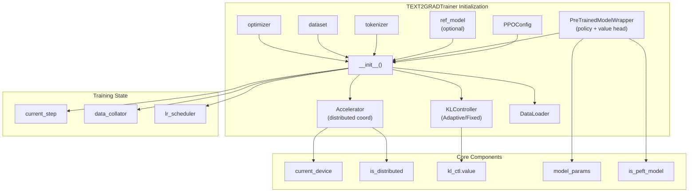
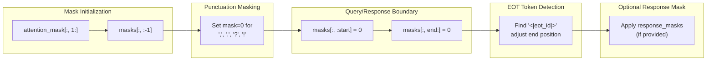
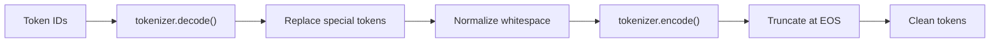
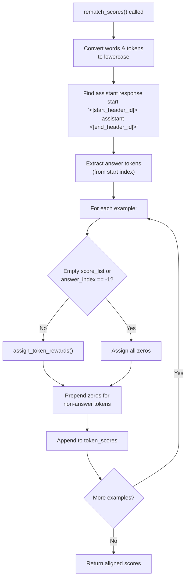
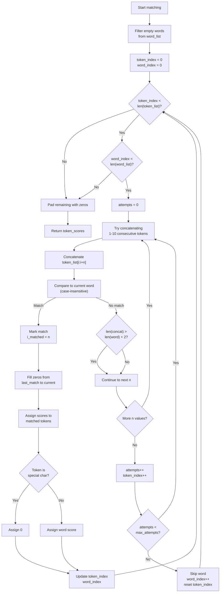
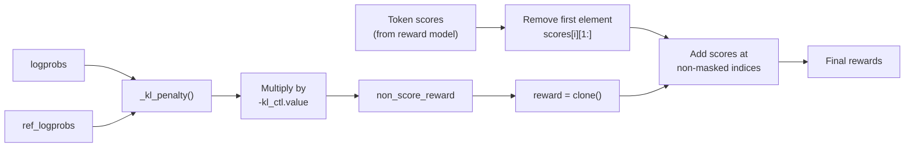
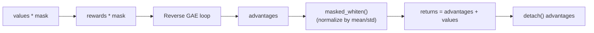

<!-- source: DeepWiki mcp.deepwiki.com · repo microsoft/Text2Grad · page 9.1 TEXT2GRADTrainer API · fetched 2026-10-26 -->

# TEXT2GRADTrainer API

<details>
<summary>Relevant source files</summary>

The following files were used as context for generating this wiki page:

- [nl_gradiant_policy_optimization/kodcode/text2grad_trainer.py](nl_gradiant_policy_optimization/kodcode/text2grad_trainer.py)
- [nl_gradiant_policy_optimization/ultrafeedback/text2grad_trainer.py](nl_gradiant_policy_optimization/ultrafeedback/text2grad_trainer.py)

</details>


This document provides a complete API reference for the `TEXT2GRADTrainer` class, the core trainer implementing PPO-based policy optimization with natural language gradients. This class extends TRL's `BaseTrainer` to support token-level rewards derived from word-level feedback.

For conceptual understanding of the training loop, see [PPO Training Loop](#6.2). For reward processing details, see [Reward Processing Pipeline](#6.3) and [Token-Reward Alignment](#6.4). For configuration objects, see [Configuration Objects API](#9.3).

## Class Overview

The `TEXT2GRADTrainer` implements the following specialized functionality:

- **Token-level reward assignment**: Converts word-level scores from reward models to token-level rewards through fuzzy matching
- **Natural language gradient integration**: Processes span-based feedback (good_spans, poor_spans) into training signals
- **Distributed training support**: Handles multi-GPU coordination with DeepSpeed and Accelerator
- **PEFT optimization**: Supports LoRA adapters and reference model management



**Sources:** 
- [nl_gradiant_policy_optimization/ultrafeedback/text2grad_trainer.py:104-393]()
- [nl_gradiant_policy_optimization/kodcode/text2grad_trainer.py:106-393]()

---

## Constructor

### `__init__()`

```python
def __init__(
    self,
    config: Optional[PPOConfig] = None,
    model: Optional[PreTrainedModelWrapper] = None,
    ref_model: Optional[PreTrainedModelWrapper] = None,
    tokenizer: Optional[PreTrainedTokenizerBase] = None,
    dataset: Optional[Union[torch.utils.data.Dataset, Dataset]] = None,
    optimizer: Optional[torch.optim.Optimizer] = None,
    data_collator: Optional[typing.Callable] = None,
    num_shared_layers: Optional[int] = None,
    lr_scheduler: Optional[torch.optim.lr_scheduler._LRScheduler] = None,
)
```

#### Parameters

| Parameter | Type | Default | Description |
|-----------|------|---------|-------------|
| `config` | `PPOConfig` | `None` | Configuration object with hyperparameters (learning rate, batch sizes, PPO settings) |
| `model` | `PreTrainedModelWrapper` | `None` | Policy model with value head (e.g., `AutoModelForCausalLMWithValueHead`) |
| `ref_model` | `PreTrainedModelWrapper` | `None` | Reference model for KL penalty. If `None` and not PEFT, creates shared-layer reference |
| `tokenizer` | `PreTrainedTokenizerBase` | `None` | Tokenizer (must be `PreTrainedTokenizer` or `PreTrainedTokenizerFast`) |
| `dataset` | `Union[torch.utils.data.Dataset, Dataset]` | `None` | Training dataset. Creates dataloader internally if provided |
| `optimizer` | `torch.optim.Optimizer` | `None` | Optimizer. If `None`, creates `DummyOptim` for DeepSpeed compatibility |
| `data_collator` | `Callable` | `None` | Data collation function. Defaults to `DataCollatorForLanguageModeling` |
| `num_shared_layers` | `int` | `None` | Number of shared layers between model and ref_model (only used if ref_model is None) |
| `lr_scheduler` | `torch.optim.lr_scheduler._LRScheduler` | `None` | Learning rate scheduler. If provided, wrapped in `DummyScheduler` for DeepSpeed |

#### Initialization Behavior

The constructor performs the following setup:

1. **Validation**: Checks types of `config`, `tokenizer`, and `model`
2. **Accelerator Setup**: Creates `Accelerator` with logging, gradient accumulation, and distributed settings from config
3. **Global Batch Configuration**: Sets `config.world_size`, `config.global_batch_size`, `config.global_backward_batch_size`
4. **PEFT Detection**: Sets `self.is_peft_model = True` (forced in this implementation)
5. **Reference Model**: Creates reference model or sets to `None` for PEFT
6. **DeepSpeed Compatibility**: Wraps optimizer in `DummyOptim` and scheduler in `DummyScheduler` for DeepSpeed Stage 3
7. **KL Controller**: Creates `AdaptiveKLController` or `FixedKLController` based on `config.adap_kl_ctrl`
8. **Accelerator Preparation**: Prepares model, optimizer, scheduler, and dataloader with `accelerator.prepare()`

**Sources:**
- [nl_gradiant_policy_optimization/ultrafeedback/text2grad_trainer.py:138-388]()
- [nl_gradiant_policy_optimization/kodcode/text2grad_trainer.py:140-393]()

---

## Core Training Methods

### `step()`

The main PPO training step that orchestrates generation, reward computation, advantage calculation, and policy updates.

```python
@PPODecorators.empty_device_cache()
def step(
    self,
    queries: List[torch.LongTensor],
    responses: List[torch.LongTensor],
    scores: List[torch.FloatTensor],
    words: List[List[str]] = None,
    response_masks: Optional[List[torch.LongTensor]] = None,
    mask_loss: str = "",
) -> Tuple[Dict, float, float, float]
```

#### Parameters

| Parameter | Type | Description |
|-----------|------|-------------|
| `queries` | `List[torch.LongTensor]` | List of tokenized query/prompt tensors, shape `(query_length,)` |
| `responses` | `List[torch.LongTensor]` | List of generated response tensors, shape `(response_length,)` |
| `scores` | `List[torch.FloatTensor]` | Word-level reward scores from reward model |
| `words` | `List[List[str]]` | Word lists corresponding to scores for alignment |
| `response_masks` | `List[torch.LongTensor]` | Optional masks for responses |
| `mask_loss` | `str` | If "loss_p", only trains value; if "loss_v", only trains policy; else trains both |

#### Returns

`Tuple[Dict, float, float, float]`: 
- Dictionary of training statistics
- Average policy loss
- Average value loss
- Average advantages

#### Training Flow

```mermaid
graph TB
    START["step() called"] --> SAFETY["_step_safety_checker()"]
    SAFETY --> SCALING["Score scaling/normalization<br/>(if config.use_score_scaling)"]
    SCALING --> CLIPPING["Score clipping<br/>(if config.score_clip)"]
    
    CLIPPING --> PREP["prepare_model_inputs()"]
    PREP --> PAD["Pad across processes<br/>(if distributed)"]
    
    PAD --> FWD["batched_forward_pass()<br/>(policy model)"]
    FWD --> REFFWD["batched_forward_pass()<br/>(reference model)"]
    
    REFFWD --> REMATCH["rematch_scores()<br/>(word→token alignment)"]
    REMATCH --> REWARDS["compute_rewards()<br/>(add KL penalty)"]
    REWARDS --> ADV["compute_advantages()<br/>(GAE)"]
    
    ADV --> BATCH["Build batch_dict"]
    BATCH --> EPOCHS["Loop: ppo_epochs"]
    
    EPOCHS --> SHUFFLE["Shuffle batch indices"]
    SHUFFLE --> BACKWARD["Loop: backward batches"]
    BACKWARD --> MINI["Loop: mini batches"]
    
    MINI --> MINIFWD["batched_forward_pass()<br/>(current logits/values)"]
    MINIFWD --> TRAIN["train_minibatch()<br/>(compute loss, backward)"]
    TRAIN --> EARLY{"Early stopping?"}
    
    EARLY -->|Yes| RECORD
    EARLY -->|No| MINI
    
    RECORD["record_step_stats()"] --> GATHER{"Distributed?"}
    GATHER -->|Yes| GATHER_STATS["gather_stats()"]
    GATHER -->|No| UPDATE
    GATHER_STATS --> UPDATE["Update KL controller"]
    
    UPDATE --> RETURN["Return stats, losses, advantages"]
```



**Key Implementation Details:**

- **Memory Management**: Aggressive `torch.cuda.empty_cache()` calls throughout to prevent OOM
- **Mini-batch Processing**: Supports 3-level batching (batch_size → backward_batch_size → mini_batch_size)
- **DeepSpeed Handling**: Conditional logic for `self.is_deepspeed` vs standard gradient accumulation
- **Error Handling**: Try-catch with distributed barrier for multi-GPU synchronization

**Sources:**
- [nl_gradiant_policy_optimization/ultrafeedback/text2grad_trainer.py:663-1018]()
- [nl_gradiant_policy_optimization/kodcode/text2grad_trainer.py:668-1022]()

---

### `batched_forward_pass()`

Performs forward passes through the model in mini-batches, computing log probabilities, values, and masks.

```python
@PPODecorators.empty_device_cache()
def batched_forward_pass(
    self,
    model: PreTrainedModelWrapper,
    queries: torch.Tensor,
    responses: torch.Tensor,
    model_inputs: dict,
    return_logits: bool = False,
    response_masks: Optional[torch.Tensor] = None,
) -> Tuple[torch.Tensor, Optional[torch.Tensor], torch.Tensor, torch.Tensor, List[List[str]]]
```

#### Parameters

| Parameter | Type | Description |
|-----------|------|-------------|
| `model` | `PreTrainedModelWrapper` | Model to run (policy or reference) |
| `queries` | `torch.Tensor` | Batch of query tensors |
| `responses` | `torch.Tensor` | Batch of response tensors |
| `model_inputs` | `dict` | Pre-collated model inputs (input_ids, attention_mask) |
| `return_logits` | `bool` | If True, returns full logits; otherwise only log probs |
| `response_masks` | `Optional[torch.Tensor]` | Optional response masks |

#### Returns

`Tuple` containing:
- `all_logprobs` (`torch.Tensor`): Log probabilities, shape `(batch_size, seq_len-1)`
- `all_logits` (`Optional[torch.Tensor]`): Logits if requested, shape `(batch_size, seq_len-1, vocab_size)`
- `all_values` (`torch.Tensor`): Value predictions, shape `(batch_size, seq_len-1)`
- `all_masks` (`torch.Tensor`): Attention masks, shape `(batch_size, seq_len-1)`
- `all_tokens` (`List[List[str]]`): Decoded token strings for each sequence

#### Masking Strategy



**Implementation Notes:**

- **Token Decoding**: Decodes each token ID individually with apostrophe normalization: `re.sub(r"[''‛']", "'", ...)`
- **Punctuation Exclusion**: Automatically masks out punctuation tokens (`,`, `.`, `?`, `!`) from loss computation
- **Boundary Detection**: For decoder-only models, identifies response start after query and stops at `<|eot_id|>`
- **Encoder-Decoder Handling**: Uses `decoder_input_ids` and `decoder_attention_mask` for seq2seq models
- **Mini-batch Iteration**: Processes in chunks of `config.mini_batch_size` to manage memory

**Sources:**
- [nl_gradiant_policy_optimization/ultrafeedback/text2grad_trainer.py:1091-1224]()
- [nl_gradiant_policy_optimization/kodcode/text2grad_trainer.py:1095-1230]()

---

### `train_minibatch()`

Computes loss and performs a single optimization step on a mini-batch.

```python
@PPODecorators.empty_device_cache()
def train_minibatch(
    self,
    old_logprobs: torch.FloatTensor,
    values: torch.FloatTensor,
    logprobs: torch.FloatTensor,
    logits: torch.FloatTensor,
    vpreds: torch.FloatTensor,
    mask: torch.LongTensor,
    advantages: torch.FloatTensor,
    returns: torch.FloatTensor,
    mask_loss: str = ""
) -> Tuple[Dict, float, float]
```

#### Parameters

| Parameter | Type | Shape | Description |
|-----------|------|-------|-------------|
| `old_logprobs` | `torch.FloatTensor` | `(batch, seq_len)` | Log probs from previous iteration |
| `values` | `torch.FloatTensor` | `(batch, seq_len)` | Old value predictions |
| `logprobs` | `torch.FloatTensor` | `(batch, seq_len)` | Current log probs |
| `logits` | `torch.FloatTensor` | `(batch, seq_len, vocab)` | Current logits |
| `vpreds` | `torch.FloatTensor` | `(batch, seq_len)` | Current value predictions |
| `mask` | `torch.LongTensor` | `(batch, seq_len)` | Attention mask |
| `advantages` | `torch.FloatTensor` | `(batch, seq_len)` | Computed advantages |
| `returns` | `torch.FloatTensor` | `(batch, seq_len)` | Computed returns |
| `mask_loss` | `str` | - | Loss masking mode |

#### Returns

`Tuple[Dict, float, float]`:
- Training statistics dictionary
- Policy loss value
- Value loss value

#### Training Steps

1. **Set model to train mode**: `self.model.train()`
2. **Compute loss**: Calls `self.loss()` to compute policy and value losses
3. **Apply loss masking**: If `mask_loss` specified, trains only one head
4. **Backward pass**: `self.accelerator.backward(loss)`
5. **Gradient clipping**: If `config.max_grad_norm` set, clips gradients
6. **Optimizer step**: Updates parameters and zeros gradients

**Sources:**
- [nl_gradiant_policy_optimization/ultrafeedback/text2grad_trainer.py:1227-1268]()
- [nl_gradiant_policy_optimization/kodcode/text2grad_trainer.py:1233-1274]()

---

## Generation Methods

### `generate()`

Generates responses from the policy model given query tensors.

```python
def generate(
    self,
    query_tensor: Union[torch.Tensor, List[torch.Tensor]],
    length_sampler: Optional[Callable] = None,
    batch_size: int = 4,
    return_prompt: bool = True,
    generate_ref_response: bool = False,
    **generation_kwargs,
) -> Union[torch.LongTensor, Tuple[torch.LongTensor, torch.LongTensor]]
```

#### Parameters

| Parameter | Type | Default | Description |
|-----------|------|---------|-------------|
| `query_tensor` | `Union[torch.Tensor, List[torch.Tensor]]` | - | Query tensor(s) of shape `(seq_len)` |
| `length_sampler` | `Optional[Callable]` | `None` | Function returning number of tokens to generate |
| `batch_size` | `int` | `4` | Batch size for batched generation |
| `return_prompt` | `bool` | `True` | Whether to include prompt in output |
| `generate_ref_response` | `bool` | `False` | Whether to also generate from reference model |
| `**generation_kwargs` | - | - | Additional kwargs passed to model.generate() |

#### Returns

- If `generate_ref_response=False`: `torch.LongTensor` of shape `(batch_size, gen_len)`
- If `generate_ref_response=True`: Tuple of `(response, ref_response)`

**Behavior:**
- **List input**: Calls `_generate_batched()` for batch processing
- **Single tensor**: Direct generation with `model.generate()`
- **PEFT handling**: Uses PEFT adapter disabling context for reference generation

**Sources:**
- [nl_gradiant_policy_optimization/ultrafeedback/text2grad_trainer.py:452-530]()
- [nl_gradiant_policy_optimization/kodcode/text2grad_trainer.py:458-536]()

---

### `_generate_batched()`

Batched generation with special token cleaning and padding removal.

```python
def _generate_batched(
    self,
    model: PreTrainedModelWrapper,
    query_tensors: List[torch.Tensor],
    length_sampler: Optional[Callable] = None,
    batch_size: int = 4,
    return_prompt: bool = False,
    pad_to_multiple_of: Optional[int] = None,
    remove_padding: bool = True,
    **generation_kwargs,
) -> List[torch.Tensor]
```

#### Special Token Cleaning

The method includes a nested `clean_special_tokens()` function that:

1. Decodes token IDs to text
2. Removes special tokens: `<|start_header_id|>`, `<|end_header_id|>`, `<|eot_id|>`, `assistant`, `human`
3. Normalizes whitespace
4. Re-tokenizes to get clean token IDs
5. Truncates at first EOS token



**Sources:**
- [nl_gradiant_policy_optimization/ultrafeedback/text2grad_trainer.py:532-612]()
- [nl_gradiant_policy_optimization/kodcode/text2grad_trainer.py:538-617]()

---

## Reward Processing Methods

### `rematch_scores()`

Aligns word-level reward scores from the reward model to token-level scores for policy training. This is the critical bridge between reward model output and policy training signal.

```python
def rematch_scores(
    self, 
    scores: List[torch.FloatTensor], 
    words: List[List[str]], 
    all_tokens: List[List[str]]
) -> Tuple[List[List[torch.Tensor]], List[List[str]], List[int], List[float]]
```

#### Parameters

| Parameter | Type | Description |
|-----------|------|-------------|
| `scores` | `List[torch.FloatTensor]` | Word-level scores from reward model (typically -1, 0, +1) |
| `words` | `List[List[str]]` | Word lists corresponding to scores |
| `all_tokens` | `List[List[str]]` | Token lists from model forward pass |

#### Returns

`Tuple` containing:
- `token_scores` (`List[List[torch.Tensor]]`): Token-level scores aligned to all_tokens
- `answers_tokens` (`List[List[str]]`): Token sequences for answers only
- `answer_indices_tokens` (`List[int]`): Start indices of answers in token sequences
- `total_skip_words_nums` (`List[float]`): Percentage of words that couldn't be matched per example

#### Processing Flow



**Key Features:**

- **Case normalization**: Converts all words and tokens to lowercase for matching
- **Response extraction**: Identifies assistant response by searching for `<|start_header_id|> assistant <|end_header_id|>` pattern
- **Padding preservation**: Assigns zero scores to prompt/query tokens
- **Error tolerance**: Tracks percentage of words that fail fuzzy matching

**Sources:**
- [nl_gradiant_policy_optimization/ultrafeedback/text2grad_trainer.py:1389-1445]()
- [nl_gradiant_policy_optimization/kodcode/text2grad_trainer.py:1398-1454]()

---

### `assign_token_rewards()`

Performs fuzzy string matching to assign word-level rewards to individual tokens. This handles tokenization mismatches between reward model and policy.

```python
def assign_token_rewards(
    self, 
    token_list: List[str], 
    word_list: List[str], 
    score_list: List[torch.Tensor]
) -> Tuple[List[torch.Tensor], int]
```

#### Parameters

| Parameter | Type | Description |
|-----------|------|-------------|
| `token_list` | `List[str]` | Decoded token strings from policy model |
| `word_list` | `List[str]` | Words from reward model feedback |
| `score_list` | `List[torch.Tensor]` | Reward scores for each word |

#### Returns

`Tuple[List[torch.Tensor], int]`:
- List of token-level scores (same length as token_list)
- Count of words that couldn't be matched

#### Fuzzy Matching Algorithm



**Algorithm Details:**

- **Max Attempts**: 5-6 attempts to match each word (implementation varies)
- **Window Size**: Tries concatenating 1-10 consecutive tokens
- **Length Check**: Skips concatenations significantly longer than target word
- **Apostrophe Normalization**: Replaces various apostrophe unicode characters with standard `'`
- **Special Character Handling**: Always assigns 0 to special tokens (`<|eot_id|>`, punctuation, etc.)

**Special Character Detection** (from kodcode implementation):

```python
def is_special_char(token):
    special_chars = ['<|eot_id|>', '<|start_header_id|>', '<|end_header_id|>']
    return (token in special_chars or 
            token.startswith('<') or
            not any(c.isalnum() for c in token if c not in ['', ' ']))
```

**Sources:**
- [nl_gradiant_policy_optimization/ultrafeedback/text2grad_trainer.py:1299-1387]()
- [nl_gradiant_policy_optimization/kodcode/text2grad_trainer.py:1306-1395]()

---

### `compute_rewards()`

Combines token-level scores with KL penalty to produce final per-token rewards.

```python
def compute_rewards(
    self,
    scores: torch.FloatTensor,
    logprobs: torch.FloatTensor,
    ref_logprobs: torch.FloatTensor,
    masks: torch.LongTensor,
    all_tokens: List[List[str]],
    words: List[List[str]] = None
) -> Tuple[torch.FloatTensor, torch.FloatTensor, torch.FloatTensor]
```

#### Parameters

| Parameter | Type | Shape | Description |
|-----------|------|-------|-------------|
| `scores` | `torch.FloatTensor` | `(batch, seq_len)` | Token-level scores from rematch_scores |
| `logprobs` | `torch.FloatTensor` | `(batch, seq_len)` | Policy model log probabilities |
| `ref_logprobs` | `torch.FloatTensor` | `(batch, seq_len)` | Reference model log probabilities |
| `masks` | `torch.LongTensor` | `(batch, seq_len)` | Attention masks |
| `all_tokens` | `List[List[str]]` | - | Token strings (unused in current impl) |
| `words` | `List[List[str]]` | - | Word strings (unused in current impl) |

#### Returns

`Tuple[torch.FloatTensor, torch.FloatTensor, torch.FloatTensor]`:
- `rewards`: Final per-token rewards, shape `(batch, seq_len)`
- `non_score_rewards`: KL penalty only, shape `(batch, seq_len)`
- `kls`: KL divergence values, shape `(batch, seq_len)`

#### Reward Computation



**Reward Formula:**

For each token position `i`:
- `kl[i] = kl_penalty(logprobs[i], ref_logprobs[i])`
- `non_score_reward[i] = -kl_ctl.value * kl[i]`
- `reward[i] = non_score_reward[i] + score[i]` (only where mask is 1)

**Implementation Note:** Skips first score element (`scores[i][1:]`) to align with logprobs indexing.

**Sources:**
- [nl_gradiant_policy_optimization/ultrafeedback/text2grad_trainer.py:1447-1490]()
- [nl_gradiant_policy_optimization/kodcode/text2grad_trainer.py:1456-1499]()

---

## Loss and Advantage Computation

### `loss()`

Calculates PPO clipped policy loss and value loss.

```python
def loss(
    self,
    old_logprobs: torch.FloatTensor,
    values: torch.FloatTensor,
    logits: torch.FloatTensor,
    vpreds: torch.FloatTensor,
    logprobs: torch.FloatTensor,
    mask: torch.LongTensor,
    advantages: torch.FloatTensor,
    returns: torch.FloatTensor,
) -> Tuple[torch.FloatTensor, torch.FloatTensor, Dict]
```

#### Loss Components

| Component | Formula | Description |
|-----------|---------|-------------|
| **Policy Loss (clipped)** | `max(-A * r, -A * clip(r, 1-ε, 1+ε))` | PPO clipped objective where `r = exp(logprob - old_logprob)`, `A` is advantage, `ε` is cliprange |
| **Value Loss (clipped)** | `0.5 * max((v - R)², (clip(v, v_old-ε, v_old+ε) - R)²)` | Clipped value function loss where `R` is return |
| **Total Loss** | `L_policy + vf_coef * L_value` | Weighted combination (vf_coef typically 0.5) |

#### Statistics Returned

```python
{
    "loss": {
        "policy": pg_loss,
        "value": vf_loss, 
        "total": total_loss
    },
    "policy": {
        "entropy": entropy,
        "approxkl": approxkl,
        "policykl": policykl,
        "clipfrac": pg_clipfrac,
        "advantages": advantages,
        "advantages_mean": advantages.mean(),
        "ratio": ratio
    },
    "returns": {
        "mean": returns.mean(),
        "var": returns.var()
    },
    "val": {
        "vpred": vpreds.mean(),
        "error": (vpreds - returns)².mean(),
        "clipfrac": vf_clipfrac,
        "mean": values.mean(),
        "var": values.var()
    }
}
```

#### Safety Features

- **Ratio Threshold**: If `masked_mean(ratio) > config.ratio_threshold`, zeros out losses to skip unstable batch
- **Logprob Clamping**: Clamps `logprob_diff` to `[-20, 20]` before exp to prevent overflow

**Sources:**
- [nl_gradiant_policy_optimization/ultrafeedback/text2grad_trainer.py:1553-1643]()
- [nl_gradiant_policy_optimization/kodcode/text2grad_trainer.py:1559-1642]()

---

### `compute_advantages()`

Computes advantages using Generalized Advantage Estimation (GAE).

```python
def compute_advantages(
    self,
    values: torch.FloatTensor,
    rewards: torch.FloatTensor,
    mask: torch.FloatTensor,
) -> Tuple[torch.FloatTensor, torch.FloatTensor, torch.FloatTensor]
```

#### GAE Algorithm

For each timestep `t` in reverse:

1. `nextvalues = values[t+1]` (or 0 if last timestep)
2. `delta[t] = rewards[t] + γ * nextvalues - values[t]`
3. `advantage[t] = delta[t] + γ * λ * advantage[t+1]`
4. `advantage[t] = advantage[t] * mask[t]`

Where:
- `γ` (gamma): Discount factor from `config.gamma`
- `λ` (lambda): GAE parameter from `config.lam`

#### Returns Processing



**Sources:**
- [nl_gradiant_policy_optimization/ultrafeedback/text2grad_trainer.py:1507-1551]()
- [nl_gradiant_policy_optimization/kodcode/text2grad_trainer.py:1516-1557]()

---

### `_kl_penalty()`

Computes KL divergence penalty between policy and reference model.

```python
def _kl_penalty(
    self, 
    logprob: torch.FloatTensor, 
    ref_logprob: torch.FloatTensor
) -> torch.FloatTensor
```

#### Penalty Types

| Type (`config.kl_penalty`) | Formula | Description |
|----------------------------|---------|-------------|
| `"kl"` | `logprob - ref_logprob` | Standard KL divergence (forward) |
| `"abs"` | `abs(logprob - ref_logprob)` | Absolute difference |
| `"mse"` | `0.5 * (logprob - ref_logprob)²` | Mean squared error |
| `"full"` | `F.kl_div(ref_logprob, logprob, log_target=True, reduction="none").sum(-1)` | Full KL over vocabulary |

**Note:** "full" mode requires full logits and is more expensive but more accurate.

**Sources:**
- [nl_gradiant_policy_optimization/ultrafeedback/text2grad_trainer.py:1492-1505]()
- [nl_gradiant_policy_optimization/kodcode/text2grad_trainer.py:1501-1514]()

---

## Utility Methods

### `prepare_model_inputs()`

Collates query and response tensors into model input format.

```python
def prepare_model_inputs(
    self, 
    queries: torch.Tensor, 
    responses: torch.Tensor
) -> Dict[str, torch.Tensor]
```

#### Behavior

- **Decoder-only**: Concatenates `[query, response]` for each example
- **Encoder-decoder**: Separates into `input_ids` (query) and `decoder_input_ids` (response)
- **Collation**: Uses `self.data_collator` (DataCollatorForLanguageModeling)
- **Device**: Moves all tensors to `self.current_device`
- **Labels**: Removes `"labels"` key from output

**Sources:**
- [nl_gradiant_policy_optimization/ultrafeedback/text2grad_trainer.py:1069-1088]()
- [nl_gradiant_policy_optimization/kodcode/text2grad_trainer.py:1073-1092]()

---

### `prepare_dataloader()`

Creates a PyTorch DataLoader from a dataset.

```python
def prepare_dataloader(
    self, 
    dataset: Union[torch.utils.data.Dataset, Dataset], 
    data_collator=None
) -> torch.utils.data.DataLoader
```

#### Configuration

- **Batch Size**: `config.batch_size`
- **Shuffle**: `True`
- **Drop Last**: `True` (ensures consistent batch sizes)
- **Collate Function**: Provided `data_collator` or default
- **Column Removal**: Removes unused columns from HuggingFace datasets

**Sources:**
- [nl_gradiant_policy_optimization/ultrafeedback/text2grad_trainer.py:401-424]()
- [nl_gradiant_policy_optimization/kodcode/text2grad_trainer.py:407-430]()

---

### `gather_stats()`

Aggregates statistics across distributed processes using all_reduce.

```python
def gather_stats(self, stats: Dict) -> Dict
```

#### Process

For each tensor in stats dictionary:
1. Call `dist.barrier()` to synchronize processes
2. Apply `dist.all_reduce(tensor, ReduceOp.SUM)`
3. Divide by `self.accelerator.num_processes` to get mean
4. Return updated stats dictionary

**Error Handling**: Try-catch per key with error message and re-raise.

**Sources:**
- [nl_gradiant_policy_optimization/ultrafeedback/text2grad_trainer.py:1053-1067]()
- [nl_gradiant_policy_optimization/kodcode/text2grad_trainer.py:1057-1071]()

---

### `record_step_stats()`

Records training step statistics for logging.

```python
def record_step_stats(self, kl_coef: float, **data) -> Dict
```

#### Computed Metrics

| Metric | Computation | Description |
|--------|-------------|-------------|
| `objective/kl` | `mean_kl = kl_list.mean()` | Average KL divergence |
| `objective/kl_dist` | `kl_list = (kls * mask).sum(axis=-1)` | Per-example KL |
| `objective/entropy` | `(-logprobs * mask).sum(axis=-1).mean()` | Policy entropy |
| `objective/kl_coef` | `kl_coef` (passed in) | Current KL coefficient |
| `ppo/mean_non_score_reward` | `masked_mean(non_score_reward, mask)` | Average KL penalty |
| `ppo/mean_scores` | `mean(masked_scores)` | Average reward model score |
| `ppo/std_scores` | `std(masked_scores)` | Score standard deviation |

#### KL Warning

Emits warning if `mean_kl < -1.0`, indicating potential training instability or incorrect generation kwargs.

**Sources:**
- [nl_gradiant_policy_optimization/ultrafeedback/text2grad_trainer.py:1645-1694]()
- [nl_gradiant_policy_optimization/kodcode/text2grad_trainer.py:1644-1697]()

---

### `log_stats()`

Logs statistics to WandB or TensorBoard.

```python
def log_stats(
    self,
    wandb_step: int,
    stats: dict,
    batch: dict,
    rewards: List[torch.FloatTensor],
    columns_to_log: typing.Iterable[str] = ("query", "response"),
)
```

#### WandB Logging

Creates a `wandb.Table` with columns:
- Each column specified in `columns_to_log`
- `reward` column with mean rewards per example

#### Additional Metrics

- `env/reward_mean`: Mean reward across batch
- `env/reward_std`: Standard deviation of rewards
- `env/reward_dist`: Full reward distribution

**Distributed Handling**: Uses `gather_object()` to collect batch data from all processes.

**Sources:**
- [nl_gradiant_policy_optimization/ultrafeedback/text2grad_trainer.py:1696-1763]()
- [nl_gradiant_policy_optimization/kodcode/text2grad_trainer.py:1699-1766]()

---

## Checkpoint Management

### `_save_pretrained()`

Saves model, tokenizer, and creates model card.

```python
def _save_pretrained(self, save_directory: str) -> None
```

**Saves:**
1. Model (unwrapped): `accelerator.unwrap_model(model).save_pretrained()`
2. Tokenizer: `tokenizer.save_pretrained()`
3. Model Card: `create_model_card()` generates README.md

**Sources:**
- [nl_gradiant_policy_optimization/ultrafeedback/text2grad_trainer.py:1785-1788]()
- [nl_gradiant_policy_optimization/kodcode/text2grad_trainer.py:1788-1791]()

---

### `create_model_card()`

Generates a Hugging Face model card with usage instructions.

```python
def create_model_card(
    self, 
    path: str, 
    model_name: Optional[str] = "TRL Model"
) -> None
```

Uses `MODEL_CARD_TEMPLATE` to create README.md with:
- License and tags
- Usage examples for inference
- Usage examples with value head

**Sources:**
- [nl_gradiant_policy_optimization/ultrafeedback/text2grad_trainer.py:1765-1783]()
- [nl_gradiant_policy_optimization/kodcode/text2grad_trainer.py:1768-1786]()

---

## Early Stopping

### `_early_stop()`

Checks if training should stop early based on KL divergence.

```python
def _early_stop(self, policykl: torch.Tensor) -> bool
```

#### Logic

- **Single GPU**: If `policykl > 1.5 * config.target_kl`, zeros gradients and returns `True`
- **Multi-GPU**: All-reduces KL, averages across processes, then checks threshold
- **Disabled**: Returns `False` if `config.early_stopping = False`

**Sources:**
- [nl_gradiant_policy_optimization/ultrafeedback/text2grad_trainer.py:1020-1051]()
- [nl_gradiant_policy_optimization/kodcode/text2grad_trainer.py:1024-1055]()

---

## Safety Checking

### `_step_safety_checker()`

Validates inputs to `step()` method.

```python
def _step_safety_checker(
    self,
    batch_size: int,
    queries: List[torch.LongTensor],
    responses: List[torch.LongTensor],
    scores: List[torch.FloatTensor],
    masks: Optional[List[torch.LongTensor]] = None,
) -> Tuple
```

#### Checks

1. **Type validation**: Ensures all inputs are lists of tensors
2. **Batch size matching**: Verifies all lists have length = `batch_size`
3. **Score dimension**: Ensures scores are 1D, squeezes if needed
4. **Device transfer**: Moves all tensors to `self.current_device`

**Sources:**
- [nl_gradiant_policy_optimization/ultrafeedback/text2grad_trainer.py:614-660]()
- [nl_gradiant_policy_optimization/kodcode/text2grad_trainer.py:619-665]()

---

## Configuration Attributes

### Instance Variables

After initialization, the trainer has the following key attributes:

| Attribute | Type | Description |
|-----------|------|-------------|
| `self.config` | `PPOConfig` | Training configuration |
| `self.model` | `PreTrainedModelWrapper` | Policy model with value head |
| `self.ref_model` | `Optional[PreTrainedModelWrapper]` | Reference model (None for PEFT) |
| `self.tokenizer` | `PreTrainedTokenizerBase` | Tokenizer |
| `self.optimizer` | `DummyOptim` | Optimizer (wrapped for DeepSpeed) |
| `self.lr_scheduler` | `Optional[DummyScheduler]` | Learning rate scheduler |
| `self.accelerator` | `Accelerator` | Accelerate distributed coordinator |
| `self.kl_ctl` | `Union[AdaptiveKLController, FixedKLController]` | KL coefficient controller |
| `self.current_device` | `torch.device` | Current GPU/CPU device |
| `self.is_distributed` | `bool` | Whether using multi-GPU |
| `self.is_deepspeed` | `bool` | Whether using DeepSpeed |
| `self.is_peft_model` | `bool` | Whether using PEFT (always True) |
| `self.dataloader` | `Optional[DataLoader]` | Training dataloader |
| `self.current_step` | `int` | Current training step counter |

---

## Usage Example

```python
from trl import PPOConfig, AutoModelForCausalLMWithValueHead
from transformers import AutoTokenizer
from text2grad_trainer import TEXT2GRADTrainer

# Initialize config
config = PPOConfig(
    model_name="meta-llama/Llama-3.1-8B-Instruct",
    learning_rate=1e-6,
    batch_size=4,
    mini_batch_size=1,
    gradient_accumulation_steps=4,
    ppo_epochs=4,
    init_kl_coef=0.05,
    target_kl=6.0,
    gamma=1.0,
    lam=0.95,
)

# Load model and tokenizer
model = AutoModelForCausalLMWithValueHead.from_pretrained(
    "path/to/model",
    peft_config=peft_config,
)
tokenizer = AutoTokenizer.from_pretrained("path/to/tokenizer")

# Initialize trainer
trainer = TEXT2GRADTrainer(
    config=config,
    model=model,
    tokenizer=tokenizer,
    dataset=train_dataset,
)

# Training loop
for epoch in range(num_epochs):
    for batch in trainer.dataloader:
        # Get queries and generate responses
        queries = batch["input_ids"]
        responses = trainer.generate(queries)
        
        # Get rewards from reward model
        words, scores = reward_model.get_feedback(queries, responses)
        
        # Perform PPO update
        stats, loss_p, loss_v, advantages = trainer.step(
            queries=queries,
            responses=responses,
            scores=scores,
            words=words,
        )
        
        # Log statistics
        trainer.log_stats(
            wandb_step=trainer.current_step,
            stats=stats,
            batch=batch,
            rewards=[s.mean() for s in scores],
        )
    
    # Save checkpoint
    trainer._save_pretrained(f"checkpoint-{epoch}")
```

---

## Method Summary Table

| Method | Purpose | Key Parameters | Returns |
|--------|---------|----------------|---------|
| `__init__()` | Initialize trainer | config, model, tokenizer, dataset | None |
| `step()` | Main PPO training step | queries, responses, scores, words | stats, loss_p, loss_v, advantages |
| `generate()` | Generate responses | query_tensor, generation_kwargs | response tensors |
| `batched_forward_pass()` | Batched model forward | model, queries, responses | logprobs, logits, values, masks, tokens |
| `train_minibatch()` | Single optimization step | old_logprobs, values, advantages, returns | stats, loss_p, loss_v |
| `rematch_scores()` | Align word→token scores | scores, words, all_tokens | token_scores, skip_percentages |
| `assign_token_rewards()` | Fuzzy match words→tokens | token_list, word_list, score_list | token_scores, skip_count |
| `compute_rewards()` | Add KL penalty to scores | scores, logprobs, ref_logprobs | rewards, non_score_rewards, kls |
| `compute_advantages()` | GAE advantage estimation | values, rewards, mask | values, advantages, returns |
| `loss()` | Compute PPO losses | logprobs, values, advantages, returns | pg_loss, vf_loss, stats |
| `prepare_model_inputs()` | Collate queries+responses | queries, responses | model_inputs dict |
| `gather_stats()` | Aggregate distributed stats | stats dict | aggregated stats |
| `record_step_stats()` | Record training metrics | kl_coef, **data | stats dict |
| `log_stats()` | Log to WandB/TensorBoard | wandb_step, stats, batch, rewards | None |
| `_save_pretrained()` | Save checkpoint | save_directory | None |
| `_early_stop()` | Check early stopping | policykl | bool |

**Sources:**
- [nl_gradiant_policy_optimization/ultrafeedback/text2grad_trainer.py:1-1830]()
- [nl_gradiant_policy_optimization/kodcode/text2grad_trainer.py:1-1832]()

---

