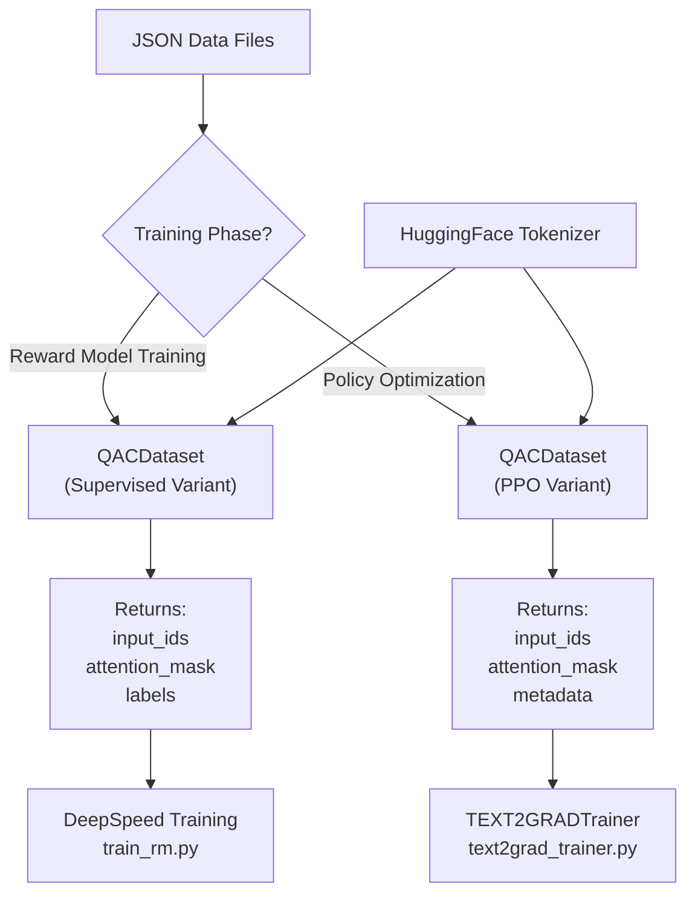
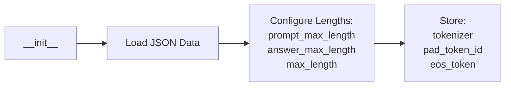
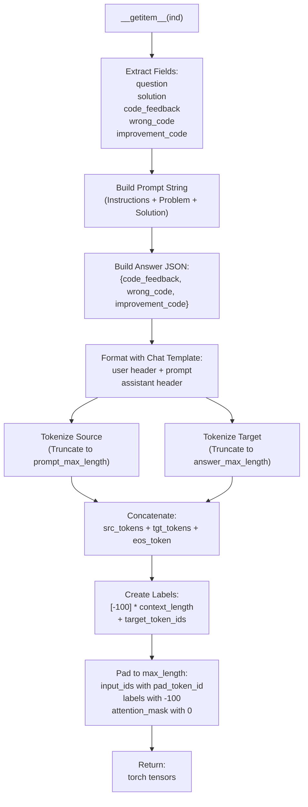
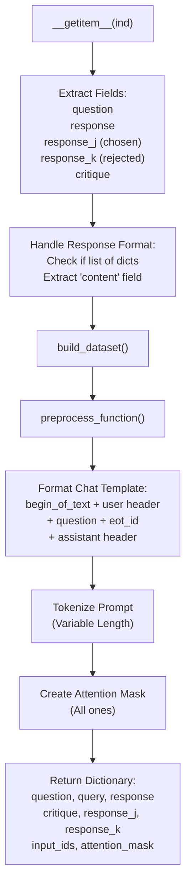
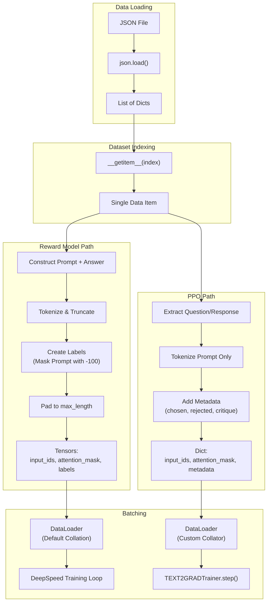

<!-- source: DeepWiki mcp.deepwiki.com · repo microsoft/Text2Grad · page 9.2 Dataset Classes API · fetched 2026-10-26 -->

# Dataset Classes API

<details>
<summary>Relevant source files</summary>

The following files were used as context for generating this wiki page:

- [nl_gradiant_policy_optimization/ultrafeedback/train_ultrafeedback.py](nl_gradiant_policy_optimization/ultrafeedback/train_ultrafeedback.py)
- [nl_reward_model/kodcode/train_rm.py](nl_reward_model/kodcode/train_rm.py)

</details>


## Purpose and Scope

This page documents the dataset classes used throughout the Text2Grad system for loading, preprocessing, and batching training data. The primary class is `QACDataset` (Question-Answer-Critique Dataset), which has two distinct implementations tailored for different training phases.

For information about the trainer that consumes these datasets, see [TEXT2GRADTrainer API](#9.1). For configuration of dataset parameters, see [Configuration Objects API](#9.3).

## Overview

The Text2Grad system uses PyTorch `Dataset` classes to handle data loading for both reward model training and policy optimization. The `QACDataset` class serves as the foundation, with task-specific variations for different training objectives.



**Sources:**
- [nl_gradiant_policy_optimization/ultrafeedback/train_ultrafeedback.py:39-93]()
- [nl_reward_model/kodcode/train_rm.py:22-122]()

## Class Architecture

### QACDataset Base Structure

Both variants of `QACDataset` share a common architectural pattern but differ in their output format and preprocessing logic.

| Component | Reward Model Variant | Policy Optimization Variant |
|-----------|---------------------|----------------------------|
| **Base Class** | `torch.utils.data.Dataset` | `torch.utils.data.Dataset` |
| **Primary File** | `train_rm.py` | `train_ultrafeedback.py` |
| **Output Format** | Supervised training tensors | Metadata-rich dictionaries |
| **Label Creation** | Masked with `-100` for prompts | No labels tensor |
| **Padding** | Fixed-length with pad tokens | Variable-length (handled by collator) |
| **Target Audience** | DeepSpeed training engine | TEXT2GRADTrainer PPO loop |

**Sources:**
- [nl_reward_model/kodcode/train_rm.py:22-44]()
- [nl_gradiant_policy_optimization/ultrafeedback/train_ultrafeedback.py:39-50]()

## QACDataset for Reward Model Training

### Initialization

The reward model variant of `QACDataset` is designed for supervised fine-tuning with causal language modeling objectives.



**Constructor Parameters:**

| Parameter | Type | Description |
|-----------|------|-------------|
| `json_path` | `str` | Path to JSON file containing training data |
| `tokenizer` | `PreTrainedTokenizer` | HuggingFace tokenizer instance |
| `prompt_max_length` | `int` | Maximum tokens for input prompt |
| `max_length` | `int` | Total maximum sequence length (prompt + answer) |

**Derived Attributes:**

- `answer_max_length = max_length - prompt_max_length - 1`
- `json_data`: List of data items loaded from JSON
- `pad_token_id`: Token ID for padding
- `eos_token`: End-of-sequence token string

**Sources:**
- [nl_reward_model/kodcode/train_rm.py:25-42]()

### Data Item Processing

The `__getitem__` method constructs complete training examples with supervised learning labels.



**Key Operations:**

1. **Prompt Construction** ([nl_reward_model/kodcode/train_rm.py:56-85]()):
   - Creates instruction template for code analysis
   - Includes problem statement and solution
   - Specifies expected JSON output format

2. **Answer Formatting** ([nl_reward_model/kodcode/train_rm.py:87-91]()):
   - Serializes ground truth to JSON
   - Uses `json.dumps` with indentation

3. **Tokenization** ([nl_reward_model/kodcode/train_rm.py:95-104]()):
   - Tokenizes prompt and answer separately
   - Truncates each to respective max lengths
   - Concatenates with EOS token

4. **Label Masking** ([nl_reward_model/kodcode/train_rm.py:106-109]()):
   - Sets prompt tokens to `-100` (ignored in loss)
   - Preserves answer tokens for supervised learning

5. **Padding** ([nl_reward_model/kodcode/train_rm.py:112-115]()):
   - Pads to fixed `max_length`
   - Creates attention mask for valid tokens

**Return Value:**

```python
{
    "input_ids": torch.Tensor,      # Shape: [max_length], dtype: long
    "attention_mask": torch.Tensor, # Shape: [max_length], dtype: long
    "labels": torch.Tensor          # Shape: [max_length], dtype: long
}
```

**Sources:**
- [nl_reward_model/kodcode/train_rm.py:47-121]()

## QACDataset for Policy Optimization

### Initialization

The policy optimization variant is designed for PPO training with TEXT2GRADTrainer.

**Constructor Parameters:**

| Parameter | Type | Description |
|-----------|------|-------------|
| `json_path` | `str` | Path to JSON file containing training data |
| `tokenizer` | `PreTrainedTokenizer` | HuggingFace tokenizer instance |
| `prompt_max_length` | `int` | Maximum tokens for input prompt |
| `max_length` | `int` | Total maximum sequence length |

**Attributes:**

- `data`: List of data items (not `json_data` like in RM variant)
- `answer_max_length = max_length - prompt_max_length - 1`
- `pad_token_id`: Token ID for padding
- `tokenizer`: Stored tokenizer reference

**Sources:**
- [nl_gradiant_policy_optimization/ultrafeedback/train_ultrafeedback.py:40-47]()

### Data Item Processing



**Key Differences from RM Variant:**

1. **No Labels Tensor**: Policy optimization generates responses, not supervised targets
2. **Metadata Preservation**: Keeps `response_j` (chosen) and `response_k` (rejected) for evaluation
3. **Variable Length**: No fixed padding in dataset (handled by collator)
4. **Response Handling**: Special logic for list-of-dict response format ([nl_gradiant_policy_optimization/ultrafeedback/train_ultrafeedback.py:62-63]())

**Return Value:**

```python
{
    "question": str,                  # Original question text
    "input_ids": torch.Tensor,        # Tokenized prompt (variable length)
    "attention_mask": torch.Tensor,   # All ones (variable length)
    "response": str,                  # Response text (for reference)
    "query": str,                     # Query text (same as question)
    "critique": str,                  # Critique text
    "response_j": list,               # Chosen response for evaluation
    "response_k": list                # Rejected response for evaluation
}
```

**Sources:**
- [nl_gradiant_policy_optimization/ultrafeedback/train_ultrafeedback.py:52-92]()

## Data Collation

### Collator Function

The policy optimization pipeline uses a custom collator to batch variable-length examples.

```python
def collator(data):
    return dict((key, [d[key] for d in data]) for key in data[0])
```

**Behavior:**

- Transposes list of dicts into dict of lists
- Preserves all fields from dataset items
- Does not perform padding (handled by trainer)

**Example:**

```python
# Input: List of dataset items
[
    {"input_ids": tensor([1, 2, 3]), "query": "Q1", ...},
    {"input_ids": tensor([4, 5]), "query": "Q2", ...}
]

# Output: Dict of lists
{
    "input_ids": [tensor([1, 2, 3]), tensor([4, 5])],
    "query": ["Q1", "Q2"],
    ...
}
```

**Sources:**
- [nl_gradiant_policy_optimization/ultrafeedback/train_ultrafeedback.py:192-193]()

## Usage Patterns

### Reward Model Training

```python
# Typical usage in train_rm.py
tokenizer = AutoTokenizer.from_pretrained(model_name)

train_dataset = QACDataset(
    json_path="path/to/train.json",
    tokenizer=tokenizer,
    prompt_max_length=900,
    max_length=1250
)

train_dataloader = DataLoader(
    train_dataset,
    batch_size=2,
    shuffle=True
)

# Iterate for training
for batch in train_dataloader:
    input_ids = batch["input_ids"].to(device)
    attention_mask = batch["attention_mask"].to(device)
    labels = batch["labels"].to(device)
    outputs = model(input_ids=input_ids, attention_mask=attention_mask, labels=labels)
    loss = outputs.loss
```

**Sources:**
- [nl_reward_model/kodcode/train_rm.py:352-366]()

### Policy Optimization Training

```python
# Typical usage in train_ultrafeedback.py
tokenizer = AutoTokenizer.from_pretrained(model_name)

ds = QACDataset(
    json_path=data_file_path,
    tokenizer=tokenizer,
    prompt_max_length=1000,
    max_length=1500
)

ppo_trainer = TEXT2GRADTrainer(
    config=config,
    model=model,
    tokenizer=tokenizer,
    dataset=ds,
    data_collator=collator,
    optimizer=optimizer
)

# Trainer handles dataloader creation and iteration
```

**Sources:**
- [nl_gradiant_policy_optimization/ultrafeedback/train_ultrafeedback.py:196-337]()

## Task-Specific Variations

### KodCode (Code Generation)

**Input Fields:**
- `question`: Problem statement
- `solution`: Code solution
- `code_feedback`: Textual critique
- `wrong_code`: List of erroneous code snippets
- `improvement_code`: List of improvable code snippets

**Output Format (RM Training):**
```json
{
    "code_feedback": "Evaluation paragraph",
    "wrong_code": ["snippet1", "snippet2"],
    "improvement_code": ["snippet1"]
}
```

**Sources:**
- [nl_reward_model/kodcode/train_rm.py:50-54]()

### UltraFeedback (Question Answering)

**Input Fields:**
- `question`: User query
- `response`: Generated response
- `response_j`: Chosen (preferred) response
- `response_k`: Rejected response
- `critique`: Feedback text

**Special Handling:**
- Response can be a list of message dicts ([nl_gradiant_policy_optimization/ultrafeedback/train_ultrafeedback.py:62-63]())
- Extracts `content` field from first message if applicable

**Sources:**
- [nl_gradiant_policy_optimization/ultrafeedback/train_ultrafeedback.py:54-66]()

### SLF5K (Summarization)

Similar structure to UltraFeedback with domain-specific fields for post summarization tasks.

## Helper Functions

### Dataset Preparation Utilities

The `prepare_datasets` function splits data into train/validation sets:

```python
def prepare_datasets(dataset_file, train_file, valid_file, split_ratio=0.9, seed=42):
    """
    Split the dataset into training and validation sets.
    
    Args:
        dataset_file: Path to the full dataset
        train_file: Path to save the training dataset
        valid_file: Path to save the validation dataset
        split_ratio: Ratio for train/validation split (default: 0.9)
        seed: Random seed for reproducibility
        
    Returns:
        Tuple of (train_data, test_data)
    """
```

**Key Operations:**
1. Loads full dataset from JSON
2. Shuffles with fixed seed for reproducibility
3. Splits at specified ratio
4. Saves train/validation subsets to separate files
5. Returns both datasets

**Sources:**
- [nl_reward_model/kodcode/train_rm.py:124-156]()

## Data Flow Diagram



**Sources:**
- [nl_reward_model/kodcode/train_rm.py:22-122]()
- [nl_gradiant_policy_optimization/ultrafeedback/train_ultrafeedback.py:39-93]()

## Configuration Examples

### Typical Length Configurations

| Task | `prompt_max_length` | `max_length` | Derived `answer_max_length` |
|------|--------------------:|-------------:|----------------------------:|
| **KodCode RM** | 900 | 1250 | 349 |
| **UltraFeedback PPO** | 1000 | 1500 | 499 |
| **SLF5K** | 800 | 1200 | 399 |

### Memory Considerations

- **Fixed Padding (RM)**: Memory = `batch_size * max_length * 4 bytes (fp32)`
- **Variable Length (PPO)**: Memory = `batch_size * max(actual_lengths) * 4 bytes`

For batch_size=2, max_length=1250:
- Fixed padding: ~10 KB per batch
- Variable length: Depends on actual sequence lengths (typically lower)

**Sources:**
- [nl_reward_model/kodcode/train_rm.py:414-415]()
- [nl_gradiant_policy_optimization/ultrafeedback/train_ultrafeedback.py:126-127]()

## Common Patterns

### Tokenizer Configuration

Both dataset variants require proper tokenizer setup:

```python
tokenizer = AutoTokenizer.from_pretrained(model_name)

# Essential: Set padding token if not present
if not tokenizer.pad_token:
    tokenizer.pad_token = tokenizer.eos_token
    tokenizer.pad_token_id = tokenizer.eos_token_id

# For RM: right padding (standard for causal LM)
tokenizer.padding_side = "right"

# For PPO: right padding for policy model
tokenizer.padding_side = "right"
```

**Sources:**
- [nl_reward_model/kodcode/train_rm.py:170-174]()
- [nl_gradiant_policy_optimization/ultrafeedback/train_ultrafeedback.py:169-189]()

### Chat Template Format

Both variants use Llama-3 chat format:

```
<|begin_of_text|><|start_header_id|>user<|end_header_id|>
{user_content}
<|eot_id|><|start_header_id|>assistant<|end_header_id|>
{assistant_content}
```

**Special Tokens:**
- `<|begin_of_text|>`: Start of conversation
- `<|start_header_id|>`: Role indicator start
- `<|end_header_id|>`: Role indicator end
- `<|eot_id|>`: End of turn

**Sources:**
- [nl_reward_model/kodcode/train_rm.py:93]()
- [nl_gradiant_policy_optimization/ultrafeedback/train_ultrafeedback.py:72-73]()

## Error Handling

### Assertion Checks

The reward model variant includes assertions to validate data integrity:

```python
# Verify total length doesn't exceed maximum
assert len(tokens) <= self.max_length

# Verify input_ids and labels have same length
assert len(input_ids) == len(labels)
```

These assertions help catch:
- Tokenization errors
- Incorrect truncation
- Length calculation bugs

**Sources:**
- [nl_reward_model/kodcode/train_rm.py:104,110]()

### Graceful Handling

The PPO variant uses `.get()` with defaults for optional fields:

```python
response = item.get("response", "")
critique = item.get("critique", "")
chosen = item.get("response_j", [])
rejected = item.get("response_k", [])
```

This prevents `KeyError` exceptions when fields are missing.

**Sources:**
- [nl_gradiant_policy_optimization/ultrafeedback/train_ultrafeedback.py:55-58]()

---

