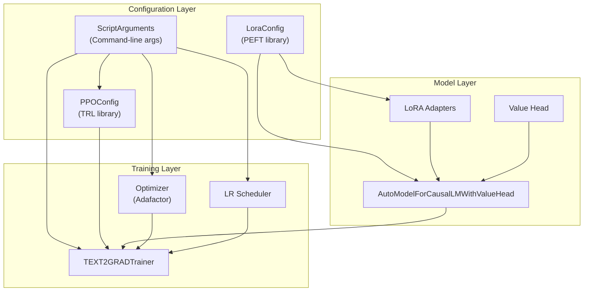
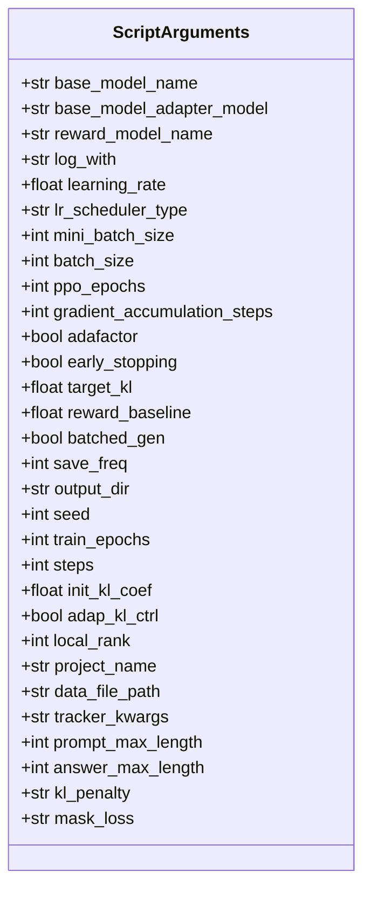
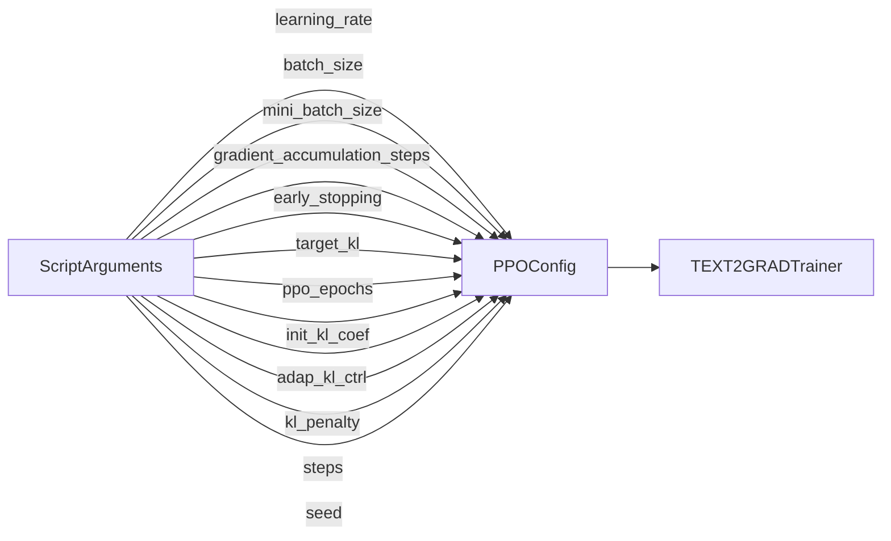
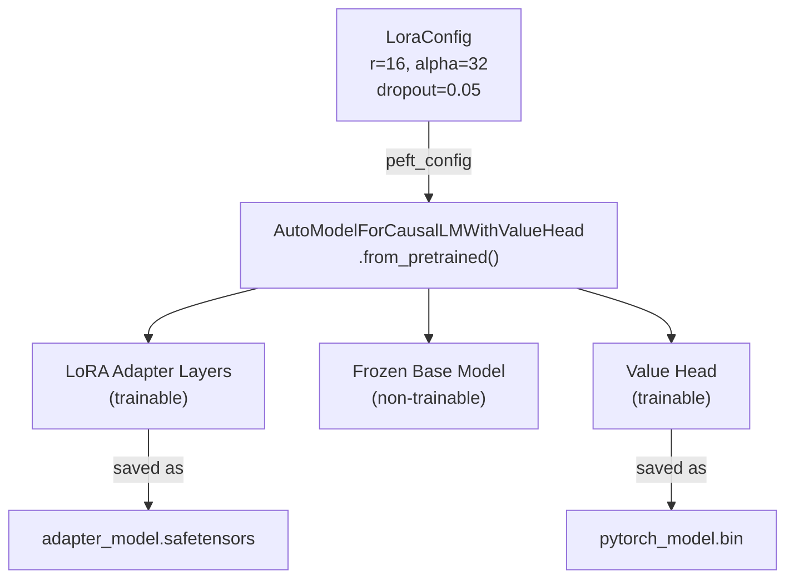
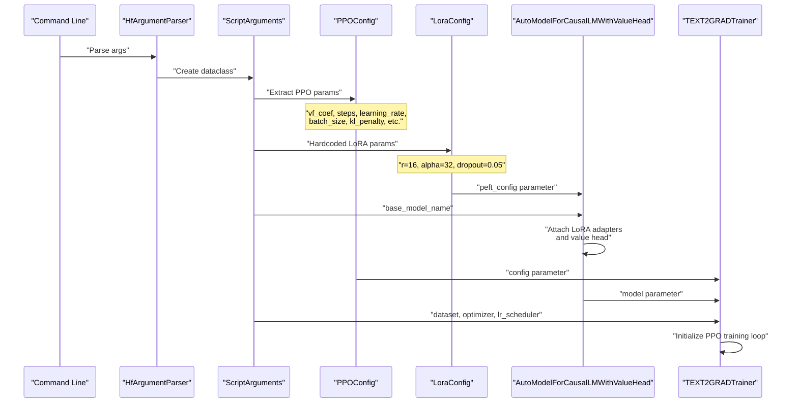
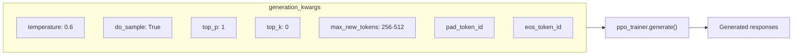
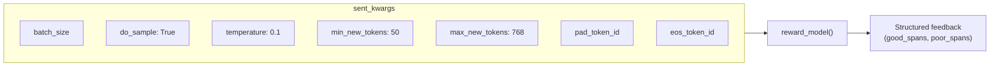
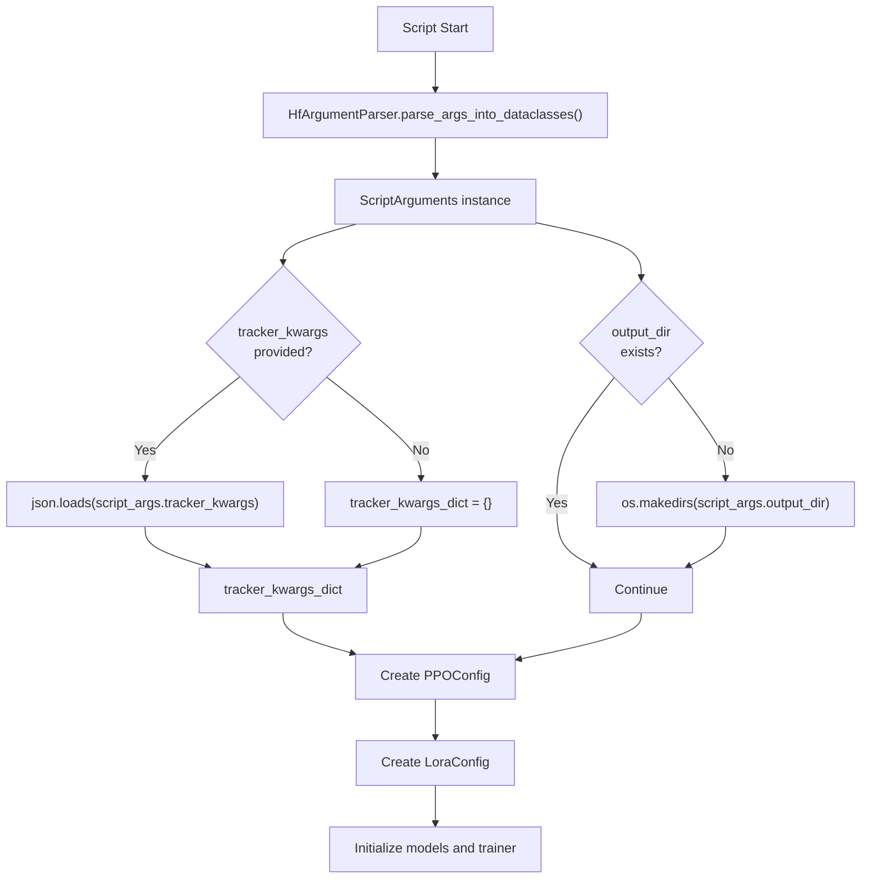
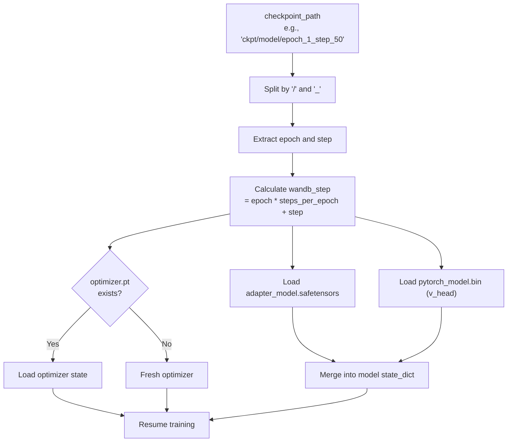
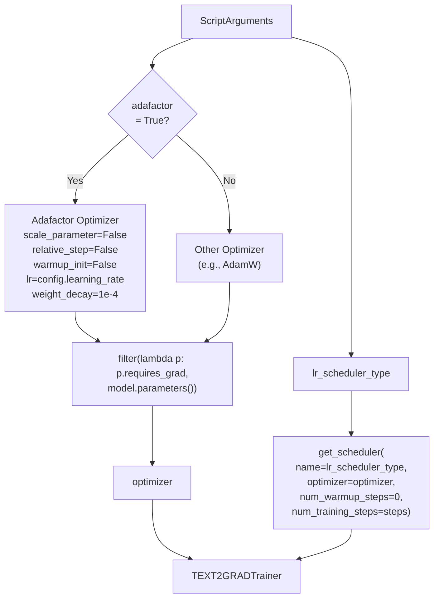

<!-- source: DeepWiki mcp.deepwiki.com · repo microsoft/Text2Grad · page 9.3 Configuration Objects API · fetched 2026-10-26 -->

# Configuration Objects API

<details>
<summary>Relevant source files</summary>

The following files were used as context for generating this wiki page:

- [nl_gradiant_policy_optimization/kodcode/train_kodcode.py](nl_gradiant_policy_optimization/kodcode/train_kodcode.py)
- [nl_gradiant_policy_optimization/ultrafeedback/train_ultrafeedback.py](nl_gradiant_policy_optimization/ultrafeedback/train_ultrafeedback.py)

</details>


This page documents the three primary configuration objects used in Text2Grad training pipelines: `ScriptArguments`, `PPOConfig`, and `LoraConfig`. These objects control all aspects of policy optimization, from hyperparameters to model architecture settings.

For the TEXT2GRADTrainer class that consumes these configurations, see [TEXT2GRADTrainer API](#9.1). For dataset configuration, see [Dataset Classes API](#9.2).

---

## Configuration Object Overview

Text2Grad uses a three-layer configuration architecture where each object controls a different aspect of the training system:



**Sources:** [nl_gradiant_policy_optimization/ultrafeedback/train_ultrafeedback.py:95-337](), [nl_gradiant_policy_optimization/kodcode/train_kodcode.py:78-323]()

---

## ScriptArguments

`ScriptArguments` is a custom dataclass that defines all command-line arguments for training scripts. It serves as the top-level configuration entry point.

### Definition and Structure



### Key Parameters

| Parameter | Type | Default | Description |
|-----------|------|---------|-------------|
| `base_model_name` | str | "" | Path or HuggingFace ID of base LLM (e.g., "meta-llama/Llama-3.1-8B-Instruct") |
| `base_model_adapter_model` | str | "" | Path to existing LoRA adapter checkpoint for resuming training |
| `reward_model_name` | str | "" | Path to trained reward model for generating natural language feedback |
| `learning_rate` | float | 1e-5 | Learning rate for optimizer (typically 1e-5 to 1e-6 for PPO) |
| `lr_scheduler_type` | str | "linear" | Type of learning rate scheduler ("linear", "cosine", "constant") |
| `batch_size` | int | 32 | Total batch size across all devices |
| `mini_batch_size` | int | 1 | PPO mini-batch size for gradient accumulation |
| `ppo_epochs` | int | 4 | Number of PPO epochs per batch |
| `gradient_accumulation_steps` | int | 1 | Steps to accumulate gradients before updating |
| `init_kl_coef` | float | 0.2 | Initial coefficient for KL divergence penalty |
| `adap_kl_ctrl` | bool | True | Enable adaptive KL control vs fixed coefficient |
| `target_kl` | float | 0.1 | Target KL divergence for early stopping |
| `save_freq` | int | 5 | Save checkpoint every N steps |
| `output_dir` | str | "ckpt/superw_token_ppo" | Directory for checkpoints and logs |
| `data_file_path` | str | "" | Path to training data JSON file |
| `prompt_max_length` | int | 1000 | Maximum length of input prompt in tokens |
| `answer_max_length` | int | 500 | Maximum length of generated response in tokens |
| `kl_penalty` | str | "full" | KL penalty calculation mode ("full" or "kl") |
| `mask_loss` | str | "" | Loss masking strategy (empty for no masking) |
| `train_epochs` | int | 2 | Total number of training epochs |
| `steps` | int | 1200 | Total number of training steps |

### Usage Example

The `ScriptArguments` dataclass is parsed from command-line arguments using HuggingFace's `HfArgumentParser`:

**Sources:** [nl_gradiant_policy_optimization/ultrafeedback/train_ultrafeedback.py:95-133](), [nl_gradiant_policy_optimization/kodcode/train_kodcode.py:78-125]()

---

## PPOConfig

`PPOConfig` is imported from the TRL (Transformer Reinforcement Learning) library and configures the PPO algorithm itself. It is instantiated using values from `ScriptArguments`.

### Configuration Flow



### Key Parameters

| Parameter | Type | Value Source | Description |
|-----------|------|--------------|-------------|
| `vf_coef` | float | 0.1 (hardcoded) | Value function loss coefficient |
| `steps` | int | `script_args.steps` | Total training steps |
| `model_name` | str | `script_args.base_model_name` | Base model identifier |
| `learning_rate` | float | `script_args.learning_rate` | Optimizer learning rate |
| `log_with` | str | `script_args.log_with` | Logging backend ("wandb") |
| `batch_size` | int | `script_args.batch_size` | Batch size for training |
| `mini_batch_size` | int | `script_args.mini_batch_size` | PPO mini-batch size |
| `gradient_accumulation_steps` | int | `script_args.gradient_accumulation_steps` | Gradient accumulation steps |
| `optimize_cuda_cache` | bool | True (hardcoded) | Enable CUDA cache optimization |
| `early_stopping` | bool | `script_args.early_stopping` | Enable early stopping based on KL |
| `target_kl` | float | `script_args.target_kl` | KL divergence threshold for stopping |
| `ppo_epochs` | int | `script_args.ppo_epochs` | Epochs per PPO update |
| `seed` | int | `script_args.seed` | Random seed for reproducibility |
| `init_kl_coef` | float | `script_args.init_kl_coef` | Initial KL penalty coefficient |
| `adap_kl_ctrl` | bool | `script_args.adap_kl_ctrl` | Use adaptive KL control |
| `tracker_kwargs` | dict | parsed from `script_args.tracker_kwargs` | Additional WandB configuration |
| `tracker_project_name` | str | `script_args.project_name` | WandB project name |
| `kl_penalty` | str | `script_args.kl_penalty` | KL penalty mode ("full" or "kl") |

### Instantiation Pattern

The `PPOConfig` is instantiated by mapping `ScriptArguments` fields:

```python
config = PPOConfig(
    vf_coef=0.1,
    steps=script_args.steps,
    model_name=script_args.base_model_name,
    learning_rate=script_args.learning_rate,
    # ... additional parameters
    kl_penalty=script_args.kl_penalty
)
```

**Sources:** [nl_gradiant_policy_optimization/ultrafeedback/train_ultrafeedback.py:145-164](), [nl_gradiant_policy_optimization/kodcode/train_kodcode.py:137-156]()

---

## LoraConfig

`LoraConfig` is imported from the PEFT (Parameter-Efficient Fine-Tuning) library and configures LoRA (Low-Rank Adaptation) parameters for the policy model.

### Definition and Usage



### Key Parameters

| Parameter | Type | Value | Description |
|-----------|------|-------|-------------|
| `r` | int | 16 | LoRA rank (dimensionality of low-rank matrices) |
| `lora_alpha` | int | 32 | LoRA scaling parameter (typically 2×r) |
| `lora_dropout` | float | 0.05 | Dropout probability for LoRA layers |
| `bias` | str | "none" | Bias training strategy ("none", "all", "lora_only") |
| `task_type` | str | "CAUSAL_LM" | Task type for PEFT configuration |

### Memory and Efficiency

LoRA enables efficient fine-tuning by reducing trainable parameters:

- **Full Model Parameters**: ~8B for Llama-3.1-8B
- **LoRA Parameters**: ~33M (r=16, targeting all linear layers)
- **Reduction**: ~99.6% fewer trainable parameters

The configuration is consistent across all tasks (KodCode, UltraFeedback, SLF5K):

**Sources:** [nl_gradiant_policy_optimization/ultrafeedback/train_ultrafeedback.py:211-222](), [nl_gradiant_policy_optimization/kodcode/train_kodcode.py:194-206]()

---

## Configuration Workflow

The following diagram shows how configuration objects flow through the initialization process:



**Sources:** [nl_gradiant_policy_optimization/ultrafeedback/train_ultrafeedback.py:132-337](), [nl_gradiant_policy_optimization/kodcode/train_kodcode.py:124-323]()

---

## Task-Specific Configuration Differences

While the configuration objects are structurally identical across tasks, certain parameters vary by task:

| Parameter | KodCode | UltraFeedback | SLF5K | Rationale |
|-----------|---------|---------------|-------|-----------|
| `prompt_max_length` | 1000 | 1000 | 1000 | Consistent prompt length |
| `answer_max_length` | 500 | 500 | 300-500 | Code requires more tokens than summaries |
| `model_max_length` (tokenizer) | 1600 | 1600 | 1600 | Total sequence length |
| `reward_model_max_length` | 2500 | 2500 | 2500 | Reward model needs extra space for critique |
| `generation_kwargs.max_new_tokens` | 256 | 512 | 256-512 | Code generation uses fewer tokens |
| `sent_kwargs.max_new_tokens` | 768 | 768 | 768 | Reward model feedback length |
| `torch_dtype` | bfloat16 | float16 | float16 | KodCode uses bfloat16 for stability |

**Sources:** [nl_gradiant_policy_optimization/ultrafeedback/train_ultrafeedback.py:169-181](), [nl_gradiant_policy_optimization/kodcode/train_kodcode.py:162-183]()

---

## Generation and Reward Model Kwargs

In addition to the three main configuration objects, training scripts define generation and reward model kwargs as dictionaries:

### Policy Model Generation (generation_kwargs)



| Parameter | Value | Description |
|-----------|-------|-------------|
| `temperature` | 0.6 | Sampling temperature (higher = more random) |
| `do_sample` | True | Enable sampling vs greedy decoding |
| `top_p` | 1 | Nucleus sampling threshold (1 = disabled) |
| `top_k` | 0 | Top-k sampling threshold (0 = disabled) |
| `max_new_tokens` | 256 (code) / 512 (QA) | Maximum tokens to generate |
| `pad_token_id` | tokenizer.pad_token_id | Padding token |
| `eos_token_id` | tokenizer.eos_token_id | End-of-sequence token |

### Reward Model Inference (sent_kwargs)



| Parameter | Value | Description |
|-----------|-------|-------------|
| `batch_size` | script_args.batch_size | Batch size for reward model |
| `do_sample` | True | Enable sampling (UltraFeedback only) |
| `temperature` | 0.1 | Low temperature for consistent feedback |
| `min_new_tokens` | 50 | Minimum feedback length |
| `max_new_tokens` | 768 | Maximum feedback length |
| `pad_token_id` | reward_tokenizer.eos_token_id | Padding token |
| `eos_token_id` | reward_tokenizer.eos_token_id | End-of-sequence token |

**Sources:** [nl_gradiant_policy_optimization/ultrafeedback/train_ultrafeedback.py:360-379](), [nl_gradiant_policy_optimization/kodcode/train_kodcode.py:346-362]()

---

## Configuration Parsing and Validation

Configuration objects are parsed and validated at script initialization:



**Validation Points:**

1. **Directory Creation**: Output directory is created if it doesn't exist
2. **JSON Parsing**: `tracker_kwargs` is parsed from JSON string to dictionary
3. **Checkpoint Validation**: If resuming from `base_model_adapter_model`, validates:
   - `adapter_model.safetensors` exists
   - `pytorch_model.bin` (value head) exists
   - Optional `optimizer.pt` for optimizer state
4. **DeepSpeed Config Check**: Warns if optimizer is defined in DeepSpeed config

**Sources:** [nl_gradiant_policy_optimization/ultrafeedback/train_ultrafeedback.py:132-164](), [nl_gradiant_policy_optimization/kodcode/train_kodcode.py:124-156]()

---

## Checkpoint Resume Configuration

When resuming training from a checkpoint, the system reconstructs training state from the checkpoint path:



**Checkpoint Path Format:**
- Pattern: `{output_dir}/epoch_{epoch}_step_{step}`
- Example: `ckpt/ultrafeedback_ppo/epoch_1_step_50`

**State Recovery:**
- `cur_epoch`: Extracted from path
- `cur_step`: Extracted from path
- `wandb_step`: Calculated as `epoch * steps_per_epoch + step`
- Optimizer state: Loaded from `optimizer.pt` if exists
- LR scheduler state: Loaded from `optimizer.pt` if exists

**Sources:** [nl_gradiant_policy_optimization/ultrafeedback/train_ultrafeedback.py:224-292](), [nl_gradiant_policy_optimization/kodcode/train_kodcode.py:208-276]()

---

## Optimizer and Scheduler Configuration

Optimizer and learning rate scheduler are configured based on `ScriptArguments`:



**Optimizer Configuration:**
- Type: Adafactor (if `script_args.adafactor=True`)
- Learning Rate: `config.learning_rate` (typically 1e-5)
- Weight Decay: 1e-4
- Only parameters with `requires_grad=True` are optimized (LoRA adapters + value head)

**Scheduler Configuration:**
- Type: From `script_args.lr_scheduler_type` ("linear", "cosine", "constant")
- Warmup Steps: 0 (no warmup)
- Total Steps: `script_args.steps`

**Sources:** [nl_gradiant_policy_optimization/ultrafeedback/train_ultrafeedback.py:304-319](), [nl_gradiant_policy_optimization/kodcode/train_kodcode.py:288-303]()

---

## Configuration Summary Table

| Configuration Object | Source | Purpose | Key Parameters |
|---------------------|--------|---------|----------------|
| **ScriptArguments** | Custom dataclass | Command-line arguments | All training hyperparameters, paths, and flags |
| **PPOConfig** | TRL library | PPO algorithm configuration | learning_rate, batch_size, kl_penalty, ppo_epochs |
| **LoraConfig** | PEFT library | LoRA adapter configuration | r=16, lora_alpha=32, lora_dropout=0.05 |
| **generation_kwargs** | Dictionary | Policy generation settings | temperature, max_new_tokens, sampling params |
| **sent_kwargs** | Dictionary | Reward model inference | batch_size, max_new_tokens, temperature |
| **optimizer** | Adafactor | Gradient descent optimizer | learning_rate, weight_decay |
| **lr_scheduler** | transformers | Learning rate schedule | scheduler_type, num_training_steps |

**Sources:** [nl_gradiant_policy_optimization/ultrafeedback/train_ultrafeedback.py:95-337](), [nl_gradiant_policy_optimization/kodcode/train_kodcode.py:78-323]()

---

