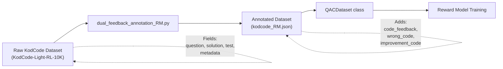
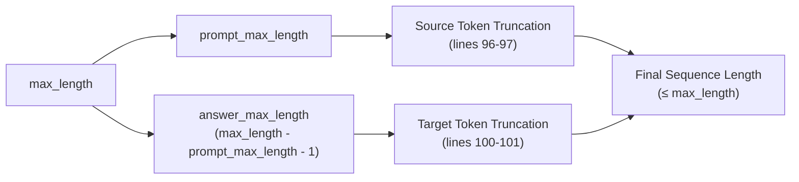
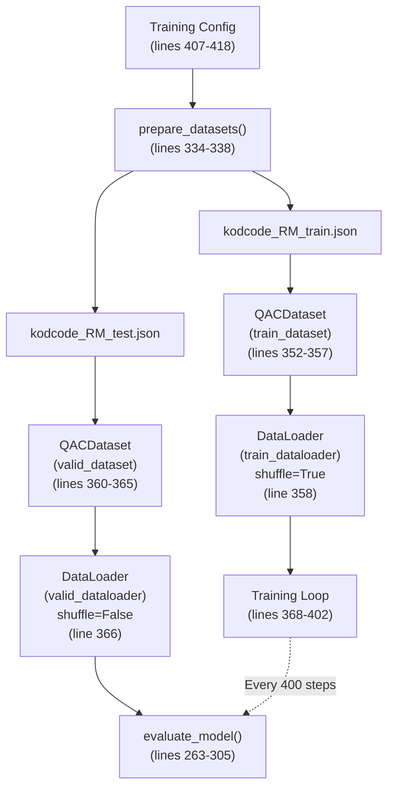

<!-- source: DeepWiki mcp.deepwiki.com · repo microsoft/Text2Grad · extra page KodCode Dataset Format · fetched 2026-10-26 -->

# KodCode Dataset Format

<details>
<summary>Relevant source files</summary>

The following files were used as context for generating this wiki page:

- [README.md](README.md)
- [nl_reward_model/kodcode/train_rm.py](nl_reward_model/kodcode/train_rm.py)

</details>


This document specifies the JSON data formats used for the KodCode code generation task within the Text2Grad system. It covers both the raw dataset format from the KodCode-Light-RL-10K dataset and the annotated format produced by the dual-feedback annotation pipeline.

For information about training reward models with this data, see [KodCode Reward Model Training](#7.1.2). For policy optimization using the trained reward model, see [KodCode Policy Optimization](#7.1.3).

---

## Overview

The KodCode dataset exists in two forms within the Text2Grad pipeline:

1. **Raw Dataset Format**: The original format from KodCode-Light-RL-10K, containing programming problems, solutions, and test cases
2. **Annotated Dataset Format**: Enhanced with dual-feedback annotations including textual critiques, error spans, and improvement suggestions

The transformation from raw to annotated format is performed by the data annotation pipeline (see [Data Annotation Pipeline](#4)).



**Diagram: KodCode Dataset Transformation Pipeline**

Sources: [README.md:198-215](), [nl_reward_model/kodcode/train_rm.py:22-121]()

---

## Raw Dataset Format

The raw KodCode dataset is distributed as a JSON array where each element represents a single programming problem with its solution and metadata.

### Structure

```json
[
    {
        "version": "v1.0",
        "style": "instruct",
        "subset": "Leetcode",
        "question_id": "Leetcode_36406_I",
        "question": "You are given a 0-indexed ...",
        "solution": "def max_height_diff_after_removal(heights):\n  ...",
        "test": "def test_max_height_diff_after_removal_all_equal():\n    assert max_height_diff_after_removal([3, 3, 3, 3]) == 0 ...",
        "gpt_pass_trial_num": 2,
        "gpt_difficulty": "hard",
        "gpt_pass_percentage": 0.2,
        "log": "..."
    }
]
```

### Field Descriptions

| Field | Type | Description |
|-------|------|-------------|
| `version` | string | Dataset version identifier (e.g., "v1.0") |
| `style` | string | Problem presentation style (typically "instruct") |
| `subset` | string | Source of the problem (e.g., "Leetcode", "MBPP") |
| `question_id` | string | Unique identifier for the problem |
| `question` | string | Natural language description of the programming problem |
| `solution` | string | Python code solution to the problem |
| `test` | string | Unit test code to validate the solution |
| `gpt_pass_trial_num` | integer | Number of trials GPT model took to solve |
| `gpt_difficulty` | string | Difficulty classification (e.g., "easy", "medium", "hard") |
| `gpt_pass_percentage` | float | Success rate of GPT model on this problem (0.0-1.0) |
| `log` | string | Additional metadata or execution logs |

Sources: [README.md:198-215]()

---

## Annotated Dataset Format

After dual-feedback annotation, the dataset is augmented with span-level feedback annotations. The annotated format retains all fields from the raw format and adds three critical feedback fields.

### Structure

```json
[
    {
        "version": "v1.0",
        "style": "instruct",
        "subset": "Leetcode",
        "question_id": "Leetcode_36406_I",
        "question": "You are given a 0-indexed ...",
        "solution": "def max_height_diff_after_removal(heights):\n  ...",
        "test": "def test_max_height_diff_after_removal_all_equal():\n    assert max_height_diff_after_removal([3, 3, 3, 3]) == 0 ...",
        "gpt_pass_trial_num": 2,
        "gpt_difficulty": "hard",
        "gpt_pass_percentage": 0.2,
        "log": "...",
        "code_feedback": "The solution correctly implements the algorithm but has inefficient time complexity. The nested loop could be optimized using a more efficient data structure.",
        "wrong_code": [
            "for i in range(len(heights)):\n    for j in range(len(heights)):"
        ],
        "improvement_code": [
            "result = max(heights) - min(heights)"
        ]
    }
]
```

### Annotation Fields

| Field | Type | Description |
|-------|------|-------------|
| `code_feedback` | string | Textual critique evaluating code quality, correctness, efficiency, and completeness. Written as a concise paragraph. |
| `wrong_code` | array of strings | Code snippets containing errors or bugs that cause test failures. Empty array if no errors found. |
| `improvement_code` | array of strings | Original code snippets that work correctly but could be improved for better efficiency, readability, or style. Empty array if no improvements needed. |

Sources: [nl_reward_model/kodcode/train_rm.py:52-54](), [nl_reward_model/kodcode/train_rm.py:79-84]()

---

## Dataset Processing in QACDataset

The `QACDataset` class in [nl_reward_model/kodcode/train_rm.py:22-121]() processes the annotated dataset for reward model training. The class implements the PyTorch `Dataset` interface and handles tokenization, formatting, and padding.

```mermaid
graph TB
    subgraph "QACDataset.__getitem__"
        ITEM["JSON Item"] --> EXTRACT["Extract Fields<br/>(question, solution, code_feedback,<br/>wrong_code, improvement_code)"]
        EXTRACT --> PROMPT["Build Prompt<br/>(lines 56-85)"]
        EXTRACT --> ANSWER["Format Answer as JSON<br/>(lines 87-91)"]
        
        PROMPT --> INPUT["Construct Input Text<br/>with Chat Template<br/>(line 93)"]
        ANSWER --> INPUT
        
        INPUT --> TOK_SRC["Tokenize Prompt<br/>(line 95)"]
        TOK_SRC --> TRUNC_SRC["Truncate to prompt_max_length<br/>(lines 96-97)"]
        
        ANSWER --> TOK_TGT["Tokenize Answer<br/>(line 99)"]
        TOK_TGT --> TRUNC_TGT["Truncate to answer_max_length<br/>(lines 100-101)"]
        
        TRUNC_SRC --> CONCAT["Concatenate Tokens + EOS<br/>(line 103)"]
        TRUNC_TGT --> CONCAT
        
        CONCAT --> IDS["Convert to IDs<br/>(line 106)"]
        IDS --> LABELS["Create Labels<br/>(-100 for prompt, IDs for answer)<br/>(lines 107-108)"]
        
        LABELS --> PAD["Padding<br/>(lines 112-115)"]
        PAD --> RETURN["Return Dict:<br/>input_ids, attention_mask, labels<br/>(lines 117-121)"]
    end
```



**Diagram: QACDataset Processing Flow**

### Key Processing Steps

1. **Field Extraction** ([nl_reward_model/kodcode/train_rm.py:48-54]()): Loads raw fields from JSON, with defaults for annotation fields
2. **Prompt Construction** ([nl_reward_model/kodcode/train_rm.py:56-85]()): Builds structured prompt with instructions and output format specification
3. **Answer Formatting** ([nl_reward_model/kodcode/train_rm.py:87-91]()): Serializes feedback fields as JSON string
4. **Tokenization** ([nl_reward_model/kodcode/train_rm.py:95-101]()): Converts text to tokens with truncation
5. **Label Masking** ([nl_reward_model/kodcode/train_rm.py:107-108]()): Sets prompt tokens to -100 so loss is only computed on answer tokens
6. **Padding** ([nl_reward_model/kodcode/train_rm.py:112-115]()): Pads sequences to `max_length` with attention masks

Sources: [nl_reward_model/kodcode/train_rm.py:22-121]()

---

## Prompt Template

The `QACDataset` class constructs a structured prompt that guides the reward model to generate feedback in the expected JSON format. The template is defined in [nl_reward_model/kodcode/train_rm.py:56-85]().

### Template Structure

```
Please analyze the following programming problem and solution:

Problem:
{question}

Submitted Solution:
{solution}

---
**Instructions:**
1. Evaluate the code solution based on:
   - **Correctness**: Does it solve the problem without bugs?
   - **Efficiency**: Is the time and space complexity optimal?
   - **Readability**: Is the code clean and well-structured?
   - **Completeness**: Does it handle all edge cases?
2. Identify specific code snippets that:
   - Have errors or bugs (for wrong_code)
   - Work correctly but could be improved (for improvement_code)
3. Provide a concise paragraph summarizing the overall quality of the solution.

---
**Output Format:**
```json
{
    "code_feedback": "Evaluate the strengths and weaknesses (if any) of the code solution, concisely written in one paragraph.",
    "wrong_code": ["Include only code snippets with errors or bugs causing test failures. Leave as an empty array if no such errors are found."],
    "improvement_code": ["Include only original code snippets in the Submitted Code that work correctly but could be improved. Leave as an empty array if no improvements are needed."]
}
```
```

The prompt is wrapped in Llama-3.1 chat template format: `<|begin_of_text|><|start_header_id|>user<|end_header_id|>\n{prompt}<|eot_id|><|start_header_id|>assistant<|end_header_id|>\n` ([nl_reward_model/kodcode/train_rm.py:93]()).

Sources: [nl_reward_model/kodcode/train_rm.py:56-93]()

---

## Dataset Splits

The `prepare_datasets` function in [nl_reward_model/kodcode/train_rm.py:124-156]() splits the annotated dataset into training and validation sets.

### Split Configuration

| Parameter | Default | Description |
|-----------|---------|-------------|
| `split_ratio` | 0.9 | Fraction of data used for training |
| `seed` | 42 | Random seed for reproducible splits |

### File Naming Convention

The training pipeline uses the following file naming pattern:

| File Type | Example Path |
|-----------|--------------|
| Full Dataset | `./data/KodCode/kodcode_RM.json` |
| Training Split | `./data/KodCode/kodcode_RM_train.json` |
| Validation Split | `./data/KodCode/kodcode_RM_test.json` |

The function performs random shuffling before splitting and saves both splits to disk.

Sources: [nl_reward_model/kodcode/train_rm.py:124-156](), [nl_reward_model/kodcode/train_rm.py:409-411]()

---

## Tokenization Parameters

The `QACDataset` class accepts tokenization parameters that control sequence length limits:



**Diagram: Tokenization Length Management**

### Default Parameters

From [nl_reward_model/kodcode/train_rm.py:414-415]():

| Parameter | Value | Purpose |
|-----------|-------|---------|
| `prompt_max_length` | 900 | Maximum tokens for question + solution + instructions |
| `max_length` | 1250 | Maximum total sequence length (prompt + answer + padding) |
| `answer_max_length` | 349 | Derived: `max_length - prompt_max_length - 1` |

The `-1` in the answer length calculation accounts for the EOS token appended at [nl_reward_model/kodcode/train_rm.py:103]().

Sources: [nl_reward_model/kodcode/train_rm.py:25-42](), [nl_reward_model/kodcode/train_rm.py:414-415]()

---

## Example: Complete Data Flow

Here is a complete example showing how a raw dataset entry is transformed and processed:

### Step 1: Raw Entry

```json
{
    "question": "Write a function to calculate factorial.",
    "solution": "def factorial(n):\n    if n == 0:\n        return 1\n    return n * factorial(n-1)",
    "subset": "Leetcode",
    "question_id": "Leetcode_12345"
}
```

### Step 2: After Annotation

```json
{
    "question": "Write a function to calculate factorial.",
    "solution": "def factorial(n):\n    if n == 0:\n        return 1\n    return n * factorial(n-1)",
    "subset": "Leetcode",
    "question_id": "Leetcode_12345",
    "code_feedback": "The recursive solution is correct but lacks handling for negative inputs, which could cause infinite recursion.",
    "wrong_code": [],
    "improvement_code": [
        "if n == 0:"
    ]
}
```

### Step 3: QACDataset Processing

The `__getitem__` method transforms this into:

```python
{
    "input_ids": torch.tensor([...], dtype=torch.long),      # Tokenized prompt + answer
    "attention_mask": torch.tensor([...], dtype=torch.long), # 1 for real tokens, 0 for padding
    "labels": torch.tensor([...], dtype=torch.long)          # -100 for prompt, token IDs for answer
}
```

The labels ensure that loss is only computed on the answer tokens, not the prompt tokens.

Sources: [nl_reward_model/kodcode/train_rm.py:47-121]()

---

## Data Loading in Training

The training script in [nl_reward_model/kodcode/train_rm.py:325-403]() demonstrates complete dataset usage:



**Diagram: Dataset Loading Pipeline in Training**

### Configuration Values

From [nl_reward_model/kodcode/train_rm.py:407-418]():

| Config Key | Value | Usage |
|------------|-------|-------|
| `dataset_file` | `./data/KodCode/kodcode_RM.json` | Full annotated dataset path |
| `train_dataset_file` | `./data/KodCode/kodcode_RM_train.json` | Training split output path |
| `valid_dataset_file` | `./data/KodCode/kodcode_RM_test.json` | Validation split output path |
| `batch_size` | 2 | Batch size per GPU |
| `prompt_max_length` | 900 | Max tokens for input prompt |
| `max_length` | 1250 | Max total sequence length |

Sources: [nl_reward_model/kodcode/train_rm.py:325-403](), [nl_reward_model/kodcode/train_rm.py:407-418]()

---

## Dataset Sources

The KodCode datasets are publicly available on Hugging Face:

| Dataset | HuggingFace Path | Purpose |
|---------|------------------|---------|
| KodCode-Light-RL-10K | `KodCode/KodCode-Light-RL-10K` | Lightweight RL dataset (10K examples) |
| KodCode-V1-SFT-4o | `KodCode/KodCode-V1-SFT-4o` | Supervised fine-tuning dataset |

The datasets are used in accordance with their respective licenses as noted in [README.md:104-106]().

Sources: [README.md:103-106]()

---

## Related Formats

For information about dataset formats for other tasks in Text2Grad:

- UltraFeedback dataset format: see [UltraFeedback Dataset Format](#7.2.1)
- SLF5K dataset format: see [SLF5K Dataset Format](#7.3.1)
- General dual-feedback annotation format: see [Dual-Feedback Annotation](#4.2)

---

