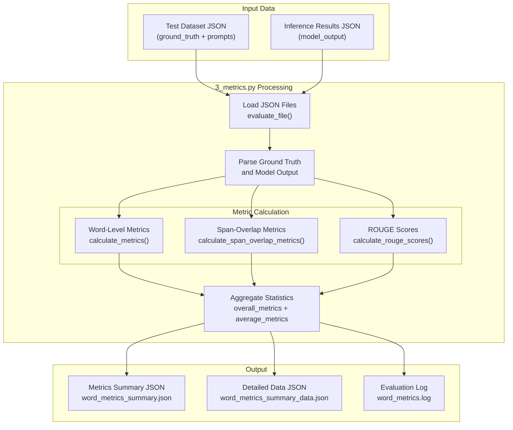
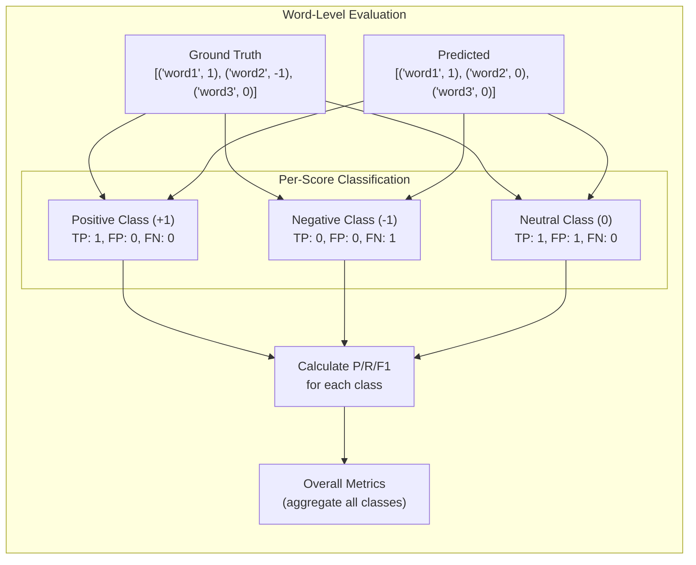
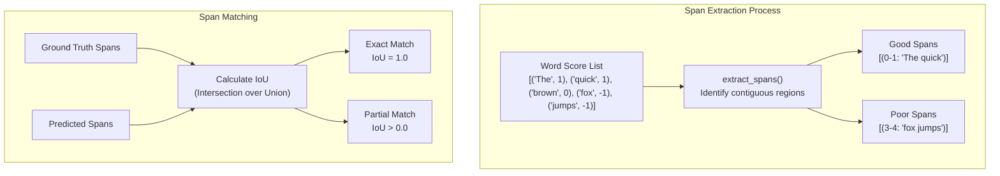
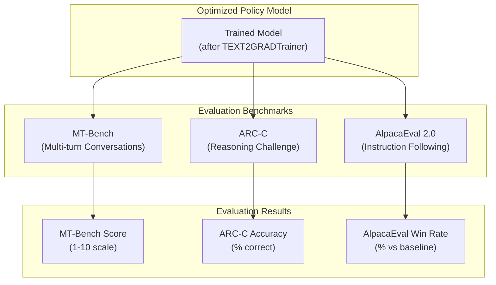

<!-- source: DeepWiki mcp.deepwiki.com · repo microsoft/Text2Grad · extra page UltraFeedback Evaluation · fetched 2026-10-26 -->

# UltraFeedback Evaluation

<details>
<summary>Relevant source files</summary>

The following files were used as context for generating this wiki page:

- [README.md](README.md)
- [nl_reward_model/slf5k/evaluation/3_metrics.py](nl_reward_model/slf5k/evaluation/3_metrics.py)
- [nl_reward_model/ultrafeedback/evaluation/3_metrics.py](nl_reward_model/ultrafeedback/evaluation/3_metrics.py)

</details>


## Purpose and Scope

This document describes the evaluation methodology for the UltraFeedback question answering task. It covers two distinct evaluation workflows:

1. **Reward Model Evaluation**: Assessing the quality of span-level feedback predictions using word-level, span-overlap, and text similarity metrics
2. **Policy Model Evaluation**: Benchmarking the optimized policy model on standardized question answering and reasoning tasks

For information about training the reward model, see [UltraFeedback Reward Model](#7.2.2). For policy optimization details, see [UltraFeedback Policy Optimization](#7.2.3).

---

## Reward Model Evaluation Overview

The UltraFeedback reward model is evaluated on its ability to predict fine-grained feedback for question-answering responses. Unlike traditional scalar reward models, this evaluation assesses three distinct capabilities:

1. **Word-level score accuracy**: Correctly classifying individual words as good (+1), poor (-1), or neutral (0)
2. **Span localization**: Identifying contiguous regions of good and poor quality text
3. **Textual feedback quality**: Generating coherent natural language critiques

### Evaluation Workflow



**Sources:**
- [nl_reward_model/ultrafeedback/evaluation/3_metrics.py:271-584]()

---

## Word-Level Metrics

Word-level metrics treat each word position as a classification task with three classes: positive (+1), negative (-1), and neutral (0). The evaluation computes precision, recall, and F1 scores separately for each class.

### Metric Calculation Process

The `calculate_metrics()` function performs position-wise comparison between ground truth and predicted word scores:

| Metric Type | Calculation | Purpose |
|-------------|-------------|---------|
| **True Positives (TP)** | Words where `predicted_score == target_score` and `ground_truth_score == target_score` | Correctly identified words of a specific score class |
| **False Positives (FP)** | Words where `predicted_score == target_score` but `ground_truth_score != target_score` | Incorrectly labeled as a specific score class |
| **False Negatives (FN)** | Words where `ground_truth_score == target_score` but `predicted_score != target_score` | Missed words that should have been labeled as a specific score class |



### Implementation Details

The core logic iterates through aligned word positions, accumulating counts for each score class:

[nl_reward_model/ultrafeedback/evaluation/3_metrics.py:28-110]()

Key implementation characteristics:
- **Position alignment**: Words must match at the same position for comparison
- **Score-specific counting**: Separate TP/FP/FN counters for scores 1, -1, and 0
- **Overall aggregation**: Total metrics computed by summing across all score classes
- **Warning on mismatch**: Logs when words at the same position differ between ground truth and prediction

### Output Format

The metrics output includes both overall and score-specific results:

```json
{
  "positive": {
    "precision": 0.85,
    "recall": 0.78,
    "f1": 0.81,
    "tp": 145, "fp": 26, "fn": 41
  },
  "negative": {
    "precision": 0.72,
    "recall": 0.65,
    "f1": 0.68,
    "tp": 98, "fp": 38, "fn": 53
  },
  "neutral": {
    "precision": 0.91,
    "recall": 0.93,
    "f1": 0.92,
    "tp": 562, "fp": 55, "fn": 42
  },
  "overall": {
    "precision": 0.87,
    "recall": 0.85,
    "f1": 0.86
  }
}
```

**Sources:**
- [nl_reward_model/ultrafeedback/evaluation/3_metrics.py:28-110]()
- [nl_reward_model/ultrafeedback/evaluation/3_metrics.py:375-412]()

---

## Span-Overlap Metrics

Span-overlap metrics evaluate the model's ability to identify **contiguous regions** of good and poor quality text. This is a unique feature of UltraFeedback evaluation that captures spatial awareness beyond individual word accuracy.

### Span Extraction and Matching

The evaluation distinguishes between **exact matches** (perfect boundary alignment) and **partial matches** (overlapping but imperfect boundaries):



### IoU Calculation

For each ground truth span, the algorithm finds the best-matching predicted span using Intersection over Union (IoU):

```
IoU = |GT_indices ∩ Pred_indices| / |GT_indices ∪ Pred_indices|
```

Example:
- Ground truth span: indices {5, 6, 7, 8} (4 words)
- Predicted span: indices {6, 7, 8, 9} (4 words)
- Intersection: {6, 7, 8} (3 words)
- Union: {5, 6, 7, 8, 9} (5 words)
- IoU = 3/5 = 0.6 (partial match)

**Sources:**
- [nl_reward_model/ultrafeedback/evaluation/3_metrics.py:143-269]()

### Span Metrics Output

The evaluation reports separate metrics for good spans and poor spans:

| Metric | Description | Interpretation |
|--------|-------------|----------------|
| `gt_count` | Number of spans in ground truth | Total spans that should be identified |
| `ex_count` | Number of predicted spans | Total spans predicted by model |
| `exact_match` | Count of spans with IoU = 1.0 | Perfect boundary predictions |
| `partial_match` | Count of spans with IoU > 0.0 | Overlapping predictions |
| `avg_iou` | Mean IoU across matched spans | Overall localization quality |
| `precision` | `partial_match / ex_count` | How many predicted spans are correct |
| `recall` | `partial_match / gt_count` | How many true spans were found |
| `f1` | Harmonic mean of precision/recall | Overall span identification quality |

Additional strict metrics using exact matches:
- `exact_precision`, `exact_recall`, `exact_f1`: Require perfect boundary alignment

**Sources:**
- [nl_reward_model/ultrafeedback/evaluation/3_metrics.py:143-269]()
- [nl_reward_model/ultrafeedback/evaluation/3_metrics.py:298-309]()

---

## ROUGE Scores for Textual Feedback

In addition to structured span predictions, the reward model generates natural language critiques. These are evaluated using ROUGE metrics that measure n-gram overlap with ground truth feedback.

### ROUGE Metrics

The evaluation computes three ROUGE variants:

| Metric | Description | Captures |
|--------|-------------|----------|
| **ROUGE-1** | Unigram overlap | Individual word similarity |
| **ROUGE-2** | Bigram overlap | Phrase-level similarity |
| **ROUGE-L** | Longest common subsequence | Structural similarity |

Each metric reports:
- **Precision**: What fraction of predicted n-grams appear in reference
- **Recall**: What fraction of reference n-grams appear in prediction
- **F-measure**: Harmonic mean balancing precision and recall

### Implementation

The `calculate_rouge_scores()` function uses the `rouge_scorer` library:

[nl_reward_model/ultrafeedback/evaluation/3_metrics.py:112-141]()

Key features:
- Uses stemming for normalization
- Handles empty/missing feedback gracefully
- Returns zero scores if either text is missing

**Sources:**
- [nl_reward_model/ultrafeedback/evaluation/3_metrics.py:112-141]()
- [nl_reward_model/ultrafeedback/evaluation/3_metrics.py:340-350]()

---

## Policy Model Evaluation Benchmarks

After policy optimization with Text2Grad, the trained model is evaluated on three standardized benchmarks that assess different aspects of question-answering and reasoning capabilities.

### Benchmark Overview



**Sources:**
- [README.md:346-353]()

### MT-Bench: Multi-Turn Conversation

**Purpose**: Evaluates conversational ability across multiple exchanges

**Characteristics**:
- Multi-turn dialogue scenarios
- Diverse domains (writing, roleplay, reasoning, math, coding, etc.)
- Scored by GPT-4 as a judge on a 1-10 scale
- Tests both first and second turn responses

**Repository**: [mtbench101/mt-bench-101](https://github.com/mtbench101/mt-bench-101)

### ARC-C: AI2 Reasoning Challenge

**Purpose**: Assesses scientific reasoning and common sense

**Characteristics**:
- Challenge Set (ARC-C) contains questions that simple retrieval/co-occurrence methods fail on
- Multiple choice questions from grade-school science exams
- Requires complex reasoning beyond pattern matching
- Accuracy reported as percentage of correct answers

**Paper**: [Think you have Solved Question Answering? Try ARC](https://arxiv.org/abs/1803.05457)

### AlpacaEval 2.0: Instruction Following

**Purpose**: Comprehensive evaluation of instruction following ability

**Characteristics**:
- Diverse set of instructions across multiple capabilities
- Pairwise comparison against reference models
- Win rate computed using GPT-4 as evaluator
- Tests generalization to unseen instruction types

**Repository**: [tatsu-lab/alpaca_eval](https://github.com/tatsu-lab/alpaca_eval)

**Sources:**
- [README.md:346-353]()

---

## Running Evaluations

### Reward Model Evaluation

The reward model evaluation follows a three-step process. This assumes you have already completed inference with `2_infer.py` (see [Reward Model Inference](#5.3)).

**Step 1: Navigate to evaluation directory**
```bash
cd nl_reward_model/ultrafeedback/evaluation
```

**Step 2: Run metrics calculation**
```bash
python 3_metrics.py \
    --input inference_results.json \
    --output word_metrics_summary.json
```

**Parameters**:
- `--input`: Path to inference results from `2_infer.py` containing model predictions
- `--output`: Path for metrics summary output

**Expected Input Format**:
```json
[
  {
    "index": 0,
    "prompt": "...",
    "response": "...",
    "model_response": "...",
    "ground_truth": {
      "word_score_list": [["word1", 1], ["word2", -1], ...],
      "textual_feedback": "..."
    },
    "model_output": {
      "word_score_list": [["word1", 1], ["word2", 0], ...],
      "textual_feedback": "..."
    }
  },
  ...
]
```

**Step 3: Review outputs**

The script generates three output files:

1. **Metrics Summary** (`word_metrics_summary.json`): Aggregated statistics
2. **Detailed Data** (`word_metrics_summary_data.json`): Per-sample annotated results
3. **Evaluation Log** (`word_metrics.log`): Processing logs and errors

**Sources:**
- [nl_reward_model/ultrafeedback/evaluation/3_metrics.py:586-593]()
- [nl_reward_model/ultrafeedback/evaluation/3_metrics.py:271-584]()

### Policy Model Evaluation

Policy model evaluation requires external benchmark repositories. Refer to each benchmark's official documentation for setup and execution instructions:

1. **MT-Bench**: See [mtbench101/mt-bench-101](https://github.com/mtbench101/mt-bench-101)
2. **ARC-C**: See [AI2 ARC Challenge](https://arxiv.org/abs/1803.05457)
3. **AlpacaEval 2.0**: See [tatsu-lab/alpaca_eval](https://github.com/tatsu-lab/alpaca_eval)

Each benchmark provides its own evaluation scripts that accept model paths and generate standardized scores.

**Sources:**
- [README.md:346-353]()

---

## Interpreting Results

### Word-Level Metrics Analysis

**High-performing models** typically show:
- Positive F1 > 0.75: Good at identifying helpful content
- Negative F1 > 0.60: Reasonable at catching errors (inherently harder)
- Overall F1 > 0.80: Strong overall discrimination

**Common patterns**:
- Negative scores are harder to predict (lower recall)
- Neutral scores often have high accuracy (most words are neutral)
- Precision-recall tradeoffs vary by model conservativeness

### Span-Overlap Metrics Analysis

**Good span metrics**:
- Precision: Are predicted good spans actually good?
- Recall: Are all good regions found?
- High IoU (>0.7): Model localizes quality regions accurately

**Poor span metrics**:
- Often lower than good span metrics (errors are subtler)
- Partial match rate indicates approximate localization ability
- Exact match rate shows boundary precision

### ROUGE Score Interpretation

| ROUGE-L F1 | Quality Level | Interpretation |
|------------|---------------|----------------|
| > 0.5 | Strong | Substantial overlap with reference feedback |
| 0.3 - 0.5 | Moderate | Captures key concepts, different wording |
| < 0.3 | Weak | Significant semantic divergence |

**Note**: ROUGE scores should be interpreted alongside span metrics, as they measure different aspects of feedback quality.

### Comparative Analysis

The evaluation script logs samples with lowest and highest performance:

[nl_reward_model/ultrafeedback/evaluation/3_metrics.py:536-580]()

Examining these extreme cases helps identify:
- Common failure modes (e.g., struggles with technical language)
- Success patterns (e.g., excels at conversational text)
- Biases in the model's predictions

**Sources:**
- [nl_reward_model/ultrafeedback/evaluation/3_metrics.py:375-485]()
- [nl_reward_model/ultrafeedback/evaluation/3_metrics.py:536-580]()

---

