<!-- source: DeepWiki mcp.deepwiki.com · repo microsoft/Text2Grad · extra page UltraFeedback Policy Optimization · fetched 2026-10-26 -->

# UltraFeedback Policy Optimization

<details>
<summary>Relevant source files</summary>

The following files were used as context for generating this wiki page:

- [nl_gradiant_policy_optimization/ultrafeedback/text2grad_trainer.py](nl_gradiant_policy_optimization/ultrafeedback/text2grad_trainer.py)
- [nl_gradiant_policy_optimization/ultrafeedback/train_ultrafeedback.py](nl_gradiant_policy_optimization/ultrafeedback/train_ultrafeedback.py)

</details>


This page documents the policy optimization implementation for the UltraFeedback question-answering task. This component uses the TEXT2GRADTrainer to train language models with span-level natural language gradients derived from reward model feedback identifying good and poor phrases in generated responses.

For dataset format details, see [UltraFeedback Dataset Format](#7.2.1). For reward model training, see [UltraFeedback Reward Model](#7.2.2). For evaluation procedures, see [UltraFeedback Evaluation](#7.2.4). For general policy optimization concepts, see [TEXT2GRADTrainer Architecture](#6.1).

## Overview

The UltraFeedback policy optimization pipeline combines:
- **TEXT2GRADTrainer**: Core PPO trainer with natural language gradient support
- **Reward Model**: Fine-tuned model that generates structured feedback with `good_spans` and `poor_spans`
- **Fuzzy Matching**: Algorithm to locate feedback spans within generated responses
- **Token Alignment**: Mapping from word-level scores to token-level rewards for training

Sources: [nl_gradiant_policy_optimization/ultrafeedback/train_ultrafeedback.py:1-1261]()

## Training Pipeline Architecture

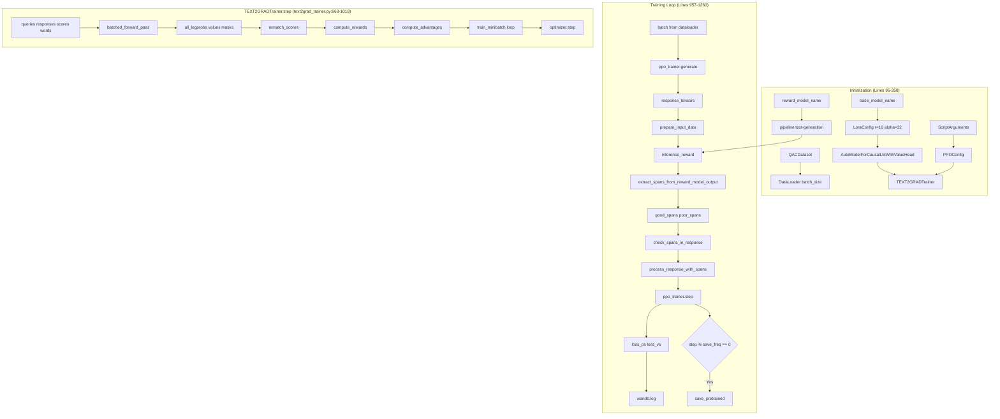

**Training Flow:**
1. **Initialization**: Load base model with LoRA adapters, create TEXT2GRADTrainer, initialize reward model pipeline
2. **Generation**: Policy model generates responses to queries
3. **Reward Inference**: Reward model analyzes responses and returns structured feedback
4. **Span Processing**: Fuzzy matching locates spans, converts to word-level scores
5. **PPO Update**: TEXT2GRADTrainer aligns scores to tokens and performs policy gradient update
6. **Checkpointing**: Save adapter weights and optimizer state periodically

Sources: [nl_gradiant_policy_optimization/ultrafeedback/train_ultrafeedback.py:95-358](), [nl_gradiant_policy_optimization/ultrafeedback/train_ultrafeedback.py:957-1260](), [nl_gradiant_policy_optimization/ultrafeedback/text2grad_trainer.py:663-1018]()

## Configuration and Initialization

### ScriptArguments

The training script uses `ScriptArguments` dataclass for configuration:

| Parameter | Type | Default | Description |
|-----------|------|---------|-------------|
| `base_model_name` | str | "" | Path to base LLM (e.g., Llama-3.1-8B-Instruct) |
| `base_model_adapter_model` | str | "" | Optional checkpoint to resume from |
| `reward_model_name` | str | "" | Path to trained reward model |
| `learning_rate` | float | 1e-5 | Learning rate for optimizer |
| `batch_size` | int | 32 | Number of samples per batch |
| `mini_batch_size` | int | 1 | Mini-batch size for PPO updates |
| `ppo_epochs` | int | 4 | Number of PPO epochs per batch |
| `init_kl_coef` | float | 0.2 | Initial KL penalty coefficient |
| `save_freq` | int | 5 | Checkpoint saving frequency (steps) |
| `output_dir` | str | "ckpt/superw_token_ppo" | Directory for checkpoints |

Sources: [nl_gradiant_policy_optimization/ultrafeedback/train_ultrafeedback.py:95-130]()

### Model Initialization

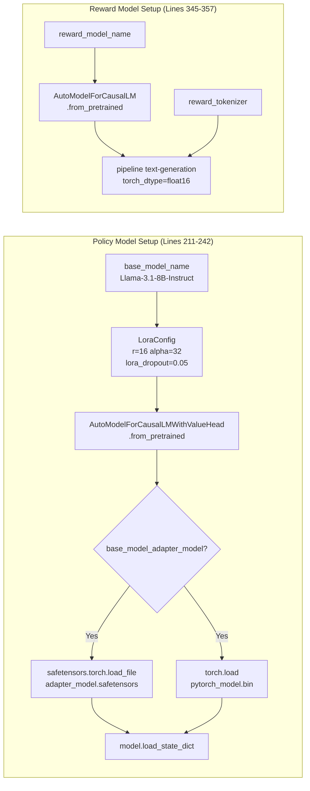

**Key Implementation Details:**

1. **LoRA Configuration**: Uses rank-16 LoRA adapters with alpha=32 for efficient fine-tuning
2. **Value Head**: `AutoModelForCausalLMWithValueHead` adds value function prediction capability
3. **Checkpoint Loading**: Loads adapter weights from safetensors and value head from pytorch_model.bin
4. **Reward Model**: Separate frozen model in float16 precision for memory efficiency

Sources: [nl_gradiant_policy_optimization/ultrafeedback/train_ultrafeedback.py:211-242](), [nl_gradiant_policy_optimization/ultrafeedback/train_ultrafeedback.py:345-357]()

## Reward Model Prompt Format

The reward model receives specially formatted prompts requesting structured feedback:

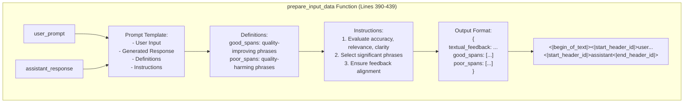

**Prompt Components:**

- **User Input**: Original question or prompt
- **Generated Response**: Model's generated answer
- **Definitions**: Precise definitions of `good_spans` and `poor_spans`
- **Instructions**: Evaluation criteria (accuracy, relevance, clarity, completeness)
- **Output Format**: JSON structure with textual feedback and span lists

Sources: [nl_gradiant_policy_optimization/ultrafeedback/train_ultrafeedback.py:390-439]()

## Span-Based Reward Processing

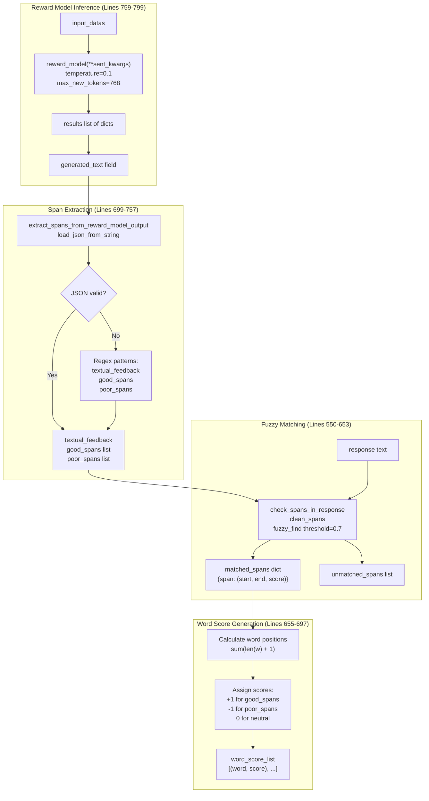

**Processing Stages:**

1. **Inference**: Reward model generates JSON with feedback and spans
2. **Parsing**: `extract_spans_from_reward_model_output` uses JSON parsing with regex fallback
3. **Span Cleaning**: Remove escape characters and whitespace from spans
4. **Fuzzy Matching**: Locate spans in response text with approximate string matching
5. **Score Assignment**: Generate word-level scores based on span membership

Sources: [nl_gradiant_policy_optimization/ultrafeedback/train_ultrafeedback.py:655-799]()

## Fuzzy Matching Algorithm

The `fuzzy_find` function implements multi-strategy approximate string matching to handle variations between reward model output and generated text:

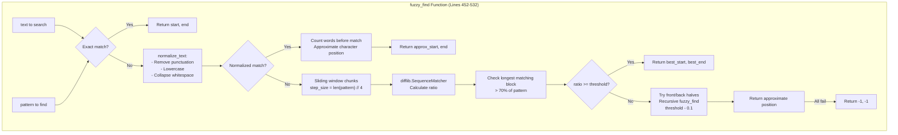

**Matching Strategies:**

1. **Exact Match**: Direct string search using `str.find()`
2. **Normalized Match**: Remove punctuation, lowercase, collapse whitespace
3. **Sequence Matching**: `difflib.SequenceMatcher` with sliding window chunks
4. **Longest Block**: Check if any matching block covers 70%+ of pattern
5. **Split Matching**: Recursively match front/back halves with lower threshold

**Threshold Adjustment**: Patterns shorter than 5 characters use `max(0.5, threshold - 0.2)`

Sources: [nl_gradiant_policy_optimization/ultrafeedback/train_ultrafeedback.py:452-532]()

## Word-to-Token Alignment

The `rematch_scores` and `assign_token_rewards` functions convert word-level scores to token-level rewards:

```mermaid
graph TB
    subgraph "rematch_scores (text2grad_trainer.py:1389-1445)"
        SCORES[scores list] --> LOWER["Convert to lowercase<br/>words[i].lower()"]
        WORDS[words list] --> LOWER
        ALL_TOKENS[all_tokens list] --> LOWER
        
        LOWER --> FIND_ASSISTANT["Search for:<br/><|start_header_id|>assistant<br/><|end_header_id|>"]
        FIND_ASSISTANT --> ANSWER_IDX[answer_indices_tokens]
        ANSWER_IDX --> SLICE[answers_tokens = all_tokens[idx:]]
        
        SLICE --> ASSIGN[assign_token_rewards]
    end
    
    subgraph "assign_token_rewards (text2grad_trainer.py:1299-1387)"
        TOKEN_LIST[token_list] --> FILTER_WORDS["Filter empty words<br/>from word_list"]
        WORD_LIST[word_list] --> FILTER_WORDS
        SCORE_LIST[score_list] --> FILTER_WORDS
        
        FILTER_WORDS --> MATCH_LOOP["For each token position:<br/>Try to match next 1-10 tokens<br/>to current word"]
        MATCH_LOOP --> CONCAT["concatenated_tokens<br/>= ''.join(tokens)"]
        CONCAT --> COMPARE{"tokens.lower() ==<br/>word.lower()?"}
        
        COMPARE -->|Yes| ASSIGN_SCORE["Assign word score<br/>to all matched tokens<br/>Skip special chars"]
        COMPARE -->|No| SKIP["Skip token<br/>Increment attempts<br/>max_attempts=5"]
        
        ASSIGN_SCORE --> TOKEN_SCORE[token_score list]
        SKIP --> UNMATCHED{attempts >= 5?}
        UNMATCHED -->|Yes| SKIP_WORD["Skip word<br/>total_skip_words_num++"]
        SKIP_WORD --> NEXT_WORD[Move to next word]
    end
```

**Alignment Process:**

1. **Lowercase Normalization**: Convert all words and tokens to lowercase
2. **Assistant Marker Search**: Find `<|start_header_id|>assistant<|end_header_id|>` sequence
3. **Token Slicing**: Extract tokens after assistant marker
4. **Word Matching**: Try to match consecutive tokens (1-10) to each word
5. **Score Propagation**: Assign word score to all matched tokens
6. **Special Character Handling**: Assign 0 to punctuation and special tokens
7. **Fallback**: Skip unmatched words after 5 attempts

Sources: [nl_gradiant_policy_optimization/ultrafeedback/text2grad_trainer.py:1299-1445]()

## PPO Training Step

The TEXT2GRADTrainer `step` method orchestrates the complete PPO update:

```mermaid
graph TB
    subgraph "TEXT2GRADTrainer.step (Lines 663-1018)"
        INPUT["queries<br/>responses<br/>scores<br/>words"] --> SAFETY[_step_safety_checker]
        SAFETY --> MODEL_INPUTS[prepare_model_inputs]
        
        MODEL_INPUTS --> FORWARD["batched_forward_pass<br/>model and ref_model"]
        FORWARD --> LOGPROBS["all_logprobs<br/>values<br/>masks<br/>all_tokens"]
        
        LOGPROBS --> REMATCH["rematch_scores<br/>Align word scores to tokens"]
        REMATCH --> TOKEN_SCORES[token_scores aligned]
        
        TOKEN_SCORES --> COMPUTE_REWARDS["compute_rewards<br/>rewards = scores - KL_penalty"]
        COMPUTE_REWARDS --> GAE["compute_advantages<br/>GAE algorithm<br/>gamma=0.99 lam=0.95"]
        
        GAE --> BATCH_DICT["batch_dict:<br/>queries responses<br/>logprobs values<br/>advantages returns"]
        
        BATCH_DICT --> PPO_EPOCHS["for _ in range(ppo_epochs):<br/>Random permutation"]
        PPO_EPOCHS --> MINI_BATCH["Split into mini_batches"]
        
        MINI_BATCH --> TRAIN_MB["train_minibatch:<br/>- Compute new logprobs/values<br/>- Calculate PPO loss<br/>- Backprop and optimizer.step"]
        
        TRAIN_MB --> EARLY_STOP{policy_kl > 1.5 * target_kl?}
        EARLY_STOP -->|Yes| STOP[Break early]
        EARLY_STOP -->|No| CONTINUE[Continue training]
        
        CONTINUE --> STATS[record_step_stats]
        STATS --> LR_SCHEDULE[lr_scheduler.step]
    end
```

**PPO Algorithm Steps:**

1. **Safety Check**: Validate tensor shapes and move to device
2. **Forward Pass**: Compute log probabilities and values for both model and reference
3. **Score Alignment**: Convert word-level rewards to token-level using `rematch_scores`
4. **Reward Computation**: Combine span scores with KL penalty
5. **Advantage Estimation**: Generalized Advantage Estimation (GAE)
6. **Mini-batch Updates**: 
   - Random permutation of batch indices
   - Split into mini-batches
   - Compute new logprobs/values
   - Calculate PPO clipped objective loss
   - Backpropagate and update parameters
7. **Early Stopping**: Stop if KL divergence exceeds 1.5 × target
8. **Statistics**: Record and log training metrics

Sources: [nl_gradiant_policy_optimization/ultrafeedback/text2grad_trainer.py:663-1018]()

## Loss Calculation

The `loss` method computes PPO policy loss and value loss:

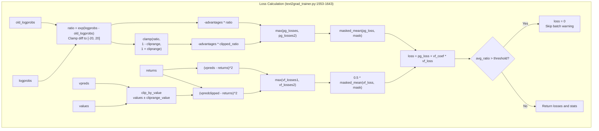

**Loss Components:**

- **Policy Loss**: PPO clipped objective with ratio clipping at `[1-ε, 1+ε]`
- **Value Loss**: Clipped value function loss with same clipping range
- **Total Loss**: `pg_loss + vf_coef * vf_loss` (vf_coef=0.1 default)
- **Ratio Threshold**: Zero out loss if average ratio exceeds threshold (prevents instability)

**Key Parameters:**
- `cliprange`: 0.2 (default PPO clipping range)
- `cliprange_value`: 0.2 (value function clipping)
- `vf_coef`: 0.1 (value loss coefficient)

Sources: [nl_gradiant_policy_optimization/ultrafeedback/text2grad_trainer.py:1553-1643]()

## Forward Pass and Masking

The `batched_forward_pass` method handles model inference with sophisticated masking:

```mermaid
graph TB
    subgraph "batched_forward_pass (Lines 1091-1224)"
        QUERIES[queries] --> CONCAT["torch.cat([q, r])<br/>for q, r in zip(queries, responses)"]
        RESPONSES[responses] --> CONCAT
        MODEL_INPUTS[model_inputs] --> CONCAT
        
        CONCAT --> BATCH_LOOP["For each mini_batch:<br/>i in range(ceil(bs / fbs))"]
        BATCH_LOOP --> MODEL_CALL["model(**input_kwargs)<br/>Returns logits, _, values"]
        
        MODEL_CALL --> TOKEN_DECODE["tokenizer.decode(token_id)<br/>for each token<br/>Clean apostrophes"]
        TOKEN_DECODE --> LOGPROB["logprobs_from_logits<br/>logits[:, :-1, :]<br/>input_ids[:, 1:]"]
        
        LOGPROB --> MASK_INIT["masks = zeros_like(attention_mask)<br/>masks[:, :-1] = attention_mask[:, 1:]"]
        
        MASK_INIT --> PUNCTUATION["Set mask=0 for:<br/>commas, periods, ?, !"]
        
        PUNCTUATION --> RESPONSE_BOUNDS["For each sample:<br/>start = len(query) - 1<br/>end = start + len(response)"]
        RESPONSE_BOUNDS --> EOT_SEARCH["Search for <|eot_id|><br/>Adjust end position"]
        
        EOT_SEARCH --> ZERO_QUERY["masks[:, :start] = 0"]
        ZERO_QUERY --> ZERO_AFTER["masks[:, end:] = 0"]
        
        ZERO_AFTER --> RESPONSE_MASK{response_masks?}
        RESPONSE_MASK -->|Yes| MULTIPLY["masks *= response_masks"]
        RESPONSE_MASK -->|No| FINAL_MASK[Final masks]
    end
```

**Masking Strategy:**

1. **Initial Mask**: Copy attention mask shifted by 1 position
2. **Punctuation Masking**: Set mask=0 for commas, periods, question marks, exclamation marks
3. **Query Masking**: Zero out all query tokens (start = len(query) - 1)
4. **Response Boundary**: Find end by searching for `<|eot_id|>` token
5. **Post-Response Masking**: Zero out tokens after response end
6. **Optional Response Mask**: Apply additional custom mask if provided

This ensures gradients only affect response tokens that matter for quality.

Sources: [nl_gradiant_policy_optimization/ultrafeedback/text2grad_trainer.py:1091-1224]()

## Checkpoint Management

```mermaid
graph TB
    subgraph "Checkpoint Saving (train_ultrafeedback.py:1173-1206)"
        STEP_CHECK{step % save_freq == 0?} -->|Yes| MAIN_PROCESS{is_main_process?}
        MAIN_PROCESS -->|Yes| CREATE_DIR["save_path = output_dir/<br/>epoch_{epoch}_step_{step}"]
        
        CREATE_DIR --> SAVE_MODEL["ppo_trainer.save_pretrained<br/>Saves adapter_model.safetensors"]
        SAVE_MODEL --> SAVE_OPT["torch.save<br/>optimizer.state_dict()<br/>lr_scheduler.state_dict()"]
        
        SAVE_OPT --> VERIFY["Check for:<br/>- adapter_model.safetensors<br/>- pytorch_model.bin<br/>- optimizer.pt"]
        VERIFY --> LOG_SAVE[Log success or missing files]
    end
    
    subgraph "Checkpoint Loading (Lines 224-292)"
        ADAPTER_PATH[base_model_adapter_model] --> LOAD_ADAPTER["safetensors.torch.load_file<br/>adapter_model.safetensors"]
        LOAD_ADAPTER --> LOAD_VHEAD["torch.load<br/>pytorch_model.bin"]
        
        LOAD_VHEAD --> REMAP["Remap keys:<br/>pretrained_model.*.default.*"]
        REMAP --> UPDATE["model.load_state_dict<br/>strict=False"]
        
        UPDATE --> OPT_EXISTS{optimizer.pt exists?}
        OPT_EXISTS -->|Yes| LOAD_OPT["optimizer.load_state_dict<br/>lr_scheduler.load_state_dict"]
        OPT_EXISTS -->|No| FRESH_OPT[Use fresh optimizer]
        
        LOAD_OPT --> EXTRACT_STEP["Extract epoch and step from:<br/>epoch_{epoch}_step_{step}"]
        EXTRACT_STEP --> CALC_WANDB["wandb_step = epoch * steps_per_epoch + step"]
    end
```

**Checkpoint Components:**

1. **adapter_model.safetensors**: LoRA adapter weights
2. **pytorch_model.bin**: Value head weights
3. **optimizer.pt**: Optimizer and lr_scheduler states

**Loading Process:**

1. Load safetensors adapter weights
2. Load value head from pytorch_model.bin
3. Remap adapter keys to match model structure (`pretrained_model.*.default.*`)
4. Load optimizer/scheduler if available
5. Extract epoch/step from checkpoint path
6. Calculate WandB step for logging continuity

**Saving Frequency**: Controlled by `save_freq` parameter (default: every 5 steps)

Sources: [nl_gradiant_policy_optimization/ultrafeedback/train_ultrafeedback.py:224-292](), [nl_gradiant_policy_optimization/ultrafeedback/train_ultrafeedback.py:1173-1206]()

## Evaluation During Training

The training loop includes periodic evaluation using similarity-based accuracy:

```mermaid
graph TB
    subgraph "Response Accuracy Evaluation (Lines 1208-1233)"
        EVAL_TRIGGER{step % 1 == 0?} -->|Yes| SAMPLE["Sample min(20, batch_size)<br/>responses"]
        
        SAMPLE --> EXTRACT_CONTENT["Extract chosen/rejected content:<br/>- Parse message list<br/>- Find assistant role<br/>- Extract content field"]
        
        EXTRACT_CONTENT --> CALC_SIM["calculate_similarity:<br/>- ROUGE scores (1, 2, L)<br/>- SequenceMatcher ratio<br/>- Average both metrics"]
        
        CALC_SIM --> COMPARE["chosen_similarity vs rejected_similarity"]
        COMPARE --> ACCURACY["accuracy = 1.0 if chosen > rejected<br/>else 0.0"]
        
        ACCURACY --> MEAN["mean_accuracy = sum / count"]
        MEAN --> WANDB_LOG["wandb.log:<br/>eval/mean_accuracy<br/>eval/accuracies"]
    end
    
    subgraph "calculate_similarity (Lines 884-905)"
        TEXT1[text1] --> ROUGE["rouge_scorer.RougeScorer<br/>rouge1, rouge2, rougeL"]
        TEXT2[text2] --> ROUGE
        ROUGE --> ROUGE_SCORE["(rouge1 + rouge2 + rougeL) / 3"]
        
        TEXT1 --> SEQ["difflib.SequenceMatcher"]
        TEXT2 --> SEQ
        SEQ --> SEQ_SCORE["matcher.ratio()"]
        
        ROUGE_SCORE --> AVG["(rouge_score + seq_score) / 2"]
        SEQ_SCORE --> AVG
    end
```

**Evaluation Metrics:**

1. **ROUGE Scores**: N-gram overlap (ROUGE-1, ROUGE-2, ROUGE-L)
2. **Sequence Matching**: Character-level similarity using `difflib.SequenceMatcher`
3. **Combined Score**: Average of ROUGE and sequence matcher scores
4. **Binary Accuracy**: 1.0 if response is more similar to chosen than rejected, else 0.0

**Evaluation Frequency**: Every step (but only on subset of 20 samples for efficiency)

Sources: [nl_gradiant_policy_optimization/ultrafeedback/train_ultrafeedback.py:884-905](), [nl_gradiant_policy_optimization/ultrafeedback/train_ultrafeedback.py:1208-1233]()

## WandB Logging

The training loop logs extensive metrics to Weights & Biases:

| Metric Category | Metrics | Description |
|----------------|---------|-------------|
| **Loss** | `train/loss_advantage`, `train/loss_value_kl` | Policy and value losses |
| **Rewards** | `rewards/mean`, `rewards/max`, `rewards/min` | Span-based reward statistics |
| **Reward Distribution** | `rewards/positive_ratio`, `rewards/negative_ratio`, `rewards/zero_ratio` | Distribution of good/poor/neutral scores |
| **Examples** | `examples/example_{i}/token_rewards` | Token-level reward tables for samples |
| **Evaluation** | `eval/mean_accuracy`, `eval/accuracies` | Similarity-based accuracy metrics |
| **Statistics** | From `ppo_trainer.log_stats` | PPO statistics (KL, entropy, advantages, etc.) |

**Example Logging:**

```python
wandb.log({"train/loss_advantage": loss_ps}, step=wandb_step)
wandb.log({"rewards/distribution": wandb.Histogram(flat_rewards)}, step=wandb_step)
token_table = wandb.Table(columns=["token", "reward"])
for token, reward in zip(words[i], rewards[i].tolist()):
    token_table.add_data(token, reward)
wandb.log({f"examples/example_{i+1}/token_rewards": token_table}, step=wandb_step)
```

Sources: [nl_gradiant_policy_optimization/ultrafeedback/train_ultrafeedback.py:1138-1171]()

## Training Loop Error Handling

The implementation includes comprehensive error handling and logging:

```mermaid
graph TB
    subgraph "Error Handling (Lines 1090-1104, 1237-1254)"
        PROCESS[Processing sample] --> ERROR{Exception?}
        ERROR -->|Yes| LOG_SAMPLE["Log sample error:<br/>- index<br/>- status: error<br/>- error_message<br/>- traceback"]
        
        LOG_SAMPLE --> INCREMENT["fail += 1<br/>batch_log[failed_samples] += 1"]
        INCREMENT --> CONTINUE[Continue to next sample]
        
        ERROR -->|No| SUCCESS["Log success:<br/>- status: success<br/>- rewards_count<br/>- words_count"]
    end
    
    subgraph "Step Error Logging (Lines 802-818)"
        STEP_ERROR[Error in step] --> CREATE_LOG["log_error(error_dir, step, error)<br/>Create timestamped log file"]
        CREATE_LOG --> WRITE_CONTEXT["Write context:<br/>- epoch, step<br/>- batch_size<br/>- tensor_shapes<br/>- full traceback"]
    end
    
    subgraph "Sample Validation (Lines 1110-1124)"
        VALID_SAMPLES{valid_samples >= 8?} -->|No| SKIP_STEP[Skip step: too few samples]
        VALID_SAMPLES -->|Yes| MULTI_GPU{multi-gpu?}
        MULTI_GPU -->|Yes| ALL_GATHER["torch.distributed.all_gather<br/>Check all processes"]
        ALL_GATHER --> MIN_CHECK{min_valid_samples >= 8?}
        MIN_CHECK -->|No| SKIP_STEP
        MIN_CHECK -->|Yes| PROCEED[Proceed with PPO step]
    end
```

**Error Handling Features:**

1. **Per-Sample Logging**: Track success/failure for each sample in batch
2. **Batch Logs**: JSON logs written to `{output_dir}/logs/epoch_{epoch}/step_{step}/`
3. **Error Files**: Detailed error logs with context and traceback
4. **Sample Validation**: Require minimum 8 valid samples per process
5. **Multi-GPU Synchronization**: Use `all_gather` to ensure all processes have sufficient samples
6. **Graceful Degradation**: Skip failed samples and continue training

Sources: [nl_gradiant_policy_optimization/ultrafeedback/train_ultrafeedback.py:802-818](), [nl_gradiant_policy_optimization/ultrafeedback/train_ultrafeedback.py:1090-1124](), [nl_gradiant_policy_optimization/ultrafeedback/train_ultrafeedback.py:1237-1254]()

## Generation Parameters

The training uses two different generation configurations:

**Policy Model Generation** (for creating responses):
```python
generation_kwargs = {
    "temperature": 0.6,
    "do_sample": True,
    "top_p": 1,
    "top_k": 0,
    "max_new_tokens": 512,
    "pad_token_id": tokenizer.pad_token_id,
    "eos_token_id": tokenizer.eos_token_id,
}
```

**Reward Model Inference** (for generating feedback):
```python
sent_kwargs = {
    "batch_size": script_args.batch_size,
    "do_sample": True,
    "temperature": 0.1,
    "min_new_tokens": 50,
    "max_new_tokens": 768,
    "pad_token_id": reward_tokenizer.eos_token_id,
    "eos_token_id": reward_tokenizer.eos_token_id,
}
```

**Key Differences:**
- Policy uses higher temperature (0.6 vs 0.1) for more diverse responses
- Reward model uses lower temperature for more deterministic feedback
- Reward model generates longer outputs (768 vs 512 tokens) for detailed critiques

Sources: [nl_gradiant_policy_optimization/ultrafeedback/train_ultrafeedback.py:360-379]()

## Multi-GPU Training

The implementation supports distributed training through Accelerator:

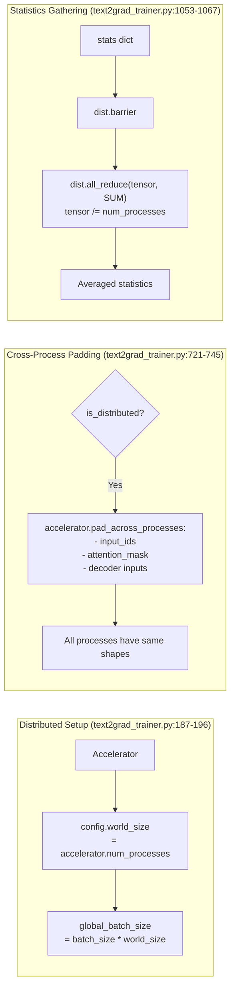

**Distributed Features:**

1. **Automatic Scaling**: Batch size scales with number of GPUs
2. **Cross-Process Padding**: Ensures all processes have same tensor shapes
3. **Barrier Synchronization**: `dist.barrier()` before collective operations
4. **Statistics Gathering**: Average metrics across all processes
5. **Main Process Checkpointing**: Only rank 0 saves checkpoints

Sources: [nl_gradiant_policy_optimization/ultrafeedback/text2grad_trainer.py:187-196](), [nl_gradiant_policy_optimization/ultrafeedback/text2grad_trainer.py:721-745](), [nl_gradiant_policy_optimization/ultrafeedback/text2grad_trainer.py:1053-1067]()

---

