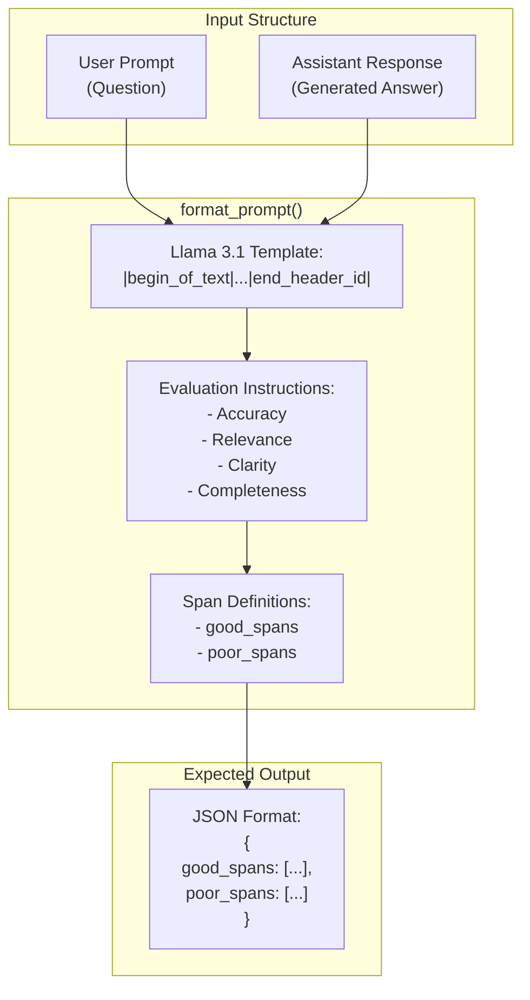
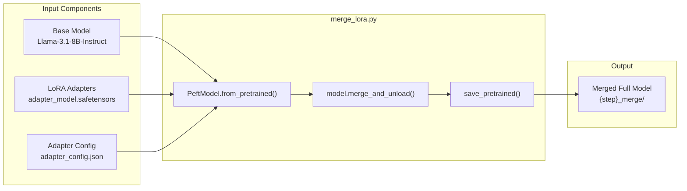
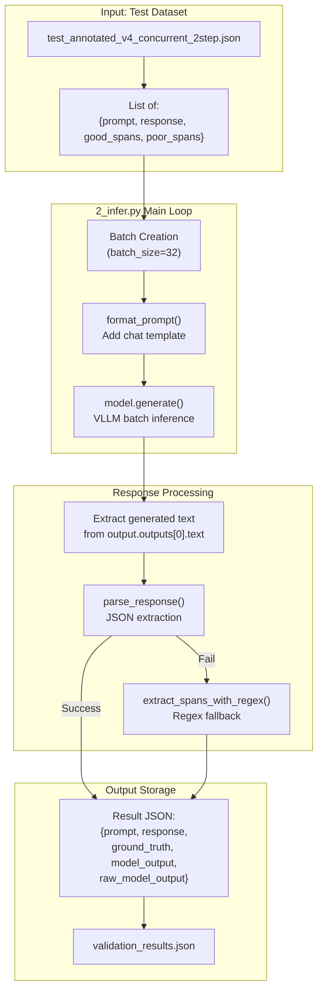
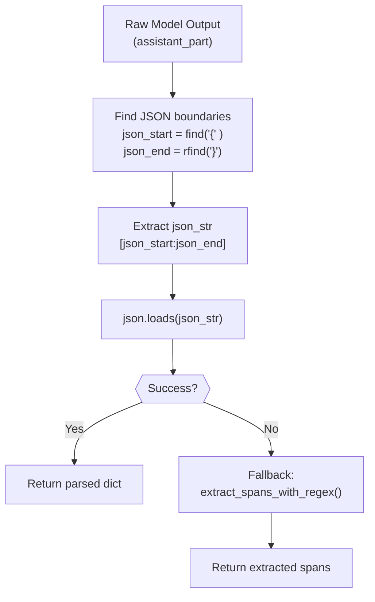
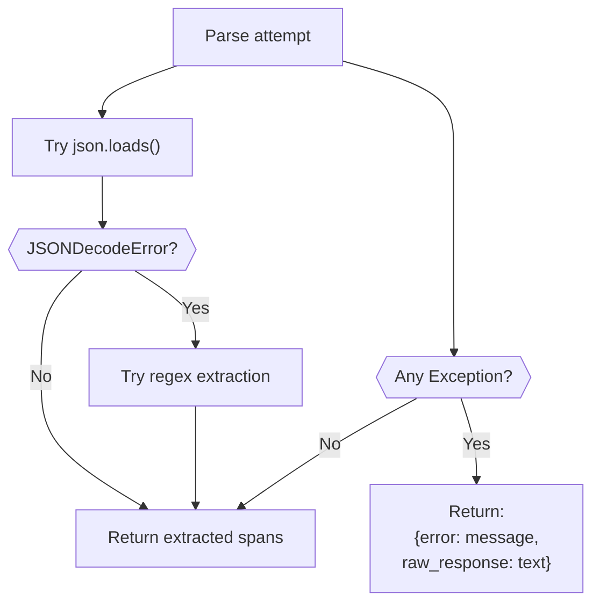
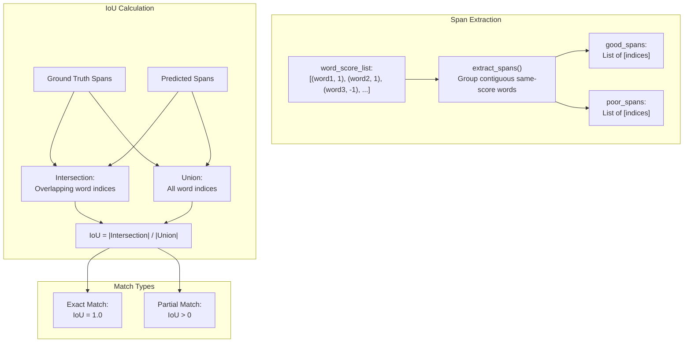
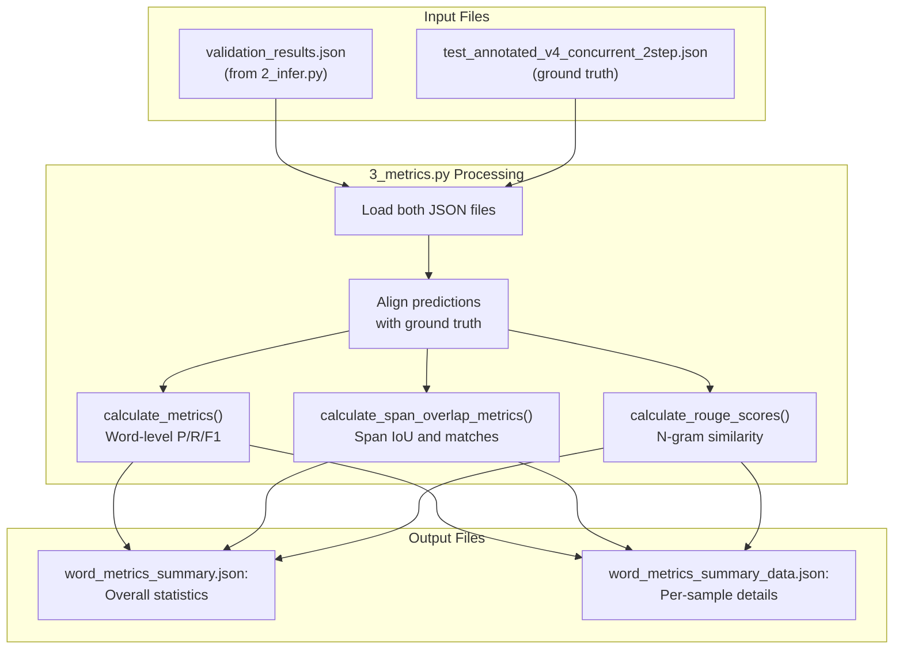

<!-- source: DeepWiki mcp.deepwiki.com · repo microsoft/Text2Grad · extra page UltraFeedback Reward Model · fetched 2026-10-26 -->

# UltraFeedback Reward Model

<details>
<summary>Relevant source files</summary>

The following files were used as context for generating this wiki page:

- [nl_reward_model/slf5k/evaluation/3_metrics.py](nl_reward_model/slf5k/evaluation/3_metrics.py)
- [nl_reward_model/ultrafeedback/evaluation/2_infer.py](nl_reward_model/ultrafeedback/evaluation/2_infer.py)
- [nl_reward_model/ultrafeedback/evaluation/3_metrics.py](nl_reward_model/ultrafeedback/evaluation/3_metrics.py)

</details>


This page describes the training and inference pipeline for reward models in the UltraFeedback task domain. The UltraFeedback reward model learns to evaluate question-answering responses by identifying `good_spans` (high-quality phrases) and `poor_spans` (problematic phrases) within generated text.

For information about the UltraFeedback dataset format and preprocessing, see [UltraFeedback Dataset Format](#7.2.1). For using this reward model in policy optimization, see [UltraFeedback Policy Optimization](#7.2.3). For general reward model training concepts, see [Training Reward Models](#5.1).

## Model Architecture and Configuration

The UltraFeedback reward model is built on `Llama-3.1-8B-Instruct` with LoRA (Low-Rank Adaptation) for parameter-efficient fine-tuning. The model learns to generate structured JSON output containing span-level annotations.

### Base Model Specifications

| Component | Configuration |
|-----------|--------------|
| Base Model | `meta-llama/Llama-3.1-8B-Instruct` |
| Fine-tuning Method | LoRA (via PEFT library) |
| LoRA Rank (r) | 16 |
| LoRA Alpha | 32 |
| Target Modules | Query, Key, Value, Output projections |
| Training Framework | DeepSpeed with ZeRO Stage 3 |
| Precision | FP16 (float16) |

The model is trained to take a prompt-response pair and output:
- `good_spans`: List of string phrases that improve response quality
- `poor_spans`: List of string phrases that harm response quality

### Prompt Format

The model uses the Llama 3.1 chat template with a structured system prompt that defines evaluation criteria:



**Sources:** [nl_reward_model/ultrafeedback/evaluation/2_infer.py:25-60]()

## Training Process

The training process follows the standard reward model training pipeline with task-specific data formatting. Training is performed using the scripts in `nl_reward_model/ultrafeedback/`.

### Training Configuration

The training typically uses:
- **Optimizer**: AdamW with DeepSpeed ZeRO Stage 3
- **Batch Size**: Configured based on GPU memory (typically 8-32 per GPU)
- **Learning Rate**: ~2e-5 to 5e-5 for LoRA adapters
- **Epochs**: Monitored with validation loss for early stopping
- **Gradient Checkpointing**: Enabled for memory efficiency
- **Mixed Precision**: FP16 training

### Data Format for Training

Training data consists of prompt-response pairs with ground truth annotations. Each training example contains:

```json
{
  "prompt": "user question or instruction",
  "response": "generated assistant response",
  "good_spans": ["phrase1", "phrase2"],
  "poor_spans": ["phrase3", "phrase4"]
}
```

The `QACDataset` class (referenced in the general training pipeline) tokenizes these examples and formats them according to the Llama 3.1 chat template.

### Checkpoint Organization

Training produces LoRA adapter checkpoints with the following structure:

```
nl_reward_model/ultrafeedback/ckpt/
└── {model_name}/
    └── {step}/
        ├── adapter_config.json
        ├── adapter_model.safetensors (or .bin)
        └── training_args.bin
```

**Sources:** [nl_reward_model/ultrafeedback/evaluation/2_infer.py:12-13]() (references checkpoint paths)

## Model Merging and Deployment

Before inference, LoRA adapters must be merged with the base model to create a standalone deployment model. This is performed by `1_merge_lora.py` (typically located in the evaluation directory).

### Merging Process



The merged model contains all weights in a single model file, eliminating the need for PEFT at inference time and enabling compatibility with optimized inference engines like VLLM.

**Sources:** Diagram 3 from high-level architecture

## Inference Pipeline

Inference uses VLLM (vLLM) for high-throughput batch processing. The pipeline is implemented in `2_infer.py`.

### VLLM Configuration

```python
# Key configuration from 2_infer.py
LLM(
    model=model_path,
    tensor_parallel_size=tensor_parallel_size,  # Multi-GPU parallelism
    dtype="float16",
    trust_remote_code=True,
    max_model_len=8192
)

SamplingParams(
    temperature=0.7,
    top_p=0.9,
    max_tokens=300  # Sufficient for JSON span output
)
```

### Inference Data Flow



**Sources:** [nl_reward_model/ultrafeedback/evaluation/2_infer.py:103-176]()

### Command-Line Arguments

The inference script accepts the following arguments:

| Argument | Default | Description |
|----------|---------|-------------|
| `--model_path` | `../ckpt/llama31-8B-span2span-v2-nofeedback/0_10000_merge` | Path to merged model |
| `--valid_dataset_file` | `../data/ultrafeedback/RM/test_annotated_v4_concurrent_2step.json` | Test data path |
| `--output_file` | `validation_results.json` | Output JSON file |
| `--batch_size` | `32` | Batch size for inference |
| `--max_new_tokens` | `300` | Maximum tokens to generate |
| `--num_samples` | `1000` | Number of samples to evaluate (-1 for all) |
| `--tensor_parallel_size` | `1` | Number of GPUs for tensor parallelism |
| `--gpu_ids` | `0,1,2,3,4,5,6,7` | Comma-separated GPU IDs |

**Sources:** [nl_reward_model/ultrafeedback/evaluation/2_infer.py:10-23]()

## Response Parsing Strategies

The inference pipeline implements robust parsing with multiple fallback strategies to handle malformed JSON outputs, which are common with LLM generation.

### Primary JSON Parsing



**Sources:** [nl_reward_model/ultrafeedback/evaluation/2_infer.py:62-78]()

### Regex Fallback Extraction

When JSON parsing fails, the system uses regex patterns to extract spans:

```python
# Pattern for good_spans
good_spans_pattern = r'"good_spans"\s*:\s*\[(.*?)\]'

# Pattern for poor_spans
poor_spans_pattern = r'"poor_spans"\s*:\s*\[(.*?)\]'

# Extract individual span strings (handles both " and ')
span_pattern = r'(?:"([^"]*?)"|\'([^\']*?)\')'
```

This regex-based extraction handles:
- Malformed JSON with missing brackets or quotes
- Mixed quote styles (single and double quotes)
- Extra whitespace or formatting issues
- Incomplete JSON structures

**Sources:** [nl_reward_model/ultrafeedback/evaluation/2_infer.py:80-101]()

### Error Handling

The parsing pipeline wraps all operations in exception handling:



**Sources:** [nl_reward_model/ultrafeedback/evaluation/2_infer.py:77-78]()

## Output Format

The inference script produces a JSON file containing detailed results for each test sample.

### Output Structure

```json
[
  {
    "prompt": "Original user question",
    "response": "Generated assistant response",
    "ground_truth": {
      "good_spans": ["ground truth good phrase 1", ...],
      "poor_spans": ["ground truth poor phrase 1", ...]
    },
    "model_output": {
      "good_spans": ["predicted good phrase 1", ...],
      "poor_spans": ["predicted poor phrase 1", ...]
    },
    "raw_model_output": "Raw text generated by model"
  },
  ...
]
```

### Key Fields

| Field | Description |
|-------|-------------|
| `prompt` | Original user input/question from test set |
| `response` | Assistant's generated response being evaluated |
| `ground_truth` | Human-annotated spans from the test dataset |
| `model_output` | Model's predicted spans (parsed from generation) |
| `raw_model_output` | Complete unprocessed model output for debugging |

This output format is consumed by the metrics calculation script (`3_metrics.py`) for evaluation. See [UltraFeedback Evaluation](#7.2.4) for details on metric computation.

**Sources:** [nl_reward_model/ultrafeedback/evaluation/2_infer.py:155-166]()

## Evaluation Metrics

The reward model's predictions are evaluated using multiple metrics at different granularities. The metrics script (`3_metrics.py`) computes:

### Word-Level Metrics

Each word in the response receives a score based on span membership:
- **Score +1**: Words in `good_spans`
- **Score -1**: Words in `poor_spans`
- **Score 0**: Neutral words

Precision, recall, and F1 are calculated separately for each score class.

### Span-Level Metrics

Span overlap metrics measure how well predicted spans match ground truth spans:



**Span metrics include:**
- **Exact Match Count**: Spans with IoU = 1.0 (perfect boundary alignment)
- **Partial Match Count**: Spans with IoU > 0 (any overlap)
- **Average IoU**: Mean intersection-over-union across all span pairs
- **Precision/Recall/F1**: Based on partial matches

**Sources:** [nl_reward_model/ultrafeedback/evaluation/3_metrics.py:143-269]()

### Computation Flow



**Sources:** [nl_reward_model/ultrafeedback/evaluation/3_metrics.py:271-593]()

### Sample Metrics Output

The metrics summary includes:

```json
{
  "overall_metrics": {
    "positive": {"precision": 0.xx, "recall": 0.xx, "f1": 0.xx},
    "negative": {"precision": 0.xx, "recall": 0.xx, "f1": 0.xx},
    "neutral": {"precision": 0.xx, "recall": 0.xx, "f1": 0.xx},
    "overall": {"precision": 0.xx, "recall": 0.xx, "f1": 0.xx}
  },
  "overall_span_metrics": {
    "good_span": {
      "gt_count": 100,
      "ex_count": 95,
      "exact_match": 60,
      "partial_match": 80,
      "precision": 0.xx,
      "recall": 0.xx,
      "f1": 0.xx
    },
    "poor_span": { /* similar structure */ }
  }
}
```

For complete evaluation methodology and benchmarking, see [UltraFeedback Evaluation](#7.2.4).

**Sources:** [nl_reward_model/ultrafeedback/evaluation/3_metrics.py:375-412]()

---

