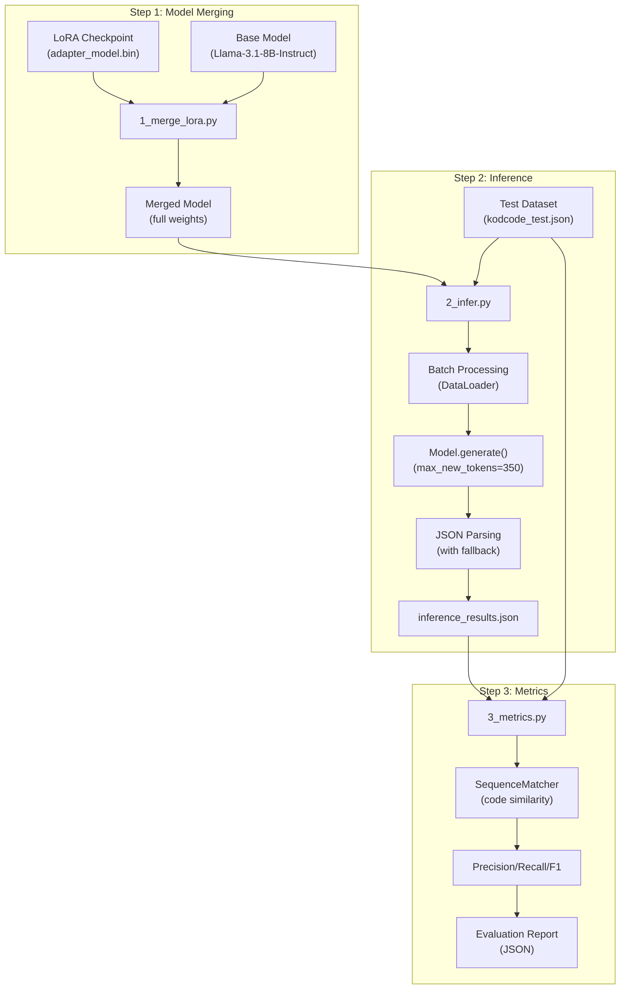
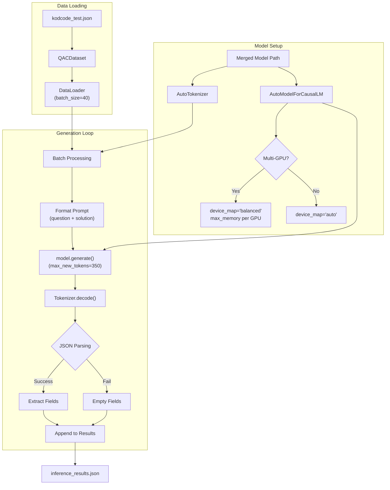
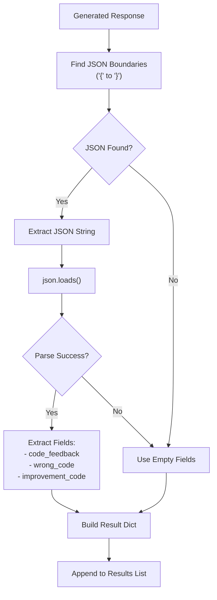
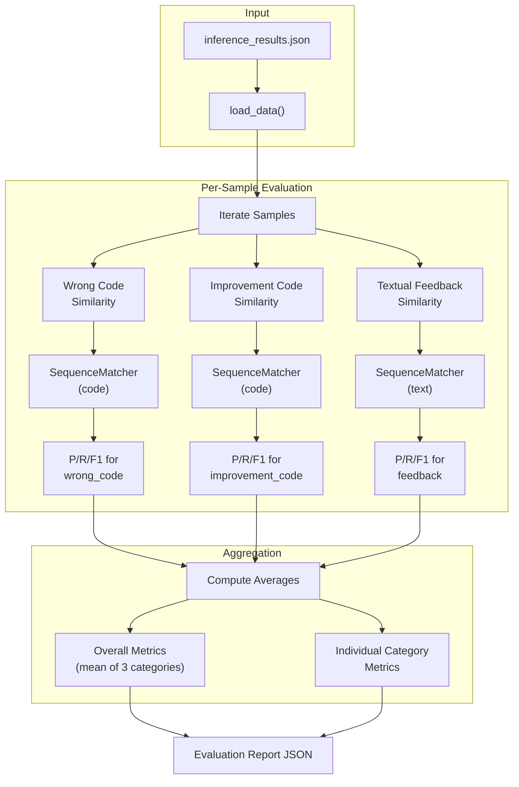
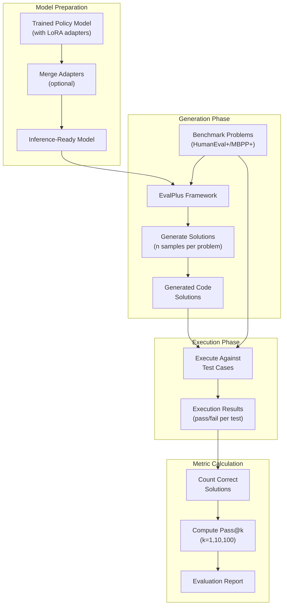
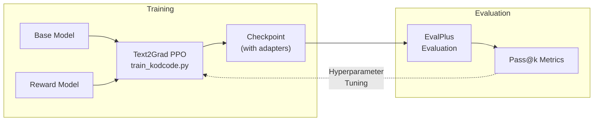

<!-- source: DeepWiki mcp.deepwiki.com · repo microsoft/Text2Grad · extra page KodCode Evaluation · fetched 2026-10-26 -->

# KodCode Evaluation

<details>
<summary>Relevant source files</summary>

The following files were used as context for generating this wiki page:

- [README.md](README.md)
- [nl_reward_model/kodcode/evaluation/2_infer.py](nl_reward_model/kodcode/evaluation/2_infer.py)
- [nl_reward_model/kodcode/evaluation/3_metrics.py](nl_reward_model/kodcode/evaluation/3_metrics.py)

</details>


This document describes the evaluation procedures for KodCode models in the Text2Grad system. It covers two distinct evaluation workflows: (1) **Reward Model Evaluation**, which assesses the quality of generated feedback and code span identification, and (2) **Policy Model Evaluation**, which measures the functional correctness of generated code using the EvalPlus framework.

For information about training KodCode reward models, see [KodCode Reward Model Training](#7.1.2). For policy optimization details, see [KodCode Policy Optimization](#7.1.3). For dataset format specifications, see [KodCode Dataset Format](#7.1.1).

**Sources:** [README.md:237-273](), [README.md:334-343]()

---

## Evaluation Types

The KodCode evaluation pipeline consists of two independent evaluation workflows:

| Evaluation Type | Purpose | Primary Metrics | Location |
|----------------|---------|-----------------|----------|
| **Reward Model** | Assess quality of feedback generation and code span identification | Precision, Recall, F1 for code segments and textual feedback | `nl_reward_model/kodcode/evaluation/` |
| **Policy Model** | Measure functional correctness of generated code solutions | Pass@1, Pass@10 on HumanEval+/MBPP+ | EvalPlus framework |

**Sources:** [README.md:237-273](), [README.md:334-343]()

---

## Reward Model Evaluation Workflow

Reward model evaluation follows a three-step pipeline that transforms trained LoRA adapters into evaluation metrics:



**Diagram: Three-Step Reward Model Evaluation Pipeline**

The workflow progresses sequentially through model preparation, inference execution, and metric calculation. Each step produces artifacts consumed by the next stage.

**Sources:** [README.md:237-269]()

---

## Step 1: LoRA Merging

The first step combines LoRA adapter weights with the base model to produce a standalone model suitable for inference. This is handled by `1_merge_lora.py`.

### Merge Command

```bash
python 1_merge_lora.py \
    --base_model "meta-llama/Llama-3.1-8B-Instruct" \
    --lora_model "../ckpt/llama31-8B-kodcode/0_4400" \
    --save_dir "../ckpt/llama31-8B-kodcode/0_4400_merge" \
    --merge_and_save True
```

### Key Parameters

| Parameter | Purpose | Example Value |
|-----------|---------|---------------|
| `--base_model` | Hugging Face model identifier or local path | `meta-llama/Llama-3.1-8B-Instruct` |
| `--lora_model` | Path to LoRA checkpoint directory | `../ckpt/llama31-8B-kodcode/0_4400` |
| `--save_dir` | Output directory for merged model | `../ckpt/llama31-8B-kodcode/0_4400_merge` |
| `--merge_and_save` | Whether to save merged weights | `True` |

The merge process loads LoRA adapter matrices and integrates them into the base model's linear layers, producing a full-weight model without LoRA dependencies.

**Sources:** [README.md:244-249]()

---

## Step 2: Inference Pipeline

The inference step generates structured feedback for test examples using the merged reward model. This is implemented in [nl_reward_model/kodcode/evaluation/2_infer.py]().

### Inference Architecture



**Diagram: Inference Pipeline Data Flow**

**Sources:** [nl_reward_model/kodcode/evaluation/2_infer.py:1-222]()

### QACDataset Class

The `QACDataset` class ([nl_reward_model/kodcode/evaluation/2_infer.py:12-77]()) handles data formatting and tokenization:

**Key Attributes:**
- `prompt_max_length`: Maximum tokens for input prompt (default: 1000)
- `max_length`: Total sequence length including generation buffer (default: 1600)
- `answer_max_length`: Computed as `max_length - prompt_max_length - 1`

**Prompt Format:**

The dataset constructs prompts that instruct the model to analyze code solutions ([nl_reward_model/kodcode/evaluation/2_infer.py:32-61]()):

```
Please analyze the following programming problem and solution:

Problem:
{question}

Submitted Solution:
{solution}

---
**Instructions:**
1. Evaluate the code solution based on:
   - Correctness
   - Efficiency
   - Readability
   - Completeness
2. Identify specific code snippets that:
   - Have errors or bugs (for wrong_code)
   - Work correctly but could be improved (for improvement_code)
3. Provide a concise paragraph summarizing overall quality.

**Output Format:**
{
    "code_feedback": "...",
    "wrong_code": ["..."],
    "improvement_code": ["..."]
}
```

**Tokenization Strategy:**

The `__getitem__` method ([nl_reward_model/kodcode/evaluation/2_infer.py:64-72]()) applies left-padding to enable efficient batch processing:

1. Tokenize input text with special tokens (Llama-3 chat format)
2. Truncate to `max_length` if necessary
3. Apply left-padding with `pad_token_id`
4. Create corresponding attention mask (0 for padding, 1 for content)

**Sources:** [nl_reward_model/kodcode/evaluation/2_infer.py:12-77]()

### Multi-GPU Configuration

The inference script supports distributed inference across multiple GPUs ([nl_reward_model/kodcode/evaluation/2_infer.py:121-136]()):

**Single GPU:**
```python
model = AutoModelForCausalLM.from_pretrained(
    args.model_path,
    device_map="auto",
    torch_dtype=torch.float16
)
```

**Multi-GPU (Balanced):**
```python
model = AutoModelForCausalLM.from_pretrained(
    args.model_path,
    device_map="balanced",
    max_memory={i: "30GiB" for i in range(num_gpus)},
    torch_dtype=torch.float16
)
```

The `device_map="balanced"` strategy distributes model layers evenly across available GPUs, with `max_memory` constraints preventing OOM errors.

**Sources:** [nl_reward_model/kodcode/evaluation/2_infer.py:121-138]()

### Inference Command

```bash
python 2_infer.py \
    --model_path "../ckpt/llama31-8B-kodcode/0_4400_merge" \
    --dataset_path "../data/KodCode/kodcode_test.json" \
    --output_file "inference_results_0_4400.json" \
    --batch_size 40 \
    --prompt_max_length 1000 \
    --max_length 1600 \
    --max_new_tokens 350 \
    --gpu_ids "0,1" \
    --gpu_memory "30GiB"
```

**Command Line Arguments:**

| Argument | Type | Default | Description |
|----------|------|---------|-------------|
| `--model_path` | str | Required | Path to merged model checkpoint |
| `--dataset_path` | str | Required | Path to test JSON file |
| `--output_file` | str | Required | Output path for results |
| `--batch_size` | int | 40 | Number of examples per batch |
| `--prompt_max_length` | int | 1000 | Maximum prompt tokens |
| `--max_length` | int | 1600 | Total sequence length |
| `--max_new_tokens` | int | 350 | Maximum tokens to generate |
| `--gpu_ids` | str | "0,1,2,3,4,5" | Comma-separated GPU IDs |
| `--gpu_memory` | str | "30GiB" | Memory limit per GPU |

**Sources:** [README.md:250-261](), [nl_reward_model/kodcode/evaluation/2_infer.py:80-105]()

### Response Parsing

The inference loop implements defensive JSON parsing with fallback strategies ([nl_reward_model/kodcode/evaluation/2_infer.py:167-216]()):



**Diagram: Response Parsing with Fallback Logic**

The parsing strategy handles malformed model outputs gracefully:

1. **Locate JSON boundaries** using `find('{')` and `rfind('}')`
2. **Extract substring** containing potential JSON
3. **Attempt parsing** with `json.loads()`
4. **On failure**, append result with empty lists and strings

This robustness is critical because LLM-generated JSON may contain syntax errors, extra text, or incomplete structures.

**Sources:** [nl_reward_model/kodcode/evaluation/2_infer.py:167-216]()

### Output Format

The inference results are saved as JSON with the following structure per example:

```json
{
  "generated_response": "Full text response from model",
  "improvement_code": ["Reference improvement snippets"],
  "wrong_code": ["Reference wrong code snippets"],
  "feedback": "Reference feedback text",
  "generated_improvement_code": ["Model-generated improvement snippets"],
  "generated_wrong_code": ["Model-generated wrong code snippets"],
  "generated_feedback": "Model-generated feedback text"
}
```

This dual structure (reference + generated) enables direct comparison for metric calculation.

**Sources:** [nl_reward_model/kodcode/evaluation/2_infer.py:178-186]()

---

## Step 3: Metrics Calculation

The metrics script ([nl_reward_model/kodcode/evaluation/3_metrics.py]()) computes evaluation scores by comparing generated outputs against ground truth annotations.

### Metrics Architecture



**Diagram: Metrics Calculation Workflow**

**Sources:** [nl_reward_model/kodcode/evaluation/3_metrics.py:1-193]()

### Code Similarity Calculation

The `calculate_code_similarity` function ([nl_reward_model/kodcode/evaluation/3_metrics.py:12-43]()) uses `SequenceMatcher` from Python's `difflib` module:

**Algorithm:**

1. **Concatenate lists** of code snippets with newline separators
2. **Apply SequenceMatcher** to find matching character blocks
3. **Sum matched characters** from all matching blocks
4. **Compute metrics:**
   - Precision = matched_chars / len(generated_text)
   - Recall = matched_chars / len(reference_text)
   - F1 = 2 × (precision × recall) / (precision + recall)

**Special Cases:**

| Condition | Precision | Recall | F1 |
|-----------|-----------|--------|-----|
| Both empty | 1.0 | 1.0 | 1.0 |
| Only reference empty | 0.0 | 1.0 | 0.0 |
| Only generated empty | 1.0 | 0.0 | 0.0 |

This approach accounts for order and position of code lines, making it more suitable for code evaluation than simple set-based overlap.

**Sources:** [nl_reward_model/kodcode/evaluation/3_metrics.py:12-43]()

### Text Similarity Calculation

The `calculate_text_similarity` function ([nl_reward_model/kodcode/evaluation/3_metrics.py:45-72]()) applies the same SequenceMatcher logic to textual feedback:

**Implementation:**
- Uses character-level matching (no tokenization)
- Considers order and continuity of text
- Handles edge cases identically to code similarity

This provides a character-level similarity score that captures both vocabulary overlap and structural similarity in the feedback text.

**Sources:** [nl_reward_model/kodcode/evaluation/3_metrics.py:45-72]()

### Aggregate Metrics

The `evaluate_dataset` function ([nl_reward_model/kodcode/evaluation/3_metrics.py:74-141]()) computes dataset-level statistics:

**Per-Category Metrics:**
1. **wrong_code**: Average P/R/F1 across all samples for error detection
2. **improvement_code**: Average P/R/F1 for improvement suggestions
3. **feedback**: Average P/R/F1 for textual feedback quality

**Overall Metric:**
- Computed as the mean of the three category scores for each sample
- Provides a single unified performance indicator

**Output Structure:**

```json
{
  "wrong_code": {
    "precision": 0.xxxx,
    "recall": 0.xxxx,
    "f1": 0.xxxx
  },
  "improvement_code": {
    "precision": 0.xxxx,
    "recall": 0.xxxx,
    "f1": 0.xxxx
  },
  "feedback": {
    "precision": 0.xxxx,
    "recall": 0.xxxx,
    "f1": 0.xxxx
  },
  "overall": {
    "precision": 0.xxxx,
    "recall": 0.xxxx,
    "f1": 0.xxxx
  },
  "samples": 1000
}
```

**Sources:** [nl_reward_model/kodcode/evaluation/3_metrics.py:74-141]()

### Metrics Command

```bash
python 3_metrics.py \
    --input_file "inference_results_0_4400.json" \
    --output_file "word_level_evaluation_results.json"
```

**Command Line Arguments:**

| Argument | Type | Description |
|----------|------|-------------|
| `--input_file` | str | Path to inference results JSON |
| `--output_file` | str | Path for evaluation results output |

**Console Output:**

The script prints detailed results to stdout ([nl_reward_model/kodcode/evaluation/3_metrics.py:164-185]()):

```
Evaluated 1000 samples

Word-Level Evaluation Results:

Wrong Code Detection:
Precision: 0.8234
Recall: 0.7892
F1 Score: 0.8059

Improvement Code Suggestions:
Precision: 0.7654
Recall: 0.7123
F1 Score: 0.7378

Textual Feedback:
Precision: 0.8901
Recall: 0.8567
F1 Score: 0.8731

Overall Performance:
Precision: 0.8263
Recall: 0.7861
F1 Score: 0.8056
```

**Sources:** [README.md:263-267](), [nl_reward_model/kodcode/evaluation/3_metrics.py:143-190]()

---

## Policy Model Evaluation

Policy models optimized with Text2Grad are evaluated on functional correctness using the **EvalPlus framework**, which extends standard code generation benchmarks with additional test cases.

### EvalPlus Benchmarks

The following benchmarks are used for KodCode policy evaluation:

| Benchmark | Description | Task Count | Evaluation Metric |
|-----------|-------------|------------|-------------------|
| **HumanEval** | Hand-written Python programming problems | 164 | Pass@k |
| **HumanEval+** | HumanEval with 80× more test cases | 164 | Pass@k |
| **MBPP** | Mostly Basic Programming Problems | 500+ | Pass@k |
| **MBPP+** | MBPP with additional test cases | 500+ | Pass@k |

**Pass@k Metric:**

Pass@k measures the probability that at least one of k generated solutions passes all test cases:

```
Pass@k = E[1 - (n-c choose k) / (n choose k)]
```

where:
- n = number of samples generated per problem
- c = number of correct samples
- k = threshold (typically 1, 10, or 100)

**Sources:** [README.md:334-343]()

### EvalPlus Framework Integration



**Diagram: EvalPlus Evaluation Pipeline for Policy Models**

**Sources:** [README.md:338-343]()

### Evaluation Process

**1. Model Loading:**
Load the trained policy model (either merged full weights or base model + LoRA adapters).

**2. Problem Generation:**
For each benchmark problem:
- Format the problem description
- Generate n candidate solutions (typically n=200 for Pass@100)
- Use sampling with temperature > 0 for diversity

**3. Code Execution:**
- Execute each generated solution against all test cases
- Base test cases + extended EvalPlus test cases
- Capture execution results (pass/fail, errors, timeouts)

**4. Metric Computation:**
- Calculate Pass@1, Pass@10, Pass@100
- Aggregate across all problems in the benchmark
- Compare against baseline models (SFT, PPO)

### Integration with Text2Grad

The evaluation workflow connects to the policy optimization pipeline:



**Diagram: Training-Evaluation Feedback Loop**

Evaluation results inform hyperparameter tuning for:
- Learning rate schedules
- KL penalty coefficients
- Reward scaling factors
- Generation parameters (temperature, top_p)

**Sources:** [README.md:277-294](), [README.md:334-343]()

---

## Interpreting Evaluation Results

### Reward Model Metrics

**High Precision, Low Recall:**
- Model is conservative in identifying errors/improvements
- Generated spans are accurate but incomplete
- May miss subtle issues in code

**Low Precision, High Recall:**
- Model over-identifies issues
- Generates false positives
- May flag correct code as problematic

**Balanced F1 Score:**
- Optimal trade-off between precision and recall
- Indicates robust span identification
- Target: F1 > 0.80 for production use

### Policy Model Metrics

**Pass@1:**
- Measures greedy decoding performance
- Reflects model's confidence in best solution
- Sensitive to temperature=0 generation

**Pass@10:**
- Measures diversity and coverage
- Indicates whether correct solutions exist in top-k samples
- Less sensitive to generation randomness

**Pass@100:**
- Upper bound on model capabilities
- Shows whether model can generate correct solution with sufficient sampling
- Useful for identifying potential vs. consistent performance

### Comparative Benchmarks

Typical performance ranges for KodCode evaluation:

| Model Type | HumanEval+ Pass@1 | MBPP+ Pass@1 | Feedback F1 |
|------------|-------------------|--------------|-------------|
| Base (SFT) | 45-55% | 40-50% | N/A |
| PPO | 50-60% | 45-55% | N/A |
| Text2Grad | 55-65% | 50-60% | 0.75-0.85 |

The reward model feedback quality (F1 score) correlates with downstream policy performance improvements.

**Sources:** [README.md:297-359]()

---

## Summary

KodCode evaluation comprises two complementary workflows:

1. **Reward Model Evaluation** uses a three-step process (merge, infer, metrics) to assess feedback generation quality through precision, recall, and F1 scores for code span identification and textual feedback.

2. **Policy Model Evaluation** leverages the EvalPlus framework to measure functional correctness on HumanEval+/MBPP+ benchmarks using Pass@k metrics.

Key implementation files:
- [nl_reward_model/kodcode/evaluation/2_infer.py]() - Inference pipeline
- [nl_reward_model/kodcode/evaluation/3_metrics.py]() - Metrics calculation
- External: EvalPlus framework for policy evaluation

For complete workflow examples, see [README.md:237-273]().

**Sources:** [README.md:237-343](), [nl_reward_model/kodcode/evaluation/2_infer.py](), [nl_reward_model/kodcode/evaluation/3_metrics.py]()

---

