<!-- source: DeepWiki mcp.deepwiki.com · repo microsoft/Text2Grad · extra page KodCode Policy Optimization · fetched 2026-10-26 -->

# KodCode Policy Optimization

<details>
<summary>Relevant source files</summary>

The following files were used as context for generating this wiki page:

- [nl_gradiant_policy_optimization/kodcode/text2grad_trainer.py](nl_gradiant_policy_optimization/kodcode/text2grad_trainer.py)
- [nl_gradiant_policy_optimization/kodcode/train_kodcode.py](nl_gradiant_policy_optimization/kodcode/train_kodcode.py)

</details>


This document describes the policy optimization process for code generation models using the Text2Grad framework with the KodCode dataset. It covers the complete workflow from loading trained reward models to running PPO training with natural language gradients on code-specific feedback.

For information about the KodCode dataset structure, see [7.1.1](#7.1.1). For details on training the reward model that powers this optimization, see [7.1.2](#7.1.2). For evaluation of the optimized model, see [7.1.4](#7.1.4).

## Overview

KodCode policy optimization trains a code generation model to improve based on fine-grained feedback about code correctness, efficiency, and quality. Unlike traditional RLHF which uses scalar rewards, this approach:

1. Generates code solutions from the policy model
2. Sends code to a trained reward model for analysis
3. Receives structured feedback identifying wrong code snippets and improvable code snippets
4. Maps these spans back to token-level rewards using fuzzy matching
5. Updates the policy using PPO with token-level gradients

The key innovation is that the reward model provides explanations (`code_feedback`) along with specific code spans (`wrong_code`, `improvement_code`), enabling the policy to learn which specific parts of generated code are problematic.

**Sources:** [nl_gradiant_policy_optimization/kodcode/train_kodcode.py:1-160](), [nl_gradiant_policy_optimization/kodcode/text2grad_trainer.py:106-137]()

## System Components

### Component Architecture

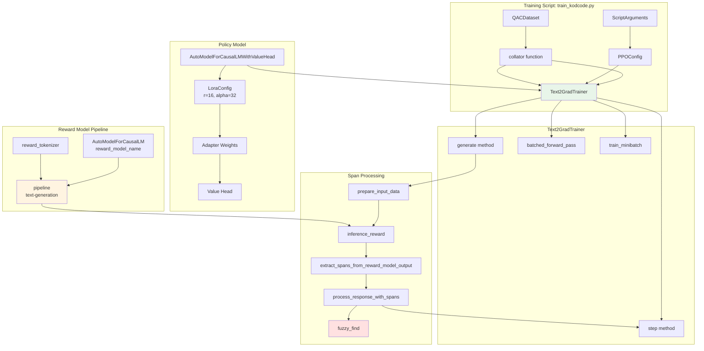

**Sources:** [nl_gradiant_policy_optimization/kodcode/train_kodcode.py:78-323](), [nl_gradiant_policy_optimization/kodcode/text2grad_trainer.py:140-323]()

### Key Classes and Functions

| Component | File Location | Purpose |
|-----------|--------------|---------|
| `Text2GradTrainer` | [text2grad_trainer.py:106-1832]() | Core PPO trainer with NL-gradient support |
| `ScriptArguments` | [train_kodcode.py:78-123]() | Hyperparameters for KodCode training |
| `QACDataset` | [train_kodcode.py:33-76]() | Dataset loader for question-answer-code format |
| `prepare_input_data` | [train_kodcode.py:378-433]() | Formats prompts for reward model |
| `fuzzy_find` | [train_kodcode.py:444-512]() | Locates code spans using fuzzy matching |
| `process_response_with_spans` | [train_kodcode.py:515-631]() | Converts spans to word-level scores |
| `extract_spans_from_reward_model_output` | [train_kodcode.py:633-682]() | Parses JSON feedback from reward model |
| `inference_reward` | [train_kodcode.py:684-718]() | Batch inference on reward model |

**Sources:** [nl_gradiant_policy_optimization/kodcode/train_kodcode.py:1-802](), [nl_gradiant_policy_optimization/kodcode/text2grad_trainer.py:1-1832]()

## Configuration and Setup

### Script Arguments

The `ScriptArguments` dataclass defines all training hyperparameters:

```python
@dataclass
class ScriptArguments:
    base_model_name: str              # Base LLM (e.g., "meta-llama/Llama-3.1-8B-Instruct")
    base_model_adapter_model: str     # Path to existing adapter (for resumption)
    reward_model_name: str            # Trained reward model path
    learning_rate: float = 1e-5       # PPO learning rate
    batch_size: int = 32              # Training batch size
    mini_batch_size: int = 1          # PPO mini-batch size
    ppo_epochs: int = 4               # PPO update epochs per batch
    gradient_accumulation_steps: int = 1
    init_kl_coef: float = 0.2         # Initial KL penalty coefficient
    adap_kl_ctrl: bool = True         # Adaptive KL control
    kl_penalty: str = "full"          # KL divergence calculation method
    prompt_max_length: int = 1000     # Max tokens for prompt
    answer_max_length: int = 500      # Max tokens for generated code
    save_freq: int = 5                # Steps between checkpoints
```

**Sources:** [nl_gradiant_policy_optimization/kodcode/train_kodcode.py:78-123]()

### PPO Configuration

The `PPOConfig` object configures the PPO algorithm:

| Parameter | Value | Purpose |
|-----------|-------|---------|
| `vf_coef` | 0.1 | Value function loss coefficient |
| `learning_rate` | 1e-5 | Policy learning rate |
| `batch_size` | 32 | Training batch size |
| `mini_batch_size` | 1 | PPO mini-batch size |
| `ppo_epochs` | 4 | Optimization epochs per batch |
| `init_kl_coef` | 0.2 | Initial KL penalty coefficient |
| `target_kl` | 0.1 | Target KL divergence for early stopping |
| `kl_penalty` | "full" | Full KL divergence computation |

**Sources:** [nl_gradiant_policy_optimization/kodcode/train_kodcode.py:137-156]()

### Model Initialization

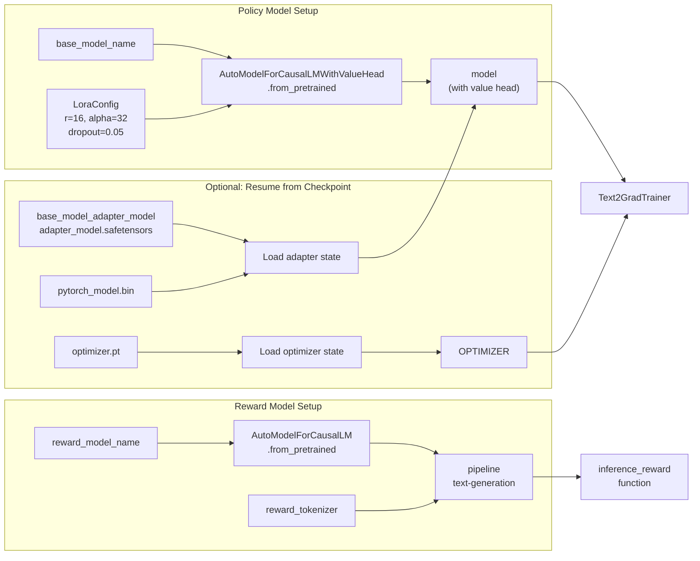

The policy model uses LoRA adapters for parameter-efficient training. When resuming from a checkpoint, the system loads:
- Adapter weights from `adapter_model.safetensors`
- Value head weights from `pytorch_model.bin`
- Optimizer state from `optimizer.pt` (optional)

**Sources:** [nl_gradiant_policy_optimization/kodcode/train_kodcode.py:194-277](), [nl_gradiant_policy_optimization/kodcode/train_kodcode.py:331-343]()

## Training Workflow

### Main Training Loop

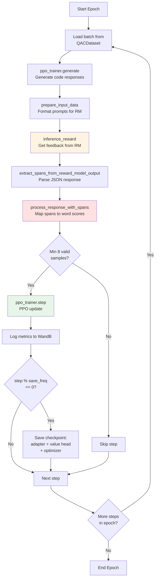

**Sources:** [nl_gradiant_policy_optimization/kodcode/train_kodcode.py:803-1055]()

### Generation Configuration

Two separate generation configurations are used:

**Policy Model Generation** (`generation_kwargs`):
```python
{
    "temperature": 0.6,
    "do_sample": True,
    "top_p": 1,
    "top_k": 0,
    "max_new_tokens": 256,
    "pad_token_id": tokenizer.pad_token_id,
    "eos_token_id": tokenizer.eos_token_id,
}
```

**Reward Model Inference** (`sent_kwargs`):
```python
{
    "batch_size": 32,
    "max_new_tokens": 768,
    "pad_token_id": reward_tokenizer.eos_token_id,
    "eos_token_id": reward_tokenizer.eos_token_id,
}
```

**Sources:** [nl_gradiant_policy_optimization/kodcode/train_kodcode.py:346-362]()

## Reward Model Integration

### Prompt Formatting for Reward Model

The `prepare_input_data` function extracts code from model responses and creates structured prompts:

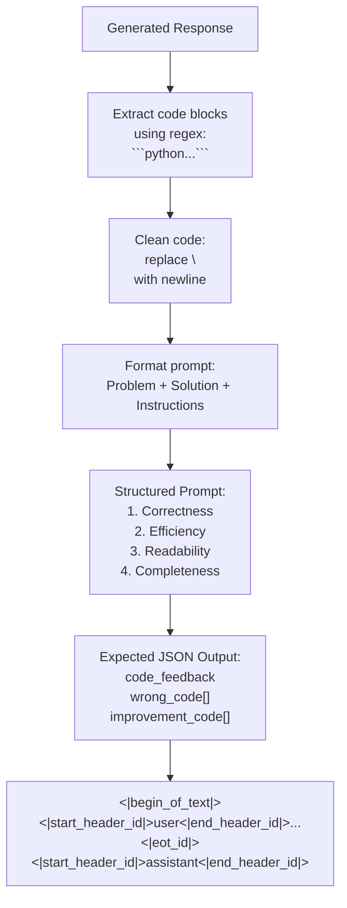

The prompt asks the reward model to:
1. Evaluate code quality across 4 dimensions
2. Identify specific code snippets with errors (`wrong_code`)
3. Identify code snippets that work but could be improved (`improvement_code`)
4. Provide overall feedback (`code_feedback`)

**Sources:** [nl_gradiant_policy_optimization/kodcode/train_kodcode.py:378-433]()

### Reward Model Inference

The `inference_reward` function performs batch inference on the reward model:

```python
def inference_reward(reward_model, input_datas):
    reward_model.model.eval()
    with torch.no_grad():
        results = reward_model(input_datas, **sent_kwargs)
        
        processed_results = []
        for result in results:
            if isinstance(result, (list, tuple)) and len(result) > 0:
                if isinstance(result[0], dict) and 'generated_text' in result[0]:
                    processed_results.append(result)
                else:
                    # Fallback for invalid format
                    processed_results.append([{'generated_text': ''}])
        
        return processed_results
```

Error handling ensures that even if the reward model fails, training continues with empty feedback.

**Sources:** [nl_gradiant_policy_optimization/kodcode/train_kodcode.py:684-718]()

## Span-to-Token Mapping

### Fuzzy Matching Algorithm

The core challenge is matching code spans (strings) from the reward model to token positions in the generated response. The `fuzzy_find` function handles this:

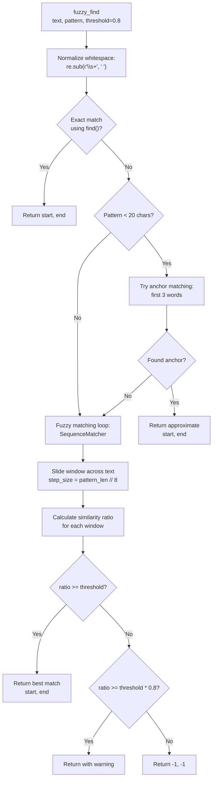

The algorithm tries multiple strategies:
1. **Exact match**: Direct string search
2. **Anchor matching**: For short patterns, find first few words
3. **Fuzzy matching**: Use `difflib.SequenceMatcher` with sliding window
4. **Lower threshold**: Accept matches above 64% similarity with warning

**Sources:** [nl_gradiant_policy_optimization/kodcode/train_kodcode.py:444-512]()

### Span Processing Pipeline

The `process_response_with_spans` function converts reward model output to word-level scores:

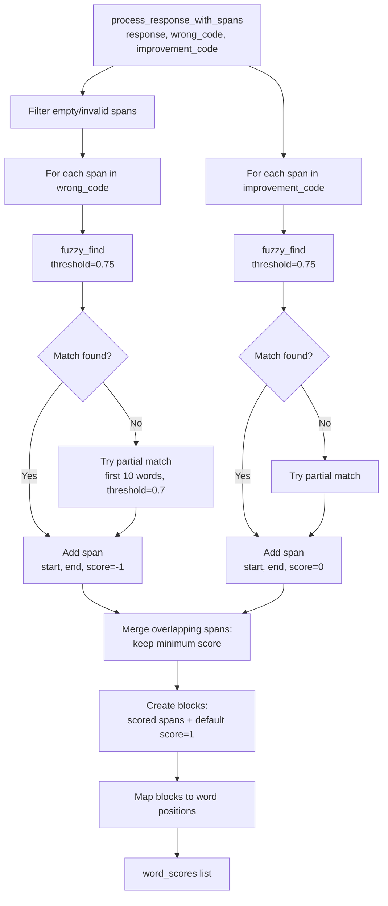

The function assigns scores:
- **-1**: Words in `wrong_code` spans (errors)
- **0**: Words in `improvement_code` spans (suboptimal)
- **1**: All other words (good)

**Sources:** [nl_gradiant_policy_optimization/kodcode/train_kodcode.py:515-631]()

### Example: Span Matching

Consider a generated response:
```python
def add(a, b):
    return a + b + 1  # Wrong: should not add 1
```

Reward model returns:
```json
{
    "wrong_code": ["return a + b + 1"],
    "improvement_code": []
}
```

Processing:
1. `fuzzy_find` locates "return a + b + 1" at character positions 20-37
2. Response is split into words: ["def", "add(a,", "b):", "return", "a", "+", "b", "+", "1"]
3. Word positions are calculated
4. Words within the span receive score -1
5. Final scores: [1.0, 1.0, 1.0, -1, -1, -1, -1, -1, -1]

**Sources:** [nl_gradiant_policy_optimization/kodcode/train_kodcode.py:515-631]()

## Token-Level Reward Assignment

### Word-to-Token Alignment

The `Text2GradTrainer.rematch_scores` method aligns word-level scores to token-level rewards:

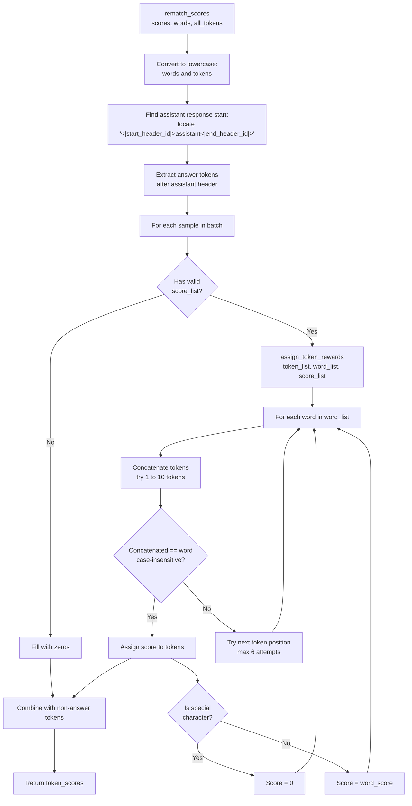

The algorithm:
1. Locates the assistant response start in the full token sequence
2. Extracts only the generated answer tokens
3. For each word, attempts to match it with 1-10 consecutive tokens
4. Assigns the word's score to all matched tokens
5. Handles special characters by assigning score 0
6. Fills unmatched tokens with score 0

**Sources:** [nl_gradiant_policy_optimization/kodcode/text2grad_trainer.py:1398-1454]()

### Token Reward Integration

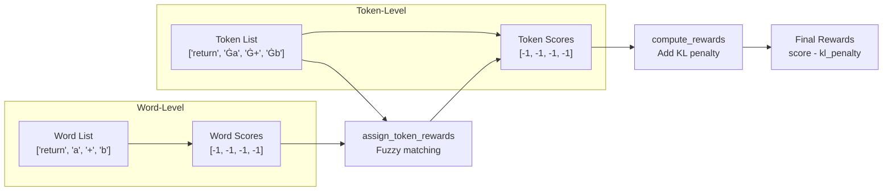

The final token-level rewards combine:
- **Span-based score**: -1 (error), 0 (improvement), or 1 (good)
- **KL penalty**: `-kl_coef * (logprob - ref_logprob)`

Result: `reward[i] = score[i] - kl_coef * kl[i]`

**Sources:** [nl_gradiant_policy_optimization/kodcode/text2grad_trainer.py:1456-1499]()

## PPO Update Step

### The `step` Method

The `Text2GradTrainer.step` method performs one PPO update:

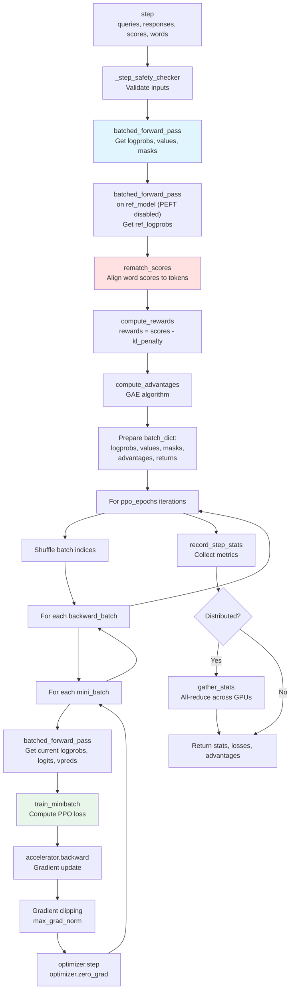

**Sources:** [nl_gradiant_policy_optimization/kodcode/text2grad_trainer.py:668-1023]()

### Loss Computation

The `train_minibatch` method computes PPO losses:

**Policy Loss** (clipped objective):
```python
ratio = torch.exp(logprobs - old_logprobs)
pg_losses = -advantages * ratio
pg_losses2 = -advantages * torch.clamp(ratio, 1 - cliprange, 1 + cliprange)
pg_loss = masked_mean(torch.max(pg_losses, pg_losses2), mask)
```

**Value Loss** (clipped):
```python
vpredclipped = clip_by_value(vpreds, values - cliprange_value, values + cliprange_value)
vf_losses1 = (vpreds - returns) ** 2
vf_losses2 = (vpredclipped - returns) ** 2
vf_loss = 0.5 * masked_mean(torch.max(vf_losses1, vf_losses2), mask)
```

**Total Loss**:
```python
loss = pg_loss + vf_coef * vf_loss
```

**Sources:** [nl_gradiant_policy_optimization/kodcode/text2grad_trainer.py:1233-1274](), [nl_gradiant_policy_optimization/kodcode/text2grad_trainer.py:1559-1642]()

## Checkpointing and Resumption

### Checkpoint Saving

When `step % save_freq == 0`, the system saves:

1. **Adapter Model**: `adapter_model.safetensors` (LoRA weights)
2. **Value Head**: `pytorch_model.bin` (value function head)
3. **Optimizer State**: `optimizer.pt` (optimizer + lr_scheduler)

```python
save_path = os.path.join(output_dir, f"epoch_{epoch}_step_{step}")
ppo_trainer.save_pretrained(save_path)

# Save optimizer separately
optimizer_path = os.path.join(save_path, "optimizer.pt")
torch.save({
    'optimizer': optimizer.state_dict(),
    'lr_scheduler': lr_scheduler.state_dict() if lr_scheduler else None,
}, optimizer_path)
```

**Sources:** [nl_gradiant_policy_optimization/kodcode/train_kodcode.py:997-1030]()

### Checkpoint Loading

The system can resume from a checkpoint:

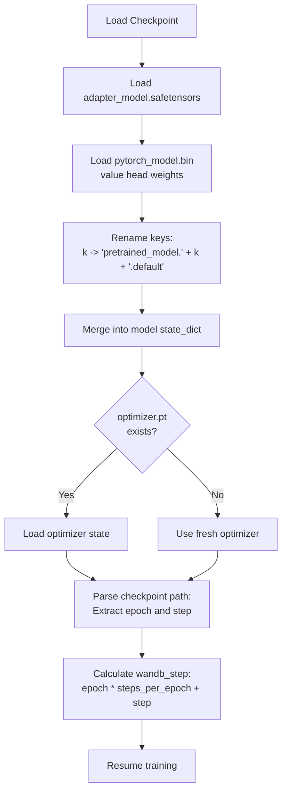

**Sources:** [nl_gradiant_policy_optimization/kodcode/train_kodcode.py:208-277]()

## Monitoring and Logging

### WandB Integration

The system logs comprehensive metrics to Weights & Biases:

| Metric Category | Metrics | Source |
|----------------|---------|--------|
| **Loss** | `train/loss_advantage`, `train/loss_value_kl` | PPO losses |
| **Rewards** | `rewards/mean`, `rewards/max`, `rewards/min` | Token rewards |
| **Reward Distribution** | `rewards/positive_ratio`, `rewards/negative_ratio`, `rewards/zero_ratio` | Score statistics |
| **PPO** | `ppo/mean_scores`, `ppo/std_scores`, `ppo/mean_non_score_reward` | PPO metrics |
| **KL** | `objective/kl`, `objective/kl_dist` | KL divergence |
| **Policy** | `policy/entropy`, `policy/approxkl`, `policy/clipfrac` | Policy statistics |
| **Value** | `val/vpred`, `val/error` | Value function |

**Sources:** [nl_gradiant_policy_optimization/kodcode/train_kodcode.py:974-995](), [nl_gradiant_policy_optimization/kodcode/text2grad_trainer.py:1644-1697]()

### Sample Logging

Each batch logs sample information:

```python
batch_log = {
    "timestamp": datetime.datetime.now().strftime("%Y-%m-%d %H:%M:%S"),
    "epoch": epoch,
    "step": step,
    "batch_size": len(batch["question"]),
    "successful_samples": 0,
    "failed_samples": 0,
    "sample_logs": []  # Individual sample details
}
```

For each sample:
- Question (first 100 chars)
- Response (first 100 chars)
- Status (success/failed/error)
- Error message (if applicable)
- Reward counts

**Sources:** [nl_gradiant_policy_optimization/kodcode/train_kodcode.py:844-947]()

## Error Handling

### Multi-Level Error Recovery

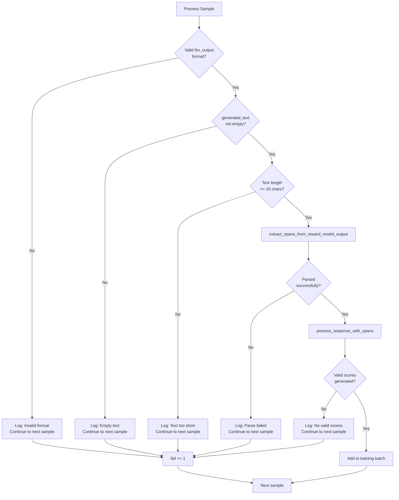

The system tolerates individual sample failures and continues training as long as at least 8 valid samples remain in the batch.

**Sources:** [nl_gradiant_policy_optimization/kodcode/train_kodcode.py:854-948]()

### Distributed Training Coordination

When using multiple GPUs, the system ensures all processes have sufficient samples:

```python
if ppo_trainer.accelerator.num_processes > 1:
    valid_samples_tensor = torch.tensor(valid_samples, device=device)
    
    # Gather counts from all processes
    all_valid_samples = [torch.zeros_like(valid_samples_tensor) 
                         for _ in range(num_processes)]
    torch.distributed.all_gather(all_valid_samples, valid_samples_tensor)
    
    min_valid_samples = min([count.item() for count in all_valid_samples])
    
    if min_valid_samples < 8:
        print(f"Warning: Some processes have fewer than 8 valid samples, skipping step")
        continue
```

This prevents deadlocks when different processes have different numbers of valid samples.

**Sources:** [nl_gradiant_policy_optimization/kodcode/train_kodcode.py:951-967]()

## Usage Example

### Basic Training Command

```bash
python nl_gradiant_policy_optimization/kodcode/train_kodcode.py \
    --base_model_name meta-llama/Llama-3.1-8B-Instruct \
    --reward_model_name path/to/trained/reward/model \
    --data_file_path path/to/kodcode/train.json \
    --output_dir ckpt/kodcode_ppo \
    --learning_rate 1e-5 \
    --batch_size 32 \
    --mini_batch_size 1 \
    --ppo_epochs 4 \
    --train_epochs 2 \
    --save_freq 5 \
    --kl_penalty full \
    --init_kl_coef 0.2
```

### Resuming from Checkpoint

```bash
python nl_gradiant_policy_optimization/kodcode/train_kodcode.py \
    --base_model_name meta-llama/Llama-3.1-8B-Instruct \
    --base_model_adapter_model ckpt/kodcode_ppo/epoch_0_step_10 \
    --reward_model_name path/to/trained/reward/model \
    --data_file_path path/to/kodcode/train.json \
    --output_dir ckpt/kodcode_ppo
```

The system automatically:
- Loads adapter and value head weights
- Restores optimizer state
- Calculates the correct epoch and step
- Resumes training from that point

**Sources:** [nl_gradiant_policy_optimization/kodcode/train_kodcode.py:1-160]()

## Key Differences from Generic PPO

### Code-Specific Adaptations

1. **Fuzzy Matching**: Required because code spans may have different whitespace than tokens
2. **Partial Matching**: For long code blocks, matches first N words to locate approximate position
3. **Special Character Handling**: Tokens like `<|eot_id|>` receive score 0
4. **Code Block Extraction**: Uses regex to extract code from markdown formatting
5. **Structured Feedback**: JSON format with separate arrays for wrong and improvable code

### Comparison with UltraFeedback/SLF5K

| Aspect | KodCode | UltraFeedback | SLF5K |
|--------|---------|---------------|-------|
| **Reward Format** | `wrong_code`, `improvement_code` | `good_spans`, `poor_spans` | Word-level scores |
| **Matching Strategy** | Fuzzy (code whitespace) | Direct (text) | Direct (text) |
| **Score Values** | -1, 0, 1 | -1, 0, 1 | -1, 0, 1 |
| **Prompt Format** | Code analysis | QA evaluation | Summary quality |
| **Max Tokens** | 256 (code) | 512 (answers) | 256 (summaries) |

**Sources:** [nl_gradiant_policy_optimization/kodcode/train_kodcode.py:378-631]()

---

**Complete Sources:**
- [nl_gradiant_policy_optimization/kodcode/text2grad_trainer.py:1-1832]()
- [nl_gradiant_policy_optimization/kodcode/train_kodcode.py:1-1055]()

---

