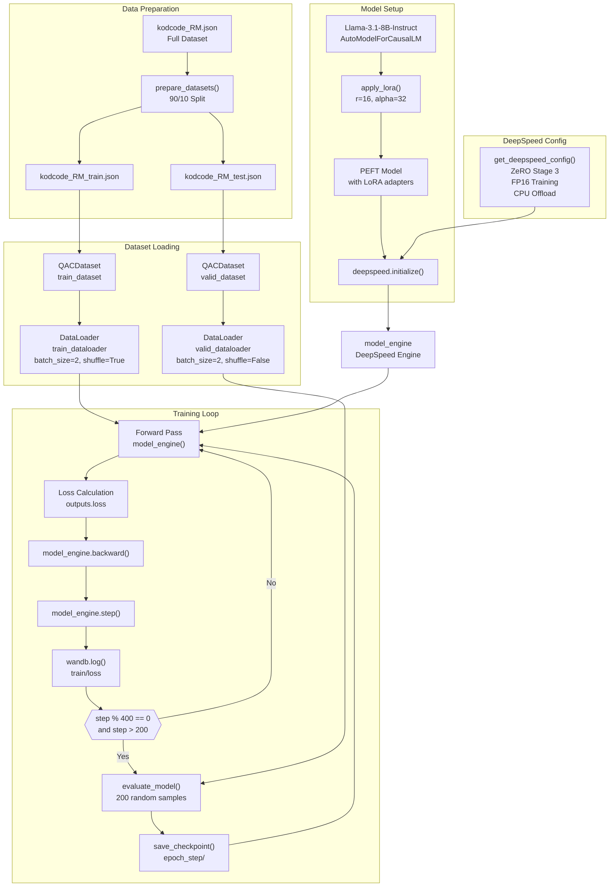
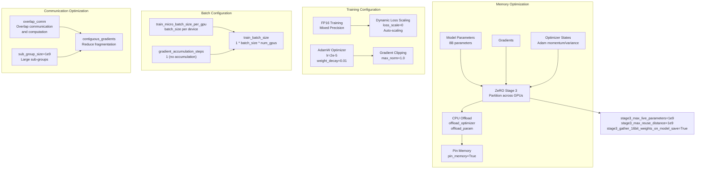
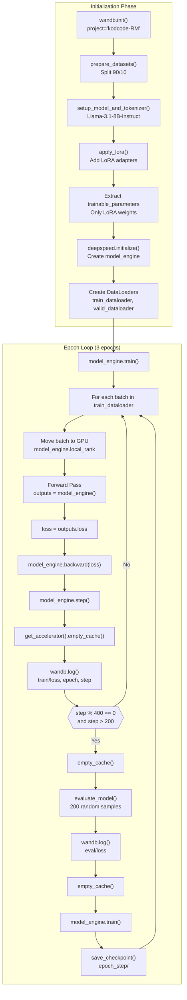
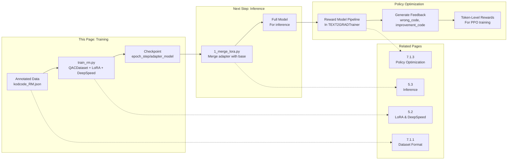

<!-- source: DeepWiki mcp.deepwiki.com · repo microsoft/Text2Grad · extra page KodCode Reward Model Training · fetched 2026-10-26 -->

# KodCode Reward Model Training

<details>
<summary>Relevant source files</summary>

The following files were used as context for generating this wiki page:

- [nl_reward_model/kodcode/train_rm.py](nl_reward_model/kodcode/train_rm.py)

</details>


## Purpose and Scope

This document describes the training process for KodCode reward models, which learn to evaluate Python code solutions and provide structured feedback. The reward model outputs JSON with three fields: `code_feedback` (textual critique), `wrong_code` (code snippets with errors), and `improvement_code` (code snippets that could be improved).

This page covers the training script located at [nl_reward_model/kodcode/train_rm.py:1-427](). For information about KodCode dataset format and annotation, see [7.1.1](#7.1.1). For inference and evaluation of trained models, see [5.3](#5.3) and [5.5](#5.5). For using the trained reward model in policy optimization, see [7.1.3](#7.1.3).

**Sources:** [nl_reward_model/kodcode/train_rm.py:1-427]()

---

## Training Pipeline Overview



**Diagram: KodCode Reward Model Training Pipeline**

This diagram shows the end-to-end training flow from data preparation through the training loop. The `QACDataset` class formats code questions, solutions, and feedback into training examples. The model uses LoRA for parameter-efficient fine-tuning and DeepSpeed ZeRO Stage 3 for memory-efficient distributed training. Evaluation runs every 400 steps on 200 random validation samples.

**Sources:** [nl_reward_model/kodcode/train_rm.py:124-157](), [nl_reward_model/kodcode/train_rm.py:325-403](), [nl_reward_model/kodcode/train_rm.py:209-260]()

---

## QACDataset: Question-Answer-Critique Format

```mermaid
graph TB
    subgraph "Input JSON Item"
        ITEM["item from json_data"]
        ITEM --> Q["question<br/>Problem description"]
        ITEM --> S["solution<br/>Code submission"]
        ITEM --> CF["code_feedback<br/>Textual critique"]
        ITEM --> WC["wrong_code<br/>Array of error snippets"]
        ITEM --> IC["improvement_code<br/>Array of improvement snippets"]
    end
    
    subgraph "Prompt Construction"
        Q --> PROMPT["Formatted Prompt<br/>Lines 56-85"]
        S --> PROMPT
        PROMPT --> INST["Instructions<br/>Evaluate correctness,<br/>efficiency, readability,<br/>completeness"]
        INST --> FORMAT["Output Format<br/>JSON schema"]
    end
    
    subgraph "Response Construction"
        CF --> JSON_OUT["json.dumps()<br/>Structured Answer"]
        WC --> JSON_OUT
        IC --> JSON_OUT
    end
    
    subgraph "Tokenization"
        PROMPT --> INPUT_TEXT["input_text<br/>with chat template<br/>user/assistant tags"]
        INPUT_TEXT --> SRC_TOK["src_tokens<br/>Truncate to prompt_max_length"]
        JSON_OUT --> TGT_TOK["tgt_tokens<br/>Truncate to answer_max_length"]
        SRC_TOK --> CONCAT["tokens = src + tgt + eos"]
        TGT_TOK --> CONCAT
        CONCAT --> IDS["input_ids<br/>convert_tokens_to_ids()"]
    end
    
    subgraph "Label Masking"
        SRC_TOK --> CONTEXT_LEN["context_length<br/>len(src_tokens)"]
        CONTEXT_LEN --> LABELS["labels<br/>-100 for prompt<br/>input_ids for answer"]
        IDS --> LABELS
    end
    
    subgraph "Padding"
        IDS --> PAD["Pad to max_length<br/>with pad_token_id"]
        LABELS --> PAD_LABELS["Pad labels<br/>with -100"]
        PAD --> ATTN["attention_mask<br/>1 for tokens, 0 for padding"]
    end
    
    subgraph "Output Batch"
        PAD --> BATCH["Batch Dictionary"]
        PAD_LABELS --> BATCH
        ATTN --> BATCH
        BATCH --> RET["input_ids: torch.tensor<br/>attention_mask: torch.tensor<br/>labels: torch.tensor"]
    end
```



**Diagram: QACDataset Data Processing Pipeline**

The `QACDataset` class ([nl_reward_model/kodcode/train_rm.py:22-121]()) converts raw JSON items into training batches. The prompt follows the Llama chat template with `<|begin_of_text|>`, `<|start_header_id|>user`, and `<|start_header_id|>assistant` markers. The ground truth answer is a JSON object with `code_feedback`, `wrong_code`, and `improvement_code` fields.

**Key Implementation Details:**

| Aspect | Implementation | Line Reference |
|--------|----------------|----------------|
| **Prompt Template** | Includes problem description, submitted solution, and evaluation instructions | [56-85]() |
| **Output Format** | JSON with three fields: code_feedback (string), wrong_code (array), improvement_code (array) | [78-84]() |
| **Chat Template** | Llama-3.1 format with user/assistant headers | [93]() |
| **Tokenization** | Separate tokenization of prompt and answer, with truncation | [95-101]() |
| **Label Masking** | Labels set to -100 for prompt tokens (no loss), actual token IDs for answer | [108]() |
| **Padding Strategy** | Right-padding to `max_length` with pad_token_id and -100 for labels | [112-115]() |

**Sources:** [nl_reward_model/kodcode/train_rm.py:22-121]()

---

## Model Setup and LoRA Configuration

The training script uses Llama-3.1-8B-Instruct as the base model with LoRA (Low-Rank Adaptation) for parameter-efficient fine-tuning.

### Model Initialization

The `setup_model_and_tokenizer()` function ([nl_reward_model/kodcode/train_rm.py:159-180]()) performs the following:

1. **Tokenizer Setup**: Loads `AutoTokenizer` from the pretrained model
2. **Padding Token Configuration**: Sets `pad_token` to `eos_token` if not present
3. **Padding Side**: Sets `padding_side = "right"` for causal language modeling
4. **Model Loading**: Loads `AutoModelForCausalLM` from the pretrained checkpoint
5. **Token ID Alignment**: Sets `model.pad_token_id = tokenizer.eos_token_id`

### LoRA Configuration

The `apply_lora()` function ([nl_reward_model/kodcode/train_rm.py:183-206]()) applies LoRA adapters with the following configuration:

| Parameter | Value | Description |
|-----------|-------|-------------|
| `r` | 16 | LoRA rank (dimensionality of low-rank matrices) |
| `lora_alpha` | 32 | Scaling factor for LoRA updates |
| `target_modules` | `["q_proj", "k_proj", "v_proj", "o_proj"]` | Attention projection layers to adapt |
| `lora_dropout` | 0.1 | Dropout rate for LoRA layers |
| `bias` | "none" | No bias terms in LoRA layers |
| `task_type` | "CAUSAL_LM" | Task type for causal language modeling |

**Why LoRA?**
- **Memory Efficiency**: Only trains ~0.5% of parameters instead of full 8B model
- **Faster Training**: Reduced parameter count accelerates training
- **Adapter Portability**: Can save/load only adapter weights (~50MB) instead of full model (16GB)

**Sources:** [nl_reward_model/kodcode/train_rm.py:159-206]()

---

## DeepSpeed ZeRO Stage 3 Configuration

The `get_deepspeed_config()` function ([nl_reward_model/kodcode/train_rm.py:209-260]()) creates a DeepSpeed configuration dictionary optimized for large model training with limited GPU memory.



**Diagram: DeepSpeed ZeRO Stage 3 Memory Optimization Strategy**

### Key Configuration Sections

**1. ZeRO Stage 3 Optimization** ([nl_reward_model/kodcode/train_rm.py:237-253]())
```
"zero_optimization": {
    "stage": 3,
    "offload_optimizer": {"device": "cpu", "pin_memory": True},
    "offload_param": {"device": "cpu", "pin_memory": True},
    "overlap_comm": True,
    "contiguous_gradients": True,
    "sub_group_size": 1e9,
    "stage3_max_live_parameters": 1e9,
    "stage3_max_reuse_distance": 1e9,
    "stage3_gather_16bit_weights_on_model_save": True
}
```

| Parameter | Value | Purpose |
|-----------|-------|---------|
| `stage` | 3 | Partition model parameters, gradients, and optimizer states |
| `offload_optimizer` | CPU with pinned memory | Move optimizer states to CPU RAM |
| `offload_param` | CPU with pinned memory | Move model parameters to CPU when not in use |
| `overlap_comm` | True | Overlap communication with computation for efficiency |
| `contiguous_gradients` | True | Reduce memory fragmentation |
| `stage3_max_live_parameters` | 1e9 | Maximum parameters kept in GPU memory |
| `stage3_gather_16bit_weights_on_model_save` | True | Gather FP16 weights when saving checkpoints |

**2. FP16 Mixed Precision** ([nl_reward_model/kodcode/train_rm.py:221-226]())
```
"fp16": {
    "enabled": True,
    "loss_scale": 0,  # Dynamic loss scaling
    "loss_scale_window": 1000,
    "hysteresis": 2,
    "min_loss_scale": 1
}
```

**3. AdamW Optimizer** ([nl_reward_model/kodcode/train_rm.py:228-236]())
```
"optimizer": {
    "type": "AdamW",
    "params": {
        "lr": 2e-5,
        "betas": [0.9, 0.999],
        "eps": 1e-8,
        "weight_decay": 0.01
    }
}
```

**4. Batch Size Configuration** ([nl_reward_model/kodcode/train_rm.py:254-256]())
- `train_micro_batch_size_per_gpu`: Batch size per GPU (e.g., 2)
- `gradient_accumulation_steps`: 1 (no gradient accumulation)
- `train_batch_size`: `1 * batch_size * torch.cuda.device_count()`

**Sources:** [nl_reward_model/kodcode/train_rm.py:209-260]()

---

## Training Loop Implementation

The main training loop is implemented in the `train()` function ([nl_reward_model/kodcode/train_rm.py:325-403]()).



**Diagram: Training Loop with Periodic Evaluation and Checkpointing**

### Training Step Details

**1. Batch Processing** ([nl_reward_model/kodcode/train_rm.py:370-378]())
```python
for step, batch in tqdm(enumerate(train_dataloader), total=len(train_dataloader)):
    input_ids = batch["input_ids"].to(model_engine.local_rank)
    attention_mask = batch["attention_mask"].to(model_engine.local_rank)
    labels = batch["labels"].to(model_engine.local_rank)
    outputs = model_engine(input_ids=input_ids, attention_mask=attention_mask, labels=labels)
    loss = outputs.loss
    
    model_engine.backward(loss)
    model_engine.step()
```

**2. Memory Management** ([nl_reward_model/kodcode/train_rm.py:380]())
- `get_accelerator().empty_cache()`: Clears GPU cache after each step to prevent memory fragmentation

**3. Logging** ([nl_reward_model/kodcode/train_rm.py:382-386]())
- Logs to Weights & Biases: `train/loss`, `epoch`, `step`

**4. Periodic Evaluation** ([nl_reward_model/kodcode/train_rm.py:388-402]())
- Condition: `step % 400 == 0 and step > 200`
- Calls `evaluate_model()` on 200 random validation samples
- Logs `eval/loss` and `eval/samples` to WandB
- Returns to training mode after evaluation

**Sources:** [nl_reward_model/kodcode/train_rm.py:325-403]()

---

## Evaluation Process

The `evaluate_model()` function ([nl_reward_model/kodcode/train_rm.py:263-305]()) performs validation on a random subset of the validation dataset.

### Evaluation Strategy

| Aspect | Implementation |
|--------|----------------|
| **Subset Size** | 200 samples (fixed) |
| **Sampling Method** | Random permutation: `torch.randperm(total_eval_samples)[:subset_size]` |
| **Subset Creation** | `torch.utils.data.Subset(eval_dataloader.dataset, random_indices)` |
| **Batch Processing** | Uses same batch size as training |
| **Shuffling** | Enabled (`shuffle=True`) |
| **Model Mode** | `model_engine.eval()` with `torch.no_grad()` |

### Evaluation Loop

```python
model_engine.eval()
eval_losses = []

# Create random subset
random_indices = torch.randperm(total_eval_samples)[:subset_size]
eval_subset = torch.utils.data.Subset(eval_dataloader.dataset, random_indices)
eval_subset_loader = DataLoader(eval_subset, batch_size=eval_dataloader.batch_size, shuffle=True)

with torch.no_grad():
    for eval_step, batch in tqdm(enumerate(eval_subset_loader), total=len(eval_subset_loader), desc="Evaluating random subset"):
        input_ids = batch["input_ids"].to(model_engine.local_rank)
        attention_mask = batch["attention_mask"].to(model_engine.local_rank)
        labels = batch["labels"].to(model_engine.local_rank)
        outputs = model_engine(input_ids=input_ids, attention_mask=attention_mask, labels=labels)
        
        eval_loss = outputs.loss
        eval_losses.append(eval_loss.item())

avg_eval_loss = sum(eval_losses) / len(eval_losses)
return avg_eval_loss
```

**Why Random Subset?**
- **Speed**: Evaluating full validation set is time-consuming
- **Memory**: Full validation may not fit in GPU memory
- **Frequency**: Evaluation runs every 400 steps, requiring fast completion
- **Representativeness**: Random sampling provides unbiased loss estimate

**Sources:** [nl_reward_model/kodcode/train_rm.py:263-305]()

---

## Checkpoint Management

The `save_checkpoint()` function ([nl_reward_model/kodcode/train_rm.py:308-322]()) saves model checkpoints during training.

### Checkpoint Structure

```
ckpt/text2grad_kodcode_RM/
├── 0_400/
│   ├── adapter_config.json
│   ├── adapter_model.safetensors
│   └── ... (other files)
├── 0_800/
│   ├── adapter_config.json
│   ├── adapter_model.safetensors
│   └── ...
└── ...
```

### Implementation Details

| Aspect | Implementation | Line Reference |
|--------|----------------|----------------|
| **Directory Format** | `{epoch}_{step}/` (e.g., "0_400", "1_800") | [319]() |
| **Rank Check** | Only rank 0 saves: `if model_engine.local_rank == 0:` | [318]() |
| **Save Method** | `model_engine.save_pretrained(checkpoint_dir)` | [321]() |
| **Content** | LoRA adapter weights (not full model) | [321]() |

**Why Only Rank 0?**
- In distributed training, all ranks have the same model state
- Saving from multiple ranks would create redundant files
- DeepSpeed handles gathering weights from all ranks when saving

**Checkpoint Contents:**
- `adapter_config.json`: LoRA configuration
- `adapter_model.safetensors`: LoRA adapter weights (~50MB)
- **Not included**: Base model weights (loaded separately during inference)

**Sources:** [nl_reward_model/kodcode/train_rm.py:308-322]()

---

## Training Configuration Parameters

The `main()` function ([nl_reward_model/kodcode/train_rm.py:405-423]()) defines the default training configuration.

### Configuration Dictionary

| Parameter | Default Value | Description |
|-----------|---------------|-------------|
| `model_name` | `"meta-llama/Llama-3.1-8B-Instruct"` | Base model from Hugging Face Hub |
| `dataset_file` | `"./data/KodCode/kodcode_RM.json"` | Full dataset before splitting |
| `train_dataset_file` | `"./data/KodCode/kodcode_RM_train.json"` | Training split output path |
| `valid_dataset_file` | `"./data/KodCode/kodcode_RM_test.json"` | Validation split output path |
| `batch_size` | 2 | Batch size per GPU |
| `epochs` | 3 | Number of training epochs |
| `prompt_max_length` | 900 | Maximum tokens for prompt (question + instructions) |
| `max_length` | 1250 | Maximum total sequence length (prompt + answer) |
| `exp_dir` | `"ckpt/text2grad_kodcode_RM"` | Checkpoint directory |
| `project_name` | `"kodcode-RM"` | Weights & Biases project name |

### Computed Parameters

- **Answer Max Length**: `max_length - prompt_max_length - 1 = 349` tokens
- **Global Batch Size**: `1 * batch_size * torch.cuda.device_count()` (e.g., 16 with 8 GPUs)
- **Split Ratio**: 90% training / 10% validation (hardcoded in `prepare_datasets()`)

### Memory Considerations

With the default configuration:
- **Prompt**: 900 tokens
- **Answer**: 349 tokens  
- **Total Sequence**: 1250 tokens
- **Batch Size**: 2 per GPU
- **Estimated GPU Memory**: ~40GB per GPU (with ZeRO Stage 3 and CPU offload)

For GPUs with less memory, consider:
- Reducing `batch_size` to 1
- Reducing `max_length` to 1024 or 896
- Increasing `gradient_accumulation_steps` in DeepSpeed config

**Sources:** [nl_reward_model/kodcode/train_rm.py:405-423]()

---

## Running the Training Script

### Prerequisites

1. **Environment Setup**: See [2.1](#2.1) for installation instructions
2. **Dataset Preparation**: Annotated KodCode data at `./data/KodCode/kodcode_RM.json` (see [7.1.1](#7.1.1))
3. **Hugging Face Access**: Llama-3.1 model requires authentication

### Single-GPU Training

```bash
cd nl_reward_model/kodcode
deepspeed train_rm.py
```

### Multi-GPU Training

```bash
cd nl_reward_model/kodcode
deepspeed --num_gpus=8 train_rm.py
```

### Monitoring Training

The script logs to Weights & Biases with project name `"kodcode-RM"`. Key metrics:
- `train/loss`: Training loss per step
- `eval/loss`: Validation loss (every 400 steps after step 200)
- `eval/samples`: Number of evaluation samples (always 200)

### Training Duration

Approximate training time on 8x A100 GPUs (80GB):
- **Per Epoch**: ~6-8 hours (depends on dataset size)
- **Total (3 epochs)**: ~18-24 hours
- **Checkpoints**: Saved every 400 steps (~every 30-40 minutes)

### Output Files

After training completes:
1. **Checkpoints**: `ckpt/text2grad_kodcode_RM/{epoch}_{step}/`
2. **Split Datasets**: `kodcode_RM_train.json` and `kodcode_RM_test.json`
3. **WandB Logs**: Online dashboard with loss curves and metrics

**Sources:** [nl_reward_model/kodcode/train_rm.py:1-19](), [nl_reward_model/kodcode/train_rm.py:405-427]()

---

## Integration with Pipeline

The trained reward model integrates into the Text2Grad pipeline as follows:



**Diagram: KodCode Reward Model Training in the Text2Grad Pipeline**

**Pipeline Flow:**
1. **Annotation** ([7.1.1](#7.1.1)): Create `kodcode_RM.json` with question, solution, code_feedback, wrong_code, improvement_code
2. **Training** (this page): Train reward model using `train_rm.py` with LoRA and DeepSpeed
3. **Merging** ([5.3](#5.3)): Merge LoRA adapters with base model using `1_merge_lora.py`
4. **Policy Optimization** ([7.1.3](#7.1.3)): Use trained reward model to generate feedback for PPO training

**Sources:** [nl_reward_model/kodcode/train_rm.py:1-427]()

---

