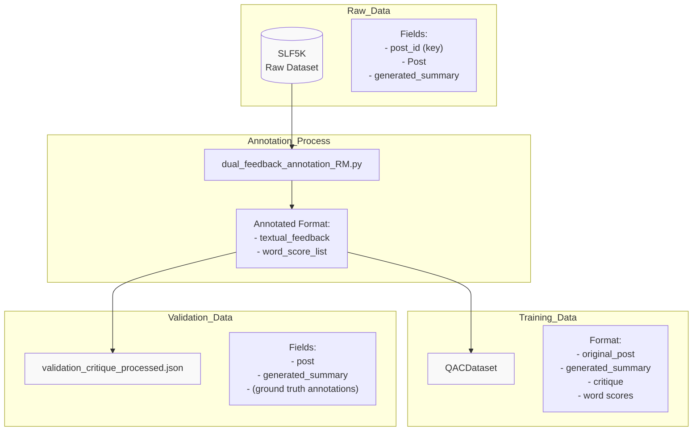
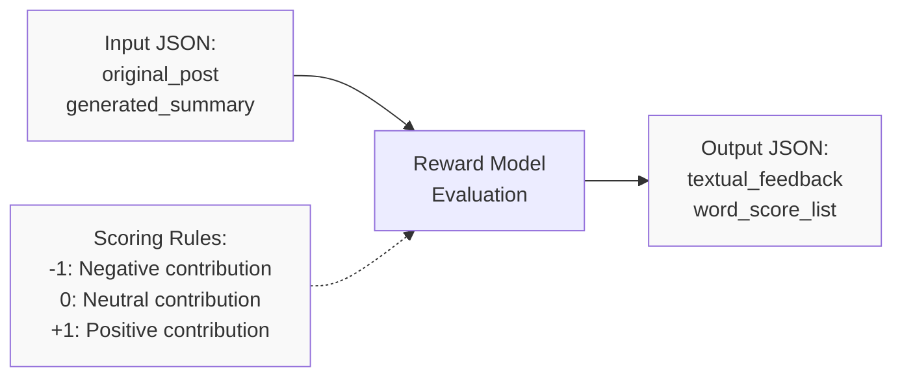
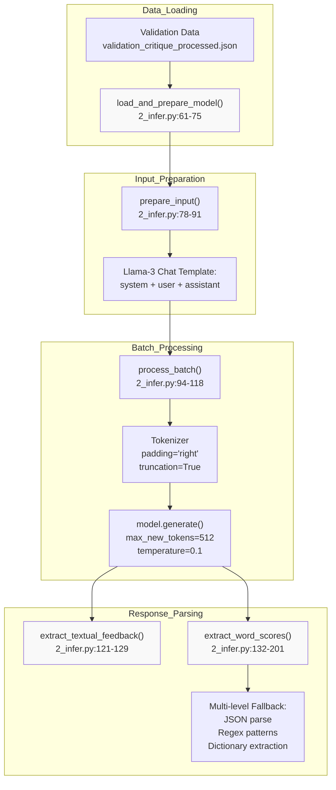
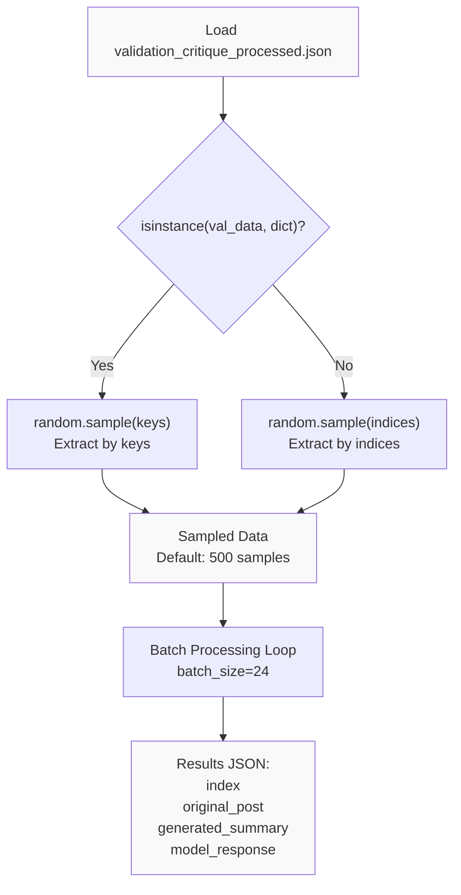
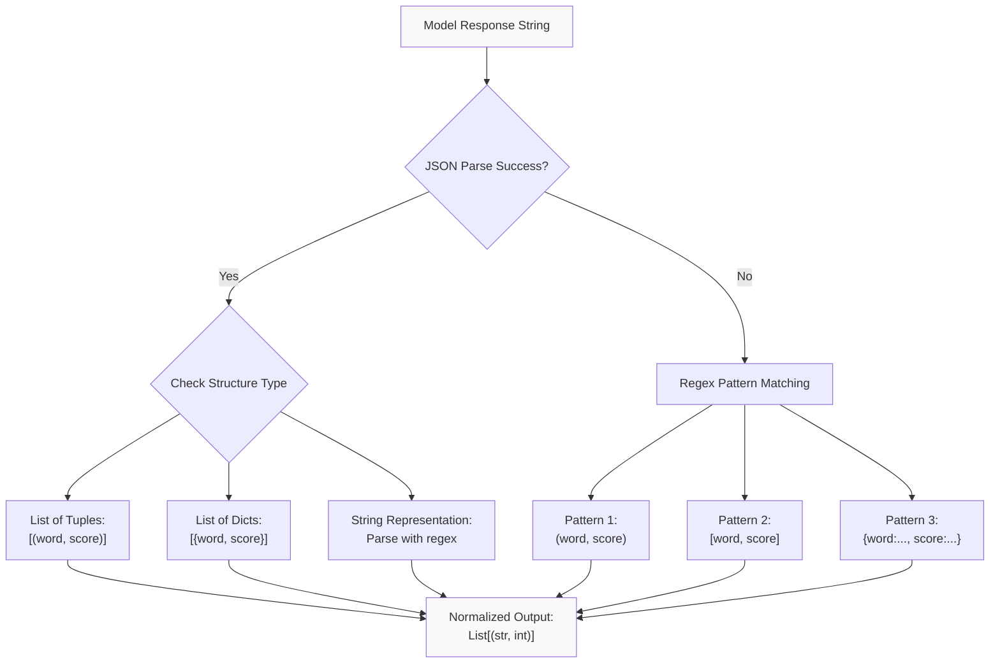
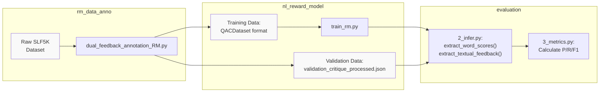

<!-- source: DeepWiki mcp.deepwiki.com · repo microsoft/Text2Grad · extra page SLF5K Dataset Format · fetched 2026-10-26 -->

# SLF5K Dataset Format

<details>
<summary>Relevant source files</summary>

The following files were used as context for generating this wiki page:

- [README.md](README.md)
- [nl_reward_model/slf5k/evaluation/2_infer.py](nl_reward_model/slf5k/evaluation/2_infer.py)

</details>


## Purpose and Scope

This document describes the data format specifications for the SLF5K (Summarization Language Feedback 5K) dataset used in the Text2Grad system. It covers both the raw input format and the processed annotation format used for training reward models and policy optimization. 

For information about training SLF5K reward models, see [SLF5K Reward Model](#7.3.2). For policy optimization procedures, see [SLF5K Policy Optimization](#7.3.3). For general information about dual-feedback annotation across all tasks, see [Dual-Feedback Annotation](#4.2).

---

## Overview

The SLF5K dataset contains Reddit posts paired with generated summaries that are annotated with word-level quality scores and textual feedback. The dataset supports the summarization task by providing fine-grained feedback about which words contribute positively, negatively, or neutrally to summary quality.



**Sources:** [README.md:163-170](), [nl_reward_model/slf5k/evaluation/2_infer.py:1-288]()

---

## Raw Dataset Format

The raw SLF5K dataset uses a nested dictionary structure where post IDs serve as top-level keys. This format is specified in the repository documentation and consumed by annotation scripts.

### Structure

```json
{
  "t3_132suw": {
    "generated_summary": "My girlfriend is premed and ...",
    "Post": "My girlfriend is studying something she won't ever use ..."
  },
  "t3_abc123": {
    "generated_summary": "Another summary text...",
    "Post": "Another original post text..."
  }
}
```

### Field Specifications

| Field | Type | Description |
|-------|------|-------------|
| **Post ID** (key) | `string` | Unique identifier for the Reddit post, typically in format `t3_<alphanumeric>` |
| `Post` | `string` | Full text of the original Reddit post |
| `generated_summary` | `string` | Model-generated summary of the post |

**Sources:** [README.md:163-170]()

---

## Annotated Dataset Format

After processing through the dual-feedback annotation pipeline, the dataset is transformed into a format suitable for reward model training. This format includes textual critiques and word-level scores.

### System Prompt Structure

The reward model is trained to understand a specific evaluation framework defined by a system prompt:



**Sources:** [nl_reward_model/slf5k/evaluation/2_infer.py:12-40]()

### Annotated Format Structure

The annotated format transforms the raw data into a question-answer-critique structure:

```json
{
  "textual_feedback": "feedback indicating missing, incorrect, or unnecessary content in the generated summary.",
  "word_score_list": [
    ["word1", -1],
    ["word2", 0],
    ["word3", 1]
  ]
}
```

### Field Specifications

| Field | Type | Description |
|-------|------|-------------|
| `textual_feedback` | `string` | Natural language critique explaining quality issues in the summary |
| `word_score_list` | `list[tuple]` | List of (word, score) pairs where score is -1, 0, or 1 |

### Word Score Semantics

The word-level scoring system provides fine-grained feedback:

- **`-1` (Negative)**: Word has a negative contribution to summarizing the original content (e.g., hallucinations, irrelevant details, factual errors)
- **`0` (Neutral)**: Word has a neutral contribution (e.g., common connectors, words that don't add or detract from quality)
- **`1` (Positive)**: Word has a positive contribution (e.g., accurately captures key information, improves clarity)

**Sources:** [nl_reward_model/slf5k/evaluation/2_infer.py:12-40]()

---

## Data Processing Pipeline

The following diagram shows how data flows through the codebase from raw format to training-ready format:



**Sources:** [nl_reward_model/slf5k/evaluation/2_infer.py:61-201]()

---

## Validation Data Format

For evaluation purposes, the system uses a processed validation dataset stored in `validation_critique_processed.json`. The inference script samples from this data to evaluate trained reward models.

### Sampling and Processing

The validation data can be stored in either dictionary or list format:

```python
# Dictionary format (keyed by post ID)
{
  "t3_132suw": {
    "post": "Original post text...",
    "generated_summary": "Generated summary text..."
  }
}

# List format (sequential)
[
  {
    "post": "Original post text...",
    "generated_summary": "Generated summary text..."
  }
]
```

The `main()` function in `2_infer.py` handles both formats through type detection and appropriate sampling:



**Sources:** [nl_reward_model/slf5k/evaluation/2_infer.py:204-238](), [nl_reward_model/slf5k/evaluation/2_infer.py:239-285]()

---

## Input Formatting for Reward Model

The `prepare_input()` function transforms raw data into the prompt format expected by the Llama-3.1 model using the chat template:

### Template Structure

```
<|begin_of_text|><|start_header_id|>system<|end_header_id|>
{SYSTEM_PROMPT}
<|eot_id|><|start_header_id|>user<|end_header_id|>
{question}
<|eot_id|><|start_header_id|>assistant<|end_header_id|>
```

### Question Format

The user portion includes structured JSON input and instructions:

```
# Input
{
  "original_post": "{post}",
  "generated_summary": "{summary}"
}

# Output
Please score each word in generated_summary based on original_post 
and the feedback of generated_summary, and output the responses as 
a JSON Dictionary without any extra information:
```

**Sources:** [nl_reward_model/slf5k/evaluation/2_infer.py:78-91]()

---

## Response Parsing Strategies

The system implements robust multi-level fallback parsing to handle various model output formats, since LLM-generated JSON may be malformed or use inconsistent structures.

### Parsing Hierarchy



### Supported Formats

The `extract_word_scores()` function handles multiple output formats:

1. **Standard JSON with list of tuples**:
   ```json
   {"word_score_list": [["word1", 1], ["word2", -1]]}
   ```

2. **JSON with list of dictionaries**:
   ```json
   {"word_score_list": [{"word": "word1", "score": 1}]}
   ```

3. **String representation requiring regex**:
   ```json
   {"word_score_list": "[(\"word1\", 1), (\"word2\", -1)]"}
   ```

4. **Malformed JSON with extractable patterns**:
   ```
   Some text ("word1", 1) more text ("word2", -1)
   ```

**Sources:** [nl_reward_model/slf5k/evaluation/2_infer.py:132-201]()

---

## Configuration Parameters

The inference script accepts various command-line arguments for data processing:

| Parameter | Default | Description |
|-----------|---------|-------------|
| `--model_path` | `../ckpt/llama31-8B/0_4800_merge` | Path to merged reward model |
| `--data_path` | `../SLF5K_label/validation_critique_processed.json` | Path to validation data |
| `--output_path` | `../QA_FS_EVAL/0_4800_res_span` | Path to save inference results |
| `--batch_size` | `24` | Batch size for inference |
| `--max_samples` | `500` | Maximum number of samples to process |
| `--max_new_tokens` | `512` | Maximum tokens to generate per response |
| `--temperature` | `0.1` | Sampling temperature (low for deterministic outputs) |
| `--gpu_ids` | `"0,1,2,3"` | Comma-separated GPU IDs |

**Sources:** [nl_reward_model/slf5k/evaluation/2_infer.py:42-58]()

---

## Result Output Format

After inference, results are saved in JSON format with the following structure:

```json
[
  {
    "index": 0,
    "original_post": "Full text of original Reddit post...",
    "generated_summary": "Generated summary text...",
    "model_response": "{\"textual_feedback\": \"...\", \"word_score_list\": [...]}"
  }
]
```

This format preserves the complete inference pipeline output, allowing downstream metrics calculation to extract and evaluate both textual feedback quality and word-level score accuracy.

**Sources:** [nl_reward_model/slf5k/evaluation/2_infer.py:264-270]()

---

## Integration with Training Pipeline



The SLF5K dataset format serves as the foundation for the entire summarization pipeline. Raw data undergoes annotation to produce training data consumed by `QACDataset`, while validation data is processed through `2_infer.py` for evaluation using `3_metrics.py`.

**Sources:** [README.md:163-170](), [nl_reward_model/slf5k/evaluation/2_infer.py:1-288]()

---

