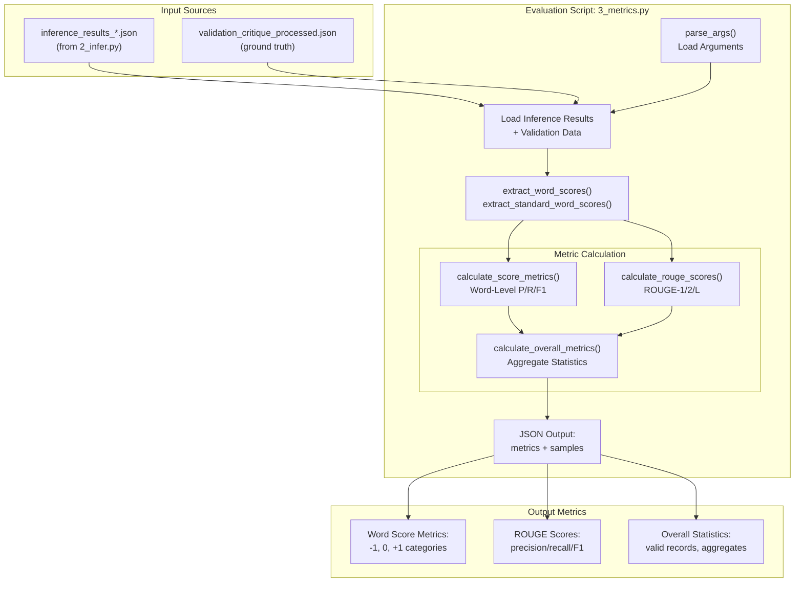
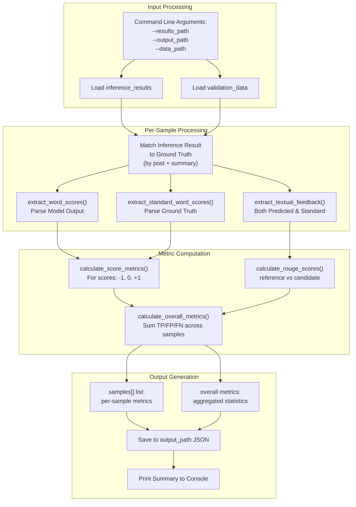
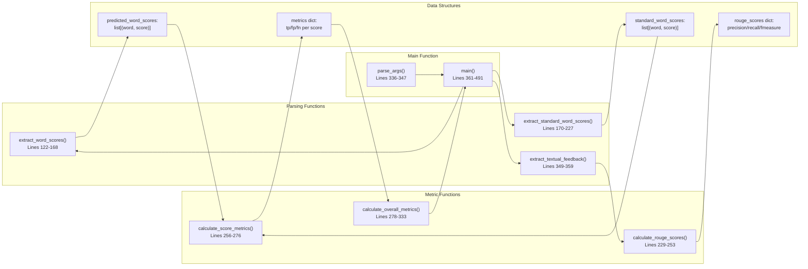
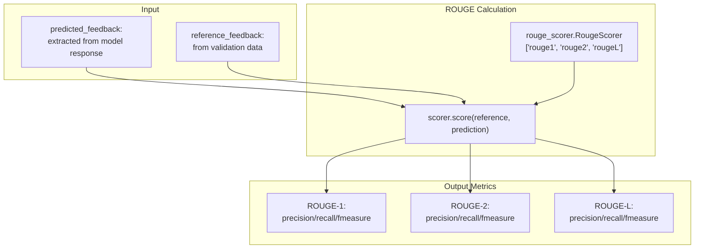
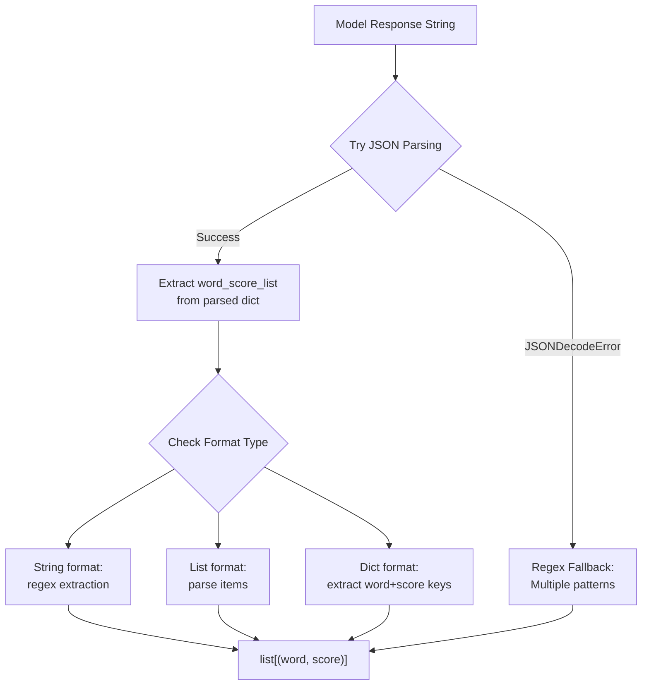

<!-- source: DeepWiki mcp.deepwiki.com · repo microsoft/Text2Grad · extra page SLF5K Evaluation · fetched 2026-10-26 -->

# SLF5K Evaluation

<details>
<summary>Relevant source files</summary>

The following files were used as context for generating this wiki page:

- [README.md](README.md)
- [nl_reward_model/slf5k/evaluation/3_metrics.py](nl_reward_model/slf5k/evaluation/3_metrics.py)
- [nl_reward_model/ultrafeedback/evaluation/3_metrics.py](nl_reward_model/ultrafeedback/evaluation/3_metrics.py)

</details>


## Purpose and Scope

This page documents the evaluation process for SLF5K summarization models trained using Text2Grad. It covers the metrics used to assess summarization quality, the evaluation workflow from inference to metrics calculation, and how to interpret results. For information on the SLF5K dataset format, see [7.3.1](#7.3.1). For reward model training, see [7.3.2](#7.3.2). For policy optimization, see [7.3.3](#7.3.3).

The SLF5K evaluation assesses models at multiple granularities: word-level scoring accuracy, textual feedback quality via ROUGE metrics, and overall summarization quality. Unlike code generation tasks that use functional correctness tests or question-answering tasks that use reasoning benchmarks, summarization evaluation relies on similarity metrics and qualitative assessment.

**Sources:** [README.md:297-332]()

## Evaluation Overview

The SLF5K evaluation framework measures model performance on 500 validation samples using two primary dimensions:

1. **Word-Level Scoring Metrics**: Precision, recall, and F1 scores for predicted word scores (-1, 0, +1)
2. **Textual Feedback Quality**: ROUGE-1, ROUGE-2, and ROUGE-L scores measuring n-gram overlap with reference critiques

Additionally, the README mentions GPT-4-as-judge for qualitative assessment and traditional metrics like BLEU, BERTScore, and Perplexity for comprehensive evaluation, though the primary implementation focuses on word-level and ROUGE metrics.



**Sources:** [nl_reward_model/slf5k/evaluation/3_metrics.py:1-491](), [README.md:303-331]()

## Evaluation Workflow

### Step 1: Model Merging

Before inference, LoRA adapter weights must be merged with the base model using `1_merge_lora.py` (not shown in provided files but referenced in README).

### Step 2: Inference

The `2_infer.py` script (not provided but referenced) generates model predictions on the validation set. This produces JSON output containing:
- Original posts
- Generated summaries
- Model responses with word scores and textual feedback

### Step 3: Metrics Calculation

The `3_metrics.py` script processes inference results and computes evaluation metrics.



**Sources:** [nl_reward_model/slf5k/evaluation/3_metrics.py:336-491]()

## Code Entity Mapping

The following diagram maps evaluation concepts to specific Python functions and data structures in `3_metrics.py`:



**Sources:** [nl_reward_model/slf5k/evaluation/3_metrics.py:122-491]()

## Word-Level Metrics

Word-level metrics evaluate the model's ability to assign correct scores (-1, 0, +1) to individual words in the generated summary. The evaluation treats each word position as a classification task.

### Metric Calculation

For each score value (target_score ∈ {-1, 0, 1}), the system calculates:

| Metric | Formula | Description |
|--------|---------|-------------|
| **True Positives (TP)** | Count of words correctly predicted with target_score | Both prediction and ground truth match target_score |
| **Predicted Positives (PP)** | Count of words predicted with target_score | Model assigned target_score |
| **Actual Positives (AP)** | Count of words in ground truth with target_score | Ground truth has target_score |
| **Precision** | TP / PP | Proportion of predicted scores that are correct |
| **Recall** | TP / AP | Proportion of actual scores that are detected |
| **F1 Score** | 2 × (Precision × Recall) / (Precision + Recall) | Harmonic mean of precision and recall |

The `calculate_score_metrics()` function implements this logic:

```python
# Simplified logic from lines 256-276
def calculate_score_metrics(predicted_scores, standard_scores, target_score):
    pred_dict = {word: score for word, score in predicted_scores}
    std_dict = {word: score for word, score in standard_scores}
    common_words = set(pred_dict.keys()) & set(std_dict.keys())
    
    true_positives = sum(1 for word in common_words
                        if pred_dict[word] == target_score and std_dict[word] == target_score)
    predicted_positives = sum(1 for score in pred_dict.values() if score == target_score)
    actual_positives = sum(1 for score in std_dict.values() if score == target_score)
```

### Score Categories

The evaluation tracks three score categories:

- **Score -1 (Poor/Negative)**: Words in poor spans that are inaccurate, redundant, or misleading
- **Score 0 (Neutral)**: Words not part of good or poor spans
- **Score +1 (Good/Positive)**: Words in good spans that accurately capture key details

**Sources:** [nl_reward_model/slf5k/evaluation/3_metrics.py:256-276](), [nl_reward_model/slf5k/evaluation/3_metrics.py:20-23]()

## ROUGE Metrics

ROUGE (Recall-Oriented Understudy for Gisting Evaluation) metrics assess the quality of textual feedback by measuring n-gram overlap between predicted and reference critiques.

### ROUGE Variants

| Metric | Description | Use Case |
|--------|-------------|----------|
| **ROUGE-1** | Unigram overlap | Vocabulary similarity |
| **ROUGE-2** | Bigram overlap | Phrase-level similarity |
| **ROUGE-L** | Longest common subsequence | Sequential coherence |

The `calculate_rouge_scores()` function uses the `rouge_scorer` library:



Each ROUGE metric returns three values:
- **Precision**: Proportion of n-grams in prediction that appear in reference
- **Recall**: Proportion of n-grams in reference that appear in prediction
- **F-measure**: Harmonic mean of precision and recall

**Sources:** [nl_reward_model/slf5k/evaluation/3_metrics.py:229-253]()

## Response Parsing

The evaluation must handle potentially malformed JSON from model outputs. The `extract_word_scores()` function implements defensive parsing with multiple fallback strategies:



### Parsing Strategies

The function attempts parsing in order of robustness:

1. **Primary**: Standard JSON parsing with `json.loads()` [line 124]()
2. **Format-specific**: Handle string, list, or dict formats [lines 127-151]()
3. **Fallback**: Regex patterns for common formats [lines 156-166]()

Supported patterns include:
- `("word", 1)` or `('word', 1)` - Tuple format
- `["word", 1]` or `['word', 1]` - List format
- `{"word": "word", "score": 1}` - Dict format

**Sources:** [nl_reward_model/slf5k/evaluation/3_metrics.py:122-168]()

## Running Evaluation

### Command-Line Usage

```bash
cd nl_reward_model/slf5k/evaluation

python 3_metrics.py \
    --results_path "../Evaluation/0_4800_res_span" \
    --output_path "../Evaluation/0_4800_metrics_span" \
    --data_path "../SLF5K_label/validation_critique_processed.json"
```

### Arguments

| Argument | Default | Description |
|----------|---------|-------------|
| `--results_path` | `../Evaluation/0_4800_res_span` | Path to inference results from `2_infer.py` |
| `--output_path` | `../Evaluation/0_4800_metrics_span` | Path to save metrics results |
| `--data_path` | `../SLF5K_label/validation_critique_processed.json` | Path to validation data with ground truth |

**Sources:** [nl_reward_model/slf5k/evaluation/3_metrics.py:336-347]()

## Output Format

The evaluation script produces a JSON file containing:

### Structure

```json
{
  "samples": [
    {
      "index": 0,
      "predicted_word_scores": [["word1", 1], ["word2", 0], ...],
      "standard_word_scores": [["word1", 1], ["word2", 0], ...],
      "predicted_feedback": "The summary captures...",
      "standard_feedback": "Reference critique..."
    }
  ],
  "rouge_scores": {
    "rouge1": {"precision": 0.XX, "recall": 0.XX, "fmeasure": 0.XX},
    "rouge2": {"precision": 0.XX, "recall": 0.XX, "fmeasure": 0.XX},
    "rougeL": {"precision": 0.XX, "recall": 0.XX, "fmeasure": 0.XX}
  },
  "word_score_metrics": {
    "score_specific": {
      "-1": {"precision": 0.XX, "recall": 0.XX, "f1": 0.XX, ...},
      "0": {"precision": 0.XX, "recall": 0.XX, "f1": 0.XX, ...},
      "1": {"precision": 0.XX, "recall": 0.XX, "f1": 0.XX, ...}
    },
    "word_matching": {
      "total_std_words": N,
      "total_pred_words": M,
      "missing_words": K,
      "matching_words": L
    }
  }
}
```

### Console Output

The script prints a formatted summary:

```
==================================================
     📊 EVALUATION METRICS SUMMARY 📊     
==================================================

🔍 TEXTUAL FEEDBACK - ROUGE SCORES:
--------------------------------------------------
  ROUGE1:
    • F1: 0.XXXX

  ROUGE2:
    • F1: 0.XXXX

  ROUGEL:
    • F1: 0.XXXX

🔍 WORD SCORE LIST - METRICS:
--------------------------------------------------

  Negative (-1):
    • Precision: 0.XXXX
    • Recall:    0.XXXX
    • F1 Score:  0.XXXX

  Neutral (0):
    • Precision: 0.XXXX
    • Recall:    0.XXXX
    • F1 Score:  0.XXXX

  Positive (1):
    • Precision: 0.XXXX
    • Recall:    0.XXXX
    • F1 Score:  0.XXXX
```

**Sources:** [nl_reward_model/slf5k/evaluation/3_metrics.py:453-487]()

## Interpreting Results

### Word-Level Performance

- **High Precision, Low Recall**: Model is conservative, identifies few words but accurately
- **Low Precision, High Recall**: Model is aggressive, identifies many words but less accurately
- **Balanced F1**: Model achieves good trade-off between precision and recall

Score-specific insights:
- **Score -1 (Poor)**: Low F1 suggests difficulty identifying problematic content
- **Score 0 (Neutral)**: Typically has highest counts, represents majority of words
- **Score +1 (Good)**: F1 indicates ability to identify high-quality content

### ROUGE Performance

- **ROUGE-1**: Basic vocabulary overlap; higher indicates better word choice
- **ROUGE-2**: Phrase-level similarity; higher indicates better phrase matching
- **ROUGE-L**: Sequential coherence; higher indicates better structure preservation

Values above 0.3-0.4 for ROUGE-1 and 0.2-0.3 for ROUGE-2 generally indicate reasonable textual feedback quality.

### Word Matching Statistics

The `word_matching` section in metrics provides insight into alignment:
- **total_std_words**: Number of words in ground truth
- **total_pred_words**: Number of words in prediction
- **missing_words**: Words in ground truth not found in prediction
- **matching_words**: Overlapping words between prediction and ground truth

High `missing_words` counts suggest the model generates summaries with different vocabulary than expected.

**Sources:** [nl_reward_model/slf5k/evaluation/3_metrics.py:278-333]()

## Comparison with Other Tasks

Unlike KodCode (see [7.1.4](#7.1.4)) which uses functional correctness via EvalPlus, or UltraFeedback (see [7.2.4](#7.2.4)) which includes span-overlap metrics, SLF5K evaluation focuses on:

1. **Text Similarity**: ROUGE metrics measure n-gram overlap
2. **Word-Level Accuracy**: Classification metrics for word scores
3. **No Span Metrics**: SLF5K evaluation doesn't include the IoU-based span overlap metrics found in UltraFeedback's `3_metrics.py`

The SLF5K approach reflects the nature of summarization evaluation, where similarity to reference summaries and word-level quality assessment are primary concerns.

**Sources:** [nl_reward_model/slf5k/evaluation/3_metrics.py:1-491](), [nl_reward_model/ultrafeedback/evaluation/3_metrics.py:143-269]()

---

