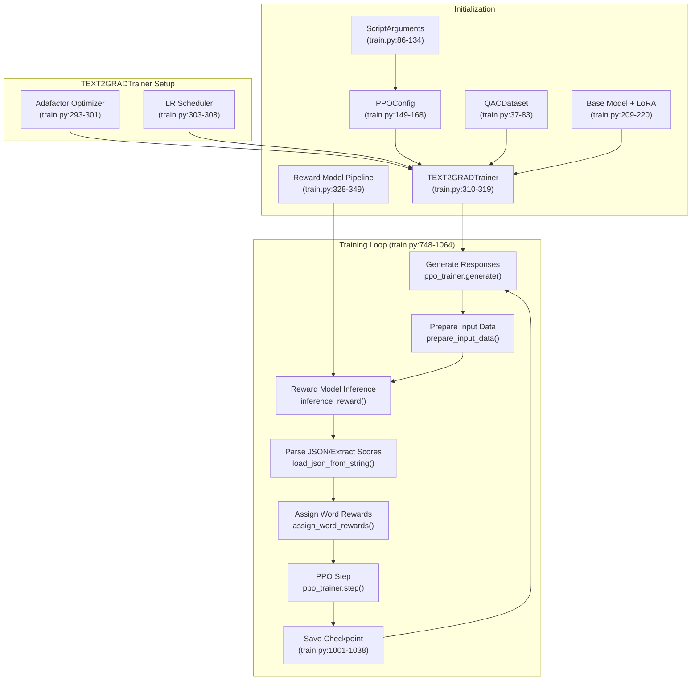
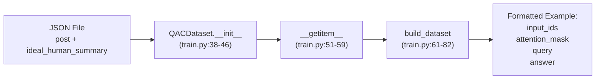
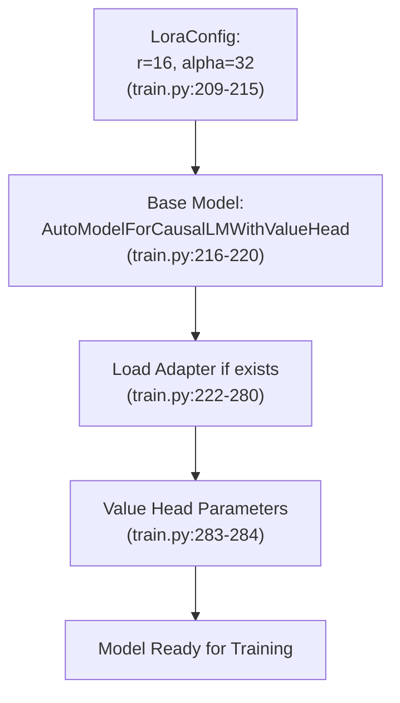
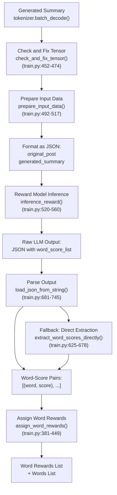
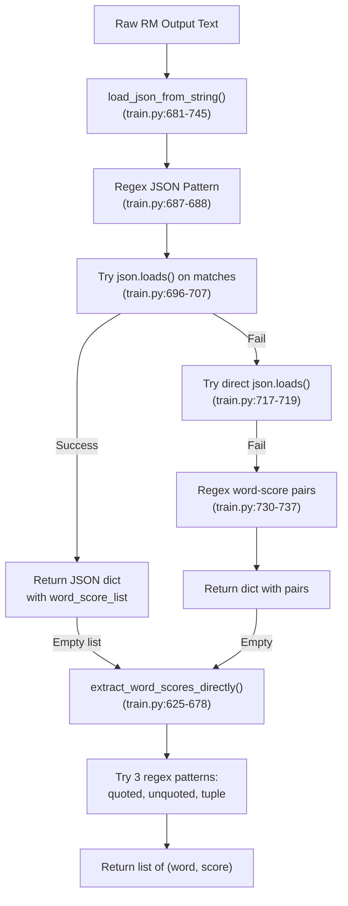
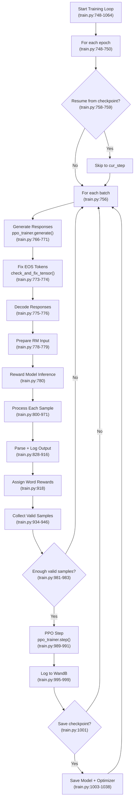
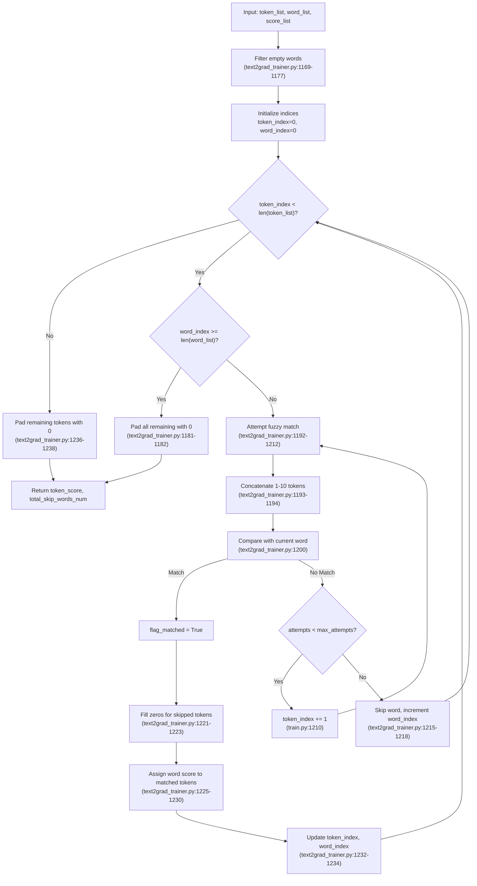

<!-- source: DeepWiki mcp.deepwiki.com · repo microsoft/Text2Grad · extra page SLF5K Policy Optimization · fetched 2026-10-26 -->

# SLF5K Policy Optimization

<details>
<summary>Relevant source files</summary>

The following files were used as context for generating this wiki page:

- [nl_gradiant_policy_optimization/slf5k/text2grad_trainer.py](nl_gradiant_policy_optimization/slf5k/text2grad_trainer.py)
- [nl_gradiant_policy_optimization/slf5k/train.py](nl_gradiant_policy_optimization/slf5k/train.py)

</details>


## Purpose and Scope

This page documents the policy optimization process for the SLF5K summarization task using the TEXT2GRADTrainer and PPO algorithm. It covers the complete training pipeline including dataset loading, model initialization, reward model inference, word-level reward processing, and the PPO training loop with natural language gradients.

For SLF5K dataset format details, see [7.3.1](#7.3.1). For SLF5K reward model training and inference, see [7.3.2](#7.3.2). For evaluation metrics and procedures, see [7.3.4](#7.3.4). For general TEXT2GRADTrainer architecture, see [6.1](#6.1).

**Sources:** [nl_gradiant_policy_optimization/slf5k/train.py:1-1065](), [nl_gradiant_policy_optimization/slf5k/text2grad_trainer.py:1-1638]()

---

## Training Pipeline Architecture



**Diagram: SLF5K Policy Optimization Training Pipeline**

This diagram illustrates the complete training pipeline from initialization to the iterative training loop. The process begins with loading configurations and datasets, initializing the TEXT2GRADTrainer, and then enters a loop where the policy generates responses, the reward model provides word-level feedback, and PPO updates optimize the policy.

**Sources:** [nl_gradiant_policy_optimization/slf5k/train.py:1-1065](), [nl_gradiant_policy_optimization/slf5k/text2grad_trainer.py:96-319]()

---

## Dataset and Configuration

### QACDataset Class

The `QACDataset` class handles loading and formatting the SLF5K dataset for training.



**Diagram: QACDataset Data Processing Flow**

The dataset reads JSON containing Reddit posts and their ideal human summaries, then formats them with the Llama chat template including a system prompt that instructs the model to summarize the text.

| Field | Description | Source |
|-------|-------------|--------|
| `post` | Original Reddit post to summarize | [train.py:54]() |
| `ideal_human_summary` | Human-written gold summary | [train.py:55]() |
| `input_ids` | Tokenized prompt with chat template | [train.py:69-70]() |
| `attention_mask` | Attention mask tensor | [train.py:71]() |
| `query` | Original post text | [train.py:73]() |
| `answer` | Gold summary (for reference) | [train.py:77]() |

The prompt template is constructed at [train.py:64-67]() with the format:
```
<|begin_of_text|><|start_header_id|>user<|end_header_id|>
Please provide a comprehensive and concise summary of the following text. 
Focus on the main ideas and key points while maintaining clarity and coherence.

Text: {post}
<|eot_id|><|start_header_id|>assistant<|end_header_id|>
```

**Sources:** [nl_gradiant_policy_optimization/slf5k/train.py:37-83]()

### ScriptArguments Configuration

The `ScriptArguments` dataclass defines all hyperparameters and paths for training:

| Parameter | Type | Default | Description |
|-----------|------|---------|-------------|
| `base_model_name` | str | "" | Base model path (e.g., Llama-3.1-8B-Instruct) |
| `base_model_adapter_model` | str | "" | Path to load checkpoint for resumption |
| `reward_model_name` | str | "" | Reward model checkpoint path |
| `learning_rate` | float | 1e-5 | Learning rate for optimizer |
| `batch_size` | int | 32 | Training batch size |
| `mini_batch_size` | int | 1 | PPO mini-batch size |
| `ppo_epochs` | int | 4 | Number of PPO epochs per batch |
| `output_max_length` | int | 400 | Maximum generation length |
| `init_kl_coef` | float | 0.2 | Initial KL penalty coefficient |
| `save_freq` | int | 5 | Save checkpoint every N steps |
| `output_dir` | str | "ckpt/superw_token_ppo" | Checkpoint output directory |
| `data_file_path` | str | "" | Training data JSON path |
| `prompt_max_length` | int | 1000 | Max prompt length |
| `answer_max_length` | int | 500 | Max answer length |

**Sources:** [nl_gradiant_policy_optimization/slf5k/train.py:85-134]()

### PPOConfig Initialization

The `PPOConfig` is initialized at [train.py:149-168]() with key settings:

```python
config = PPOConfig(
    vf_coef=0.1,                              # Value function coefficient
    steps=script_args.steps,                  # Total training steps
    learning_rate=script_args.learning_rate,
    batch_size=script_args.batch_size,
    mini_batch_size=script_args.mini_batch_size,
    gradient_accumulation_steps=script_args.gradient_accumulation_steps,
    ppo_epochs=script_args.ppo_epochs,
    init_kl_coef=script_args.init_kl_coef,   # Initial KL penalty
    adap_kl_ctrl=script_args.adap_kl_ctrl,   # Adaptive KL control
    kl_penalty=script_args.kl_penalty         # KL penalty type ("full")
)
```

**Sources:** [nl_gradiant_policy_optimization/slf5k/train.py:149-168]()

---

## Model Initialization

### Policy Model Setup



**Diagram: Policy Model Initialization Flow**

The policy model is initialized with LoRA adapters at [train.py:209-220]():

```python
lora_config = LoraConfig(
    r=16,                    # LoRA rank
    lora_alpha=32,          # LoRA alpha scaling
    lora_dropout=0.05,      # Dropout probability
    bias="none",            # No bias training
    task_type="CAUSAL_LM",  # Causal language modeling
)
model = AutoModelForCausalLMWithValueHead.from_pretrained(
    script_args.base_model_name,
    device_map="balanced",
    peft_config=lora_config,
)
```

**Sources:** [nl_gradiant_policy_optimization/slf5k/train.py:209-220]()

### Checkpoint Loading and Resumption

When `base_model_adapter_model` is provided, the system loads a checkpoint to resume training:

1. **Load Adapter Weights**: Loads `adapter_model.safetensors` using safetensors at [train.py:226-228]()
2. **Load Value Head**: Loads `pytorch_model.bin` containing value head weights at [train.py:230-232]()
3. **Merge State Dicts**: Combines adapter and value head into model state dict at [train.py:234-243]()
4. **Load Optimizer State**: Optionally loads optimizer state from `optimizer.pt` at [train.py:251-273]()
5. **Calculate Resume Position**: Parses epoch and step from checkpoint path to skip already-processed data at [train.py:566-595]()

The checkpoint path format is: `{output_dir}/epoch_{epoch}_step_{step}`, allowing the system to extract the training position.

**Sources:** [nl_gradiant_policy_optimization/slf5k/train.py:222-280](), [train.py:566-595]()

### Reward Model Setup

The reward model is loaded as a separate inference pipeline:

```python
reward_model_instance = AutoModelForCausalLM.from_pretrained(
    script_args.reward_model_name,
    torch_dtype=torch.float16,      # Half-precision for efficiency
    device_map="balanced"            # Distributed across GPUs
)

reward_model = pipeline(
    "text-generation",
    model=reward_model_instance,
    tokenizer=reward_tokenizer
)
```

This creates a text generation pipeline at [train.py:328-349]() that will generate structured feedback with word-level scores.

**Sources:** [nl_gradiant_policy_optimization/slf5k/train.py:328-349]()

---

## Generation and Reward Processing

### Generation Configuration

The policy model generates summaries using these parameters:

| Parameter | Value | Description |
|-----------|-------|-------------|
| `temperature` | 0.6 | Sampling temperature |
| `do_sample` | True | Enable sampling (not greedy) |
| `top_p` | 0.9 | Nucleus sampling threshold |
| `num_beams` | 2 | Beam search width |
| `repetition_penalty` | 1.2 | Penalty for repeated tokens |
| `max_new_tokens` | 100 | Maximum tokens to generate |
| `min_new_tokens` | 45 | Minimum tokens to generate |

These are defined in `generation_kwargs` at [train.py:352-362]().

The reward model uses more conservative generation settings at [train.py:365-374]():

| Parameter | Value | Description |
|-----------|-------|-------------|
| `do_sample` | False | Deterministic generation |
| `temperature` | 0.05 | Very low temperature |
| `num_beams` | 3 | Beam search width |
| `min_new_tokens` | 20 | Minimum feedback length |
| `max_new_tokens` | 500 | Maximum feedback length |

**Sources:** [nl_gradiant_policy_optimization/slf5k/train.py:352-374]()

### Reward Processing Pipeline



**Diagram: Reward Processing Pipeline from Generation to Word-Level Scores**

**Sources:** [nl_gradiant_policy_optimization/slf5k/train.py:381-560](), [train.py:625-745]()

### Prepare Input Data for Reward Model

The `prepare_input_data()` function at [train.py:492-517]() formats the generated summaries for the reward model:

```python
def prepare_input_data(queries, responses, question_template):
    input_datas = []
    for query, response in zip(queries, responses):
        query_escaped = query.replace('"', '\\"')
        response_escaped = response.replace('"', '\\"')
        
        system = f"""# User Input
{{
  "original_post": "{query_escaped}",
  "generated_summary": "{response_escaped}"
}}
"""
        input_datas.append(generate_prompt(question_template, system))
    return input_datas
```

The `question_template` is loaded from `rm_instruction.yaml` at [train.py:170-171]() using the strategy specified in script arguments.

**Sources:** [nl_gradiant_policy_optimization/slf5k/train.py:492-517](), [train.py:170-171]()

### Response Parsing with Fallback Strategies

The system employs multiple parsing strategies to handle malformed JSON:

1. **JSON Regex Matching**: Uses regex to find JSON patterns at [train.py:686-711]()
2. **Direct JSON Parsing**: Attempts `json.loads()` at [train.py:717-719]()
3. **Regex Fallback for Word-Scores**: Extracts word-score pairs directly at [train.py:730-737]()
4. **Direct Word-Score Extraction**: As last resort, uses multiple regex patterns at [train.py:625-678]()



**Diagram: Multi-Level Fallback Parsing Strategy**

The `extract_word_scores_directly()` function tries three regex patterns:

1. `"word": score` - Quoted word with colon
2. `word: score` - Unquoted word with colon  
3. `(word, score)` - Tuple format

This ensures robustness against various LLM output formats.

**Sources:** [nl_gradiant_policy_optimization/slf5k/train.py:625-745]()

### Assign Word Rewards

The `assign_word_rewards()` function at [train.py:381-449]() processes the parsed word-score pairs:

```python
def assign_word_rewards(answer, score_list):
    words = []
    word_rewards = []
    
    for item in score_list:
        word, score = item
        
        # Clean word
        word = re.sub(r'^[^a-zA-Z0-9$￥&]+|[^a-zA-Z0-9$￥&]+$', '', word)
        word = re.sub(r"[''‛]", "'", word)
        
        if word:
            words.append(word)
            word_rewards.append(float(score))
    
    return word_rewards, words
```

This function:
- Validates input types at [train.py:393-405]()
- Cleans word strings by removing non-alphanumeric prefixes/suffixes at [train.py:429]()
- Normalizes quotes at [train.py:430]()
- Returns parallel lists of rewards and words at [train.py:444]()

**Sources:** [nl_gradiant_policy_optimization/slf5k/train.py:381-449]()

---

## PPO Training Loop

### Main Training Loop Structure



**Diagram: Main Training Loop Flow with Checkpointing**

**Sources:** [nl_gradiant_policy_optimization/slf5k/train.py:748-1064]()

### Sample Processing with Logging

For each sample in the batch, the system:

1. **Creates log directory** for the sample at [train.py:762-763]()
2. **Validates LLM output** format at [train.py:811-826]()
3. **Extracts text to parse** by removing the prompt at [train.py:828]()
4. **Logs raw input/output** to file at [train.py:832-857]()
5. **Attempts JSON parsing** with detailed logging at [train.py:869-898]()
6. **Falls back to direct extraction** if needed at [train.py:900-916]()
7. **Assigns rewards** and logs results at [train.py:918-933]()
8. **Collects successful samples** for PPO step at [train.py:934-946]()

Each sample's processing is logged to `{output_dir}/logs/epoch_{epoch}/step_{step}/sample_{ind}.txt` with sections:
- QUERY
- RESPONSE  
- REWARD MODEL INPUT
- REWARD MODEL RAW OUTPUT
- TEXT TO PARSE
- JSON PARSING RESULT (or FAILED)
- DIRECT EXTRACTION RESULT
- REWARD ASSIGNMENT RESULT

A batch summary is saved at [train.py:976-978]() as JSON.

**Sources:** [nl_gradiant_policy_optimization/slf5k/train.py:800-978]()

### TEXT2GRADTrainer.step() Method

The core PPO update is performed by `TEXT2GRADTrainer.step()` at [text2grad_trainer.py:615-878]():

```mermaid
graph TB
    INPUT["Input:<br/>queries, responses,<br/>scores, words"] --> SAFETY["Safety Check<br/>(text2grad_trainer.py:642-644)"]
    SAFETY --> PREPARE["Prepare Model Inputs<br/>(text2grad_trainer.py:673)"]
    
    PREPARE --> FORWARD["Batched Forward Pass<br/>(text2grad_trainer.py:706-713)"]
    FORWARD --> REF_FORWARD["Reference Forward Pass<br/>(text2grad_trainer.py:714-722)"]
    
    REF_FORWARD --> REMATCH["Rematch Scores to Tokens<br/>rematch_scores()<br/>(text2grad_trainer.py:726)"]
    REMATCH --> LEN_PENALTY["Length Weight Penalty<br/>get_length_weight_penalty()<br/>(text2grad_trainer.py:732-733)"]
    
    LEN_PENALTY --> COMPUTE_REW["Compute Rewards + KL<br/>compute_rewards()<br/>(text2grad_trainer.py:743-748)"]
    COMPUTE_REW --> COMPUTE_ADV["Compute Advantages (GAE)<br/>compute_advantages()<br/>(text2grad_trainer.py:752)"]
    
    COMPUTE_ADV --> EPOCHS["For ppo_epochs iterations<br/>(text2grad_trainer.py:779)"]
    EPOCHS --> SHUFFLE["Shuffle batch indices<br/>(text2grad_trainer.py:784)"]
    SHUFFLE --> MINI_BATCH["For each mini-batch<br/>(text2grad_trainer.py:789-792)"]
    
    MINI_BATCH --> MINI_FORWARD["Mini-batch Forward Pass<br/>(text2grad_trainer.py:807-813)"]
    MINI_FORWARD --> TRAIN_MINI["Train Mini-batch<br/>train_minibatch()<br/>(text2grad_trainer.py:814-824)"]
    TRAIN_MINI --> EARLY_STOP{"Early stopping?<br/>(text2grad_trainer.py:830-834)"}
    EARLY_STOP -->|No| MINI_BATCH
    EARLY_STOP -->|Yes| RECORD
    
    MINI_BATCH -->|Done| RECORD["Record Step Stats<br/>(text2grad_trainer.py:845-856)"]
    RECORD --> UPDATE_KL["Update KL Controller<br/>(text2grad_trainer.py:863-866)"]
    UPDATE_KL --> RETURN["Return stats, losses, advantages"]
```



**Diagram: TEXT2GRADTrainer.step() Execution Flow**

**Sources:** [nl_gradiant_policy_optimization/slf5k/text2grad_trainer.py:615-878]()

### Token-Level Reward Alignment

A critical step is aligning word-level scores to token-level rewards via `rematch_scores()` at [text2grad_trainer.py:1242-1285]():

```python
def rematch_scores(self, scores, words, all_tokens):
    # Lowercase normalization
    for i in range(len(words)):
        words[i] = [word.lower() for word in words[i]]
    for i in range(len(all_tokens)):
        all_tokens[i] = [token.lower() for token in all_tokens[i]]
    
    # Find assistant response start
    answer_indices_tokens = []
    for sublist in all_tokens:
        found_index = -1
        for i in range(len(sublist) - 2):
            if (sublist[i] == '<|start_header_id|>' and
                sublist[i + 1] == 'assistant' and
                sublist[i + 2] == '<|end_header_id|>'):
                j = i + 3
                while j < len(sublist) and sublist[j] == '':
                    j += 1
                found_index = j
                break
        answer_indices_tokens.append(found_index)
    
    # Extract answer tokens
    answers_tokens = []
    for i in range(len(words)):
        if answer_indices_tokens[i] != -1:
            answers_tokens.append(all_tokens[i][answer_indices_tokens[i]:])
        else:
            answers_tokens.append([])
    
    # Assign token rewards using fuzzy matching
    token_scores = []
    total_skip_words_nums = []
    for i, token_list in enumerate(answers_tokens):
        word_list = words[i]
        score_list = scores[i]
        token_non_score = [torch.tensor(0., device=score_list[0].device)] * answer_indices_tokens[i]
        
        token_score, total_skip_words_num = self.assign_token_rewards(token_list, word_list, score_list)
        total_skip_words_nums.append(float(total_skip_words_num / len(word_list)))
        
        token_scores.append(token_non_score + token_score)
    
    return token_scores, answers_tokens, answer_indices_tokens, total_skip_words_nums
```

This function:
1. Normalizes words and tokens to lowercase
2. Finds the assistant response start marker in the token sequence
3. Extracts only the answer tokens (excludes prompt)
4. Calls `assign_token_rewards()` for fuzzy string matching
5. Returns token-aligned scores with zero scores for prompt tokens

**Sources:** [nl_gradiant_policy_optimization/slf5k/text2grad_trainer.py:1242-1285]()

### Assign Token Rewards via Fuzzy Matching

The `assign_token_rewards()` method at [text2grad_trainer.py:1155-1240]() performs sophisticated fuzzy matching:



**Diagram: Fuzzy Matching Algorithm for Token-Word Alignment**

Key features:
- **Variable-length matching**: Tries concatenating 1-10 tokens to match a word
- **Case-insensitive comparison**: Converts to lowercase at [text2grad_trainer.py:1196]()
- **Max attempts**: Allows up to 5 token shifts to find a match at [text2grad_trainer.py:1165]()
- **Special character handling**: Assigns zero score to punctuation at [text2grad_trainer.py:1226-1228]()
- **Skip tracking**: Records how many words couldn't be matched

**Sources:** [nl_gradiant_policy_optimization/slf5k/text2grad_trainer.py:1155-1240]()

### Length Weight Penalty

The system applies a length penalty to encourage appropriate summary lengths via `get_length_weight_penalty()` at [text2grad_trainer.py:592-612]():

```python
def get_length_weight_penalty(self, alpha, suggested_lengths, scores):
    lwps = []
    scores_penaled = []
    for k, score in enumerate(scores):
        score_tensor = torch.tensor(score)
        nonzero_indices = torch.nonzero(score_tensor, as_tuple=True)[0]
        start_index = nonzero_indices[0].item() if nonzero_indices.numel() > 0 else 0
        len = 0
        lwp = [1.0] * start_index
        score_penaled = [0.0] * start_index
        for i in range(start_index, score_tensor.numel()):
            len += 1
            exp_input = alpha * (len - suggested_lengths[k]) - 6
            exp_input = max(min(exp_input, 6), -10)  # Clip for numerical stability
            lwp_len = 1.0 / (1.0 + math.exp(exp_input))
            
            lwp.append(lwp_len)
            score_penaled.append(score_tensor[i].item() * lwp_len)
        lwps.append(lwp)
        scores_penaled.append(score_penaled)
    return lwps, scores_penaled
```

The penalty uses a sigmoid function centered at the suggested length (default 48 tokens at [text2grad_trainer.py:730]()):
- Shorter summaries: Penalty ≈ 1.0 (no penalty)
- Around suggested length: Penalty ≈ 0.5
- Longer summaries: Penalty approaches 0

The penalized scores are used at [train.py:732-735]().

**Sources:** [nl_gradiant_policy_optimization/slf5k/text2grad_trainer.py:592-612](), [train.py:728-735]()

### Compute Rewards with KL Penalty

The `compute_rewards()` method at [text2grad_trainer.py:1287-1314]() combines word scores with KL penalties:

```python
def compute_rewards(self, scores, logprobs, ref_logprobs, masks, all_tokens, words):
    rewards, non_score_rewards, kls = [], [], []
    
    # Remove first element (prompt shift)
    for i in range(len(scores)):
        scores[i] = scores[i][1:]
    
    for score, logprob, ref_logprob, mask in zip(scores, logprobs, ref_logprobs, masks):
        # Compute KL divergence
        kl = self._kl_penalty(logprob, ref_logprob)
        kls.append(kl)
        
        # KL penalty component
        non_score_reward = -self.kl_ctl.value * kl
        non_score_rewards.append(non_score_reward)
        
        # Add word scores at non-masked positions
        reward = non_score_reward.clone()
        non_masked_indices = mask.nonzero()
        for index in non_masked_indices:
            reward[index] += score[index]
        
        rewards.append(reward)
    return torch.stack(rewards), torch.stack(non_score_rewards), torch.stack(kls)
```

The final reward at each token position is:
```
reward[t] = -kl_coef * kl[t] + word_score[t] * mask[t]
```

Where `kl_coef` starts at `init_kl_coef` (0.2) and adapts based on KL divergence statistics.

**Sources:** [nl_gradiant_policy_optimization/slf5k/text2grad_trainer.py:1287-1314]()

### Compute Advantages with GAE

Generalized Advantage Estimation (GAE) is computed at [text2grad_trainer.py:1331-1359]():

```python
def compute_advantages(self, values, rewards, mask):
    lastgaelam = 0
    advantages_reversed = []
    gen_len = rewards.shape[-1]
    
    # Apply mask
    values = values * mask
    rewards = rewards * mask
    
    # Optional reward whitening
    if self.config.whiten_rewards:
        rewards = masked_whiten(rewards, mask, shift_mean=False)
    
    # Backward pass through time
    for t in reversed(range(gen_len)):
        nextvalues = values[:, t + 1] if t < gen_len - 1 else 0.0
        delta = rewards[:, t] + self.config.gamma * nextvalues - values[:, t]
        lastgaelam = delta + self.config.gamma * self.config.lam * lastgaelam
        lastgaelam = lastgaelam * mask[:, t]
        advantages_reversed.append(lastgaelam)
    
    advantages = torch.stack(advantages_reversed[::-1]).transpose(0, 1)
    returns = advantages + values
    advantages = masked_whiten(advantages, mask)
    advantages = advantages.detach()
    
    return values, advantages, returns
```

GAE uses:
- **gamma** (γ): Discount factor (typically 1.0)
- **lambda** (λ): GAE parameter balancing bias vs variance

The advantages are then whitened (normalized) and used for policy gradient updates.

**Sources:** [nl_gradiant_policy_optimization/slf5k/text2grad_trainer.py:1331-1359]()

### Mini-batch Training

The `train_minibatch()` method at [text2grad_trainer.py:1076-1124]() performs the actual gradient updates:

```python
def train_minibatch(self, old_logprobs, values, logprobs, logits, vpreds, 
                    mask, advantages, returns, mask_loss=""):
    self.model.train()
    
    # Compute PPO loss
    loss_p, loss_v, train_stats = self.loss(
        old_logprobs, values, logits, vpreds, logprobs, 
        mask, advantages, returns
    )
    
    # Optional loss masking
    if mask_loss:
        loss = loss_v if mask_loss == "loss_p" else loss_p
    else:
        loss = loss_p + loss_v
    
    # Backward pass
    self.accelerator.backward(loss)
    
    # Gradient clipping
    if self.config.max_grad_norm is not None:
        if self.accelerator.sync_gradients:
            self.accelerator.clip_grad_norm_(self.model_params, self.config.max_grad_norm)
    
    # Optimizer step
    self.optimizer.step()
    self.optimizer.zero_grad()
    
    return train_stats, loss_p.item(), loss_v.item()
```

The loss computation at [text2grad_trainer.py:1361-1432]() includes:

1. **Value Loss (clipped)**: 
   ```
   vf_loss = 0.5 * mean(max((vpred - return)², (vpred_clipped - return)²))
   ```

2. **Policy Loss (clipped objective)**:
   ```
   ratio = exp(logprob - old_logprob)
   pg_loss = mean(max(-advantage * ratio, 
                      -advantage * clip(ratio, 1-ε, 1+ε)))
   ```

3. **Combined Loss**:
   ```
   loss = pg_loss + vf_coef * vf_loss
   ```

Where `vf_coef = 0.1` at [train.py:150]().

**Sources:** [nl_gradiant_policy_optimization/slf5k/text2grad_trainer.py:1076-1124](), [text2grad_trainer.py:1361-1432]()

---

## Checkpoint Management

### Saving Checkpoints

Checkpoints are saved every `save_freq` steps at [train.py:1001-1038]():

```python
if step != 0 and step % script_args.save_freq == 0:
    save_path = os.path.join(script_args.output_dir, f"epoch_{epoch}_step_{step}")
    os.makedirs(save_path, exist_ok=True)
    
    # Save model (LoRA adapter + value head)
    ppo_trainer.save_pretrained(save_path)
    
    # Save optimizer state
    optimizer_path = os.path.join(save_path, "optimizer.pt")
    torch.save({
        'optimizer': optimizer.state_dict(),
        'lr_scheduler': lr_scheduler.state_dict() if lr_scheduler else None,
    }, optimizer_path)
```

Each checkpoint contains:
- `adapter_model.safetensors`: LoRA adapter weights
- `pytorch_model.bin`: Value head weights
- `optimizer.pt`: Optimizer and scheduler state
- `adapter_config.json`: LoRA configuration
- `README.md`: Model card

**Sources:** [nl_gradiant_policy_optimization/slf5k/train.py:1001-1038]()

### Resuming from Checkpoint

To resume training from a checkpoint:

1. **Pass checkpoint path** via `base_model_adapter_model` argument
2. **Load adapter and value head** at [train.py:222-280]()
3. **Extract epoch and step** from path at [train.py:566-568]():
   ```python
   cur_epoch = int(script_args.base_model_adapter_model.split("/")[-1].split("_")[1])
   cur_step = int(script_args.base_model_adapter_model.split("/")[-1].split("_")[-1])
   ```
4. **Calculate samples to skip** at [train.py:569-577]()
5. **Recreate DataLoader** with same seed and skip batches at [train.py:579-595]()
6. **Continue training** from the correct position

The system maintains WandB step continuity by updating `wandb_step` at [train.py:574]().

**Sources:** [nl_gradiant_policy_optimization/slf5k/train.py:566-595]()

---

## Logging and Error Handling

### WandB Integration

Training metrics are logged to Weights & Biases at [train.py:995-999]():

```python
wandb.log({"train/loss_advantage": loss_ps}, step=wandb_step)
wandb.log({"train/loss_value_kl": loss_vs}, step=wandb_step)
wandb.log({"train/average_advantages": average_rewards.item()}, step=wandb_step)

ppo_trainer.log_stats(wandb_step, stats, batch, rewards)
```

The `log_stats()` method at [text2grad_trainer.py:1509-1577]() logs comprehensive statistics including:

| Metric | Description |
|--------|-------------|
| `objective/kl` | Mean KL divergence from reference |
| `objective/entropy` | Mean entropy of policy distribution |
| `ppo/mean_scores` | Mean word-level scores |
| `ppo/std_scores` | Standard deviation of scores |
| `ppo/mean_non_score_reward` | KL penalty component |
| `ppo/skip_word_percentage` | Failed word matching rate |
| `ppo/val/var_explained` | Value function quality |
| `tokens/queries_len_mean` | Average query length |
| `tokens/responses_len_mean` | Average response length |
| `env/reward_mean` | Overall reward mean |
| `env/reward_std` | Overall reward std |

**Sources:** [nl_gradiant_policy_optimization/slf5k/train.py:995-999](), [text2grad_trainer.py:1509-1577]()

### Detailed Sample Logging

Each sample's processing is logged to disk at [train.py:832-857]():

```
{output_dir}/logs/epoch_{epoch}/step_{step}/sample_{ind}.txt
```

Log sections include:
1. **QUERY**: Original post
2. **RESPONSE**: Generated summary
3. **REWARD MODEL INPUT**: Formatted prompt for RM
4. **REWARD MODEL RAW OUTPUT**: Complete RM generation
5. **TEXT TO PARSE**: Extracted text without prompt
6. **JSON PARSING RESULT**: Parsed word-score list or failure
7. **DIRECT EXTRACTION RESULT**: Fallback extraction results
8. **REWARD ASSIGNMENT RESULT**: Final word-reward pairs

A batch summary JSON is saved at [train.py:976-978]() with:
- Timestamp
- Epoch and step
- Batch size
- Successful vs failed samples
- Per-sample logs with status and error messages

**Sources:** [nl_gradiant_policy_optimization/slf5k/train.py:832-857](), [train.py:976-978]()

### Error Handling

The training loop includes comprehensive error handling:

1. **Sample-level try-catch** at [train.py:801-971]() catches parsing errors
2. **Step-level try-catch** at [train.py:988-1058]() catches PPO step errors
3. **Detailed error logging** via `log_error()` at [train.py:598-623]()
4. **Training continuation** after errors at [train.py:1058]()

Error logs include:
- Exception type and message
- Full traceback
- Training context (epoch, step, batch size)
- Tensor shapes for debugging

Errors are saved to:
```
{output_dir}/error_logs/error_step_{step}_{timestamp}.txt
```

Sample-level failures don't stop training if enough valid samples remain (threshold: `batch_size // 2` at [train.py:981]()).

**Sources:** [nl_gradiant_policy_optimization/slf5k/train.py:598-623](), [train.py:801-1064]()

---

## Usage Example

To train an SLF5K policy optimization model:

```bash
python nl_gradiant_policy_optimization/slf5k/train.py \
    --base_model_name "meta-llama/Llama-3.1-8B-Instruct" \
    --reward_model_name "path/to/slf5k_reward_model" \
    --data_file_path "data/slf5k/train.json" \
    --output_dir "checkpoints/slf5k_ppo" \
    --learning_rate 1e-5 \
    --batch_size 32 \
    --mini_batch_size 1 \
    --ppo_epochs 4 \
    --save_freq 5 \
    --train_epochs 2 \
    --steps 1200 \
    --init_kl_coef 0.2 \
    --strategy "slf5k_strategy" \
    --project_name "slf5k_text2grad"
```

To resume from a checkpoint:

```bash
python nl_gradiant_policy_optimization/slf5k/train.py \
    --base_model_name "meta-llama/Llama-3.1-8B-Instruct" \
    --base_model_adapter_model "checkpoints/slf5k_ppo/epoch_0_step_10" \
    --reward_model_name "path/to/slf5k_reward_model" \
    --data_file_path "data/slf5k/train.json" \
    --output_dir "checkpoints/slf5k_ppo" \
    # ... other arguments
```

The training will:
1. Load the dataset and initialize models
2. Generate summaries for each batch
3. Get word-level feedback from the reward model
4. Align word scores to tokens via fuzzy matching
5. Apply length penalties
6. Compute advantages using GAE
7. Perform PPO updates over multiple mini-batches
8. Log metrics to WandB
9. Save checkpoints every `save_freq` steps

**Sources:** [nl_gradiant_policy_optimization/slf5k/train.py:1-1065]()

---

