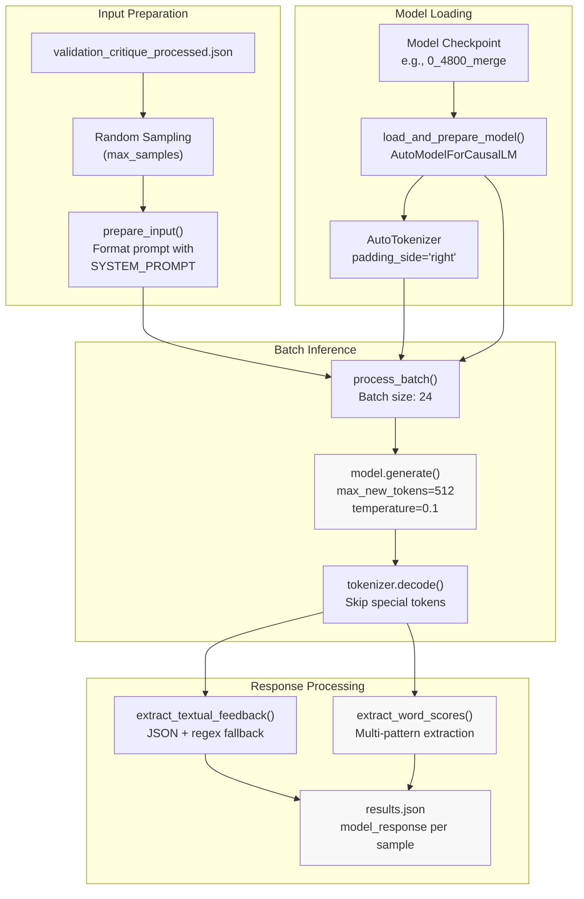
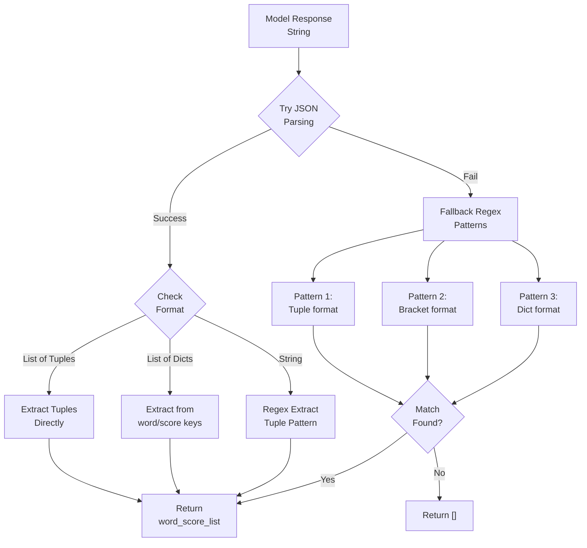
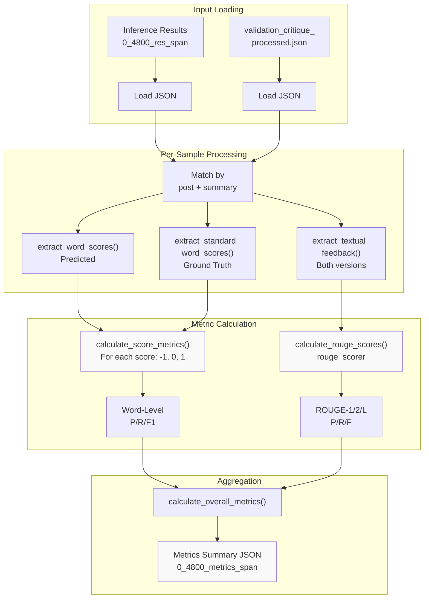

<!-- source: DeepWiki mcp.deepwiki.com · repo microsoft/Text2Grad · extra page SLF5K Reward Model · fetched 2026-10-26 -->

# SLF5K Reward Model

<details>
<summary>Relevant source files</summary>

The following files were used as context for generating this wiki page:

- [nl_reward_model/slf5k/evaluation/2_infer.py](nl_reward_model/slf5k/evaluation/2_infer.py)
- [nl_reward_model/slf5k/evaluation/3_metrics.py](nl_reward_model/slf5k/evaluation/3_metrics.py)
- [nl_reward_model/ultrafeedback/evaluation/3_metrics.py](nl_reward_model/ultrafeedback/evaluation/3_metrics.py)

</details>


## Purpose and Scope

This page documents the SLF5K reward model component, which evaluates summarization quality by providing **textual feedback** and **word-level scores** for Reddit post summaries. The reward model is trained to identify which words contribute positively or negatively to summary quality, enabling fine-grained feedback for policy optimization.

For information about training the policy using this reward model, see [SLF5K Policy Optimization](#7.3.3). For dataset format details, see [SLF5K Dataset Format](#7.3.1). For general reward model training concepts, see [Training Reward Models](#5.1).

---

## Model Architecture

The SLF5K reward model is built on **Llama-3.1-8B-Instruct** with parameter-efficient fine-tuning using LoRA adapters.

### Base Configuration

| Component | Specification |
|-----------|--------------|
| Base Model | `meta-llama/Llama-3.1-8B-Instruct` |
| Fine-tuning Method | LoRA (Low-Rank Adaptation) |
| Precision | FP16 (`torch.float16`) |
| Training Framework | DeepSpeed with ZeRO Stage 3 |
| Output Format | JSON with textual feedback + word scores |

### Training Setup

The model is trained to generate structured feedback following a specific prompt format defined in the system prompt [nl_reward_model/slf5k/evaluation/2_infer.py:12-40](). The training process follows the general reward model training pipeline described in [Training Reward Models](#5.1), adapted for the summarization task with word-level annotations from the SLF5K dataset.

**Sources:** [nl_reward_model/slf5k/evaluation/2_infer.py:61-75]()

---

## Inference Pipeline

### Workflow Overview



**Inference Workflow**: The pipeline loads a merged reward model checkpoint, samples validation data, formats prompts with the system instructions, performs batch inference, and applies robust parsing to extract structured feedback.

**Sources:** [nl_reward_model/slf5k/evaluation/2_infer.py:42-288]()

### Key Functions

#### `load_and_prepare_model(model_path)`

Loads the merged reward model and configures the tokenizer [nl_reward_model/slf5k/evaluation/2_infer.py:61-75]():

- Sets `pad_token` to `eos_token` if not defined
- Forces `padding_side="right"` for generation
- Loads model with `device_map="balanced"` for multi-GPU distribution
- Returns model in eval mode

#### `prepare_input(post, summary)`

Formats the input prompt using the Llama-3 chat template [nl_reward_model/slf5k/evaluation/2_infer.py:78-91]():

```
<|begin_of_text|><|start_header_id|>system<|end_header_id|>
{SYSTEM_PROMPT}
<|eot_id|><|start_header_id|>user<|end_header_id|>
{question with post and summary}
<|eot_id|><|start_header_id|>assistant<|end_header_id|>
```

The system prompt instructs the model to:
1. Provide textual feedback about summary quality
2. Assign word-level scores: `-1` (negative), `0` (neutral), `1` (positive)

#### `process_batch(model, tokenizer, batch_data, max_new_tokens, temperature)`

Processes a batch of inputs through the model [nl_reward_model/slf5k/evaluation/2_infer.py:94-118]():

- Tokenizes all prompts with padding
- Generates responses with `do_sample=True` and low temperature (0.1)
- Extracts only the newly generated tokens (excluding input prompt)
- Returns decoded responses as strings

**Sources:** [nl_reward_model/slf5k/evaluation/2_infer.py:61-118]()

---

## Response Format and Parsing

### Expected Output Format

The model is trained to produce JSON output with two fields [nl_reward_model/slf5k/evaluation/2_infer.py:29-38]():

```json
{
  "textual_feedback": "feedback indicating missing, incorrect, or unnecessary content...",
  "word_score_list": [
    ("word1", -1),
    ("word2", 0),
    ("word3", 1),
    ...
  ]
}
```

### Parsing Strategy

The codebase implements a **multi-level fallback parsing strategy** to handle LLM-generated JSON that may be malformed or formatted inconsistently.



**Parsing Hierarchy**: Multiple fallback strategies ensure robust extraction even when LLM outputs are malformed.

**Sources:** [nl_reward_model/slf5k/evaluation/2_infer.py:121-202]()

### `extract_textual_feedback(response)`

Extracts the textual feedback field [nl_reward_model/slf5k/evaluation/2_infer.py:121-129]():

1. **Primary**: Parse complete JSON and extract `textual_feedback` key
2. **Fallback**: Use regex pattern `"textual_feedback"\s*:\s*"([^"]*)"`
3. **Default**: Return empty string if both fail

### `extract_word_scores(response)`

Implements sophisticated extraction logic [nl_reward_model/slf5k/evaluation/2_infer.py:132-201]():

**Level 1: JSON Parsing**
- Parse complete JSON and check `word_score_list` format
- Handle string representation: `r'\([\"\']?([^\"\',]+)[\"\']?,\s*(-?\d+)\)'`
- Handle list of dicts with `word`/`score` or `word`/`Score` keys
- Handle list of tuples/lists directly

**Level 2: Fallback Iteration**
- If `word_score_list` is a list but format is unexpected
- Try to find `word`/`token` and `score`/`value` keys dynamically
- Convert string scores to integers with regex extraction

**Level 3: Regex Patterns**
If JSON parsing completely fails:
```python
patterns = [
    r'\([\"\']?([^\"\',]+)[\"\']?,\s*(-?\d+)\)',  # Tuple format
    r'\[[\"\']?([^\"\',]+)[\"\']?,\s*(-?\d+)\]',  # Bracket format
    r'{\s*[\"\']?word[\"\']?\s*:\s*[\"\']?([^\"\',]+)[\"\']?\s*,\s*[\"\']?score[\"\']?\s*:\s*(-?\d+)\s*}'  # Dict format
]
```

**Level 4: JSON Block Search**
- Search for JSON-like blocks with `({[\s\S]*})` regex
- Attempt recursive parsing on extracted blocks

**Sources:** [nl_reward_model/slf5k/evaluation/2_infer.py:132-201]()

---

## Evaluation Metrics

The evaluation system computes three types of metrics: **word-level classification metrics**, **textual feedback similarity**, and **span-based analysis**.

### Metrics Calculation Pipeline



**Evaluation Pipeline**: Matches inference results with ground truth, extracts predictions and references, calculates multiple metrics, and aggregates results.

**Sources:** [nl_reward_model/slf5k/evaluation/3_metrics.py:336-491]()

### Word-Level Metrics

#### Scoring Classification

For each word position, the system classifies scores as `-1` (negative), `0` (neutral), or `1` (positive) [nl_reward_model/slf5k/evaluation/3_metrics.py:256-276]().

**Calculation** [nl_reward_model/slf5k/evaluation/3_metrics.py:256-276]():
```python
# Convert to dictionaries for comparison
pred_dict = {word: score for word, score in predicted_scores}
std_dict = {word: score for word, score in standard_scores}

# Find common words
common_words = set(pred_dict.keys()) & set(std_dict.keys())

# For each target_score in [-1, 0, 1]:
true_positives = sum(1 for word in common_words
                    if pred_dict[word] == target_score 
                    and std_dict[word] == target_score)
predicted_positives = sum(1 for score in pred_dict.values() 
                         if score == target_score)
actual_positives = sum(1 for score in std_dict.values() 
                      if score == target_score)
```

#### Metrics Per Score Class

| Metric | Formula | Description |
|--------|---------|-------------|
| Precision | `TP / (TP + FP)` | Accuracy of predicted score class |
| Recall | `TP / (TP + FN)` | Coverage of actual score class |
| F1 | `2 × P × R / (P + R)` | Harmonic mean of P and R |

The system computes separate metrics for:
- **Positive (1)**: Words that improve summary quality
- **Negative (-1)**: Words that harm summary quality  
- **Neutral (0)**: Words with no significant impact
- **Overall**: Aggregated across all score classes

**Sources:** [nl_reward_model/slf5k/evaluation/3_metrics.py:256-333]()

### ROUGE Metrics for Textual Feedback

ROUGE (Recall-Oriented Understudy for Gisting Evaluation) scores measure n-gram overlap between predicted and ground truth textual feedback [nl_reward_model/slf5k/evaluation/3_metrics.py:229-253]().

**Computed Metrics**:
- **ROUGE-1**: Unigram overlap
- **ROUGE-2**: Bigram overlap
- **ROUGE-L**: Longest common subsequence

Each metric reports:
- **Precision**: What fraction of predicted n-grams appear in reference
- **Recall**: What fraction of reference n-grams are captured
- **F-measure**: Harmonic mean

**Implementation** [nl_reward_model/slf5k/evaluation/3_metrics.py:229-253]():
```python
from rouge_score import rouge_scorer

scorer = rouge_scorer.RougeScorer(['rouge1', 'rouge2', 'rougeL'], 
                                   use_stemmer=True)
scores = scorer.score(reference_text, predicted_text)
```

**Sources:** [nl_reward_model/slf5k/evaluation/3_metrics.py:229-253]()

### Word Matching Statistics

The evaluation tracks word-level alignment between predictions and ground truth [nl_reward_model/slf5k/evaluation/3_metrics.py:304-311]():

| Statistic | Description |
|-----------|-------------|
| `total_std_words` | Number of words in ground truth |
| `total_pred_words` | Number of words in prediction |
| `missing_words` | Words in ground truth but not predicted |
| `matching_words` | Words present in both |

This reveals whether the model predicts the correct set of words before evaluating score accuracy.

**Sources:** [nl_reward_model/slf5k/evaluation/3_metrics.py:278-333]()

---

## Key Configuration Parameters

### Inference Parameters

Command-line arguments for `2_infer.py` [nl_reward_model/slf5k/evaluation/2_infer.py:42-58]():

| Parameter | Default | Description |
|-----------|---------|-------------|
| `--model_path` | `../ckpt/llama31-8B/0_4800_merge` | Path to merged model checkpoint |
| `--data_path` | `../SLF5K_label/validation_critique_processed.json` | Validation data with ground truth |
| `--output_path` | `../QA_FS_EVAL/0_4800_res_span` | Where to save inference results |
| `--batch_size` | `24` | Batch size for parallel inference |
| `--max_samples` | `500` | Maximum samples to process |
| `--max_new_tokens` | `512` | Maximum tokens to generate per sample |
| `--temperature` | `0.1` | Sampling temperature (low for consistency) |
| `--gpu_ids` | `"0,1,2,3"` | GPU devices for model loading |

### Evaluation Parameters

Command-line arguments for `3_metrics.py` [nl_reward_model/slf5k/evaluation/3_metrics.py:336-347]():

| Parameter | Default | Description |
|-----------|---------|-------------|
| `--results_path` | `../Evaluation/0_4800_res_span` | Inference results from `2_infer.py` |
| `--output_path` | `../Evaluation/0_4800_metrics_span` | Where to save metrics |
| `--data_path` | `../SLF5K_label/validation_critique_processed.json` | Ground truth annotations |

**Sources:** [nl_reward_model/slf5k/evaluation/2_infer.py:42-58](), [nl_reward_model/slf5k/evaluation/3_metrics.py:336-347]()

---

## System Prompt Design

### Inference Prompt

The system prompt for inference [nl_reward_model/slf5k/evaluation/2_infer.py:12-40]() instructs the model to:

1. **Provide textual feedback** about summary quality
2. **Assign word-level scores** with clear rules:
   - `-1`: Negative contribution (incorrect/harmful)
   - `0`: Neutral contribution
   - `1`: Positive contribution (accurate/helpful)
3. **Output JSON format** with `textual_feedback` and `word_score_list` fields

### Alternative Evaluation Prompt

A second system prompt exists in `3_metrics.py` [nl_reward_model/slf5k/evaluation/3_metrics.py:14-53]() that emphasizes:

- **Span-based evaluation** rather than word-by-word
- **Quality over quantity** (concise spans, avoid over-segmentation)
- Focus on "good spans" and "poor spans" as phrases
- Direct JSON output without extra text

This alternative prompt represents a different evaluation philosophy that groups contiguous words into meaningful spans before scoring, which may reduce noise from overly granular annotations.

**Sources:** [nl_reward_model/slf5k/evaluation/2_infer.py:12-40](), [nl_reward_model/slf5k/evaluation/3_metrics.py:14-53]()

---

## Output Structure

### Inference Output

The `2_infer.py` script produces a JSON file with the following structure:

```json
[
  {
    "index": 0,
    "original_post": "Reddit post text...",
    "generated_summary": "Model-generated summary...",
    "model_response": "{\"textual_feedback\": \"...\", \"word_score_list\": [...]}"
  },
  ...
]
```

### Metrics Output

The `3_metrics.py` script generates two files:

**1. Summary Metrics** (`{output_path}.json`):
```json
{
  "total_records": 500,
  "valid_records": 495,
  "valid_rouge_records": 490,
  "overall_metrics": {
    "positive": {"precision": 0.75, "recall": 0.68, "f1": 0.71, ...},
    "negative": {...},
    "neutral": {...},
    "overall": {...}
  },
  "average_metrics": {...},
  "rouge_scores": {
    "rouge1": {"precision": 0.62, "recall": 0.58, "fmeasure": 0.60},
    "rouge2": {...},
    "rougeL": {...}
  },
  "word_matching": {
    "total_std_words": 12500,
    "total_pred_words": 12300,
    "missing_words": 250,
    "matching_words": 12250
  }
}
```

**2. Detailed Results** (`{output_path}_data.json`):
Contains all samples with per-sample metrics appended.

**Sources:** [nl_reward_model/slf5k/evaluation/3_metrics.py:376-487]()

---

## Usage Example

### Running Inference

```bash
cd nl_reward_model/slf5k/evaluation

python 2_infer.py \
    --model_path ../ckpt/text2grad_slf5k_RM/0_4000_merge \
    --data_path ../SLF5K_label/validation_critique_processed.json \
    --output_path ../Evaluation/inference_results.json \
    --batch_size 24 \
    --max_samples 500 \
    --gpu_ids "0,1,2,3"
```

### Computing Metrics

```bash
python 3_metrics.py \
    --results_path ../Evaluation/inference_results.json \
    --output_path ../Evaluation/metrics_summary.json \
    --data_path ../SLF5K_label/validation_critique_processed.json
```

The script will output:
- Word-level precision/recall/F1 for each score class
- ROUGE scores for textual feedback
- Detailed logs showing best/worst performing samples

**Sources:** [nl_reward_model/slf5k/evaluation/2_infer.py:204-288](), [nl_reward_model/slf5k/evaluation/3_metrics.py:361-491]()

---

## Integration with Policy Training

The reward model outputs are consumed by the TEXT2GRADTrainer during policy optimization (see [SLF5K Policy Optimization](#7.3.3)):

1. **During PPO training**, generated summaries are sent to this reward model
2. The reward model returns `textual_feedback` and `word_score_list`
3. Fuzzy string matching locates scored words in the generated text
4. Word-level scores are aligned to token positions for gradient computation
5. The policy is updated to maximize word-level rewards

This creates a feedback loop where the reward model guides the policy toward generating summaries with more positive-contributing words and fewer negative-contributing words.

**Sources:** [nl_reward_model/slf5k/evaluation/2_infer.py:1-288](), [nl_reward_model/slf5k/evaluation/3_metrics.py:1-491]()

---

