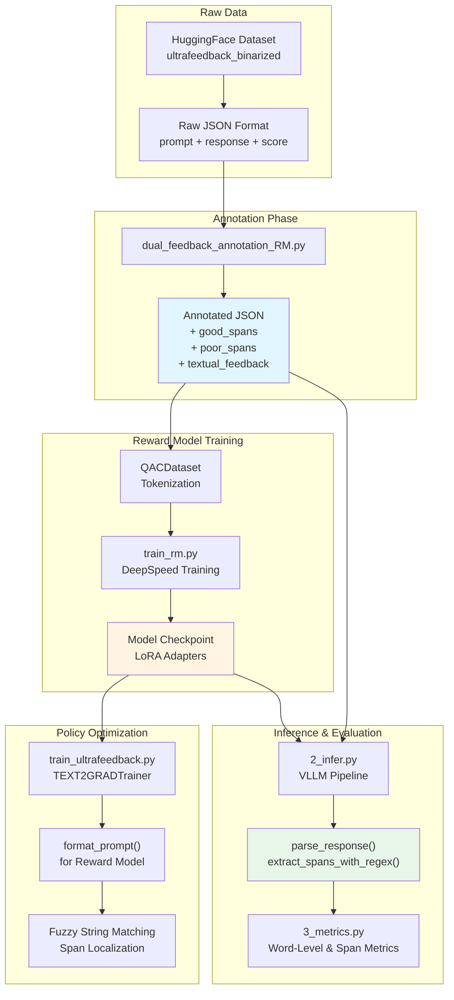
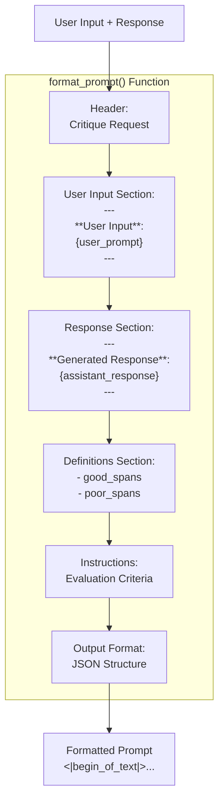

<!-- source: DeepWiki mcp.deepwiki.com · repo microsoft/Text2Grad · extra page UltraFeedback Dataset Format · fetched 2026-10-26 -->

# UltraFeedback Dataset Format

<details>
<summary>Relevant source files</summary>

The following files were used as context for generating this wiki page:

- [README.md](README.md)
- [nl_reward_model/ultrafeedback/evaluation/2_infer.py](nl_reward_model/ultrafeedback/evaluation/2_infer.py)

</details>


This page documents the UltraFeedback dataset format used in the Text2Grad framework for question answering tasks. It covers the raw dataset structure from HuggingFace, the annotated format after dual-feedback annotation, and how the format flows through the reward model and policy optimization pipelines.

For training reward models with this format, see [UltraFeedback Reward Model](#7.2.2). For policy optimization using UltraFeedback data, see [UltraFeedback Policy Optimization](#7.2.3). For general dataset formats across all tasks, see [Input Data Formats](#4.1).

## Raw Dataset Format

The UltraFeedback dataset is sourced from HuggingFace Hub at `HuggingFaceH4/ultrafeedback_binarized`. Each sample in the raw format contains a prompt, response pairs (chosen and rejected), and associated scores.

### JSON Structure

```json
[
    {
        "prompt": "In this task, you are given ... \n\nA:",
        "prompt_id": "333685aaf217d34921dac65dbea023fe1180b5c1973dbb6554bc022d74b54e0c",
        "score_chosen": 4.0,
        "score_rejected": 4.0,
        "response": [
            {
                "content": "In this task, you are given ... \n\nA:",
                "role": "user"
            },
            {
                "content": "Could you provide ... ",
                "role": "assistant"
            }
        ],
        "is_chosen": true,
        "score": 4.0,
        "critique": ""
    }
]
```

**Sources:** [README.md:173-196]()

### Field Descriptions

| Field | Type | Description |
|-------|------|-------------|
| `prompt` | string | The user's input question or instruction |
| `prompt_id` | string | Unique SHA256 hash identifier for the prompt |
| `score_chosen` | float | Quality score for the preferred response (0.0-5.0) |
| `score_rejected` | float | Quality score for the rejected response (0.0-5.0) |
| `response` | array | Conversation history with role-content pairs |
| `is_chosen` | boolean | Whether this response is the preferred one |
| `score` | float | The score for this particular response |
| `critique` | string | Natural language feedback (initially empty in raw data) |

**Sources:** [README.md:173-196]()

## Annotated Dataset Format

After running the dual-feedback annotation pipeline in [rm_data_anno/ultrafeedback/dual_feedback_annotation_RM.py](), the dataset is enriched with span-level annotations and textual feedback.

### Enhanced JSON Structure

```json
[
    {
        "prompt": "In this task, you are given ... \n\nA:",
        "response": "Could you provide more context about the specific requirements?",
        "good_spans": ["provide more context", "specific requirements"],
        "poor_spans": ["Could you"],
        "textual_feedback": "The response appropriately asks for clarification...",
        "score": 4.0
    }
]
```

### Annotation Fields

| Field | Type | Description |
|-------|------|-------------|
| `prompt` | string | User input (unchanged from raw format) |
| `response` | string | Assistant's response text (extracted from conversation) |
| `good_spans` | array[string] | Phrases that improve response quality |
| `poor_spans` | array[string] | Phrases that degrade response quality |
| `textual_feedback` | string | Natural language explanation of quality assessment |
| `score` | float | Overall quality score (preserved from raw data) |

**Sources:** [README.md:173-196](), [nl_reward_model/ultrafeedback/evaluation/2_infer.py:156-164]()

## Format Flow Through Pipeline



**Diagram: UltraFeedback Data Transformation Pipeline**

This diagram shows how the UltraFeedback format evolves from raw data to training and inference. The annotated format serves as the central format used by both reward model training and policy optimization.

**Sources:** [README.md:127-145](), [nl_reward_model/ultrafeedback/evaluation/2_infer.py:1-178]()

## Prompt Formatting for Inference

The reward model expects a specific prompt format to generate span-level feedback. This formatting is implemented in [nl_reward_model/ultrafeedback/evaluation/2_infer.py:25-60]().

### Prompt Template Structure



**Diagram: Prompt Formatting Template Structure**

**Sources:** [nl_reward_model/ultrafeedback/evaluation/2_infer.py:25-60]()

### Template Components

The prompt template includes these key sections:

1. **Critique Request Header** - Explains the task
2. **User Input Section** - Contains the original question/prompt
3. **Generated Response Section** - Contains the assistant's response
4. **Definitions** - Defines `good_spans` and `poor_spans`
5. **Instructions** - Evaluation criteria (Accuracy, Relevance, Clarity, Completeness)
6. **Output Format** - Expected JSON structure

The template is wrapped with Llama-3.1 chat format tokens: `<|begin_of_text|><|start_header_id|>user<|end_header_id|>...<|eot_id|><|start_header_id|>assistant<|end_header_id|>`

**Sources:** [nl_reward_model/ultrafeedback/evaluation/2_infer.py:25-60]()

## Response Parsing Strategies

The framework implements robust parsing to handle various model output formats, with multiple fallback strategies.

### Parsing Flow

```mermaid
graph TB
    RAW["Raw Model Output<br/>assistant_part"]
    
    subgraph "parse_response() Function"
        JSONEXTRACT["Extract JSON<br/>Find { and }"]
        JSONDECODE["json.loads()<br/>Parse JSON"]
        SUCCESS["Return Parsed<br/>good_spans + poor_spans"]
        FAIL["JSON Parse Failed"]
    end
    
    subgraph "extract_spans_with_regex() Fallback"
        GOODREGEX["Regex Pattern:<br/>\"good_spans\"\\s*:\\s*\\[(.*?)\\]"]
        POORREGEX["Regex Pattern:<br/>\"poor_spans\"\\s*:\\s*\\[(.*?)\\]"]
        SPANEXTRACT["Extract Individual Spans<br/>\"([^\"]*?)\"|'([^']*?)'"]
        FALLBACKRESULT["Return Extracted<br/>good_spans + poor_spans"]
    end
    
    RAW --> JSONEXTRACT
    JSONEXTRACT --> JSONDECODE
    JSONDECODE -->|Success| SUCCESS
    JSONDECODE -->|Failure| FAIL
    FAIL --> GOODREGEX
    GOODREGEX --> POORREGEX
    POORREGEX --> SPANEXTRACT
    SPANEXTRACT --> FALLBACKRESULT
```

**Diagram: Response Parsing with Fallback Strategy**

**Sources:** [nl_reward_model/ultrafeedback/evaluation/2_infer.py:62-101]()

### Parsing Functions

**Primary Parser: `parse_response()`** [nl_reward_model/ultrafeedback/evaluation/2_infer.py:62-78]()
- Locates JSON boundaries using `find("{")` and `rfind("}")` 
- Attempts `json.loads()` on extracted string
- Falls back to regex extraction on failure

**Fallback Parser: `extract_spans_with_regex()`** [nl_reward_model/ultrafeedback/evaluation/2_infer.py:80-101]()
- Uses regex patterns to locate `good_spans` and `poor_spans` arrays
- Extracts individual span strings with pattern `(?:"([^"]*?)"|'([^']*?)')`
- Handles both double and single quoted strings
- Returns structured dictionary even if JSON is malformed

**Sources:** [nl_reward_model/ultrafeedback/evaluation/2_infer.py:62-101]()

## Data Structure Mapping

### Code-to-Format Mapping

| Code Entity | File Location | Format Field(s) |
|------------|---------------|-----------------|
| `format_prompt()` | [nl_reward_model/ultrafeedback/evaluation/2_infer.py:25-60]() | `prompt`, `response` |
| `parse_response()` | [nl_reward_model/ultrafeedback/evaluation/2_infer.py:62-78]() | `good_spans`, `poor_spans` (output) |
| `extract_spans_with_regex()` | [nl_reward_model/ultrafeedback/evaluation/2_infer.py:80-101]() | `good_spans`, `poor_spans` (fallback) |
| `result` dict | [nl_reward_model/ultrafeedback/evaluation/2_infer.py:155-164]() | All fields |
| `ground_truth` dict | [nl_reward_model/ultrafeedback/evaluation/2_infer.py:158-161]() | `good_spans`, `poor_spans` |
| `model_output` dict | [nl_reward_model/ultrafeedback/evaluation/2_infer.py:162]() | Generated spans |

**Sources:** [nl_reward_model/ultrafeedback/evaluation/2_infer.py:25-164]()

## Inference Output Format

After model inference, results are saved with comprehensive metadata for evaluation.

### Output JSON Structure

```json
{
    "prompt": "Original user question...",
    "response": "Assistant's generated response...",
    "ground_truth": {
        "good_spans": ["phrase1", "phrase2"],
        "poor_spans": ["phrase3"]
    },
    "model_output": {
        "good_spans": ["phrase1"],
        "poor_spans": ["phrase3", "phrase4"]
    },
    "raw_model_output": "Complete raw text from model..."
}
```

This output format enables direct comparison between ground truth annotations and model predictions for evaluation metrics computation.

**Sources:** [nl_reward_model/ultrafeedback/evaluation/2_infer.py:155-166]()

## Batch Processing Configuration

The inference pipeline supports batch processing with configurable parameters:

| Parameter | Default | Description |
|-----------|---------|-------------|
| `--batch_size` | 32 | Number of samples processed per batch |
| `--max_new_tokens` | 300 | Maximum tokens to generate per response |
| `--num_samples` | 1000 | Total samples to evaluate (-1 for all) |
| `--tensor_parallel_size` | 1 | GPUs for tensor parallelism |
| `--gpu_ids` | "0,1,2,3,4,5,6,7" | Comma-separated GPU IDs |

Example usage:
```bash
python 2_infer.py \
    --valid_dataset_file "../data/ultrafeedback/RM/test_annotated_v4_concurrent_2step.json" \
    --output_file "validation_results.json" \
    --batch_size 32 \
    --max_new_tokens 300
```

**Sources:** [nl_reward_model/ultrafeedback/evaluation/2_infer.py:10-23](), [nl_reward_model/ultrafeedback/evaluation/2_infer.py:132-145]()

## Format Validation

### Required Fields

**Annotated Dataset (for training):**
- `prompt` (string) - Must not be empty
- `response` (string) - Must not be empty  
- `good_spans` (array) - Can be empty list
- `poor_spans` (array) - Can be empty list

**Raw Dataset (for annotation):**
- `prompt` (string)
- `response` (array with role-content pairs) or direct string
- `score` (float)

### Common Format Issues

1. **Missing Spans**: Empty `good_spans` and `poor_spans` arrays are valid (indicates neutral response)
2. **Malformed JSON**: Handled by regex fallback parser
3. **Tokenization Mismatches**: Spans may not align exactly with tokenizer boundaries
4. **Response Formatting**: Raw `response` field may be array or string depending on source

**Sources:** [nl_reward_model/ultrafeedback/evaluation/2_infer.py:62-101](), [README.md:173-196]()

---

