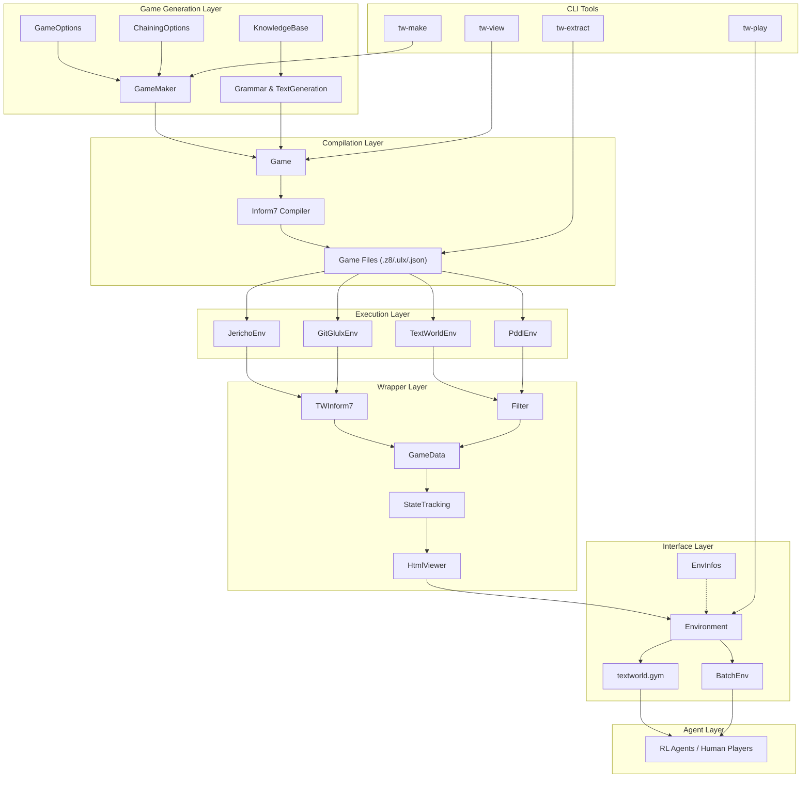
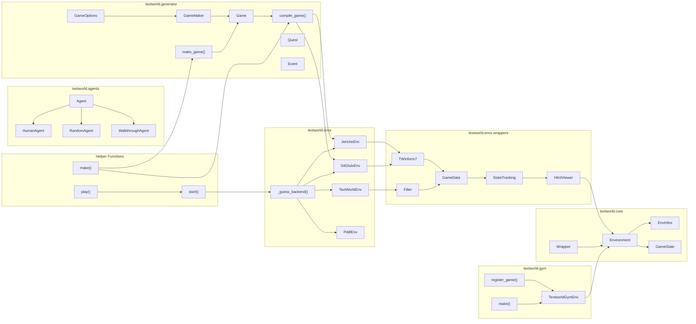

<!-- source: DeepWiki mcp.deepwiki.com · repo microsoft/TextWorld · page 1 Overview · fetched 2026-10-26 -->

# Overview

<details>
<summary>Relevant source files</summary>

The following files were used as context for generating this wiki page:

- [CHANGELOG.md](CHANGELOG.md)
- [README.md](README.md)
- [setup.py](setup.py)
- [textworld/envs/__init__.py](textworld/envs/__init__.py)
- [textworld/envs/wrappers/viewer.py](textworld/envs/wrappers/viewer.py)
- [textworld/helpers.py](textworld/helpers.py)
- [textworld/testing.py](textworld/testing.py)
- [textworld/version.py](textworld/version.py)

</details>


This document provides a high-level overview of TextWorld, covering its purpose, key features, and architectural components. TextWorld is a text-based game generator and extensible sandbox learning environment designed for training and testing reinforcement learning (RL) agents.

For detailed information about specific subsystems, see:
- Game generation process: [Game Generation](#4)
- Environment execution: [Game Environments](#5) 
- Agent integration: [Agent Interface](#6)
- Command-line usage: [Command Line Tools](#7)

## Purpose and Scope

TextWorld serves as both a procedural text game generator and a standardized environment for RL research. It enables researchers to:

- **Generate customizable text-based games** with varying complexity and objectives
- **Train and evaluate RL agents** in interactive fiction environments  
- **Study language understanding** in goal-oriented scenarios
- **Benchmark agent performance** across diverse textual challenges

The framework supports Python 3.9-3.12 on Linux and macOS systems, with Windows support available through Docker.

Sources: [README.md:9-13](), [setup.py:41-74]()

## Key Features

| Feature | Description | Implementation |
|---------|-------------|----------------|
| **Procedural Generation** | Algorithmic creation of game worlds, quests, and narratives | `GameMaker`, `ChainingOptions` |
| **Multi-Backend Support** | Z-machine, Glulx, JSON, and PDDL game formats | `JerichoEnv`, `GitGlulxEnv`, `TextWorldEnv`, `PddlEnv` |
| **Gym Integration** | OpenAI Gym-compatible API for RL training | `textworld.gym` module |
| **Visualization Tools** | Web-based game state visualization and graph rendering | `HtmlViewer`, `tw-view` |
| **Flexible Information Control** | Configurable environment information for agents | `EnvInfos` system |
| **Batch Processing** | Parallel game execution for efficient training | `BatchEnv` wrappers |

Sources: [README.md:88-116](), [textworld/envs/__init__.py:12-24](), [textworld/envs/wrappers/viewer.py:13-39]()

## Architecture Overview

The following diagram illustrates TextWorld's modular architecture and the relationships between its core systems:

**TextWorld System Architecture**


Sources: [textworld/envs/__init__.py:5-24](), [textworld/helpers.py:19-54](), [setup.py:51-58]()

## Core System Components

The following diagram details the primary classes and modules that implement TextWorld's functionality:

**Core Implementation Components**


Sources: [textworld/helpers.py:19-116](), [textworld/envs/__init__.py:1-25](), [textworld/testing.py:48-110]()

## Entry Points and Usage Patterns

TextWorld provides multiple interfaces for different use cases:

### Programmatic Interface
The `textworld.helpers` module provides the primary programmatic entry points:

- **`start(path, request_infos, wrappers)`** - Load and start a game environment 
- **`play(game_file, agent, max_nb_steps, wrappers)`** - Play a game with an agent
- **`make(options)`** - Generate a new game programmatically

### Command Line Interface  
Six command-line tools provide direct access to TextWorld functionality:

- **`tw-make`** - Generate games with customizable parameters
- **`tw-play`** - Play games interactively or with automated agents  
- **`tw-extract`** - Extract data and statistics from game files
- **`tw-view`** - Visualize game states as graphs
- **`tw-stats`** - Generate statistical reports
- **`tw-data`** - Manage game data and challenges

### Gym Integration
The `textworld.gym` module enables seamless integration with RL frameworks:

```python
import textworld.gym
env_id = textworld.gym.register_game("game.z8", max_episode_steps=50)
env = textworld.gym.make(env_id)
```

Sources: [textworld/helpers.py:19-116](), [setup.py:51-58](), [README.md:88-116]()

## Supported Game Formats

TextWorld supports multiple game file formats through specialized backend environments:

| Format | Extension | Backend | Description |
|--------|-----------|---------|-------------|
| Z-machine | `.z1` - `.z8` | `JerichoEnv` | Classic interactive fiction format |
| Glulx | `.ulx` | `GitGlulxEnv` | Extended interactive fiction format |
| TextWorld JSON | `.json` | `TextWorldEnv` | Native TextWorld format |
| PDDL | `.tw-pddl` | `PddlEnv` | Planning domain format |

The `_guess_backend()` function automatically selects the appropriate environment based on file extension.

Sources: [textworld/envs/__init__.py:12-24](), [README.md:80-81]()

---

