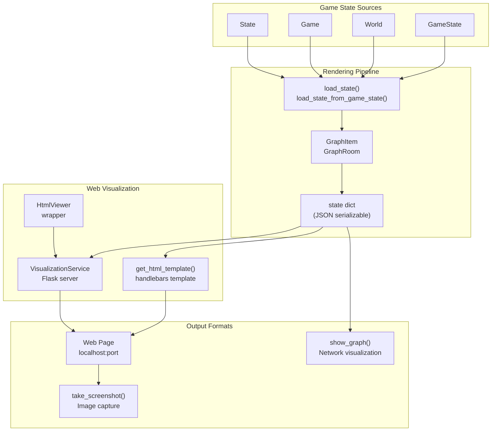
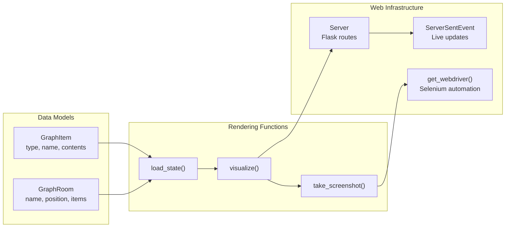
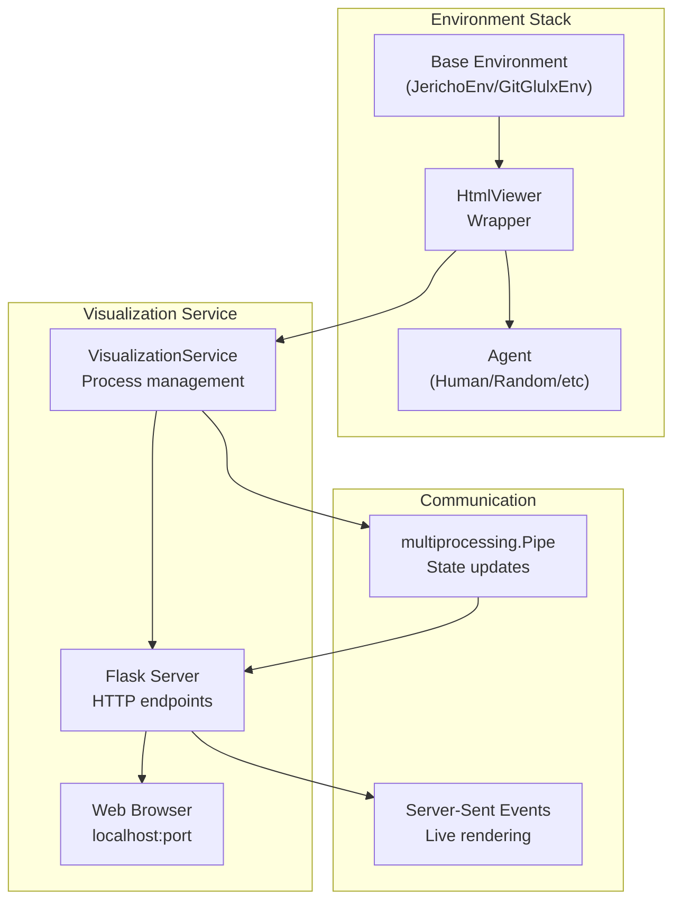
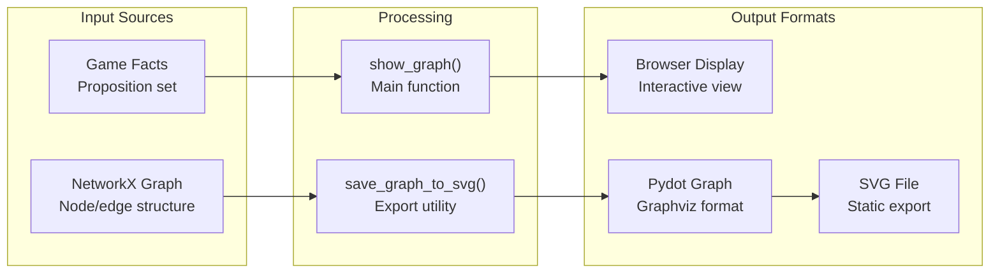

<!-- source: DeepWiki mcp.deepwiki.com · repo microsoft/TextWorld · page 10 Visualization and Utilities · fetched 2026-10-26 -->

# Visualization and Utilities

<details>
<summary>Relevant source files</summary>

The following files were used as context for generating this wiki page:

- [scripts/tw-play](scripts/tw-play)
- [textworld/agents/human.py](textworld/agents/human.py)
- [textworld/envs/wrappers/__init__.py](textworld/envs/wrappers/__init__.py)
- [textworld/envs/wrappers/recorder.py](textworld/envs/wrappers/recorder.py)
- [textworld/envs/wrappers/tests/test_viewer.py](textworld/envs/wrappers/tests/test_viewer.py)
- [textworld/render/__init__.py](textworld/render/__init__.py)
- [textworld/render/render.py](textworld/render/render.py)
- [textworld/render/serve.py](textworld/render/serve.py)
- [textworld/render/tests/test_graph.py](textworld/render/tests/test_graph.py)
- [textworld/utils.py](textworld/utils.py)

</details>


This document covers TextWorld's visualization capabilities and core utility functions. The visualization system provides web-based rendering of game states, while the utilities module contains essential helper functions for game generation, data processing, and development workflows.

For environment wrapper functionality, see [Environment Wrappers](#5.2). For command-line tools usage, see [Command Line Tools](#7).

## Core Utilities

TextWorld provides several foundational utility classes and functions that support game generation, data management, and development workflows.

### Random Number Generation

The `RandomGenerator` class provides deterministic random number generation for reproducible game creation:

```python
class RandomGenerator:
    def __init__(self, seed=None)
    def set_seed(self, seed)
    def next(self)  # Returns new numpy.RandomState
```

The global random generator `g_rng` is used throughout TextWorld to ensure consistent randomization patterns across game generation processes.

### Data Structures

The `RegexDict` class extends `OrderedDict` with pattern matching capabilities:

```python
class RegexDict(OrderedDict):
    def get_matching(self, *regexes: List[str], exclude: List[str] = [])
```

This enables flexible querying of rule sets and knowledge bases using regular expressions.

### File and Directory Management

Several utility functions handle temporary directories and file operations:

| Function | Purpose | Usage |
|----------|---------|-------|
| `maybe_mkdir(dirpath)` | Create directories safely | Game compilation output |
| `make_temp_directory()` | Context manager for temp dirs | Testing and compilation |
| `check_flag(flag, default)` | Environment variable parsing | Debug mode detection |

Sources: [textworld/utils.py:17-223]()

## Visualization System Architecture

TextWorld's visualization system consists of multiple components that work together to render game states in a web browser.

### Visualization Pipeline



### Core Rendering Components

The rendering system transforms game objects into web-displayable formats:



Sources: [textworld/render/render.py:48-505](), [textworld/render/serve.py:130-325]()

## HTML Viewer Environment Wrapper

The `HtmlViewer` wrapper integrates web visualization directly into the environment interface:

### HtmlViewer Integration



The `HtmlViewer` automatically starts a web server when wrapping an environment and provides real-time updates as the game progresses.

### Usage Pattern

```python
# From tw-play script
env = textworld.start(game_file)
if args.viewer is not None:
    from textworld.envs.wrappers.viewer import HtmlViewer
    env = HtmlViewer(env, port=args.viewer)
```

Sources: [textworld/envs/wrappers/tests/test_viewer.py:13-48](), [scripts/tw-play:55-57]()

## Command Line Visualization

The `tw-play` script provides several visualization options for interactive game playing:

### Viewer Options

| Option | Function | Implementation |
|--------|----------|----------------|
| `--viewer PORT` | Start web viewer | Wraps env with `HtmlViewer` |
| `--mode human` | Interactive play | Uses `HumanAgent` with prompt |
| `--hint` | Show oracle trajectory | Enables policy commands display |
| `--verbose` | Show game state | Calls `env.render()` each step |

### Agent Visualization Features

The `HumanAgent` provides enhanced visualization capabilities:

- **Autocompletion**: Displays `admissible_commands` when available
- **Oracle Mode**: Shows optimal action sequence with `policy_commands`
- **Command History**: Uses `prompt_toolkit` for enhanced terminal interaction

Sources: [scripts/tw-play:14-84](), [textworld/agents/human.py:26-70]()

## Graph Visualization

TextWorld includes network graph visualization for displaying game state relationships:

### Graph Rendering Pipeline



The `show_graph()` function can render to browser or file formats, with styling and layout automatically configured.

Sources: [textworld/render/tests/test_graph.py:23-31](), [textworld/utils.py:191-211]()

## Utility Functions for Development

### Data Processing Utilities

TextWorld provides several specialized functions for data manipulation:

| Function | Purpose | Use Case |
|----------|---------|----------|
| `uniquify(seq)` | Order-preserving deduplication | Game object processing |
| `take(n, iterable)` | Limited iteration | Batch processing |
| `chunk(iterable, n, fct)` | Data batching | Parallel game generation |
| `unique_product(*iterables)` | Cartesian product with deduplication | Combination generation |
| `encode_seeds(seeds)` | Generate UID from seed list | Game identification |

### Development Helpers

```python
def str2bool(v)  # Environment variable parsing
def check_modules(required, missing)  # Dependency validation
def check_flag(flag, default=False)  # Debug mode detection
```

These utilities support configuration management and optional dependency handling throughout the codebase.

### Screenshot and Image Processing

The visualization system includes image capture capabilities:

```python
def take_screenshot(url, id='world')  # Capture DOM element
def concat_images(*images)  # Combine multiple images
def get_webdriver(path=None)  # Selenium driver setup
```

These functions enable automated screenshot generation for documentation and testing.

Sources: [textworld/utils.py:79-223](), [textworld/render/render.py:337-458]()

---

