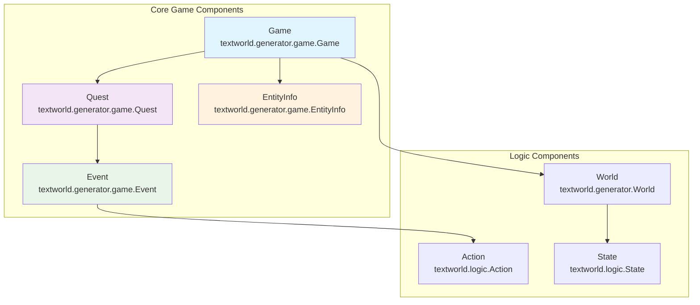
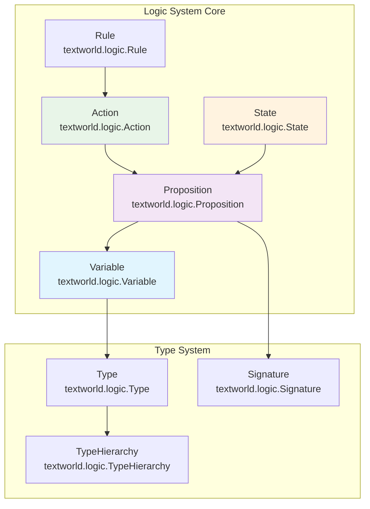
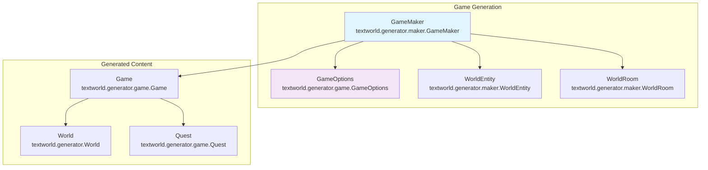
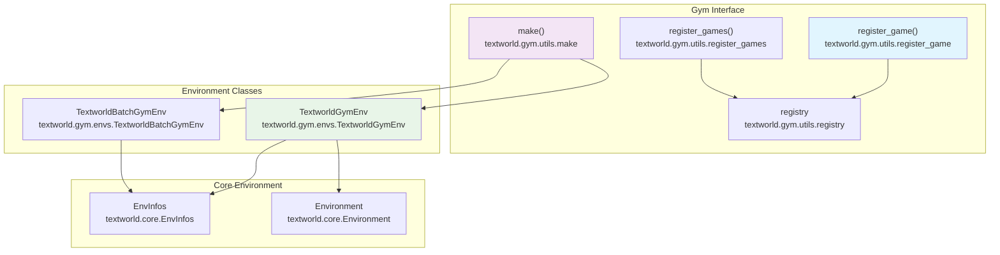

<!-- source: DeepWiki mcp.deepwiki.com · repo microsoft/TextWorld · page 11 API Reference · fetched 2026-10-26 -->

# API Reference

<details>
<summary>Relevant source files</summary>

The following files were used as context for generating this wiki page:

- [CHANGELOG.md](CHANGELOG.md)
- [README.md](README.md)
- [scripts/benchmark_framework.py](scripts/benchmark_framework.py)
- [setup.py](setup.py)
- [textworld/envs/wrappers/viewer.py](textworld/envs/wrappers/viewer.py)
- [textworld/generator/game.py](textworld/generator/game.py)
- [textworld/generator/maker.py](textworld/generator/maker.py)
- [textworld/generator/tests/test_game.py](textworld/generator/tests/test_game.py)
- [textworld/gym/__init__.py](textworld/gym/__init__.py)
- [textworld/gym/envs/textworld.py](textworld/gym/envs/textworld.py)
- [textworld/gym/utils.py](textworld/gym/utils.py)
- [textworld/logic/__init__.py](textworld/logic/__init__.py)
- [textworld/logic/logic.ebnf](textworld/logic/logic.ebnf)
- [textworld/logic/parser.py](textworld/logic/parser.py)
- [textworld/logic/tests/test_logic.py](textworld/logic/tests/test_logic.py)
- [textworld/version.py](textworld/version.py)

</details>


This document provides comprehensive API documentation for TextWorld's key classes and functions. It covers the core interfaces for game generation, logic representation, and environment interaction that developers use to create and play text-based games.

For information about installation and basic setup, see [Installation and Setup](#2). For conceptual explanations of the game structure and logic system, see [Core Concepts](#3). For practical tutorials on building games, see [Game Generation](#4).

## Core Game Components

TextWorld represents games through four primary classes that form the foundation of the game structure.



### Game Class

The `Game` class represents a complete text-based game including its world, quests, and metadata.

| Property | Type | Description |
|----------|------|-------------|
| `world` | `World` | The game world containing rooms, objects, and initial state |
| `quests` | `Tuple[Quest]` | List of quests that define winning/losing conditions |
| `infos` | `Dict[str, EntityInfo]` | Metadata about entities in the game |
| `max_score` | `float` | Maximum possible score achievable |
| `command_templates` | `List[str]` | All command templates understood in this game |
| `verbs` | `List[str]` | All verbs that should be recognized |
| `objects_names` | `List[str]` | Names of all interactive objects |
| `walkthrough` | `Optional[List[str]]` | Sequence of commands to complete the game |

Key methods include:
- `serialize()` / `deserialize()` for saving/loading games
- `save(filename)` / `load(filename)` for file I/O

Sources: [textworld/generator/game.py:386-638]()

### Quest Class

The `Quest` class defines objectives within a game through winning and failing conditions.

| Property | Type | Description |
|----------|------|-------------|
| `win_events` | `Tuple[Event]` | Mutually exclusive events that complete the quest |
| `fail_events` | `Tuple[Event]` | Mutually exclusive events that fail the quest |
| `reward` | `int` | Points awarded for completing this quest |
| `desc` | `Optional[str]` | Text description of the quest |
| `optional` | `bool` | Whether this quest is optional to finish the game |
| `repeatable` | `bool` | Whether this quest can be completed multiple times |

Key methods:
- `is_winning(state)` - Check if quest is completed in given state
- `is_failing(state)` - Check if quest has failed in given state

Sources: [textworld/generator/game.py:176-320]()

### Event Class

The `Event` class represents specific conditions or action sequences that trigger quest completion or failure.

| Property | Type | Description |
|----------|------|-------------|
| `actions` | `Tuple[Action]` | Sequence of actions to trigger this event |
| `commands` | `Tuple[str]` | Human-readable commands corresponding to actions |
| `condition` | `Action` | Logical condition that must be satisfied |

Key methods:
- `is_triggering(state)` - Check if event would trigger in given state
- `set_conditions(conditions)` - Define triggering conditions

Sources: [textworld/generator/game.py:63-174]()

### EntityInfo Class

The `EntityInfo` class stores metadata about entities (objects, rooms, etc.) in the game.

| Property | Type | Description |
|----------|------|-------------|
| `id` | `str` | Unique identifier for the entity |
| `type` | `str` | Entity type (e.g., 'f' for food, 'c' for container) |
| `name` | `str` | Display name shown to players |
| `desc` | `str` | Description shown when examining the entity |
| `synonyms` | `List[str]` | Alternative names for the entity |

Sources: [textworld/generator/game.py:322-384]()

## Logic System

TextWorld uses first-order logic to represent game state and actions. The logic system provides the foundation for reasoning about game worlds.



### Variable Class

The `Variable` class represents entities in the game world (players, objects, rooms, etc.).

| Property | Type | Description |
|----------|------|-------------|
| `name` | `str` | Unique identifier for this variable |
| `type` | `str` | Type classification (e.g., 'P' for player, 'r' for room) |

Key methods:
- `is_a(type)` - Check if variable is of given type
- `parse(expr)` - Create variable from string expression

Sources: [textworld/logic/__init__.py:464-540]()

### Proposition Class

The `Proposition` class represents facts about the world (e.g., "at(player, kitchen)").

| Property | Type | Description |
|----------|------|-------------|
| `name` | `str` | Predicate name (e.g., "at", "in", "locked") |
| `arguments` | `Tuple[Variable]` | Variables this proposition applies to |
| `signature` | `Signature` | Type signature of the proposition |

Key methods:
- `parse(expr)` - Create proposition from string
- `negate()` - Create negated version of proposition

Sources: [textworld/logic/__init__.py:620-713]()

### Action Class

The `Action` class represents state transitions with preconditions and postconditions.

| Property | Type | Description |
|----------|------|-------------|
| `name` | `str` | Action name (e.g., "take", "open") |
| `preconditions` | `Tuple[Proposition]` | Facts that must be true to apply action |
| `postconditions` | `Tuple[Proposition]` | Facts that become true after applying action |

Key methods:
- `is_applicable(state)` - Check if action can be applied in state
- `copy()` - Create a copy of the action
- `inverse()` - Generate reverse action if possible

Sources: [textworld/logic/__init__.py:1020-1200]()

### State Class

The `State` class represents the current state of the game world as a set of true propositions.

| Property | Type | Description |
|----------|------|-------------|
| `facts` | `Set[Proposition]` | All true propositions in current state |
| `variables` | `Set[Variable]` | All variables mentioned in current state |

Key methods:
- `is_fact(proposition)` - Check if proposition is true
- `add_fact(proposition)` / `remove_fact(proposition)` - Modify state
- `apply(action)` - Apply action to change state
- `all_applicable_actions(rules)` - Find all applicable actions

Sources: [textworld/logic/__init__.py:1350-1600]()

## Game Generation Interface

The `GameMaker` class provides the primary interface for programmatically constructing games.



### GameMaker Class

The `GameMaker` class is a stateful builder for creating text-based games.

| Property | Type | Description |
|----------|------|-------------|
| `player` | `WorldEntity` | The player entity |
| `inventory` | `WorldEntity` | Player's inventory container |
| `rooms` | `List[WorldRoom]` | All rooms in the game world |
| `paths` | `List[WorldPath]` | Connections between rooms |
| `quests` | `List[Quest]` | Quests defined for this game |

Key methods:
- `new(type, name, desc)` - Create new entity
- `new_room(name, desc)` - Create new room
- `connect(exit1, exit2)` - Connect two room exits
- `set_player(room)` - Place player in starting room
- `generate_random_quests(length, breadth)` - Auto-generate quests
- `build()` - Create final Game object

Sources: [textworld/generator/maker.py:349-790]()

### GameOptions Class

The `GameOptions` class configures game generation parameters.

| Property | Type | Description |
|----------|------|-------------|
| `nb_rooms` | `int` | Number of rooms to generate |
| `nb_objects` | `int` | Number of objects to place |
| `quest_length` | `int` | Minimum actions required to complete quest |
| `quest_breadth` | `int` | How non-linear quests can be |
| `seeds` | `Dict[str, int]` | Random seeds for different generation aspects |

Sources: [textworld/generator/game.py:23]()

## Environment Interface

TextWorld provides OpenAI Gym-compatible interfaces for reinforcement learning applications.



### Core Functions

| Function | Parameters | Returns | Description |
|----------|------------|---------|-------------|
| `register_game()` | `gamefile`, `request_infos`, `max_episode_steps` | `str` | Register single game, returns env_id |
| `register_games()` | `gamefiles`, `batch_size`, `request_infos` | `str` | Register multiple games, returns env_id |
| `make()` | `id` | `Environment` | Create environment from registered ID |

### Environment Classes

**TextworldGymEnv**: Single-game environment with standard Gym interface
- `reset()` → `(observation: str, infos: Dict)`
- `step(command: str)` → `(observation: str, score: float, done: bool, infos: Dict)`

**TextworldBatchGymEnv**: Multi-game environment for parallel execution
- `reset()` → `(observations: List[str], infos: Dict[str, List])`
- `step(commands: List[str])` → `(observations: List[str], scores: List[float], dones: List[bool], infos: Dict[str, List])`

Sources: [textworld/gym/utils.py:34-199](), [textworld/gym/envs/textworld.py:11-67]()

## Information Request System

The `EnvInfos` class controls what additional information environments provide to agents.

| Property | Type | Description |
|----------|------|-------------|
| `description` | `bool` | Current room description |
| `inventory` | `bool` | Player's inventory contents |
| `objective` | `bool` | Current quest objective |
| `admissible_commands` | `bool` | Valid commands in current state |
| `intermediate_reward` | `bool` | Reward for intermediate progress |
| `facts` | `bool` | All true facts in current state |

Example usage:
```python
import textworld.gym

# Request specific information
request_infos = textworld.EnvInfos(
    description=True,
    inventory=True, 
    admissible_commands=True
)

env_id = textworld.gym.register_game("game.ulx", request_infos)
env = textworld.gym.make(env_id)
```

Sources: [textworld/core.py](), [textworld/gym/utils.py:46-53]()

## Common Usage Patterns

### Creating and Playing a Game

```python
# Generate a game
import textworld
from textworld import GameMaker

M = GameMaker()
room = M.new_room("kitchen")
M.set_player(room)
game = M.build()

# Compile and register with Gym
gamefile = textworld.compile(game, "game.ulx") 
env_id = textworld.gym.register_game(gamefile)
env = textworld.gym.make(env_id)

# Play the game
obs, infos = env.reset()
obs, score, done, infos = env.step("look")
```

### Parsing Logic Expressions

```python
from textworld.logic import Variable, Proposition, Action

# Create entities
player = Variable.parse("P")
kitchen = Variable.parse("kitchen: r")

# Create facts
at_kitchen = Proposition.parse("at(P, kitchen: r)")

# Create actions
take_action = Action.parse("take :: $at(P, r) & in(o, r) -> in(o, I)")
```

Sources: [textworld/logic/__init__.py:520-530](), [textworld/logic/__init__.py:680-690]()