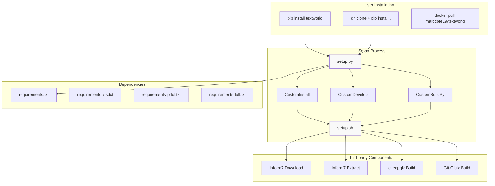
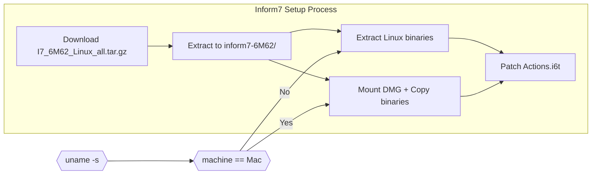
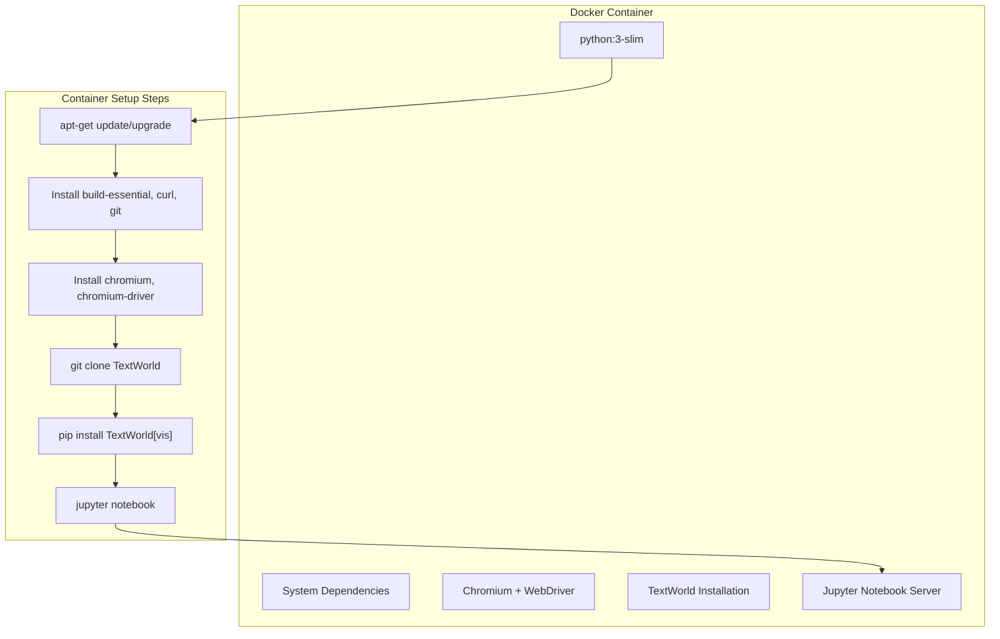

<!-- source: DeepWiki mcp.deepwiki.com · repo microsoft/TextWorld · page 2 Installation and Setup · fetched 2026-10-26 -->

# Installation and Setup

<details>
<summary>Relevant source files</summary>

The following files were used as context for generating this wiki page:

- [CHANGELOG.md](CHANGELOG.md)
- [MANIFEST.in](MANIFEST.in)
- [README.md](README.md)
- [docker/Dockerfile](docker/Dockerfile)
- [docker/README.md](docker/README.md)
- [pyproject.toml](pyproject.toml)
- [requirements-full.txt](requirements-full.txt)
- [requirements.txt](requirements.txt)
- [setup.py](setup.py)
- [setup.sh](setup.sh)
- [textworld/__init__.py](textworld/__init__.py)
- [textworld/envs/wrappers/viewer.py](textworld/envs/wrappers/viewer.py)
- [textworld/version.py](textworld/version.py)
- [tools/prep-release.sh](tools/prep-release.sh)

</details>


This page covers the installation and setup procedures for TextWorld, including system requirements, dependencies, and configuration options. For information about development environment setup and contributing to TextWorld, see [Development](#9). For details about the command-line tools that become available after installation, see [Command Line Tools](#7).

## Prerequisites and System Requirements

TextWorld supports specific Python versions and operating systems with additional system-level dependencies required for compilation and execution.

### Supported Platforms

| Platform | Support Level | Notes |
|----------|---------------|-------|
| Linux (Debian/Ubuntu) | Full | Primary development platform |
| macOS | Full | Requires additional setup steps |
| Windows | Docker only | Native installation not supported |

### Python Version Requirements

TextWorld requires Python 3.9, 3.10, 3.11, or 3.12. The version constraints are defined in [pyproject.toml:27-30]() and enforced during installation.

### System Dependencies

#### Linux (Debian/Ubuntu)
```bash
sudo apt update && sudo apt install build-essential libffi-dev python3-dev curl git
```

#### macOS
```bash
brew install libffi curl git
```

These dependencies support the compilation of native components including the Glulx interpreter and Inform7 integration.

Sources: [README.md:13-26](), [pyproject.toml:16-32]()

## Installation Flow Architecture



Sources: [setup.py:16-48](), [setup.sh:1-78]()

## Core Installation

### Standard Installation

The recommended installation method uses pip to install from PyPI:

```bash
pip install textworld
```

This triggers the `CustomInstall` class in [setup.py:21-25]() which executes [setup.sh:1-78]() to build required third-party components.

### Development Installation

For development or to install from source:

```bash
git clone https://github.com/microsoft/TextWorld.git
cd TextWorld
pip install .
```

This uses the `CustomDevelop` class in [setup.py:28-32]() with the same setup process.

### Virtual Environment Recommendation

TextWorld installation should use virtual environments to prevent package conflicts:

```bash
# Using conda
conda create -n textworld python=3.11
conda activate textworld

# Using venv
python -m venv textworld-env
source textworld-env/bin/activate  # Linux/macOS
# textworld-env\Scripts\activate  # Windows
```

Sources: [README.md:26-36](), [setup.py:41-48]()

## Third-Party Dependencies Setup

TextWorld requires several third-party components that are automatically installed via [setup.sh:1-78]():

### Inform7 Compiler Installation



The setup process downloads Inform7 6M62 from [http://emshort.com/inform-app-archive/6M62/]() and handles platform-specific installation:

- **Linux**: Extracts `inform7-compilers` and `inform7-interpreters` tarballs based on architecture
- **macOS**: Mounts the DMG file and copies compiled binaries from the Inform.app bundle

Sources: [setup.sh:20-64]()

### Glulx Components Build

The Glulx interpreter components are built from local sources:

1. **cheapglk**: A minimal GLK library implementation built in [textworld/thirdparty/glulx/cheapglk]()
2. **Git-Glulx**: The Glulx interpreter built in [textworld/thirdparty/glulx/Git-Glulx]()

Both components use Makefiles and are built with `make -B` to force rebuilding.

Sources: [setup.sh:67-77]()

## Optional Components

### Visualization Dependencies

For game state visualization and HTML viewer functionality:

```bash
pip install textworld[vis]
```

This installs additional packages defined in [requirements-vis.txt]() including:
- `selenium` for web browser automation
- `flask` for web server functionality  
- `pillow` for image processing
- `plotly` for interactive visualizations

#### WebDriver Setup

Visualization requires a WebDriver for browser automation:

```bash
# For Chrome
pip install chromedriver_installer

# Or manually install Firefox geckodriver
```

The `HtmlViewer` wrapper in [textworld/envs/wrappers/viewer.py:13-106]() uses these drivers to provide real-time game visualization.

Sources: [README.md:38-49](), [requirements-vis.txt]()

### PDDL Support

For integration with ALFWorld and PDDL-based planning:

```bash
pip install textworld[pddl]
```

This adds the `fast-downward-textworld` dependency for PDDL domain planning.

### Full Installation

To install all optional dependencies:

```bash
pip install textworld[full]
```

Sources: [setup.py:69-73](), [requirements-pddl.txt](), [requirements-full.txt]()

## Docker Alternative

For Windows users or simplified deployment, a Docker container is available:

```bash
docker pull marccote19/textworld
docker run -p 8888:8888 -it --rm marccote19/textworld
```

### Docker Container Components



The container automatically starts a Jupyter notebook server accessible at `http://127.0.0.1:8888` with a token-based authentication.

Sources: [docker/Dockerfile:1-28](), [docker/README.md:1-33]()

## Installation Verification

After installation, verify TextWorld is working correctly:

### Command-Line Tools Verification

```bash
# Check tool availability
tw-make --help
tw-play --help
tw-extract --help

# Generate a simple game
tw-make custom --world-size 2 --nb-objects 3 --quest-length 2 --output test_game.z8

# Play the generated game
tw-play test_game.z8
```

### Python API Verification

```python
import textworld
import textworld.gym

# Check version
print(textworld.__version__)

# Test game generation
env_id = textworld.gym.register_game("test_game.z8", max_episode_steps=50)
env = textworld.gym.make(env_id)
obs, infos = env.reset()
print("Installation successful!")
env.close()
```

### Visualization Verification

```bash
# Test visualization (if installed)
tw-play test_game.z8 --viewer
```

This should open a browser window displaying the game state visualization.

Sources: [README.md:67-113](), [scripts/tw-make](), [scripts/tw-play]()

## Troubleshooting Common Issues

### Missing System Dependencies

**Error**: `fatal error: 'ffi.h' file not found`
**Solution**: Install libffi development headers:
```bash
# Ubuntu/Debian
sudo apt install libffi-dev

# macOS  
brew install libffi
```

### Inform7 Compilation Issues

**Error**: Inform7 compiler not found
**Solution**: Ensure [setup.sh:1-78]() completed successfully. The Inform7 binaries should be in `textworld/thirdparty/inform7-6M62/share/inform7/Compilers/`.

### WebDriver Issues

**Error**: `WebdriverNotFoundError` when using visualization
**Solution**: Install appropriate WebDriver:
```bash
pip install chromedriver_installer
```

### Docker Port Conflicts

**Error**: `bind: address already in use`
**Solution**: Use a different host port:
```bash
docker run -p 9999:8888 -it --rm marccote19/textworld
```

Sources: [textworld/envs/wrappers/viewer.py:92-94](), [docker/README.md:18-32]()

---

