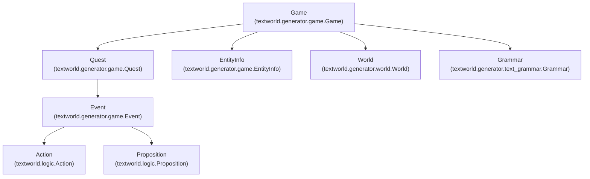
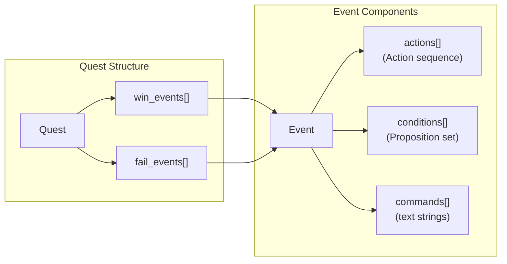
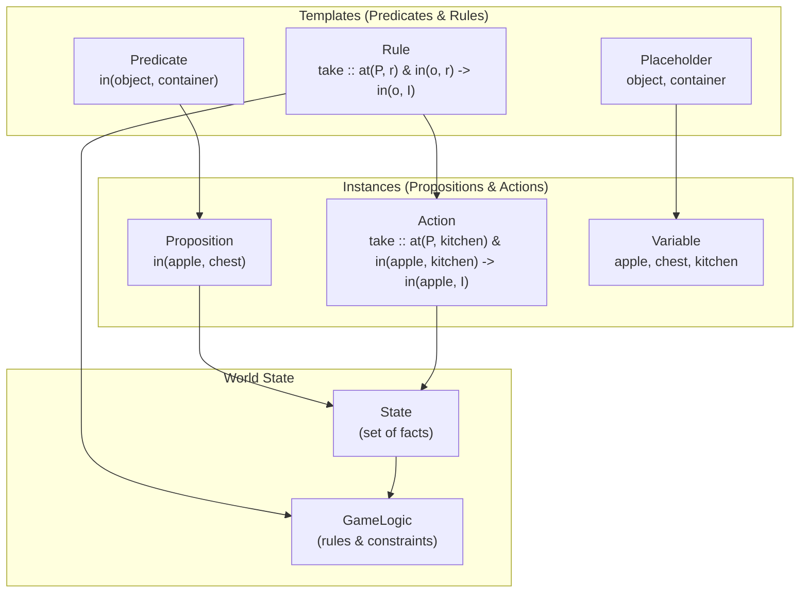
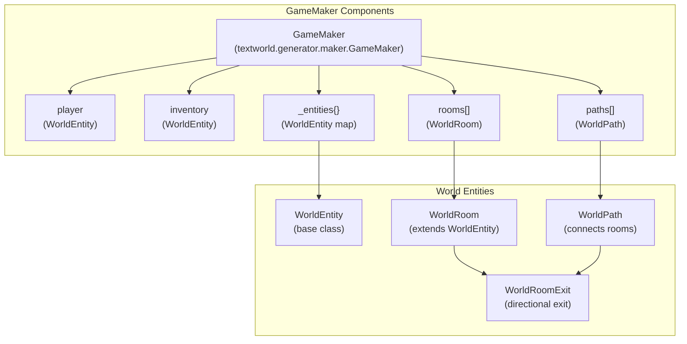
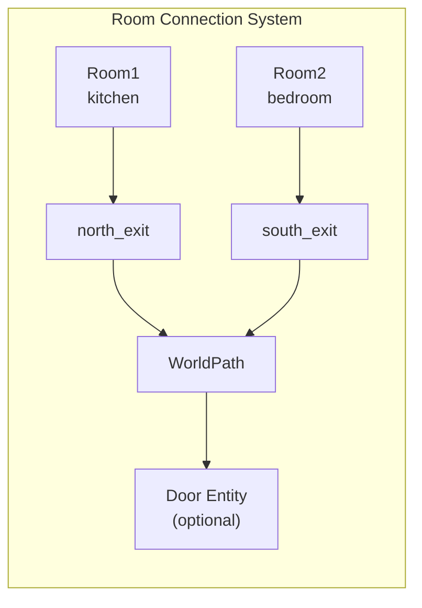
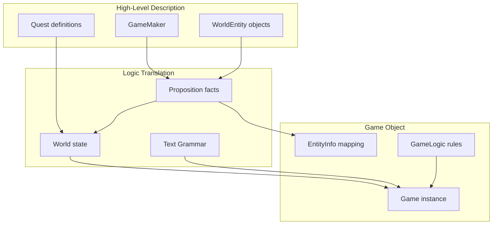

<!-- source: DeepWiki mcp.deepwiki.com · repo microsoft/TextWorld · page 3 Core Concepts · fetched 2026-10-26 -->

# Core Concepts

<details>
<summary>Relevant source files</summary>

The following files were used as context for generating this wiki page:

- [textworld/generator/game.py](textworld/generator/game.py)
- [textworld/generator/maker.py](textworld/generator/maker.py)
- [textworld/generator/tests/test_game.py](textworld/generator/tests/test_game.py)
- [textworld/logic/__init__.py](textworld/logic/__init__.py)
- [textworld/logic/logic.ebnf](textworld/logic/logic.ebnf)
- [textworld/logic/parser.py](textworld/logic/parser.py)
- [textworld/logic/tests/test_logic.py](textworld/logic/tests/test_logic.py)

</details>


This document explains the fundamental data structures and concepts that form the foundation of TextWorld. These core abstractions enable the creation, representation, and manipulation of text-based interactive fiction games. For information about using these concepts to generate games, see [Game Generation](#4). For details on executing games in environments, see [Game Environments](#5).

## Game Structure

TextWorld represents interactive fiction games through three primary classes that define the game's objectives and narrative structure.

### Game Class Hierarchy



**Sources:** [textworld/generator/game.py:386-638]()

The `Game` class [textworld/generator/game.py:386]() serves as the top-level container that combines a world representation with optional quests and text generation rules. Each game contains:

- **World**: The physical layout and initial state
- **Quests**: Optional objectives for players to complete
- **Grammar**: Rules for generating natural language descriptions
- **Entity Information**: Metadata about objects, rooms, and characters

### Quest and Event System



**Sources:** [textworld/generator/game.py:176-320](), [textworld/generator/game.py:63-174]()

A `Quest` [textworld/generator/game.py:176]() defines game objectives through mutually exclusive sets of winning and failing events. The quest system supports:

- **Win Events**: Alternative ways to complete the quest successfully
- **Fail Events**: Conditions that cause quest failure
- **Rewards**: Numeric rewards for completion
- **Optional/Repeatable**: Flags for quest behavior

An `Event` [textworld/generator/game.py:63]() represents a triggerable condition defined by either:
- A sequence of `actions` that must be performed
- A set of `conditions` (propositions) that must become true
- Human-readable `commands` corresponding to the actions

## Logic System

TextWorld uses a first-order logic system to represent world states and the actions that can modify them. This system provides the mathematical foundation for game mechanics.

### Core Logic Components



**Sources:** [textworld/logic/__init__.py:464-540](), [textworld/logic/__init__.py:620-713](), [textworld/logic/__init__.py:1270-1420]()

### Variables and Propositions

A `Variable` [textworld/logic/__init__.py:464]() represents a concrete entity in the game world with a unique name and type:

```python
# Examples from the codebase
apple = Variable("apple", "f")  # food item
kitchen = Variable("kitchen", "r")  # room
```

A `Proposition` [textworld/logic/__init__.py:620]() represents a fact about the world state by applying a predicate to specific variables:

```python
# Fact: the apple is in the kitchen
in_kitchen = Proposition("in", [apple, kitchen])
```

### Actions and Rules

A `Rule` [textworld/logic/__init__.py:1270]() defines a template for actions with placeholders:

```python
# Template: taking objects from rooms
take_rule = Rule("take", 
    preconditions=[at(P, r), in(o, r)],  # player at room, object in room
    postconditions=[in(o, I)]  # object in inventory
)
```

An `Action` [textworld/logic/__init__.py:1026]() is a concrete instance of a rule with specific variables, representing something that can happen in the game world.

**Sources:** [textworld/logic/__init__.py:1026-1269](), [textworld/logic/__init__.py:1270-1420]()

### State Management

The `State` class [textworld/logic/__init__.py:1421]() maintains the current set of true propositions and provides methods to:

- Check if propositions are facts: `state.is_fact(proposition)`
- Apply actions to change the state: `state.apply(action)`
- Find applicable actions: `state.all_applicable_actions(rules)`
- Test action sequences: `state.is_sequence_applicable(actions)`

**Sources:** [textworld/logic/__init__.py:1421-1750]()

## World Building System

The `GameMaker` class provides a stateful interface for constructing game worlds by managing entities, rooms, and their relationships.

### GameMaker Architecture



**Sources:** [textworld/generator/maker.py:349-881]()

### Entity System

A `WorldEntity` [textworld/generator/maker.py:77]() represents any object in the game world and encapsulates:

- **Variable**: The underlying logic representation
- **Properties**: Facts that apply only to this entity (e.g., "closed", "locked")
- **Facts**: All propositions involving this entity
- **Content**: Child entities contained within this entity
- **Entity Info**: Display name, description, and text generation metadata

**Sources:** [textworld/generator/maker.py:77-236]()

```python
# Creating entities with GameMaker
M = GameMaker()
chest = M.new(type='c', name='wooden chest')  # container
chest.add_property('closed')  # chest starts closed
apple = M.new(type='f', name='red apple')  # food
chest.add(apple)  # apple is inside chest
```

### Room and Path System

A `WorldRoom` [textworld/generator/maker.py:238]() extends `WorldEntity` with directional exits for each compass direction. Rooms are connected through `WorldPath` objects [textworld/generator/maker.py:284]() that can optionally contain doors.



**Sources:** [textworld/generator/maker.py:238-347]()

## Integration and Game Building

The core concepts work together through the `GameMaker.build()` method [textworld/generator/maker.py:769](), which transforms the high-level world description into the formal logic representation required by the game engine.

### Build Process Flow



**Sources:** [textworld/generator/maker.py:769-807]()

The build process:

1. **Validates** the world state against knowledge base constraints
2. **Extracts facts** from all entities, rooms, and paths
3. **Creates a World** object from the collected facts  
4. **Builds a Game** object combining world, quests, and grammar
5. **Generates text** descriptions using the grammar system
6. **Preserves metadata** like entity names and descriptions

This architecture enables TextWorld to seamlessly bridge between intuitive world-building operations (adding objects to rooms) and the formal logical representations needed for game execution and AI training.

**Sources:** [textworld/generator/game.py:386-638](), [textworld/generator/maker.py:349-881](), [textworld/logic/__init__.py:1421-1750]()

---

