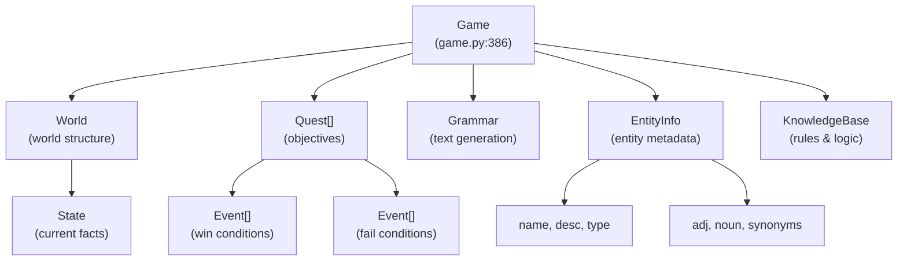
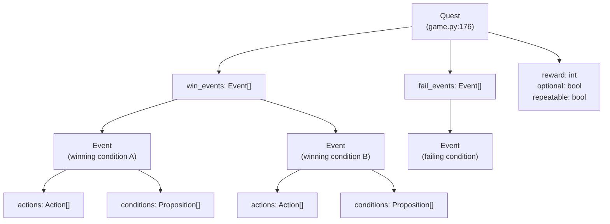
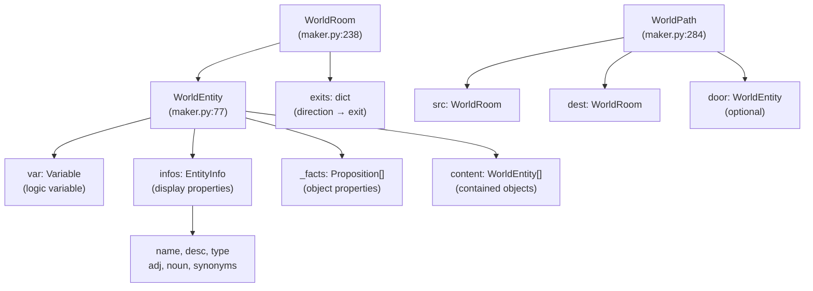
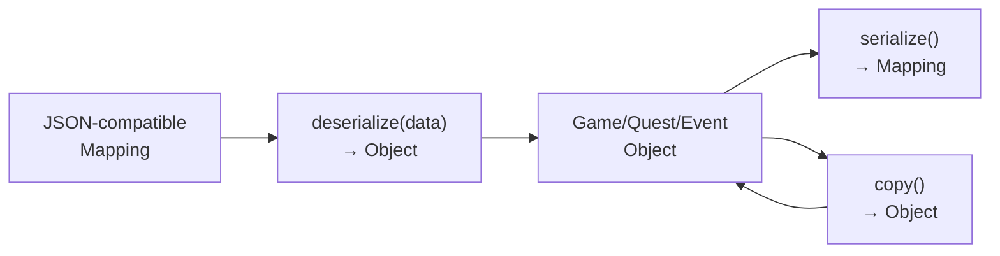
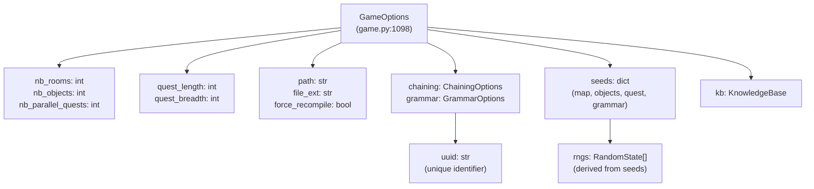

<!-- source: DeepWiki mcp.deepwiki.com · repo microsoft/TextWorld · page 3.1 Game Structure · fetched 2026-10-26 -->

# Game Structure

Relevant source files

The following files were used as context for generating this wiki page:

- [textworld/generator/game.py](textworld/generator/game.py)
- [textworld/generator/maker.py](textworld/generator/maker.py)
- [textworld/generator/tests/test_game.py](textworld/generator/tests/test_game.py)

This document covers the core data structures and classes that represent TextWorld games. These classes define how game worlds, quests, events, and entities are structured and managed within the system. For information about the underlying logic system (propositions, actions, rules), see [Logic System](#3.2). For text generation and grammar systems, see [Text Generation](#3.3).

## Core Game Representation Classes

TextWorld games are represented through a hierarchy of interconnected classes that capture both the static world structure and dynamic gameplay elements.

### Game Class

The `Game` class [textworld/generator/game.py:386-638]() is the top-level container that represents a complete TextWorld game. It encapsulates:

- **World structure**: The physical layout, rooms, and objects
- **Quest system**: Objectives and winning/failing conditions  
- **Grammar**: Text generation rules for descriptions
- **Metadata**: Additional game information and properties

Sources: [textworld/generator/game.py:386-638]()

### Game Metadata and Properties

The `Game` class provides several computed properties for introspecting game content:

| Property | Description | Source |
|----------|-------------|---------|
| `max_score` | Sum of all quest rewards | [textworld/generator/game.py:533-538]() |
| `command_templates` | Available command patterns | [textworld/generator/game.py:541-543]() |
| `objects_names` | Names of all game objects | [textworld/generator/game.py:555-561]() |
| `verbs` | Action verbs recognized in game | [textworld/generator/game.py:577-580]() |
| `possible_commands` | All possible player commands | [textworld/generator/game.py:583-588]() |

Sources: [textworld/generator/game.py:533-608]()

## Quest and Event System

TextWorld uses a quest-event model to define game objectives and narrative structure.

### Quest Structure

A `Quest` [textworld/generator/game.py:176-320]() represents a game objective with:

- **Win events**: Mutually exclusive conditions for completing the quest
- **Fail events**: Conditions that cause quest failure  
- **Reward**: Points awarded for completion
- **Optional/Repeatable flags**: Whether quest is required or can be completed multiple times

Sources: [textworld/generator/game.py:176-320]()

### Event Definition

An `Event` [textworld/generator/game.py:63-174]() represents something that can happen in the game:

- **Actions**: Sequence of actions that trigger the event
- **Conditions**: Propositions that must be true for triggering
- **Commands**: Human-readable text commands
- **Trigger condition**: Automatically generated logical condition for event activation

Events can be defined either by providing explicit actions or by specifying the required end conditions. If only actions are provided, the conditions are derived from the final action's postconditions.

Sources: [textworld/generator/game.py:63-174]()

## World Entity System

The physical game world is represented through entity classes that model rooms, objects, and their relationships.

### WorldEntity Hierarchy

Sources: [textworld/generator/maker.py:77-347]()

### Entity Relationships

WorldEntity objects can contain other entities, forming a containment hierarchy:

- **Rooms** contain objects and the player
- **Containers** can hold objects  
- **Supporters** have objects placed on them
- **Player inventory** holds carried items

The containment relationships are represented both as object references (`content`, `parent`) and as logical facts (`at`, `in`, `on` propositions).

Sources: [textworld/generator/maker.py:167-196]()

## Game Progression Tracking

TextWorld includes a sophisticated system for tracking quest progress and game state changes.

### Progression Class Hierarchy

```mermaid
graph TB
    GameProgression["GameProgression<br/>(game.py:982)"] --> QuestProgressions["quest_progressions:<br/>QuestProgression[]"]
    GameProgression --> GameState["state: State<br/>(current world state)"]
    GameProgression --> ValidActions["valid_actions: Action[]"]
    
    QuestProgression["QuestProgression<br/>(game.py:886)"] --> Quest["quest: Quest"]
    QuestProgression --> WinEventProgressions["win_events:<br/>EventProgression[]"]
    QuestProgression --> FailEventProgressions["fail_events:<br/>EventProgression[]"]
    QuestProgression --> Completions["nb_completions: int"]
    
    EventProgression["EventProgression<br/>(game.py:761)"] --> Event["event: Event"]
    EventProgression --> DependencyTree["_tree:<br/>ActionDependencyTree"]
    EventProgression --> Policy["_policy: Action[]<br/>(actions to complete)"]
    EventProgression --> Status["triggered: bool<br/>untriggerable: bool"]
```

Sources: [textworld/generator/game.py:761-1096]()

### Progression State Management

The progression system tracks three key states:

1. **Triggered**: Event conditions have been satisfied
2. **Untriggerable**: Event can no longer be completed due to irreversible actions
3. **In Progress**: Event is still achievable and being tracked

When actions are applied, the progression system:
- Updates the game state
- Checks for newly triggered events
- Recomputes winning policies using dependency trees
- Detects irreversible failures

Sources: [textworld/generator/game.py:824-883]()

## Serialization and Data Management

All core game structure classes support JSON serialization for saving and loading games.

### Serialization Methods

Each major class implements the serialization pattern:

Key serialization features:
- **Version tracking**: Games include version numbers for compatibility [textworld/generator/game.py:393]()
- **Deep serialization**: All nested objects are recursively serialized
- **Copy operations**: All classes support deep copying via serialize/deserialize

### EntityInfo Management

The `EntityInfo` class [textworld/generator/game.py:322-384]() stores display-related metadata for game entities:

- **Identity**: `id`, `type`, `name`
- **Linguistic properties**: `adj`, `noun`, `synonyms`  
- **Display text**: `desc`, `definite`, `indefinite`
- **Context**: `room_type` for location-dependent naming

This separation allows the logical game state (variables, facts) to remain independent from presentation details (names, descriptions).

Sources: [textworld/generator/game.py:322-384](), [textworld/generator/game.py:393](), [textworld/generator/game.py:473-514]()

## Game Configuration

### GameOptions Class

The `GameOptions` class [textworld/generator/game.py:1098-1268]() provides comprehensive configuration for game generation:

The options system provides deterministic game generation through seed management and supports both quick configuration (quest_length, quest_breadth) and detailed control through sub-options.

Sources: [textworld/generator/game.py:1098-1268]()

---

