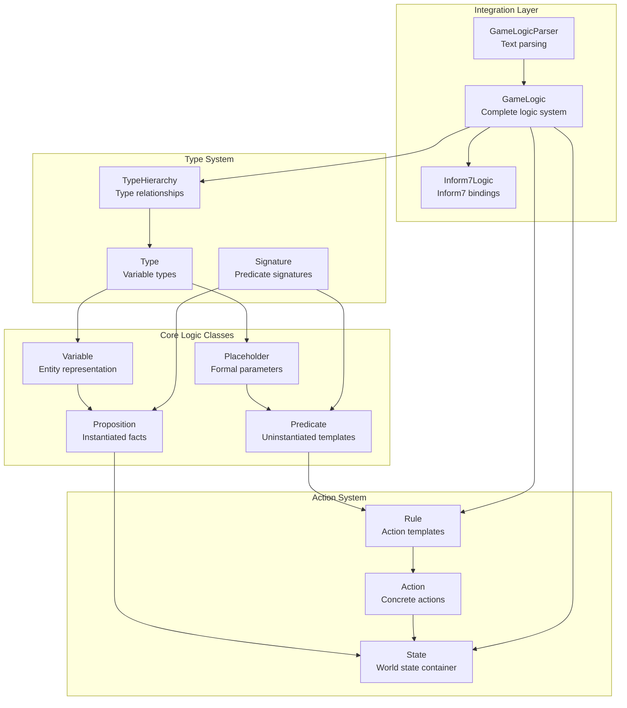
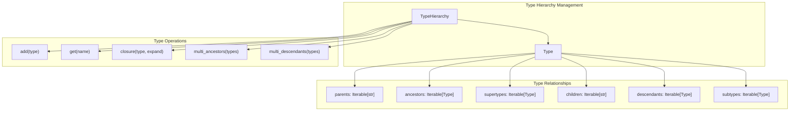
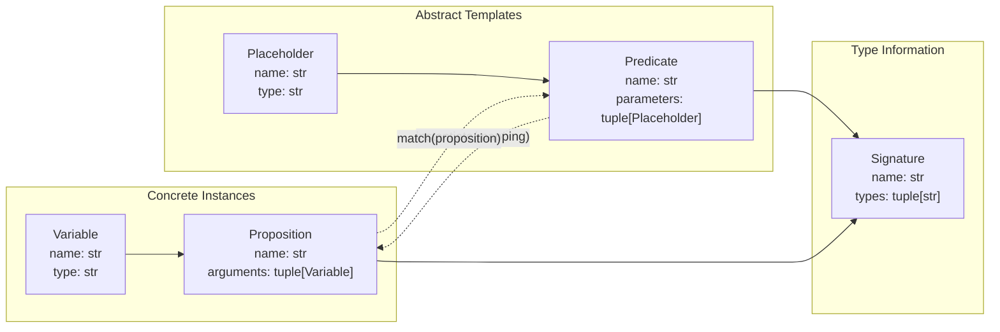
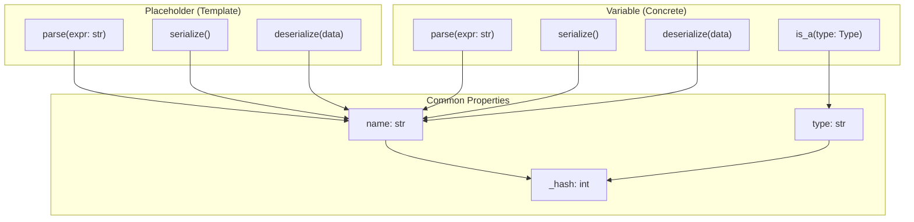
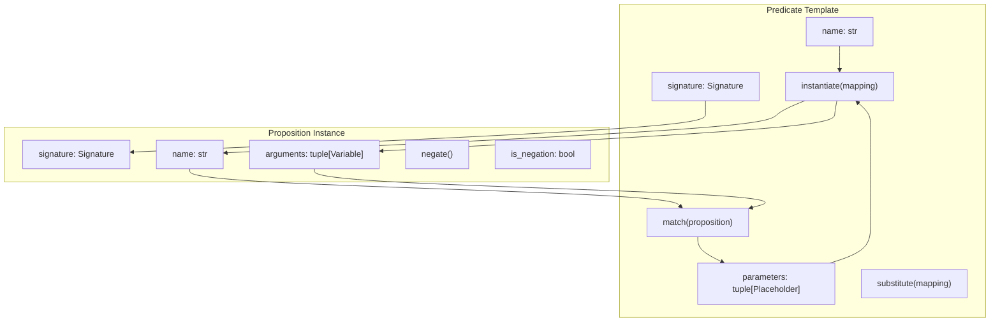
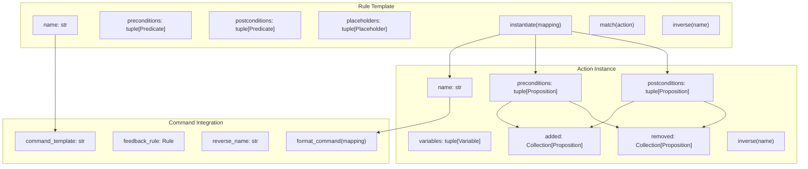
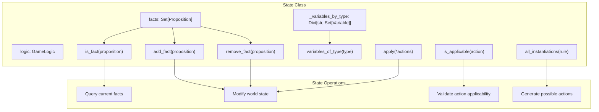
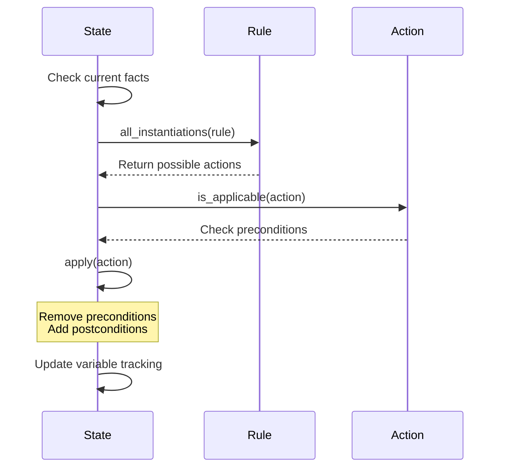
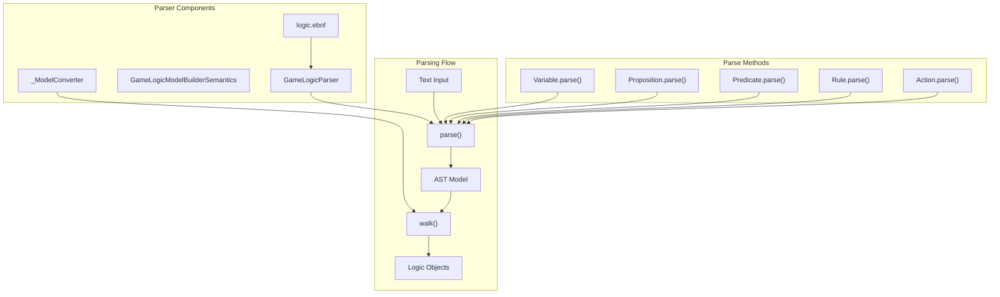

<!-- source: DeepWiki mcp.deepwiki.com · repo microsoft/TextWorld · page 3.2 Logic System · fetched 2026-10-26 -->

# Logic System

Relevant source files

The following files were used as context for generating this wiki page:

- [textworld/logic/__init__.py](textworld/logic/__init__.py)
- [textworld/logic/logic.ebnf](textworld/logic/logic.ebnf)
- [textworld/logic/parser.py](textworld/logic/parser.py)
- [textworld/logic/tests/test_logic.py](textworld/logic/tests/test_logic.py)

The Logic System provides the foundational first-order logic framework for representing game world states, actions, and rules in TextWorld. This system enables precise reasoning about game mechanics, state transitions, and constraint validation through a formal logical representation.

For information about game structure and world modeling, see [Game Structure](#3.1). For text generation based on logical states, see [Text Generation](#3.3).

## Purpose and Architecture

The Logic System implements a first-order logic framework where game worlds are represented as sets of logical propositions, and actions are defined as state transformations with preconditions and postconditions. The system supports type hierarchies, rule templates, constraint validation, and integration with the Inform7 compiler.

Sources: [textworld/logic/__init__.py:24-40]()

## Type System

The type system provides hierarchical typing for variables and supports inheritance relationships between types. The `TypeHierarchy` class manages parent-child relationships and enables polymorphic matching.

Sources: [textworld/logic/__init__.py:221-462]()

### Type Class Structure

| Property | Description | Return Type |
|----------|-------------|-------------|
| `name` | Type identifier | `str` |
| `parents` | Direct parent type names | `tuple[str]` |
| `parent_types` | Parent Type objects | `Iterable[Type]` |
| `ancestors` | All ancestor types | `Iterable[Type]` |
| `supertypes` | This type + ancestors | `Iterable[Type]` |
| `children` | Direct child type names | `Iterable[str]` |
| `descendants` | All descendant types | `Iterable[Type]` |
| `subtypes` | This type + descendants | `Iterable[Type]` |

Sources: [textworld/logic/__init__.py:234-294]()

## Logic Expression Classes

The system defines several classes for representing logical expressions, from concrete instances to abstract templates.

Sources: [textworld/logic/__init__.py:464-930]()

### Variable and Placeholder Classes

Both `Variable` and `Placeholder` share similar structure but serve different purposes:

Sources: [textworld/logic/__init__.py:464-540](), [textworld/logic/__init__.py:716-788]()

### Proposition and Predicate Relationship

Sources: [textworld/logic/__init__.py:621-713](), [textworld/logic/__init__.py:791-930]()

## Rules and Actions

Rules serve as templates for actions, defining patterns of state transformation that can be instantiated with specific variables.

Sources: [textworld/logic/__init__.py:958-1098](), [textworld/logic/__init__.py:1099-1327]()

### Rule Instantiation Process

| Step | Input | Process | Output |
|------|-------|---------|---------|
| 1 | `Rule` + `Mapping[Placeholder, Variable]` | Map placeholders to variables | Variable assignments |
| 2 | Precondition predicates | `predicate.instantiate(mapping)` | Precondition propositions |
| 3 | Postcondition predicates | `predicate.instantiate(mapping)` | Postcondition propositions |
| 4 | Command template | String formatting with variables | Executable command |
| 5 | All components | `Action` constructor | Concrete `Action` |

Sources: [textworld/logic/__init__.py:1242-1271]()

## State Management

The `State` class manages the current world state as a collection of true propositions and provides methods for querying and modifying the state.

Sources: [textworld/logic/__init__.py:1682-1918]()

### State Transition Example

Sources: [textworld/logic/tests/test_logic.py:130-161]()

## Parsing System

The logic system includes a complete parser for textual representations of logical expressions, built using the TatSu parsing framework.

Sources: [textworld/logic/parser.py:44-649](), [textworld/logic/__init__.py:66-218]()

### Grammar Structure

| Element | Pattern | Example |
|---------|---------|---------|
| Variable | `name [":" type]` | `P`, `kitchen: r` |
| Proposition | `name "(" arguments ")"` | `at(P, kitchen: r)` |
| Predicate | `name "(" parameters ")"` | `at(P, r)` |
| Action | `name "::" preconditions "->" postconditions` | `take :: at(P, r) & in(o, r) -> in(o, I)` |
| Rule | `name "::" preconditions "->" postconditions` | `take :: at(P, r) & in(o, r) -> in(o, I)` |

Sources: [textworld/logic/logic.ebnf:20-37]()

## Game Logic Integration

The `GameLogic` class serves as the central coordinator for all logic system components, managing types, predicates, rules, and their relationships.

```mermaid
graph TB
    subgraph "GameLogic Components"
        GameLogic_types["types: TypeHierarchy"]
        GameLogic_predicates["predicates: Set[Signature]"]
        GameLogic_aliases["aliases: Dict[Signature, Alias]"]
        GameLogic_rules["rules: Dict[str, Rule]"]
        GameLogic_constraints["constraints: Dict[str, Rule]"]
        GameLogic_inform7["inform7: Inform7Logic"]
    end
    
    subgraph "Logic Operations"
        parse_method["parse(document)"]
        load_method["load(path)"]
        add_predicate["_add_predicate(signature)"]
        add_rule["_add_rule(rule)"]
        add_constraint["_add_constraint(constraint)"]
    end
    
    subgraph "Inform7 Integration"
        Inform7Logic_types["types: Dict[str, Inform7Type]"]
        Inform7Logic_predicates["predicates: Dict[Signature, Inform7Predicate]"]
        Inform7Logic_commands["commands: Dict[str, Inform7Command]"]
        Inform7Logic_code["code: str"]
    end
    
    GameLogic_types --> parse_method
    GameLogic_predicates --> add_predicate
    GameLogic_rules --> add_rule
    GameLogic_constraints --> add_constraint
    GameLogic_inform7 --> Inform7Logic_types
    GameLogic_inform7 --> Inform7Logic_predicates
    GameLogic_inform7 --> Inform7Logic_commands
    GameLogic_inform7 --> Inform7Logic_code
```

Sources: [textworld/logic/__init__.py:1426-1682](), [textworld/logic/__init__.py:1373-1425]()

### Performance Optimizations

The logic system implements several performance optimizations for frequently-used operations:

| Optimization | Implementation | Purpose |
|--------------|----------------|---------|
| Immutability | Object sharing | Reduce memory allocation |
| `__slots__` | Limited attributes | Faster attribute access |
| Hash caching | `_hash` field | Speed up dictionary/set operations |
| Tuple comparison | Direct attribute comparison | Avoid tuple allocation |
| Rule instantiation cache | `_cache` field in Rule | Reuse instantiated actions |

Sources: [textworld/logic/__init__.py:42-58]()

---

