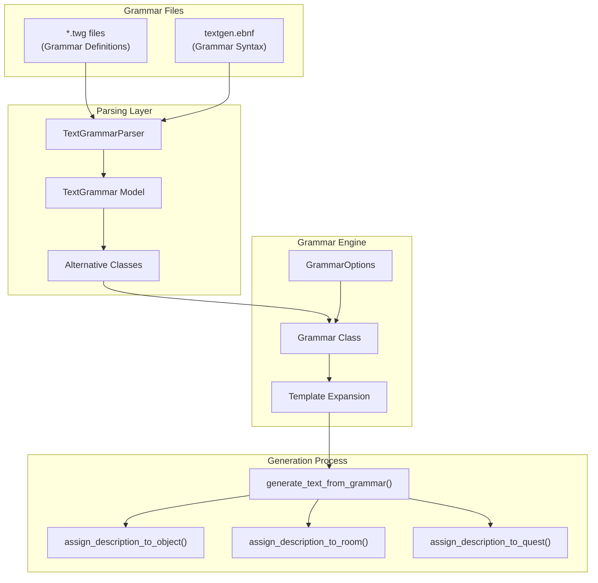
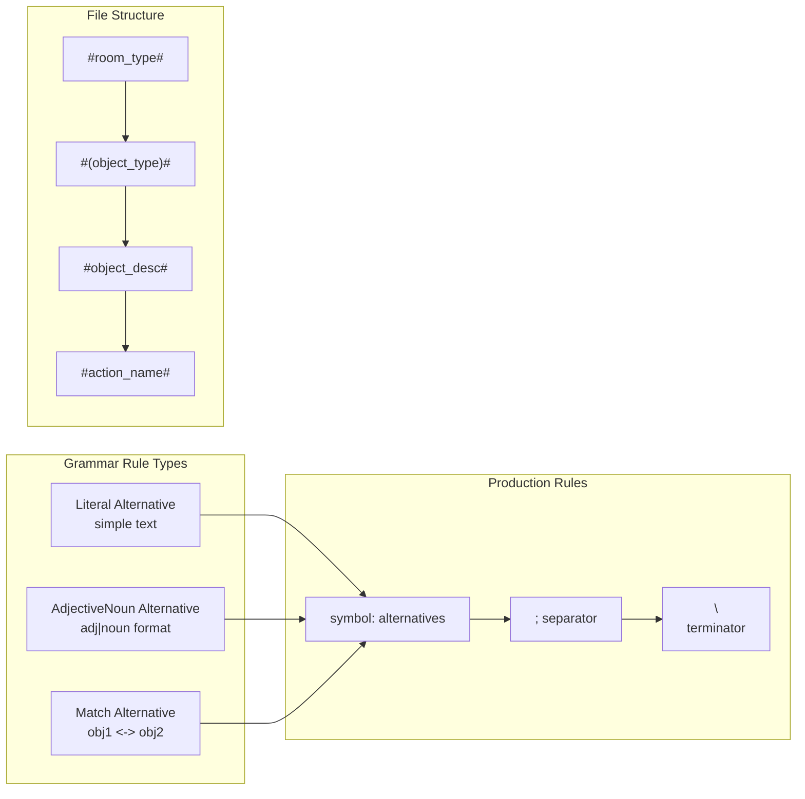
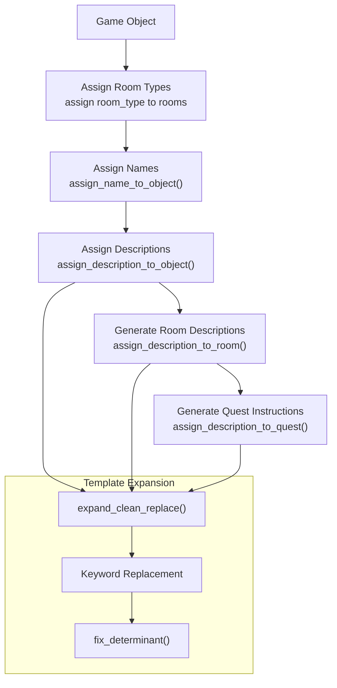
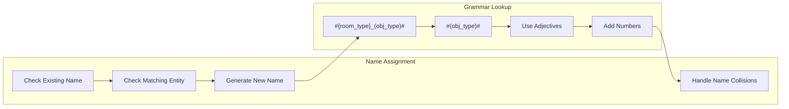
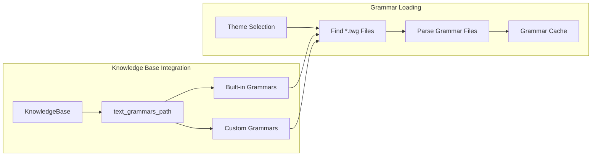

<!-- source: DeepWiki mcp.deepwiki.com · repo microsoft/TextWorld · page 3.3 Text Generation · fetched 2026-10-26 -->

# Text Generation

<details>
<summary>Relevant source files</summary>

The following files were used as context for generating this wiki page:

- [textworld/generator/data/__init__.py](textworld/generator/data/__init__.py)
- [textworld/generator/logger.py](textworld/generator/logger.py)
- [textworld/generator/tests/test_maker.py](textworld/generator/tests/test_maker.py)
- [textworld/generator/tests/test_text_generation.py](textworld/generator/tests/test_text_generation.py)
- [textworld/generator/tests/test_text_grammar.py](textworld/generator/tests/test_text_grammar.py)
- [textworld/generator/text_generation.py](textworld/generator/text_generation.py)
- [textworld/generator/text_grammar.py](textworld/generator/text_grammar.py)
- [textworld/logic/model.py](textworld/logic/model.py)
- [textworld/textgen/__init__.py](textworld/textgen/__init__.py)
- [textworld/textgen/model.py](textworld/textgen/model.py)
- [textworld/textgen/parser.py](textworld/textgen/parser.py)
- [textworld/textgen/textgen.ebnf](textworld/textgen/textgen.ebnf)

</details>


This document describes TextWorld's natural language text generation system, which converts logical game representations into human-readable descriptions. The system uses context-free grammars defined in `.twg` files to generate descriptions for game objects, rooms, quests, and instructions.

For information about the underlying logical representation of games, see [Logic System](#3.2). For details on how games are structured, see [Game Structure](#3.1).

## Grammar System Overview

TextWorld's text generation is built around a context-free grammar system that expands templates into natural language. The core components work together to transform abstract game entities into descriptive text.



Sources: [textworld/generator/text_generation.py:107-145](), [textworld/generator/text_grammar.py:131-200](), [textworld/textgen/parser.py:44-181]()

## Grammar Files and Format

Grammar files use the `.twg` extension and follow a specific syntax for defining text generation rules. The grammar format supports literal text, adjective-noun pairs, and matching patterns for related objects.



The grammar parser processes these files using TatSu, creating a structured representation that supports template expansion and variable substitution.

Sources: [textworld/textgen/textgen.ebnf:1-28](), [textworld/textgen/model.py:35-61](), [textworld/textgen/__init__.py:21-111]()

## Text Generation Process

The main text generation workflow transforms game entities into natural language through a multi-step process involving name assignment, description generation, and template expansion.

### Core Generation Pipeline



The `generate_text_from_grammar()` function orchestrates this process, ensuring that all game entities receive appropriate textual representations based on the loaded grammar rules.

Sources: [textworld/generator/text_generation.py:107-145](), [textworld/generator/text_generation.py:538-596]()

## Object and Room Description Generation

Objects and rooms receive names and descriptions through a systematic process that considers object types, room contexts, and grammar constraints.

### Name Generation Process



The system supports matching entities (objects that should have related names) and handles name conflicts through adjective expansion or numerical suffixes when `allowed_variables_numbering` is enabled.

### Room Description Generation

Room descriptions combine decorative text with object listings, exit information, and door descriptions. The system can blend similar objects together when `blend_descriptions` is enabled.

Sources: [textworld/generator/text_generation.py:58-87](), [textworld/generator/text_generation.py:148-282](), [textworld/generator/text_grammar.py:291-369]()

## Quest Description Generation

Quest descriptions transform action sequences into natural language instructions. The system supports instruction blending and different levels of detail based on grammar options.

```mermaid
graph TB
    subgraph "Quest Processing"
        Events["Quest Win Events"]
        Actions["Event Actions"]
        Counts["Object Counts"]
    end
    
    subgraph "Instruction Generation"
        Individual["Individual Instructions"]
        Blended["Blended Action Chains"]
        LastOnly["Last Action Only"]
    end
    
    subgraph "Action Chain Detection"
        Sequences["get_action_chains()"]
        Merging["MergeAction Class"]
        Validation["is_seq() validation"]
    end
    
    Events --> Actions
    Actions --> Counts
    Actions --> Individual
    Actions --> Sequences
    
    Individual --> LastOnly
    Sequences --> Merging
    Merging --> Validation
    Validation --> Blended
    
    Individual --> "generate_instruction()"
    Blended --> "generate_instruction()"
    LastOnly --> "generate_instruction()"
```

The `describe_event()` function processes each quest event, generating appropriate instruction text based on the configured grammar options and action patterns.

Sources: [textworld/generator/text_generation.py:384-451](), [textworld/generator/text_generation.py:454-525](), [textworld/generator/text_generation.py:285-381]()

## Grammar Options and Customization

The `GrammarOptions` class provides extensive customization of the text generation process, controlling everything from adjective usage to instruction blending.

### Configuration Options

| Option | Type | Purpose |
|--------|------|---------|
| `theme` | str | Grammar theme name (e.g., "house", "basic") |
| `include_adj` | bool | Whether names can include adjectives |
| `blend_descriptions` | bool | Group similar objects in descriptions |
| `blend_instructions` | bool | Combine consecutive actions |
| `only_last_action` | bool | Show only final quest action |
| `ambiguous_instructions` | bool | Use abstract object references |
| `allowed_variables_numbering` | bool | Add numbers to avoid name conflicts |
| `unique_expansion` | bool | Force unique template expansions |

### Grammar Loading and Caching



The grammar system integrates with the `KnowledgeBase` to locate and load appropriate grammar files, supporting both built-in themes and custom grammar definitions.

Sources: [textworld/generator/text_grammar.py:45-129](), [textworld/generator/text_grammar.py:184-194](), [textworld/generator/data/__init__.py:92-181]()

---

