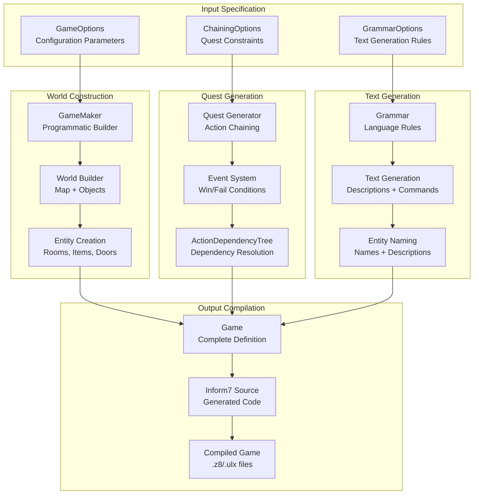
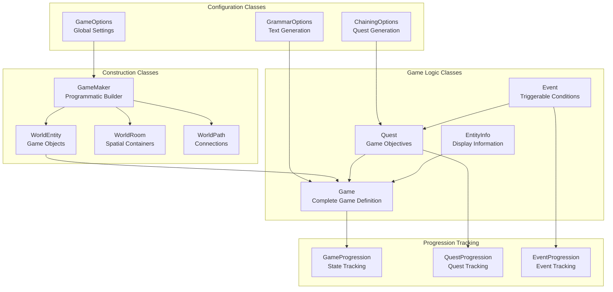

<!-- source: DeepWiki mcp.deepwiki.com · repo microsoft/TextWorld · page 4 Game Generation · fetched 2026-10-26 -->

# Game Generation

<details>
<summary>Relevant source files</summary>

The following files were used as context for generating this wiki page:

- [scripts/tw-make](scripts/tw-make)
- [textworld/generator/__init__.py](textworld/generator/__init__.py)
- [textworld/generator/chaining.py](textworld/generator/chaining.py)
- [textworld/generator/game.py](textworld/generator/game.py)
- [textworld/generator/maker.py](textworld/generator/maker.py)
- [textworld/generator/tests/test_chaining.py](textworld/generator/tests/test_chaining.py)
- [textworld/generator/tests/test_game.py](textworld/generator/tests/test_game.py)

</details>


Game Generation is TextWorld's core system for creating interactive text-based games from high-level specifications. It encompasses world construction, quest design, text generation, and compilation to playable formats. This system transforms declarative game descriptions into fully functional interactive fiction files.

For information about playing and interacting with generated games, see [Game Environments](#5). For details about the command-line interface to game generation, see [tw-make](#7.1).

## Overview

The Game Generation system operates through a multi-stage pipeline that transforms high-level game specifications into playable interactive fiction. The process involves world construction, quest generation, text synthesis, and compilation to standard interactive fiction formats.

## Game Generation Pipeline



Sources: [textworld/generator/__init__.py:173-212](), [textworld/generator/game.py:386-431](), [textworld/generator/maker.py:349-431]()

## Core Game Generation Classes

The system is built around several key classes that represent different aspects of game construction:



Sources: [textworld/generator/game.py:386-431](), [textworld/generator/maker.py:77-348](), [textworld/generator/game.py:982-1048]()

## Key Components

### Game Construction

The `GameMaker` class provides the primary interface for programmatic game construction. It maintains world state and provides methods for creating entities, establishing spatial relationships, and defining game logic.

| Component | Purpose | Key Methods |
|-----------|---------|-------------|
| `GameMaker` | Main construction interface | `new()`, `new_room()`, `connect()`, `set_player()` |
| `WorldEntity` | Represents game objects | `add_property()`, `add_fact()`, `add()` |
| `WorldRoom` | Spatial containers with exits | `exits`, directional properties |
| `WorldPath` | Connections between rooms | `facts`, door management |

### Quest and Event System

Games are driven by quest structures that define winning and losing conditions through events. The system supports complex quest hierarchies with parallel subquests and dependency tracking.

| Component | Purpose | Key Features |
|-----------|---------|--------------|
| `Quest` | Game objectives | Win/fail events, rewards, optional/repeatable flags |
| `Event` | Triggerable conditions | Action sequences, logical conditions |
| `ActionDependencyTree` | Dependency resolution | Action ordering, cycle detection |

### Text Generation Integration

The generation system integrates with TextWorld's grammar system to produce natural language descriptions for all game elements.

| Component | Purpose | Integration Point |
|-----------|---------|------------------|
| `Grammar` | Language rules | `Game.change_grammar()` |
| `EntityInfo` | Display metadata | Name, description, synonyms |
| `TextGeneration` | Description synthesis | Automatic text generation |

## Generation Entry Points

The system provides multiple entry points for different use cases:

### High-Level Generation

```python
# Generate complete game from options
game = textworld.make(options)  # Returns (game_file, game)
```

### Component-Level Generation

```python
# Create individual components
world = make_world(world_size, nb_objects)
quests = make_quest(world, options)
grammar = make_grammar(options, rng)
game = Game(world, grammar, quests)
```

### Programmatic Construction

```python
# Manual construction using GameMaker
M = GameMaker(options)
room = M.new_room("kitchen")
item = M.new(type='f', name='apple')
room.add(item)
game = M.build()
```

Sources: [textworld/generator/__init__.py:173-212](), [textworld/generator/maker.py:769-807](), [scripts/tw-make:198-199]()

## Integration with Other Systems

Game Generation interfaces with several other TextWorld subsystems:

- **Logic System** ([#3.2](#3.2)): Provides the underlying state representation and action semantics
- **Text Generation** ([#3.3](#3.3)): Converts logical structures to natural language
- **Inform7 Compilation** ([#4.3](#4.3)): Transforms games to executable formats
- **Command Line Tools** ([#7](#7)): Provides user-facing generation interfaces

The generation system serves as the bridge between high-level game specifications and the executable environments where agents interact with games.

Sources: [textworld/generator/game.py:1-1048](), [textworld/generator/maker.py:1-881](), [textworld/generator/__init__.py:1-257]()

---

