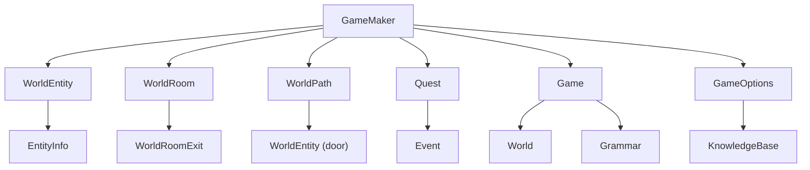
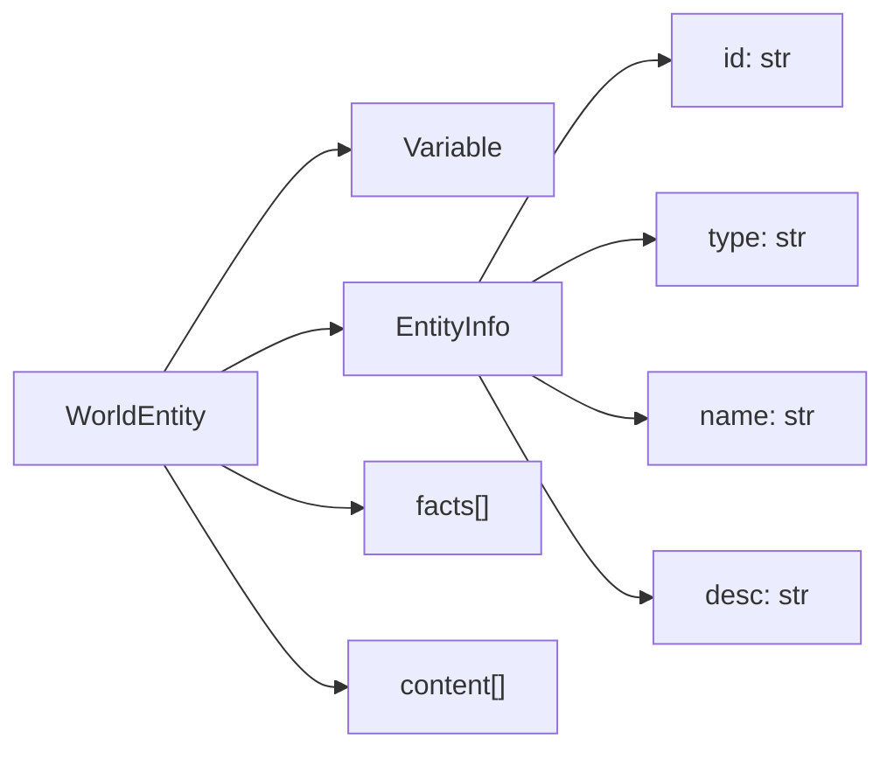
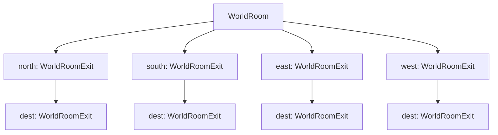
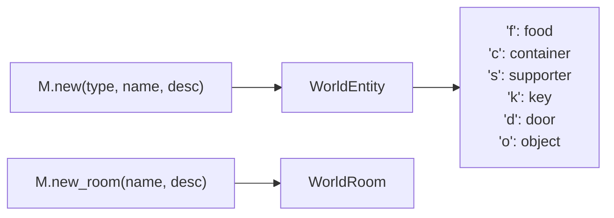
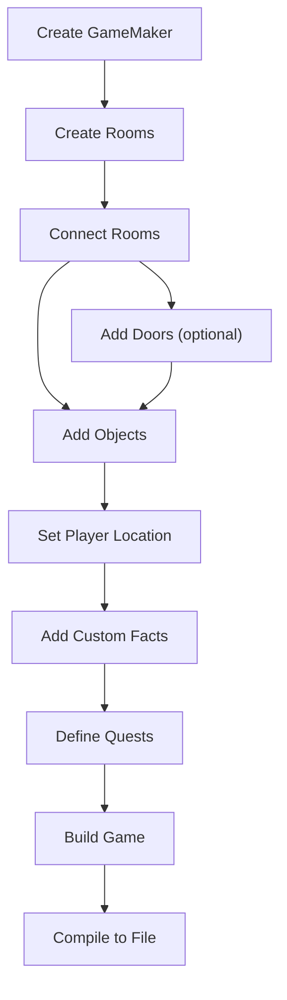
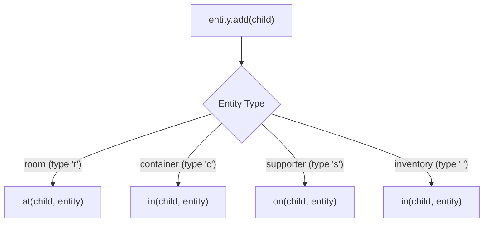
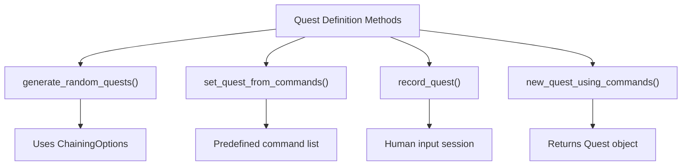
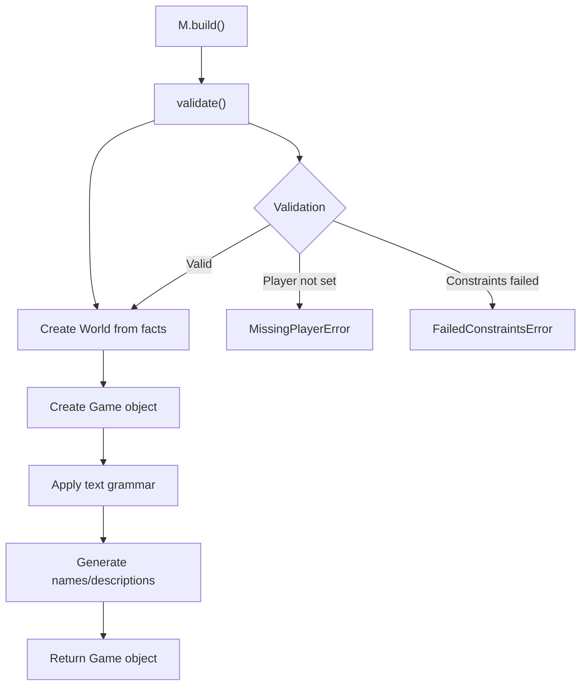

<!-- source: DeepWiki mcp.deepwiki.com · repo microsoft/TextWorld · page 4.1 Game Creation with GameMaker · fetched 2026-10-26 -->

# Game Creation with GameMaker

<details>
<summary>Relevant source files</summary>

The following files were used as context for generating this wiki page:

- [textworld/generator/game.py](textworld/generator/game.py)
- [textworld/generator/maker.py](textworld/generator/maker.py)
- [textworld/generator/tests/test_game.py](textworld/generator/tests/test_game.py)

</details>


This page explains how to use the `GameMaker` class to programmatically construct text-based game worlds. GameMaker provides a high-level interface for creating rooms, objects, connections, and quests before compiling them into playable games. For information about quest generation and event systems, see [Quest and Event System](#4.2). For details about the compilation process, see [Inform7 Compilation](#4.3).

## Overview

The `GameMaker` class serves as the primary interface for handcrafting TextWorld games. It maintains the world state and provides methods to create entities, establish relationships between them, and define game objectives. GameMaker manages the underlying logical representation while offering an intuitive API for game construction.


*GameMaker Architecture: Core classes and their relationships*

Sources: [textworld/generator/maker.py:349-881](), [textworld/generator/game.py:386-638]()

## Core Entity Types

GameMaker works with several fundamental entity types that represent different aspects of the game world:

### WorldEntity

The `WorldEntity` class represents any object in the game world - items, containers, supporters, doors, etc. Each entity has a unique identifier, type, name, and description.


*WorldEntity structure and properties*

### WorldRoom

`WorldRoom` extends `WorldEntity` to represent rooms with directional exits. Each room automatically creates `WorldRoomExit` objects for all compass directions.


*WorldRoom exit structure*

Sources: [textworld/generator/maker.py:77-236](), [textworld/generator/maker.py:238-261]()

## Basic Usage

### Creating a GameMaker Instance

```python
from textworld import GameMaker, GameOptions

# Create with default options
M = GameMaker()

# Or with custom options
options = GameOptions()
options.nb_rooms = 5
options.seeds = {"map": 1, "objects": 2, "quest": 3, "grammar": 4}
M = GameMaker(options)
```

### Creating Entities

The `new()` method creates entities based on their type. Room creation has a dedicated `new_room()` method:


*Entity creation methods and common types*

Sources: [textworld/generator/maker.py:426-469](), [textworld/generator/maker.py:439-470]()

## World Construction Workflow

### Typical Game Creation Process


*Standard workflow for game creation*

### Room Connections

Rooms are connected using the `connect()` method which takes two `WorldRoomExit` objects and creates a `WorldPath`:

```python
# Create rooms
bedroom = M.new_room("bedroom")
kitchen = M.new_room("kitchen")

# Connect rooms
path = M.connect(bedroom.east, kitchen.west)

# Optionally add a door
door = M.new_door(path, name="wooden door")
door.add_property("closed")
```

```mermaid
graph LR
    BR["bedroom"] --> BE["east exit"]
    KR["kitchen"] --> KW["west exit"]
    
    BE -.->|connect()| WP["WorldPath"]
    KW -.->|connect()| WP
    
    WP --> D["door (optional)"]
```
*Room connection mechanism*

Sources: [textworld/generator/maker.py:537-561](), [textworld/generator/maker.py:411-424]()

## Entity Management

### Adding Objects to Containers

The `add()` method automatically determines the appropriate relationship based on entity types:


*Automatic relationship inference based on entity types*

### Facts and Properties

Entities can have facts (relationships with other entities) and properties (single-entity attributes):

```python
# Add a property (single entity)
chest.add_property("closed")

# Add a fact (multiple entities)
M.add_fact("match", key, chest)  # Key matches chest

# Remove facts/properties
chest.remove_property("closed")
chest.add_property("open")
```

Sources: [textworld/generator/maker.py:167-196](), [textworld/generator/maker.py:402-409]()

## Quest Definition

### Quest Creation Methods

GameMaker provides several ways to define game objectives:


*Available quest definition approaches*

### Command-Based Quest Definition

```python
# Define quest using text commands
commands = ["take key", "unlock chest with key", "open chest", "take treasure"]
quest = M.set_quest_from_commands(commands)

# Or create an event/quest for later use
event = M.new_event_using_commands(commands)
quest = M.new_quest_using_commands(commands)
```

Sources: [textworld/generator/maker.py:573-598](), [textworld/generator/maker.py:639-671](), [textworld/generator/maker.py:683-720]()

## Game Building and Compilation

### Build Process


*Game building process and validation*

### Compilation to Playable Files

```python
# Build the game
game = M.build()

# Compile to file
game_file = M.compile("my_game.ulx")  # Creates .ulx, .ni, and .json files

# Or use textworld.generator.compile_game directly
import textworld
options = textworld.GameOptions()
options.path = "my_game.ulx"
game_file = textworld.generator.compile_game(game, options)
```

Sources: [textworld/generator/maker.py:769-807](), [textworld/generator/maker.py:809-828]()

## Advanced Features

### State Inspection and Testing

GameMaker provides methods to inspect the current world state and test games:

```python
# Check current world state
current_state = M.state
all_facts = list(M.facts)

# Test the game interactively
M.test()  # Launches human play session

# Test with walkthrough
M.test(walkthrough=True)  # Uses WalkthroughAgent

# Find entities
carrot = M.find_by_name("carrot")
all_food = M.findall("f")  # All food items
```

### Distractor Generation

```python
# Add random objects to make the game more challenging
M.generate_distractors(nb_distractors=5)
```

### Graph Import

GameMaker can import room layouts from NetworkX graphs:

```python
import networkx as nx

G = nx.Graph()
G.add_node("room1", name="Kitchen")
G.add_node("room2", name="Bedroom")
G.add_edge("room1", "room2", has_door=True, door_name="wooden door", door_state="open")

rooms = M.import_graph(G)
```

Sources: [textworld/generator/maker.py:380-395](), [textworld/generator/maker.py:563-571](), [textworld/generator/maker.py:600-613](), [textworld/generator/maker.py:862-881]()

## Error Handling

GameMaker includes specific exceptions for common issues:

| Exception | Cause | Solution |
|-----------|-------|----------|
| `MissingPlayerError` | Player location not set | Call `M.set_player(room)` |
| `ExitAlreadyUsedError` | Exit already connected | Check existing connections |
| `PlayerAlreadySetError` | Player set multiple times | Set player only once |
| `FailedConstraintsError` | Knowledge base constraints violated | Review entity relationships |
| `QuestError` | Invalid quest commands | Verify command syntax |

Sources: [textworld/generator/maker.py:46-75](), [textworld/generator/maker.py:752-767]()

---

