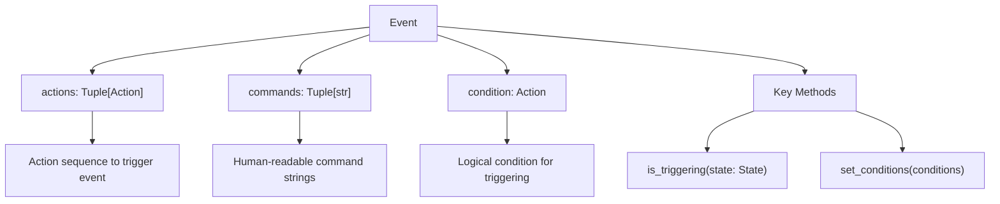
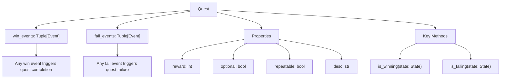
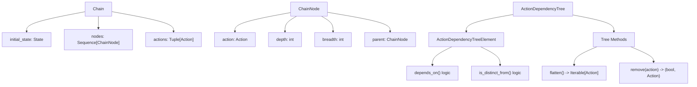
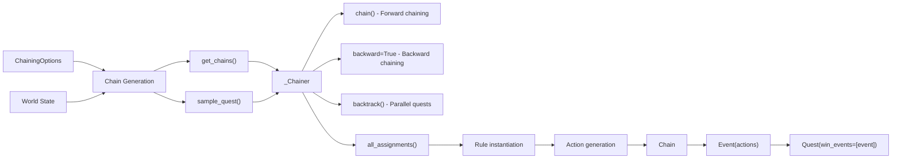
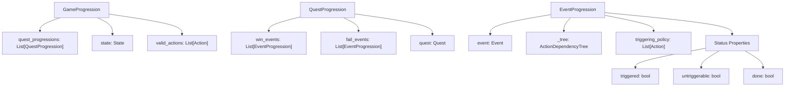
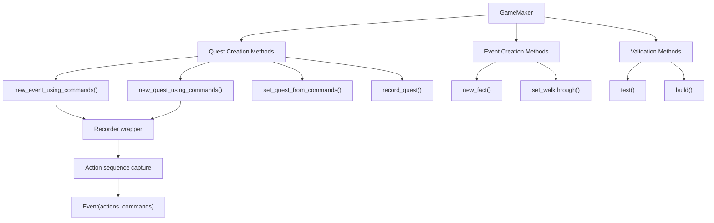

<!-- source: DeepWiki mcp.deepwiki.com · repo microsoft/TextWorld · page 4.2 Quest and Event System · fetched 2026-10-26 -->

# Quest and Event System

<details>
<summary>Relevant source files</summary>

The following files were used as context for generating this wiki page:

- [scripts/tw-make](scripts/tw-make)
- [textworld/generator/__init__.py](textworld/generator/__init__.py)
- [textworld/generator/chaining.py](textworld/generator/chaining.py)
- [textworld/generator/game.py](textworld/generator/game.py)
- [textworld/generator/maker.py](textworld/generator/maker.py)
- [textworld/generator/tests/test_chaining.py](textworld/generator/tests/test_chaining.py)
- [textworld/generator/tests/test_game.py](textworld/generator/tests/test_game.py)

</details>


This document covers TextWorld's quest and event system, which defines game objectives, tracks player progress, and generates action chains that form coherent gameplay narratives. The system provides the foundation for creating structured challenges within procedurally generated text-based games.

For information about the underlying game world structure, see [Game Structure](#3.1). For details about the logic system that powers quest conditions, see [Logic System](#3.2).

## Core Components

The quest and event system is built around three primary classes that define game objectives and their completion conditions.

### Event Class

The `Event` class represents a specific triggerable occurrence in the game world. Events are triggered when their conditions become satisfied, either through a sequence of actions or by achieving certain world states.



Events can be created in two ways:
- **Action-based**: Providing a sequence of actions that must be performed
- **Condition-based**: Providing logical propositions that must become true

**Sources:** [textworld/generator/game.py:63-174]()

### Quest Class

The `Quest` class represents a complete objective within the game, containing mutually exclusive sets of winning and failing events.



Quests support several important features:
- **Optional quests**: Not required for game completion
- **Repeatable quests**: Can be completed multiple times
- **Negative rewards**: Allow for penalty-based objectives

**Sources:** [textworld/generator/game.py:176-320]()

### Action Chains and Dependencies

The system uses dependency trees to represent complex action sequences and their relationships.



**Sources:** [textworld/generator/chaining.py:19-58](), [textworld/generator/game.py:640-759]()

## Quest Generation Process

Quest generation in TextWorld uses a sophisticated chaining system that creates coherent action sequences.



The chaining process supports several key features:

### Chaining Options

The `ChainingOptions` class controls quest generation behavior:

| Option | Description |
|--------|-------------|
| `backward` | Generate quests backwards from goal state |
| `min_length/max_length` | Control quest length |
| `min_depth/max_depth` | Control subquest depth |
| `min_breadth/max_breadth` | Control parallel subquest count |
| `create_variables` | Allow new variable creation |
| `rules_per_depth` | Restrict available actions by depth |

**Sources:** [textworld/generator/chaining.py:60-197]()

### Generation Algorithm

The quest generation algorithm works through these phases:

1. **State Analysis**: Examine current world state for possible actions
2. **Rule Matching**: Find applicable rules at current depth
3. **Variable Assignment**: Create mappings for rule placeholders
4. **Action Instantiation**: Generate concrete actions from rules
5. **Dependency Resolution**: Build dependency trees for action sequences
6. **Chain Construction**: Create linear action sequences from trees

**Sources:** [textworld/generator/chaining.py:535-594]()

## Progress Tracking System

The system provides three levels of progress tracking to monitor quest completion during gameplay.



### Progress Tracking Features

Each level of tracking provides specific functionality:

**EventProgression**:
- Tracks individual event completion
- Maintains action dependency trees
- Provides shortest completion policy
- Detects untriggerable states

**QuestProgression**:
- Monitors quest win/fail conditions
- Tracks multiple completion attempts
- Supports repeatable quest logic
- Manages quest completion counts

**GameProgression**:
- Oversees all quest progressions
- Provides global winning policy
- Detects game completion/failure
- Maintains overall game state

**Sources:** [textworld/generator/game.py:761-1189]()

## Integration with GameMaker

The `GameMaker` class provides convenient methods for creating quests and events during game construction.



### Quest Creation Workflow

1. **Command-based Creation**: Use `set_quest_from_commands()` to define quests through text commands
2. **Interactive Recording**: Use `record_quest()` to capture player actions during gameplay
3. **Manual Construction**: Build `Event` and `Quest` objects directly with specific conditions
4. **Validation**: Use `test()` method to verify quest completability

**Sources:** [textworld/generator/maker.py:615-671](), [textworld/generator/maker.py:683-721]()

## Usage Examples

### Creating Simple Quests

```python
# Command-based quest creation
M = GameMaker()
commands = ["take key", "unlock chest", "take treasure"]
quest = M.set_quest_from_commands(commands)
```

### Complex Multi-Event Quests

```python
# Multiple winning conditions
win_event1 = Event(conditions=[fact1, fact2])
win_event2 = Event(actions=[action1, action2])
fail_event = Event(conditions=[bad_fact])

quest = Quest(
    win_events=[win_event1, win_event2],
    fail_events=[fail_event],
    reward=10,
    optional=False,
    repeatable=False
)
```

### Generating Random Quests

```python
# Automatic quest generation
options = GameOptions()
options.chaining.max_length = 5
options.chaining.max_breadth = 2
quests = make_quest(world, options)
```

**Sources:** [textworld/generator/tests/test_game.py:49-984](), [scripts/tw-make:170-197]()

The quest and event system provides a flexible foundation for creating engaging text-based game experiences, from simple linear objectives to complex branching narratives with multiple success paths and failure conditions.

---

