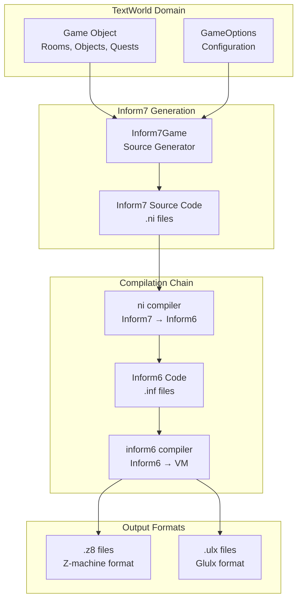
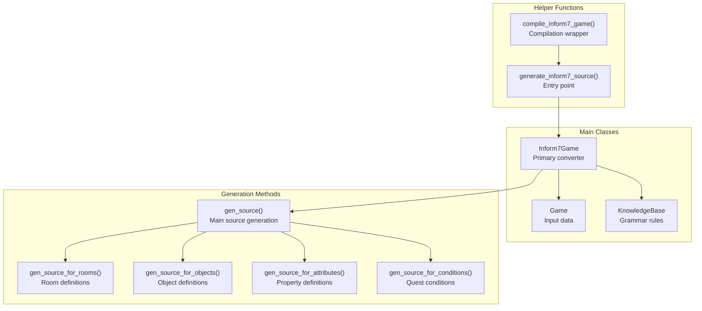
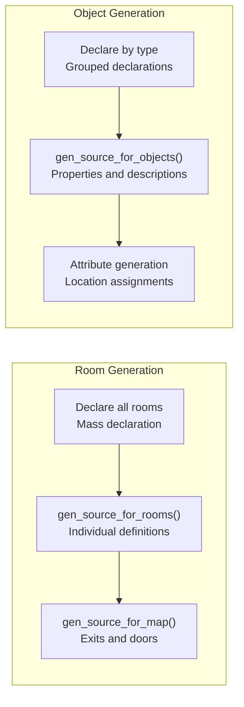
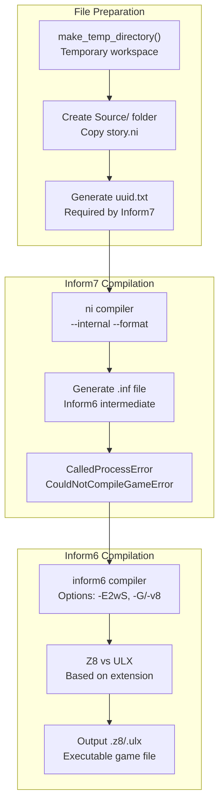
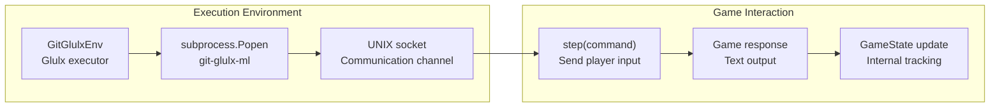

<!-- source: DeepWiki mcp.deepwiki.com · repo microsoft/TextWorld · page 4.3 Inform7 Compilation · fetched 2026-10-26 -->

# Inform7 Compilation

Relevant source files

The following files were used as context for generating this wiki page:

- [textworld/envs/glulx/git_glulx.py](textworld/envs/glulx/git_glulx.py)
- [textworld/generator/inform7/tests/test_world2inform7.py](textworld/generator/inform7/tests/test_world2inform7.py)
- [textworld/generator/inform7/world2inform7.py](textworld/generator/inform7/world2inform7.py)

This document covers the process of compiling TextWorld games into playable Inform7 format files. This includes converting TextWorld's internal `Game` representation to Inform7 source code and then compiling that source to executable game files (.z8 or .ulx formats).

For information about creating games using `GameMaker`, see [Game Creation with GameMaker](#4.1). For details about quest and event definitions, see [Quest and Event System](#4.2). For information about executing compiled games, see [Game Environments](#5).

## Compilation Pipeline Overview

The Inform7 compilation process transforms TextWorld's high-level game representation into playable interactive fiction files through a multi-stage pipeline:

Sources: [textworld/generator/inform7/world2inform7.py:1006-1088]()

## Core Compilation Classes

The compilation system centers around the `Inform7Game` class which handles the conversion from TextWorld's internal representation to Inform7 source code:

Sources: [textworld/generator/inform7/world2inform7.py:56-1004]()

## Source Code Generation Process

The `Inform7Game.gen_source()` method orchestrates the generation of complete Inform7 source code through several key phases:

### Game Setup and Configuration

The generation process begins with basic game configuration and type definitions:

| Component | Method | Purpose |
|-----------|--------|---------|
| Memory allocation | Direct source injection | Sets `MAX_STATIC_DATA` for large games |
| Random seed | Direct source injection | Ensures reproducible game generation |
| Type definitions | `define_inform7_kinds()` | Maps TextWorld types to Inform7 kinds |
| Custom addons | KB addon injection | Includes knowledge base extensions |

### World Structure Generation

The world structure is built through systematic declaration and definition:

Sources: [textworld/generator/inform7/world2inform7.py:286-313]()

### Quest Logic Integration

Quest systems are translated into Inform7's event-driven model through condition checking and score management:

| Quest Element | Inform7 Implementation | Generation Method |
|---------------|----------------------|-------------------|
| Win conditions | `quest{id} completed` truth states | Direct template generation |
| Fail conditions | `end the story` triggers | `gen_source_for_conditions()` |
| Score rewards | `increase the score by {reward}` | Template-based injection |
| Repeatability | Conditional completion flags | Logic branch generation |

Sources: [textworld/generator/inform7/world2inform7.py:318-382]()

## Compilation Execution

The `compile_inform7_game()` function manages the actual compilation process from Inform7 source to executable formats:

Sources: [textworld/generator/inform7/world2inform7.py:1012-1088]()

## Environment Integration

Compiled games integrate with TextWorld's environment system through specific backend engines:

### Format Support

| Format | Engine | File Extension | Use Case |
|--------|--------|---------------|----------|
| Z-machine | JerichoEnv | .z8 | Standard games, memory efficient |
| Glulx | GitGlulxEnv | .ulx | Large games, extended memory |

### Runtime Communication

The `GitGlulxEnv` class demonstrates how compiled Glulx games are executed:

Sources: [textworld/envs/glulx/git_glulx.py:32-151]()

## Error Handling and Debugging

The compilation system includes comprehensive error handling for common failure scenarios:

### Compilation Errors

The `CouldNotCompileGameError` exception captures compilation failures with diagnostic information:

- **ni compiler failures**: Usually indicate Inform7 syntax errors in generated source
- **inform6 compiler failures**: Typically indicate memory or size constraints
- **Size limitations**: .z8 format has memory restrictions that may require .ulx format

### Debug Features

| Debug Option | Environment Variable | Effect |
|--------------|---------------------|--------|
| Inform6 debug mode | `TEXTWORLD_I6_DEBUG` | Enables testing commands in compiled games |
| Verbose compilation | Function parameter | Prints compiler output during build |

Sources: [textworld/generator/inform7/world2inform7.py:32-34, 1047-1054, 1077-1084]()

## Testing and Validation

The compilation system includes extensive testing through the test suite which validates:

- Quest winning/losing condition generation
- Multi-quest game compilation
- Object disambiguation and naming
- Score systems and repeatability
- Special command integration

Key test patterns demonstrate proper compilation of complex game features including multiple winning conditions, optional quests, and infinite scoring scenarios.

Sources: [textworld/generator/inform7/tests/test_world2inform7.py:21-613]()

---

