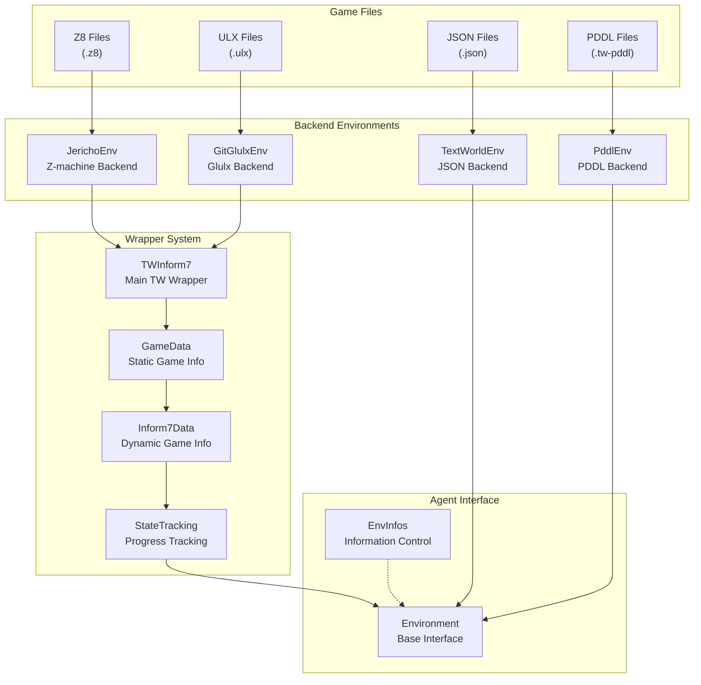
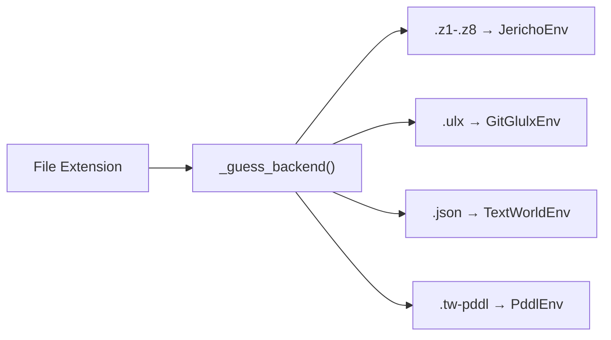
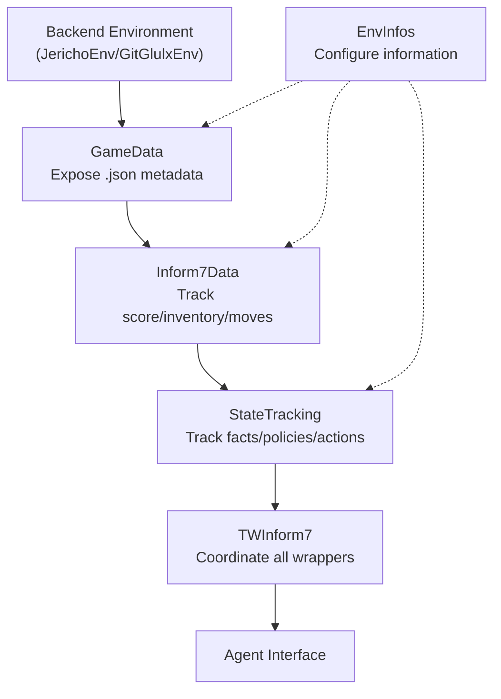
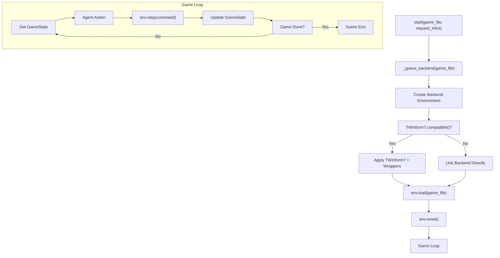

<!-- source: DeepWiki mcp.deepwiki.com · repo microsoft/TextWorld · page 5 Game Environments · fetched 2026-10-26 -->

# Game Environments

<details>
<summary>Relevant source files</summary>

The following files were used as context for generating this wiki page:

- [textworld/core.py](textworld/core.py)
- [textworld/envs/__init__.py](textworld/envs/__init__.py)
- [textworld/envs/tests/test_tw.py](textworld/envs/tests/test_tw.py)
- [textworld/envs/tw.py](textworld/envs/tw.py)
- [textworld/envs/wrappers/tests/test_tw_inform7.py](textworld/envs/wrappers/tests/test_tw_inform7.py)
- [textworld/envs/wrappers/tw_inform7.py](textworld/envs/wrappers/tw_inform7.py)
- [textworld/helpers.py](textworld/helpers.py)
- [textworld/testing.py](textworld/testing.py)

</details>


This document covers the environment system in TextWorld that provides standardized interfaces for executing and interacting with generated games. The environment system handles different game backends (Z-machine, Glulx, JSON), information filtering, and state tracking. For information about generating games, see [Game Generation](#4). For details about integrating with agents, see [Agent Interface](#6).

## System Overview

The TextWorld environment system provides a unified interface for running text-based games across multiple backend engines. The system consists of three main layers: backend environments that handle game execution, wrapper classes that add functionality, and an information system that controls what data is exposed to agents.



**Environment System Architecture**

Sources: [textworld/envs/__init__.py:12-24](), [textworld/envs/wrappers/tw_inform7.py:93-118](), [textworld/core.py:152-294]()

## Backend Environments

Backend environments provide the core execution engines for different game formats. Each backend implements the base `Environment` interface defined in [textworld/core.py:152-294]().

| Backend | File Extension | Purpose | Implementation |
|---------|---------------|---------|----------------|
| `JerichoEnv` | `.z1`-`.z8` | Z-machine games | Jericho interpreter |
| `GitGlulxEnv` | `.ulx` | Glulx games | Git Glulx interpreter |
| `TextWorldEnv` | `.json` | JSON metadata | Direct game state simulation |
| `PddlEnv` | `.tw-pddl` | PDDL planning | Planning domain execution |

The system automatically selects the appropriate backend using the `_guess_backend()` function:



**Backend Selection Logic**

Sources: [textworld/envs/__init__.py:12-24](), [textworld/envs/tw.py:19-179]()

### Environment Interface

All backend environments implement the core `Environment` interface which provides these essential methods:

- `load(path)` - Load a game file
- `reset()` - Start/restart the game  
- `step(command)` - Execute a command and return new state
- `render()` - Display current game state
- `copy()` - Create environment copy for parallel execution

Sources: [textworld/core.py:152-294]()

## Wrapper System

The wrapper system adds functionality to backend environments through a chain of wrapper classes. Each wrapper implements the `Wrapper` base class and can modify environment behavior.



**Wrapper Chain for Inform7 Games**

Sources: [textworld/envs/wrappers/tw_inform7.py:93-118]()

### TWInform7 Wrapper

The `TWInform7` wrapper is the main entry point for TextWorld-generated games. It automatically applies the wrapper chain and ensures compatibility with Inform7 games that have accompanying `.json` metadata files.

Key features:
- Compatibility checking via `TWInform7.compatible(path)`
- Automatic wrapper chain application
- Support for both Z-machine and Glulx backends

Sources: [textworld/envs/wrappers/tw_inform7.py:93-118]()

### GameData Wrapper

The `GameData` wrapper exposes static information from the game's JSON metadata file. This includes:

- Game objective and maximum score
- Entity names and types
- Command templates and verbs
- Possible commands
- Win/fail condition facts

Sources: [textworld/envs/wrappers/tw_inform7.py:342-408]()

### Inform7Data Wrapper  

The `Inform7Data` wrapper tracks dynamic game information that changes during gameplay:

- Current score and move count
- Player inventory contents
- Room descriptions
- Win/loss status detection

The wrapper uses special `tw-extra-infos` commands to extract information from the game interpreter and parses structured output between XML-like tags.

Sources: [textworld/envs/wrappers/tw_inform7.py:120-187]()

### StateTracking Wrapper

The `StateTracking` wrapper provides advanced state tracking capabilities for agent training:

- Current game facts and state
- Valid/admissible commands
- Winning policy sequences
- Intermediate rewards for progress tracking
- Action detection from Inform7 debug output

This wrapper maintains a `GameProgression` object that tracks the game's logical state independently of the text interface.

Sources: [textworld/envs/wrappers/tw_inform7.py:189-340]()

## Information System (EnvInfos)

The `EnvInfos` class provides fine-grained control over what information environments expose to agents. This system allows users to request only the information needed for their specific use case, improving performance and reducing complexity.

### Information Categories

| Category | Information Type | Examples |
|----------|------------------|----------|
| **Basic Game State** | `feedback`, `score`, `moves`, `won`, `lost` | Game output, progress tracking |
| **Static Game Info** | `objective`, `max_score`, `entities`, `verbs` | Game structure, vocabulary |
| **Dynamic State** | `inventory`, `description`, `location`, `facts` | Current game state |
| **Agent Support** | `admissible_commands`, `policy_commands` | Valid actions, optimal strategies |
| **Advanced Tracking** | `intermediate_reward`, `last_action` | Training signals, action history |

### Usage Example

```python
from textworld import EnvInfos

# Configure information for RL training
request_infos = EnvInfos(
    admissible_commands=True,  # Valid commands
    intermediate_reward=True,  # Progress signals
    score=True,               # Current score
    moves=True               # Move count
)

env = textworld.start(game_file, request_infos=request_infos)
```

Sources: [textworld/core.py:12-134]()

## Environment Lifecycle

The typical lifecycle of a TextWorld environment involves initialization, game loading, and interactive execution:



**Environment Lifecycle Flow**

Sources: [textworld/helpers.py:19-53](), [textworld/core.py:152-294]()

### Game State Management

The environment system uses a `GameState` object (a specialized dictionary) to represent the current state of the game. The state includes:

- `feedback` - Text output from the game
- `score` - Current game score  
- `done` - Whether the game has ended
- Additional fields based on `EnvInfos` configuration

The `GameState` supports both dictionary-style access (`state["score"]`) and attribute-style access (`state.score`).

Sources: [textworld/core.py:136-150]()

## Environment Integration

### Starting Environments

The `textworld.start()` function provides the main entry point for creating environments:

```python
import textworld

# Basic usage
env = textworld.start("game.z8")

# With information configuration  
env = textworld.start("game.z8", request_infos=EnvInfos(score=True))

# With additional wrappers
env = textworld.start("game.z8", wrappers=[CustomWrapper])
```

The function automatically handles backend selection, wrapper application, and game loading.

Sources: [textworld/helpers.py:19-53]()

### Environment Copying

Environments support copying for parallel execution scenarios:

```python
env1 = textworld.start("game.z8")
env2 = env1.copy()  # Independent copy

# Both environments can run in parallel
state1 = env1.reset()
state2 = env2.reset()
```

This is particularly useful for batch processing and distributed training scenarios.

Sources: [textworld/core.py:268-274](), [textworld/envs/wrappers/tw_inform7.py:113-117]()

---

