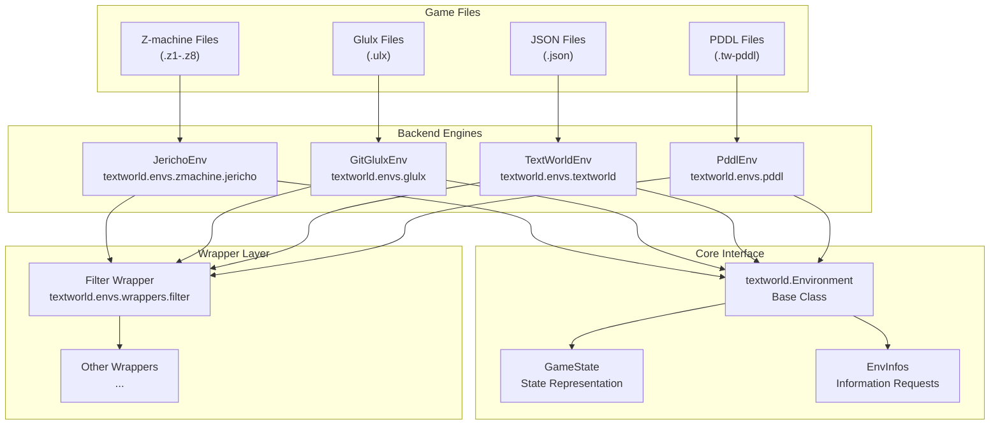
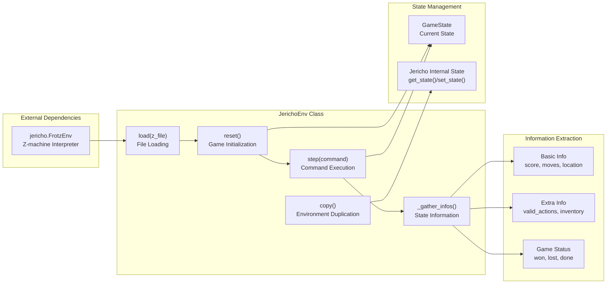
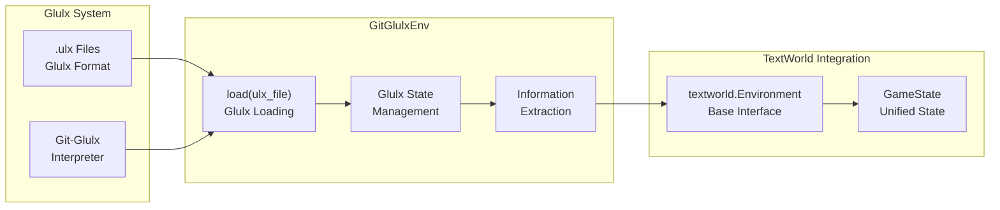
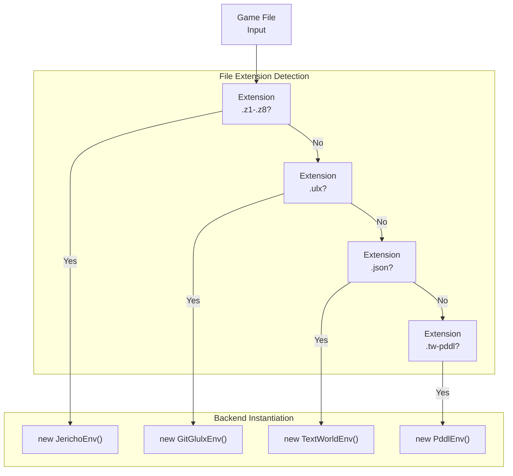
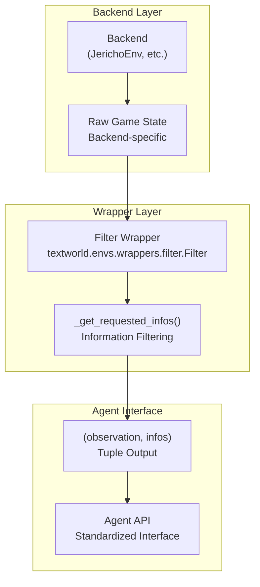

<!-- source: DeepWiki mcp.deepwiki.com · repo microsoft/TextWorld · page 5.1 Environment Backends · fetched 2026-10-26 -->

# Environment Backends

<details>
<summary>Relevant source files</summary>

The following files were used as context for generating this wiki page:

- [tests/test_textworld.py](tests/test_textworld.py)
- [textworld/envs/wrappers/filter.py](textworld/envs/wrappers/filter.py)
- [textworld/envs/zmachine/jericho.py](textworld/envs/zmachine/jericho.py)
- [textworld/envs/zmachine/tests/test_jericho.py](textworld/envs/zmachine/tests/test_jericho.py)
- [textworld/gym/core.py](textworld/gym/core.py)
- [textworld/gym/envs/__init__.py](textworld/gym/envs/__init__.py)

</details>


Environment backends are the core execution engines that interface with compiled TextWorld games in different formats. They provide a unified API for game interaction while handling the specifics of different game file formats and execution environments. This page covers the implementation and usage of the various backend engines available in TextWorld.

For information about wrapper functionality that builds on top of these backends, see [Environment Wrappers](#5.2). For details about configuring information flow from backends to agents, see [Information System (EnvInfos)](#5.3).

## Backend Architecture Overview

TextWorld supports multiple backend engines to handle different game compilation formats. Each backend implements the core `Environment` interface while providing specialized functionality for its target format.

**Backend Architecture Diagram**


Sources: [textworld/envs/zmachine/jericho.py:15-23](), [textworld/envs/wrappers/filter.py:10-33]()

## JerichoEnv - Z-machine Backend

The `JerichoEnv` class provides backend support for Z-machine format games (files with extensions `.z1` through `.z8`). It uses the Jericho library to interface with the Frotz Z-machine interpreter.

**JerichoEnv Implementation Details**


Sources: [textworld/envs/zmachine/jericho.py:15-146]()

### Key Features

| Feature | Implementation | File Reference |
|---------|---------------|----------------|
| **File Support** | Z-machine files (.z1-.z8) | [textworld/envs/zmachine/jericho.py:24-33]() |
| **Game Loading** | `load(z_file)` validates and loads game files | [textworld/envs/zmachine/jericho.py:24-40]() |
| **State Management** | Integrates Jericho state with TextWorld `GameState` | [textworld/envs/zmachine/jericho.py:93-97]() |
| **Information Gathering** | Extracts game info based on `EnvInfos` requests | [textworld/envs/zmachine/jericho.py:56-88]() |
| **Environment Copying** | Supports copying for branching/backtracking | [textworld/envs/zmachine/jericho.py:125-140]() |

### Information Extraction

The `JerichoEnv` extracts different types of information depending on game support level:

```python
# Basic information available for supported games
basic_attrs = ["score", "moves", "location", "description", "inventory"]

# Extra information for fully supported games  
extra_attrs = ["valid_actions", "admissible_commands"]

# Game status information
status_info = ["won", "lost", "done"]
```

Sources: [textworld/envs/zmachine/jericho.py:62-87]()

### Usage Example

```python
from textworld.envs.zmachine.jericho import JerichoEnv
from textworld.core import EnvInfos

# Configure information requests
request_infos = EnvInfos(score=True, moves=True, admissible_commands=True)

# Create and configure environment
env = JerichoEnv(request_infos)
env.load("game.z8")
game_state = env.reset()

# Execute commands
game_state, score, done = env.step("look around")
```

Sources: [textworld/envs/zmachine/tests/test_jericho.py:52-56]()

## GitGlulxEnv - Glulx Backend

The `GitGlulxEnv` backend handles Glulx format games (`.ulx` files) using the Git-Glulx interpreter. While not detailed in the provided files, this backend follows the same interface pattern as `JerichoEnv`.

**GitGlulxEnv Architecture**


Sources: Architecture diagrams in problem description

## TextWorldEnv - JSON Backend

The `TextWorldEnv` backend processes games stored in JSON format, providing direct access to TextWorld's internal game representation without requiring compilation to Z-machine or Glulx formats.

## PddlEnv - PDDL Backend

The `PddlEnv` backend handles games exported to PDDL (Planning Domain Definition Language) format, enabling integration with classical planning systems.

## Backend Selection and Usage

The TextWorld system automatically selects the appropriate backend based on file extension when loading games:

| File Extension | Backend | Interpreter |
|---------------|---------|-------------|
| `.z1` - `.z8` | `JerichoEnv` | Jericho/Frotz |
| `.ulx` | `GitGlulxEnv` | Git-Glulx |
| `.json` | `TextWorldEnv` | Native TextWorld |
| `.tw-pddl` | `PddlEnv` | PDDL Planner |

**Backend Selection Flow**


Sources: [textworld/envs/zmachine/jericho.py:24-33]()

## Integration with Wrapper System

Environment backends integrate with the wrapper system through the base `Environment` class. The `Filter` wrapper is commonly used to control information flow from backends to agents.

**Backend-Wrapper Integration**


Sources: [textworld/envs/wrappers/filter.py:35-55]()

The wrapper system allows multiple backends to present a unified interface to agents while maintaining their specialized capabilities for different game formats.

---

