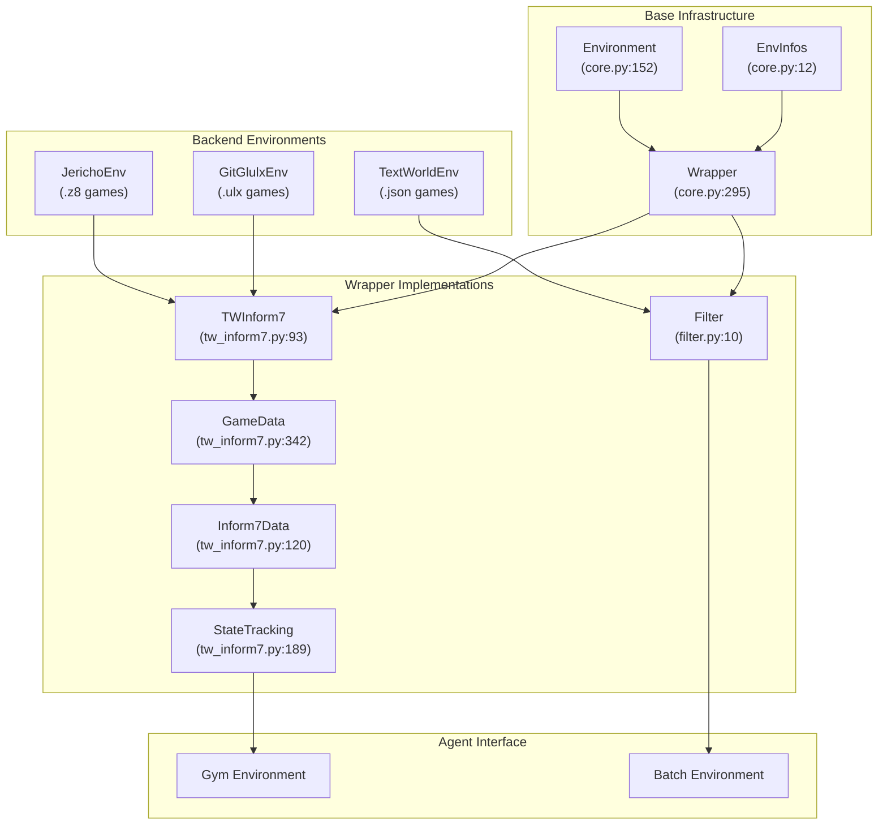
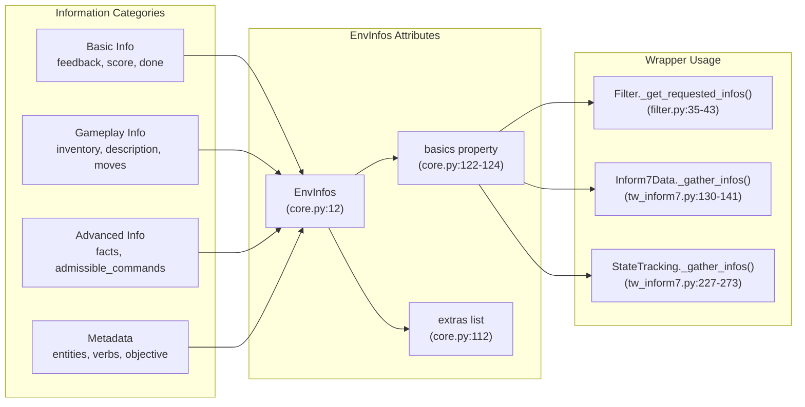
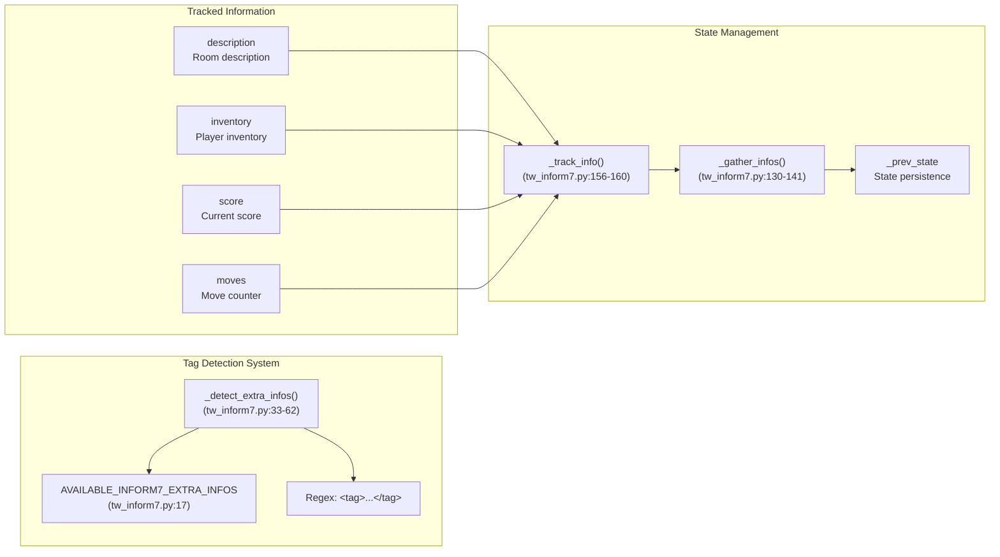
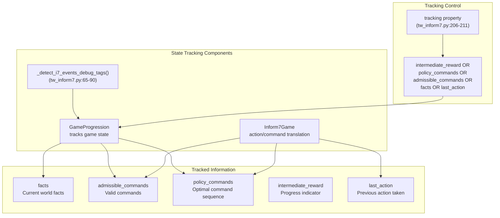
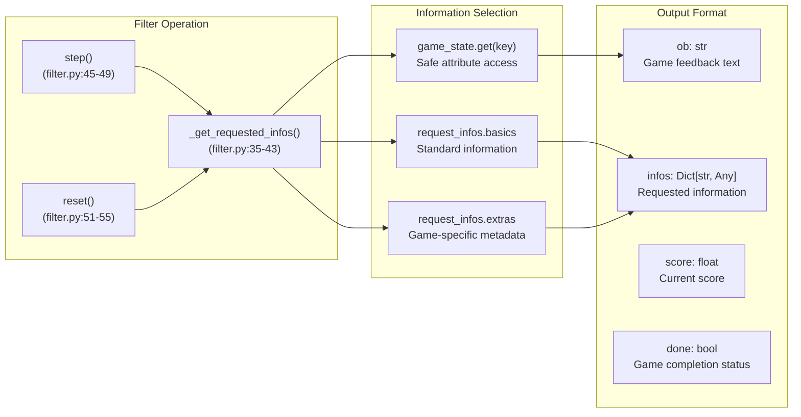

<!-- source: DeepWiki mcp.deepwiki.com · repo microsoft/TextWorld · page 5.2 Environment Wrappers · fetched 2026-10-26 -->

# Environment Wrappers

<details>
<summary>Relevant source files</summary>

The following files were used as context for generating this wiki page:

- [textworld/core.py](textworld/core.py)
- [textworld/envs/tests/test_tw.py](textworld/envs/tests/test_tw.py)
- [textworld/envs/tw.py](textworld/envs/tw.py)
- [textworld/envs/wrappers/filter.py](textworld/envs/wrappers/filter.py)
- [textworld/envs/wrappers/tests/test_tw_inform7.py](textworld/envs/wrappers/tests/test_tw_inform7.py)
- [textworld/envs/wrappers/tw_inform7.py](textworld/envs/wrappers/tw_inform7.py)
- [textworld/gym/core.py](textworld/gym/core.py)
- [textworld/gym/envs/__init__.py](textworld/gym/envs/__init__.py)

</details>


Environment wrappers provide a modular system for extending and modifying the behavior of TextWorld environments without changing the underlying game engines. They implement the decorator pattern to add functionality such as information filtering, state tracking, and enhanced data access to base environments like `JerichoEnv` and `GitGlulxEnv`.

For information about the core environment backends that wrappers extend, see [Environment Backends](#5.1). For details on controlling what information environments provide to agents, see [Information System (EnvInfos)](#5.3).

## Wrapper Architecture Overview

The wrapper system follows a hierarchical composition pattern where multiple wrappers can be chained together to combine functionality. Each wrapper extends the base `Wrapper` class and intercepts calls to `step()`, `reset()`, and `load()` methods.



Sources: [textworld/core.py:295-378](), [textworld/envs/wrappers/tw_inform7.py:93-118](), [textworld/envs/wrappers/filter.py:10-62]()

## Base Wrapper Infrastructure

### Wrapper Base Class

The `Wrapper` class provides the foundation for all environment wrappers. It implements attribute delegation to the wrapped environment and defines the core interface that all wrappers must follow.

| Method | Purpose | Implementation |
|--------|---------|----------------|
| `_wrap(env)` | Store reference to wrapped environment | [core.py:321-326]() |
| `__getattr__(attr)` | Delegate attribute access to wrapped env | [core.py:328-336]() |
| `unwrapped` | Access the innermost environment | [core.py:338-343]() |
| `copy()` | Create a copy of the wrapper chain | Must be implemented by subclasses |

### EnvInfos Integration

Wrappers use the `EnvInfos` system to determine what additional information to provide in the game state. The `request_infos` attribute controls which data is gathered and exposed.



Sources: [textworld/core.py:12-134](), [textworld/envs/wrappers/filter.py:35-43](), [textworld/envs/wrappers/tw_inform7.py:130-141]()

## TextWorld Inform7 Wrapper System

### TWInform7 Composite Wrapper

The `TWInform7` wrapper is the main entry point for TextWorld-generated Inform7 games. It automatically composes three specialized wrappers to provide comprehensive functionality.

```mermaid
graph TB
    subgraph "TWInform7 Composition"
        TWInform7["TWInform7._wrap()<br/>(tw_inform7.py:98-102)"]
        
        GameData["GameData<br/>Static game information"]
        Inform7Data["Inform7Data<br/>Dynamic game information"] 
        StateTracking["StateTracking<br/>Game state progression"]
    end
    
    subgraph "Compatibility Check"
        Compatible["TWInform7.compatible()<br/>(tw_inform7.py:105-111)"]
        JsonCheck["Checks for .json file<br/>alongside .z8/.ulx"]
    end
    
    subgraph "Wrapper Chain Flow"
        BaseEnv["Base Environment<br/>(JerichoEnv/GitGlulxEnv)"]
        Step1["Wrapped with GameData"]
        Step2["Wrapped with Inform7Data"] 
        Step3["Wrapped with StateTracking"]
        FinalEnv["Complete TWInform7 Environment"]
    end
    
    TWInform7 --> GameData
    GameData --> Inform7Data
    Inform7Data --> StateTracking
    
    Compatible --> JsonCheck
    
    BaseEnv --> Step1
    Step1 --> Step2
    Step2 --> Step3
    Step3 --> FinalEnv
```



Sources: [textworld/envs/wrappers/tw_inform7.py:93-118]()

### GameData Wrapper

The `GameData` wrapper exposes static information from the game's JSON metadata file. This information remains constant throughout gameplay and includes entities, verbs, objectives, and quest structures.

| Information Type | State Key | Source |
|------------------|-----------|---------|
| Command templates | `command_templates` | `Game.command_templates` |
| Available verbs | `verbs` | `Game.verbs` |
| Entity names | `entities` | `Game.entity_names` |
| Typed entities | `typed_entities` | `Game.objects_names_and_types` |
| Game objective | `objective` | `Game.objective` |
| Maximum score | `max_score` | `Game.max_score` |
| Win conditions | `win_facts` | Quest win events (if requested) |
| Fail conditions | `fail_facts` | Quest fail events (if requested) |

Sources: [textworld/envs/wrappers/tw_inform7.py:342-407]()

### Inform7Data Wrapper

The `Inform7Data` wrapper manages dynamic information that changes during gameplay. It tracks special Inform7 output tags and maintains state information across game steps.



Sources: [textworld/envs/wrappers/tw_inform7.py:120-187](), [textworld/envs/wrappers/tw_inform7.py:33-62]()

### StateTracking Wrapper

The `StateTracking` wrapper provides the most advanced functionality, tracking game progression, valid actions, and optimal policies. It requires access to the game's logical structure through the JSON file.



Sources: [textworld/envs/wrappers/tw_inform7.py:189-340]()

## Information Filtering

### Filter Wrapper

The `Filter` wrapper provides a clean interface for accessing requested information by returning only the data specified in `EnvInfos`. It transforms the internal state representation into a user-friendly dictionary format.



Sources: [textworld/envs/wrappers/filter.py:10-62]()

## Usage Patterns

### Basic Wrapper Usage

```python
# Manual wrapper composition
env = JerichoEnv(request_infos)
env = GameData(env)
env = Inform7Data(env) 
env = StateTracking(env)

# Automatic composition via TWInform7
env = TWInform7(JerichoEnv(request_infos))
```

### Environment Compatibility

| Environment Type | Compatible Wrappers | Requirements |
|------------------|-------------------|--------------|
| `JerichoEnv` (.z8) | `TWInform7`, `Filter` | JSON metadata file |
| `GitGlulxEnv` (.ulx) | `TWInform7`, `Filter` | JSON metadata file |
| `TextWorldEnv` (.json) | `Filter` | Native JSON support |

The `TWInform7.compatible()` method checks for the presence of the required JSON metadata file alongside the game binary.

### Error Handling

The wrapper system includes specific error handling for missing dependencies:

- `MissingGameInfosError`: Raised when a wrapper requiring game metadata is used with a game lacking a JSON file
- Compatibility checks prevent runtime errors by validating file availability

Sources: [textworld/envs/wrappers/tw_inform7.py:20-31](), [textworld/envs/wrappers/tw_inform7.py:105-111]()

---

