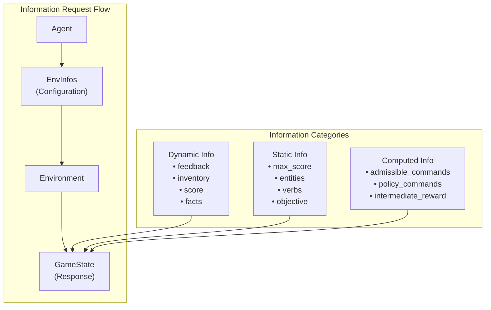
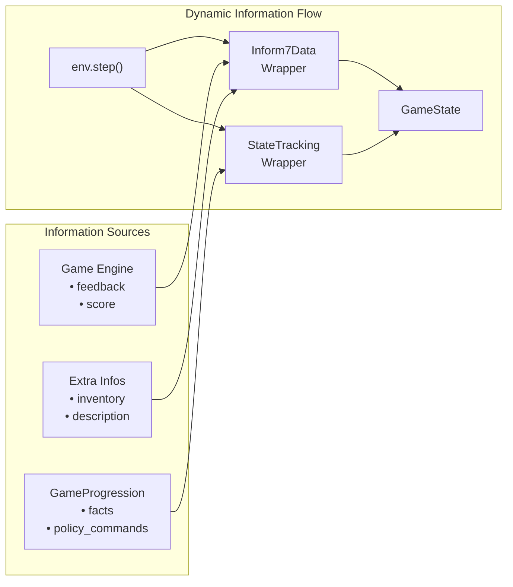
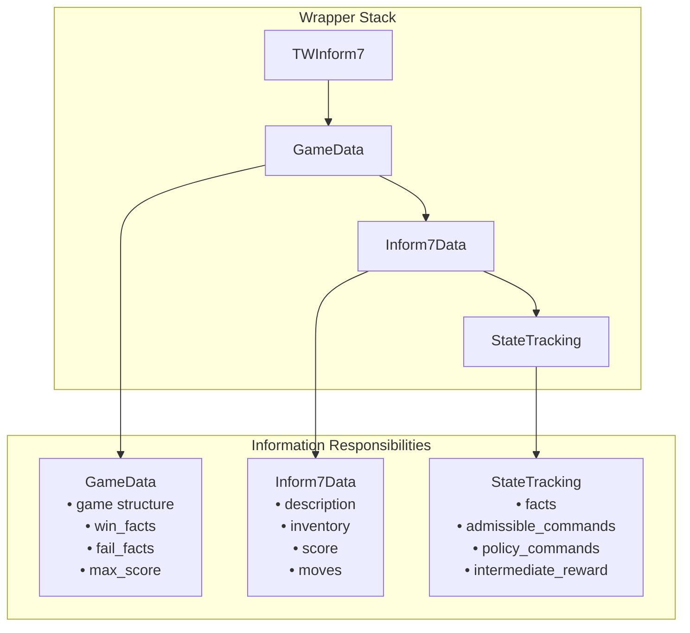

<!-- source: DeepWiki mcp.deepwiki.com · repo microsoft/TextWorld · page 5.3 Information System (EnvInfos) · fetched 2026-10-26 -->

# Information System (EnvInfos)

<details>
<summary>Relevant source files</summary>

The following files were used as context for generating this wiki page:

- [textworld/core.py](textworld/core.py)
- [textworld/envs/tests/test_tw.py](textworld/envs/tests/test_tw.py)
- [textworld/envs/tw.py](textworld/envs/tw.py)
- [textworld/envs/wrappers/tests/test_tw_inform7.py](textworld/envs/wrappers/tests/test_tw_inform7.py)
- [textworld/envs/wrappers/tw_inform7.py](textworld/envs/wrappers/tw_inform7.py)

</details>


The Information System in TextWorld provides a flexible mechanism for controlling what information environments expose to agents. This system allows agents to request specific types of game state information while avoiding unnecessary computation for unused data. The core of this system is the `EnvInfos` class, which acts as a configuration object specifying what information should be included in the `GameState` returned by environment operations.

For information about environment backends and their execution, see [Environment Backends](#5.1). For details on the wrapper system that implements information filtering, see [Environment Wrappers](#5.2).

## EnvInfos Configuration Class

The `EnvInfos` class serves as a declarative interface for specifying information requirements. It uses boolean attributes to indicate which types of information should be computed and included in game states.



Sources: [textworld/core.py:12-134]()

The `EnvInfos` class defines its available information types through `__slots__`, ensuring memory efficiency and providing a clear contract for supported information types:

| Category | Information Types | Changes Per Step |
|----------|------------------|------------------|
| **Observation** | `feedback`, `description`, `inventory`, `location` | Yes |
| **Game Status** | `won`, `lost`, `score`, `moves` | Yes |
| **Game Structure** | `max_score`, `objective`, `entities`, `verbs`, `command_templates` | No |
| **Game Logic** | `facts`, `win_facts`, `fail_facts`, `last_action` | Yes/No |
| **Agent Support** | `admissible_commands`, `policy_commands`, `intermediate_reward` | Yes |

Sources: [textworld/core.py:22-32](), [textworld/core.py:35-112]()

## Information Categories and Usage

### Dynamic Game Information

Dynamic information changes with each game step and requires real-time computation or tracking:



Sources: [textworld/envs/wrappers/tw_inform7.py:120-187](), [textworld/envs/wrappers/tw_inform7.py:189-339]()

### Static Game Information

Static information remains constant throughout a game session and is typically loaded once:

- **Game Structure**: `max_score`, `objective`, `entities`, `verbs`
- **Command Templates**: `command_templates`, `possible_commands`
- **Quest Information**: `win_facts`, `fail_facts`

Sources: [textworld/envs/wrappers/tw_inform7.py:342-407]()

### Computed Agent Support Information

These information types require complex computation based on current game state:

- **`admissible_commands`**: Valid commands for current state
- **`policy_commands`**: Optimal action sequence to win
- **`intermediate_reward`**: Progress indicator for reinforcement learning

Sources: [textworld/envs/wrappers/tw_inform7.py:264-269](), [textworld/envs/wrappers/tw_inform7.py:235-255]()

## Wrapper Integration

The information system integrates deeply with TextWorld's wrapper architecture. Different wrappers are responsible for providing different categories of information:



Sources: [textworld/envs/wrappers/tw_inform7.py:93-118]()

### Conditional Information Gathering

Wrappers use the `request_infos` attribute to conditionally gather information, avoiding unnecessary computation:

```python
# Example from Inform7Data wrapper
if self.request_infos.inventory:
    self._track_info("inventory")

if self.request_infos.description:
    self._track_info("description")
```

Sources: [textworld/envs/wrappers/tw_inform7.py:167-171]()

### State Tracking Optimization

The `StateTracking` wrapper includes a `tracking` property that determines whether expensive state tracking should be enabled:

```python
@property
def tracking(self):
    return (self.request_infos.intermediate_reward
            or self.request_infos.policy_commands
            or self.request_infos.admissible_commands
            or self.request_infos.facts
            or self.request_infos.last_action)
```

Sources: [textworld/envs/wrappers/tw_inform7.py:206-211]()

## Extra Information System

The `extras` attribute in `EnvInfos` provides extensibility for game-specific metadata:

```python
# EnvInfos supports custom metadata keys
request_infos = EnvInfos(extras=["custom_key", "game_metadata"])
```

Game metadata is exposed through the `extra.{key}` pattern in the game state, allowing access to arbitrary game-specific information without modifying the core `EnvInfos` interface.

Sources: [textworld/core.py:111-112](), [textworld/envs/wrappers/tw_inform7.py:376-377]()

## Usage Patterns

### Basic Information Request

```python
# Request basic game information
request_infos = EnvInfos(
    feedback=True,      # Game narrative text
    score=True,         # Current score
    won=True,           # Game completion status
    inventory=True      # Player inventory
)

env = textworld.start(game_file, request_infos=request_infos)
```

### Advanced Agent Information

```python
# Request information for RL agents
request_infos = EnvInfos(
    admissible_commands=True,    # Valid actions
    intermediate_reward=True,    # Progress signal
    policy_commands=True,        # Optimal policy
    facts=True                   # World state facts
)
```

Sources: [textworld/envs/wrappers/tests/test_tw_inform7.py:37-44](), [textworld/envs/wrappers/tests/test_tw_inform7.py:388-393]()

The information system provides a clean separation between what agents need and how environments provide it, enabling efficient and flexible game state management across different types of agents and use cases.

---

