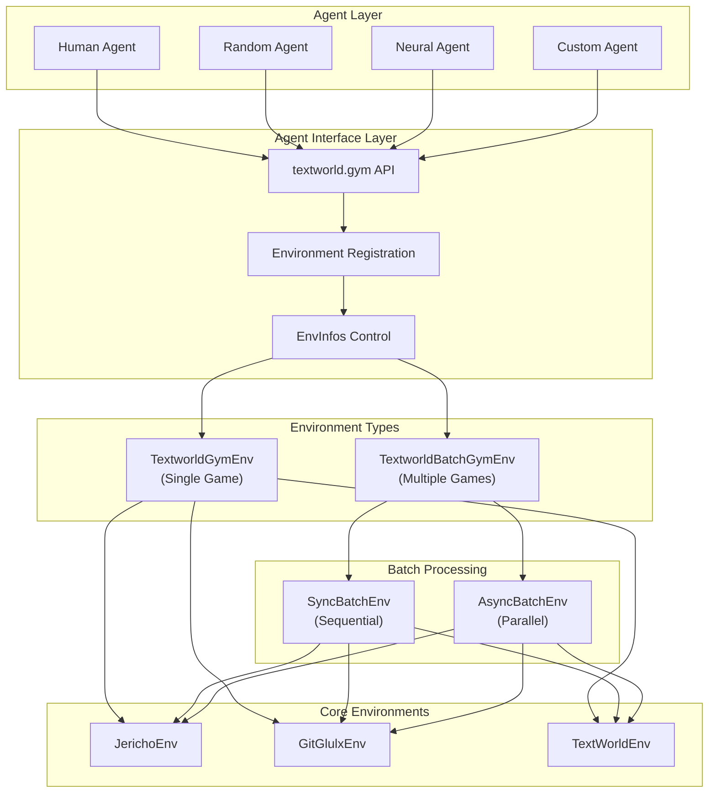
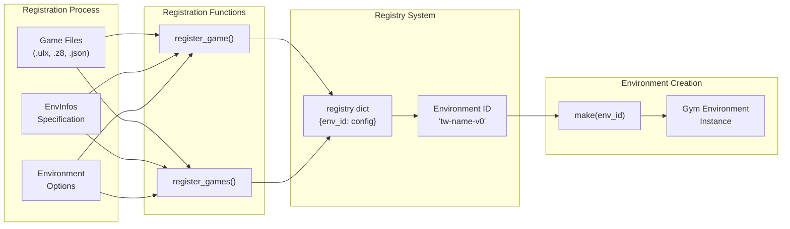
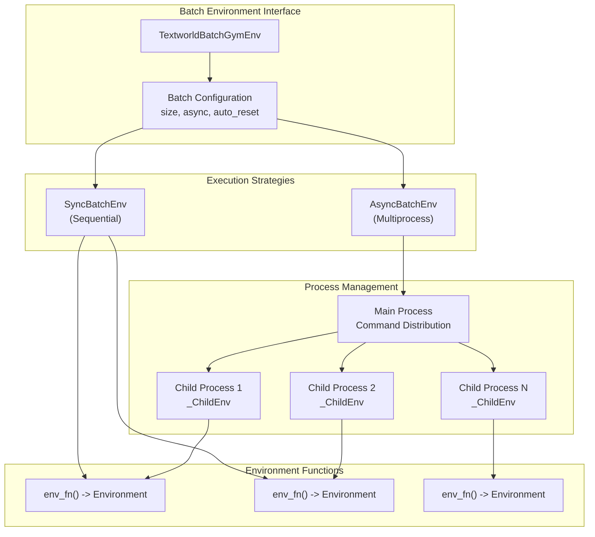
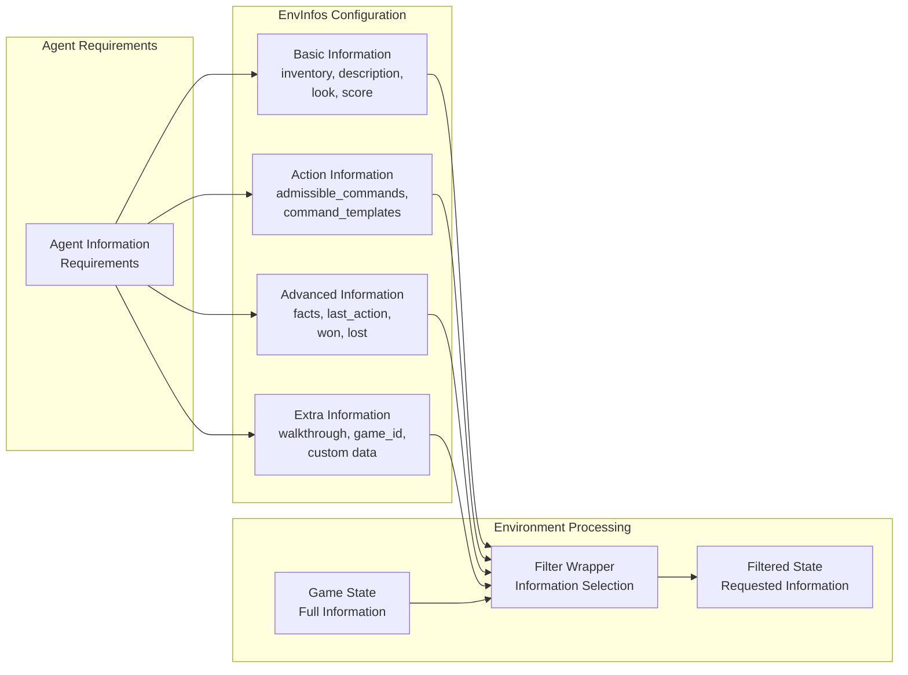

<!-- source: DeepWiki mcp.deepwiki.com · repo microsoft/TextWorld · page 6 Agent Interface · fetched 2026-10-26 -->

# Agent Interface

<details>
<summary>Relevant source files</summary>

The following files were used as context for generating this wiki page:

- [scripts/benchmark_framework.py](scripts/benchmark_framework.py)
- [textworld/envs/batch/batch_env.py](textworld/envs/batch/batch_env.py)
- [textworld/envs/batch/tests/test_batch_env.py](textworld/envs/batch/tests/test_batch_env.py)
- [textworld/gym/__init__.py](textworld/gym/__init__.py)
- [textworld/gym/envs/textworld.py](textworld/gym/envs/textworld.py)
- [textworld/gym/envs/textworld_batch.py](textworld/gym/envs/textworld_batch.py)
- [textworld/gym/tests/test_textworld_gym.py](textworld/gym/tests/test_textworld_gym.py)
- [textworld/gym/utils.py](textworld/gym/utils.py)

</details>


The Agent Interface system provides the primary integration layer between reinforcement learning agents and TextWorld game environments. This system implements OpenAI Gym-compatible interfaces, handles batch processing for parallel game execution, and manages information flow between agents and games.

This document covers the gym integration layer, environment registration, and batch processing capabilities. For details about the underlying game environments, see [Game Environments](#5). For information about specific agent implementations, see [Agent Types](#6.3).

## Architecture Overview

The Agent Interface layer sits between game environments and agents, providing standardized APIs and enhanced functionality for training and evaluation.



Sources: [textworld/gym/utils.py:1-200](), [textworld/gym/envs/textworld.py:1-67](), [textworld/gym/envs/textworld_batch.py:1-211]()

## Environment Registration System

TextWorld uses a registration system to create reusable environment configurations that can be instantiated multiple times with consistent settings.



The registration process creates environment configurations without instantiating the actual environments:

```python
# Register a single game
env_id = textworld.gym.register_game(
    gamefile="game.ulx",
    request_infos=EnvInfos(inventory=True, description=True),
    max_episode_steps=50,
    name="my-game"
)

# Register multiple games for variety
env_id = textworld.gym.register_games(
    gamefiles=["game1.ulx", "game2.z8"],
    request_infos=EnvInfos(admissible_commands=True),
    batch_size=4,
    asynchronous=True,
    name="multi-game"
)
```

Sources: [textworld/gym/utils.py:34-122](), [textworld/gym/utils.py:124-199]()

## Single vs Batch Environments

TextWorld provides two main environment types depending on whether you need to run one game or multiple games simultaneously.

### Single Game Environment

`TextworldGymEnv` wraps a single game instance and provides standard Gym API methods:

| Method | Input | Output | Description |
|--------|-------|--------|-------------|
| `reset()` | None | `(obs, infos)` | Reset game to initial state |
| `step(command)` | `str` | `(obs, score, done, infos)` | Execute single command |
| `render(mode)` | `str` | Text output | Display current state |
| `close()` | None | None | Clean up resources |

### Batch Environment

`TextworldBatchGymEnv` manages multiple game instances for parallel training:

| Method | Input | Output | Description |
|--------|-------|--------|-------------|
| `reset()` | None | `(obs_list, infos_dict)` | Reset all games in batch |
| `step(commands)` | `List[str]` | `(obs_list, scores_list, dones_list, infos_dict)` | Execute commands in parallel |
| `seed(seed)` | `int` | `List[int]` | Set seeds for reproducibility |
| `skip(nb_games)` | `int` | None | Skip games in rotation |

Sources: [textworld/gym/envs/textworld.py:11-67](), [textworld/gym/envs/textworld_batch.py:34-211]()

## Batch Processing Architecture

The batch system supports both synchronous and asynchronous execution depending on performance requirements.



### Synchronous Batch Processing

`SyncBatchEnv` runs games sequentially in the main process:

```python
# Best for small batch sizes or debugging
env_id = textworld.gym.register_games(
    gamefiles=["game1.ulx", "game2.z8"],
    batch_size=2,
    asynchronous=False  # Use SyncBatchEnv
)
```

### Asynchronous Batch Processing

`AsyncBatchEnv` uses multiprocessing to run games in parallel:

```python
# Best for large batch sizes and performance
env_id = textworld.gym.register_games(
    gamefiles=["game1.ulx", "game2.z8", "game3.ulx"],
    batch_size=8,
    asynchronous=True  # Use AsyncBatchEnv
)
```

Sources: [textworld/envs/batch/batch_env.py:93-199](), [textworld/envs/batch/batch_env.py:201-285](), [textworld/gym/envs/textworld_batch.py:78-80]()

## Information Control with EnvInfos

The `EnvInfos` system allows agents to specify exactly what information they need from the environment, optimizing performance and providing flexibility.



### Common EnvInfos Patterns

```python
# Minimal information for simple agents
basic_infos = EnvInfos(
    description=True,
    inventory=True
)

# Full information for learning agents
learning_infos = EnvInfos(
    description=True,
    inventory=True,
    admissible_commands=True,
    score=True,
    won=True,
    lost=True
)

# Debug information including extras
debug_infos = EnvInfos(
    description=True,
    inventory=True,
    admissible_commands=True,
    extras=["walkthrough", "game_id"]
)
```

Sources: [textworld/gym/utils.py:47-53](), [textworld/gym/tests/test_textworld_gym.py:49-51](), [textworld/gym/tests/test_textworld_gym.py:274-275]()

## Integration Patterns

### Basic Single Game Usage

```python
import textworld.gym
from textworld import EnvInfos

# Register and create environment
request_infos = EnvInfos(description=True, inventory=True)
env_id = textworld.gym.register_game("game.ulx", request_infos)
env = textworld.gym.make(env_id)

# Standard RL loop
obs, infos = env.reset()
done = False
while not done:
    action = agent.act(obs, infos)
    obs, score, done, infos = env.step(action)

env.close()
```

### Batch Training Pattern

```python
# Register batch environment
env_id = textworld.gym.register_games(
    gamefiles=["game1.ulx", "game2.z8"],
    request_infos=EnvInfos(admissible_commands=True),
    batch_size=4,
    auto_reset=True
)
env = textworld.gym.make(env_id)

# Batch RL loop
obs_list, infos = env.reset()
for episode in range(num_episodes):
    actions = [agent.act(obs, infos, i) for i, obs in enumerate(obs_list)]
    obs_list, scores, dones, infos = env.step(actions)
    # Training happens here with batch data

env.close()
```

### Custom Wrapper Integration

```python
class CustomWrapper(textworld.core.Wrapper):
    def step(self, command):
        state, score, done = super().step(command)
        # Custom processing
        state.feedback = self.process_feedback(state.feedback)
        return state, score, done

# Register with custom wrapper
env_id = textworld.gym.register_game(
    "game.ulx",
    request_infos=EnvInfos(inventory=True),
    wrappers=[CustomWrapper]
)
```

Sources: [textworld/gym/tests/test_textworld_gym.py:48-64](), [textworld/gym/tests/test_textworld_gym.py:122-156](), [textworld/gym/tests/test_textworld_gym.py:264-292]()

---

