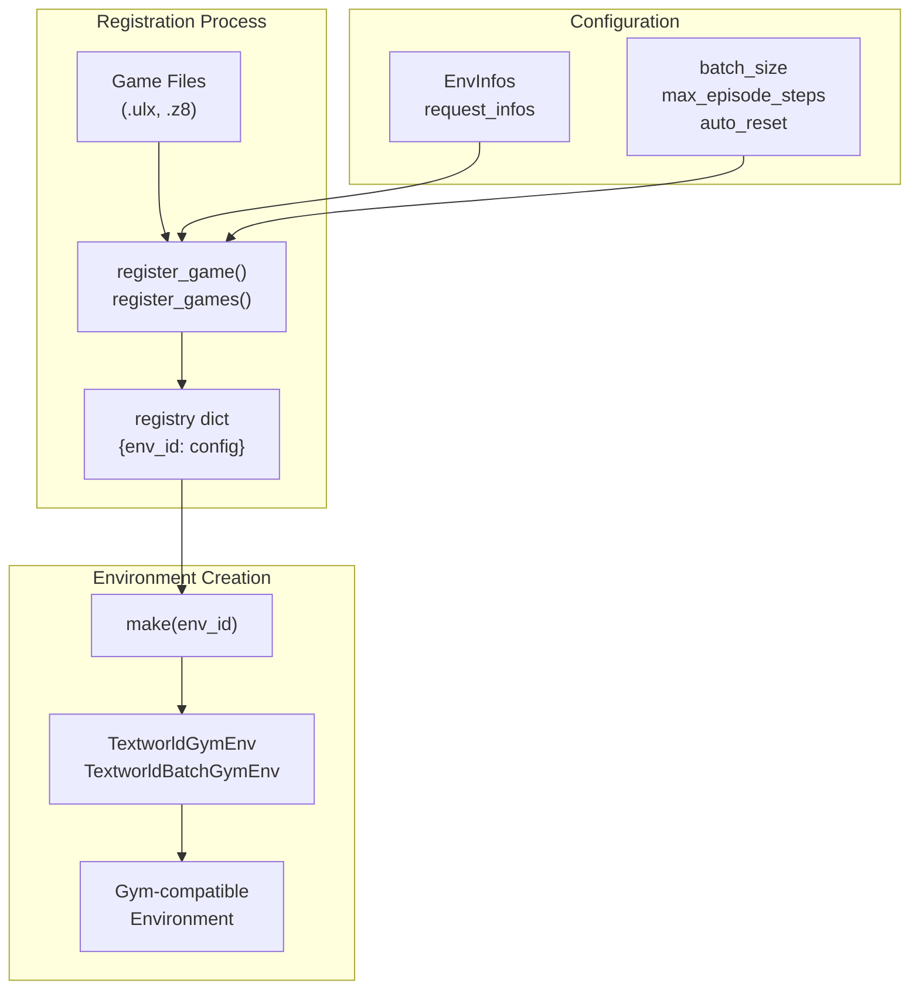
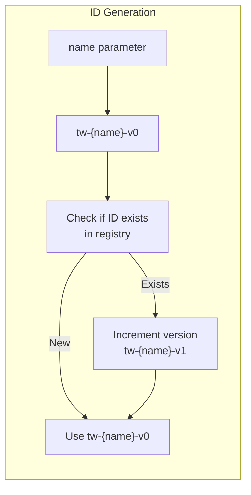
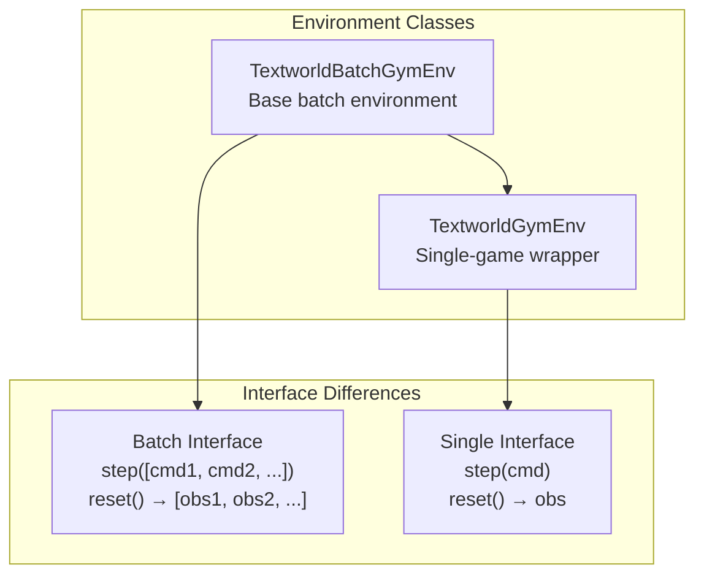
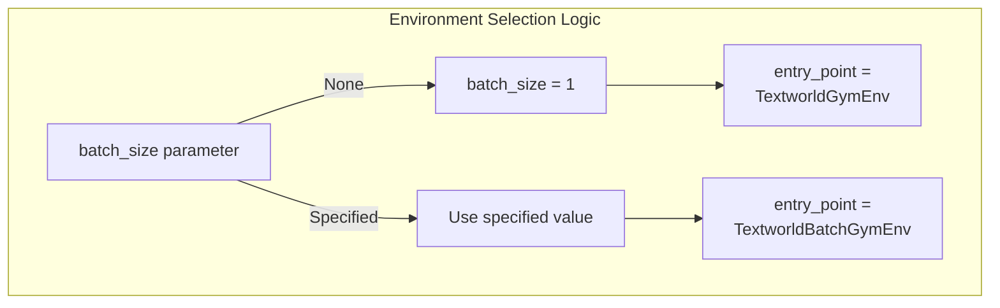
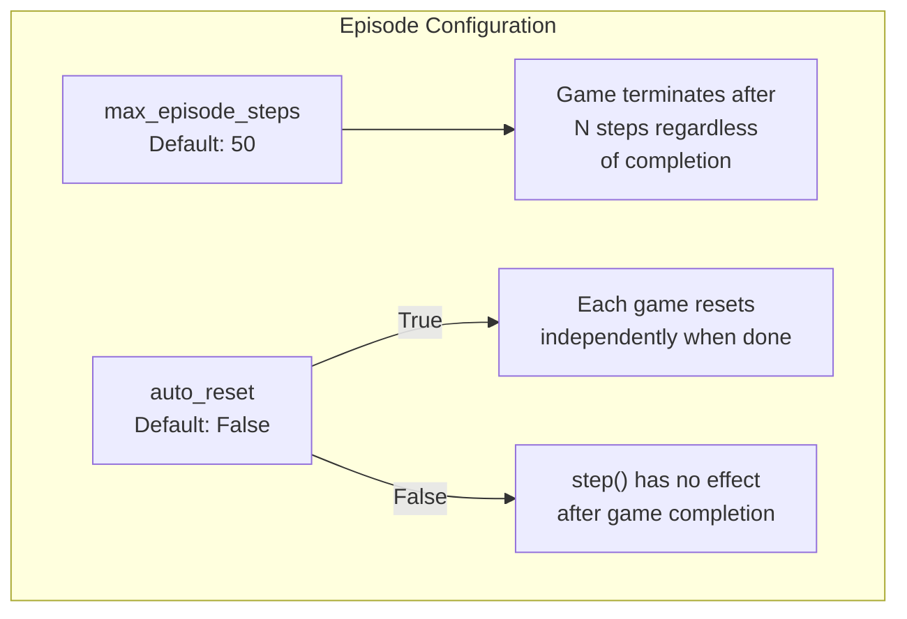
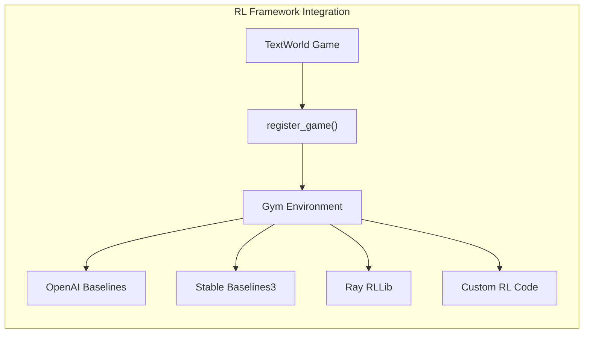

<!-- source: DeepWiki mcp.deepwiki.com · repo microsoft/TextWorld · page 6.1 Gym Integration · fetched 2026-10-26 -->

# Gym Integration

<details>
<summary>Relevant source files</summary>

The following files were used as context for generating this wiki page:

- [scripts/benchmark_framework.py](scripts/benchmark_framework.py)
- [textworld/gym/__init__.py](textworld/gym/__init__.py)
- [textworld/gym/envs/textworld.py](textworld/gym/envs/textworld.py)
- [textworld/gym/utils.py](textworld/gym/utils.py)

</details>


This document explains how TextWorld integrates with OpenAI Gym to provide a standardized reinforcement learning interface. The gym integration allows TextWorld games to be used seamlessly with existing RL frameworks and baselines that expect Gym-compatible environments.

For information about the underlying environment backends that power these Gym environments, see [Environment Backends](#5.1). For details about batch processing capabilities, see [Batch Processing](#6.2).

## Purpose and Scope

The TextWorld gym integration provides OpenAI Gym-compatible wrappers around TextWorld environments, enabling:

- **Standard RL Interface**: Environments follow the standard `reset()` and `step()` API expected by RL frameworks
- **Game Registration System**: A registry mechanism for managing multiple game configurations
- **Batch Processing Support**: Ability to run multiple games in parallel for efficient training
- **Information Customization**: Fine-grained control over what information environments provide to agents
- **Automatic Lifecycle Management**: Handling of game resets, episode limits, and resource cleanup

## Registration System

TextWorld uses a registration system similar to OpenAI Gym's approach, where games are registered with unique identifiers and can be instantiated later.

### Registry Architecture



Sources: [textworld/gym/utils.py:7-31]()

### Core Registration Functions

The registration system centers around two main functions that populate the global `registry` dictionary:

**Single Game Registration**
```python
register_game(gamefile, request_infos=None, batch_size=None, 
              max_episode_steps=50, name="", **kwargs)
```

**Multiple Game Registration**  
```python
register_games(gamefiles, request_infos=None, batch_size=None,
               max_episode_steps=50, asynchronous=True, **kwargs)
```

Both functions return an environment ID (e.g., `"tw-v0"`, `"tw-custom-v1"`) that can be used with the `make()` function.

Sources: [textworld/gym/utils.py:34-199]()

### Environment ID Management

The registration system automatically handles version numbering to prevent conflicts:



Sources: [textworld/gym/utils.py:96-102]()

## Environment Classes

TextWorld provides two main Gym environment classes that handle different usage patterns:

### Class Hierarchy



Sources: [textworld/gym/envs/textworld.py:11-66]()

### TextworldGymEnv

The `TextworldGymEnv` class provides a standard single-environment interface by wrapping the batch environment and unpacking results:

**Reset Method**
- Returns `(observation, info)` instead of `([observation], {key: [value]})`
- Extracts first element from batch results

**Step Method**  
- Takes single command instead of command list
- Returns `(observation, score, done, info)` with scalar values
- Wraps single command in list for batch environment, then unpacks results

Sources: [textworld/gym/envs/textworld.py:37-66]()

### Automatic Environment Selection

The registration system automatically chooses the appropriate environment class based on batch configuration:



Sources: [textworld/gym/utils.py:104-107]()

## Configuration Options

### Information Control with EnvInfos

The `request_infos` parameter accepts an `EnvInfos` object that controls what information the environment provides:

| Information Type | Purpose | Usage |
|-----------------|---------|-------|
| `description` | Current location description | Scene understanding |
| `inventory` | Player's current items | State tracking |
| `admissible_commands` | Valid actions in current state | Action space pruning |
| `intermediate_reward` | Step-by-step reward signals | Dense reward training |
| `extras` | Custom game metadata | Domain-specific information |

Sources: [textworld/gym/utils.py:47-53](), [textworld/gym/utils.py:137-142]()

### Episode Management Options



Sources: [textworld/gym/utils.py:62-68](), [textworld/gym/utils.py:152-155]()

### Batch Processing Configuration

For environments with `batch_size > 1`:

| Parameter | Effect | Default |
|-----------|--------|---------|
| `asynchronous` | Parallel vs sequential execution | `True` |
| `auto_reset` | Independent game lifecycle management | `False` |
| `batch_size` | Number of simultaneous games | `1` |

Sources: [textworld/gym/utils.py:67-69]()

## Usage Examples

### Basic Single Game Registration

```python
import gym
import textworld.gym
from textworld import EnvInfos

# Configure information requests
request_infos = EnvInfos(description=True, inventory=True, 
                        admissible_commands=True)

# Register game
env_id = textworld.gym.register_game(
    gamefile="path/to/game.z8",
    request_infos=request_infos,
    max_episode_steps=100,
    name="custom"
)

# Create environment
env = gym.make(env_id)  # or textworld.gym.make(env_id)
```

Sources: [textworld/gym/utils.py:171-189]()

### Batch Environment Usage

The registration and usage pattern for batch environments shown in the benchmark framework:

```python
# Register batch environment
infos = textworld.EnvInfos(admissible_commands=True)
env_id = textworld.gym.register_games(
    gamefiles=[gamefile] * batch_size, 
    infos, 
    batch_size
)
env = textworld.gym.make(env_id)

# Use batch interface
obs, infos = env.reset()  # Returns lists
commands = [select_command(info) for info in infos["admissible_commands"]]
obs, scores, dones, infos = env.step(commands)  # Takes list, returns lists
```

Sources: [scripts/benchmark_framework.py:92-119]()

### Integration with RL Frameworks

The gym integration enables direct usage with popular RL libraries:



Sources: [textworld/gym/utils.py:158-166](), [scripts/benchmark_framework.py:92-96]()

The standardized interface ensures compatibility with any framework expecting OpenAI Gym environments, enabling TextWorld games to be used as drop-in replacements for other RL environments.

---

