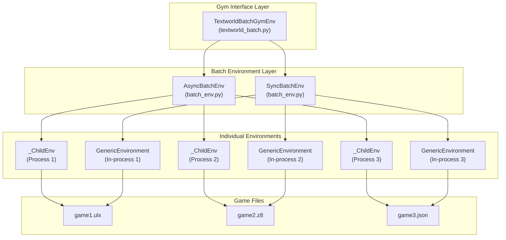
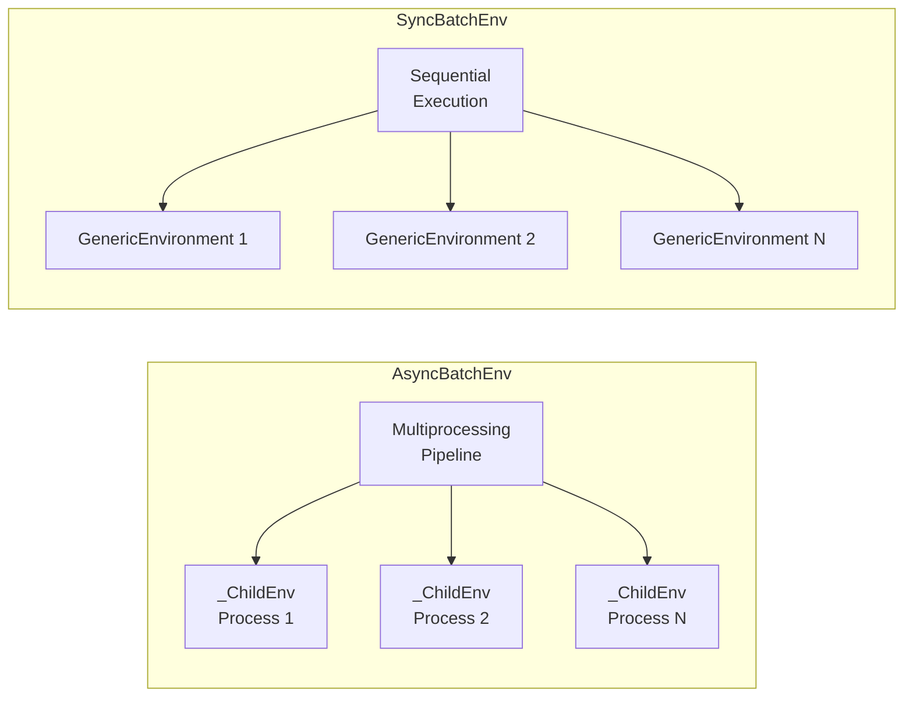
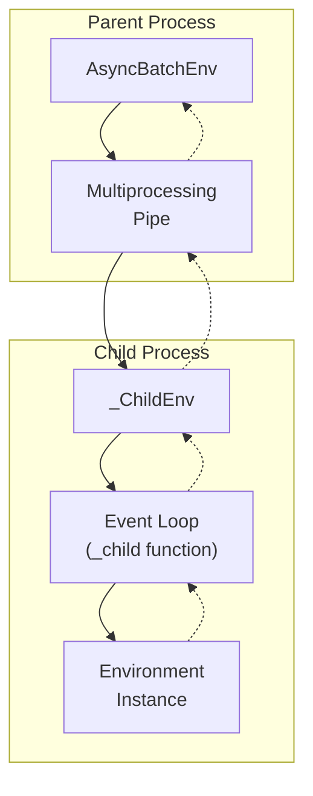
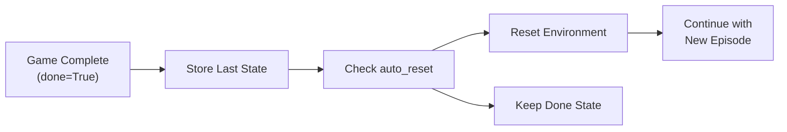

<!-- source: DeepWiki mcp.deepwiki.com · repo microsoft/TextWorld · page 6.2 Batch Processing · fetched 2026-10-26 -->

# Batch Processing

<details>
<summary>Relevant source files</summary>

The following files were used as context for generating this wiki page:

- [textworld/envs/batch/batch_env.py](textworld/envs/batch/batch_env.py)
- [textworld/envs/batch/tests/test_batch_env.py](textworld/envs/batch/tests/test_batch_env.py)
- [textworld/gym/envs/textworld_batch.py](textworld/gym/envs/textworld_batch.py)
- [textworld/gym/tests/test_textworld_gym.py](textworld/gym/tests/test_textworld_gym.py)

</details>


## Purpose and Scope

The batch processing system enables parallel execution of multiple TextWorld games simultaneously, providing efficient training and evaluation environments for reinforcement learning agents. This system allows running multiple game instances in either synchronous or asynchronous modes, with support for automatic resetting and information aggregation across the batch.

For information about the basic Gym integration without batch processing, see [Gym Integration](#6.1). For details about different agent implementations, see [Agent Types](#6.3).

## Architecture Overview

The batch processing system consists of multiple layers that coordinate parallel game execution:



**Sources:** [textworld/gym/envs/textworld_batch.py:1-211](), [textworld/envs/batch/batch_env.py:1-285]()

## Core Components

### TextworldBatchGymEnv

The `TextworldBatchGymEnv` class serves as the primary interface for batch processing, implementing the Gym environment API for multiple games:

| Parameter | Type | Description |
|-----------|------|-------------|
| `gamefiles` | `List[str]` | Paths to game files (*.ulx, *.z[1-8], *.json) |
| `request_infos` | `EnvInfos` | Information to be returned by environments |
| `batch_size` | `int` | Number of games to run simultaneously |
| `asynchronous` | `bool` | Whether to use parallel processing |
| `auto_reset` | `bool` | Whether games reset automatically when done |
| `max_episode_steps` | `int` | Maximum steps per episode |

**Sources:** [textworld/gym/envs/textworld_batch.py:34-82]()

### Batch Environment Implementations

The system provides two execution strategies:



**Sources:** [textworld/envs/batch/batch_env.py:93-199](), [textworld/envs/batch/batch_env.py:201-285]()

### Child Process Management

For asynchronous execution, the `_ChildEnv` wrapper manages individual game processes:



**Sources:** [textworld/envs/batch/batch_env.py:16-91]()

## Execution Modes

### Asynchronous Mode

In asynchronous mode (`asynchronous=True`), games run in separate processes using multiprocessing:

- Each game runs in its own process via `_ChildEnv`
- Commands are sent through pipes to child processes
- Results are collected asynchronously
- Better performance for CPU-intensive workloads

**Sources:** [textworld/envs/batch/batch_env.py:93-199]()

### Synchronous Mode

In synchronous mode (`asynchronous=False`), games run sequentially in the same process:

- All games share the same process
- Commands are executed one after another
- Simpler debugging and resource management
- Lower overhead for simple workloads

**Sources:** [textworld/envs/batch/batch_env.py:201-285]()

## Key Features

### Auto-Reset Functionality

When `auto_reset=True`, completed games automatically reset on the next step:



**Sources:** [textworld/envs/batch/batch_env.py:164-171](), [textworld/envs/batch/batch_env.py:262-269]()

### Information Aggregation

The batch system aggregates information from individual environments using the `_list_of_dicts_to_dict_of_lists` function:

```python
# Converts: [{"key1": val1}, {"key1": val2}]
# To: {"key1": [val1, val2]}
```

**Sources:** [textworld/envs/batch/batch_env.py:10-14]()

### Seeding and Randomization

The batch system handles seeding for reproducible experiments:

- Games are shuffled using `shuffled_cycle` iterator
- Each environment gets a unique seed for decorrelation
- Supports both single seed and per-environment seed lists

**Sources:** [textworld/gym/envs/textworld_batch.py:82-101](), [textworld/envs/batch/batch_env.py:120-131]()

## Integration with Gym Interface

The batch environment maintains compatibility with the OpenAI Gym interface while extending it for multiple games:

| Method | Single Game | Batch Game |
|--------|-------------|------------|
| `reset()` | Returns `(obs, info)` | Returns `(obs_list, info_dict)` |
| `step(action)` | Single action | List of actions |
| `render()` | Single rendering | List of renderings |

**Sources:** [textworld/gym/envs/textworld_batch.py:103-122](), [textworld/gym/envs/textworld_batch.py:133-151]()

## Configuration and Usage

### Registration Example

```python
env_id = textworld.gym.register_games(
    gamefiles=["game1.ulx", "game2.z8"],
    request_infos=EnvInfos(inventory=True, description=True),
    batch_size=4,
    asynchronous=True,
    auto_reset=True,
    max_episode_steps=50,
    name="my-batch-env"
)
```

### Execution Example

```python
env = textworld.gym.make(env_id)
obs, infos = env.reset()  # Returns lists
actions = ["go north", "take key", "look", "wait"]
obs, scores, dones, infos = env.step(actions)  # Batch step
```

**Sources:** [textworld/gym/tests/test_textworld_gym.py:122-156](), [textworld/gym/tests/test_textworld_gym.py:157-191]()

### Performance Considerations

- Use `asynchronous=True` for CPU-intensive workloads
- Use `auto_reset=True` for continuous training
- Larger batch sizes improve throughput but increase memory usage
- Consider `max_episode_steps` to prevent infinite episodes

**Sources:** [textworld/gym/envs/textworld_batch.py:36-82]()

---

