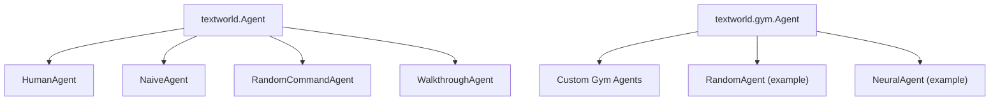
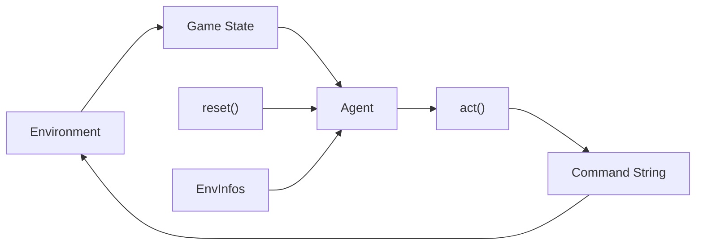
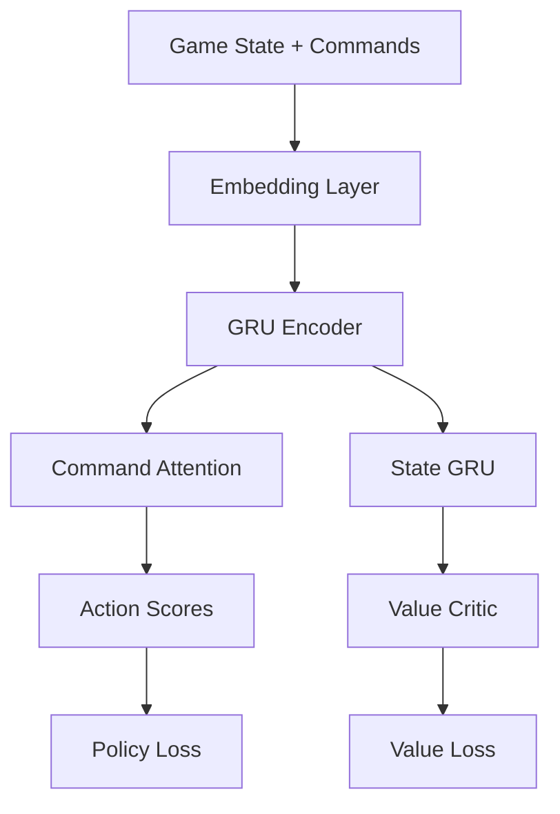
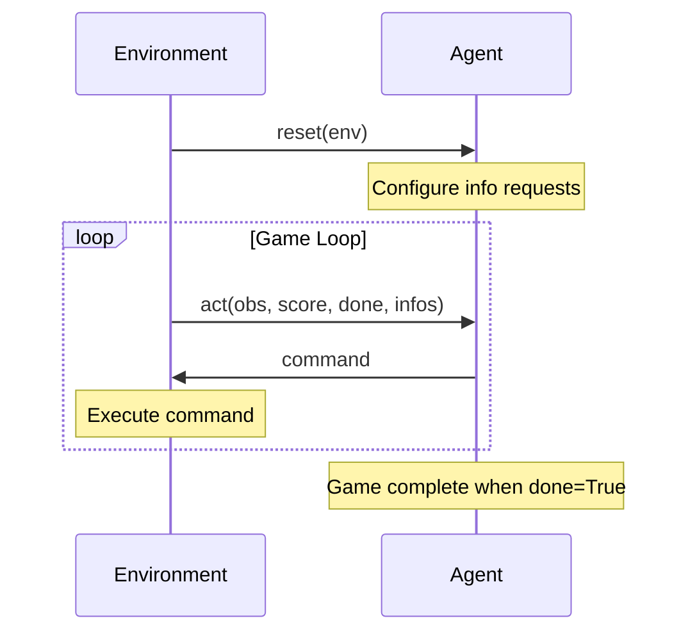

<!-- source: DeepWiki mcp.deepwiki.com · repo microsoft/TextWorld · page 6.3 Agent Types · fetched 2026-10-26 -->

# Agent Types

<details>
<summary>Relevant source files</summary>

The following files were used as context for generating this wiki page:

- [notebooks/Building a simple agent.ipynb](notebooks/Building a simple agent.ipynb)
- [notebooks/Handcrafting a game.ipynb](notebooks/Handcrafting a game.ipynb)
- [notebooks/Playing TextWorld generated games with OpenAI Gym.ipynb](notebooks/Playing TextWorld generated games with OpenAI Gym.ipynb)
- [notebooks/Playing text-based games with TextWorld.ipynb](notebooks/Playing text-based games with TextWorld.ipynb)
- [scripts/tw-play](scripts/tw-play)
- [textworld/agents/human.py](textworld/agents/human.py)
- [textworld/envs/wrappers/__init__.py](textworld/envs/wrappers/__init__.py)
- [textworld/envs/wrappers/recorder.py](textworld/envs/wrappers/recorder.py)
- [textworld/envs/wrappers/tests/test_viewer.py](textworld/envs/wrappers/tests/test_viewer.py)

</details>


This document provides an overview of the different agent implementations available in TextWorld and explains how to create custom agents. For information about integrating agents with TextWorld environments through the Gym API, see [Gym Integration](#6.1). For details on running multiple agents in parallel, see [Batch Processing](#6.2).

## Purpose and Scope

TextWorld provides several built-in agent types for interacting with text-based games, from simple random agents to sophisticated human interfaces. This page covers the agent hierarchy, built-in implementations, and guidelines for creating custom agents. All agents follow a common interface that allows them to observe game states and select actions.

## Agent Architecture

### Agent Base Classes

TextWorld provides two main base classes for agents:



Sources: [scripts/tw-play:45-52](), [notebooks/Building a simple agent.ipynb:174-185](), [textworld/agents/human.py:26]()

### Agent Interface Flow



Sources: [textworld/agents/human.py:35-44](), [notebooks/Building a simple agent.ipynb:184-185]()

## Built-in Agent Types

### HumanAgent

The `HumanAgent` provides an interactive interface for human players with optional autocompletion and oracle assistance.

| Feature | Description |
|---------|-------------|
| **Interactive Input** | Prompts user for commands via terminal |
| **Autocompletion** | Uses admissible commands for command completion |
| **Oracle Mode** | Shows optimal policy and intermediate rewards |
| **History** | Command history with search (when prompt_toolkit available) |

Key methods:
- `reset(env)`: Configures environment information requests
- `act(game_state, reward, done)`: Prompts user for input and returns command

Sources: [textworld/agents/human.py:26-69](), [scripts/tw-play:50]()

### NaiveAgent (Random Agent)

A simple agent that selects actions randomly from admissible commands.

```python
# Usage in tw-play script
if args.mode == "random":
    agent = textworld.agents.NaiveAgent()
```

Sources: [scripts/tw-play:45-46]()

### RandomCommandAgent

Another random agent variant that selects from available commands randomly.

```python
# Usage in tw-play script  
if args.mode == "random-cmd":
    agent = textworld.agents.RandomCommandAgent()
```

Sources: [scripts/tw-play:47-48]()

### WalkthroughAgent

An agent that follows a predetermined sequence of optimal commands to solve the game.

```python
# Usage in tw-play script
if args.mode == 'walkthrough':
    agent = textworld.agents.WalkthroughAgent()
```

Sources: [scripts/tw-play:51-52]()

## Creating Custom Agents

### Basic Custom Agent

To create a custom agent, extend `textworld.gym.Agent` and implement the required methods:

```python
class RandomAgent(textworld.gym.Agent):
    def __init__(self, seed=1234):
        self.seed = seed
        self.rng = np.random.RandomState(self.seed)

    @property
    def infos_to_request(self) -> textworld.EnvInfos:
        return textworld.EnvInfos(admissible_commands=True)

    def act(self, obs: str, score: int, done: bool, infos: Mapping[str, Any]) -> str:
        return self.rng.choice(infos["admissible_commands"])
```

Sources: [notebooks/Building a simple agent.ipynb:174-185]()

### Information Requests

Agents can request additional information from the environment through `EnvInfos`:

| Information Type | Description |
|------------------|-------------|
| `admissible_commands` | Commands guaranteed to be understood |
| `description` | Current room description |
| `inventory` | Player's inventory |
| `won`/`lost` | Game completion status |
| `facts` | Underlying game state facts |
| `policy_commands` | Oracle optimal actions |

Sources: [notebooks/Building a simple agent.ipynb:181-182](), [textworld/agents/human.py:40-44]()

### Neural Agent Example

Advanced agents can implement learning algorithms. The tutorial provides a complete neural agent implementation:



The neural agent includes:
- Text tokenization and embedding
- GRU-based encoding for observations and commands  
- Attention mechanism for command selection
- Actor-critic training with policy gradients

Sources: [notebooks/Building a simple agent.ipynb:384-535]()

### Agent Lifecycle



Sources: [textworld/agents/human.py:35-69](), [notebooks/Building a simple agent.ipynb:459-535]()

## Command Line Integration

The `tw-play` script demonstrates how different agent types are instantiated and used:

```bash
# Human player with oracle hints
tw-play game.z8 --mode human --hint

# Random agent  
tw-play game.z8 --mode random

# Walkthrough agent
tw-play game.z8 --mode walkthrough
```

The script handles agent creation, environment setup, and the main game loop:

```python
agent.reset(env)
game_state = env.reset()

for _ in range(args.max_steps) if args.max_steps > 0 else itertools.count():
    command = agent.act(game_state, reward, done)
    game_state, reward, done = env.step(command)
    if done:
        break
```

Sources: [scripts/tw-play:54-78]()

## Best Practices

### Agent Implementation Guidelines

1. **Information Requests**: Only request information your agent actually uses to minimize overhead
2. **Error Handling**: Handle cases where requested information might not be available
3. **State Management**: Reset any internal state when `reset()` is called
4. **Command Validation**: Consider validating commands against admissible actions

### Performance Considerations

- Use `admissible_commands` to avoid invalid actions
- Request minimal information to reduce processing overhead
- Implement efficient tokenization for text-based agents
- Consider batch processing for training scenarios

Sources: [notebooks/Building a simple agent.ipynb:174-185](), [textworld/agents/human.py:35-44]()

---

