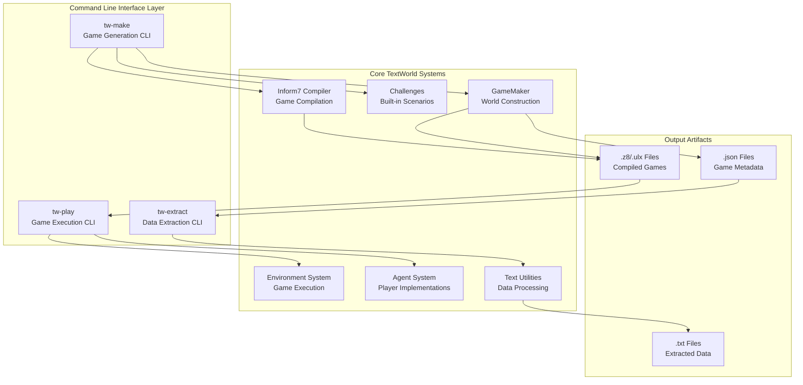
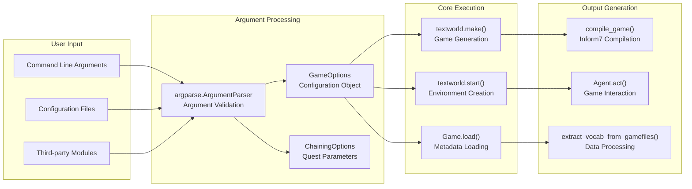
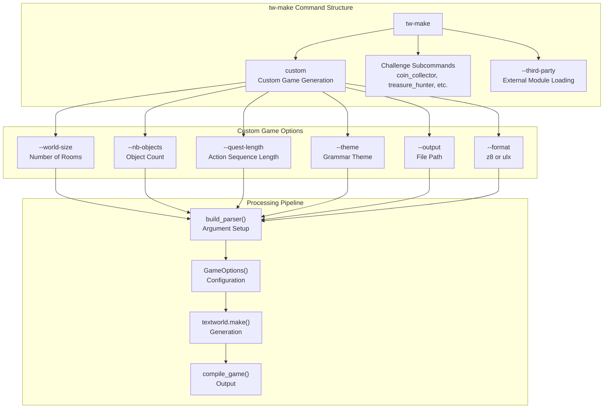
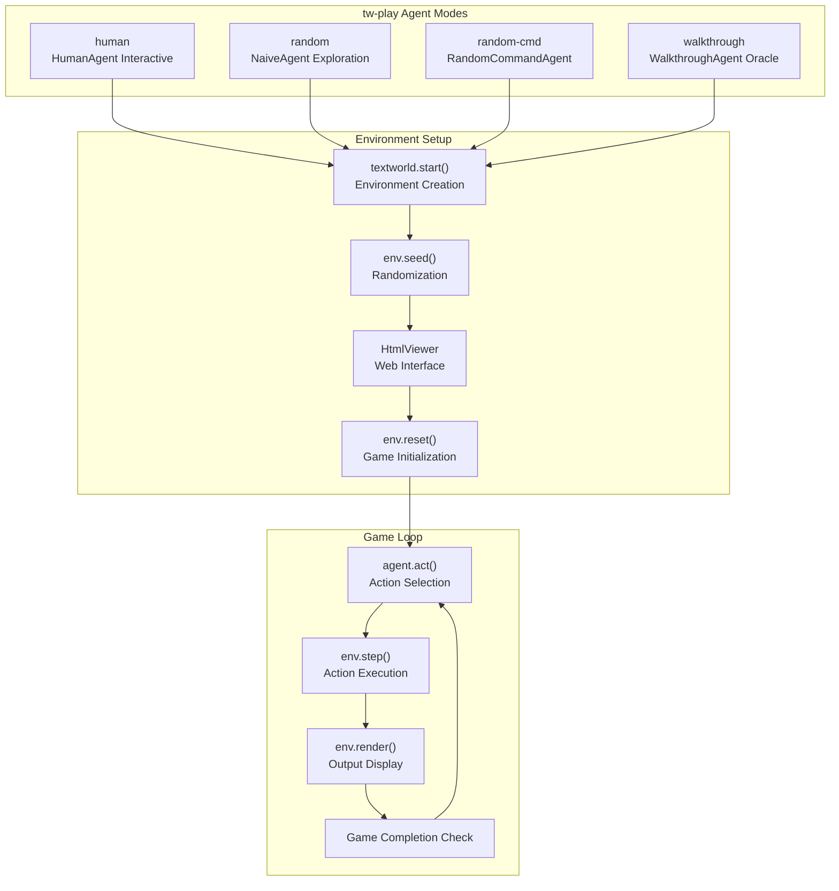
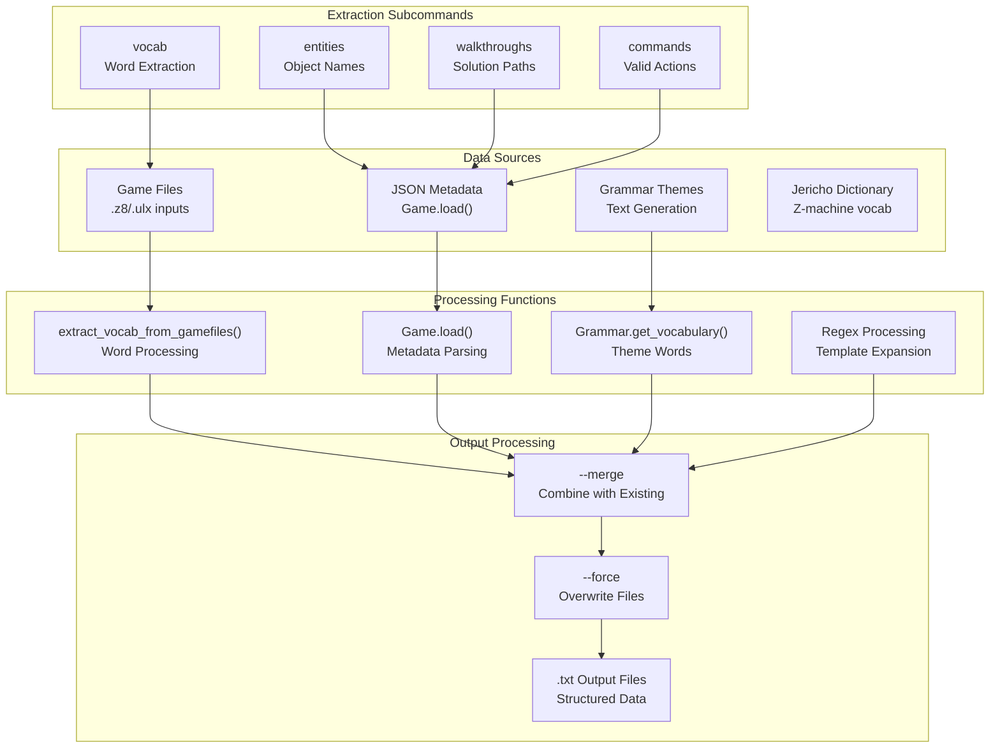
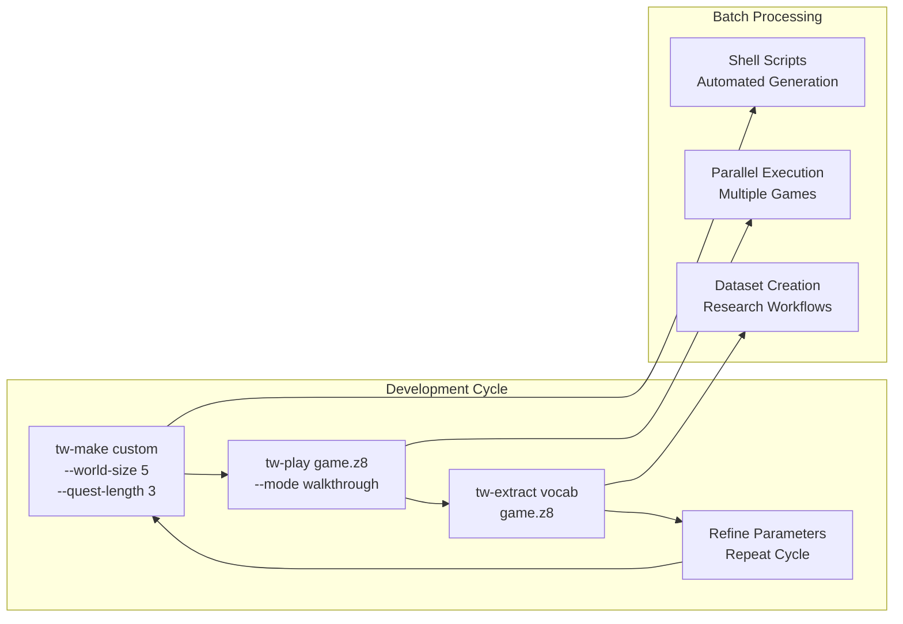

<!-- source: DeepWiki mcp.deepwiki.com · repo microsoft/TextWorld · page 7 Command Line Tools · fetched 2026-10-26 -->

# Command Line Tools

Relevant source files

The following files were used as context for generating this wiki page:

- [.github/workflows/pep8.yml](.github/workflows/pep8.yml)
- [scripts/tw-extract](scripts/tw-extract)
- [scripts/tw-make](scripts/tw-make)
- [scripts/tw-play](scripts/tw-play)
- [tests/test_make_game.py](tests/test_make_game.py)
- [tests/test_tw-extract.py](tests/test_tw-extract.py)
- [tests/test_tw-play.py](tests/test_tw-play.py)
- [textworld/agents/human.py](textworld/agents/human.py)
- [textworld/envs/wrappers/__init__.py](textworld/envs/wrappers/__init__.py)
- [textworld/envs/wrappers/recorder.py](textworld/envs/wrappers/recorder.py)
- [textworld/envs/wrappers/tests/test_viewer.py](textworld/envs/wrappers/tests/test_viewer.py)
- [textworld/generator/__init__.py](textworld/generator/__init__.py)
- [textworld/generator/chaining.py](textworld/generator/chaining.py)
- [textworld/generator/tests/test_chaining.py](textworld/generator/tests/test_chaining.py)
- [textworld/generator/tests/test_logger.py](textworld/generator/tests/test_logger.py)
- [textworld/generator/tests/test_making_a_game.py](textworld/generator/tests/test_making_a_game.py)
- [textworld/text_utils.py](textworld/text_utils.py)
- [tox.ini](tox.ini)

TextWorld provides several command-line utilities that serve as the primary interface for generating, playing, and analyzing text-based games. These tools abstract the underlying TextWorld API into convenient command-line interfaces suitable for scripting, experimentation, and automated workflows.

For information about the underlying game generation system, see [Game Generation](#4). For details about environment execution and agent interfaces, see [Game Environments](#5) and [Agent Interface](#6).

## Architecture Overview

The command-line tools form a bridge between user workflows and TextWorld's core systems. Each tool focuses on a specific aspect of the TextWorld ecosystem: game creation, game execution, and data extraction.

Sources: [scripts/tw-make:1-246](), [scripts/tw-play:1-84](), [scripts/tw-extract:1-172]()

## Command Line Tool Integration Flow

The following diagram shows how command-line arguments flow through the TextWorld system to produce outputs:

Sources: [scripts/tw-make:148-246](), [scripts/tw-play:37-83](), [scripts/tw-extract:68-169]()

## tw-make: Game Generation Tool

The `tw-make` command generates TextWorld games with customizable parameters. It supports both custom game creation and built-in challenge scenarios.

### Command Structure

Sources: [scripts/tw-make:46-146](), [scripts/tw-make:163-217]()

### Key Implementation Details

The tool implements sophisticated argument parsing through the `build_parser()` function at [scripts/tw-make:46-146](). It creates separate subparsers for custom games and each registered challenge:

- **Custom games**: Configured through `GameOptions` and `ChainingOptions` objects
- **Challenge games**: Use challenge-specific make functions from `textworld.challenges.CHALLENGES`
- **Third-party support**: Dynamic module loading via `_maybe_load_third_party_module()` at [scripts/tw-make:31-44]()

The generation process handles error cases like `QuestGenerationError` and `MissingTextGrammar` with informative error messages at [scripts/tw-make:200-210]().

## tw-play: Game Execution Tool

The `tw-play` command provides an interface for playing TextWorld games using different agent implementations.

### Agent Mode Architecture

Sources: [scripts/tw-play:42-79](), [scripts/tw-play:14-34]()

### Agent Implementation Details

Each agent mode corresponds to a specific class from `textworld.agents`:

- `HumanAgent`: Interactive play with optional oracle hints at [scripts/tw-play:50]()
- `NaiveAgent`: Random action selection at [scripts/tw-play:46]()
- `RandomCommandAgent`: Random command generation at [scripts/tw-play:48]()  
- `WalkthroughAgent`: Optimal action sequence execution at [scripts/tw-play:52]()

The tool supports optional web visualization through `HtmlViewer` wrapper at [scripts/tw-play:56-57]().

## tw-extract: Data Extraction Tool

The `tw-extract` command extracts various types of information from TextWorld games for analysis and dataset creation.

### Extraction Pipeline

Sources: [scripts/tw-extract:68-169](), [scripts/tw-extract:18-65]()

### Extraction Implementation

Each subcommand implements specific extraction logic:

- **Vocabulary**: Uses `extract_vocab_from_gamefiles()` from `textworld.text_utils` at [scripts/tw-extract:92]()
- **Entities**: Extracts `game.objects_names` from loaded JSON metadata at [scripts/tw-extract:86]()
- **Walkthroughs**: Retrieves solution sequences from `game.metadata["walkthrough"]` at [scripts/tw-extract:111]()
- **Commands**: Expands command templates using object type hierarchies at [scripts/tw-extract:131-141]()

The tool supports merging new extractions with existing files and provides verbose output for analysis workflows.

## Usage Patterns and Workflows

### Typical Game Development Workflow

### Integration with TextWorld API

The command-line tools serve as high-level interfaces to the core TextWorld API, providing convenient access to functionality that can also be accessed programmatically. Each tool corresponds to specific API entry points:

| Tool | Primary API | Configuration | Output |
|------|-------------|---------------|---------|
| `tw-make` | `textworld.make()` | `GameOptions` | `.z8/.ulx + .json` |
| `tw-play` | `textworld.start()` | Agent classes | Interactive session |
| `tw-extract` | `Game.load()` | Extraction type | `.txt` data files |

Sources: [scripts/tw-make:199](), [scripts/tw-play:42](), [scripts/tw-extract:85](), [textworld/text_utils.py:57-62]()

---

