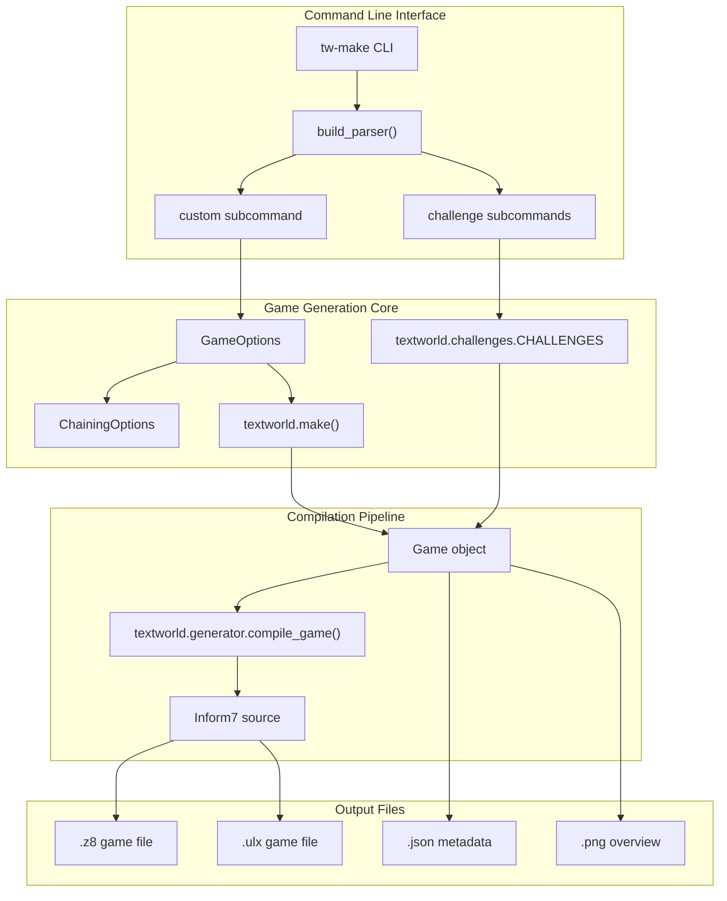
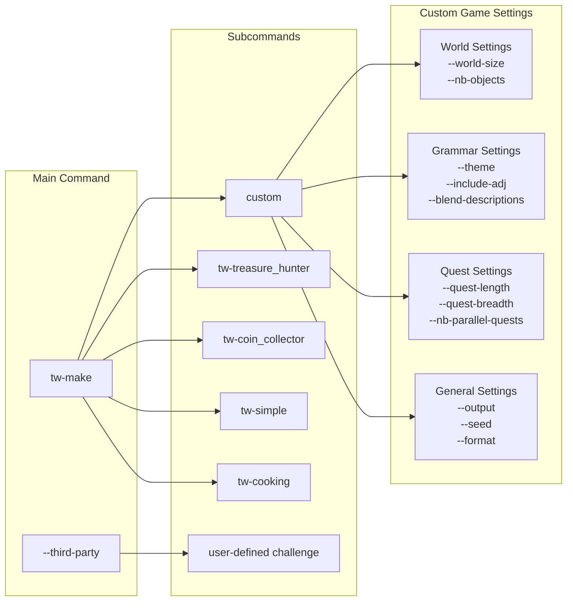
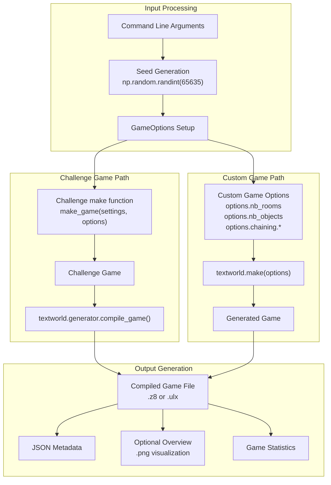
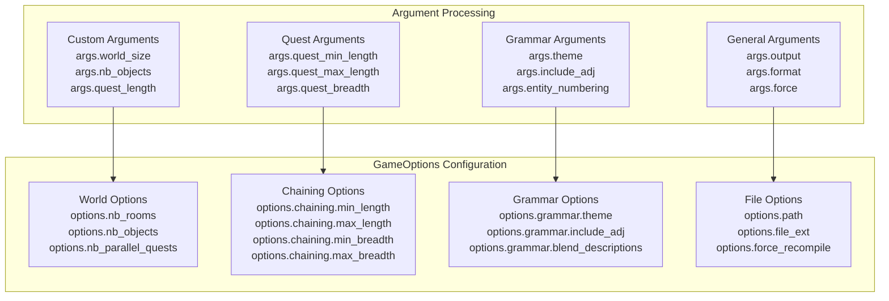
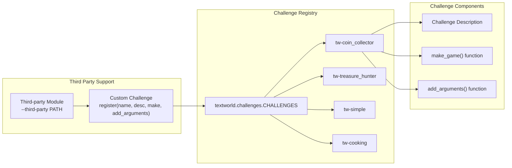
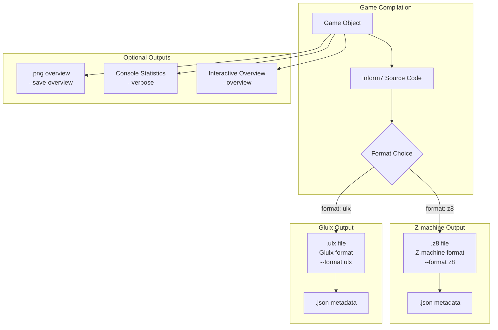
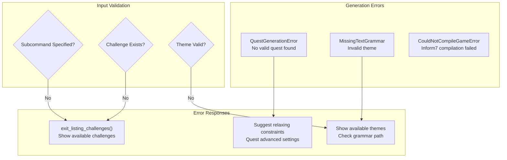

<!-- source: DeepWiki mcp.deepwiki.com · repo microsoft/TextWorld · page 7.1 tw-make · fetched 2026-10-26 -->

# tw-make

Relevant source files

The following files were used as context for generating this wiki page:

- [docs/source/textworld.challenges.rst](docs/source/textworld.challenges.rst)
- [scripts/tw-make](scripts/tw-make)
- [tests/test_tw-make.py](tests/test_tw-make.py)
- [textworld/challenges/__init__.py](textworld/challenges/__init__.py)
- [textworld/challenges/registration.py](textworld/challenges/registration.py)
- [textworld/generator/__init__.py](textworld/generator/__init__.py)
- [textworld/generator/chaining.py](textworld/generator/chaining.py)
- [textworld/generator/tests/test_chaining.py](textworld/generator/tests/test_chaining.py)

`tw-make` is TextWorld's primary command-line tool for generating interactive fiction games. It provides a unified interface for creating both custom games with user-defined parameters and predefined challenge scenarios. The tool handles the complete pipeline from game specification to compiled playable files in Z-machine or Glulx formats.

For information about playing generated games, see [tw-play](#7.2). For extracting data from games, see [tw-extract](#7.3). For the underlying game generation system, see [Game Generation](#4).

## Architecture Overview

`tw-make` serves as the command-line interface to TextWorld's game generation pipeline, orchestrating the creation of game worlds, quests, and text content before compiling them into playable formats.

Sources: [scripts/tw-make:46-217](), [textworld/generator/__init__.py:173-256]()

## Command Structure

`tw-make` uses a subcommand-based interface where users specify either `custom` for user-defined games or a challenge name for predefined scenarios.

Sources: [scripts/tw-make:46-146](), [textworld/challenges/__init__.py:1-9]()

## Game Generation Pipeline

The tool orchestrates a multi-stage pipeline that transforms command-line arguments into playable game files through several key processing stages.

Sources: [scripts/tw-make:148-246](), [textworld/generator/__init__.py:214-256]()

## Configuration Categories

`tw-make` organizes configuration options into distinct categories, each controlling different aspects of game generation.

| Category | Options | Purpose |
|----------|---------|---------|
| **World Settings** | `--world-size`, `--nb-objects` | Control the physical game world size and object count |
| **Grammar Settings** | `--theme`, `--include-adj`, `--blend-descriptions`, `--ambiguous-instructions` | Configure text generation and natural language style |
| **Quest Settings** | `--quest-length`, `--quest-breadth`, `--nb-parallel-quests` | Define quest structure and complexity |
| **Quest Advanced** | `--quest-min-length`, `--quest-max-length`, `--quest-min-depth`, `--quest-max-depth` | Fine-tune quest generation constraints |
| **General Settings** | `--output`, `--seed`, `--format`, `--force`, `--overview` | Control output generation and compilation |

Sources: [scripts/tw-make:56-133](), [scripts/tw-make:163-197]()

## Challenge System Integration

The tool integrates with TextWorld's challenge registry to provide access to predefined game scenarios with specialized generation logic.

Sources: [scripts/tw-make:31-44](), [scripts/tw-make:135-141](), [scripts/tw-make:212-217](), [textworld/challenges/registration.py:1-38]()

## Output Files and Formats

`tw-make` generates multiple output files depending on the specified options and format requirements.

| File Type | Extension | Purpose |
|-----------|-----------|---------|
| **Game File** | `.z8`, `.ulx` | Compiled playable game in Z-machine or Glulx format |
| **Metadata** | `.json` | Game structure, walkthrough, and metadata for analysis |
| **Overview** | `.png` | Visual representation of game world and quest structure |

Sources: [scripts/tw-make:115-127](), [scripts/tw-make:219-246](), [textworld/generator/__init__.py:230-256]()

## Error Handling and Validation

The tool implements comprehensive error handling for common generation failures and provides informative error messages to guide users.

Sources: [scripts/tw-make:20-28](), [scripts/tw-make:198-210](), [textworld/generator/chaining.py:15-17]()

---

