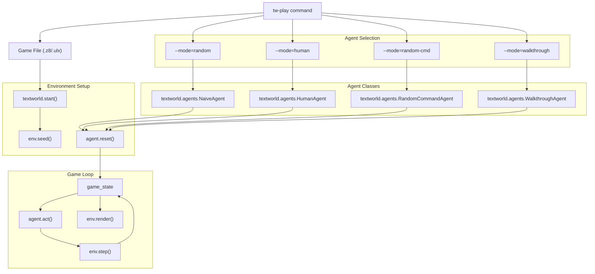
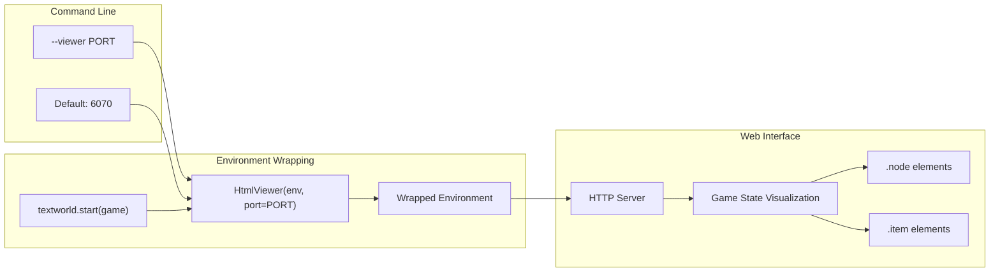
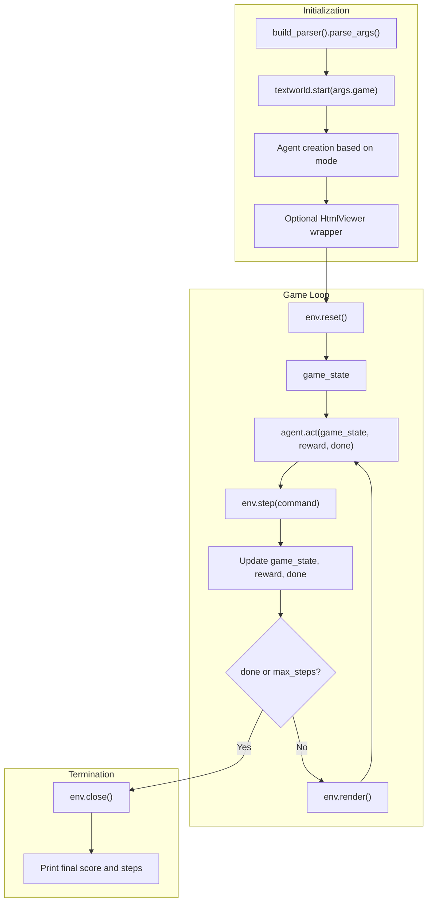
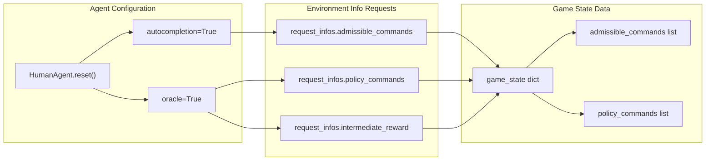

<!-- source: DeepWiki mcp.deepwiki.com · repo microsoft/TextWorld · page 7.2 tw-play · fetched 2026-10-26 -->

# tw-play

Relevant source files

The following files were used as context for generating this wiki page:

- [scripts/tw-play](scripts/tw-play)
- [textworld/agents/human.py](textworld/agents/human.py)
- [textworld/envs/wrappers/__init__.py](textworld/envs/wrappers/__init__.py)
- [textworld/envs/wrappers/recorder.py](textworld/envs/wrappers/recorder.py)
- [textworld/envs/wrappers/tests/test_viewer.py](textworld/envs/wrappers/tests/test_viewer.py)

## Purpose and Scope

The `tw-play` command-line tool provides an interactive interface for playing TextWorld games using various agent types and visualization options. It serves as the primary entry point for human players and automated agents to interact with compiled TextWorld games in `.z8` and `.ulx` formats.

For information about generating games, see [tw-make](#7.1). For environment configuration and wrappers, see [Environment Wrappers](#5.2). For agent implementations, see [Agent Types](#6.3).

## Command-Line Interface

The `tw-play` tool accepts a game file and various configuration options to control gameplay behavior:

| Option | Description | Default | Choices |
|--------|-------------|---------|---------|
| `game` | Game file (.z8 or .ulx) | Required | - |
| `--mode` | Agent type to use | `human` | `random`, `human`, `random-cmd`, `walkthrough` |
| `--seed` | Random seed for game | None | Integer |
| `--max-steps` | Maximum number of steps | 0 (unlimited) | Integer |
| `--viewer` | Start web viewer on port | None | Port number (default: 6070) |
| `--hint` | Display oracle trajectory | False | Boolean flag |
| `-v, --verbose` | Verbose output | False | Boolean flag |
| `-vv, --very-verbose` | Debug information | False | Boolean flag |

Sources: [scripts/tw-play:14-34]()

## Agent Modes and Execution Flow

### tw-play Agent Mode Architecture

Sources: [scripts/tw-play:45-53](), [scripts/tw-play:69-77]()

### Agent Types

#### Human Agent
The `HumanAgent` provides interactive gameplay with optional autocompletion and oracle hints:
- Supports command autocompletion using `prompt_toolkit`
- Can display oracle trajectory with `--hint` flag
- Requests `admissible_commands` and `policy_commands` information

#### Automated Agents
- **NaiveAgent**: Random action selection from admissible commands
- **RandomCommandAgent**: Random command generation 
- **WalkthroughAgent**: Follows predefined walkthrough sequences

Sources: [scripts/tw-play:45-52](), [textworld/agents/human.py:26-69]()

## Web Viewer Integration

### HtmlViewer Wrapper System

The web viewer provides real-time visualization of game state through an HTML interface accessible via web browser. When the `--viewer` option is specified, the environment is wrapped with `HtmlViewer` which starts an HTTP server on the specified port.

Sources: [scripts/tw-play:55-57](), [textworld/envs/wrappers/tests/test_viewer.py:9-47]()

## Game Execution Process

### Main Execution Loop

The execution follows a standard reinforcement learning loop where the agent observes the current game state, selects an action (command), and receives feedback in the form of a new state, reward, and done signal.

Sources: [scripts/tw-play:37-81]()

## Environment Configuration

The tool automatically configures environment information requests based on the selected agent and options:

- **Human Agent**: Requests `admissible_commands` for autocompletion and `policy_commands` for oracle hints
- **Verbose Mode**: Enables rendering after each step
- **Viewer Mode**: Wraps environment with `HtmlViewer` for web-based visualization

### Information Request Flow

Sources: [textworld/agents/human.py:35-44](), [textworld/agents/human.py:56-67]()

## Integration Points

The `tw-play` tool integrates with several TextWorld subsystems:

- **Environment System**: Uses `textworld.start()` to initialize game environments
- **Agent Framework**: Leverages agent classes from `textworld.agents` module  
- **Wrapper System**: Optionally applies `HtmlViewer` and other environment wrappers
- **Information System**: Configures `request_infos` based on agent requirements

This makes `tw-play` a comprehensive interface for testing and demonstrating TextWorld's capabilities across different agent types and visualization modes.

Sources: [scripts/tw-play:10-11](), [textworld/envs/wrappers/__init__.py:1-10]()

---

