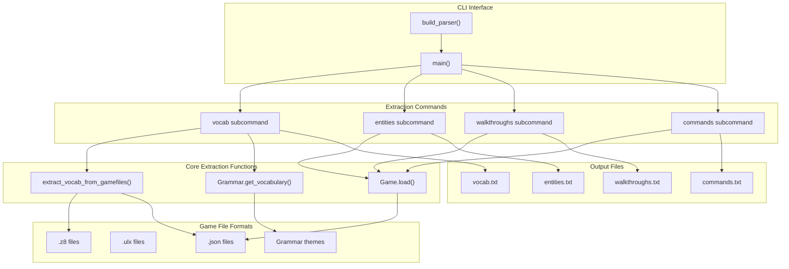
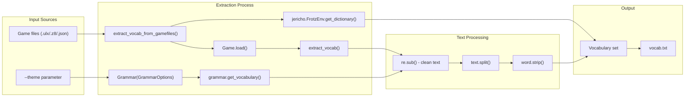
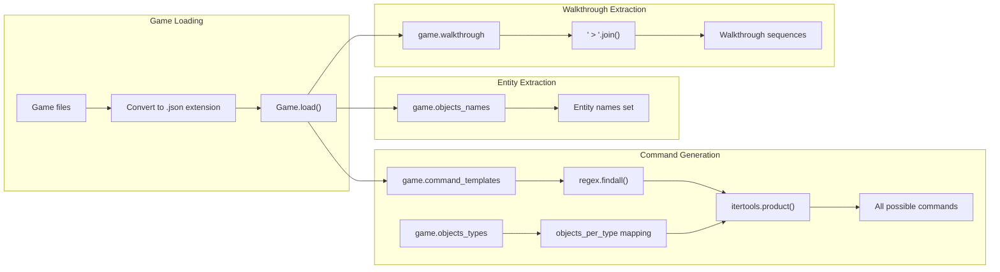
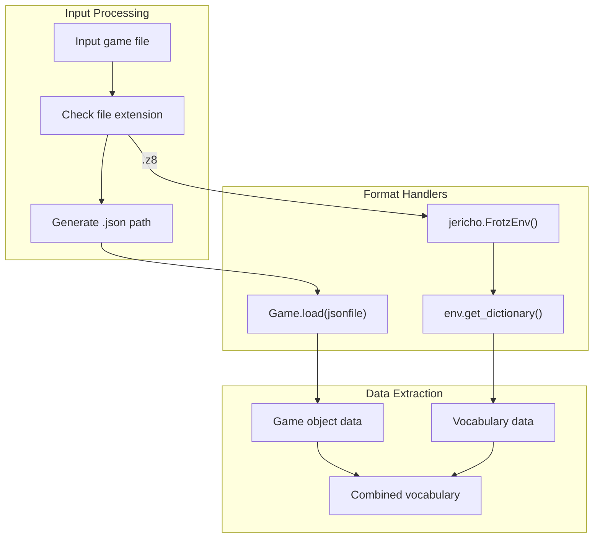
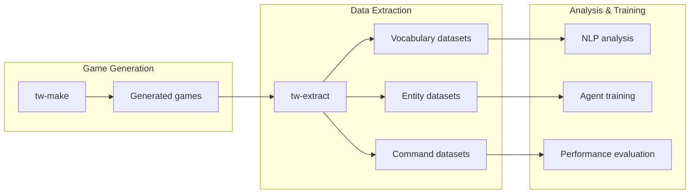

<!-- source: DeepWiki mcp.deepwiki.com · repo microsoft/TextWorld · page 7.3 tw-extract · fetched 2026-10-26 -->

# tw-extract

<details>
<summary>Relevant source files</summary>

The following files were used as context for generating this wiki page:

- [.github/workflows/pep8.yml](.github/workflows/pep8.yml)
- [scripts/tw-extract](scripts/tw-extract)
- [tests/test_make_game.py](tests/test_make_game.py)
- [tests/test_tw-extract.py](tests/test_tw-extract.py)
- [tests/test_tw-play.py](tests/test_tw-play.py)
- [textworld/generator/tests/test_logger.py](textworld/generator/tests/test_logger.py)
- [textworld/generator/tests/test_making_a_game.py](textworld/generator/tests/test_making_a_game.py)
- [textworld/text_utils.py](textworld/text_utils.py)
- [tox.ini](tox.ini)

</details>


`tw-extract` is a command-line utility for extracting structured data from TextWorld game files. It supports extracting vocabularies, entity names, walkthroughs, and possible commands from games in various formats including Z-machine, Glulx, and TextWorld JSON files.

For information about game generation, see [tw-make](#7.1). For information about playing games, see [tw-play](#7.2).

## Purpose and Architecture

The `tw-extract` tool serves as a data mining utility for analyzing TextWorld games and building datasets for natural language processing and reinforcement learning research. It can process multiple game files simultaneously and output aggregated results.

### Tool Architecture



Sources: [scripts/tw-extract:18-65](), [textworld/text_utils.py:57-62]()

## Command Structure

The tool uses a subcommand structure with shared options for file handling and verbosity control.

### General Options

| Option | Description | Default |
|--------|-------------|---------|
| `-f, --force` | Overwrite existing output files | False |
| `--merge` | Merge with existing output file | False |
| `-q, --quiet` | Suppress progress messages | False |
| `-v, --verbose` | Show detailed output | False |

Sources: [scripts/tw-extract:22-29]()

### Subcommands

| Subcommand | Purpose | Input Formats | Output |
|------------|---------|---------------|---------|
| `vocab` | Extract vocabulary words | `.ulx`, `.z8`, `.json`, themes | `vocab.txt` |
| `entities` | Extract entity names | `.ulx`, `.z8`, `.json` | `entities.txt` |
| `walkthroughs` | Extract solution sequences | `.ulx`, `.json` | `walkthroughs.txt` |
| `commands` | Extract all possible commands | `.ulx`, `.json` | `commands.txt` |

Sources: [scripts/tw-extract:35-63]()

## Data Extraction Workflows

### Vocabulary Extraction Pipeline



Sources: [scripts/tw-extract:90-103](), [textworld/text_utils.py:12-62]()

### Entity and Command Extraction



Sources: [scripts/tw-extract:80-144]()

## File Format Support

The tool handles multiple game file formats with automatic format detection and conversion:

### Format Processing Matrix

| Format | Vocabulary | Entities | Walkthroughs | Commands | Processing Method |
|--------|------------|----------|--------------|----------|-------------------|
| `.json` | ✓ | ✓ | ✓ | ✓ | Direct `Game.load()` |
| `.z8` | ✓ | ✓ | ✓ | ✓ | JSON + Jericho dictionary |
| `.ulx` | ✓ | ✓ | ✓ | ✓ | JSON conversion required |

Sources: [textworld/text_utils.py:48-54](), [scripts/tw-extract:84-122]()

### File Processing Workflow



Sources: [textworld/text_utils.py:41-54]()

## Usage Examples

### Basic Vocabulary Extraction
```bash
tw-extract vocab game1.z8 game2.ulx --output my_vocab.txt
```

### Entity Extraction with Merge
```bash
tw-extract entities *.json --output entities.txt --merge
```

### Theme-based Vocabulary
```bash
tw-extract vocab --theme house --output house_vocab.txt
```

### Command Generation
```bash
tw-extract commands game.json --output all_commands.txt --verbose
```

Sources: [tests/test_tw-extract.py:41-105]()

## Output Format Specifications

### Text File Structure
All output files use line-separated text format:
- One item per line
- Sorted alphabetically (except walkthroughs)
- UTF-8 encoding
- No headers or metadata

### Merge Behavior
When `--merge` is specified:
1. Load existing file content
2. Combine with new extractions
3. Remove duplicates
4. Sort results
5. Report new items found

Sources: [scripts/tw-extract:153-168]()

## Integration with TextWorld Pipeline

### Data Flow in Research Workflow



Sources: [scripts/tw-extract:1-172](), [tests/test_tw-extract.py:16-106]()

---

