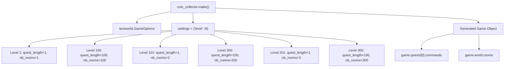
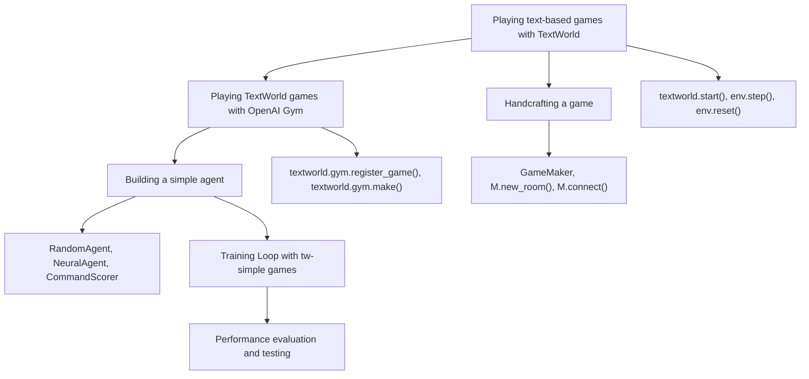
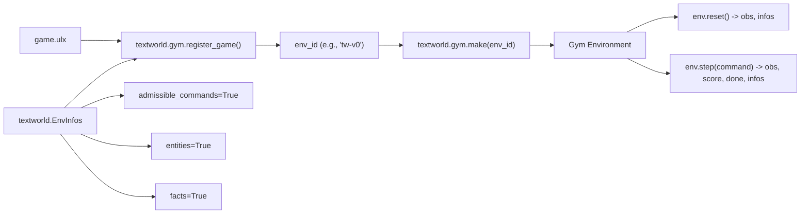
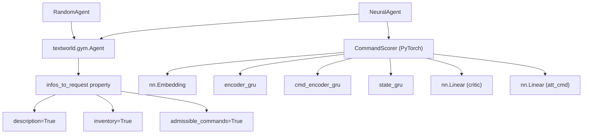
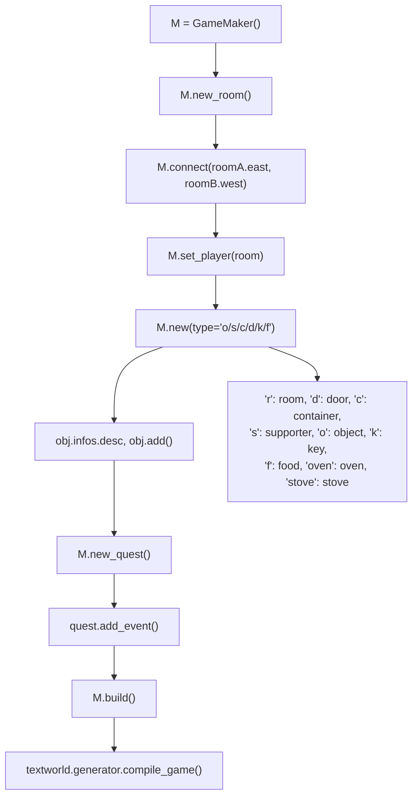

<!-- source: DeepWiki mcp.deepwiki.com · repo microsoft/TextWorld · page 8 Challenges and Examples · fetched 2026-10-26 -->

# Challenges and Examples

<details>
<summary>Relevant source files</summary>

The following files were used as context for generating this wiki page:

- [notebooks/Building a simple agent.ipynb](notebooks/Building a simple agent.ipynb)
- [notebooks/Handcrafting a game.ipynb](notebooks/Handcrafting a game.ipynb)
- [notebooks/Playing TextWorld generated games with OpenAI Gym.ipynb](notebooks/Playing TextWorld generated games with OpenAI Gym.ipynb)
- [notebooks/Playing text-based games with TextWorld.ipynb](notebooks/Playing text-based games with TextWorld.ipynb)
- [textworld/challenges/tests/test_coin_collector.py](textworld/challenges/tests/test_coin_collector.py)

</details>


This document covers TextWorld's built-in challenges and comprehensive learning materials, including predefined game scenarios and step-by-step tutorials for building agents and creating games. For information about command-line tools for game generation and playing, see [Command Line Tools](#7).

## Built-in Challenges

TextWorld provides predefined challenges that serve as standardized benchmarks for agent development and research. These challenges offer varying levels of difficulty and complexity to test different aspects of agent capabilities.

### Coin Collector Challenge

The `coin_collector` challenge is a scalable scenario where agents must navigate environments and collect coins. It demonstrates TextWorld's ability to generate games with controlled complexity parameters.



The challenge supports multiple difficulty levels with different parameters:

| Level | Quest Length | Number of Rooms | Complexity |
|-------|-------------|-----------------|------------|
| 1     | 1           | 1               | Minimal    |
| 100   | 100         | 100             | High       |
| 101   | 1           | 2               | Low        |
| 200   | 100         | 200             | Very High  |
| 201   | 1           | 3               | Low        |
| 300   | 100         | 300             | Maximum    |

Sources: [textworld/challenges/tests/test_coin_collector.py:11-27]()

## Tutorial Notebooks

TextWorld provides comprehensive Jupyter notebooks that guide users through different aspects of the framework, from basic game playing to advanced agent development.

### Learning Progression Overview



### Core API Tutorial

The basic tutorial demonstrates fundamental TextWorld concepts using the core API.

Key components covered:
- `textworld.start()` for initializing games
- `textworld.EnvInfos` for requesting game state information
- `env.step(command)` for sending commands
- `env.reset()` for restarting games
- `env.render()` for displaying game output

The tutorial uses external games like Zork1 and demonstrates information extraction including feedback, description, inventory, and score tracking.

Sources: [notebooks/Playing text-based games with TextWorld.ipynb:88-175](), [notebooks/Playing text-based games with TextWorld.ipynb:335-389]()

### OpenAI Gym Integration Tutorial

This tutorial shows how to use TextWorld with the familiar OpenAI Gym interface, making it compatible with existing reinforcement learning frameworks.



The tutorial demonstrates advanced information extraction capabilities including admissible commands, entity lists, and game state facts for generated games.

Sources: [notebooks/Playing TextWorld generated games with OpenAI Gym.ipynb:57-95](), [notebooks/Playing TextWorld generated games with OpenAI Gym.ipynb:297-345]()

### Agent Development Tutorial

The agent development tutorial provides a comprehensive guide to building and training reinforcement learning agents for TextWorld games.

#### Agent Architecture



The tutorial covers:
- Simple random baseline agent implementation
- Neural agent with attention mechanism over commands
- Training loop with policy gradient methods
- Evaluation and testing procedures
- Game generation with different difficulty settings

Training uses games generated with `tw-make tw-simple` with various reward densities and goal specifications.

Sources: [notebooks/Building a simple agent.ipynb:157-186](), [notebooks/Building a simple agent.ipynb:314-535](), [notebooks/Building a simple agent.ipynb:637-653]()

### Game Creation Tutorial

The handcrafting tutorial demonstrates how to programmatically create custom text-based games using the `GameMaker` API.

#### Game Construction Workflow



The tutorial covers object types, room connections, quest creation, and game compilation to playable formats.

Sources: [notebooks/Handcrafting a game.ipynb:45-63](), [notebooks/Handcrafting a game.ipynb:174-187]()

## Training Environments and Test Games

TextWorld provides various pre-configured training environments that demonstrate different learning challenges:

### Simple Test Games

The tutorials use a handcrafted world layout for consistent training:
```
                     Bathroom
                        +
                        |
                        +
    Bedroom +-(d1)-+ Kitchen +--(d2)--+ Backyard
      (P)               +                  +
                        |                  |
                        +                  +
                   Living Room           Garden
```

This environment supports different reward configurations:
- **Dense rewards**: Frequent positive feedback for progress
- **Balanced rewards**: Moderate feedback frequency  
- **Sparse rewards**: Minimal feedback, only at goal completion

Goal descriptions can be:
- **Detailed**: Explicit instructions provided
- **Brief**: Goal mentioned but minimal instructions
- **None**: No explicit goal, requires exploration

Sources: [notebooks/Building a simple agent.ipynb:105-133](), [notebooks/Building a simple agent.ipynb:144-151]()

## Performance Evaluation

The tutorials demonstrate systematic evaluation approaches comparing random baselines with trained agents across different game configurations. Training typically involves 500 episodes on single games or 100 games for better generalization.

Sources: [notebooks/Building a simple agent.ipynb:677-721](), [notebooks/Building a simple agent.ipynb:740-796]()

---

