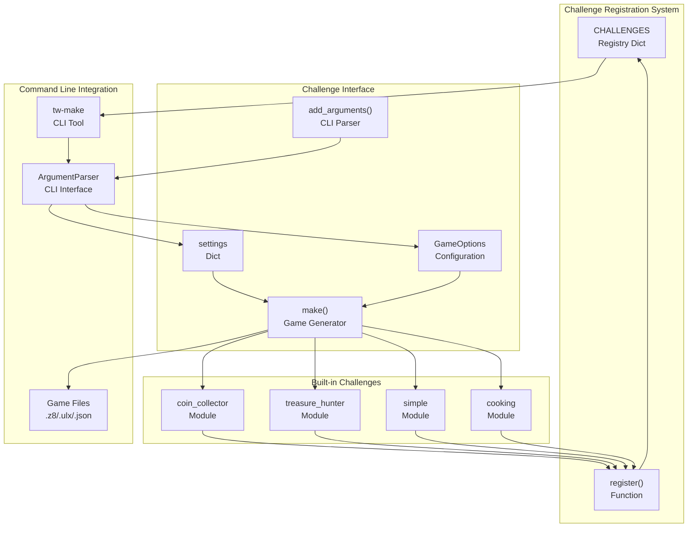
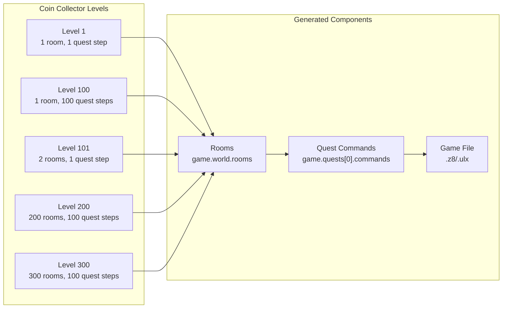
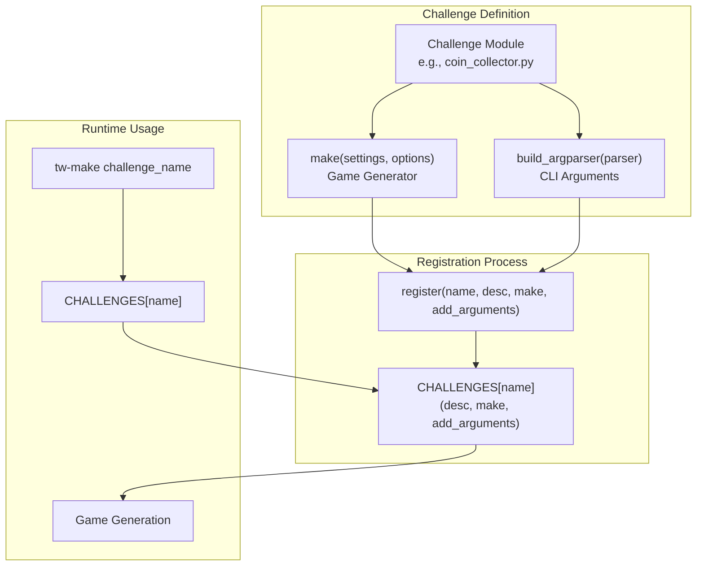
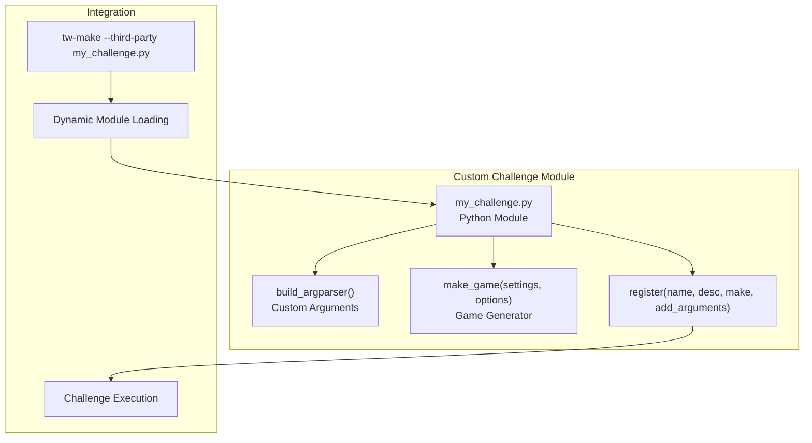

<!-- source: DeepWiki mcp.deepwiki.com · repo microsoft/TextWorld · page 8.1 Built-in Challenges · fetched 2026-10-26 -->

# Built-in Challenges

<details>
<summary>Relevant source files</summary>

The following files were used as context for generating this wiki page:

- [docs/source/textworld.challenges.rst](docs/source/textworld.challenges.rst)
- [tests/test_tw-make.py](tests/test_tw-make.py)
- [textworld/challenges/__init__.py](textworld/challenges/__init__.py)
- [textworld/challenges/registration.py](textworld/challenges/registration.py)
- [textworld/challenges/tests/test_coin_collector.py](textworld/challenges/tests/test_coin_collector.py)

</details>


This document describes TextWorld's built-in challenge system, which provides predefined game scenarios with configurable difficulty levels and objectives. These challenges serve as standardized benchmarks for agent development and testing, offering well-defined tasks ranging from simple navigation to complex multi-step cooking scenarios.

For information about creating custom games, see [Game Generation](#4). For details on using the command line tools to generate challenge games, see [tw-make](#7.1).

## Challenge System Overview

TextWorld includes a registration-based challenge system that allows both built-in and third-party challenges to be easily integrated and accessed through the command line interface. The system provides consistent interfaces for challenge configuration, game generation, and parameter specification.

### Challenge Architecture



Sources: [textworld/challenges/registration.py:1-38](), [textworld/challenges/__init__.py:1-9](), [tests/test_tw-make.py:67-89]()

## Built-in Challenges

TextWorld provides four core challenges, each targeting different aspects of text-based game playing and natural language understanding.

### Challenge Summary

| Challenge | Module | Primary Objective | Key Parameters |
|-----------|--------|-------------------|----------------|
| `tw-coin_collector` | `coin_collector` | Collect coins in sequence | `--level` |
| `tw-treasure_hunter` | `treasure_hunter` | Navigate and find treasure | `--level` |
| `tw-simple` | `simple` | Basic game mechanics | `--rewards`, `--goal` |
| `tw-cooking` | `cooking` | Multi-step recipe completion | `--recipe`, `--take`, `--cook`, `--split`, `--drop` |

Sources: [textworld/challenges/__init__.py:4-8](), [tests/test_tw-make.py:68-74]()

### Coin Collector Challenge

The `coin_collector` challenge focuses on sequential action execution and spatial navigation. Players must collect coins in a specific order across multiple rooms.

**Level Configuration:**
- Levels 1-100: Single room, quest length equals level
- Levels 101-200: Multiple rooms (level - 100), maximum quest length 100
- Levels 201-300: Multiple rooms (level - 200), maximum quest length 100



Sources: [textworld/challenges/tests/test_coin_collector.py:10-28](), [textworld/challenges/tw_coin_collector.py]()

### Treasure Hunter Challenge

The `treasure_hunter` challenge emphasizes exploration and goal-directed navigation in procedurally generated environments.

**Configuration:**
- Uses `--level` parameter to control difficulty
- Generates games with treasure-finding objectives
- Focuses on spatial reasoning and exploration

Sources: [tests/test_tw-make.py:69](), [textworld/challenges/tw_treasure_hunter.py]()

### Simple Challenge

The `simple` challenge provides configurable basic game mechanics for testing fundamental agent capabilities.

**Configuration Parameters:**
- `--rewards`: Controls reward structure (e.g., "dense")
- `--goal`: Configures goal description format (e.g., "brief")

Sources: [tests/test_tw-make.py:71](), [textworld/challenges/tw_simple.py]()

### Cooking Challenge

The `cooking` challenge represents the most complex built-in scenario, requiring multi-step reasoning, inventory management, and recipe execution.

**Configuration Parameters:**
- `--recipe`: Number of recipes to include
- `--take`: Number of ingredients to take
- `--cook`: Enable cooking actions
- `--split`: Data split configuration ("valid")
- `--drop`: Enable dropping actions

**Example Configurations:**
```bash
# Basic cooking with 2 recipes
tw-make tw-cooking --recipe 2 --take 1 --cook --split valid

# Advanced cooking with dropping
tw-make tw-cooking --recipe 2 --take 1 --cook --drop --split valid
```

Sources: [tests/test_tw-make.py:72-73](), [textworld/challenges/tw_cooking.py]()

## Registration System

The challenge registration system provides a consistent interface for adding new challenges and integrating them with the command line tools.

### Registration Interface



Sources: [textworld/challenges/registration.py:5-37]()

### Registration Function

The `register()` function in [textworld/challenges/registration.py:5-21]() accepts four parameters:

- `name`: Unique challenge identifier used with `tw-make`
- `desc`: Brief description for help text
- `make`: Function that generates games given settings and options
- `add_arguments`: Function that configures CLI argument parsing

## Usage with tw-make

Built-in challenges integrate seamlessly with the `tw-make` command line tool, providing standardized game generation with configurable parameters.

### Command Syntax

```bash
tw-make [challenge_name] [challenge_options] --seed [seed] --output [file]
```

### Challenge Generation Examples

```bash
# Generate coin collector level 5
tw-make tw-coin_collector --level 5 --seed 1234 --output game.ulx

# Generate treasure hunter level 5  
tw-make tw-treasure_hunter --level 5 --seed 1234 --output game.ulx

# Generate simple game with dense rewards
tw-make tw-simple --rewards dense --goal brief --seed 1234 --output game.ulx

# Generate cooking challenge
tw-make tw-cooking --recipe 2 --take 1 --cook --split valid --seed 1234 --output game.ulx
```

Sources: [tests/test_tw-make.py:67-89]()

## Third-Party Challenge Support

TextWorld supports custom third-party challenges through the `--third-party` flag, allowing external challenge modules to be loaded and used with `tw-make`.

### Third-Party Challenge Structure



### Example Third-Party Challenge

A minimal third-party challenge requires:

1. `build_argparser()` function for CLI arguments
2. `make_game()` function for game generation  
3. `register()` call to register the challenge

Example usage:
```bash
tw-make --third-party my_challenge.py my-challenge --nb-locations 3 --seed 1234 --output game.ulx
```

Sources: [tests/test_tw-make.py:104-160]()

---

