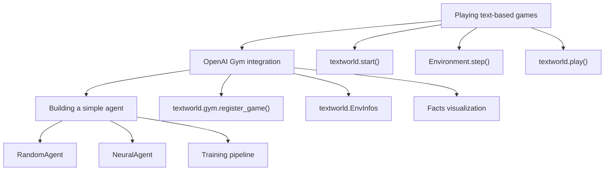
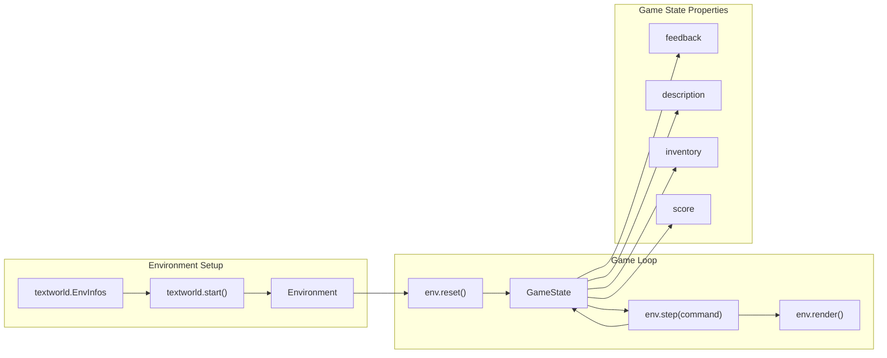
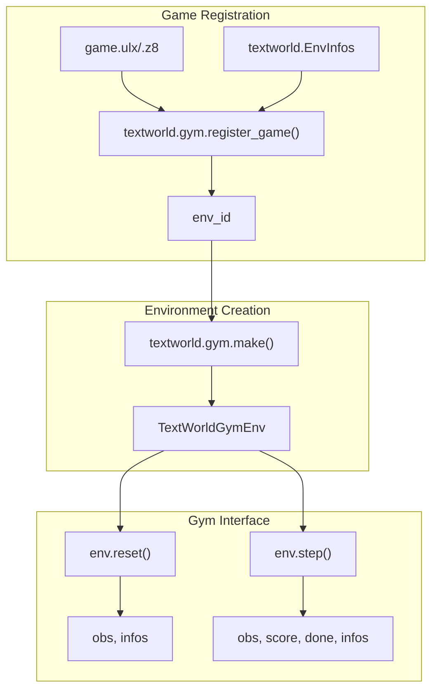
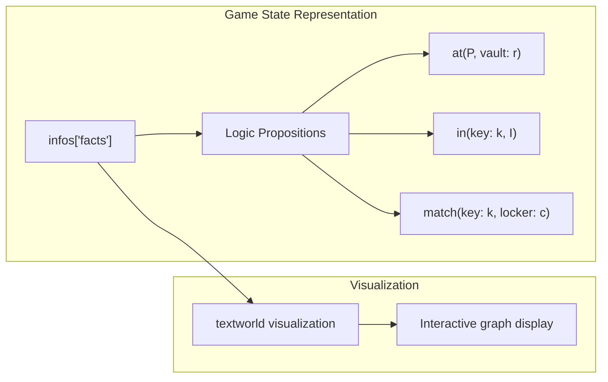
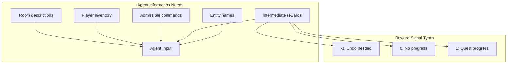
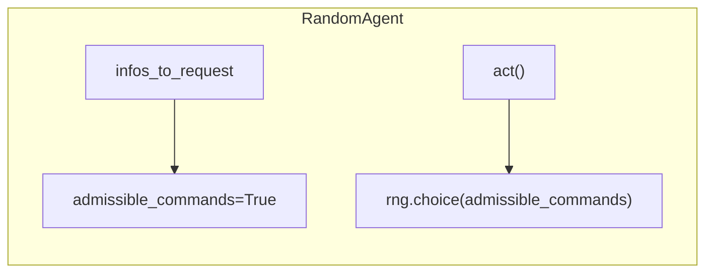
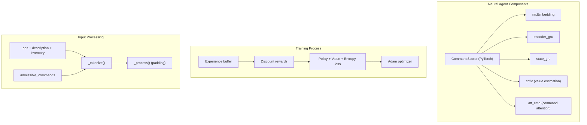
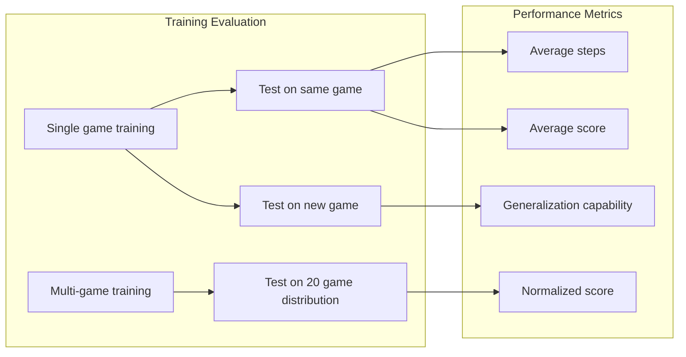

<!-- source: DeepWiki mcp.deepwiki.com · repo microsoft/TextWorld · page 8.2 Tutorials and Notebooks · fetched 2026-10-26 -->

# Tutorials and Notebooks

<details>
<summary>Relevant source files</summary>

The following files were used as context for generating this wiki page:

- [notebooks/Building a simple agent.ipynb](notebooks/Building a simple agent.ipynb)
- [notebooks/Handcrafting a game.ipynb](notebooks/Handcrafting a game.ipynb)
- [notebooks/Playing TextWorld generated games with OpenAI Gym.ipynb](notebooks/Playing TextWorld generated games with OpenAI Gym.ipynb)
- [notebooks/Playing text-based games with TextWorld.ipynb](notebooks/Playing text-based games with TextWorld.ipynb)

</details>


This section provides step-by-step tutorials for learning TextWorld through interactive Jupyter notebooks. These tutorials demonstrate core TextWorld functionality from basic game playing to building sophisticated learning agents, with hands-on examples and complete code implementations.

For information about built-in game challenges and scenarios, see [Built-in Challenges](#8.1). For command-line tools covered in these tutorials, see [Command Line Tools](#7).

## Overview of Available Tutorials

TextWorld includes three main tutorial notebooks that progressively introduce key concepts:

| Notebook | Purpose | Key Topics |
|----------|---------|------------|
| Playing text-based games with TextWorld | Basic API usage and game interaction | Core Environment API, game state access, basic play loops |
| Playing TextWorld generated games with OpenAI Gym | Gym integration and information control | Gym registration, EnvInfos system, state visualization |
| Building a simple agent | Neural agent development and training | Agent architecture, learning challenges, training procedures |

### Tutorial Learning Path



Sources: [notebooks/Playing text-based games with TextWorld.ipynb:1-715](), [notebooks/Playing TextWorld generated games with OpenAI Gym.ipynb:1-447](), [notebooks/Building a simple agent.ipynb:1-997]()

## Basic Game Playing Tutorial

### Core Environment Interface

The foundational tutorial demonstrates TextWorld's core API through the `textworld.Environment` class and basic game interaction patterns:



The tutorial covers essential `textworld.EnvInfos` configuration for controlling available information:

- `feedback=True` - Parser response text after commands
- `description=True` - Current room description via `look` command
- `inventory=True` - Player inventory via `inventory` command

### Interactive Play Function

The notebook introduces `textworld.play()` as a convenient interface for human players, automatically providing admissible commands and game state information.

Sources: [notebooks/Playing text-based games with TextWorld.ipynb:87-166](), [notebooks/Playing text-based games with TextWorld.ipynb:342-390](), [notebooks/Playing text-based games with TextWorld.ipynb:396-680]()

## OpenAI Gym Integration Tutorial

### Environment Registration and Management

The Gym tutorial demonstrates TextWorld's integration with the OpenAI Gym ecosystem through the `textworld.gym` module:



### Advanced Information Requests

The tutorial showcases sophisticated information control through `textworld.EnvInfos`:

- `admissible_commands=True` - Valid commands for current state
- `entities=True` - All interactable entity names  
- `facts=True` - Complete logical state representation

### State Visualization and Facts System



The facts system exposes the underlying logical representation with predicates like:
- `at(entity, location)` - Spatial relationships
- `in(object, container)` - Containment relationships  
- `match(key, lock)` - Key-lock correspondences
- `open/closed(container)` - Container states

Sources: [notebooks/Playing TextWorld generated games with OpenAI Gym.ipynb:55-95](), [notebooks/Playing TextWorld generated games with OpenAI Gym.ipynb:289-346](), [notebooks/Playing TextWorld generated games with OpenAI Gym.ipynb:387-447]()

## Neural Agent Development Tutorial

### Learning Challenges and Information Augmentation

The agent building tutorial addresses fundamental challenges in text-based game learning:

1. **Combinatorial action space** - Actions grow with vocabulary size
2. **Sparse reward signals** - Limited feedback during gameplay

The tutorial demonstrates requesting augmented information to ease learning:



### Agent Architecture Implementations

#### RandomAgent Implementation



#### NeuralAgent Architecture



### Training Methodology and Game Generation

The tutorial demonstrates progressive training approaches:

#### Single Game Training
Uses `tw-make tw-simple` to generate controlled test scenarios with varying reward densities:
- `--rewards dense` - Frequent intermediate rewards
- `--rewards balanced` - Moderate reward frequency  
- `--rewards sparse` - Minimal reward signals

#### Multi-Game Generalization
Trains on 100 games using parallel generation:
```bash
seq 1 100 | xargs -n1 -P4 tw-make tw-simple --rewards dense --goal detailed --format z8 --output training_games/ --seed
```

### Evaluation Framework



Sources: [notebooks/Building a simple agent.ipynb:74-99](), [notebooks/Building a simple agent.ipynb:157-186](), [notebooks/Building a simple agent.ipynb:313-536](), [notebooks/Building a simple agent.ipynb:540-831]()

## Running the Tutorials

### Prerequisites and Setup

All tutorials require basic TextWorld installation:
```bash
pip install textworld
```

The neural agent tutorial additionally requires:
```bash
pip install torch torchvision torchaudio
pip install gym==0.21
```

For visualization features:
```bash
pip install textworld[vis]
```

### Notebook Execution

Each notebook includes Google Colab compatibility badges and can be run in several environments:

1. **Local Jupyter** - Standard notebook execution
2. **Google Colab** - Cloud-based execution with pre-configured dependencies
3. **Command-line equivalents** - Many examples can be run via `tw-play`, `tw-make` tools

### Data and Game Files

Notebooks can either:
- Generate games on-demand (slower initial execution)
- Download pre-generated data packages for faster execution:
```bash
wget https://aka.ms/textworld/notebooks/data.zip
unzip -nq data.zip && rm -f data.zip
```

Sources: [notebooks/Building a simple agent.ipynb:22-68](), [notebooks/Playing text-based games with TextWorld.ipynb:22-35](), [notebooks/Playing TextWorld generated games with OpenAI Gym.ipynb:22-33]()

---

