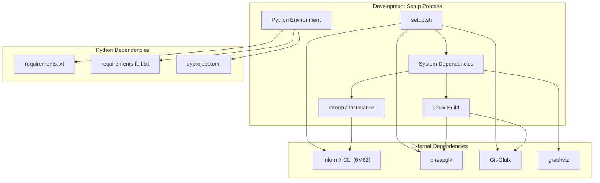
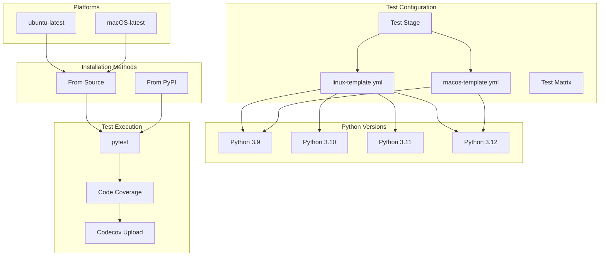
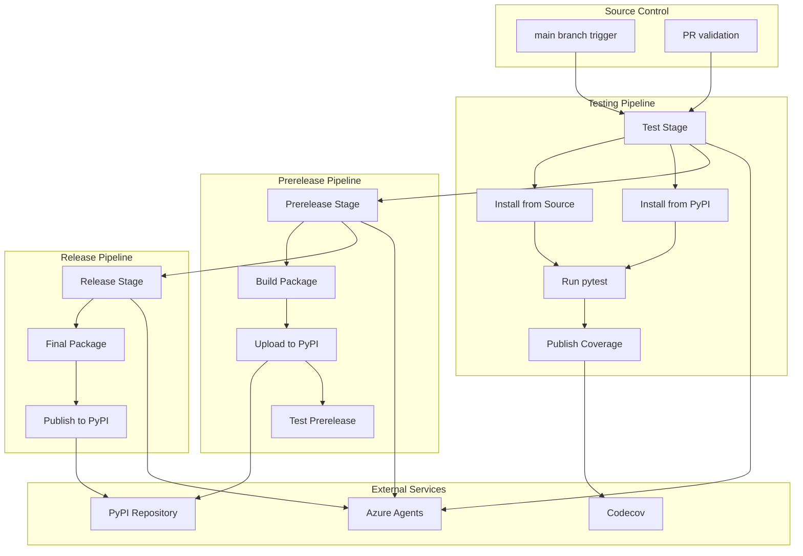
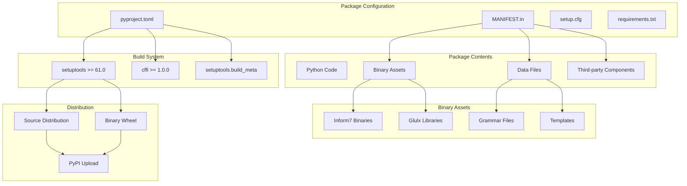
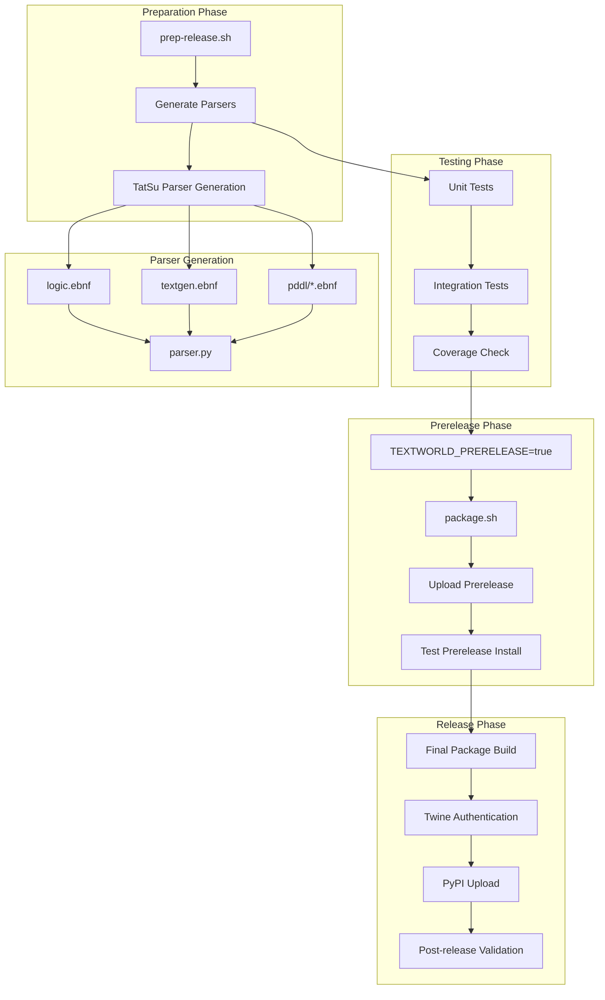

<!-- source: DeepWiki mcp.deepwiki.com · repo microsoft/TextWorld · page 9 Development · fetched 2026-10-26 -->

# Development

Relevant source files

The following files were used as context for generating this wiki page:

- [.azure/pipelines/linux-template.yml](.azure/pipelines/linux-template.yml)
- [.azure/pipelines/macos-template.yml](.azure/pipelines/macos-template.yml)
- [.azure/pipelines/prerelease.yml](.azure/pipelines/prerelease.yml)
- [.azure/pipelines/release.yml](.azure/pipelines/release.yml)
- [.azure/pipelines/tests.yml](.azure/pipelines/tests.yml)
- [MANIFEST.in](MANIFEST.in)
- [pyproject.toml](pyproject.toml)
- [setup.sh](setup.sh)
- [textworld/__init__.py](textworld/__init__.py)
- [tools/prep-release.sh](tools/prep-release.sh)

This section provides comprehensive information for developers contributing to TextWorld, covering development environment setup, testing infrastructure, continuous integration pipelines, and package distribution processes. For information about using TextWorld's core APIs and game generation, see [Core Concepts](#3) and [Game Generation](#4).

## Development Environment Setup

TextWorld requires a specific development environment setup that includes external dependencies like Inform7 compiler and Glulx interpreters. The primary setup is managed through the `setup.sh` script which handles cross-platform installation of these dependencies.

### Development Environment Architecture

The `setup.sh` script performs platform-specific installation of Inform7 and Glulx components. On Linux, it downloads and extracts the Inform7 CLI distribution [setup.sh:21-31](). On macOS, it additionally mounts the Inform7 DMG to extract platform-specific binaries [setup.sh:50-64](). The script also builds the modified Glulx interpreters from source [setup.sh:67-77]().

**Sources:** [setup.sh:1-78](), [pyproject.toml:1-38]()

## Testing Infrastructure

TextWorld uses a comprehensive testing infrastructure that supports multiple Python versions and platforms through Azure Pipelines. The testing system is designed to validate both source installations and PyPI package installations.

### Test Execution Pipeline

The testing infrastructure runs on multiple combinations of operating systems and Python versions. Linux tests run on all supported Python versions (3.9-3.12) [.azure/pipelines/tests.yml:14-26](), while macOS tests run on Python 3.9 and 3.12 [.azure/pipelines/tests.yml:27-34](). Each test job installs system dependencies, sets up the TextWorld environment, and runs the full test suite with coverage reporting.

**Sources:** [.azure/pipelines/tests.yml:1-35](), [.azure/pipelines/linux-template.yml:1-47](), [.azure/pipelines/macos-template.yml:1-40]()

## CI/CD Pipeline Architecture

The CI/CD system uses Azure Pipelines with separate workflows for testing, prerelease, and production release. The system supports both source-based development and package distribution validation.

### Pipeline Flow and Components

The CI/CD system distinguishes between development testing and package validation. The `installFromSource` variable controls whether tests install TextWorld from source code or from PyPI packages [.azure/pipelines/linux-template.yml:20-28](). This allows validation of both development workflows and published packages.

**Sources:** [.azure/pipelines/tests.yml:6-8](), [.azure/pipelines/prerelease.yml:32-35](), [.azure/pipelines/release.yml:1-29]()

## Packaging and Distribution

TextWorld uses modern Python packaging standards with `pyproject.toml` as the primary configuration and `MANIFEST.in` for including non-Python assets. The packaging system handles complex binary dependencies and platform-specific components.

### Package Structure and Dependencies

The package includes extensive binary assets and data files through `MANIFEST.in`. Key inclusions are Inform7 compiler binaries [MANIFEST.in:28-30](), Glulx interpreter libraries [MANIFEST.in:25](), grammar files [MANIFEST.in:13-14](), and text generation templates [MANIFEST.in:16](). The build system uses `setuptools` with `cffi` for handling binary components [pyproject.toml:2-6]().

**Sources:** [pyproject.toml:1-38](), [MANIFEST.in:1-36](), [tools/prep-release.sh:1-16]()

## Release Process

The release process involves multiple stages: preparation, testing, prerelease validation, and final release. Each stage includes specific validation steps and automated deployment.

### Release Workflow and Automation

The release preparation script `prep-release.sh` generates parser files from grammar definitions using TatSu [tools/prep-release.sh:10-15](). This includes parsers for the core logic system, text generation, and PDDL environment support. The prerelease process uses the `TEXTWORLD_PRERELEASE` environment variable to create development versions [.azure/pipelines/prerelease.yml:20](), while final releases follow the standard packaging workflow.

**Sources:** [tools/prep-release.sh:1-16](), [.azure/pipelines/prerelease.yml:17-29](), [.azure/pipelines/release.yml:16-28]()

---

