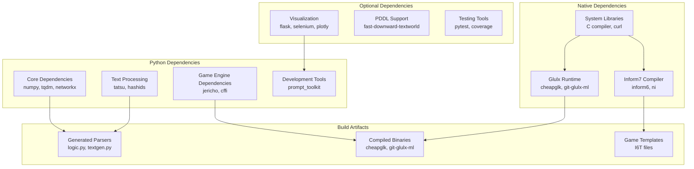
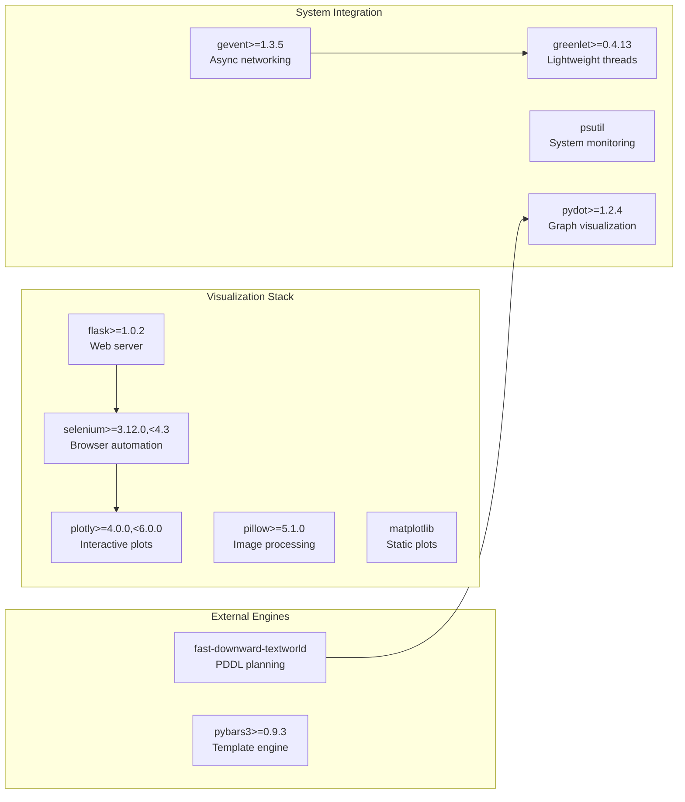
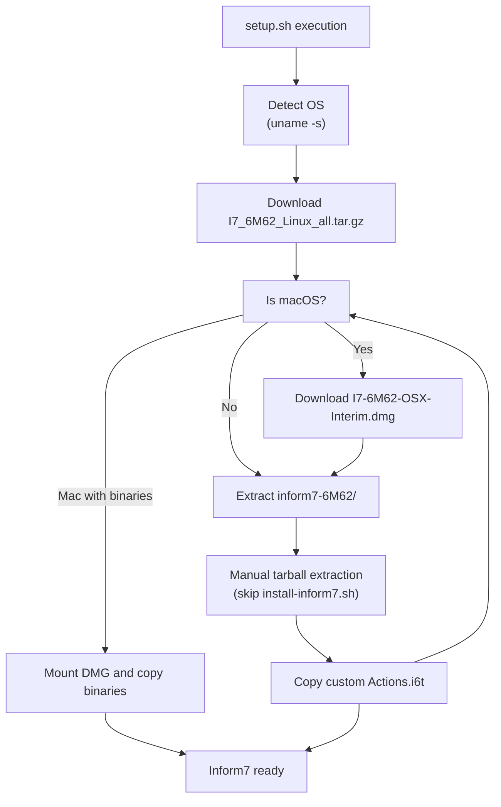
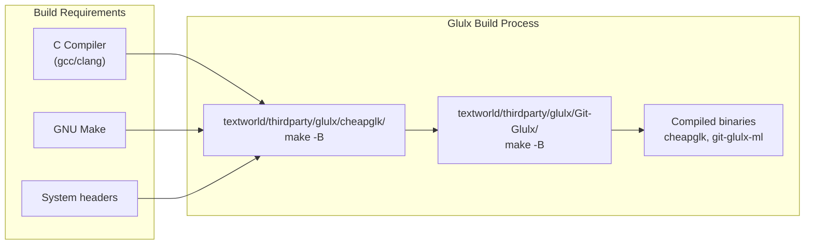
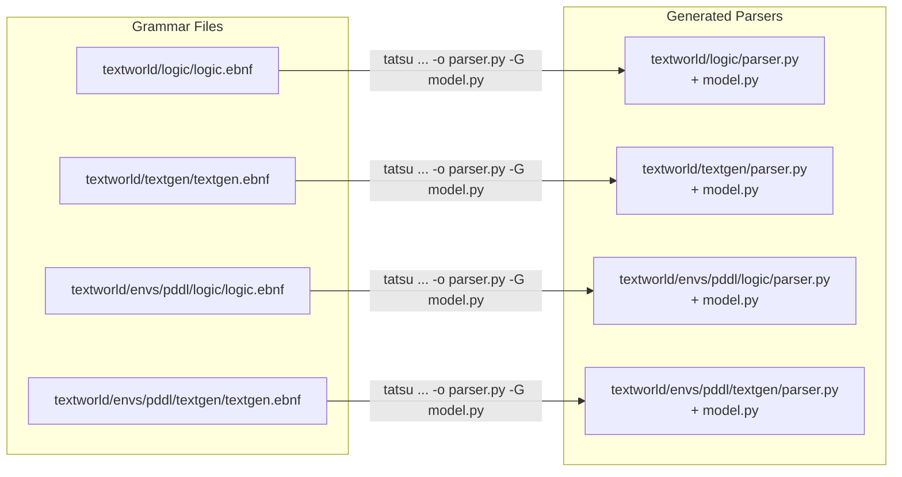

<!-- source: DeepWiki mcp.deepwiki.com · repo microsoft/TextWorld · page 9.1 Setup and Dependencies · fetched 2026-10-26 -->

# Setup and Dependencies

Relevant source files

The following files were used as context for generating this wiki page:

- [MANIFEST.in](MANIFEST.in)
- [pyproject.toml](pyproject.toml)
- [requirements-full.txt](requirements-full.txt)
- [requirements.txt](requirements.txt)
- [setup.sh](setup.sh)
- [textworld/__init__.py](textworld/__init__.py)
- [tools/prep-release.sh](tools/prep-release.sh)

This document provides detailed instructions for setting up a TextWorld development environment, including dependency management, native toolchain installation, and build system configuration. This is specifically for developers contributing to TextWorld or extending its functionality.

For general installation instructions for end users, see [Installation and Setup](#2). For information about testing and CI/CD pipelines, see [Testing and CI/CD](#9.2).

## Overview

TextWorld's development environment requires several categories of dependencies working together to support game generation, compilation, and execution across multiple platforms.

Sources: [requirements.txt:1-15](), [requirements-full.txt:1-30](), [setup.sh:1-78]()

## Python Dependencies

TextWorld uses a tiered dependency system with different requirement files for different use cases.

### Core Dependencies

The base runtime dependencies are minimal and focused on essential functionality:

| Package | Version | Purpose |
|---------|---------|---------|
| `numpy` | >=1.14.5 | Numerical operations and array handling |
| `tqdm` | >=4.17.1 | Progress bars for game generation |
| `cffi` | >=1.0.0 | Foreign function interface for native libraries |
| `networkx` | >=2 | Graph operations for game world representation |
| `more_itertools` | latest | Extended iteration utilities |
| `tatsu` | ==5.8.3 | Parser generator for game logic DSL |
| `hashids` | >=1.2.0 | Deterministic ID generation |
| `jericho` | >=3.3.0 | Z-machine interpreter backend |
| `mementos` | >=1.3.1 | Memoization utilities |
| `termcolor` | latest | Terminal color output |
| `prompt_toolkit` | latest | Advanced command-line interfaces |

Sources: [requirements.txt:1-15]()

### Extended Dependencies

The full dependency set includes visualization and advanced features:

Sources: [requirements-full.txt:16-30]()

## Native Dependencies Setup

TextWorld requires several native components that must be compiled or installed separately from Python packages.

### Inform7 Compiler Installation

The `setup.sh` script handles Inform7 installation across different platforms:

Key components installed:
- `inform7-common_6M62_all.tar.gz` - Core Inform7 libraries
- `inform7-compilers_6M62_${ARCH}.tar.gz` - Platform-specific compilers
- `inform7-interpreters_6M62_${ARCH}.tar.gz` - Runtime interpreters
- Custom `Actions.i6t` - Modified action definitions

Sources: [setup.sh:18-47]()

### Glulx Runtime Compilation

The Glulx components are built locally from included source:

Sources: [setup.sh:67-77]()

## Development Environment Configuration

### Project Structure Setup

The development environment follows a specific directory structure that must be maintained:

| Path | Purpose | Source |
|------|---------|---------|
| `textworld/thirdparty/inform7-6M62/` | Inform7 installation | [setup.sh:29-46]() |
| `textworld/thirdparty/glulx/` | Glulx source and binaries | [setup.sh:67-77]() |
| `textworld/logic/` | Logic system parsers | [MANIFEST.in:13]() |
| `textworld/textgen/` | Text generation parsers | [MANIFEST.in:14]() |
| `textworld/generator/data/` | Game generation data | [MANIFEST.in:15-16]() |

### Build System Integration

The modern Python packaging uses `pyproject.toml` for configuration:

```mermaid
graph TB
    subgraph "Build Configuration"
        PyProject["pyproject.toml<br/>Build metadata"]
        SetupTools["setuptools >= 61.0<br/>Build backend"]
        CFFI["cffi >= 1.0.0<br/>Native compilation"]
    end
    
    subgraph "Package Metadata"
        Version["Dynamic version<br/>from textworld/version.py"]
        Dependencies["Dynamic dependencies<br/>from requirements.txt"]
        OptionalDeps["Optional dependencies<br/>from requirements-full.txt"]
    end
    
    subgraph "Distribution"
        Manifest["MANIFEST.in<br/>File inclusion rules"]
        Wheel["Built wheel<br/>textworld-*.whl"]
        SDist["Source distribution<br/>textworld-*.tar.gz"]
    end
    
    PyProject --> SetupTools
    SetupTools --> CFFI
    PyProject --> Version
    Version --> Dependencies
    Dependencies --> OptionalDeps
    Manifest --> Wheel
    Manifest --> SDist
```

Sources: [pyproject.toml:1-38](), [MANIFEST.in:1-36]()

### Parser Generation

TextWorld uses `tatsu` to generate parsers from EBNF grammars during development:

Sources: [tools/prep-release.sh:10-15]()

## Platform Support

TextWorld supports multiple platforms with platform-specific handling:

| Platform | Detection | Special Handling |
|----------|-----------|------------------|
| Linux | `uname -s` = Linux | Standard tarball extraction |
| macOS | `uname -s` = Darwin | DMG mounting and binary extraction |
| Windows | `uname -s` = MINGW/CYGWIN | Limited support through compatibility layers |

### macOS-Specific Setup

macOS requires additional steps for Inform7 compiler binaries:

1. Mount the DMG file: `hdiutil attach ./I7-6M62-OSX-Interim.dmg`
2. Copy compiled binaries from `/Volumes/Inform/Inform.app/Contents/MacOS/`
3. Unmount the DMG: `hdiutil detach /Volumes/Inform/`

Sources: [setup.sh:9-16](), [setup.sh:49-64]()

## Verification and Testing

After setup completion, verify the installation by checking key components:

### Essential Components Checklist

- [ ] Python dependencies installed (`pip list`)
- [ ] Inform7 compiler available (`textworld/thirdparty/inform7-6M62/share/inform7/Compilers/ni`)
- [ ] Glulx runtime compiled (`textworld/thirdparty/glulx/Git-Glulx/git-glulx-ml`)
- [ ] Parser generation working (`tatsu --version`)
- [ ] TextWorld importable (`python -c "import textworld"`)

### Common Setup Issues

| Issue | Symptom | Solution |
|-------|---------|----------|
| Missing C compiler | Glulx build fails | Install `build-essential` (Linux) or Xcode tools (macOS) |
| Inform7 not found | Game compilation errors | Verify `setup.sh` completed successfully |
| Import errors | `ModuleNotFoundError` | Check Python path and virtual environment |
| Permission errors | File access denied | Ensure write permissions in installation directory |

Sources: [setup.sh:1-78](), [textworld/__init__.py:1-19]()

---

