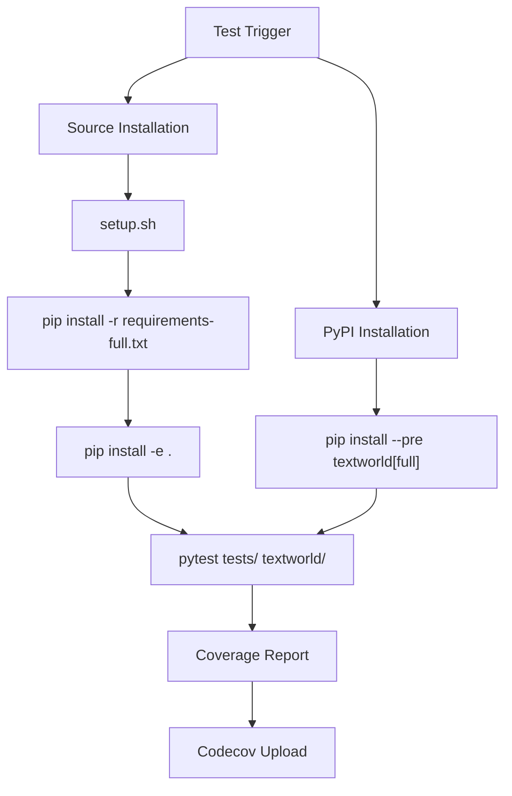
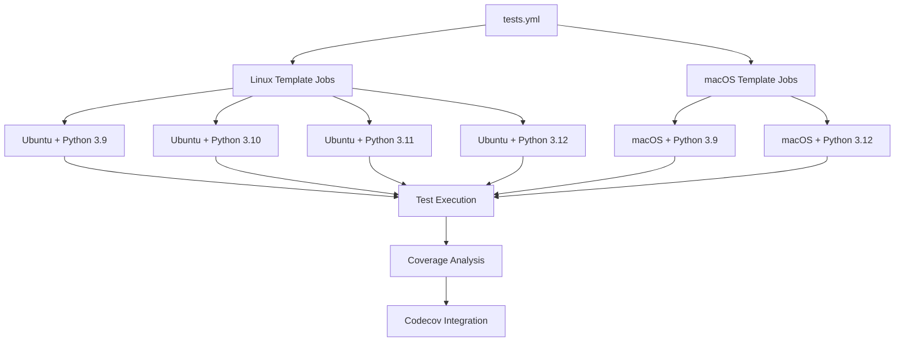
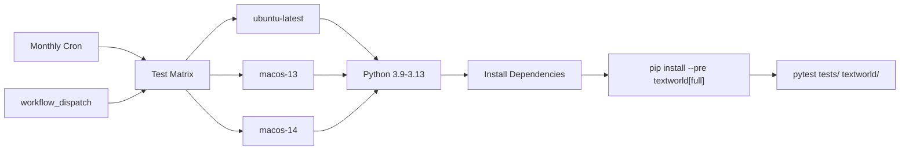
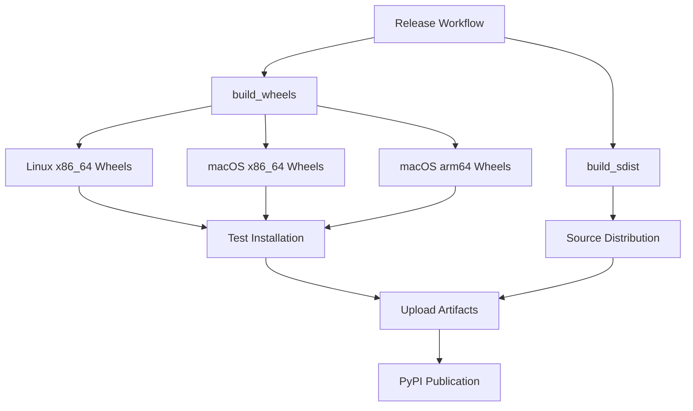
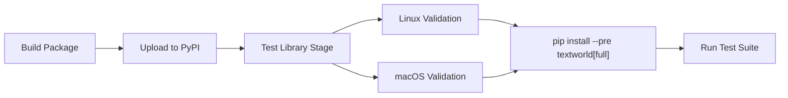

<!-- source: DeepWiki mcp.deepwiki.com · repo microsoft/TextWorld · page 9.2 Testing and CI/CD · fetched 2026-10-26 -->

# Testing and CI/CD

<details>
<summary>Relevant source files</summary>

The following files were used as context for generating this wiki page:

- [.azure/pipelines/linux-template.yml](.azure/pipelines/linux-template.yml)
- [.azure/pipelines/macos-template.yml](.azure/pipelines/macos-template.yml)
- [.azure/pipelines/prerelease.yml](.azure/pipelines/prerelease.yml)
- [.azure/pipelines/release.yml](.azure/pipelines/release.yml)
- [.azure/pipelines/tests.yml](.azure/pipelines/tests.yml)
- [.github/workflows/release.yml](.github/workflows/release.yml)
- [.github/workflows/test_pypi.yml](.github/workflows/test_pypi.yml)

</details>


This document covers TextWorld's testing infrastructure and continuous integration/continuous deployment (CI/CD) pipelines. It explains how automated testing is performed across multiple Python versions and operating systems, how code coverage is tracked, and how packages are built and distributed to PyPI.

For information about setting up the development environment, see [Setup and Dependencies](#9.1). For details about package distribution mechanics, see [Packaging and Distribution](#9.3).

## Test Infrastructure Overview

TextWorld employs a comprehensive testing strategy that validates functionality across multiple Python versions and operating systems. The testing infrastructure is built around two main CI/CD platforms: Azure Pipelines for primary testing and GitHub Actions for additional validation and release management.

### Test Matrix

The testing matrix covers the following configurations:

| Platform | Python Versions | Test Type |
|----------|----------------|-----------|
| Ubuntu Latest | 3.9, 3.10, 3.11, 3.12 | Full test suite |
| macOS Latest | 3.9, 3.12 | Full test suite |
| macOS 13/14 | 3.9, 3.10, 3.11, 3.12, 3.13 | PyPI validation |

### Installation Methods

Tests validate two installation approaches:

1. **Source Installation**: Installing from the repository using `setup.sh` and `pip install -e .`
2. **PyPI Installation**: Installing prebuilt packages using `pip install textworld[full]`



**Sources:** [.azure/pipelines/linux-template.yml:23-28](), [.azure/pipelines/linux-template.yml:18-21](), [.azure/pipelines/linux-template.yml:30-33]()

## Continuous Integration Pipelines

### Azure Pipelines

The primary CI system uses Azure Pipelines with a template-based approach for consistency across platforms.

#### Main Test Pipeline

The main test pipeline is defined in `tests.yml` and orchestrates testing across multiple configurations:



**Sources:** [.azure/pipelines/tests.yml:10-34](), [.azure/pipelines/linux-template.yml:1-47](), [.azure/pipelines/macos-template.yml:1-40]()

#### Platform-Specific Templates

Each platform template handles:

- **Dependency Installation**: 
  - Linux: `sudo apt install graphviz`
  - macOS: `brew install graphviz`
- **Python Setup**: Using `UsePythonVersion@0` task
- **TextWorld Installation**: Conditional based on `installFromSource` variable
- **Test Execution**: Using `pytest` with coverage and JUnit output
- **Coverage Publishing**: Integration with Codecov and Azure DevOps

### GitHub Actions

GitHub Actions provide additional validation and handle package distribution:

#### PyPI Testing Workflow

The `test_pypi.yml` workflow validates TextWorld installations from PyPI on a monthly schedule:



**Sources:** [.github/workflows/test_pypi.yml:3-40]()

## Package Building and Distribution

### Wheel Building Process

The release workflow builds wheels for multiple platforms using `cibuildwheel`:



**Sources:** [.github/workflows/release.yml:14-123](), [.github/workflows/release.yml:125-146](), [.github/workflows/release.yml:148-171]()

### Release Pipelines

TextWorld supports multiple release channels:

1. **Prerelease Pipeline**: Publishes release candidates to PyPI for testing
2. **Release Pipeline**: Publishes stable versions to PyPI
3. **GitHub Releases**: Automated wheel building on GitHub releases

The prerelease pipeline includes a validation stage that tests the uploaded package:



**Sources:** [.azure/pipelines/prerelease.yml:3-52]()

## Coverage and Quality Assurance

### Code Coverage

Code coverage is measured using `pytest-cov` and reported through multiple channels:

- **Codecov Integration**: Automated upload with retry logic for reliability
- **Azure DevOps Reports**: Native integration using `PublishCodeCoverageResults@1`
- **HTML Reports**: Generated for detailed local analysis

The coverage configuration includes:

```bash
pytest --cov=textworld --cov-report=xml --cov-report=html tests/ textworld/
```

### Test Execution

Tests are executed with the following pytest configuration:

- **Duration Reporting**: `--durations=10` for performance monitoring
- **JUnit Output**: `--junitxml=junit/test-results.xml` for CI integration
- **Coverage Tracking**: Both XML and HTML format reports
- **Test Discovery**: Covers both `tests/` and `textworld/` directories for doctests

**Sources:** [.azure/pipelines/linux-template.yml:30-40](), [.azure/pipelines/macos-template.yml:30-39]()

### Quality Gates

The CI/CD system enforces several quality gates:

1. **Multi-Platform Compatibility**: Tests must pass on both Linux and macOS
2. **Python Version Support**: Validation across Python 3.9-3.12 (3.13 for PyPI tests)
3. **Installation Methods**: Both source and PyPI installations must work
4. **Coverage Reporting**: Automatic coverage analysis and reporting
5. **Package Integrity**: Wheel building and testing validates distribution packages

**Sources:** [.azure/pipelines/tests.yml:1-35](), [.github/workflows/test_pypi.yml:1-40](), [.github/workflows/release.yml:1-171]()

---

