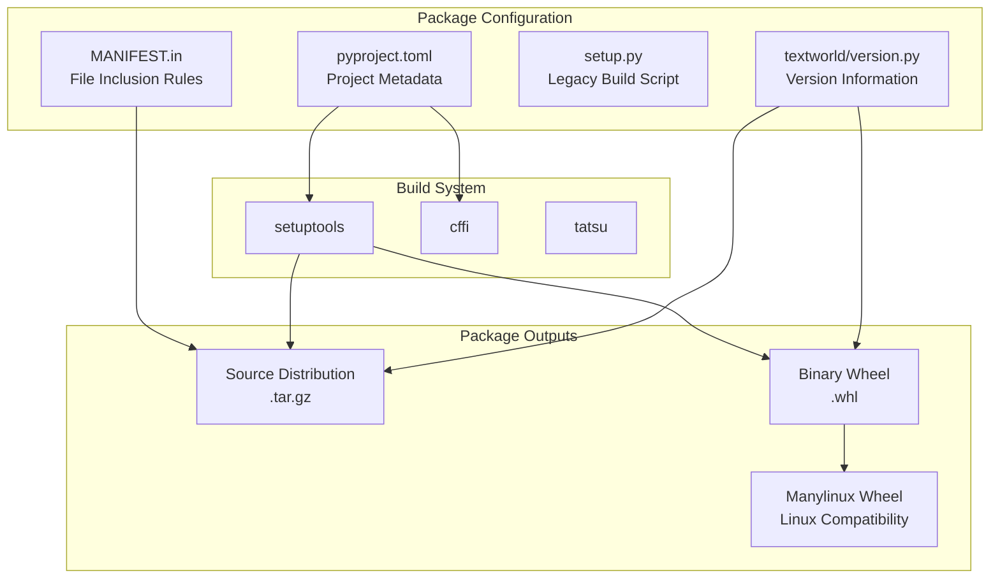
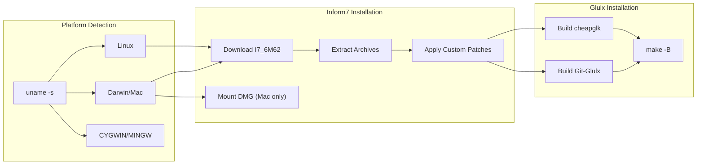
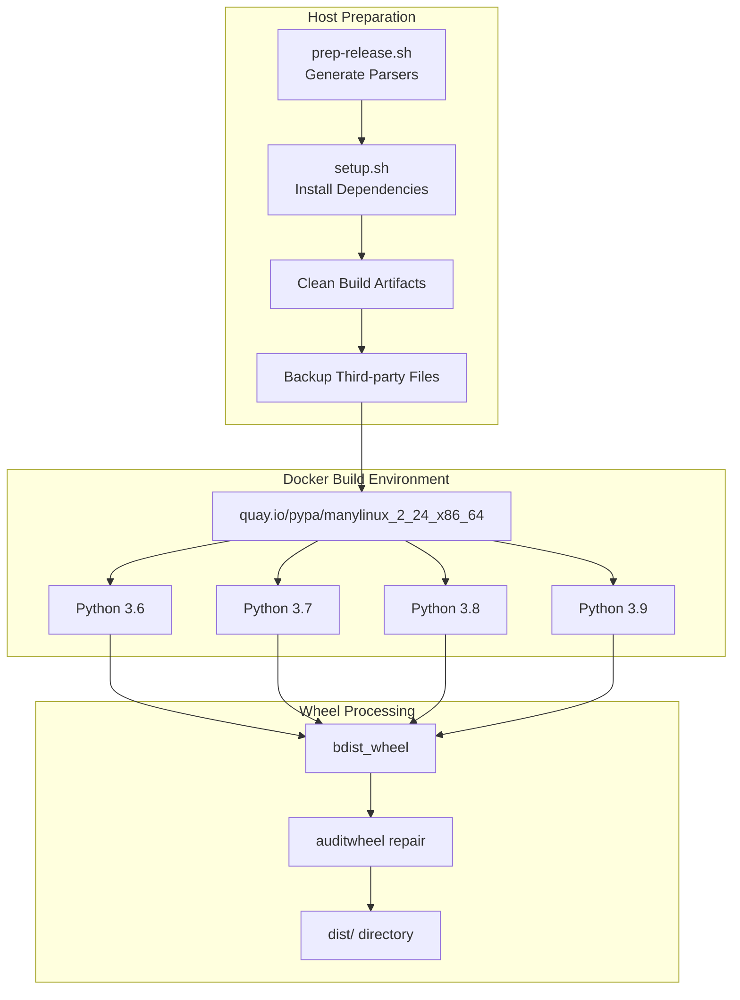
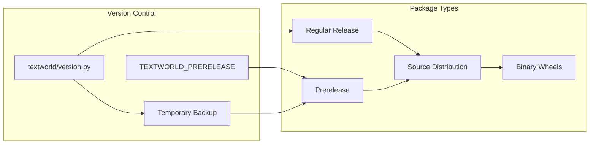
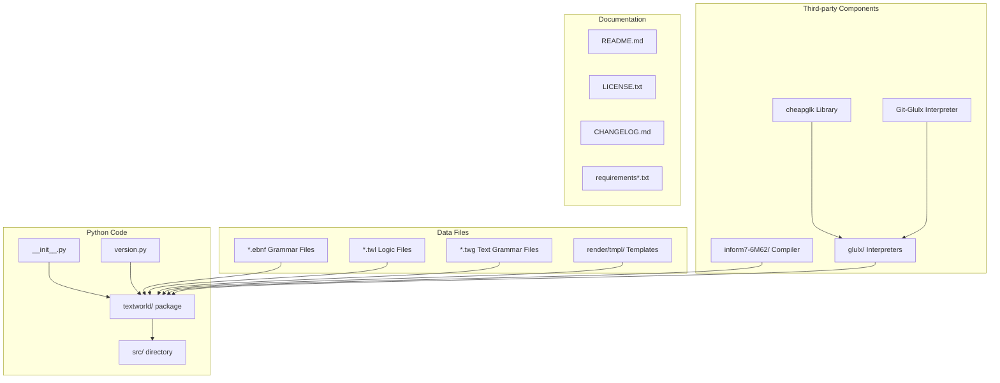

<!-- source: DeepWiki mcp.deepwiki.com · repo microsoft/TextWorld · page 9.3 Packaging and Distribution · fetched 2026-10-26 -->

# Packaging and Distribution

Relevant source files

The following files were used as context for generating this wiki page:

- [MANIFEST.in](MANIFEST.in)
- [pyproject.toml](pyproject.toml)
- [setup.sh](setup.sh)
- [textworld/__init__.py](textworld/__init__.py)
- [tools/package-impl.sh](tools/package-impl.sh)
- [tools/package.sh](tools/package.sh)
- [tools/prep-release.sh](tools/prep-release.sh)

This page covers the packaging and distribution system for TextWorld, including package configuration, dependency management, release preparation, and binary distribution. This system enables TextWorld to be distributed as a Python package on PyPI with all necessary third-party dependencies and native components.

For information about development environment setup, see [Setup and Dependencies](#9.1). For details about the testing infrastructure that validates packages, see [Testing and CI/CD](#9.2).

## Package Configuration

TextWorld uses modern Python packaging standards with `pyproject.toml` as the primary configuration file and `MANIFEST.in` for specifying package contents.

### Project Metadata

The package metadata is defined in `pyproject.toml` using the PEP 621 standard:

| Field | Value | Description |
|-------|--------|-------------|
| Name | `textworld` | Package name on PyPI |
| Python Requirement | `>=3.9` | Minimum Python version |
| Build System | `setuptools >= 61.0` | Modern setuptools with pyproject.toml support |
| License | MIT | Open source license |
| Classifiers | Production/Stable | Development status and target audience |

The project supports Python 3.9 through 3.12 across Linux and macOS platforms, as specified in the classifiers section [pyproject.toml:27-30]().

**Package Configuration Pipeline**

Sources: [pyproject.toml:1-38](), [MANIFEST.in:1-36]()

### File Inclusion Management

The `MANIFEST.in` file specifies which files are included in the source distribution:

| File Category | Pattern | Purpose |
|---------------|---------|---------|
| Core Package | `recursive-include src *` | Source code |
| Requirements | `requirements*.txt` | Dependency specifications |
| Documentation | `README.md`, `LICENSE.txt`, `CHANGELOG.md` | Package documentation |
| Setup Scripts | `setup.sh`, `glk_build.py` | Installation scripts |
| Grammar Files | `*.ebnf` | Parser grammar definitions |
| Game Data | `*.twl`, `*.twg` | Logic and text generation rules |
| Third-party | `recursive-include textworld/thirdparty/` | External dependencies |
| Templates | `recursive-include textworld/render/tmpl` | Rendering templates |

Sources: [MANIFEST.in:1-36]()

## Dependency Management and Setup

TextWorld requires complex third-party dependencies including the Inform7 compiler and Glulx interpreters. The `setup.sh` script manages platform-specific installation of these components.

### Third-party Component Installation

**Third-party Dependency Installation Pipeline**

The setup process handles platform-specific requirements:

1. **Platform Detection**: Uses `uname -s` to identify Linux, macOS, or Windows environments [setup.sh:10-16]()
2. **Inform7 CLI**: Downloads and extracts the Inform7 6M62 release with custom patches [setup.sh:21-47]()
3. **macOS Handling**: Mounts DMG files and copies compiled binaries for macOS [setup.sh:50-64]()
4. **Glulx Components**: Builds cheapglk and Git-Glulx interpreters from source [setup.sh:68-77]()

Sources: [setup.sh:1-78]()

## Release Preparation Pipeline

The release preparation process generates required parsers and prepares the codebase for packaging through the `prep-release.sh` script.

### Parser Generation

TextWorld uses TatSu to generate parsers from EBNF grammar files:

| Grammar File | Generated Parser | Purpose |
|--------------|------------------|---------|
| `textworld/logic/logic.ebnf` | `textworld/logic/parser.py` | Logic system parsing |
| `textworld/textgen/textgen.ebnf` | `textworld/textgen/parser.py` | Text generation parsing |
| `textworld/envs/pddl/logic/logic.ebnf` | `textworld/envs/pddl/logic/parser.py` | PDDL logic parsing |
| `textworld/envs/pddl/textgen/textgen.ebnf` | `textworld/envs/pddl/textgen/parser.py` | PDDL text generation |

The `tatsu` command generates both parser and model files for each grammar [tools/prep-release.sh:10-15]().

Sources: [tools/prep-release.sh:1-16]()

## Binary Distribution and Wheels

TextWorld provides binary wheels for Linux platforms using the manylinux standard to ensure compatibility across different Linux distributions.

### Manylinux Wheel Building

**Manylinux Wheel Build Process**

The packaging process creates portable Linux wheels:

1. **Host Preparation**: Runs setup and cleans unnecessary files [tools/package.sh:12-24]()
2. **Backup Management**: Temporarily removes large third-party files to reduce source package size [tools/package.sh:20-21]()
3. **Docker Execution**: Uses manylinux Docker image for consistent build environment [tools/package.sh:37]()
4. **Multi-Python Builds**: Creates wheels for Python 3.6-3.9 in the container [tools/package-impl.sh:9-11]()
5. **Wheel Auditing**: Uses `auditwheel` to bundle shared libraries and ensure compatibility [tools/package-impl.sh:13-15]()

Sources: [tools/package.sh:1-47](), [tools/package-impl.sh:1-16]()

### Version Management

The packaging system supports both regular releases and prereleases:

**Version Management System**

- **Regular Releases**: Use version from `textworld/version.py` as-is
- **Prereleases**: Environment variable `TEXTWORLD_PRERELEASE` modifies version string [tools/package.sh:27-30]()
- **Backup/Restore**: Original version file is preserved and restored after packaging [tools/package.sh:42-45]()

Sources: [tools/package.sh:26-45]()

## Package Content Management

The distribution includes both Python code and platform-specific native components, carefully managed to balance functionality and package size.

### Included Components

**Package Content Structure**

The package excludes build artifacts and temporary files through global exclusion patterns:
- `*.o *.a` - Compiled object files [MANIFEST.in:32]()
- `*/__pycache__/*` - Python bytecode cache [MANIFEST.in:33]()
- `build/` - Build directory [MANIFEST.in:35]()

Sources: [MANIFEST.in:1-36](), [textworld/__init__.py:1-19]()

### Distribution Workflow

The complete distribution workflow integrates all components:

1. **Preparation**: Generate parsers and prepare dependencies
2. **Source Package**: Create source distribution with `python setup.py sdist`
3. **Binary Wheels**: Build platform-specific wheels in Docker
4. **Upload**: Manual upload to PyPI using `twine upload` [tools/package.sh:39-40]()

This system ensures TextWorld can be easily installed via `pip install textworld` while including all necessary native dependencies and data files.

Sources: [tools/package.sh:31-40](), [tools/package-impl.sh:1-16]()

---

