# Page: Overview

# Overview

<details>
<summary>Relevant source files</summary>

The following files were used as context for generating this wiki page:

- [CHANGELOG.md](CHANGELOG.md)
- [README.md](README.md)
- [setup.py](setup.py)
- [textworld/envs/__init__.py](textworld/envs/__init__.py)
- [textworld/envs/wrappers/viewer.py](textworld/envs/wrappers/viewer.py)
- [textworld/helpers.py](textworld/helpers.py)
- [textworld/testing.py](textworld/testing.py)
- [textworld/version.py](textworld/version.py)

</details>


This document provides a high-level overview of TextWorld, covering its purpose, key features, and architectural components. TextWorld is a text-based game generator and extensible sandbox learning environment designed for training and testing reinforcement learning (RL) agents.

For detailed information about specific subsystems, see:
- Game generation process: [Game Generation](#4)
- Environment execution: [Game Environments](#5) 
- Agent integration: [Agent Interface](#6)
- Command-line usage: [Command Line Tools](#7)

## Purpose and Scope

TextWorld serves as both a procedural text game generator and a standardized environment for RL research. It enables researchers to:

- **Generate customizable text-based games** with varying complexity and objectives
- **Train and evaluate RL agents** in interactive fiction environments  
- **Study language understanding** in goal-oriented scenarios
- **Benchmark agent performance** across diverse textual challenges

The framework supports Python 3.9-3.12 on Linux and macOS systems, with Windows support available through Docker.

Sources: [README.md:9-13](), [setup.py:41-74]()

## Key Features

| Feature | Description | Implementation |
|---------|-------------|----------------|
| **Procedural Generation** | Algorithmic creation of game worlds, quests, and narratives | `GameMaker`, `ChainingOptions` |
| **Multi-Backend Support** | Z-machine, Glulx, JSON, and PDDL game formats | `JerichoEnv`, `GitGlulxEnv`, `TextWorldEnv`, `PddlEnv` |
| **Gym Integration** | OpenAI Gym-compatible API for RL training | `textworld.gym` module |
| **Visualization Tools** | Web-based game state visualization and graph rendering | `HtmlViewer`, `tw-view` |
| **Flexible Information Control** | Configurable environment information for agents | `EnvInfos` system |
| **Batch Processing** | Parallel game execution for efficient training | `BatchEnv` wrappers |

Sources: [README.md:88-116](), [textworld/envs/__init__.py:12-24](), [textworld/envs/wrappers/viewer.py:13-39]()

## Architecture Overview

The following diagram illustrates TextWorld's modular architecture and the relationships between its core systems:

**TextWorld System Architecture**
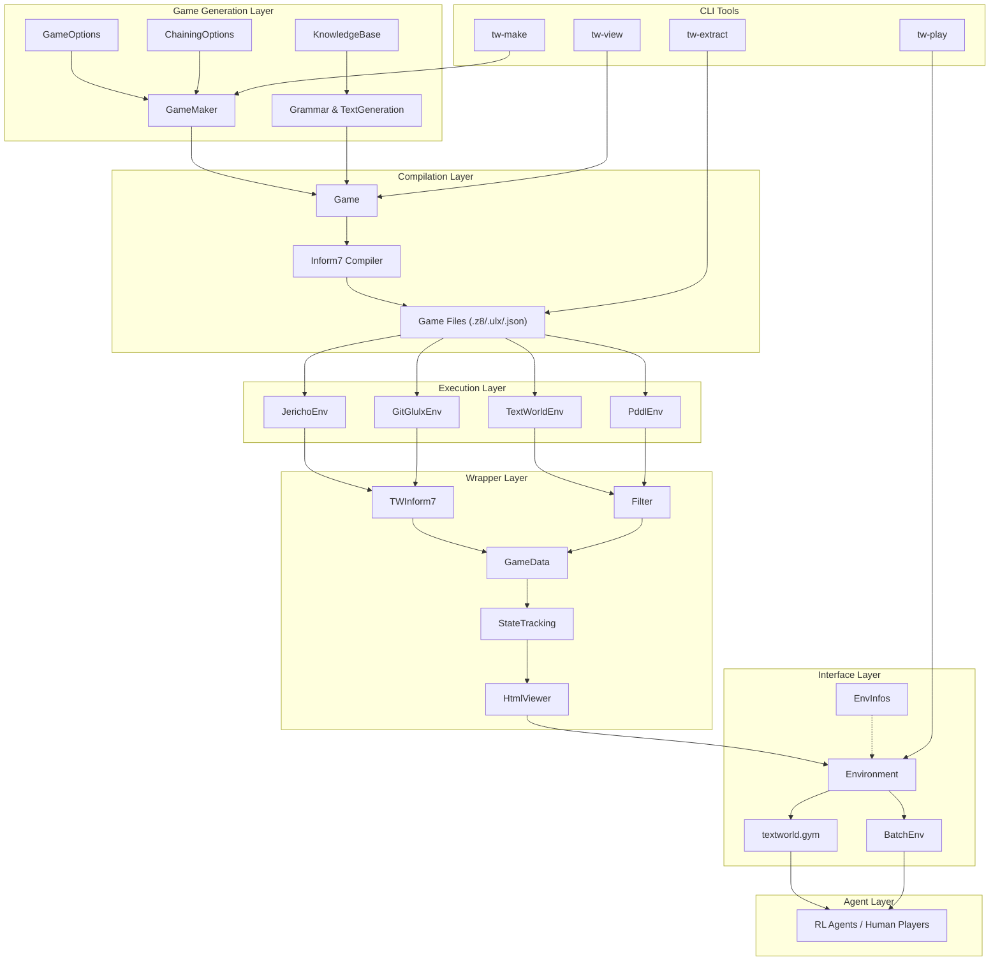

Sources: [textworld/envs/__init__.py:5-24](), [textworld/helpers.py:19-54](), [setup.py:51-58]()

## Core System Components

The following diagram details the primary classes and modules that implement TextWorld's functionality:

**Core Implementation Components**
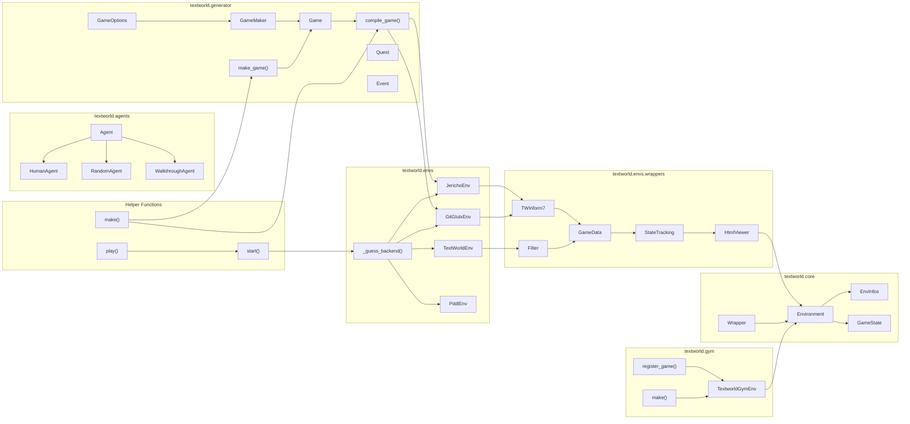

Sources: [textworld/helpers.py:19-116](), [textworld/envs/__init__.py:1-25](), [textworld/testing.py:48-110]()

## Entry Points and Usage Patterns

TextWorld provides multiple interfaces for different use cases:

### Programmatic Interface
The `textworld.helpers` module provides the primary programmatic entry points:

- **`start(path, request_infos, wrappers)`** - Load and start a game environment 
- **`play(game_file, agent, max_nb_steps, wrappers)`** - Play a game with an agent
- **`make(options)`** - Generate a new game programmatically

### Command Line Interface  
Six command-line tools provide direct access to TextWorld functionality:

- **`tw-make`** - Generate games with customizable parameters
- **`tw-play`** - Play games interactively or with automated agents  
- **`tw-extract`** - Extract data and statistics from game files
- **`tw-view`** - Visualize game states as graphs
- **`tw-stats`** - Generate statistical reports
- **`tw-data`** - Manage game data and challenges

### Gym Integration
The `textworld.gym` module enables seamless integration with RL frameworks:

```python
import textworld.gym
env_id = textworld.gym.register_game("game.z8", max_episode_steps=50)
env = textworld.gym.make(env_id)
```

Sources: [textworld/helpers.py:19-116](), [setup.py:51-58](), [README.md:88-116]()

## Supported Game Formats

TextWorld supports multiple game file formats through specialized backend environments:

| Format | Extension | Backend | Description |
|--------|-----------|---------|-------------|
| Z-machine | `.z1` - `.z8` | `JerichoEnv` | Classic interactive fiction format |
| Glulx | `.ulx` | `GitGlulxEnv` | Extended interactive fiction format |
| TextWorld JSON | `.json` | `TextWorldEnv` | Native TextWorld format |
| PDDL | `.tw-pddl` | `PddlEnv` | Planning domain format |

The `_guess_backend()` function automatically selects the appropriate environment based on file extension.

Sources: [textworld/envs/__init__.py:12-24](), [README.md:80-81]()

---

# Page: Installation and Setup

# Installation and Setup

<details>
<summary>Relevant source files</summary>

The following files were used as context for generating this wiki page:

- [CHANGELOG.md](CHANGELOG.md)
- [MANIFEST.in](MANIFEST.in)
- [README.md](README.md)
- [docker/Dockerfile](docker/Dockerfile)
- [docker/README.md](docker/README.md)
- [pyproject.toml](pyproject.toml)
- [requirements-full.txt](requirements-full.txt)
- [requirements.txt](requirements.txt)
- [setup.py](setup.py)
- [setup.sh](setup.sh)
- [textworld/__init__.py](textworld/__init__.py)
- [textworld/envs/wrappers/viewer.py](textworld/envs/wrappers/viewer.py)
- [textworld/version.py](textworld/version.py)
- [tools/prep-release.sh](tools/prep-release.sh)

</details>


This page covers the installation and setup procedures for TextWorld, including system requirements, dependencies, and configuration options. For information about development environment setup and contributing to TextWorld, see [Development](#9). For details about the command-line tools that become available after installation, see [Command Line Tools](#7).

## Prerequisites and System Requirements

TextWorld supports specific Python versions and operating systems with additional system-level dependencies required for compilation and execution.

### Supported Platforms

| Platform | Support Level | Notes |
|----------|---------------|-------|
| Linux (Debian/Ubuntu) | Full | Primary development platform |
| macOS | Full | Requires additional setup steps |
| Windows | Docker only | Native installation not supported |

### Python Version Requirements

TextWorld requires Python 3.9, 3.10, 3.11, or 3.12. The version constraints are defined in [pyproject.toml:27-30]() and enforced during installation.

### System Dependencies

#### Linux (Debian/Ubuntu)
```bash
sudo apt update && sudo apt install build-essential libffi-dev python3-dev curl git
```

#### macOS
```bash
brew install libffi curl git
```

These dependencies support the compilation of native components including the Glulx interpreter and Inform7 integration.

Sources: [README.md:13-26](), [pyproject.toml:16-32]()

## Installation Flow Architecture

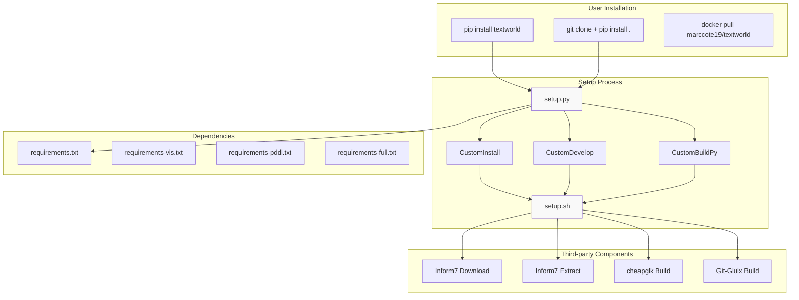

Sources: [setup.py:16-48](), [setup.sh:1-78]()

## Core Installation

### Standard Installation

The recommended installation method uses pip to install from PyPI:

```bash
pip install textworld
```

This triggers the `CustomInstall` class in [setup.py:21-25]() which executes [setup.sh:1-78]() to build required third-party components.

### Development Installation

For development or to install from source:

```bash
git clone https://github.com/microsoft/TextWorld.git
cd TextWorld
pip install .
```

This uses the `CustomDevelop` class in [setup.py:28-32]() with the same setup process.

### Virtual Environment Recommendation

TextWorld installation should use virtual environments to prevent package conflicts:

```bash
# Using conda
conda create -n textworld python=3.11
conda activate textworld

# Using venv
python -m venv textworld-env
source textworld-env/bin/activate  # Linux/macOS
# textworld-env\Scripts\activate  # Windows
```

Sources: [README.md:26-36](), [setup.py:41-48]()

## Third-Party Dependencies Setup

TextWorld requires several third-party components that are automatically installed via [setup.sh:1-78]():

### Inform7 Compiler Installation

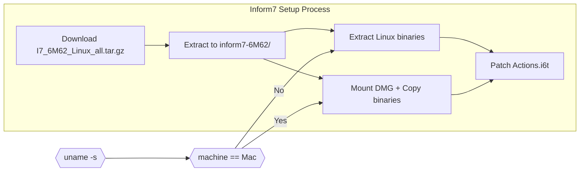

The setup process downloads Inform7 6M62 from [http://emshort.com/inform-app-archive/6M62/]() and handles platform-specific installation:

- **Linux**: Extracts `inform7-compilers` and `inform7-interpreters` tarballs based on architecture
- **macOS**: Mounts the DMG file and copies compiled binaries from the Inform.app bundle

Sources: [setup.sh:20-64]()

### Glulx Components Build

The Glulx interpreter components are built from local sources:

1. **cheapglk**: A minimal GLK library implementation built in [textworld/thirdparty/glulx/cheapglk]()
2. **Git-Glulx**: The Glulx interpreter built in [textworld/thirdparty/glulx/Git-Glulx]()

Both components use Makefiles and are built with `make -B` to force rebuilding.

Sources: [setup.sh:67-77]()

## Optional Components

### Visualization Dependencies

For game state visualization and HTML viewer functionality:

```bash
pip install textworld[vis]
```

This installs additional packages defined in [requirements-vis.txt]() including:
- `selenium` for web browser automation
- `flask` for web server functionality  
- `pillow` for image processing
- `plotly` for interactive visualizations

#### WebDriver Setup

Visualization requires a WebDriver for browser automation:

```bash
# For Chrome
pip install chromedriver_installer

# Or manually install Firefox geckodriver
```

The `HtmlViewer` wrapper in [textworld/envs/wrappers/viewer.py:13-106]() uses these drivers to provide real-time game visualization.

Sources: [README.md:38-49](), [requirements-vis.txt]()

### PDDL Support

For integration with ALFWorld and PDDL-based planning:

```bash
pip install textworld[pddl]
```

This adds the `fast-downward-textworld` dependency for PDDL domain planning.

### Full Installation

To install all optional dependencies:

```bash
pip install textworld[full]
```

Sources: [setup.py:69-73](), [requirements-pddl.txt](), [requirements-full.txt]()

## Docker Alternative

For Windows users or simplified deployment, a Docker container is available:

```bash
docker pull marccote19/textworld
docker run -p 8888:8888 -it --rm marccote19/textworld
```

### Docker Container Components

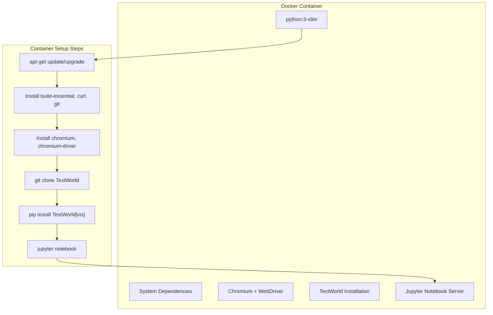

The container automatically starts a Jupyter notebook server accessible at `http://127.0.0.1:8888` with a token-based authentication.

Sources: [docker/Dockerfile:1-28](), [docker/README.md:1-33]()

## Installation Verification

After installation, verify TextWorld is working correctly:

### Command-Line Tools Verification

```bash
# Check tool availability
tw-make --help
tw-play --help
tw-extract --help

# Generate a simple game
tw-make custom --world-size 2 --nb-objects 3 --quest-length 2 --output test_game.z8

# Play the generated game
tw-play test_game.z8
```

### Python API Verification

```python
import textworld
import textworld.gym

# Check version
print(textworld.__version__)

# Test game generation
env_id = textworld.gym.register_game("test_game.z8", max_episode_steps=50)
env = textworld.gym.make(env_id)
obs, infos = env.reset()
print("Installation successful!")
env.close()
```

### Visualization Verification

```bash
# Test visualization (if installed)
tw-play test_game.z8 --viewer
```

This should open a browser window displaying the game state visualization.

Sources: [README.md:67-113](), [scripts/tw-make](), [scripts/tw-play]()

## Troubleshooting Common Issues

### Missing System Dependencies

**Error**: `fatal error: 'ffi.h' file not found`
**Solution**: Install libffi development headers:
```bash
# Ubuntu/Debian
sudo apt install libffi-dev

# macOS  
brew install libffi
```

### Inform7 Compilation Issues

**Error**: Inform7 compiler not found
**Solution**: Ensure [setup.sh:1-78]() completed successfully. The Inform7 binaries should be in `textworld/thirdparty/inform7-6M62/share/inform7/Compilers/`.

### WebDriver Issues

**Error**: `WebdriverNotFoundError` when using visualization
**Solution**: Install appropriate WebDriver:
```bash
pip install chromedriver_installer
```

### Docker Port Conflicts

**Error**: `bind: address already in use`
**Solution**: Use a different host port:
```bash
docker run -p 9999:8888 -it --rm marccote19/textworld
```

Sources: [textworld/envs/wrappers/viewer.py:92-94](), [docker/README.md:18-32]()

---

# Page: Core Concepts

# Core Concepts

<details>
<summary>Relevant source files</summary>

The following files were used as context for generating this wiki page:

- [textworld/generator/game.py](textworld/generator/game.py)
- [textworld/generator/maker.py](textworld/generator/maker.py)
- [textworld/generator/tests/test_game.py](textworld/generator/tests/test_game.py)
- [textworld/logic/__init__.py](textworld/logic/__init__.py)
- [textworld/logic/logic.ebnf](textworld/logic/logic.ebnf)
- [textworld/logic/parser.py](textworld/logic/parser.py)
- [textworld/logic/tests/test_logic.py](textworld/logic/tests/test_logic.py)

</details>


This document explains the fundamental data structures and concepts that form the foundation of TextWorld. These core abstractions enable the creation, representation, and manipulation of text-based interactive fiction games. For information about using these concepts to generate games, see [Game Generation](#4). For details on executing games in environments, see [Game Environments](#5).

## Game Structure

TextWorld represents interactive fiction games through three primary classes that define the game's objectives and narrative structure.

### Game Class Hierarchy

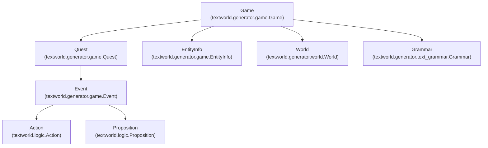

**Sources:** [textworld/generator/game.py:386-638]()

The `Game` class [textworld/generator/game.py:386]() serves as the top-level container that combines a world representation with optional quests and text generation rules. Each game contains:

- **World**: The physical layout and initial state
- **Quests**: Optional objectives for players to complete
- **Grammar**: Rules for generating natural language descriptions
- **Entity Information**: Metadata about objects, rooms, and characters

### Quest and Event System

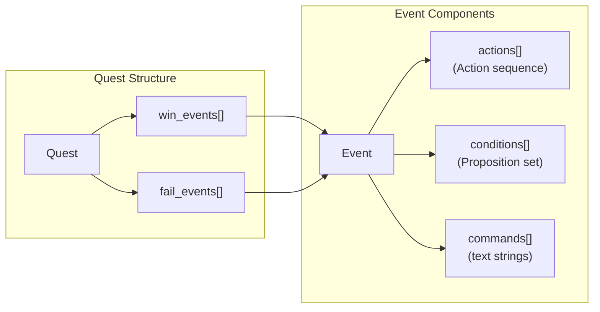

**Sources:** [textworld/generator/game.py:176-320](), [textworld/generator/game.py:63-174]()

A `Quest` [textworld/generator/game.py:176]() defines game objectives through mutually exclusive sets of winning and failing events. The quest system supports:

- **Win Events**: Alternative ways to complete the quest successfully
- **Fail Events**: Conditions that cause quest failure
- **Rewards**: Numeric rewards for completion
- **Optional/Repeatable**: Flags for quest behavior

An `Event` [textworld/generator/game.py:63]() represents a triggerable condition defined by either:
- A sequence of `actions` that must be performed
- A set of `conditions` (propositions) that must become true
- Human-readable `commands` corresponding to the actions

## Logic System

TextWorld uses a first-order logic system to represent world states and the actions that can modify them. This system provides the mathematical foundation for game mechanics.

### Core Logic Components

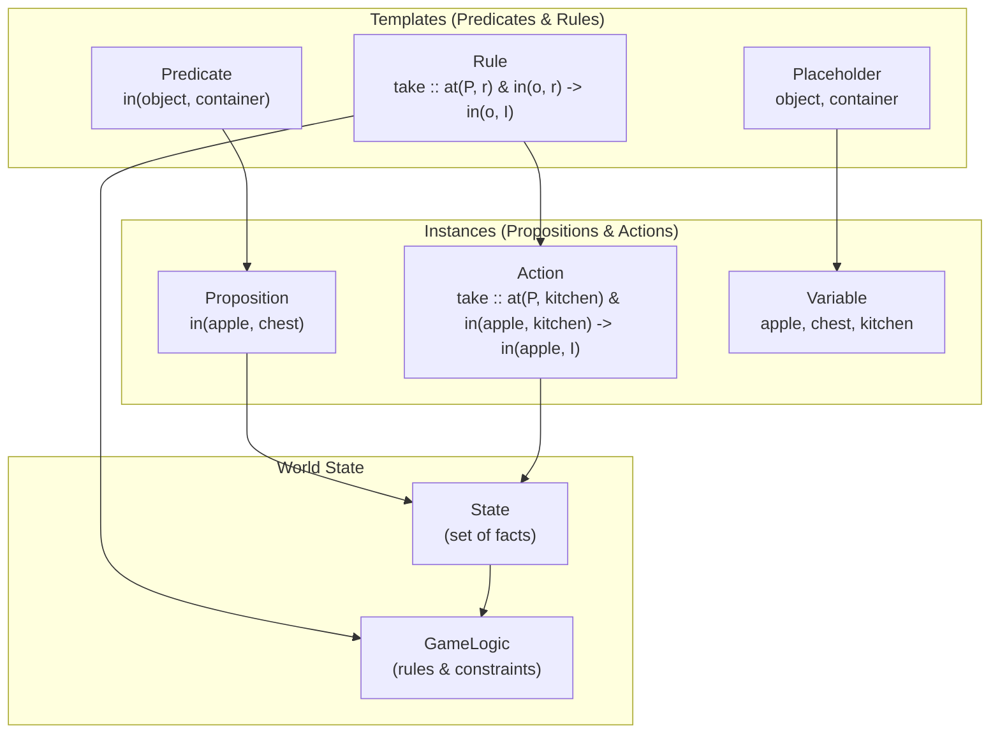

**Sources:** [textworld/logic/__init__.py:464-540](), [textworld/logic/__init__.py:620-713](), [textworld/logic/__init__.py:1270-1420]()

### Variables and Propositions

A `Variable` [textworld/logic/__init__.py:464]() represents a concrete entity in the game world with a unique name and type:

```python
# Examples from the codebase
apple = Variable("apple", "f")  # food item
kitchen = Variable("kitchen", "r")  # room
```

A `Proposition` [textworld/logic/__init__.py:620]() represents a fact about the world state by applying a predicate to specific variables:

```python
# Fact: the apple is in the kitchen
in_kitchen = Proposition("in", [apple, kitchen])
```

### Actions and Rules

A `Rule` [textworld/logic/__init__.py:1270]() defines a template for actions with placeholders:

```python
# Template: taking objects from rooms
take_rule = Rule("take", 
    preconditions=[at(P, r), in(o, r)],  # player at room, object in room
    postconditions=[in(o, I)]  # object in inventory
)
```

An `Action` [textworld/logic/__init__.py:1026]() is a concrete instance of a rule with specific variables, representing something that can happen in the game world.

**Sources:** [textworld/logic/__init__.py:1026-1269](), [textworld/logic/__init__.py:1270-1420]()

### State Management

The `State` class [textworld/logic/__init__.py:1421]() maintains the current set of true propositions and provides methods to:

- Check if propositions are facts: `state.is_fact(proposition)`
- Apply actions to change the state: `state.apply(action)`
- Find applicable actions: `state.all_applicable_actions(rules)`
- Test action sequences: `state.is_sequence_applicable(actions)`

**Sources:** [textworld/logic/__init__.py:1421-1750]()

## World Building System

The `GameMaker` class provides a stateful interface for constructing game worlds by managing entities, rooms, and their relationships.

### GameMaker Architecture

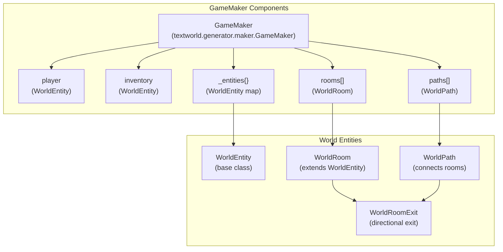

**Sources:** [textworld/generator/maker.py:349-881]()

### Entity System

A `WorldEntity` [textworld/generator/maker.py:77]() represents any object in the game world and encapsulates:

- **Variable**: The underlying logic representation
- **Properties**: Facts that apply only to this entity (e.g., "closed", "locked")
- **Facts**: All propositions involving this entity
- **Content**: Child entities contained within this entity
- **Entity Info**: Display name, description, and text generation metadata

**Sources:** [textworld/generator/maker.py:77-236]()

```python
# Creating entities with GameMaker
M = GameMaker()
chest = M.new(type='c', name='wooden chest')  # container
chest.add_property('closed')  # chest starts closed
apple = M.new(type='f', name='red apple')  # food
chest.add(apple)  # apple is inside chest
```

### Room and Path System

A `WorldRoom` [textworld/generator/maker.py:238]() extends `WorldEntity` with directional exits for each compass direction. Rooms are connected through `WorldPath` objects [textworld/generator/maker.py:284]() that can optionally contain doors.

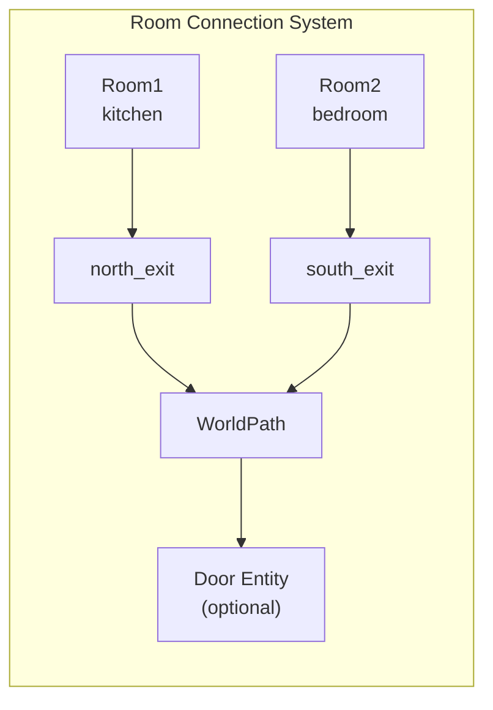

**Sources:** [textworld/generator/maker.py:238-347]()

## Integration and Game Building

The core concepts work together through the `GameMaker.build()` method [textworld/generator/maker.py:769](), which transforms the high-level world description into the formal logic representation required by the game engine.

### Build Process Flow

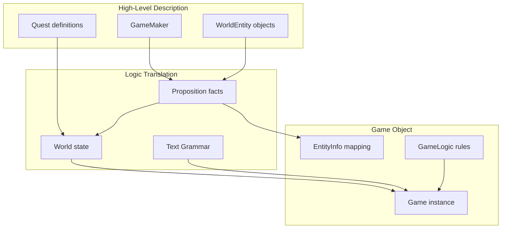

**Sources:** [textworld/generator/maker.py:769-807]()

The build process:

1. **Validates** the world state against knowledge base constraints
2. **Extracts facts** from all entities, rooms, and paths
3. **Creates a World** object from the collected facts  
4. **Builds a Game** object combining world, quests, and grammar
5. **Generates text** descriptions using the grammar system
6. **Preserves metadata** like entity names and descriptions

This architecture enables TextWorld to seamlessly bridge between intuitive world-building operations (adding objects to rooms) and the formal logical representations needed for game execution and AI training.

**Sources:** [textworld/generator/game.py:386-638](), [textworld/generator/maker.py:349-881](), [textworld/logic/__init__.py:1421-1750]()

---

# Page: Game Structure

# Game Structure

<details>
<summary>Relevant source files</summary>

The following files were used as context for generating this wiki page:

- [textworld/generator/game.py](textworld/generator/game.py)
- [textworld/generator/maker.py](textworld/generator/maker.py)
- [textworld/generator/tests/test_game.py](textworld/generator/tests/test_game.py)

</details>


This document covers the core data structures and classes that represent TextWorld games. These classes define how game worlds, quests, events, and entities are structured and managed within the system. For information about the underlying logic system (propositions, actions, rules), see [Logic System](#3.2). For text generation and grammar systems, see [Text Generation](#3.3).

## Core Game Representation Classes

TextWorld games are represented through a hierarchy of interconnected classes that capture both the static world structure and dynamic gameplay elements.

### Game Class

The `Game` class [textworld/generator/game.py:386-638]() is the top-level container that represents a complete TextWorld game. It encapsulates:

- **World structure**: The physical layout, rooms, and objects
- **Quest system**: Objectives and winning/failing conditions  
- **Grammar**: Text generation rules for descriptions
- **Metadata**: Additional game information and properties

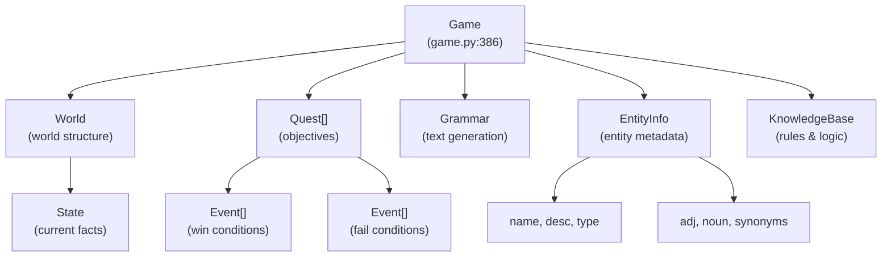

Sources: [textworld/generator/game.py:386-638]()

### Game Metadata and Properties

The `Game` class provides several computed properties for introspecting game content:

| Property | Description | Source |
|----------|-------------|---------|
| `max_score` | Sum of all quest rewards | [textworld/generator/game.py:533-538]() |
| `command_templates` | Available command patterns | [textworld/generator/game.py:541-543]() |
| `objects_names` | Names of all game objects | [textworld/generator/game.py:555-561]() |
| `verbs` | Action verbs recognized in game | [textworld/generator/game.py:577-580]() |
| `possible_commands` | All possible player commands | [textworld/generator/game.py:583-588]() |

Sources: [textworld/generator/game.py:533-608]()

## Quest and Event System

TextWorld uses a quest-event model to define game objectives and narrative structure.

### Quest Structure

A `Quest` [textworld/generator/game.py:176-320]() represents a game objective with:

- **Win events**: Mutually exclusive conditions for completing the quest
- **Fail events**: Conditions that cause quest failure  
- **Reward**: Points awarded for completion
- **Optional/Repeatable flags**: Whether quest is required or can be completed multiple times

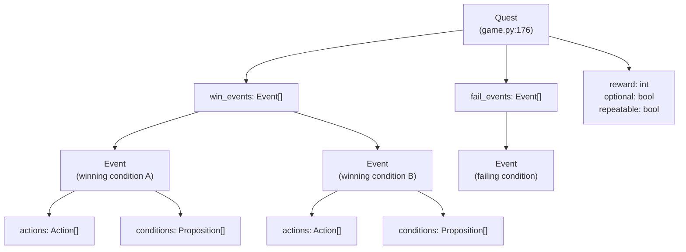

Sources: [textworld/generator/game.py:176-320]()

### Event Definition

An `Event` [textworld/generator/game.py:63-174]() represents something that can happen in the game:

- **Actions**: Sequence of actions that trigger the event
- **Conditions**: Propositions that must be true for triggering
- **Commands**: Human-readable text commands
- **Trigger condition**: Automatically generated logical condition for event activation

Events can be defined either by providing explicit actions or by specifying the required end conditions. If only actions are provided, the conditions are derived from the final action's postconditions.

Sources: [textworld/generator/game.py:63-174]()

## World Entity System

The physical game world is represented through entity classes that model rooms, objects, and their relationships.

### WorldEntity Hierarchy

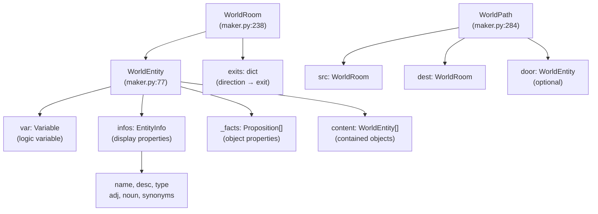

Sources: [textworld/generator/maker.py:77-347]()

### Entity Relationships

WorldEntity objects can contain other entities, forming a containment hierarchy:

- **Rooms** contain objects and the player
- **Containers** can hold objects  
- **Supporters** have objects placed on them
- **Player inventory** holds carried items

The containment relationships are represented both as object references (`content`, `parent`) and as logical facts (`at`, `in`, `on` propositions).

Sources: [textworld/generator/maker.py:167-196]()

## Game Progression Tracking

TextWorld includes a sophisticated system for tracking quest progress and game state changes.

### Progression Class Hierarchy

```mermaid
graph TB
    GameProgression["GameProgression<br/>(game.py:982)"] --> QuestProgressions["quest_progressions:<br/>QuestProgression[]"]
    GameProgression --> GameState["state: State<br/>(current world state)"]
    GameProgression --> ValidActions["valid_actions: Action[]"]
    
    QuestProgression["QuestProgression<br/>(game.py:886)"] --> Quest["quest: Quest"]
    QuestProgression --> WinEventProgressions["win_events:<br/>EventProgression[]"]
    QuestProgression --> FailEventProgressions["fail_events:<br/>EventProgression[]"]
    QuestProgression --> Completions["nb_completions: int"]
    
    EventProgression["EventProgression<br/>(game.py:761)"] --> Event["event: Event"]
    EventProgression --> DependencyTree["_tree:<br/>ActionDependencyTree"]
    EventProgression --> Policy["_policy: Action[]<br/>(actions to complete)"]
    EventProgression --> Status["triggered: bool<br/>untriggerable: bool"]
```

Sources: [textworld/generator/game.py:761-1096]()

### Progression State Management

The progression system tracks three key states:

1. **Triggered**: Event conditions have been satisfied
2. **Untriggerable**: Event can no longer be completed due to irreversible actions
3. **In Progress**: Event is still achievable and being tracked

When actions are applied, the progression system:
- Updates the game state
- Checks for newly triggered events
- Recomputes winning policies using dependency trees
- Detects irreversible failures

Sources: [textworld/generator/game.py:824-883]()

## Serialization and Data Management

All core game structure classes support JSON serialization for saving and loading games.

### Serialization Methods

Each major class implements the serialization pattern:

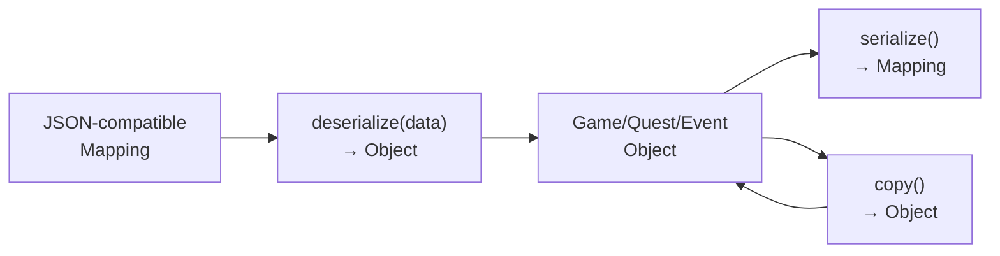

Key serialization features:
- **Version tracking**: Games include version numbers for compatibility [textworld/generator/game.py:393]()
- **Deep serialization**: All nested objects are recursively serialized
- **Copy operations**: All classes support deep copying via serialize/deserialize

### EntityInfo Management

The `EntityInfo` class [textworld/generator/game.py:322-384]() stores display-related metadata for game entities:

- **Identity**: `id`, `type`, `name`
- **Linguistic properties**: `adj`, `noun`, `synonyms`  
- **Display text**: `desc`, `definite`, `indefinite`
- **Context**: `room_type` for location-dependent naming

This separation allows the logical game state (variables, facts) to remain independent from presentation details (names, descriptions).

Sources: [textworld/generator/game.py:322-384](), [textworld/generator/game.py:393](), [textworld/generator/game.py:473-514]()

## Game Configuration

### GameOptions Class

The `GameOptions` class [textworld/generator/game.py:1098-1268]() provides comprehensive configuration for game generation:

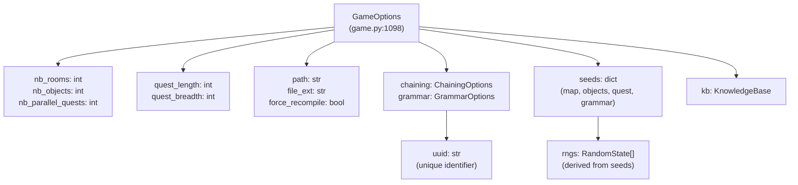

The options system provides deterministic game generation through seed management and supports both quick configuration (quest_length, quest_breadth) and detailed control through sub-options.

Sources: [textworld/generator/game.py:1098-1268]()

---

# Page: Logic System

# Logic System

<details>
<summary>Relevant source files</summary>

The following files were used as context for generating this wiki page:

- [textworld/logic/__init__.py](textworld/logic/__init__.py)
- [textworld/logic/logic.ebnf](textworld/logic/logic.ebnf)
- [textworld/logic/parser.py](textworld/logic/parser.py)
- [textworld/logic/tests/test_logic.py](textworld/logic/tests/test_logic.py)

</details>


The Logic System provides the foundational first-order logic framework for representing game world states, actions, and rules in TextWorld. This system enables precise reasoning about game mechanics, state transitions, and constraint validation through a formal logical representation.

For information about game structure and world modeling, see [Game Structure](#3.1). For text generation based on logical states, see [Text Generation](#3.3).

## Purpose and Architecture

The Logic System implements a first-order logic framework where game worlds are represented as sets of logical propositions, and actions are defined as state transformations with preconditions and postconditions. The system supports type hierarchies, rule templates, constraint validation, and integration with the Inform7 compiler.

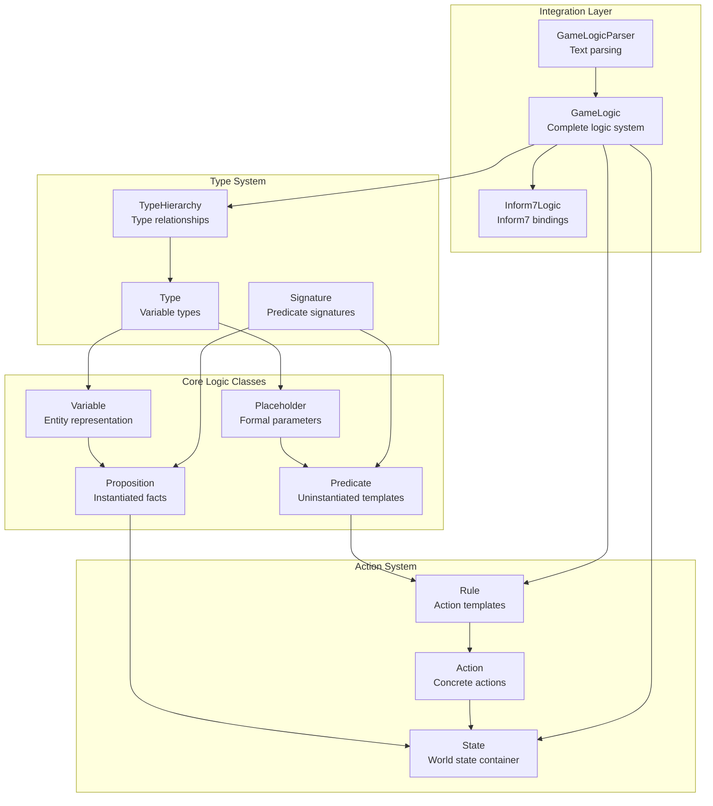

Sources: [textworld/logic/__init__.py:24-40]()

## Type System

The type system provides hierarchical typing for variables and supports inheritance relationships between types. The `TypeHierarchy` class manages parent-child relationships and enables polymorphic matching.

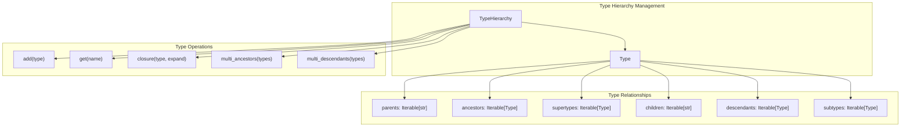

Sources: [textworld/logic/__init__.py:221-462]()

### Type Class Structure

| Property | Description | Return Type |
|----------|-------------|-------------|
| `name` | Type identifier | `str` |
| `parents` | Direct parent type names | `tuple[str]` |
| `parent_types` | Parent Type objects | `Iterable[Type]` |
| `ancestors` | All ancestor types | `Iterable[Type]` |
| `supertypes` | This type + ancestors | `Iterable[Type]` |
| `children` | Direct child type names | `Iterable[str]` |
| `descendants` | All descendant types | `Iterable[Type]` |
| `subtypes` | This type + descendants | `Iterable[Type]` |

Sources: [textworld/logic/__init__.py:234-294]()

## Logic Expression Classes

The system defines several classes for representing logical expressions, from concrete instances to abstract templates.

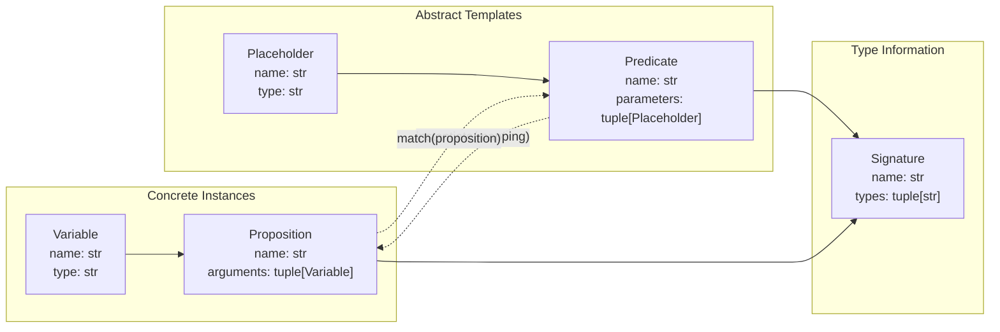

Sources: [textworld/logic/__init__.py:464-930]()

### Variable and Placeholder Classes

Both `Variable` and `Placeholder` share similar structure but serve different purposes:

```mermaid
graph TB
    subgraph "Variable (Concrete)"
        Variable_parse["parse(expr: str)"]
        Variable_serialize["serialize()"]
        Variable_deserialize["deserialize(data)"]
        Variable_is_a["is_a(type: Type)"]
    end
    
    subgraph "Placeholder (Template)"
        Placeholder_parse["parse(expr: str)"]
        Placeholder_serialize["serialize()"]  
        Placeholder_deserialize["deserialize(data)"]
    end
    
    subgraph "Common Properties"
        name["name: str"]
        type_prop["type: str"]
        hash_prop["_hash: int"]
    end
    
    Variable_parse --> name
    Variable_serialize --> name
    Variable_deserialize --> name
    Variable_is_a --> type_prop
    
    Placeholder_parse --> name
    Placeholder_serialize --> name
    Placeholder_deserialize --> name
    
    name --> hash_prop
    type_prop --> hash_prop
```

Sources: [textworld/logic/__init__.py:464-540](), [textworld/logic/__init__.py:716-788]()

### Proposition and Predicate Relationship

```mermaid
graph TB
    subgraph "Predicate Template"
        Predicate_name["name: str"]
        Predicate_parameters["parameters: tuple[Placeholder]"]
        Predicate_signature["signature: Signature"]
        
        instantiate_method["instantiate(mapping)"]
        match_method["match(proposition)"]
        substitute_method["substitute(mapping)"]
    end
    
    subgraph "Proposition Instance"
        Proposition_name["name: str"]
        Proposition_arguments["arguments: tuple[Variable]"]
        Proposition_signature["signature: Signature"]
        
        negate_method["negate()"]
        is_negation_prop["is_negation: bool"]
    end
    
    Predicate_name --> instantiate_method
    Predicate_parameters --> instantiate_method
    instantiate_method --> Proposition_name
    instantiate_method --> Proposition_arguments
    
    Proposition_name --> match_method
    Proposition_arguments --> match_method
    match_method --> Predicate_parameters
    
    Predicate_signature --> Proposition_signature
```

Sources: [textworld/logic/__init__.py:621-713](), [textworld/logic/__init__.py:791-930]()

## Rules and Actions

Rules serve as templates for actions, defining patterns of state transformation that can be instantiated with specific variables.

```mermaid
graph TB
    subgraph "Rule Template"
        Rule_name["name: str"]
        Rule_preconditions["preconditions: tuple[Predicate]"]
        Rule_postconditions["postconditions: tuple[Predicate]"]
        Rule_placeholders["placeholders: tuple[Placeholder]"]
        
        Rule_instantiate["instantiate(mapping)"]
        Rule_match["match(action)"]
        Rule_inverse["inverse(name)"]
    end
    
    subgraph "Action Instance"
        Action_name["name: str"]
        Action_preconditions["preconditions: tuple[Proposition]"]
        Action_postconditions["postconditions: tuple[Proposition]"]
        Action_variables["variables: tuple[Variable]"]
        
        Action_added["added: Collection[Proposition]"]
        Action_removed["removed: Collection[Proposition]"]
        Action_inverse["inverse(name)"]
    end
    
    subgraph "Command Integration"
        command_template["command_template: str"]
        feedback_rule["feedback_rule: Rule"]
        reverse_name["reverse_name: str"]
        format_command["format_command(mapping)"]
    end
    
    Rule_instantiate --> Action_name
    Rule_instantiate --> Action_preconditions
    Rule_instantiate --> Action_postconditions
    
    Action_preconditions --> Action_added
    Action_postconditions --> Action_added
    Action_preconditions --> Action_removed
    Action_postconditions --> Action_removed
    
    Rule_name --> command_template
    Action_name --> format_command
```

Sources: [textworld/logic/__init__.py:958-1098](), [textworld/logic/__init__.py:1099-1327]()

### Rule Instantiation Process

| Step | Input | Process | Output |
|------|-------|---------|---------|
| 1 | `Rule` + `Mapping[Placeholder, Variable]` | Map placeholders to variables | Variable assignments |
| 2 | Precondition predicates | `predicate.instantiate(mapping)` | Precondition propositions |
| 3 | Postcondition predicates | `predicate.instantiate(mapping)` | Postcondition propositions |
| 4 | Command template | String formatting with variables | Executable command |
| 5 | All components | `Action` constructor | Concrete `Action` |

Sources: [textworld/logic/__init__.py:1242-1271]()

## State Management

The `State` class manages the current world state as a collection of true propositions and provides methods for querying and modifying the state.

```mermaid
graph TB
    subgraph "State Class"
        State_logic["logic: GameLogic"]
        State_facts["facts: Set[Proposition]"]
        State_variables_by_type["_variables_by_type: Dict[str, Set[Variable]]"]
        
        is_fact["is_fact(proposition)"]
        add_fact["add_fact(proposition)"]
        remove_fact["remove_fact(proposition)"]
        variables_of_type["variables_of_type(type)"]
        all_instantiations["all_instantiations(rule)"]
        is_applicable["is_applicable(action)"]
        apply["apply(*actions)"]
    end
    
    subgraph "State Operations"
        query_facts["Query current facts"]
        modify_state["Modify world state"]
        validate_actions["Validate action applicability"]
        generate_actions["Generate possible actions"]
    end
    
    State_facts --> is_fact
    State_facts --> add_fact
    State_facts --> remove_fact
    State_variables_by_type --> variables_of_type
    
    is_fact --> query_facts
    add_fact --> modify_state
    remove_fact --> modify_state
    all_instantiations --> generate_actions
    is_applicable --> validate_actions
    apply --> modify_state
```

Sources: [textworld/logic/__init__.py:1682-1918]()

### State Transition Example

```mermaid
sequenceDiagram
    participant S as State
    participant R as Rule
    participant A as Action
    
    S->>S: Check current facts
    S->>R: all_instantiations(rule)
    R-->>S: Return possible actions
    S->>A: is_applicable(action)
    A-->>S: Check preconditions
    S->>S: apply(action)
    Note over S: Remove preconditions<br/>Add postconditions
    S->>S: Update variable tracking
```

Sources: [textworld/logic/tests/test_logic.py:130-161]()

## Parsing System

The logic system includes a complete parser for textual representations of logical expressions, built using the TatSu parsing framework.

```mermaid
graph TB
    subgraph "Parser Components"
        GameLogicParser_class["GameLogicParser"]
        GameLogicModelBuilderSemantics["GameLogicModelBuilderSemantics"]
        ModelConverter["_ModelConverter"]
        grammar_file["logic.ebnf"]
    end
    
    subgraph "Parsing Flow"
        text_input["Text Input"]
        parse_method["parse()"]
        ast_model["AST Model"]
        walk_method["walk()"]
        logic_objects["Logic Objects"]
    end
    
    subgraph "Parse Methods"
        Variable_parse_method["Variable.parse()"]
        Proposition_parse_method["Proposition.parse()"]
        Predicate_parse_method["Predicate.parse()"]
        Rule_parse_method["Rule.parse()"]
        Action_parse_method["Action.parse()"]
    end
    
    grammar_file --> GameLogicParser_class
    GameLogicParser_class --> parse_method
    text_input --> parse_method
    parse_method --> ast_model
    ModelConverter --> walk_method
    ast_model --> walk_method
    walk_method --> logic_objects
    
    Variable_parse_method --> parse_method
    Proposition_parse_method --> parse_method
    Predicate_parse_method --> parse_method
    Rule_parse_method --> parse_method
    Action_parse_method --> parse_method
```

Sources: [textworld/logic/parser.py:44-649](), [textworld/logic/__init__.py:66-218]()

### Grammar Structure

| Element | Pattern | Example |
|---------|---------|---------|
| Variable | `name [":" type]` | `P`, `kitchen: r` |
| Proposition | `name "(" arguments ")"` | `at(P, kitchen: r)` |
| Predicate | `name "(" parameters ")"` | `at(P, r)` |
| Action | `name "::" preconditions "->" postconditions` | `take :: at(P, r) & in(o, r) -> in(o, I)` |
| Rule | `name "::" preconditions "->" postconditions` | `take :: at(P, r) & in(o, r) -> in(o, I)` |

Sources: [textworld/logic/logic.ebnf:20-37]()

## Game Logic Integration

The `GameLogic` class serves as the central coordinator for all logic system components, managing types, predicates, rules, and their relationships.

```mermaid
graph TB
    subgraph "GameLogic Components"
        GameLogic_types["types: TypeHierarchy"]
        GameLogic_predicates["predicates: Set[Signature]"]
        GameLogic_aliases["aliases: Dict[Signature, Alias]"]
        GameLogic_rules["rules: Dict[str, Rule]"]
        GameLogic_constraints["constraints: Dict[str, Rule]"]
        GameLogic_inform7["inform7: Inform7Logic"]
    end
    
    subgraph "Logic Operations"
        parse_method["parse(document)"]
        load_method["load(path)"]
        add_predicate["_add_predicate(signature)"]
        add_rule["_add_rule(rule)"]
        add_constraint["_add_constraint(constraint)"]
    end
    
    subgraph "Inform7 Integration"
        Inform7Logic_types["types: Dict[str, Inform7Type]"]
        Inform7Logic_predicates["predicates: Dict[Signature, Inform7Predicate]"]
        Inform7Logic_commands["commands: Dict[str, Inform7Command]"]
        Inform7Logic_code["code: str"]
    end
    
    GameLogic_types --> parse_method
    GameLogic_predicates --> add_predicate
    GameLogic_rules --> add_rule
    GameLogic_constraints --> add_constraint
    GameLogic_inform7 --> Inform7Logic_types
    GameLogic_inform7 --> Inform7Logic_predicates
    GameLogic_inform7 --> Inform7Logic_commands
    GameLogic_inform7 --> Inform7Logic_code
```

Sources: [textworld/logic/__init__.py:1426-1682](), [textworld/logic/__init__.py:1373-1425]()

### Performance Optimizations

The logic system implements several performance optimizations for frequently-used operations:

| Optimization | Implementation | Purpose |
|--------------|----------------|---------|
| Immutability | Object sharing | Reduce memory allocation |
| `__slots__` | Limited attributes | Faster attribute access |
| Hash caching | `_hash` field | Speed up dictionary/set operations |
| Tuple comparison | Direct attribute comparison | Avoid tuple allocation |
| Rule instantiation cache | `_cache` field in Rule | Reuse instantiated actions |

Sources: [textworld/logic/__init__.py:42-58]()

---

# Page: Text Generation

# Text Generation

<details>
<summary>Relevant source files</summary>

The following files were used as context for generating this wiki page:

- [textworld/generator/data/__init__.py](textworld/generator/data/__init__.py)
- [textworld/generator/logger.py](textworld/generator/logger.py)
- [textworld/generator/tests/test_maker.py](textworld/generator/tests/test_maker.py)
- [textworld/generator/tests/test_text_generation.py](textworld/generator/tests/test_text_generation.py)
- [textworld/generator/tests/test_text_grammar.py](textworld/generator/tests/test_text_grammar.py)
- [textworld/generator/text_generation.py](textworld/generator/text_generation.py)
- [textworld/generator/text_grammar.py](textworld/generator/text_grammar.py)
- [textworld/logic/model.py](textworld/logic/model.py)
- [textworld/textgen/__init__.py](textworld/textgen/__init__.py)
- [textworld/textgen/model.py](textworld/textgen/model.py)
- [textworld/textgen/parser.py](textworld/textgen/parser.py)
- [textworld/textgen/textgen.ebnf](textworld/textgen/textgen.ebnf)

</details>


This document describes TextWorld's natural language text generation system, which converts logical game representations into human-readable descriptions. The system uses context-free grammars defined in `.twg` files to generate descriptions for game objects, rooms, quests, and instructions.

For information about the underlying logical representation of games, see [Logic System](#3.2). For details on how games are structured, see [Game Structure](#3.1).

## Grammar System Overview

TextWorld's text generation is built around a context-free grammar system that expands templates into natural language. The core components work together to transform abstract game entities into descriptive text.

```mermaid
graph TB
    subgraph "Grammar Files"
        TWG["*.twg files<br/>(Grammar Definitions)"]
        EBNF["textgen.ebnf<br/>(Grammar Syntax)"]
    end
    
    subgraph "Parsing Layer"
        Parser["TextGrammarParser"]
        Model["TextGrammar Model"]
        Alternatives["Alternative Classes"]
    end
    
    subgraph "Grammar Engine"
        Grammar["Grammar Class"]
        Options["GrammarOptions"]
        Expansion["Template Expansion"]
    end
    
    subgraph "Generation Process"
        TextGen["generate_text_from_grammar()"]
        ObjectDesc["assign_description_to_object()"]
        RoomDesc["assign_description_to_room()"]
        QuestDesc["assign_description_to_quest()"]
    end
    
    TWG --> Parser
    EBNF --> Parser
    Parser --> Model
    Model --> Alternatives
    Alternatives --> Grammar
    Options --> Grammar
    Grammar --> Expansion
    Expansion --> TextGen
    TextGen --> ObjectDesc
    TextGen --> RoomDesc
    TextGen --> QuestDesc
```

Sources: [textworld/generator/text_generation.py:107-145](), [textworld/generator/text_grammar.py:131-200](), [textworld/textgen/parser.py:44-181]()

## Grammar Files and Format

Grammar files use the `.twg` extension and follow a specific syntax for defining text generation rules. The grammar format supports literal text, adjective-noun pairs, and matching patterns for related objects.

```mermaid
graph LR
    subgraph "Grammar Rule Types"
        Literal["Literal Alternative<br/>simple text"]
        AdjNoun["AdjectiveNoun Alternative<br/>adj|noun format"]
        Match["Match Alternative<br/>obj1 <-> obj2"]
    end
    
    subgraph "Production Rules"
        Symbol["symbol: alternatives"]
        Separator["; separator"]
        Newline["\\n terminator"]
    end
    
    subgraph "File Structure"
        RoomTypes["#room_type#"]
        ObjectNames["#(object_type)#"]
        Descriptions["#object_desc#"]
        Instructions["#action_name#"]
    end
    
    Literal --> Symbol
    AdjNoun --> Symbol
    Match --> Symbol
    Symbol --> Separator
    Separator --> Newline
    
    RoomTypes --> ObjectNames
    ObjectNames --> Descriptions
    Descriptions --> Instructions
```

The grammar parser processes these files using TatSu, creating a structured representation that supports template expansion and variable substitution.

Sources: [textworld/textgen/textgen.ebnf:1-28](), [textworld/textgen/model.py:35-61](), [textworld/textgen/__init__.py:21-111]()

## Text Generation Process

The main text generation workflow transforms game entities into natural language through a multi-step process involving name assignment, description generation, and template expansion.

### Core Generation Pipeline

```mermaid
flowchart TD
    Game["Game Object"] --> AssignRoomTypes["Assign Room Types<br/>assign room_type to rooms"]
    AssignRoomTypes --> AssignNames["Assign Names<br/>assign_name_to_object()"]
    AssignNames --> AssignDescs["Assign Descriptions<br/>assign_description_to_object()"]
    AssignDescs --> GenerateRooms["Generate Room Descriptions<br/>assign_description_to_room()"]
    GenerateRooms --> GenerateQuests["Generate Quest Instructions<br/>assign_description_to_quest()"]
    
    subgraph "Template Expansion"
        Expand["expand_clean_replace()"]
        Replace["Keyword Replacement"]
        Determinant["fix_determinant()"]
    end
    
    AssignDescs --> Expand
    GenerateRooms --> Expand
    GenerateQuests --> Expand
    Expand --> Replace
    Replace --> Determinant
```

The `generate_text_from_grammar()` function orchestrates this process, ensuring that all game entities receive appropriate textual representations based on the loaded grammar rules.

Sources: [textworld/generator/text_generation.py:107-145](), [textworld/generator/text_generation.py:538-596]()

## Object and Room Description Generation

Objects and rooms receive names and descriptions through a systematic process that considers object types, room contexts, and grammar constraints.

### Name Generation Process

```mermaid
flowchart LR
    subgraph "Name Assignment"
        CheckExisting["Check Existing Name"]
        CheckMatching["Check Matching Entity"]
        GenerateNew["Generate New Name"]
        HandleCollisions["Handle Name Collisions"]
    end
    
    subgraph "Grammar Lookup"
        RoomSpecific["#{room_type}_(obj_type)#"]
        Generic["#(obj_type)#"]
        Fallback["Use Adjectives"]
        Numbering["Add Numbers"]
    end
    
    CheckExisting --> CheckMatching
    CheckMatching --> GenerateNew
    GenerateNew --> RoomSpecific
    RoomSpecific --> Generic
    Generic --> Fallback
    Fallback --> Numbering
    Numbering --> HandleCollisions
```

The system supports matching entities (objects that should have related names) and handles name conflicts through adjective expansion or numerical suffixes when `allowed_variables_numbering` is enabled.

### Room Description Generation

Room descriptions combine decorative text with object listings, exit information, and door descriptions. The system can blend similar objects together when `blend_descriptions` is enabled.

Sources: [textworld/generator/text_generation.py:58-87](), [textworld/generator/text_generation.py:148-282](), [textworld/generator/text_grammar.py:291-369]()

## Quest Description Generation

Quest descriptions transform action sequences into natural language instructions. The system supports instruction blending and different levels of detail based on grammar options.

```mermaid
graph TB
    subgraph "Quest Processing"
        Events["Quest Win Events"]
        Actions["Event Actions"]
        Counts["Object Counts"]
    end
    
    subgraph "Instruction Generation"
        Individual["Individual Instructions"]
        Blended["Blended Action Chains"]
        LastOnly["Last Action Only"]
    end
    
    subgraph "Action Chain Detection"
        Sequences["get_action_chains()"]
        Merging["MergeAction Class"]
        Validation["is_seq() validation"]
    end
    
    Events --> Actions
    Actions --> Counts
    Actions --> Individual
    Actions --> Sequences
    
    Individual --> LastOnly
    Sequences --> Merging
    Merging --> Validation
    Validation --> Blended
    
    Individual --> "generate_instruction()"
    Blended --> "generate_instruction()"
    LastOnly --> "generate_instruction()"
```

The `describe_event()` function processes each quest event, generating appropriate instruction text based on the configured grammar options and action patterns.

Sources: [textworld/generator/text_generation.py:384-451](), [textworld/generator/text_generation.py:454-525](), [textworld/generator/text_generation.py:285-381]()

## Grammar Options and Customization

The `GrammarOptions` class provides extensive customization of the text generation process, controlling everything from adjective usage to instruction blending.

### Configuration Options

| Option | Type | Purpose |
|--------|------|---------|
| `theme` | str | Grammar theme name (e.g., "house", "basic") |
| `include_adj` | bool | Whether names can include adjectives |
| `blend_descriptions` | bool | Group similar objects in descriptions |
| `blend_instructions` | bool | Combine consecutive actions |
| `only_last_action` | bool | Show only final quest action |
| `ambiguous_instructions` | bool | Use abstract object references |
| `allowed_variables_numbering` | bool | Add numbers to avoid name conflicts |
| `unique_expansion` | bool | Force unique template expansions |

### Grammar Loading and Caching

```mermaid
flowchart LR
    subgraph "Grammar Loading"
        Theme["Theme Selection"]
        Files["Find *.twg Files"]
        Parse["Parse Grammar Files"]
        Cache["Grammar Cache"]
    end
    
    subgraph "Knowledge Base Integration"
        KB["KnowledgeBase"]
        TextPath["text_grammars_path"]
        Builtin["Built-in Grammars"]
        Custom["Custom Grammars"]
    end
    
    Theme --> Files
    Files --> Parse
    Parse --> Cache
    
    KB --> TextPath
    TextPath --> Builtin
    TextPath --> Custom
    Builtin --> Files
    Custom --> Files
```

The grammar system integrates with the `KnowledgeBase` to locate and load appropriate grammar files, supporting both built-in themes and custom grammar definitions.

Sources: [textworld/generator/text_grammar.py:45-129](), [textworld/generator/text_grammar.py:184-194](), [textworld/generator/data/__init__.py:92-181]()

---

# Page: Game Generation

# Game Generation

<details>
<summary>Relevant source files</summary>

The following files were used as context for generating this wiki page:

- [scripts/tw-make](scripts/tw-make)
- [textworld/generator/__init__.py](textworld/generator/__init__.py)
- [textworld/generator/chaining.py](textworld/generator/chaining.py)
- [textworld/generator/game.py](textworld/generator/game.py)
- [textworld/generator/maker.py](textworld/generator/maker.py)
- [textworld/generator/tests/test_chaining.py](textworld/generator/tests/test_chaining.py)
- [textworld/generator/tests/test_game.py](textworld/generator/tests/test_game.py)

</details>


Game Generation is TextWorld's core system for creating interactive text-based games from high-level specifications. It encompasses world construction, quest design, text generation, and compilation to playable formats. This system transforms declarative game descriptions into fully functional interactive fiction files.

For information about playing and interacting with generated games, see [Game Environments](#5). For details about the command-line interface to game generation, see [tw-make](#7.1).

## Overview

The Game Generation system operates through a multi-stage pipeline that transforms high-level game specifications into playable interactive fiction. The process involves world construction, quest generation, text synthesis, and compilation to standard interactive fiction formats.

## Game Generation Pipeline

```mermaid
graph TB
    subgraph "Input Specification"
        GameOptions["GameOptions<br/>Configuration Parameters"]
        ChainingOptions["ChainingOptions<br/>Quest Constraints"]
        GrammarOptions["GrammarOptions<br/>Text Generation Rules"]
    end
    
    subgraph "World Construction"
        GameMaker["GameMaker<br/>Programmatic Builder"]
        WorldBuilder["World Builder<br/>Map + Objects"]
        EntityCreation["Entity Creation<br/>Rooms, Items, Doors"]
    end
    
    subgraph "Quest Generation"
        QuestGenerator["Quest Generator<br/>Action Chaining"]
        EventSystem["Event System<br/>Win/Fail Conditions"]
        ActionDependency["ActionDependencyTree<br/>Dependency Resolution"]
    end
    
    subgraph "Text Generation"
        Grammar["Grammar<br/>Language Rules"]
        TextGeneration["Text Generation<br/>Descriptions + Commands"]
        EntityNaming["Entity Naming<br/>Names + Descriptions"]
    end
    
    subgraph "Output Compilation"
        GameClass["Game<br/>Complete Definition"]
        Inform7Source["Inform7 Source<br/>Generated Code"]
        CompiledGame["Compiled Game<br/>.z8/.ulx files"]
    end
    
    GameOptions --> GameMaker
    ChainingOptions --> QuestGenerator
    GrammarOptions --> Grammar
    
    GameMaker --> WorldBuilder
    WorldBuilder --> EntityCreation
    
    QuestGenerator --> EventSystem
    EventSystem --> ActionDependency
    
    Grammar --> TextGeneration
    TextGeneration --> EntityNaming
    
    EntityCreation --> GameClass
    ActionDependency --> GameClass
    EntityNaming --> GameClass
    
    GameClass --> Inform7Source
    Inform7Source --> CompiledGame
```

Sources: [textworld/generator/__init__.py:173-212](), [textworld/generator/game.py:386-431](), [textworld/generator/maker.py:349-431]()

## Core Game Generation Classes

The system is built around several key classes that represent different aspects of game construction:

```mermaid
graph TB
    subgraph "Configuration Classes"
        GameOptions["GameOptions<br/>Global Settings"]
        ChainingOptions["ChainingOptions<br/>Quest Generation"]
        GrammarOptions["GrammarOptions<br/>Text Generation"]
    end
    
    subgraph "Construction Classes"
        GameMaker["GameMaker<br/>Programmatic Builder"]
        WorldEntity["WorldEntity<br/>Game Objects"]
        WorldRoom["WorldRoom<br/>Spatial Containers"]
        WorldPath["WorldPath<br/>Connections"]
    end
    
    subgraph "Game Logic Classes"
        Game["Game<br/>Complete Game Definition"]
        Quest["Quest<br/>Game Objectives"]
        Event["Event<br/>Triggerable Conditions"]
        EntityInfo["EntityInfo<br/>Display Information"]
    end
    
    subgraph "Progression Tracking"
        GameProgression["GameProgression<br/>State Tracking"]
        QuestProgression["QuestProgression<br/>Quest Tracking"]
        EventProgression["EventProgression<br/>Event Tracking"]
    end
    
    GameOptions --> GameMaker
    ChainingOptions --> Quest
    GrammarOptions --> Game
    
    GameMaker --> WorldEntity
    GameMaker --> WorldRoom
    GameMaker --> WorldPath
    
    WorldEntity --> Game
    Quest --> Game
    Event --> Quest
    EntityInfo --> Game
    
    Game --> GameProgression
    Quest --> QuestProgression
    Event --> EventProgression
```

Sources: [textworld/generator/game.py:386-431](), [textworld/generator/maker.py:77-348](), [textworld/generator/game.py:982-1048]()

## Key Components

### Game Construction

The `GameMaker` class provides the primary interface for programmatic game construction. It maintains world state and provides methods for creating entities, establishing spatial relationships, and defining game logic.

| Component | Purpose | Key Methods |
|-----------|---------|-------------|
| `GameMaker` | Main construction interface | `new()`, `new_room()`, `connect()`, `set_player()` |
| `WorldEntity` | Represents game objects | `add_property()`, `add_fact()`, `add()` |
| `WorldRoom` | Spatial containers with exits | `exits`, directional properties |
| `WorldPath` | Connections between rooms | `facts`, door management |

### Quest and Event System

Games are driven by quest structures that define winning and losing conditions through events. The system supports complex quest hierarchies with parallel subquests and dependency tracking.

| Component | Purpose | Key Features |
|-----------|---------|--------------|
| `Quest` | Game objectives | Win/fail events, rewards, optional/repeatable flags |
| `Event` | Triggerable conditions | Action sequences, logical conditions |
| `ActionDependencyTree` | Dependency resolution | Action ordering, cycle detection |

### Text Generation Integration

The generation system integrates with TextWorld's grammar system to produce natural language descriptions for all game elements.

| Component | Purpose | Integration Point |
|-----------|---------|------------------|
| `Grammar` | Language rules | `Game.change_grammar()` |
| `EntityInfo` | Display metadata | Name, description, synonyms |
| `TextGeneration` | Description synthesis | Automatic text generation |

## Generation Entry Points

The system provides multiple entry points for different use cases:

### High-Level Generation

```python
# Generate complete game from options
game = textworld.make(options)  # Returns (game_file, game)
```

### Component-Level Generation

```python
# Create individual components
world = make_world(world_size, nb_objects)
quests = make_quest(world, options)
grammar = make_grammar(options, rng)
game = Game(world, grammar, quests)
```

### Programmatic Construction

```python
# Manual construction using GameMaker
M = GameMaker(options)
room = M.new_room("kitchen")
item = M.new(type='f', name='apple')
room.add(item)
game = M.build()
```

Sources: [textworld/generator/__init__.py:173-212](), [textworld/generator/maker.py:769-807](), [scripts/tw-make:198-199]()

## Integration with Other Systems

Game Generation interfaces with several other TextWorld subsystems:

- **Logic System** ([#3.2](#3.2)): Provides the underlying state representation and action semantics
- **Text Generation** ([#3.3](#3.3)): Converts logical structures to natural language
- **Inform7 Compilation** ([#4.3](#4.3)): Transforms games to executable formats
- **Command Line Tools** ([#7](#7)): Provides user-facing generation interfaces

The generation system serves as the bridge between high-level game specifications and the executable environments where agents interact with games.

Sources: [textworld/generator/game.py:1-1048](), [textworld/generator/maker.py:1-881](), [textworld/generator/__init__.py:1-257]()

---

# Page: Game Creation with GameMaker

# Game Creation with GameMaker

<details>
<summary>Relevant source files</summary>

The following files were used as context for generating this wiki page:

- [textworld/generator/game.py](textworld/generator/game.py)
- [textworld/generator/maker.py](textworld/generator/maker.py)
- [textworld/generator/tests/test_game.py](textworld/generator/tests/test_game.py)

</details>


This page explains how to use the `GameMaker` class to programmatically construct text-based game worlds. GameMaker provides a high-level interface for creating rooms, objects, connections, and quests before compiling them into playable games. For information about quest generation and event systems, see [Quest and Event System](#4.2). For details about the compilation process, see [Inform7 Compilation](#4.3).

## Overview

The `GameMaker` class serves as the primary interface for handcrafting TextWorld games. It maintains the world state and provides methods to create entities, establish relationships between them, and define game objectives. GameMaker manages the underlying logical representation while offering an intuitive API for game construction.

```mermaid
graph TB
    GM["GameMaker"] --> WE["WorldEntity"]
    GM --> WR["WorldRoom"] 
    GM --> WP["WorldPath"]
    GM --> Q["Quest"]
    GM --> G["Game"]
    
    WE --> EI["EntityInfo"]
    WR --> WRE["WorldRoomExit"]
    WP --> WD["WorldEntity (door)"]
    Q --> E["Event"]
    
    GM --> GO["GameOptions"]
    GO --> KB["KnowledgeBase"]
    
    G --> W["World"]
    G --> Gr["Grammar"]
```
*GameMaker Architecture: Core classes and their relationships*

Sources: [textworld/generator/maker.py:349-881](), [textworld/generator/game.py:386-638]()

## Core Entity Types

GameMaker works with several fundamental entity types that represent different aspects of the game world:

### WorldEntity

The `WorldEntity` class represents any object in the game world - items, containers, supporters, doors, etc. Each entity has a unique identifier, type, name, and description.

```mermaid
graph LR
    WE["WorldEntity"] --> V["Variable"]
    WE --> EI["EntityInfo"]
    WE --> F["facts[]"]
    WE --> C["content[]"]
    
    EI --> id["id: str"]
    EI --> type["type: str"] 
    EI --> name["name: str"]
    EI --> desc["desc: str"]
```
*WorldEntity structure and properties*

### WorldRoom

`WorldRoom` extends `WorldEntity` to represent rooms with directional exits. Each room automatically creates `WorldRoomExit` objects for all compass directions.

```mermaid
graph TB
    WR["WorldRoom"] --> WRE_N["north: WorldRoomExit"]
    WR --> WRE_S["south: WorldRoomExit"]
    WR --> WRE_E["east: WorldRoomExit"]
    WR --> WRE_W["west: WorldRoomExit"]
    
    WRE_N --> D_N["dest: WorldRoomExit"]
    WRE_S --> D_S["dest: WorldRoomExit"]
    WRE_E --> D_E["dest: WorldRoomExit"]
    WRE_W --> D_W["dest: WorldRoomExit"]
```
*WorldRoom exit structure*

Sources: [textworld/generator/maker.py:77-236](), [textworld/generator/maker.py:238-261]()

## Basic Usage

### Creating a GameMaker Instance

```python
from textworld import GameMaker, GameOptions

# Create with default options
M = GameMaker()

# Or with custom options
options = GameOptions()
options.nb_rooms = 5
options.seeds = {"map": 1, "objects": 2, "quest": 3, "grammar": 4}
M = GameMaker(options)
```

### Creating Entities

The `new()` method creates entities based on their type. Room creation has a dedicated `new_room()` method:

```mermaid
graph LR
    new["M.new(type, name, desc)"] --> WE["WorldEntity"]
    new_room["M.new_room(name, desc)"] --> WR["WorldRoom"]
    
    WE --> types["'f': food<br/>'c': container<br/>'s': supporter<br/>'k': key<br/>'d': door<br/>'o': object"]
```
*Entity creation methods and common types*

Sources: [textworld/generator/maker.py:426-469](), [textworld/generator/maker.py:439-470]()

## World Construction Workflow

### Typical Game Creation Process

```mermaid
graph TD
    Start["Create GameMaker"] --> Rooms["Create Rooms"]
    Rooms --> Connect["Connect Rooms"]
    Connect --> Objects["Add Objects"]
    Objects --> Player["Set Player Location"]
    Player --> Facts["Add Custom Facts"]
    Facts --> Quests["Define Quests"]
    Quests --> Build["Build Game"]
    Build --> Compile["Compile to File"]
    
    Connect --> Doors["Add Doors (optional)"]
    Doors --> Objects
```
*Standard workflow for game creation*

### Room Connections

Rooms are connected using the `connect()` method which takes two `WorldRoomExit` objects and creates a `WorldPath`:

```python
# Create rooms
bedroom = M.new_room("bedroom")
kitchen = M.new_room("kitchen")

# Connect rooms
path = M.connect(bedroom.east, kitchen.west)

# Optionally add a door
door = M.new_door(path, name="wooden door")
door.add_property("closed")
```

```mermaid
graph LR
    BR["bedroom"] --> BE["east exit"]
    KR["kitchen"] --> KW["west exit"]
    
    BE -.->|connect()| WP["WorldPath"]
    KW -.->|connect()| WP
    
    WP --> D["door (optional)"]
```
*Room connection mechanism*

Sources: [textworld/generator/maker.py:537-561](), [textworld/generator/maker.py:411-424]()

## Entity Management

### Adding Objects to Containers

The `add()` method automatically determines the appropriate relationship based on entity types:

```mermaid
graph TD
    add["entity.add(child)"] --> check{Entity Type}
    
    check -->|"room (type 'r')"| at["at(child, entity)"]
    check -->|"container (type 'c')"| in_c["in(child, entity)"]
    check -->|"supporter (type 's')"| on["on(child, entity)"]
    check -->|"inventory (type 'I')"| in_i["in(child, entity)"]
```
*Automatic relationship inference based on entity types*

### Facts and Properties

Entities can have facts (relationships with other entities) and properties (single-entity attributes):

```python
# Add a property (single entity)
chest.add_property("closed")

# Add a fact (multiple entities)
M.add_fact("match", key, chest)  # Key matches chest

# Remove facts/properties
chest.remove_property("closed")
chest.add_property("open")
```

Sources: [textworld/generator/maker.py:167-196](), [textworld/generator/maker.py:402-409]()

## Quest Definition

### Quest Creation Methods

GameMaker provides several ways to define game objectives:

```mermaid
graph TB
    QuestMethods["Quest Definition Methods"] --> Auto["generate_random_quests()"]
    QuestMethods --> Commands["set_quest_from_commands()"]
    QuestMethods --> Record["record_quest()"]
    QuestMethods --> Manual["new_quest_using_commands()"]
    
    Auto --> Options["Uses ChainingOptions"]
    Commands --> List["Predefined command list"]
    Record --> Interactive["Human input session"]
    Manual --> Event["Returns Quest object"]
```
*Available quest definition approaches*

### Command-Based Quest Definition

```python
# Define quest using text commands
commands = ["take key", "unlock chest with key", "open chest", "take treasure"]
quest = M.set_quest_from_commands(commands)

# Or create an event/quest for later use
event = M.new_event_using_commands(commands)
quest = M.new_quest_using_commands(commands)
```

Sources: [textworld/generator/maker.py:573-598](), [textworld/generator/maker.py:639-671](), [textworld/generator/maker.py:683-720]()

## Game Building and Compilation

### Build Process

```mermaid
graph TD
    Build["M.build()"] --> Validate["validate()"]
    Validate --> World["Create World from facts"]
    World --> Game["Create Game object"]
    Game --> Grammar["Apply text grammar"]
    Grammar --> Names["Generate names/descriptions"]
    Names --> Return["Return Game object"]
    
    Validate --> Check{Validation}
    Check -->|"Player not set"| Error1["MissingPlayerError"]
    Check -->|"Constraints failed"| Error2["FailedConstraintsError"]
    Check -->|"Valid"| World
```
*Game building process and validation*

### Compilation to Playable Files

```python
# Build the game
game = M.build()

# Compile to file
game_file = M.compile("my_game.ulx")  # Creates .ulx, .ni, and .json files

# Or use textworld.generator.compile_game directly
import textworld
options = textworld.GameOptions()
options.path = "my_game.ulx"
game_file = textworld.generator.compile_game(game, options)
```

Sources: [textworld/generator/maker.py:769-807](), [textworld/generator/maker.py:809-828]()

## Advanced Features

### State Inspection and Testing

GameMaker provides methods to inspect the current world state and test games:

```python
# Check current world state
current_state = M.state
all_facts = list(M.facts)

# Test the game interactively
M.test()  # Launches human play session

# Test with walkthrough
M.test(walkthrough=True)  # Uses WalkthroughAgent

# Find entities
carrot = M.find_by_name("carrot")
all_food = M.findall("f")  # All food items
```

### Distractor Generation

```python
# Add random objects to make the game more challenging
M.generate_distractors(nb_distractors=5)
```

### Graph Import

GameMaker can import room layouts from NetworkX graphs:

```python
import networkx as nx

G = nx.Graph()
G.add_node("room1", name="Kitchen")
G.add_node("room2", name="Bedroom")
G.add_edge("room1", "room2", has_door=True, door_name="wooden door", door_state="open")

rooms = M.import_graph(G)
```

Sources: [textworld/generator/maker.py:380-395](), [textworld/generator/maker.py:563-571](), [textworld/generator/maker.py:600-613](), [textworld/generator/maker.py:862-881]()

## Error Handling

GameMaker includes specific exceptions for common issues:

| Exception | Cause | Solution |
|-----------|-------|----------|
| `MissingPlayerError` | Player location not set | Call `M.set_player(room)` |
| `ExitAlreadyUsedError` | Exit already connected | Check existing connections |
| `PlayerAlreadySetError` | Player set multiple times | Set player only once |
| `FailedConstraintsError` | Knowledge base constraints violated | Review entity relationships |
| `QuestError` | Invalid quest commands | Verify command syntax |

Sources: [textworld/generator/maker.py:46-75](), [textworld/generator/maker.py:752-767]()

---

# Page: Quest and Event System

# Quest and Event System

<details>
<summary>Relevant source files</summary>

The following files were used as context for generating this wiki page:

- [scripts/tw-make](scripts/tw-make)
- [textworld/generator/__init__.py](textworld/generator/__init__.py)
- [textworld/generator/chaining.py](textworld/generator/chaining.py)
- [textworld/generator/game.py](textworld/generator/game.py)
- [textworld/generator/maker.py](textworld/generator/maker.py)
- [textworld/generator/tests/test_chaining.py](textworld/generator/tests/test_chaining.py)
- [textworld/generator/tests/test_game.py](textworld/generator/tests/test_game.py)

</details>


This document covers TextWorld's quest and event system, which defines game objectives, tracks player progress, and generates action chains that form coherent gameplay narratives. The system provides the foundation for creating structured challenges within procedurally generated text-based games.

For information about the underlying game world structure, see [Game Structure](#3.1). For details about the logic system that powers quest conditions, see [Logic System](#3.2).

## Core Components

The quest and event system is built around three primary classes that define game objectives and their completion conditions.

### Event Class

The `Event` class represents a specific triggerable occurrence in the game world. Events are triggered when their conditions become satisfied, either through a sequence of actions or by achieving certain world states.

```mermaid
graph TD
    Event["Event"] --> Actions["actions: Tuple[Action]"]
    Event --> Commands["commands: Tuple[str]"]
    Event --> Condition["condition: Action"]
    
    Actions --> ActionSeq["Action sequence to trigger event"]
    Commands --> HumanReadable["Human-readable command strings"]
    Condition --> TriggerCondition["Logical condition for triggering"]
    
    Event --> Methods["Key Methods"]
    Methods --> IsTriggering["is_triggering(state: State)"]
    Methods --> SetConditions["set_conditions(conditions)"]
```

Events can be created in two ways:
- **Action-based**: Providing a sequence of actions that must be performed
- **Condition-based**: Providing logical propositions that must become true

**Sources:** [textworld/generator/game.py:63-174]()

### Quest Class

The `Quest` class represents a complete objective within the game, containing mutually exclusive sets of winning and failing events.

```mermaid
graph TD
    Quest["Quest"] --> WinEvents["win_events: Tuple[Event]"]
    Quest --> FailEvents["fail_events: Tuple[Event]"]
    Quest --> Properties["Properties"]
    
    Properties --> Reward["reward: int"]
    Properties --> Optional["optional: bool"]
    Properties --> Repeatable["repeatable: bool"]
    Properties --> Description["desc: str"]
    
    WinEvents --> WinLogic["Any win event triggers quest completion"]
    FailEvents --> FailLogic["Any fail event triggers quest failure"]
    
    Quest --> QuestMethods["Key Methods"]
    QuestMethods --> IsWinning["is_winning(state: State)"]
    QuestMethods --> IsFailing["is_failing(state: State)"]
```

Quests support several important features:
- **Optional quests**: Not required for game completion
- **Repeatable quests**: Can be completed multiple times
- **Negative rewards**: Allow for penalty-based objectives

**Sources:** [textworld/generator/game.py:176-320]()

### Action Chains and Dependencies

The system uses dependency trees to represent complex action sequences and their relationships.

```mermaid
graph TD
    Chain["Chain"] --> InitialState["initial_state: State"]
    Chain --> Nodes["nodes: Sequence[ChainNode]"]
    Chain --> Actions["actions: Tuple[Action]"]
    
    ChainNode["ChainNode"] --> NodeAction["action: Action"]
    ChainNode --> Depth["depth: int"]
    ChainNode --> Breadth["breadth: int"]
    ChainNode --> Parent["parent: ChainNode"]
    
    ActionDependencyTree["ActionDependencyTree"] --> Elements["ActionDependencyTreeElement"]
    Elements --> DependsOn["depends_on() logic"]
    Elements --> IsDistinct["is_distinct_from() logic"]
    
    ActionDependencyTree --> TreeMethods["Tree Methods"]
    TreeMethods --> Flatten["flatten() -> Iterable[Action]"]
    TreeMethods --> Remove["remove(action) -> (bool, Action)"]
```

**Sources:** [textworld/generator/chaining.py:19-58](), [textworld/generator/game.py:640-759]()

## Quest Generation Process

Quest generation in TextWorld uses a sophisticated chaining system that creates coherent action sequences.

```mermaid
graph LR
    ChainingOptions["ChainingOptions"] --> ChainGeneration["Chain Generation"]
    WorldState["World State"] --> ChainGeneration
    
    ChainGeneration --> GetChains["get_chains()"]
    ChainGeneration --> SampleQuest["sample_quest()"]
    
    GetChains --> Chainer["_Chainer"]
    SampleQuest --> Chainer
    
    Chainer --> ForwardChain["chain() - Forward chaining"]
    Chainer --> BackwardChain["backward=True - Backward chaining"]
    Chainer --> Backtrack["backtrack() - Parallel quests"]
    
    Chainer --> Assignments["all_assignments()"]
    Assignments --> RuleInstantiation["Rule instantiation"]
    RuleInstantiation --> ActionGeneration["Action generation"]
    
    ActionGeneration --> Chain["Chain"]
    Chain --> Event["Event(actions)"]
    Event --> Quest["Quest(win_events=[event])"]
```

The chaining process supports several key features:

### Chaining Options

The `ChainingOptions` class controls quest generation behavior:

| Option | Description |
|--------|-------------|
| `backward` | Generate quests backwards from goal state |
| `min_length/max_length` | Control quest length |
| `min_depth/max_depth` | Control subquest depth |
| `min_breadth/max_breadth` | Control parallel subquest count |
| `create_variables` | Allow new variable creation |
| `rules_per_depth` | Restrict available actions by depth |

**Sources:** [textworld/generator/chaining.py:60-197]()

### Generation Algorithm

The quest generation algorithm works through these phases:

1. **State Analysis**: Examine current world state for possible actions
2. **Rule Matching**: Find applicable rules at current depth
3. **Variable Assignment**: Create mappings for rule placeholders
4. **Action Instantiation**: Generate concrete actions from rules
5. **Dependency Resolution**: Build dependency trees for action sequences
6. **Chain Construction**: Create linear action sequences from trees

**Sources:** [textworld/generator/chaining.py:535-594]()

## Progress Tracking System

The system provides three levels of progress tracking to monitor quest completion during gameplay.

```mermaid
graph TD
    GameProgression["GameProgression"] --> QuestProgressions["quest_progressions: List[QuestProgression]"]
    GameProgression --> GameState["state: State"]
    GameProgression --> ValidActions["valid_actions: List[Action]"]
    
    QuestProgression["QuestProgression"] --> WinEventProgressions["win_events: List[EventProgression]"]
    QuestProgression --> FailEventProgressions["fail_events: List[EventProgression]"]
    QuestProgression --> QuestInstance["quest: Quest"]
    
    EventProgression["EventProgression"] --> EventInstance["event: Event"]
    EventProgression --> ProgressionTree["_tree: ActionDependencyTree"]
    EventProgression --> TriggerPolicy["triggering_policy: List[Action]"]
    
    EventProgression --> ProgressionStatus["Status Properties"]
    ProgressionStatus --> Triggered["triggered: bool"]
    ProgressionStatus --> Untriggerable["untriggerable: bool"]
    ProgressionStatus --> Done["done: bool"]
```

### Progress Tracking Features

Each level of tracking provides specific functionality:

**EventProgression**:
- Tracks individual event completion
- Maintains action dependency trees
- Provides shortest completion policy
- Detects untriggerable states

**QuestProgression**:
- Monitors quest win/fail conditions
- Tracks multiple completion attempts
- Supports repeatable quest logic
- Manages quest completion counts

**GameProgression**:
- Oversees all quest progressions
- Provides global winning policy
- Detects game completion/failure
- Maintains overall game state

**Sources:** [textworld/generator/game.py:761-1189]()

## Integration with GameMaker

The `GameMaker` class provides convenient methods for creating quests and events during game construction.

```mermaid
graph TD
    GameMaker["GameMaker"] --> QuestMethods["Quest Creation Methods"]
    GameMaker --> EventMethods["Event Creation Methods"]
    GameMaker --> ValidationMethods["Validation Methods"]
    
    QuestMethods --> NewEventUsing["new_event_using_commands()"]
    QuestMethods --> NewQuestUsing["new_quest_using_commands()"]
    QuestMethods --> SetQuestFrom["set_quest_from_commands()"]
    QuestMethods --> RecordQuest["record_quest()"]
    
    EventMethods --> NewFact["new_fact()"]
    EventMethods --> SetWalkthrough["set_walkthrough()"]
    
    ValidationMethods --> Test["test()"]
    ValidationMethods --> Build["build()"]
    
    NewEventUsing --> Recorder["Recorder wrapper"]
    NewQuestUsing --> Recorder
    Recorder --> ActionCapture["Action sequence capture"]
    ActionCapture --> EventConstruction["Event(actions, commands)"]
```

### Quest Creation Workflow

1. **Command-based Creation**: Use `set_quest_from_commands()` to define quests through text commands
2. **Interactive Recording**: Use `record_quest()` to capture player actions during gameplay
3. **Manual Construction**: Build `Event` and `Quest` objects directly with specific conditions
4. **Validation**: Use `test()` method to verify quest completability

**Sources:** [textworld/generator/maker.py:615-671](), [textworld/generator/maker.py:683-721]()

## Usage Examples

### Creating Simple Quests

```python
# Command-based quest creation
M = GameMaker()
commands = ["take key", "unlock chest", "take treasure"]
quest = M.set_quest_from_commands(commands)
```

### Complex Multi-Event Quests

```python
# Multiple winning conditions
win_event1 = Event(conditions=[fact1, fact2])
win_event2 = Event(actions=[action1, action2])
fail_event = Event(conditions=[bad_fact])

quest = Quest(
    win_events=[win_event1, win_event2],
    fail_events=[fail_event],
    reward=10,
    optional=False,
    repeatable=False
)
```

### Generating Random Quests

```python
# Automatic quest generation
options = GameOptions()
options.chaining.max_length = 5
options.chaining.max_breadth = 2
quests = make_quest(world, options)
```

**Sources:** [textworld/generator/tests/test_game.py:49-984](), [scripts/tw-make:170-197]()

The quest and event system provides a flexible foundation for creating engaging text-based game experiences, from simple linear objectives to complex branching narratives with multiple success paths and failure conditions.

---

# Page: Inform7 Compilation

# Inform7 Compilation

<details>
<summary>Relevant source files</summary>

The following files were used as context for generating this wiki page:

- [textworld/envs/glulx/git_glulx.py](textworld/envs/glulx/git_glulx.py)
- [textworld/generator/inform7/tests/test_world2inform7.py](textworld/generator/inform7/tests/test_world2inform7.py)
- [textworld/generator/inform7/world2inform7.py](textworld/generator/inform7/world2inform7.py)

</details>


This document covers the process of compiling TextWorld games into playable Inform7 format files. This includes converting TextWorld's internal `Game` representation to Inform7 source code and then compiling that source to executable game files (.z8 or .ulx formats).

For information about creating games using `GameMaker`, see [Game Creation with GameMaker](#4.1). For details about quest and event definitions, see [Quest and Event System](#4.2). For information about executing compiled games, see [Game Environments](#5).

## Compilation Pipeline Overview

The Inform7 compilation process transforms TextWorld's high-level game representation into playable interactive fiction files through a multi-stage pipeline:

```mermaid
graph TB
    subgraph "TextWorld Domain"
        Game["Game Object<br/>Rooms, Objects, Quests"]
        GameOptions["GameOptions<br/>Configuration"]
    end
    
    subgraph "Inform7 Generation"
        Inform7Game["Inform7Game<br/>Source Generator"]
        I7Source["Inform7 Source Code<br/>.ni files"]
    end
    
    subgraph "Compilation Chain"
        NICompiler["ni compiler<br/>Inform7 → Inform6"]
        I6Code["Inform6 Code<br/>.inf files"]
        I6Compiler["inform6 compiler<br/>Inform6 → VM"]
    end
    
    subgraph "Output Formats"
        Z8File[".z8 files<br/>Z-machine format"]
        ULXFile[".ulx files<br/>Glulx format"]
    end
    
    Game --> Inform7Game
    GameOptions --> Inform7Game
    Inform7Game --> I7Source
    I7Source --> NICompiler
    NICompiler --> I6Code
    I6Code --> I6Compiler
    I6Compiler --> Z8File
    I6Compiler --> ULXFile
```

Sources: [textworld/generator/inform7/world2inform7.py:1006-1088]()

## Core Compilation Classes

The compilation system centers around the `Inform7Game` class which handles the conversion from TextWorld's internal representation to Inform7 source code:

```mermaid
graph TB
    subgraph "Main Classes"
        Inform7Game["Inform7Game<br/>Primary converter"]
        Game["Game<br/>Input data"]
        KnowledgeBase["KnowledgeBase<br/>Grammar rules"]
    end
    
    subgraph "Generation Methods"
        GenSource["gen_source()<br/>Main source generation"]
        GenRooms["gen_source_for_rooms()<br/>Room definitions"]
        GenObjects["gen_source_for_objects()<br/>Object definitions"]
        GenAttributes["gen_source_for_attributes()<br/>Property definitions"]
        GenConditions["gen_source_for_conditions()<br/>Quest conditions"]
    end
    
    subgraph "Helper Functions"
        GenerateSource["generate_inform7_source()<br/>Entry point"]
        CompileGame["compile_inform7_game()<br/>Compilation wrapper"]
    end
    
    Inform7Game --> Game
    Inform7Game --> KnowledgeBase
    Inform7Game --> GenSource
    GenSource --> GenRooms
    GenSource --> GenObjects
    GenSource --> GenAttributes
    GenSource --> GenConditions
    
    GenerateSource --> Inform7Game
    CompileGame --> GenerateSource
```

Sources: [textworld/generator/inform7/world2inform7.py:56-1004]()

## Source Code Generation Process

The `Inform7Game.gen_source()` method orchestrates the generation of complete Inform7 source code through several key phases:

### Game Setup and Configuration

The generation process begins with basic game configuration and type definitions:

| Component | Method | Purpose |
|-----------|--------|---------|
| Memory allocation | Direct source injection | Sets `MAX_STATIC_DATA` for large games |
| Random seed | Direct source injection | Ensures reproducible game generation |
| Type definitions | `define_inform7_kinds()` | Maps TextWorld types to Inform7 kinds |
| Custom addons | KB addon injection | Includes knowledge base extensions |

### World Structure Generation

The world structure is built through systematic declaration and definition:

```mermaid
graph LR
    subgraph "Room Generation"
        DeclareRooms["Declare all rooms<br/>Mass declaration"]
        DefineRooms["gen_source_for_rooms()<br/>Individual definitions"]
        RoomConnections["gen_source_for_map()<br/>Exits and doors"]
    end
    
    subgraph "Object Generation"
        DeclareObjects["Declare by type<br/>Grouped declarations"]
        DefineObjects["gen_source_for_objects()<br/>Properties and descriptions"]
        ObjectPlacement["Attribute generation<br/>Location assignments"]
    end
    
    DeclareRooms --> DefineRooms
    DefineRooms --> RoomConnections
    DeclareObjects --> DefineObjects
    DefineObjects --> ObjectPlacement
```

Sources: [textworld/generator/inform7/world2inform7.py:286-313]()

### Quest Logic Integration

Quest systems are translated into Inform7's event-driven model through condition checking and score management:

| Quest Element | Inform7 Implementation | Generation Method |
|---------------|----------------------|-------------------|
| Win conditions | `quest{id} completed` truth states | Direct template generation |
| Fail conditions | `end the story` triggers | `gen_source_for_conditions()` |
| Score rewards | `increase the score by {reward}` | Template-based injection |
| Repeatability | Conditional completion flags | Logic branch generation |

Sources: [textworld/generator/inform7/world2inform7.py:318-382]()

## Compilation Execution

The `compile_inform7_game()` function manages the actual compilation process from Inform7 source to executable formats:

```mermaid
graph TB
    subgraph "File Preparation"
        TempDir["make_temp_directory()<br/>Temporary workspace"]
        SourceSetup["Create Source/ folder<br/>Copy story.ni"]
        UUIDFile["Generate uuid.txt<br/>Required by Inform7"]
    end
    
    subgraph "Inform7 Compilation"
        NIProcess["ni compiler<br/>--internal --format"]
        I6Generation["Generate .inf file<br/>Inform6 intermediate"]
        ErrorHandling["CalledProcessError<br/>CouldNotCompileGameError"]
    end
    
    subgraph "Inform6 Compilation"
        I6Process["inform6 compiler<br/>Options: -E2wS, -G/-v8"]
        FormatSelection["Z8 vs ULX<br/>Based on extension"]
        FinalOutput["Output .z8/.ulx<br/>Executable game file"]
    end
    
    TempDir --> SourceSetup
    SourceSetup --> UUIDFile
    UUIDFile --> NIProcess
    NIProcess --> I6Generation
    I6Generation --> ErrorHandling
    ErrorHandling --> I6Process
    I6Process --> FormatSelection
    FormatSelection --> FinalOutput
```

Sources: [textworld/generator/inform7/world2inform7.py:1012-1088]()

## Environment Integration

Compiled games integrate with TextWorld's environment system through specific backend engines:

### Format Support

| Format | Engine | File Extension | Use Case |
|--------|--------|---------------|----------|
| Z-machine | JerichoEnv | .z8 | Standard games, memory efficient |
| Glulx | GitGlulxEnv | .ulx | Large games, extended memory |

### Runtime Communication

The `GitGlulxEnv` class demonstrates how compiled Glulx games are executed:

```mermaid
graph LR
    subgraph "Execution Environment"
        GitGlulxEnv["GitGlulxEnv<br/>Glulx executor"]
        Process["subprocess.Popen<br/>git-glulx-ml"]
        Socket["UNIX socket<br/>Communication channel"]
    end
    
    subgraph "Game Interaction"
        Step["step(command)<br/>Send player input"]
        Response["Game response<br/>Text output"]
        StateUpdate["GameState update<br/>Internal tracking"]
    end
    
    GitGlulxEnv --> Process
    Process --> Socket
    Socket --> Step
    Step --> Response
    Response --> StateUpdate
```

Sources: [textworld/envs/glulx/git_glulx.py:32-151]()

## Error Handling and Debugging

The compilation system includes comprehensive error handling for common failure scenarios:

### Compilation Errors

The `CouldNotCompileGameError` exception captures compilation failures with diagnostic information:

- **ni compiler failures**: Usually indicate Inform7 syntax errors in generated source
- **inform6 compiler failures**: Typically indicate memory or size constraints
- **Size limitations**: .z8 format has memory restrictions that may require .ulx format

### Debug Features

| Debug Option | Environment Variable | Effect |
|--------------|---------------------|--------|
| Inform6 debug mode | `TEXTWORLD_I6_DEBUG` | Enables testing commands in compiled games |
| Verbose compilation | Function parameter | Prints compiler output during build |

Sources: [textworld/generator/inform7/world2inform7.py:32-34, 1047-1054, 1077-1084]()

## Testing and Validation

The compilation system includes extensive testing through the test suite which validates:

- Quest winning/losing condition generation
- Multi-quest game compilation
- Object disambiguation and naming
- Score systems and repeatability
- Special command integration

Key test patterns demonstrate proper compilation of complex game features including multiple winning conditions, optional quests, and infinite scoring scenarios.

Sources: [textworld/generator/inform7/tests/test_world2inform7.py:21-613]()

---

# Page: Game Environments

# Game Environments

<details>
<summary>Relevant source files</summary>

The following files were used as context for generating this wiki page:

- [textworld/core.py](textworld/core.py)
- [textworld/envs/__init__.py](textworld/envs/__init__.py)
- [textworld/envs/tests/test_tw.py](textworld/envs/tests/test_tw.py)
- [textworld/envs/tw.py](textworld/envs/tw.py)
- [textworld/envs/wrappers/tests/test_tw_inform7.py](textworld/envs/wrappers/tests/test_tw_inform7.py)
- [textworld/envs/wrappers/tw_inform7.py](textworld/envs/wrappers/tw_inform7.py)
- [textworld/helpers.py](textworld/helpers.py)
- [textworld/testing.py](textworld/testing.py)

</details>


This document covers the environment system in TextWorld that provides standardized interfaces for executing and interacting with generated games. The environment system handles different game backends (Z-machine, Glulx, JSON), information filtering, and state tracking. For information about generating games, see [Game Generation](#4). For details about integrating with agents, see [Agent Interface](#6).

## System Overview

The TextWorld environment system provides a unified interface for running text-based games across multiple backend engines. The system consists of three main layers: backend environments that handle game execution, wrapper classes that add functionality, and an information system that controls what data is exposed to agents.

```mermaid
graph TB
    subgraph "Game Files"
        Z8["Z8 Files<br/>(.z8)"]
        ULX["ULX Files<br/>(.ulx)"] 
        JSON["JSON Files<br/>(.json)"]
        PDDL["PDDL Files<br/>(.tw-pddl)"]
    end
    
    subgraph "Backend Environments"
        JerichoEnv["JerichoEnv<br/>Z-machine Backend"]
        GitGlulxEnv["GitGlulxEnv<br/>Glulx Backend"]
        TextWorldEnv["TextWorldEnv<br/>JSON Backend"]
        PddlEnv["PddlEnv<br/>PDDL Backend"]
    end
    
    subgraph "Wrapper System"
        TWInform7["TWInform7<br/>Main TW Wrapper"]
        GameData["GameData<br/>Static Game Info"]
        Inform7Data["Inform7Data<br/>Dynamic Game Info"]
        StateTracking["StateTracking<br/>Progress Tracking"]
    end
    
    subgraph "Agent Interface"
        Environment["Environment<br/>Base Interface"]
        EnvInfos["EnvInfos<br/>Information Control"]
    end
    
    Z8 --> JerichoEnv
    ULX --> GitGlulxEnv
    JSON --> TextWorldEnv
    PDDL --> PddlEnv
    
    JerichoEnv --> TWInform7
    GitGlulxEnv --> TWInform7
    TextWorldEnv --> Environment
    PddlEnv --> Environment
    
    TWInform7 --> GameData
    GameData --> Inform7Data
    Inform7Data --> StateTracking
    StateTracking --> Environment
    
    EnvInfos -.-> Environment
```

**Environment System Architecture**

Sources: [textworld/envs/__init__.py:12-24](), [textworld/envs/wrappers/tw_inform7.py:93-118](), [textworld/core.py:152-294]()

## Backend Environments

Backend environments provide the core execution engines for different game formats. Each backend implements the base `Environment` interface defined in [textworld/core.py:152-294]().

| Backend | File Extension | Purpose | Implementation |
|---------|---------------|---------|----------------|
| `JerichoEnv` | `.z1`-`.z8` | Z-machine games | Jericho interpreter |
| `GitGlulxEnv` | `.ulx` | Glulx games | Git Glulx interpreter |
| `TextWorldEnv` | `.json` | JSON metadata | Direct game state simulation |
| `PddlEnv` | `.tw-pddl` | PDDL planning | Planning domain execution |

The system automatically selects the appropriate backend using the `_guess_backend()` function:

```mermaid
graph LR
    FileExt["File Extension"] --> GuessBackend["_guess_backend()"]
    GuessBackend --> JerichoEnv[".z1-.z8 → JerichoEnv"]
    GuessBackend --> GitGlulxEnv[".ulx → GitGlulxEnv"] 
    GuessBackend --> TextWorldEnv[".json → TextWorldEnv"]
    GuessBackend --> PddlEnv[".tw-pddl → PddlEnv"]
```

**Backend Selection Logic**

Sources: [textworld/envs/__init__.py:12-24](), [textworld/envs/tw.py:19-179]()

### Environment Interface

All backend environments implement the core `Environment` interface which provides these essential methods:

- `load(path)` - Load a game file
- `reset()` - Start/restart the game  
- `step(command)` - Execute a command and return new state
- `render()` - Display current game state
- `copy()` - Create environment copy for parallel execution

Sources: [textworld/core.py:152-294]()

## Wrapper System

The wrapper system adds functionality to backend environments through a chain of wrapper classes. Each wrapper implements the `Wrapper` base class and can modify environment behavior.

```mermaid
graph TB
    Backend["Backend Environment<br/>(JerichoEnv/GitGlulxEnv)"] --> GameData
    GameData["GameData<br/>Expose .json metadata"] --> Inform7Data
    Inform7Data["Inform7Data<br/>Track score/inventory/moves"] --> StateTracking  
    StateTracking["StateTracking<br/>Track facts/policies/actions"] --> TWInform7
    TWInform7["TWInform7<br/>Coordinate all wrappers"] --> Agent["Agent Interface"]
    
    EnvInfos["EnvInfos<br/>Configure information"] -.-> GameData
    EnvInfos -.-> Inform7Data
    EnvInfos -.-> StateTracking
```

**Wrapper Chain for Inform7 Games**

Sources: [textworld/envs/wrappers/tw_inform7.py:93-118]()

### TWInform7 Wrapper

The `TWInform7` wrapper is the main entry point for TextWorld-generated games. It automatically applies the wrapper chain and ensures compatibility with Inform7 games that have accompanying `.json` metadata files.

Key features:
- Compatibility checking via `TWInform7.compatible(path)`
- Automatic wrapper chain application
- Support for both Z-machine and Glulx backends

Sources: [textworld/envs/wrappers/tw_inform7.py:93-118]()

### GameData Wrapper

The `GameData` wrapper exposes static information from the game's JSON metadata file. This includes:

- Game objective and maximum score
- Entity names and types
- Command templates and verbs
- Possible commands
- Win/fail condition facts

Sources: [textworld/envs/wrappers/tw_inform7.py:342-408]()

### Inform7Data Wrapper  

The `Inform7Data` wrapper tracks dynamic game information that changes during gameplay:

- Current score and move count
- Player inventory contents
- Room descriptions
- Win/loss status detection

The wrapper uses special `tw-extra-infos` commands to extract information from the game interpreter and parses structured output between XML-like tags.

Sources: [textworld/envs/wrappers/tw_inform7.py:120-187]()

### StateTracking Wrapper

The `StateTracking` wrapper provides advanced state tracking capabilities for agent training:

- Current game facts and state
- Valid/admissible commands
- Winning policy sequences
- Intermediate rewards for progress tracking
- Action detection from Inform7 debug output

This wrapper maintains a `GameProgression` object that tracks the game's logical state independently of the text interface.

Sources: [textworld/envs/wrappers/tw_inform7.py:189-340]()

## Information System (EnvInfos)

The `EnvInfos` class provides fine-grained control over what information environments expose to agents. This system allows users to request only the information needed for their specific use case, improving performance and reducing complexity.

### Information Categories

| Category | Information Type | Examples |
|----------|------------------|----------|
| **Basic Game State** | `feedback`, `score`, `moves`, `won`, `lost` | Game output, progress tracking |
| **Static Game Info** | `objective`, `max_score`, `entities`, `verbs` | Game structure, vocabulary |
| **Dynamic State** | `inventory`, `description`, `location`, `facts` | Current game state |
| **Agent Support** | `admissible_commands`, `policy_commands` | Valid actions, optimal strategies |
| **Advanced Tracking** | `intermediate_reward`, `last_action` | Training signals, action history |

### Usage Example

```python
from textworld import EnvInfos

# Configure information for RL training
request_infos = EnvInfos(
    admissible_commands=True,  # Valid commands
    intermediate_reward=True,  # Progress signals
    score=True,               # Current score
    moves=True               # Move count
)

env = textworld.start(game_file, request_infos=request_infos)
```

Sources: [textworld/core.py:12-134]()

## Environment Lifecycle

The typical lifecycle of a TextWorld environment involves initialization, game loading, and interactive execution:

```mermaid
graph TB
    Start["start(game_file, request_infos)"] --> GuessBackend["_guess_backend(game_file)"]
    GuessBackend --> CreateEnv["Create Backend Environment"]
    CreateEnv --> CheckCompat["TWInform7.compatible()?"]
    CheckCompat -->|Yes| ApplyWrappers["Apply TWInform7 + Wrappers"]
    CheckCompat -->|No| DirectEnv["Use Backend Directly"]
    ApplyWrappers --> LoadGame["env.load(game_file)"]
    DirectEnv --> LoadGame
    LoadGame --> Reset["env.reset()"]
    Reset --> GameLoop["Game Loop"]
    
    subgraph "Game Loop"
        GetState["Get GameState"] --> AgentAction["Agent Action"]
        AgentAction --> Step["env.step(command)"]
        Step --> UpdateState["Update GameState"]
        UpdateState --> CheckDone["Game Done?"]
        CheckDone -->|No| GetState
        CheckDone -->|Yes| GameEnd["Game End"]
    end
```

**Environment Lifecycle Flow**

Sources: [textworld/helpers.py:19-53](), [textworld/core.py:152-294]()

### Game State Management

The environment system uses a `GameState` object (a specialized dictionary) to represent the current state of the game. The state includes:

- `feedback` - Text output from the game
- `score` - Current game score  
- `done` - Whether the game has ended
- Additional fields based on `EnvInfos` configuration

The `GameState` supports both dictionary-style access (`state["score"]`) and attribute-style access (`state.score`).

Sources: [textworld/core.py:136-150]()

## Environment Integration

### Starting Environments

The `textworld.start()` function provides the main entry point for creating environments:

```python
import textworld

# Basic usage
env = textworld.start("game.z8")

# With information configuration  
env = textworld.start("game.z8", request_infos=EnvInfos(score=True))

# With additional wrappers
env = textworld.start("game.z8", wrappers=[CustomWrapper])
```

The function automatically handles backend selection, wrapper application, and game loading.

Sources: [textworld/helpers.py:19-53]()

### Environment Copying

Environments support copying for parallel execution scenarios:

```python
env1 = textworld.start("game.z8")
env2 = env1.copy()  # Independent copy

# Both environments can run in parallel
state1 = env1.reset()
state2 = env2.reset()
```

This is particularly useful for batch processing and distributed training scenarios.

Sources: [textworld/core.py:268-274](), [textworld/envs/wrappers/tw_inform7.py:113-117]()

---

# Page: Environment Backends

# Environment Backends

<details>
<summary>Relevant source files</summary>

The following files were used as context for generating this wiki page:

- [tests/test_textworld.py](tests/test_textworld.py)
- [textworld/envs/wrappers/filter.py](textworld/envs/wrappers/filter.py)
- [textworld/envs/zmachine/jericho.py](textworld/envs/zmachine/jericho.py)
- [textworld/envs/zmachine/tests/test_jericho.py](textworld/envs/zmachine/tests/test_jericho.py)
- [textworld/gym/core.py](textworld/gym/core.py)
- [textworld/gym/envs/__init__.py](textworld/gym/envs/__init__.py)

</details>


Environment backends are the core execution engines that interface with compiled TextWorld games in different formats. They provide a unified API for game interaction while handling the specifics of different game file formats and execution environments. This page covers the implementation and usage of the various backend engines available in TextWorld.

For information about wrapper functionality that builds on top of these backends, see [Environment Wrappers](#5.2). For details about configuring information flow from backends to agents, see [Information System (EnvInfos)](#5.3).

## Backend Architecture Overview

TextWorld supports multiple backend engines to handle different game compilation formats. Each backend implements the core `Environment` interface while providing specialized functionality for its target format.

**Backend Architecture Diagram**
```mermaid
graph TB
    subgraph "Game Files"
        ZMachine["Z-machine Files<br/>(.z1-.z8)"]
        Glulx["Glulx Files<br/>(.ulx)"] 
        JSON["JSON Files<br/>(.json)"]
        PDDL["PDDL Files<br/>(.tw-pddl)"]
    end
    
    subgraph "Backend Engines"
        JerichoEnv["JerichoEnv<br/>textworld.envs.zmachine.jericho"]
        GitGlulxEnv["GitGlulxEnv<br/>textworld.envs.glulx"]
        TextWorldEnv["TextWorldEnv<br/>textworld.envs.textworld"]
        PddlEnv["PddlEnv<br/>textworld.envs.pddl"]
    end
    
    subgraph "Core Interface"
        Environment["textworld.Environment<br/>Base Class"]
        GameState["GameState<br/>State Representation"]
        EnvInfos["EnvInfos<br/>Information Requests"]
    end
    
    subgraph "Wrapper Layer"
        Filter["Filter Wrapper<br/>textworld.envs.wrappers.filter"]
        OtherWrappers["Other Wrappers<br/>..."]
    end
    
    ZMachine --> JerichoEnv
    Glulx --> GitGlulxEnv
    JSON --> TextWorldEnv
    PDDL --> PddlEnv
    
    JerichoEnv --> Environment
    GitGlulxEnv --> Environment
    TextWorldEnv --> Environment
    PddlEnv --> Environment
    
    Environment --> GameState
    Environment --> EnvInfos
    
    JerichoEnv --> Filter
    GitGlulxEnv --> Filter
    TextWorldEnv --> Filter
    PddlEnv --> Filter
    
    Filter --> OtherWrappers
```

Sources: [textworld/envs/zmachine/jericho.py:15-23](), [textworld/envs/wrappers/filter.py:10-33]()

## JerichoEnv - Z-machine Backend

The `JerichoEnv` class provides backend support for Z-machine format games (files with extensions `.z1` through `.z8`). It uses the Jericho library to interface with the Frotz Z-machine interpreter.

**JerichoEnv Implementation Details**
```mermaid
graph LR
    subgraph "External Dependencies"
        FrotzEnv["jericho.FrotzEnv<br/>Z-machine Interpreter"]
    end
    
    subgraph "JerichoEnv Class"
        LoadMethod["load(z_file)<br/>File Loading"]
        ResetMethod["reset()<br/>Game Initialization"] 
        StepMethod["step(command)<br/>Command Execution"]
        GatherInfos["_gather_infos()<br/>State Information"]
        CopyMethod["copy()<br/>Environment Duplication"]
    end
    
    subgraph "State Management"
        GameState["GameState<br/>Current State"]
        JerichoState["Jericho Internal State<br/>get_state()/set_state()"]
    end
    
    subgraph "Information Extraction"
        BasicInfos["Basic Info<br/>score, moves, location"]
        ExtraInfos["Extra Info<br/>valid_actions, inventory"]
        GameStatus["Game Status<br/>won, lost, done"]
    end
    
    FrotzEnv --> LoadMethod
    LoadMethod --> ResetMethod
    ResetMethod --> StepMethod
    StepMethod --> GatherInfos
    
    GatherInfos --> BasicInfos
    GatherInfos --> ExtraInfos
    GatherInfos --> GameStatus
    
    ResetMethod --> GameState
    StepMethod --> GameState
    CopyMethod --> JerichoState
```

Sources: [textworld/envs/zmachine/jericho.py:15-146]()

### Key Features

| Feature | Implementation | File Reference |
|---------|---------------|----------------|
| **File Support** | Z-machine files (.z1-.z8) | [textworld/envs/zmachine/jericho.py:24-33]() |
| **Game Loading** | `load(z_file)` validates and loads game files | [textworld/envs/zmachine/jericho.py:24-40]() |
| **State Management** | Integrates Jericho state with TextWorld `GameState` | [textworld/envs/zmachine/jericho.py:93-97]() |
| **Information Gathering** | Extracts game info based on `EnvInfos` requests | [textworld/envs/zmachine/jericho.py:56-88]() |
| **Environment Copying** | Supports copying for branching/backtracking | [textworld/envs/zmachine/jericho.py:125-140]() |

### Information Extraction

The `JerichoEnv` extracts different types of information depending on game support level:

```python
# Basic information available for supported games
basic_attrs = ["score", "moves", "location", "description", "inventory"]

# Extra information for fully supported games  
extra_attrs = ["valid_actions", "admissible_commands"]

# Game status information
status_info = ["won", "lost", "done"]
```

Sources: [textworld/envs/zmachine/jericho.py:62-87]()

### Usage Example

```python
from textworld.envs.zmachine.jericho import JerichoEnv
from textworld.core import EnvInfos

# Configure information requests
request_infos = EnvInfos(score=True, moves=True, admissible_commands=True)

# Create and configure environment
env = JerichoEnv(request_infos)
env.load("game.z8")
game_state = env.reset()

# Execute commands
game_state, score, done = env.step("look around")
```

Sources: [textworld/envs/zmachine/tests/test_jericho.py:52-56]()

## GitGlulxEnv - Glulx Backend

The `GitGlulxEnv` backend handles Glulx format games (`.ulx` files) using the Git-Glulx interpreter. While not detailed in the provided files, this backend follows the same interface pattern as `JerichoEnv`.

**GitGlulxEnv Architecture**
```mermaid
graph LR
    subgraph "Glulx System"
        UlxFiles[".ulx Files<br/>Glulx Format"]
        GitGlulx["Git-Glulx<br/>Interpreter"]
    end
    
    subgraph "GitGlulxEnv"
        LoadUlx["load(ulx_file)<br/>Glulx Loading"]
        GlulxState["Glulx State<br/>Management"]
        GlulxInfos["Information<br/>Extraction"]
    end
    
    subgraph "TextWorld Integration"
        BaseEnv["textworld.Environment<br/>Base Interface"]
        GameStateObj["GameState<br/>Unified State"]
    end
    
    UlxFiles --> LoadUlx
    GitGlulx --> LoadUlx
    LoadUlx --> GlulxState
    GlulxState --> GlulxInfos
    GlulxInfos --> BaseEnv
    BaseEnv --> GameStateObj
```

Sources: Architecture diagrams in problem description

## TextWorldEnv - JSON Backend

The `TextWorldEnv` backend processes games stored in JSON format, providing direct access to TextWorld's internal game representation without requiring compilation to Z-machine or Glulx formats.

## PddlEnv - PDDL Backend

The `PddlEnv` backend handles games exported to PDDL (Planning Domain Definition Language) format, enabling integration with classical planning systems.

## Backend Selection and Usage

The TextWorld system automatically selects the appropriate backend based on file extension when loading games:

| File Extension | Backend | Interpreter |
|---------------|---------|-------------|
| `.z1` - `.z8` | `JerichoEnv` | Jericho/Frotz |
| `.ulx` | `GitGlulxEnv` | Git-Glulx |
| `.json` | `TextWorldEnv` | Native TextWorld |
| `.tw-pddl` | `PddlEnv` | PDDL Planner |

**Backend Selection Flow**
```mermaid
graph TB
    GameFile["Game File<br/>Input"]
    
    subgraph "File Extension Detection"
        ZCheck["Extension<br/>.z1-.z8?"]
        UlxCheck["Extension<br/>.ulx?"]
        JsonCheck["Extension<br/>.json?"]
        PddlCheck["Extension<br/>.tw-pddl?"]
    end
    
    subgraph "Backend Instantiation"
        CreateJericho["new JerichoEnv()"]
        CreateGitGlulx["new GitGlulxEnv()"]
        CreateTextWorld["new TextWorldEnv()"]
        CreatePddl["new PddlEnv()"]
    end
    
    GameFile --> ZCheck
    ZCheck -->|Yes| CreateJericho
    ZCheck -->|No| UlxCheck
    UlxCheck -->|Yes| CreateGitGlulx
    UlxCheck -->|No| JsonCheck  
    JsonCheck -->|Yes| CreateTextWorld
    JsonCheck -->|No| PddlCheck
    PddlCheck -->|Yes| CreatePddl
```

Sources: [textworld/envs/zmachine/jericho.py:24-33]()

## Integration with Wrapper System

Environment backends integrate with the wrapper system through the base `Environment` class. The `Filter` wrapper is commonly used to control information flow from backends to agents.

**Backend-Wrapper Integration**
```mermaid
graph TB
    subgraph "Backend Layer"
        Backend["Backend<br/>(JerichoEnv, etc.)"]
        RawState["Raw Game State<br/>Backend-specific"]
    end
    
    subgraph "Wrapper Layer"
        FilterWrapper["Filter Wrapper<br/>textworld.envs.wrappers.filter.Filter"]
        RequestedInfos["_get_requested_infos()<br/>Information Filtering"]
    end
    
    subgraph "Agent Interface"
        ObsInfos["(observation, infos)<br/>Tuple Output"]
        AgentAPI["Agent API<br/>Standardized Interface"]
    end
    
    Backend --> RawState
    RawState --> FilterWrapper
    FilterWrapper --> RequestedInfos
    RequestedInfos --> ObsInfos
    ObsInfos --> AgentAPI
```

Sources: [textworld/envs/wrappers/filter.py:35-55]()

The wrapper system allows multiple backends to present a unified interface to agents while maintaining their specialized capabilities for different game formats.

---

# Page: Environment Wrappers

# Environment Wrappers

<details>
<summary>Relevant source files</summary>

The following files were used as context for generating this wiki page:

- [textworld/core.py](textworld/core.py)
- [textworld/envs/tests/test_tw.py](textworld/envs/tests/test_tw.py)
- [textworld/envs/tw.py](textworld/envs/tw.py)
- [textworld/envs/wrappers/filter.py](textworld/envs/wrappers/filter.py)
- [textworld/envs/wrappers/tests/test_tw_inform7.py](textworld/envs/wrappers/tests/test_tw_inform7.py)
- [textworld/envs/wrappers/tw_inform7.py](textworld/envs/wrappers/tw_inform7.py)
- [textworld/gym/core.py](textworld/gym/core.py)
- [textworld/gym/envs/__init__.py](textworld/gym/envs/__init__.py)

</details>


Environment wrappers provide a modular system for extending and modifying the behavior of TextWorld environments without changing the underlying game engines. They implement the decorator pattern to add functionality such as information filtering, state tracking, and enhanced data access to base environments like `JerichoEnv` and `GitGlulxEnv`.

For information about the core environment backends that wrappers extend, see [Environment Backends](#5.1). For details on controlling what information environments provide to agents, see [Information System (EnvInfos)](#5.3).

## Wrapper Architecture Overview

The wrapper system follows a hierarchical composition pattern where multiple wrappers can be chained together to combine functionality. Each wrapper extends the base `Wrapper` class and intercepts calls to `step()`, `reset()`, and `load()` methods.

```mermaid
graph TB
    subgraph "Base Infrastructure"
        Environment["Environment<br/>(core.py:152)"]
        Wrapper["Wrapper<br/>(core.py:295)"]
        EnvInfos["EnvInfos<br/>(core.py:12)"]
    end
    
    subgraph "Backend Environments"
        JerichoEnv["JerichoEnv<br/>(.z8 games)"]
        GitGlulxEnv["GitGlulxEnv<br/>(.ulx games)"]
        TextWorldEnv["TextWorldEnv<br/>(.json games)"]
    end
    
    subgraph "Wrapper Implementations"
        Filter["Filter<br/>(filter.py:10)"]
        TWInform7["TWInform7<br/>(tw_inform7.py:93)"]
        GameData["GameData<br/>(tw_inform7.py:342)"]
        Inform7Data["Inform7Data<br/>(tw_inform7.py:120)"]
        StateTracking["StateTracking<br/>(tw_inform7.py:189)"]
    end
    
    subgraph "Agent Interface"
        GymEnv["Gym Environment"]
        BatchEnv["Batch Environment"]
    end
    
    Environment --> Wrapper
    EnvInfos --> Wrapper
    
    JerichoEnv --> TWInform7
    GitGlulxEnv --> TWInform7
    TextWorldEnv --> Filter
    
    Wrapper --> Filter
    Wrapper --> TWInform7
    
    TWInform7 --> GameData
    GameData --> Inform7Data
    Inform7Data --> StateTracking
    
    StateTracking --> GymEnv
    Filter --> BatchEnv
```

Sources: [textworld/core.py:295-378](), [textworld/envs/wrappers/tw_inform7.py:93-118](), [textworld/envs/wrappers/filter.py:10-62]()

## Base Wrapper Infrastructure

### Wrapper Base Class

The `Wrapper` class provides the foundation for all environment wrappers. It implements attribute delegation to the wrapped environment and defines the core interface that all wrappers must follow.

| Method | Purpose | Implementation |
|--------|---------|----------------|
| `_wrap(env)` | Store reference to wrapped environment | [core.py:321-326]() |
| `__getattr__(attr)` | Delegate attribute access to wrapped env | [core.py:328-336]() |
| `unwrapped` | Access the innermost environment | [core.py:338-343]() |
| `copy()` | Create a copy of the wrapper chain | Must be implemented by subclasses |

### EnvInfos Integration

Wrappers use the `EnvInfos` system to determine what additional information to provide in the game state. The `request_infos` attribute controls which data is gathered and exposed.

```mermaid
graph LR
    subgraph "Information Categories"
        Basic["Basic Info<br/>feedback, score, done"]
        Gameplay["Gameplay Info<br/>inventory, description, moves"]
        Advanced["Advanced Info<br/>facts, admissible_commands"]
        Metadata["Metadata<br/>entities, verbs, objective"]
    end
    
    subgraph "EnvInfos Attributes"
        EnvInfos["EnvInfos<br/>(core.py:12)"]
        Basics["basics property<br/>(core.py:122-124)"]
        Extras["extras list<br/>(core.py:112)"]
    end
    
    subgraph "Wrapper Usage"
        Filter["Filter._get_requested_infos()<br/>(filter.py:35-43)"]
        Inform7Data["Inform7Data._gather_infos()<br/>(tw_inform7.py:130-141)"]
        StateTracking["StateTracking._gather_infos()<br/>(tw_inform7.py:227-273)"]
    end
    
    Basic --> EnvInfos
    Gameplay --> EnvInfos
    Advanced --> EnvInfos
    Metadata --> EnvInfos
    
    EnvInfos --> Basics
    EnvInfos --> Extras
    
    Basics --> Filter
    Basics --> Inform7Data
    Basics --> StateTracking
```

Sources: [textworld/core.py:12-134](), [textworld/envs/wrappers/filter.py:35-43](), [textworld/envs/wrappers/tw_inform7.py:130-141]()

## TextWorld Inform7 Wrapper System

### TWInform7 Composite Wrapper

The `TWInform7` wrapper is the main entry point for TextWorld-generated Inform7 games. It automatically composes three specialized wrappers to provide comprehensive functionality.

```mermaid
graph TB
    subgraph "TWInform7 Composition"
        TWInform7["TWInform7._wrap()<br/>(tw_inform7.py:98-102)"]
        
        GameData["GameData<br/>Static game information"]
        Inform7Data["Inform7Data<br/>Dynamic game information"] 
        StateTracking["StateTracking<br/>Game state progression"]
    end
    
    subgraph "Compatibility Check"
        Compatible["TWInform7.compatible()<br/>(tw_inform7.py:105-111)"]
        JsonCheck["Checks for .json file<br/>alongside .z8/.ulx"]
    end
    
    subgraph "Wrapper Chain Flow"
        BaseEnv["Base Environment<br/>(JerichoEnv/GitGlulxEnv)"]
        Step1["Wrapped with GameData"]
        Step2["Wrapped with Inform7Data"] 
        Step3["Wrapped with StateTracking"]
        FinalEnv["Complete TWInform7 Environment"]
    end
    
    TWInform7 --> GameData
    GameData --> Inform7Data
    Inform7Data --> StateTracking
    
    Compatible --> JsonCheck
    
    BaseEnv --> Step1
    Step1 --> Step2
    Step2 --> Step3
    Step3 --> FinalEnv
```

Sources: [textworld/envs/wrappers/tw_inform7.py:93-118]()

### GameData Wrapper

The `GameData` wrapper exposes static information from the game's JSON metadata file. This information remains constant throughout gameplay and includes entities, verbs, objectives, and quest structures.

| Information Type | State Key | Source |
|------------------|-----------|---------|
| Command templates | `command_templates` | `Game.command_templates` |
| Available verbs | `verbs` | `Game.verbs` |
| Entity names | `entities` | `Game.entity_names` |
| Typed entities | `typed_entities` | `Game.objects_names_and_types` |
| Game objective | `objective` | `Game.objective` |
| Maximum score | `max_score` | `Game.max_score` |
| Win conditions | `win_facts` | Quest win events (if requested) |
| Fail conditions | `fail_facts` | Quest fail events (if requested) |

Sources: [textworld/envs/wrappers/tw_inform7.py:342-407]()

### Inform7Data Wrapper

The `Inform7Data` wrapper manages dynamic information that changes during gameplay. It tracks special Inform7 output tags and maintains state information across game steps.

```mermaid
graph LR
    subgraph "Tag Detection System"
        ExtraInfos["_detect_extra_infos()<br/>(tw_inform7.py:33-62)"]
        AvailableTags["AVAILABLE_INFORM7_EXTRA_INFOS<br/>(tw_inform7.py:17)"]
        TagRegex["Regex: &lt;tag&gt;...&lt;/tag&gt;"]
    end
    
    subgraph "Tracked Information"
        Description["description<br/>Room description"]
        Inventory["inventory<br/>Player inventory"]
        Score["score<br/>Current score"]
        Moves["moves<br/>Move counter"]
    end
    
    subgraph "State Management"
        TrackInfo["_track_info()<br/>(tw_inform7.py:156-160)"]
        GatherInfos["_gather_infos()<br/>(tw_inform7.py:130-141)"]
        PrevState["_prev_state<br/>State persistence"]
    end
    
    ExtraInfos --> AvailableTags
    ExtraInfos --> TagRegex
    
    Description --> TrackInfo
    Inventory --> TrackInfo
    Score --> TrackInfo
    Moves --> TrackInfo
    
    TrackInfo --> GatherInfos
    GatherInfos --> PrevState
```

Sources: [textworld/envs/wrappers/tw_inform7.py:120-187](), [textworld/envs/wrappers/tw_inform7.py:33-62]()

### StateTracking Wrapper

The `StateTracking` wrapper provides the most advanced functionality, tracking game progression, valid actions, and optimal policies. It requires access to the game's logical structure through the JSON file.

```mermaid
graph TB
    subgraph "State Tracking Components"
        GameProgression["GameProgression<br/>tracks game state"]
        Inform7Game["Inform7Game<br/>action/command translation"]
        ActionDetection["_detect_i7_events_debug_tags()<br/>(tw_inform7.py:65-90)"]
    end
    
    subgraph "Tracked Information"
        Facts["facts<br/>Current world facts"]
        AdmissibleCommands["admissible_commands<br/>Valid commands"]
        PolicyCommands["policy_commands<br/>Optimal command sequence"]
        IntermediateReward["intermediate_reward<br/>Progress indicator"]
        LastAction["last_action<br/>Previous action taken"]
    end
    
    subgraph "Tracking Control"
        TrackingProperty["tracking property<br/>(tw_inform7.py:206-211)"]
        RequiredInfos["intermediate_reward OR<br/>policy_commands OR<br/>admissible_commands OR<br/>facts OR last_action"]
    end
    
    GameProgression --> Facts
    GameProgression --> AdmissibleCommands
    GameProgression --> PolicyCommands
    
    Inform7Game --> AdmissibleCommands
    Inform7Game --> PolicyCommands
    Inform7Game --> LastAction
    
    ActionDetection --> GameProgression
    
    TrackingProperty --> RequiredInfos
    RequiredInfos --> GameProgression
```

Sources: [textworld/envs/wrappers/tw_inform7.py:189-340]()

## Information Filtering

### Filter Wrapper

The `Filter` wrapper provides a clean interface for accessing requested information by returning only the data specified in `EnvInfos`. It transforms the internal state representation into a user-friendly dictionary format.

```mermaid
graph LR
    subgraph "Filter Operation"
        Step["step()<br/>(filter.py:45-49)"]
        Reset["reset()<br/>(filter.py:51-55)"]
        GetInfos["_get_requested_infos()<br/>(filter.py:35-43)"]
    end
    
    subgraph "Information Selection"
        Basics["request_infos.basics<br/>Standard information"]
        Extras["request_infos.extras<br/>Game-specific metadata"]
        StateAccess["game_state.get(key)<br/>Safe attribute access"]
    end
    
    subgraph "Output Format"
        ObsString["ob: str<br/>Game feedback text"]
        InfosDict["infos: Dict[str, Any]<br/>Requested information"]
        ScoreFloat["score: float<br/>Current score"]
        DoneBool["done: bool<br/>Game completion status"]
    end
    
    Step --> GetInfos
    Reset --> GetInfos
    
    GetInfos --> Basics
    GetInfos --> Extras
    GetInfos --> StateAccess
    
    Basics --> InfosDict
    Extras --> InfosDict
    StateAccess --> ObsString
```

Sources: [textworld/envs/wrappers/filter.py:10-62]()

## Usage Patterns

### Basic Wrapper Usage

```python
# Manual wrapper composition
env = JerichoEnv(request_infos)
env = GameData(env)
env = Inform7Data(env) 
env = StateTracking(env)

# Automatic composition via TWInform7
env = TWInform7(JerichoEnv(request_infos))
```

### Environment Compatibility

| Environment Type | Compatible Wrappers | Requirements |
|------------------|-------------------|--------------|
| `JerichoEnv` (.z8) | `TWInform7`, `Filter` | JSON metadata file |
| `GitGlulxEnv` (.ulx) | `TWInform7`, `Filter` | JSON metadata file |
| `TextWorldEnv` (.json) | `Filter` | Native JSON support |

The `TWInform7.compatible()` method checks for the presence of the required JSON metadata file alongside the game binary.

### Error Handling

The wrapper system includes specific error handling for missing dependencies:

- `MissingGameInfosError`: Raised when a wrapper requiring game metadata is used with a game lacking a JSON file
- Compatibility checks prevent runtime errors by validating file availability

Sources: [textworld/envs/wrappers/tw_inform7.py:20-31](), [textworld/envs/wrappers/tw_inform7.py:105-111]()

---

# Page: Information System (EnvInfos)

# Information System (EnvInfos)

<details>
<summary>Relevant source files</summary>

The following files were used as context for generating this wiki page:

- [textworld/core.py](textworld/core.py)
- [textworld/envs/tests/test_tw.py](textworld/envs/tests/test_tw.py)
- [textworld/envs/tw.py](textworld/envs/tw.py)
- [textworld/envs/wrappers/tests/test_tw_inform7.py](textworld/envs/wrappers/tests/test_tw_inform7.py)
- [textworld/envs/wrappers/tw_inform7.py](textworld/envs/wrappers/tw_inform7.py)

</details>


The Information System in TextWorld provides a flexible mechanism for controlling what information environments expose to agents. This system allows agents to request specific types of game state information while avoiding unnecessary computation for unused data. The core of this system is the `EnvInfos` class, which acts as a configuration object specifying what information should be included in the `GameState` returned by environment operations.

For information about environment backends and their execution, see [Environment Backends](#5.1). For details on the wrapper system that implements information filtering, see [Environment Wrappers](#5.2).

## EnvInfos Configuration Class

The `EnvInfos` class serves as a declarative interface for specifying information requirements. It uses boolean attributes to indicate which types of information should be computed and included in game states.

```mermaid
graph TB
    subgraph "Information Request Flow"
        Agent["Agent"]
        EnvInfos["EnvInfos\n(Configuration)"]
        Environment["Environment"]
        GameState["GameState\n(Response)"]
    end
    
    subgraph "Information Categories"
        Dynamic["Dynamic Info\n• feedback\n• inventory\n• score\n• facts"]
        Static["Static Info\n• max_score\n• entities\n• verbs\n• objective"]
        Computed["Computed Info\n• admissible_commands\n• policy_commands\n• intermediate_reward"]
    end
    
    Agent --> EnvInfos
    EnvInfos --> Environment
    Environment --> GameState
    
    Dynamic --> GameState
    Static --> GameState
    Computed --> GameState
```

Sources: [textworld/core.py:12-134]()

The `EnvInfos` class defines its available information types through `__slots__`, ensuring memory efficiency and providing a clear contract for supported information types:

| Category | Information Types | Changes Per Step |
|----------|------------------|------------------|
| **Observation** | `feedback`, `description`, `inventory`, `location` | Yes |
| **Game Status** | `won`, `lost`, `score`, `moves` | Yes |
| **Game Structure** | `max_score`, `objective`, `entities`, `verbs`, `command_templates` | No |
| **Game Logic** | `facts`, `win_facts`, `fail_facts`, `last_action` | Yes/No |
| **Agent Support** | `admissible_commands`, `policy_commands`, `intermediate_reward` | Yes |

Sources: [textworld/core.py:22-32](), [textworld/core.py:35-112]()

## Information Categories and Usage

### Dynamic Game Information

Dynamic information changes with each game step and requires real-time computation or tracking:

```mermaid
graph LR
    subgraph "Dynamic Information Flow"
        Step["env.step()"]
        Inform7Data["Inform7Data\nWrapper"]
        StateTracking["StateTracking\nWrapper"]
        GameState["GameState"]
    end
    
    subgraph "Information Sources"
        GameEngine["Game Engine\n• feedback\n• score"]
        ExtraInfos["Extra Infos\n• inventory\n• description"]
        GameProgression["GameProgression\n• facts\n• policy_commands"]
    end
    
    Step --> Inform7Data
    Step --> StateTracking
    Inform7Data --> GameState
    StateTracking --> GameState
    
    GameEngine --> Inform7Data
    ExtraInfos --> Inform7Data
    GameProgression --> StateTracking
```

Sources: [textworld/envs/wrappers/tw_inform7.py:120-187](), [textworld/envs/wrappers/tw_inform7.py:189-339]()

### Static Game Information

Static information remains constant throughout a game session and is typically loaded once:

- **Game Structure**: `max_score`, `objective`, `entities`, `verbs`
- **Command Templates**: `command_templates`, `possible_commands`
- **Quest Information**: `win_facts`, `fail_facts`

Sources: [textworld/envs/wrappers/tw_inform7.py:342-407]()

### Computed Agent Support Information

These information types require complex computation based on current game state:

- **`admissible_commands`**: Valid commands for current state
- **`policy_commands`**: Optimal action sequence to win
- **`intermediate_reward`**: Progress indicator for reinforcement learning

Sources: [textworld/envs/wrappers/tw_inform7.py:264-269](), [textworld/envs/wrappers/tw_inform7.py:235-255]()

## Wrapper Integration

The information system integrates deeply with TextWorld's wrapper architecture. Different wrappers are responsible for providing different categories of information:

```mermaid
graph TB
    subgraph "Wrapper Stack"
        TWInform7["TWInform7"]
        GameData["GameData"]
        Inform7Data["Inform7Data"]
        StateTracking["StateTracking"]
    end
    
    subgraph "Information Responsibilities"
        GameDataInfo["GameData\n• game structure\n• win_facts\n• fail_facts\n• max_score"]
        Inform7DataInfo["Inform7Data\n• description\n• inventory\n• score\n• moves"]
        StateTrackingInfo["StateTracking\n• facts\n• admissible_commands\n• policy_commands\n• intermediate_reward"]
    end
    
    TWInform7 --> GameData
    GameData --> Inform7Data
    Inform7Data --> StateTracking
    
    GameData --> GameDataInfo
    Inform7Data --> Inform7DataInfo
    StateTracking --> StateTrackingInfo
```

Sources: [textworld/envs/wrappers/tw_inform7.py:93-118]()

### Conditional Information Gathering

Wrappers use the `request_infos` attribute to conditionally gather information, avoiding unnecessary computation:

```python
# Example from Inform7Data wrapper
if self.request_infos.inventory:
    self._track_info("inventory")

if self.request_infos.description:
    self._track_info("description")
```

Sources: [textworld/envs/wrappers/tw_inform7.py:167-171]()

### State Tracking Optimization

The `StateTracking` wrapper includes a `tracking` property that determines whether expensive state tracking should be enabled:

```python
@property
def tracking(self):
    return (self.request_infos.intermediate_reward
            or self.request_infos.policy_commands
            or self.request_infos.admissible_commands
            or self.request_infos.facts
            or self.request_infos.last_action)
```

Sources: [textworld/envs/wrappers/tw_inform7.py:206-211]()

## Extra Information System

The `extras` attribute in `EnvInfos` provides extensibility for game-specific metadata:

```python
# EnvInfos supports custom metadata keys
request_infos = EnvInfos(extras=["custom_key", "game_metadata"])
```

Game metadata is exposed through the `extra.{key}` pattern in the game state, allowing access to arbitrary game-specific information without modifying the core `EnvInfos` interface.

Sources: [textworld/core.py:111-112](), [textworld/envs/wrappers/tw_inform7.py:376-377]()

## Usage Patterns

### Basic Information Request

```python
# Request basic game information
request_infos = EnvInfos(
    feedback=True,      # Game narrative text
    score=True,         # Current score
    won=True,           # Game completion status
    inventory=True      # Player inventory
)

env = textworld.start(game_file, request_infos=request_infos)
```

### Advanced Agent Information

```python
# Request information for RL agents
request_infos = EnvInfos(
    admissible_commands=True,    # Valid actions
    intermediate_reward=True,    # Progress signal
    policy_commands=True,        # Optimal policy
    facts=True                   # World state facts
)
```

Sources: [textworld/envs/wrappers/tests/test_tw_inform7.py:37-44](), [textworld/envs/wrappers/tests/test_tw_inform7.py:388-393]()

The information system provides a clean separation between what agents need and how environments provide it, enabling efficient and flexible game state management across different types of agents and use cases.

---

# Page: Agent Interface

# Agent Interface

<details>
<summary>Relevant source files</summary>

The following files were used as context for generating this wiki page:

- [scripts/benchmark_framework.py](scripts/benchmark_framework.py)
- [textworld/envs/batch/batch_env.py](textworld/envs/batch/batch_env.py)
- [textworld/envs/batch/tests/test_batch_env.py](textworld/envs/batch/tests/test_batch_env.py)
- [textworld/gym/__init__.py](textworld/gym/__init__.py)
- [textworld/gym/envs/textworld.py](textworld/gym/envs/textworld.py)
- [textworld/gym/envs/textworld_batch.py](textworld/gym/envs/textworld_batch.py)
- [textworld/gym/tests/test_textworld_gym.py](textworld/gym/tests/test_textworld_gym.py)
- [textworld/gym/utils.py](textworld/gym/utils.py)

</details>


The Agent Interface system provides the primary integration layer between reinforcement learning agents and TextWorld game environments. This system implements OpenAI Gym-compatible interfaces, handles batch processing for parallel game execution, and manages information flow between agents and games.

This document covers the gym integration layer, environment registration, and batch processing capabilities. For details about the underlying game environments, see [Game Environments](#5). For information about specific agent implementations, see [Agent Types](#6.3).

## Architecture Overview

The Agent Interface layer sits between game environments and agents, providing standardized APIs and enhanced functionality for training and evaluation.

```mermaid
graph TB
    subgraph "Agent Layer"
        HumanAgent["Human Agent"]
        RandomAgent["Random Agent"] 
        NeuralAgent["Neural Agent"]
        CustomAgent["Custom Agent"]
    end
    
    subgraph "Agent Interface Layer"
        GymAPI["textworld.gym API"]
        Registration["Environment Registration"]
        EnvInfos["EnvInfos Control"]
    end
    
    subgraph "Environment Types"
        SingleEnv["TextworldGymEnv<br/>(Single Game)"]
        BatchEnv["TextworldBatchGymEnv<br/>(Multiple Games)"]
    end
    
    subgraph "Batch Processing"
        SyncBatch["SyncBatchEnv<br/>(Sequential)"]
        AsyncBatch["AsyncBatchEnv<br/>(Parallel)"]
    end
    
    subgraph "Core Environments"
        JerichoEnv["JerichoEnv"]
        GitGlulxEnv["GitGlulxEnv"] 
        TextWorldEnv["TextWorldEnv"]
    end
    
    HumanAgent --> GymAPI
    RandomAgent --> GymAPI
    NeuralAgent --> GymAPI
    CustomAgent --> GymAPI
    
    GymAPI --> Registration
    Registration --> EnvInfos
    
    EnvInfos --> SingleEnv
    EnvInfos --> BatchEnv
    
    BatchEnv --> SyncBatch
    BatchEnv --> AsyncBatch
    
    SingleEnv --> JerichoEnv
    SyncBatch --> JerichoEnv
    AsyncBatch --> JerichoEnv
    
    SingleEnv --> GitGlulxEnv
    SyncBatch --> GitGlulxEnv
    AsyncBatch --> GitGlulxEnv
    
    SingleEnv --> TextWorldEnv
    SyncBatch --> TextWorldEnv
    AsyncBatch --> TextWorldEnv
```

Sources: [textworld/gym/utils.py:1-200](), [textworld/gym/envs/textworld.py:1-67](), [textworld/gym/envs/textworld_batch.py:1-211]()

## Environment Registration System

TextWorld uses a registration system to create reusable environment configurations that can be instantiated multiple times with consistent settings.

```mermaid
graph LR
    subgraph "Registration Process"
        GameFiles["Game Files<br/>(.ulx, .z8, .json)"]
        EnvInfosSpec["EnvInfos<br/>Specification"]
        Options["Environment<br/>Options"]
    end
    
    subgraph "Registration Functions"
        RegisterGame["register_game()"]
        RegisterGames["register_games()"]
    end
    
    subgraph "Registry System" 
        Registry["registry dict<br/>{env_id: config}"]
        EnvID["Environment ID<br/>'tw-name-v0'"]
    end
    
    subgraph "Environment Creation"
        MakeFunc["make(env_id)"]
        GymEnv["Gym Environment<br/>Instance"]
    end
    
    GameFiles --> RegisterGame
    GameFiles --> RegisterGames
    EnvInfosSpec --> RegisterGame
    EnvInfosSpec --> RegisterGames
    Options --> RegisterGame
    Options --> RegisterGames
    
    RegisterGame --> Registry
    RegisterGames --> Registry
    Registry --> EnvID
    
    EnvID --> MakeFunc
    MakeFunc --> GymEnv
```

The registration process creates environment configurations without instantiating the actual environments:

```python
# Register a single game
env_id = textworld.gym.register_game(
    gamefile="game.ulx",
    request_infos=EnvInfos(inventory=True, description=True),
    max_episode_steps=50,
    name="my-game"
)

# Register multiple games for variety
env_id = textworld.gym.register_games(
    gamefiles=["game1.ulx", "game2.z8"],
    request_infos=EnvInfos(admissible_commands=True),
    batch_size=4,
    asynchronous=True,
    name="multi-game"
)
```

Sources: [textworld/gym/utils.py:34-122](), [textworld/gym/utils.py:124-199]()

## Single vs Batch Environments

TextWorld provides two main environment types depending on whether you need to run one game or multiple games simultaneously.

### Single Game Environment

`TextworldGymEnv` wraps a single game instance and provides standard Gym API methods:

| Method | Input | Output | Description |
|--------|-------|--------|-------------|
| `reset()` | None | `(obs, infos)` | Reset game to initial state |
| `step(command)` | `str` | `(obs, score, done, infos)` | Execute single command |
| `render(mode)` | `str` | Text output | Display current state |
| `close()` | None | None | Clean up resources |

### Batch Environment

`TextworldBatchGymEnv` manages multiple game instances for parallel training:

| Method | Input | Output | Description |
|--------|-------|--------|-------------|
| `reset()` | None | `(obs_list, infos_dict)` | Reset all games in batch |
| `step(commands)` | `List[str]` | `(obs_list, scores_list, dones_list, infos_dict)` | Execute commands in parallel |
| `seed(seed)` | `int` | `List[int]` | Set seeds for reproducibility |
| `skip(nb_games)` | `int` | None | Skip games in rotation |

Sources: [textworld/gym/envs/textworld.py:11-67](), [textworld/gym/envs/textworld_batch.py:34-211]()

## Batch Processing Architecture

The batch system supports both synchronous and asynchronous execution depending on performance requirements.

```mermaid
graph TB
    subgraph "Batch Environment Interface"
        BatchGymEnv["TextworldBatchGymEnv"]
        BatchConfig["Batch Configuration<br/>size, async, auto_reset"]
    end
    
    subgraph "Execution Strategies"
        SyncBatch["SyncBatchEnv<br/>(Sequential)"]
        AsyncBatch["AsyncBatchEnv<br/>(Multiprocess)"]
    end
    
    subgraph "Process Management"
        MainProcess["Main Process<br/>Command Distribution"]
        ChildProcess1["Child Process 1<br/>_ChildEnv"]
        ChildProcess2["Child Process 2<br/>_ChildEnv"]
        ChildProcessN["Child Process N<br/>_ChildEnv"]
    end
    
    subgraph "Environment Functions"
        EnvFn1["env_fn() -> Environment"]
        EnvFn2["env_fn() -> Environment"] 
        EnvFnN["env_fn() -> Environment"]
    end
    
    BatchGymEnv --> BatchConfig
    BatchConfig --> SyncBatch
    BatchConfig --> AsyncBatch
    
    SyncBatch --> EnvFn1
    SyncBatch --> EnvFn2
    
    AsyncBatch --> MainProcess
    MainProcess --> ChildProcess1
    MainProcess --> ChildProcess2
    MainProcess --> ChildProcessN
    
    ChildProcess1 --> EnvFn1
    ChildProcess2 --> EnvFn2
    ChildProcessN --> EnvFnN
```

### Synchronous Batch Processing

`SyncBatchEnv` runs games sequentially in the main process:

```python
# Best for small batch sizes or debugging
env_id = textworld.gym.register_games(
    gamefiles=["game1.ulx", "game2.z8"],
    batch_size=2,
    asynchronous=False  # Use SyncBatchEnv
)
```

### Asynchronous Batch Processing

`AsyncBatchEnv` uses multiprocessing to run games in parallel:

```python
# Best for large batch sizes and performance
env_id = textworld.gym.register_games(
    gamefiles=["game1.ulx", "game2.z8", "game3.ulx"],
    batch_size=8,
    asynchronous=True  # Use AsyncBatchEnv
)
```

Sources: [textworld/envs/batch/batch_env.py:93-199](), [textworld/envs/batch/batch_env.py:201-285](), [textworld/gym/envs/textworld_batch.py:78-80]()

## Information Control with EnvInfos

The `EnvInfos` system allows agents to specify exactly what information they need from the environment, optimizing performance and providing flexibility.

```mermaid
graph LR
    subgraph "Agent Requirements"
        AgentNeeds["Agent Information<br/>Requirements"]
    end
    
    subgraph "EnvInfos Configuration"
        BasicInfo["Basic Information<br/>inventory, description,<br/>look, score"]
        ActionInfo["Action Information<br/>admissible_commands,<br/>command_templates"]
        AdvancedInfo["Advanced Information<br/>facts, last_action,<br/>won, lost"]
        ExtraInfo["Extra Information<br/>walkthrough, game_id,<br/>custom data"]
    end
    
    subgraph "Environment Processing"
        Filter["Filter Wrapper<br/>Information Selection"]
        GameState["Game State<br/>Full Information"]
        FilteredState["Filtered State<br/>Requested Information"]
    end
    
    AgentNeeds --> BasicInfo
    AgentNeeds --> ActionInfo
    AgentNeeds --> AdvancedInfo
    AgentNeeds --> ExtraInfo
    
    BasicInfo --> Filter
    ActionInfo --> Filter
    AdvancedInfo --> Filter
    ExtraInfo --> Filter
    
    GameState --> Filter
    Filter --> FilteredState
```

### Common EnvInfos Patterns

```python
# Minimal information for simple agents
basic_infos = EnvInfos(
    description=True,
    inventory=True
)

# Full information for learning agents
learning_infos = EnvInfos(
    description=True,
    inventory=True,
    admissible_commands=True,
    score=True,
    won=True,
    lost=True
)

# Debug information including extras
debug_infos = EnvInfos(
    description=True,
    inventory=True,
    admissible_commands=True,
    extras=["walkthrough", "game_id"]
)
```

Sources: [textworld/gym/utils.py:47-53](), [textworld/gym/tests/test_textworld_gym.py:49-51](), [textworld/gym/tests/test_textworld_gym.py:274-275]()

## Integration Patterns

### Basic Single Game Usage

```python
import textworld.gym
from textworld import EnvInfos

# Register and create environment
request_infos = EnvInfos(description=True, inventory=True)
env_id = textworld.gym.register_game("game.ulx", request_infos)
env = textworld.gym.make(env_id)

# Standard RL loop
obs, infos = env.reset()
done = False
while not done:
    action = agent.act(obs, infos)
    obs, score, done, infos = env.step(action)

env.close()
```

### Batch Training Pattern

```python
# Register batch environment
env_id = textworld.gym.register_games(
    gamefiles=["game1.ulx", "game2.z8"],
    request_infos=EnvInfos(admissible_commands=True),
    batch_size=4,
    auto_reset=True
)
env = textworld.gym.make(env_id)

# Batch RL loop
obs_list, infos = env.reset()
for episode in range(num_episodes):
    actions = [agent.act(obs, infos, i) for i, obs in enumerate(obs_list)]
    obs_list, scores, dones, infos = env.step(actions)
    # Training happens here with batch data

env.close()
```

### Custom Wrapper Integration

```python
class CustomWrapper(textworld.core.Wrapper):
    def step(self, command):
        state, score, done = super().step(command)
        # Custom processing
        state.feedback = self.process_feedback(state.feedback)
        return state, score, done

# Register with custom wrapper
env_id = textworld.gym.register_game(
    "game.ulx",
    request_infos=EnvInfos(inventory=True),
    wrappers=[CustomWrapper]
)
```

Sources: [textworld/gym/tests/test_textworld_gym.py:48-64](), [textworld/gym/tests/test_textworld_gym.py:122-156](), [textworld/gym/tests/test_textworld_gym.py:264-292]()

---

# Page: Gym Integration

# Gym Integration

<details>
<summary>Relevant source files</summary>

The following files were used as context for generating this wiki page:

- [scripts/benchmark_framework.py](scripts/benchmark_framework.py)
- [textworld/gym/__init__.py](textworld/gym/__init__.py)
- [textworld/gym/envs/textworld.py](textworld/gym/envs/textworld.py)
- [textworld/gym/utils.py](textworld/gym/utils.py)

</details>


This document explains how TextWorld integrates with OpenAI Gym to provide a standardized reinforcement learning interface. The gym integration allows TextWorld games to be used seamlessly with existing RL frameworks and baselines that expect Gym-compatible environments.

For information about the underlying environment backends that power these Gym environments, see [Environment Backends](#5.1). For details about batch processing capabilities, see [Batch Processing](#6.2).

## Purpose and Scope

The TextWorld gym integration provides OpenAI Gym-compatible wrappers around TextWorld environments, enabling:

- **Standard RL Interface**: Environments follow the standard `reset()` and `step()` API expected by RL frameworks
- **Game Registration System**: A registry mechanism for managing multiple game configurations
- **Batch Processing Support**: Ability to run multiple games in parallel for efficient training
- **Information Customization**: Fine-grained control over what information environments provide to agents
- **Automatic Lifecycle Management**: Handling of game resets, episode limits, and resource cleanup

## Registration System

TextWorld uses a registration system similar to OpenAI Gym's approach, where games are registered with unique identifiers and can be instantiated later.

### Registry Architecture

```mermaid
graph TD
    subgraph "Registration Process"
        GameFiles["Game Files<br/>(.ulx, .z8)"] --> RegisterFunc["register_game()<br/>register_games()"]
        RegisterFunc --> Registry["registry dict<br/>{env_id: config}"]
    end
    
    subgraph "Environment Creation"
        Registry --> MakeFunc["make(env_id)"]
        MakeFunc --> EnvClass["TextworldGymEnv<br/>TextworldBatchGymEnv"]
        EnvClass --> GymEnv["Gym-compatible<br/>Environment"]
    end
    
    subgraph "Configuration"
        EnvInfos["EnvInfos<br/>request_infos"] --> RegisterFunc
        BatchConfig["batch_size<br/>max_episode_steps<br/>auto_reset"] --> RegisterFunc
    end
```

Sources: [textworld/gym/utils.py:7-31]()

### Core Registration Functions

The registration system centers around two main functions that populate the global `registry` dictionary:

**Single Game Registration**
```python
register_game(gamefile, request_infos=None, batch_size=None, 
              max_episode_steps=50, name="", **kwargs)
```

**Multiple Game Registration**  
```python
register_games(gamefiles, request_infos=None, batch_size=None,
               max_episode_steps=50, asynchronous=True, **kwargs)
```

Both functions return an environment ID (e.g., `"tw-v0"`, `"tw-custom-v1"`) that can be used with the `make()` function.

Sources: [textworld/gym/utils.py:34-199]()

### Environment ID Management

The registration system automatically handles version numbering to prevent conflicts:

```mermaid
graph LR
    subgraph "ID Generation"
        NameInput["name parameter"] --> BaseID["tw-{name}-v0"]
        BaseID --> CheckRegistry["Check if ID exists<br/>in registry"]
        CheckRegistry -->|"Exists"| BumpVersion["Increment version<br/>tw-{name}-v1"]
        CheckRegistry -->|"New"| FinalID["Use tw-{name}-v0"]
        BumpVersion --> FinalID
    end
```

Sources: [textworld/gym/utils.py:96-102]()

## Environment Classes

TextWorld provides two main Gym environment classes that handle different usage patterns:

### Class Hierarchy

```mermaid
graph TD
    subgraph "Environment Classes"
        BatchEnv["TextworldBatchGymEnv<br/>Base batch environment"]
        SingleEnv["TextworldGymEnv<br/>Single-game wrapper"]
        
        BatchEnv --> SingleEnv
    end
    
    subgraph "Interface Differences"
        BatchInterface["Batch Interface<br/>step([cmd1, cmd2, ...])<br/>reset() → [obs1, obs2, ...]"]
        SingleInterface["Single Interface<br/>step(cmd)<br/>reset() → obs"]
        
        BatchEnv --> BatchInterface
        SingleEnv --> SingleInterface
    end
```

Sources: [textworld/gym/envs/textworld.py:11-66]()

### TextworldGymEnv

The `TextworldGymEnv` class provides a standard single-environment interface by wrapping the batch environment and unpacking results:

**Reset Method**
- Returns `(observation, info)` instead of `([observation], {key: [value]})`
- Extracts first element from batch results

**Step Method**  
- Takes single command instead of command list
- Returns `(observation, score, done, info)` with scalar values
- Wraps single command in list for batch environment, then unpacks results

Sources: [textworld/gym/envs/textworld.py:37-66]()

### Automatic Environment Selection

The registration system automatically chooses the appropriate environment class based on batch configuration:

```mermaid
graph TD
    subgraph "Environment Selection Logic"
        BatchSize["batch_size parameter"]
        BatchSize -->|"None"| SetBatchOne["batch_size = 1"]
        BatchSize -->|"Specified"| UseBatch["Use specified value"]
        
        SetBatchOne --> SingleEnvClass["entry_point =<br/>TextworldGymEnv"]
        UseBatch --> BatchEnvClass["entry_point =<br/>TextworldBatchGymEnv"]
    end
```

Sources: [textworld/gym/utils.py:104-107]()

## Configuration Options

### Information Control with EnvInfos

The `request_infos` parameter accepts an `EnvInfos` object that controls what information the environment provides:

| Information Type | Purpose | Usage |
|-----------------|---------|-------|
| `description` | Current location description | Scene understanding |
| `inventory` | Player's current items | State tracking |
| `admissible_commands` | Valid actions in current state | Action space pruning |
| `intermediate_reward` | Step-by-step reward signals | Dense reward training |
| `extras` | Custom game metadata | Domain-specific information |

Sources: [textworld/gym/utils.py:47-53](), [textworld/gym/utils.py:137-142]()

### Episode Management Options

```mermaid
graph TD
    subgraph "Episode Configuration"
        MaxSteps["max_episode_steps<br/>Default: 50"]
        AutoReset["auto_reset<br/>Default: False"]
        
        MaxSteps --> StepLimit["Game terminates after<br/>N steps regardless<br/>of completion"]
        AutoReset -->|"True"| IndependentReset["Each game resets<br/>independently when done"]
        AutoReset -->|"False"| ManualReset["step() has no effect<br/>after game completion"]
    end
```

Sources: [textworld/gym/utils.py:62-68](), [textworld/gym/utils.py:152-155]()

### Batch Processing Configuration

For environments with `batch_size > 1`:

| Parameter | Effect | Default |
|-----------|--------|---------|
| `asynchronous` | Parallel vs sequential execution | `True` |
| `auto_reset` | Independent game lifecycle management | `False` |
| `batch_size` | Number of simultaneous games | `1` |

Sources: [textworld/gym/utils.py:67-69]()

## Usage Examples

### Basic Single Game Registration

```python
import gym
import textworld.gym
from textworld import EnvInfos

# Configure information requests
request_infos = EnvInfos(description=True, inventory=True, 
                        admissible_commands=True)

# Register game
env_id = textworld.gym.register_game(
    gamefile="path/to/game.z8",
    request_infos=request_infos,
    max_episode_steps=100,
    name="custom"
)

# Create environment
env = gym.make(env_id)  # or textworld.gym.make(env_id)
```

Sources: [textworld/gym/utils.py:171-189]()

### Batch Environment Usage

The registration and usage pattern for batch environments shown in the benchmark framework:

```python
# Register batch environment
infos = textworld.EnvInfos(admissible_commands=True)
env_id = textworld.gym.register_games(
    gamefiles=[gamefile] * batch_size, 
    infos, 
    batch_size
)
env = textworld.gym.make(env_id)

# Use batch interface
obs, infos = env.reset()  # Returns lists
commands = [select_command(info) for info in infos["admissible_commands"]]
obs, scores, dones, infos = env.step(commands)  # Takes list, returns lists
```

Sources: [scripts/benchmark_framework.py:92-119]()

### Integration with RL Frameworks

The gym integration enables direct usage with popular RL libraries:

```mermaid
graph LR
    subgraph "RL Framework Integration"
        TWGame["TextWorld Game"] --> Registration["register_game()"]
        Registration --> GymEnv["Gym Environment"]
        
        GymEnv --> Baselines["OpenAI Baselines"]
        GymEnv --> StableBaselines["Stable Baselines3"]
        GymEnv --> RLLib["Ray RLLib"]
        GymEnv --> Custom["Custom RL Code"]
    end
```

Sources: [textworld/gym/utils.py:158-166](), [scripts/benchmark_framework.py:92-96]()

The standardized interface ensures compatibility with any framework expecting OpenAI Gym environments, enabling TextWorld games to be used as drop-in replacements for other RL environments.

---

# Page: Batch Processing

# Batch Processing

<details>
<summary>Relevant source files</summary>

The following files were used as context for generating this wiki page:

- [textworld/envs/batch/batch_env.py](textworld/envs/batch/batch_env.py)
- [textworld/envs/batch/tests/test_batch_env.py](textworld/envs/batch/tests/test_batch_env.py)
- [textworld/gym/envs/textworld_batch.py](textworld/gym/envs/textworld_batch.py)
- [textworld/gym/tests/test_textworld_gym.py](textworld/gym/tests/test_textworld_gym.py)

</details>


## Purpose and Scope

The batch processing system enables parallel execution of multiple TextWorld games simultaneously, providing efficient training and evaluation environments for reinforcement learning agents. This system allows running multiple game instances in either synchronous or asynchronous modes, with support for automatic resetting and information aggregation across the batch.

For information about the basic Gym integration without batch processing, see [Gym Integration](#6.1). For details about different agent implementations, see [Agent Types](#6.3).

## Architecture Overview

The batch processing system consists of multiple layers that coordinate parallel game execution:

```mermaid
graph TB
    subgraph "Gym Interface Layer"
        TBE["TextworldBatchGymEnv<br/>(textworld_batch.py)"]
    end
    
    subgraph "Batch Environment Layer"
        ABE["AsyncBatchEnv<br/>(batch_env.py)"]
        SBE["SyncBatchEnv<br/>(batch_env.py)"]
    end
    
    subgraph "Individual Environments"
        CE1["_ChildEnv<br/>(Process 1)"]
        CE2["_ChildEnv<br/>(Process 2)"]
        CE3["_ChildEnv<br/>(Process 3)"]
        GE1["GenericEnvironment<br/>(In-process 1)"]
        GE2["GenericEnvironment<br/>(In-process 2)"]
        GE3["GenericEnvironment<br/>(In-process 3)"]
    end
    
    subgraph "Game Files"
        GF1["game1.ulx"]
        GF2["game2.z8"]
        GF3["game3.json"]
    end
    
    TBE --> ABE
    TBE --> SBE
    ABE --> CE1
    ABE --> CE2
    ABE --> CE3
    SBE --> GE1
    SBE --> GE2
    SBE --> GE3
    
    CE1 --> GF1
    CE2 --> GF2
    CE3 --> GF3
    GE1 --> GF1
    GE2 --> GF2
    GE3 --> GF3
```

**Sources:** [textworld/gym/envs/textworld_batch.py:1-211](), [textworld/envs/batch/batch_env.py:1-285]()

## Core Components

### TextworldBatchGymEnv

The `TextworldBatchGymEnv` class serves as the primary interface for batch processing, implementing the Gym environment API for multiple games:

| Parameter | Type | Description |
|-----------|------|-------------|
| `gamefiles` | `List[str]` | Paths to game files (*.ulx, *.z[1-8], *.json) |
| `request_infos` | `EnvInfos` | Information to be returned by environments |
| `batch_size` | `int` | Number of games to run simultaneously |
| `asynchronous` | `bool` | Whether to use parallel processing |
| `auto_reset` | `bool` | Whether games reset automatically when done |
| `max_episode_steps` | `int` | Maximum steps per episode |

**Sources:** [textworld/gym/envs/textworld_batch.py:34-82]()

### Batch Environment Implementations

The system provides two execution strategies:

```mermaid
graph LR
    subgraph "AsyncBatchEnv"
        MP1["Multiprocessing<br/>Pipeline"]
        CE1["_ChildEnv<br/>Process 1"]
        CE2["_ChildEnv<br/>Process 2"]
        CE3["_ChildEnv<br/>Process N"]
    end
    
    subgraph "SyncBatchEnv"
        SE1["Sequential<br/>Execution"]
        GE1["GenericEnvironment 1"]
        GE2["GenericEnvironment 2"]
        GE3["GenericEnvironment N"]
    end
    
    MP1 --> CE1
    MP1 --> CE2
    MP1 --> CE3
    SE1 --> GE1
    SE1 --> GE2
    SE1 --> GE3
```

**Sources:** [textworld/envs/batch/batch_env.py:93-199](), [textworld/envs/batch/batch_env.py:201-285]()

### Child Process Management

For asynchronous execution, the `_ChildEnv` wrapper manages individual game processes:

```mermaid
graph TB
    subgraph "Parent Process"
        ABE["AsyncBatchEnv"]
        PIPE["Multiprocessing<br/>Pipe"]
    end
    
    subgraph "Child Process"
        CE["_ChildEnv"]
        EL["Event Loop<br/>(_child function)"]
        ENV["Environment<br/>Instance"]
    end
    
    ABE --> PIPE
    PIPE --> CE
    CE --> EL
    EL --> ENV
    
    ENV -.-> EL
    EL -.-> CE
    CE -.-> PIPE
    PIPE -.-> ABE
```

**Sources:** [textworld/envs/batch/batch_env.py:16-91]()

## Execution Modes

### Asynchronous Mode

In asynchronous mode (`asynchronous=True`), games run in separate processes using multiprocessing:

- Each game runs in its own process via `_ChildEnv`
- Commands are sent through pipes to child processes
- Results are collected asynchronously
- Better performance for CPU-intensive workloads

**Sources:** [textworld/envs/batch/batch_env.py:93-199]()

### Synchronous Mode

In synchronous mode (`asynchronous=False`), games run sequentially in the same process:

- All games share the same process
- Commands are executed one after another
- Simpler debugging and resource management
- Lower overhead for simple workloads

**Sources:** [textworld/envs/batch/batch_env.py:201-285]()

## Key Features

### Auto-Reset Functionality

When `auto_reset=True`, completed games automatically reset on the next step:

```mermaid
graph LR
    A["Game Complete<br/>(done=True)"] --> B["Store Last State"]
    B --> C["Check auto_reset"]
    C --> D["Reset Environment"]
    D --> E["Continue with<br/>New Episode"]
    C --> F["Keep Done State"]
```

**Sources:** [textworld/envs/batch/batch_env.py:164-171](), [textworld/envs/batch/batch_env.py:262-269]()

### Information Aggregation

The batch system aggregates information from individual environments using the `_list_of_dicts_to_dict_of_lists` function:

```python
# Converts: [{"key1": val1}, {"key1": val2}]
# To: {"key1": [val1, val2]}
```

**Sources:** [textworld/envs/batch/batch_env.py:10-14]()

### Seeding and Randomization

The batch system handles seeding for reproducible experiments:

- Games are shuffled using `shuffled_cycle` iterator
- Each environment gets a unique seed for decorrelation
- Supports both single seed and per-environment seed lists

**Sources:** [textworld/gym/envs/textworld_batch.py:82-101](), [textworld/envs/batch/batch_env.py:120-131]()

## Integration with Gym Interface

The batch environment maintains compatibility with the OpenAI Gym interface while extending it for multiple games:

| Method | Single Game | Batch Game |
|--------|-------------|------------|
| `reset()` | Returns `(obs, info)` | Returns `(obs_list, info_dict)` |
| `step(action)` | Single action | List of actions |
| `render()` | Single rendering | List of renderings |

**Sources:** [textworld/gym/envs/textworld_batch.py:103-122](), [textworld/gym/envs/textworld_batch.py:133-151]()

## Configuration and Usage

### Registration Example

```python
env_id = textworld.gym.register_games(
    gamefiles=["game1.ulx", "game2.z8"],
    request_infos=EnvInfos(inventory=True, description=True),
    batch_size=4,
    asynchronous=True,
    auto_reset=True,
    max_episode_steps=50,
    name="my-batch-env"
)
```

### Execution Example

```python
env = textworld.gym.make(env_id)
obs, infos = env.reset()  # Returns lists
actions = ["go north", "take key", "look", "wait"]
obs, scores, dones, infos = env.step(actions)  # Batch step
```

**Sources:** [textworld/gym/tests/test_textworld_gym.py:122-156](), [textworld/gym/tests/test_textworld_gym.py:157-191]()

### Performance Considerations

- Use `asynchronous=True` for CPU-intensive workloads
- Use `auto_reset=True` for continuous training
- Larger batch sizes improve throughput but increase memory usage
- Consider `max_episode_steps` to prevent infinite episodes

**Sources:** [textworld/gym/envs/textworld_batch.py:36-82]()

---

# Page: Agent Types

# Agent Types

<details>
<summary>Relevant source files</summary>

The following files were used as context for generating this wiki page:

- [notebooks/Building a simple agent.ipynb](notebooks/Building a simple agent.ipynb)
- [notebooks/Handcrafting a game.ipynb](notebooks/Handcrafting a game.ipynb)
- [notebooks/Playing TextWorld generated games with OpenAI Gym.ipynb](notebooks/Playing TextWorld generated games with OpenAI Gym.ipynb)
- [notebooks/Playing text-based games with TextWorld.ipynb](notebooks/Playing text-based games with TextWorld.ipynb)
- [scripts/tw-play](scripts/tw-play)
- [textworld/agents/human.py](textworld/agents/human.py)
- [textworld/envs/wrappers/__init__.py](textworld/envs/wrappers/__init__.py)
- [textworld/envs/wrappers/recorder.py](textworld/envs/wrappers/recorder.py)
- [textworld/envs/wrappers/tests/test_viewer.py](textworld/envs/wrappers/tests/test_viewer.py)

</details>


This document provides an overview of the different agent implementations available in TextWorld and explains how to create custom agents. For information about integrating agents with TextWorld environments through the Gym API, see [Gym Integration](#6.1). For details on running multiple agents in parallel, see [Batch Processing](#6.2).

## Purpose and Scope

TextWorld provides several built-in agent types for interacting with text-based games, from simple random agents to sophisticated human interfaces. This page covers the agent hierarchy, built-in implementations, and guidelines for creating custom agents. All agents follow a common interface that allows them to observe game states and select actions.

## Agent Architecture

### Agent Base Classes

TextWorld provides two main base classes for agents:

```mermaid
graph TB
    Agent["textworld.Agent"]
    GymAgent["textworld.gym.Agent"]
    
    Agent --> HumanAgent["HumanAgent"]
    Agent --> NaiveAgent["NaiveAgent"] 
    Agent --> RandomCommandAgent["RandomCommandAgent"]
    Agent --> WalkthroughAgent["WalkthroughAgent"]
    
    GymAgent --> CustomAgent["Custom Gym Agents"]
    GymAgent --> RandomAgent["RandomAgent (example)"]
    GymAgent --> NeuralAgent["NeuralAgent (example)"]
```

Sources: [scripts/tw-play:45-52](), [notebooks/Building a simple agent.ipynb:174-185](), [textworld/agents/human.py:26]()

### Agent Interface Flow

```mermaid
graph LR
    Env["Environment"] --> obs["Game State"]
    obs --> Agent["Agent"]
    Agent --> act["act()"]
    act --> command["Command String"]
    command --> Env
    
    reset["reset()"] --> Agent
    infos["EnvInfos"] --> Agent
```

Sources: [textworld/agents/human.py:35-44](), [notebooks/Building a simple agent.ipynb:184-185]()

## Built-in Agent Types

### HumanAgent

The `HumanAgent` provides an interactive interface for human players with optional autocompletion and oracle assistance.

| Feature | Description |
|---------|-------------|
| **Interactive Input** | Prompts user for commands via terminal |
| **Autocompletion** | Uses admissible commands for command completion |
| **Oracle Mode** | Shows optimal policy and intermediate rewards |
| **History** | Command history with search (when prompt_toolkit available) |

Key methods:
- `reset(env)`: Configures environment information requests
- `act(game_state, reward, done)`: Prompts user for input and returns command

Sources: [textworld/agents/human.py:26-69](), [scripts/tw-play:50]()

### NaiveAgent (Random Agent)

A simple agent that selects actions randomly from admissible commands.

```python
# Usage in tw-play script
if args.mode == "random":
    agent = textworld.agents.NaiveAgent()
```

Sources: [scripts/tw-play:45-46]()

### RandomCommandAgent

Another random agent variant that selects from available commands randomly.

```python
# Usage in tw-play script  
if args.mode == "random-cmd":
    agent = textworld.agents.RandomCommandAgent()
```

Sources: [scripts/tw-play:47-48]()

### WalkthroughAgent

An agent that follows a predetermined sequence of optimal commands to solve the game.

```python
# Usage in tw-play script
if args.mode == 'walkthrough':
    agent = textworld.agents.WalkthroughAgent()
```

Sources: [scripts/tw-play:51-52]()

## Creating Custom Agents

### Basic Custom Agent

To create a custom agent, extend `textworld.gym.Agent` and implement the required methods:

```python
class RandomAgent(textworld.gym.Agent):
    def __init__(self, seed=1234):
        self.seed = seed
        self.rng = np.random.RandomState(self.seed)

    @property
    def infos_to_request(self) -> textworld.EnvInfos:
        return textworld.EnvInfos(admissible_commands=True)

    def act(self, obs: str, score: int, done: bool, infos: Mapping[str, Any]) -> str:
        return self.rng.choice(infos["admissible_commands"])
```

Sources: [notebooks/Building a simple agent.ipynb:174-185]()

### Information Requests

Agents can request additional information from the environment through `EnvInfos`:

| Information Type | Description |
|------------------|-------------|
| `admissible_commands` | Commands guaranteed to be understood |
| `description` | Current room description |
| `inventory` | Player's inventory |
| `won`/`lost` | Game completion status |
| `facts` | Underlying game state facts |
| `policy_commands` | Oracle optimal actions |

Sources: [notebooks/Building a simple agent.ipynb:181-182](), [textworld/agents/human.py:40-44]()

### Neural Agent Example

Advanced agents can implement learning algorithms. The tutorial provides a complete neural agent implementation:

```mermaid
graph TB
    Input["Game State + Commands"] --> Embedding["Embedding Layer"]
    Embedding --> GRU["GRU Encoder"] 
    GRU --> Attention["Command Attention"]
    Attention --> Scores["Action Scores"]
    Scores --> Policy["Policy Loss"]
    
    GRU --> StateGRU["State GRU"]
    StateGRU --> Critic["Value Critic"]
    Critic --> Value["Value Loss"]
```

The neural agent includes:
- Text tokenization and embedding
- GRU-based encoding for observations and commands  
- Attention mechanism for command selection
- Actor-critic training with policy gradients

Sources: [notebooks/Building a simple agent.ipynb:384-535]()

### Agent Lifecycle

```mermaid
sequenceDiagram
    participant E as Environment
    participant A as Agent
    
    E->>A: reset(env)
    Note over A: Configure info requests
    
    loop Game Loop
        E->>A: act(obs, score, done, infos)
        A->>E: command
        Note over E: Execute command
    end
    
    Note over A: Game complete when done=True
```

Sources: [textworld/agents/human.py:35-69](), [notebooks/Building a simple agent.ipynb:459-535]()

## Command Line Integration

The `tw-play` script demonstrates how different agent types are instantiated and used:

```bash
# Human player with oracle hints
tw-play game.z8 --mode human --hint

# Random agent  
tw-play game.z8 --mode random

# Walkthrough agent
tw-play game.z8 --mode walkthrough
```

The script handles agent creation, environment setup, and the main game loop:

```python
agent.reset(env)
game_state = env.reset()

for _ in range(args.max_steps) if args.max_steps > 0 else itertools.count():
    command = agent.act(game_state, reward, done)
    game_state, reward, done = env.step(command)
    if done:
        break
```

Sources: [scripts/tw-play:54-78]()

## Best Practices

### Agent Implementation Guidelines

1. **Information Requests**: Only request information your agent actually uses to minimize overhead
2. **Error Handling**: Handle cases where requested information might not be available
3. **State Management**: Reset any internal state when `reset()` is called
4. **Command Validation**: Consider validating commands against admissible actions

### Performance Considerations

- Use `admissible_commands` to avoid invalid actions
- Request minimal information to reduce processing overhead
- Implement efficient tokenization for text-based agents
- Consider batch processing for training scenarios

Sources: [notebooks/Building a simple agent.ipynb:174-185](), [textworld/agents/human.py:35-44]()

---

# Page: Command Line Tools

# Command Line Tools

<details>
<summary>Relevant source files</summary>

The following files were used as context for generating this wiki page:

- [.github/workflows/pep8.yml](.github/workflows/pep8.yml)
- [scripts/tw-extract](scripts/tw-extract)
- [scripts/tw-make](scripts/tw-make)
- [scripts/tw-play](scripts/tw-play)
- [tests/test_make_game.py](tests/test_make_game.py)
- [tests/test_tw-extract.py](tests/test_tw-extract.py)
- [tests/test_tw-play.py](tests/test_tw-play.py)
- [textworld/agents/human.py](textworld/agents/human.py)
- [textworld/envs/wrappers/__init__.py](textworld/envs/wrappers/__init__.py)
- [textworld/envs/wrappers/recorder.py](textworld/envs/wrappers/recorder.py)
- [textworld/envs/wrappers/tests/test_viewer.py](textworld/envs/wrappers/tests/test_viewer.py)
- [textworld/generator/__init__.py](textworld/generator/__init__.py)
- [textworld/generator/chaining.py](textworld/generator/chaining.py)
- [textworld/generator/tests/test_chaining.py](textworld/generator/tests/test_chaining.py)
- [textworld/generator/tests/test_logger.py](textworld/generator/tests/test_logger.py)
- [textworld/generator/tests/test_making_a_game.py](textworld/generator/tests/test_making_a_game.py)
- [textworld/text_utils.py](textworld/text_utils.py)
- [tox.ini](tox.ini)

</details>


TextWorld provides several command-line utilities that serve as the primary interface for generating, playing, and analyzing text-based games. These tools abstract the underlying TextWorld API into convenient command-line interfaces suitable for scripting, experimentation, and automated workflows.

For information about the underlying game generation system, see [Game Generation](#4). For details about environment execution and agent interfaces, see [Game Environments](#5) and [Agent Interface](#6).

## Architecture Overview

The command-line tools form a bridge between user workflows and TextWorld's core systems. Each tool focuses on a specific aspect of the TextWorld ecosystem: game creation, game execution, and data extraction.

```mermaid
graph TB
    subgraph "Command Line Interface Layer"
        twmake["tw-make<br/>Game Generation CLI"]
        twplay["tw-play<br/>Game Execution CLI"]  
        twextract["tw-extract<br/>Data Extraction CLI"]
    end
    
    subgraph "Core TextWorld Systems"
        gamemaker["GameMaker<br/>World Construction"]
        challenges["Challenges<br/>Built-in Scenarios"]
        compiler["Inform7 Compiler<br/>Game Compilation"]
        environments["Environment System<br/>Game Execution"]
        agents["Agent System<br/>Player Implementations"]
        textutils["Text Utilities<br/>Data Processing"]
    end
    
    subgraph "Output Artifacts"
        z8files[".z8/.ulx Files<br/>Compiled Games"]
        jsonfiles[".json Files<br/>Game Metadata"]
        datafiles[".txt Files<br/>Extracted Data"]
    end
    
    twmake --> gamemaker
    twmake --> challenges
    twmake --> compiler
    twplay --> environments
    twplay --> agents
    twextract --> textutils
    
    gamemaker --> z8files
    compiler --> z8files
    gamemaker --> jsonfiles
    textutils --> datafiles
    
    z8files --> twplay
    jsonfiles --> twextract
```

Sources: [scripts/tw-make:1-246](), [scripts/tw-play:1-84](), [scripts/tw-extract:1-172]()

## Command Line Tool Integration Flow

The following diagram shows how command-line arguments flow through the TextWorld system to produce outputs:

```mermaid
graph LR
    subgraph "User Input"
        args["Command Line Arguments"]
        configs["Configuration Files"]
        thirdparty["Third-party Modules"]
    end
    
    subgraph "Argument Processing"
        argparse["argparse.ArgumentParser<br/>Argument Validation"]
        options["GameOptions<br/>Configuration Object"]
        chainingopts["ChainingOptions<br/>Quest Parameters"]
    end
    
    subgraph "Core Execution"
        textworld_make["textworld.make()<br/>Game Generation"]
        textworld_start["textworld.start()<br/>Environment Creation"]
        game_load["Game.load()<br/>Metadata Loading"]
    end
    
    subgraph "Output Generation"
        compilation["compile_game()<br/>Inform7 Compilation"]
        agents_act["Agent.act()<br/>Game Interaction"]
        data_extract["extract_vocab_from_gamefiles()<br/>Data Processing"]
    end
    
    args --> argparse
    configs --> argparse
    thirdparty --> argparse
    
    argparse --> options
    argparse --> chainingopts
    
    options --> textworld_make
    options --> textworld_start
    options --> game_load
    
    textworld_make --> compilation
    textworld_start --> agents_act
    game_load --> data_extract
```

Sources: [scripts/tw-make:148-246](), [scripts/tw-play:37-83](), [scripts/tw-extract:68-169]()

## tw-make: Game Generation Tool

The `tw-make` command generates TextWorld games with customizable parameters. It supports both custom game creation and built-in challenge scenarios.

### Command Structure

```mermaid
graph TB
    subgraph "tw-make Command Structure"
        main["tw-make"]
        custom["custom<br/>Custom Game Generation"]
        challenges["Challenge Subcommands<br/>coin_collector, treasure_hunter, etc."]
        thirdparty["--third-party<br/>External Module Loading"]
    end
    
    subgraph "Custom Game Options"
        worldsize["--world-size<br/>Number of Rooms"]
        nbobjects["--nb-objects<br/>Object Count"]
        questlen["--quest-length<br/>Action Sequence Length"]
        theme["--theme<br/>Grammar Theme"]
        output["--output<br/>File Path"]
        format["--format<br/>z8 or ulx"]
    end
    
    subgraph "Processing Pipeline"
        parser["build_parser()<br/>Argument Setup"]
        options_create["GameOptions()<br/>Configuration"]
        make_call["textworld.make()<br/>Generation"]
        compile_call["compile_game()<br/>Output"]
    end
    
    main --> custom
    main --> challenges
    main --> thirdparty
    
    custom --> worldsize
    custom --> nbobjects
    custom --> questlen
    custom --> theme
    custom --> output
    custom --> format
    
    worldsize --> parser
    nbobjects --> parser
    questlen --> parser
    theme --> parser
    output --> parser
    format --> parser
    
    parser --> options_create
    options_create --> make_call
    make_call --> compile_call
```

Sources: [scripts/tw-make:46-146](), [scripts/tw-make:163-217]()

### Key Implementation Details

The tool implements sophisticated argument parsing through the `build_parser()` function at [scripts/tw-make:46-146](). It creates separate subparsers for custom games and each registered challenge:

- **Custom games**: Configured through `GameOptions` and `ChainingOptions` objects
- **Challenge games**: Use challenge-specific make functions from `textworld.challenges.CHALLENGES`
- **Third-party support**: Dynamic module loading via `_maybe_load_third_party_module()` at [scripts/tw-make:31-44]()

The generation process handles error cases like `QuestGenerationError` and `MissingTextGrammar` with informative error messages at [scripts/tw-make:200-210]().

## tw-play: Game Execution Tool

The `tw-play` command provides an interface for playing TextWorld games using different agent implementations.

### Agent Mode Architecture

```mermaid
graph TB
    subgraph "tw-play Agent Modes"
        human["human<br/>HumanAgent Interactive"]
        random["random<br/>NaiveAgent Exploration"]
        randomcmd["random-cmd<br/>RandomCommandAgent"]
        walkthrough["walkthrough<br/>WalkthroughAgent Oracle"]
    end
    
    subgraph "Environment Setup"
        start["textworld.start()<br/>Environment Creation"]
        seed["env.seed()<br/>Randomization"]
        viewer["HtmlViewer<br/>Web Interface"]
        reset["env.reset()<br/>Game Initialization"]
    end
    
    subgraph "Game Loop"
        act["agent.act()<br/>Action Selection"]
        step["env.step()<br/>Action Execution"]
        render["env.render()<br/>Output Display"]
        done["Game Completion Check"]
    end
    
    human --> start
    random --> start
    randomcmd --> start
    walkthrough --> start
    
    start --> seed
    seed --> viewer
    viewer --> reset
    
    reset --> act
    act --> step
    step --> render
    render --> done
    done --> act
```

Sources: [scripts/tw-play:42-79](), [scripts/tw-play:14-34]()

### Agent Implementation Details

Each agent mode corresponds to a specific class from `textworld.agents`:

- `HumanAgent`: Interactive play with optional oracle hints at [scripts/tw-play:50]()
- `NaiveAgent`: Random action selection at [scripts/tw-play:46]()
- `RandomCommandAgent`: Random command generation at [scripts/tw-play:48]()  
- `WalkthroughAgent`: Optimal action sequence execution at [scripts/tw-play:52]()

The tool supports optional web visualization through `HtmlViewer` wrapper at [scripts/tw-play:56-57]().

## tw-extract: Data Extraction Tool

The `tw-extract` command extracts various types of information from TextWorld games for analysis and dataset creation.

### Extraction Pipeline

```mermaid
graph TB
    subgraph "Extraction Subcommands"
        vocab["vocab<br/>Word Extraction"]
        entities["entities<br/>Object Names"]
        walkthroughs["walkthroughs<br/>Solution Paths"]
        commands["commands<br/>Valid Actions"]
    end
    
    subgraph "Data Sources"
        gamefiles["Game Files<br/>.z8/.ulx inputs"]
        jsonfiles["JSON Metadata<br/>Game.load()"]
        grammar["Grammar Themes<br/>Text Generation"]
        jericho["Jericho Dictionary<br/>Z-machine vocab"]
    end
    
    subgraph "Processing Functions"
        extract_vocab["extract_vocab_from_gamefiles()<br/>Word Processing"]
        game_load["Game.load()<br/>Metadata Parsing"]
        grammar_vocab["Grammar.get_vocabulary()<br/>Theme Words"]
        regex_proc["Regex Processing<br/>Template Expansion"]
    end
    
    subgraph "Output Processing"
        merge["--merge<br/>Combine with Existing"]
        force["--force<br/>Overwrite Files"]
        output_files[".txt Output Files<br/>Structured Data"]
    end
    
    vocab --> gamefiles
    entities --> jsonfiles
    walkthroughs --> jsonfiles
    commands --> jsonfiles
    
    gamefiles --> extract_vocab
    jsonfiles --> game_load
    grammar --> grammar_vocab
    
    extract_vocab --> merge
    game_load --> merge
    grammar_vocab --> merge
    regex_proc --> merge
    
    merge --> force
    force --> output_files
```

Sources: [scripts/tw-extract:68-169](), [scripts/tw-extract:18-65]()

### Extraction Implementation

Each subcommand implements specific extraction logic:

- **Vocabulary**: Uses `extract_vocab_from_gamefiles()` from `textworld.text_utils` at [scripts/tw-extract:92]()
- **Entities**: Extracts `game.objects_names` from loaded JSON metadata at [scripts/tw-extract:86]()
- **Walkthroughs**: Retrieves solution sequences from `game.metadata["walkthrough"]` at [scripts/tw-extract:111]()
- **Commands**: Expands command templates using object type hierarchies at [scripts/tw-extract:131-141]()

The tool supports merging new extractions with existing files and provides verbose output for analysis workflows.

## Usage Patterns and Workflows

### Typical Game Development Workflow

```mermaid
graph LR
    subgraph "Development Cycle"
        generate["tw-make custom<br/>--world-size 5<br/>--quest-length 3"]
        test["tw-play game.z8<br/>--mode walkthrough"]
        analyze["tw-extract vocab<br/>game.z8"]
        iterate["Refine Parameters<br/>Repeat Cycle"]
    end
    
    subgraph "Batch Processing"
        script["Shell Scripts<br/>Automated Generation"]
        parallel["Parallel Execution<br/>Multiple Games"]
        dataset["Dataset Creation<br/>Research Workflows"]
    end
    
    generate --> test
    test --> analyze
    analyze --> iterate
    iterate --> generate
    
    generate --> script
    test --> parallel
    analyze --> dataset
```

### Integration with TextWorld API

The command-line tools serve as high-level interfaces to the core TextWorld API, providing convenient access to functionality that can also be accessed programmatically. Each tool corresponds to specific API entry points:

| Tool | Primary API | Configuration | Output |
|------|-------------|---------------|---------|
| `tw-make` | `textworld.make()` | `GameOptions` | `.z8/.ulx + .json` |
| `tw-play` | `textworld.start()` | Agent classes | Interactive session |
| `tw-extract` | `Game.load()` | Extraction type | `.txt` data files |

Sources: [scripts/tw-make:199](), [scripts/tw-play:42](), [scripts/tw-extract:85](), [textworld/text_utils.py:57-62]()

---

# Page: tw-make

# tw-make

<details>
<summary>Relevant source files</summary>

The following files were used as context for generating this wiki page:

- [docs/source/textworld.challenges.rst](docs/source/textworld.challenges.rst)
- [scripts/tw-make](scripts/tw-make)
- [tests/test_tw-make.py](tests/test_tw-make.py)
- [textworld/challenges/__init__.py](textworld/challenges/__init__.py)
- [textworld/challenges/registration.py](textworld/challenges/registration.py)
- [textworld/generator/__init__.py](textworld/generator/__init__.py)
- [textworld/generator/chaining.py](textworld/generator/chaining.py)
- [textworld/generator/tests/test_chaining.py](textworld/generator/tests/test_chaining.py)

</details>


`tw-make` is TextWorld's primary command-line tool for generating interactive fiction games. It provides a unified interface for creating both custom games with user-defined parameters and predefined challenge scenarios. The tool handles the complete pipeline from game specification to compiled playable files in Z-machine or Glulx formats.

For information about playing generated games, see [tw-play](#7.2). For extracting data from games, see [tw-extract](#7.3). For the underlying game generation system, see [Game Generation](#4).

## Architecture Overview

`tw-make` serves as the command-line interface to TextWorld's game generation pipeline, orchestrating the creation of game worlds, quests, and text content before compiling them into playable formats.

```mermaid
graph TB
    subgraph "Command Line Interface"
        CLI["tw-make CLI"]
        ArgParser["build_parser()"]
        CustomParser["custom subcommand"]
        ChallengeParser["challenge subcommands"]
    end
    
    subgraph "Game Generation Core"
        GameOptions["GameOptions"]
        ChainingOptions["ChainingOptions"]
        GameMaker["textworld.make()"]
        ChallengeRegistry["textworld.challenges.CHALLENGES"]
    end
    
    subgraph "Compilation Pipeline"
        Game["Game object"]
        Inform7Source["Inform7 source"]
        CompileGame["textworld.generator.compile_game()"]
    end
    
    subgraph "Output Files"
        Z8File[".z8 game file"]
        UlxFile[".ulx game file"]
        JSONFile[".json metadata"]
        PNGFile[".png overview"]
    end
    
    CLI --> ArgParser
    ArgParser --> CustomParser
    ArgParser --> ChallengeParser
    
    CustomParser --> GameOptions
    ChallengeParser --> ChallengeRegistry
    GameOptions --> ChainingOptions
    
    GameOptions --> GameMaker
    ChallengeRegistry --> Game
    GameMaker --> Game
    
    Game --> CompileGame
    CompileGame --> Inform7Source
    Inform7Source --> Z8File
    Inform7Source --> UlxFile
    Game --> JSONFile
    Game --> PNGFile
```

Sources: [scripts/tw-make:46-217](), [textworld/generator/__init__.py:173-256]()

## Command Structure

`tw-make` uses a subcommand-based interface where users specify either `custom` for user-defined games or a challenge name for predefined scenarios.

```mermaid
graph LR
    subgraph "Main Command"
        TWMake["tw-make"]
        ThirdParty["--third-party"]
    end
    
    subgraph "Subcommands"
        Custom["custom"]
        TreasureHunter["tw-treasure_hunter"]
        CoinCollector["tw-coin_collector"]
        Simple["tw-simple"]
        Cooking["tw-cooking"]
        UserChallenge["user-defined challenge"]
    end
    
    subgraph "Custom Game Settings"
        WorldSettings["World Settings<br/>--world-size<br/>--nb-objects"]
        GrammarSettings["Grammar Settings<br/>--theme<br/>--include-adj<br/>--blend-descriptions"]
        QuestSettings["Quest Settings<br/>--quest-length<br/>--quest-breadth<br/>--nb-parallel-quests"]
        GeneralSettings["General Settings<br/>--output<br/>--seed<br/>--format"]
    end
    
    TWMake --> Custom
    TWMake --> TreasureHunter
    TWMake --> CoinCollector
    TWMake --> Simple
    TWMake --> Cooking
    ThirdParty --> UserChallenge
    
    Custom --> WorldSettings
    Custom --> GrammarSettings
    Custom --> QuestSettings
    Custom --> GeneralSettings
```

Sources: [scripts/tw-make:46-146](), [textworld/challenges/__init__.py:1-9]()

## Game Generation Pipeline

The tool orchestrates a multi-stage pipeline that transforms command-line arguments into playable game files through several key processing stages.

```mermaid
graph TB
    subgraph "Input Processing"
        CommandLine["Command Line Arguments"]
        SeedGeneration["Seed Generation<br/>np.random.randint(65635)"]
        OptionsSetup["GameOptions Setup"]
    end
    
    subgraph "Custom Game Path"
        CustomOptions["Custom Game Options<br/>options.nb_rooms<br/>options.nb_objects<br/>options.chaining.*"]
        TextworldMake["textworld.make(options)"]
        CustomGame["Generated Game"]
    end
    
    subgraph "Challenge Game Path"
        ChallengeFunc["Challenge make function<br/>make_game(settings, options)"]
        ChallengeGame["Challenge Game"]
        CompileChallenge["textworld.generator.compile_game()"]
    end
    
    subgraph "Output Generation"
        GameFile["Compiled Game File<br/>.z8 or .ulx"]
        JSONMetadata["JSON Metadata"]
        Overview["Optional Overview<br/>.png visualization"]
        Stats["Game Statistics"]
    end
    
    CommandLine --> SeedGeneration
    SeedGeneration --> OptionsSetup
    
    OptionsSetup --> CustomOptions
    OptionsSetup --> ChallengeFunc
    
    CustomOptions --> TextworldMake
    TextworldMake --> CustomGame
    
    ChallengeFunc --> ChallengeGame
    ChallengeGame --> CompileChallenge
    CompileChallenge --> GameFile
    
    CustomGame --> GameFile
    GameFile --> JSONMetadata
    GameFile --> Overview
    GameFile --> Stats
```

Sources: [scripts/tw-make:148-246](), [textworld/generator/__init__.py:214-256]()

## Configuration Categories

`tw-make` organizes configuration options into distinct categories, each controlling different aspects of game generation.

| Category | Options | Purpose |
|----------|---------|---------|
| **World Settings** | `--world-size`, `--nb-objects` | Control the physical game world size and object count |
| **Grammar Settings** | `--theme`, `--include-adj`, `--blend-descriptions`, `--ambiguous-instructions` | Configure text generation and natural language style |
| **Quest Settings** | `--quest-length`, `--quest-breadth`, `--nb-parallel-quests` | Define quest structure and complexity |
| **Quest Advanced** | `--quest-min-length`, `--quest-max-length`, `--quest-min-depth`, `--quest-max-depth` | Fine-tune quest generation constraints |
| **General Settings** | `--output`, `--seed`, `--format`, `--force`, `--overview` | Control output generation and compilation |

```mermaid
graph TD
    subgraph "GameOptions Configuration"
        WorldOpts["World Options<br/>options.nb_rooms<br/>options.nb_objects<br/>options.nb_parallel_quests"]
        ChainingOpts["Chaining Options<br/>options.chaining.min_length<br/>options.chaining.max_length<br/>options.chaining.min_breadth<br/>options.chaining.max_breadth"]
        GrammarOpts["Grammar Options<br/>options.grammar.theme<br/>options.grammar.include_adj<br/>options.grammar.blend_descriptions"]
        FileOpts["File Options<br/>options.path<br/>options.file_ext<br/>options.force_recompile"]
    end
    
    subgraph "Argument Processing"
        CustomArgs["Custom Arguments<br/>args.world_size<br/>args.nb_objects<br/>args.quest_length"]
        ChainingArgs["Quest Arguments<br/>args.quest_min_length<br/>args.quest_max_length<br/>args.quest_breadth"]
        GrammarArgs["Grammar Arguments<br/>args.theme<br/>args.include_adj<br/>args.entity_numbering"]
        GeneralArgs["General Arguments<br/>args.output<br/>args.format<br/>args.force"]
    end
    
    CustomArgs --> WorldOpts
    ChainingArgs --> ChainingOpts
    GrammarArgs --> GrammarOpts
    GeneralArgs --> FileOpts
```

Sources: [scripts/tw-make:56-133](), [scripts/tw-make:163-197]()

## Challenge System Integration

The tool integrates with TextWorld's challenge registry to provide access to predefined game scenarios with specialized generation logic.

```mermaid
graph LR
    subgraph "Challenge Registry"
        Registry["textworld.challenges.CHALLENGES"]
        CoinCollector["tw-coin_collector"]
        TreasureHunter["tw-treasure_hunter"]
        Simple["tw-simple"]
        Cooking["tw-cooking"]
    end
    
    subgraph "Challenge Components"
        Description["Challenge Description"]
        MakeFunction["make_game() function"]
        ArgumentParser["add_arguments() function"]
    end
    
    subgraph "Third Party Support"
        ThirdPartyModule["Third-party Module<br/>--third-party PATH"]
        CustomChallenge["Custom Challenge<br/>register(name, desc, make, add_arguments)"]
    end
    
    Registry --> CoinCollector
    Registry --> TreasureHunter
    Registry --> Simple
    Registry --> Cooking
    
    CoinCollector --> Description
    CoinCollector --> MakeFunction
    CoinCollector --> ArgumentParser
    
    ThirdPartyModule --> CustomChallenge
    CustomChallenge --> Registry
```

Sources: [scripts/tw-make:31-44](), [scripts/tw-make:135-141](), [scripts/tw-make:212-217](), [textworld/challenges/registration.py:1-38]()

## Output Files and Formats

`tw-make` generates multiple output files depending on the specified options and format requirements.

| File Type | Extension | Purpose |
|-----------|-----------|---------|
| **Game File** | `.z8`, `.ulx` | Compiled playable game in Z-machine or Glulx format |
| **Metadata** | `.json` | Game structure, walkthrough, and metadata for analysis |
| **Overview** | `.png` | Visual representation of game world and quest structure |

```mermaid
graph TB
    subgraph "Game Compilation"
        Game["Game Object"]
        Inform7Source["Inform7 Source Code"]
        CompilerChoice{"Format Choice"}
    end
    
    subgraph "Z-machine Output"
        Z8File[".z8 file<br/>Z-machine format<br/>--format z8"]
        Z8JSON[".json metadata"]
    end
    
    subgraph "Glulx Output" 
        UlxFile[".ulx file<br/>Glulx format<br/>--format ulx"]
        UlxJSON[".json metadata"]
    end
    
    subgraph "Optional Outputs"
        OverviewPNG[".png overview<br/>--save-overview"]
        StatsOutput["Console Statistics<br/>--verbose"]
        InteractiveView["Interactive Overview<br/>--overview"]
    end
    
    Game --> Inform7Source
    Inform7Source --> CompilerChoice
    
    CompilerChoice -->|"format: z8"| Z8File
    CompilerChoice -->|"format: ulx"| UlxFile
    
    Z8File --> Z8JSON
    UlxFile --> UlxJSON
    
    Game --> OverviewPNG
    Game --> StatsOutput
    Game --> InteractiveView
```

Sources: [scripts/tw-make:115-127](), [scripts/tw-make:219-246](), [textworld/generator/__init__.py:230-256]()

## Error Handling and Validation

The tool implements comprehensive error handling for common generation failures and provides informative error messages to guide users.

```mermaid
graph TD
    subgraph "Input Validation"
        SubcommandCheck{"Subcommand Specified?"}
        ChallengeExists{"Challenge Exists?"}
        ThemeValid{"Theme Valid?"}
    end
    
    subgraph "Generation Errors"
        QuestError["QuestGenerationError<br/>No valid quest found"]
        GrammarError["MissingTextGrammar<br/>Invalid theme"]
        CompilationError["CouldNotCompileGameError<br/>Inform7 compilation failed"]
    end
    
    subgraph "Error Responses"
        ListChallenges["exit_listing_challenges()<br/>Show available challenges"]
        QuestSuggestions["Suggest relaxing constraints<br/>Quest advanced settings"]
        ThemeSuggestions["Show available themes<br/>Check grammar path"]
    end
    
    SubcommandCheck -->|"No"| ListChallenges
    ChallengeExists -->|"No"| ListChallenges
    QuestError --> QuestSuggestions
    GrammarError --> ThemeSuggestions
    ThemeValid -->|"No"| ThemeSuggestions
```

Sources: [scripts/tw-make:20-28](), [scripts/tw-make:198-210](), [textworld/generator/chaining.py:15-17]()

---

# Page: tw-play

# tw-play

<details>
<summary>Relevant source files</summary>

The following files were used as context for generating this wiki page:

- [scripts/tw-play](scripts/tw-play)
- [textworld/agents/human.py](textworld/agents/human.py)
- [textworld/envs/wrappers/__init__.py](textworld/envs/wrappers/__init__.py)
- [textworld/envs/wrappers/recorder.py](textworld/envs/wrappers/recorder.py)
- [textworld/envs/wrappers/tests/test_viewer.py](textworld/envs/wrappers/tests/test_viewer.py)

</details>


## Purpose and Scope

The `tw-play` command-line tool provides an interactive interface for playing TextWorld games using various agent types and visualization options. It serves as the primary entry point for human players and automated agents to interact with compiled TextWorld games in `.z8` and `.ulx` formats.

For information about generating games, see [tw-make](#7.1). For environment configuration and wrappers, see [Environment Wrappers](#5.2). For agent implementations, see [Agent Types](#6.3).

## Command-Line Interface

The `tw-play` tool accepts a game file and various configuration options to control gameplay behavior:

| Option | Description | Default | Choices |
|--------|-------------|---------|---------|
| `game` | Game file (.z8 or .ulx) | Required | - |
| `--mode` | Agent type to use | `human` | `random`, `human`, `random-cmd`, `walkthrough` |
| `--seed` | Random seed for game | None | Integer |
| `--max-steps` | Maximum number of steps | 0 (unlimited) | Integer |
| `--viewer` | Start web viewer on port | None | Port number (default: 6070) |
| `--hint` | Display oracle trajectory | False | Boolean flag |
| `-v, --verbose` | Verbose output | False | Boolean flag |
| `-vv, --very-verbose` | Debug information | False | Boolean flag |

Sources: [scripts/tw-play:14-34]()

## Agent Modes and Execution Flow

### tw-play Agent Mode Architecture

```mermaid
graph TB
    CLIInput["tw-play command"]
    GameFile["Game File (.z8/.ulx)"]
    
    subgraph "Agent Selection"
        RandomMode["--mode=random"]
        HumanMode["--mode=human"]
        RandomCmdMode["--mode=random-cmd"]  
        WalkthroughMode["--mode=walkthrough"]
    end
    
    subgraph "Agent Classes"
        NaiveAgent["textworld.agents.NaiveAgent"]
        HumanAgent["textworld.agents.HumanAgent"]
        RandomCommandAgent["textworld.agents.RandomCommandAgent"]
        WalkthroughAgent["textworld.agents.WalkthroughAgent"]
    end
    
    subgraph "Environment Setup"
        TextWorldStart["textworld.start()"]
        EnvSeed["env.seed()"]
        AgentReset["agent.reset()"]
    end
    
    subgraph "Game Loop"
        GameState["game_state"]
        AgentAct["agent.act()"]
        EnvStep["env.step()"]
        EnvRender["env.render()"]
    end
    
    CLIInput --> GameFile
    CLIInput --> RandomMode
    CLIInput --> HumanMode
    CLIInput --> RandomCmdMode
    CLIInput --> WalkthroughMode
    
    RandomMode --> NaiveAgent
    HumanMode --> HumanAgent
    RandomCmdMode --> RandomCommandAgent
    WalkthroughMode --> WalkthroughAgent
    
    GameFile --> TextWorldStart
    TextWorldStart --> EnvSeed
    NaiveAgent --> AgentReset
    HumanAgent --> AgentReset
    RandomCommandAgent --> AgentReset
    WalkthroughAgent --> AgentReset
    
    AgentReset --> GameState
    GameState --> AgentAct
    AgentAct --> EnvStep
    EnvStep --> GameState
    GameState --> EnvRender
```

Sources: [scripts/tw-play:45-53](), [scripts/tw-play:69-77]()

### Agent Types

#### Human Agent
The `HumanAgent` provides interactive gameplay with optional autocompletion and oracle hints:
- Supports command autocompletion using `prompt_toolkit`
- Can display oracle trajectory with `--hint` flag
- Requests `admissible_commands` and `policy_commands` information

#### Automated Agents
- **NaiveAgent**: Random action selection from admissible commands
- **RandomCommandAgent**: Random command generation 
- **WalkthroughAgent**: Follows predefined walkthrough sequences

Sources: [scripts/tw-play:45-52](), [textworld/agents/human.py:26-69]()

## Web Viewer Integration

### HtmlViewer Wrapper System

```mermaid
graph LR
    subgraph "Command Line"
        ViewerFlag["--viewer PORT"]
        DefaultPort["Default: 6070"]
    end
    
    subgraph "Environment Wrapping"
        BaseEnv["textworld.start(game)"]
        HtmlViewerWrapper["HtmlViewer(env, port=PORT)"]
        ViewerEnv["Wrapped Environment"]
    end
    
    subgraph "Web Interface"
        WebServer["HTTP Server"]
        GameVisualization["Game State Visualization"]
        NodeElements[".node elements"]
        ItemElements[".item elements"]
    end
    
    ViewerFlag --> HtmlViewerWrapper
    DefaultPort --> HtmlViewerWrapper
    BaseEnv --> HtmlViewerWrapper
    HtmlViewerWrapper --> ViewerEnv
    
    ViewerEnv --> WebServer
    WebServer --> GameVisualization
    GameVisualization --> NodeElements
    GameVisualization --> ItemElements
```

The web viewer provides real-time visualization of game state through an HTML interface accessible via web browser. When the `--viewer` option is specified, the environment is wrapped with `HtmlViewer` which starts an HTTP server on the specified port.

Sources: [scripts/tw-play:55-57](), [textworld/envs/wrappers/tests/test_viewer.py:9-47]()

## Game Execution Process

### Main Execution Loop

```mermaid
graph TD
    subgraph "Initialization"
        ParseArgs["build_parser().parse_args()"]
        StartEnv["textworld.start(args.game)"]
        CreateAgent["Agent creation based on mode"]
        WrapViewer["Optional HtmlViewer wrapper"]
    end
    
    subgraph "Game Loop"
        ResetEnv["env.reset()"]
        GetGameState["game_state"]
        AgentDecision["agent.act(game_state, reward, done)"]
        ExecuteCommand["env.step(command)"]
        UpdateState["Update game_state, reward, done"]
        CheckDone{"done or max_steps?"}
        RenderOutput["env.render()"]
    end
    
    subgraph "Termination"
        CloseEnv["env.close()"]
        PrintStats["Print final score and steps"]
    end
    
    ParseArgs --> StartEnv
    StartEnv --> CreateAgent
    CreateAgent --> WrapViewer
    WrapViewer --> ResetEnv
    
    ResetEnv --> GetGameState
    GetGameState --> AgentDecision
    AgentDecision --> ExecuteCommand
    ExecuteCommand --> UpdateState
    UpdateState --> CheckDone
    CheckDone -->|No| RenderOutput
    RenderOutput --> AgentDecision
    CheckDone -->|Yes| CloseEnv
    CloseEnv --> PrintStats
```

The execution follows a standard reinforcement learning loop where the agent observes the current game state, selects an action (command), and receives feedback in the form of a new state, reward, and done signal.

Sources: [scripts/tw-play:37-81]()

## Environment Configuration

The tool automatically configures environment information requests based on the selected agent and options:

- **Human Agent**: Requests `admissible_commands` for autocompletion and `policy_commands` for oracle hints
- **Verbose Mode**: Enables rendering after each step
- **Viewer Mode**: Wraps environment with `HtmlViewer` for web-based visualization

### Information Request Flow

```mermaid
graph LR
    subgraph "Agent Configuration"
        HumanAgentReset["HumanAgent.reset()"]
        AutocompletionFlag["autocompletion=True"]
        OracleFlag["oracle=True"]
    end
    
    subgraph "Environment Info Requests"
        AdmissibleCommands["request_infos.admissible_commands"]
        PolicyCommands["request_infos.policy_commands"]
        IntermediateReward["request_infos.intermediate_reward"]
    end
    
    subgraph "Game State Data"
        GameStateDict["game_state dict"]
        CommandsList["admissible_commands list"]
        PolicyList["policy_commands list"]
    end
    
    HumanAgentReset --> AutocompletionFlag
    HumanAgentReset --> OracleFlag
    AutocompletionFlag --> AdmissibleCommands
    OracleFlag --> PolicyCommands
    OracleFlag --> IntermediateReward
    
    AdmissibleCommands --> GameStateDict
    PolicyCommands --> GameStateDict
    IntermediateReward --> GameStateDict
    
    GameStateDict --> CommandsList
    GameStateDict --> PolicyList
```

Sources: [textworld/agents/human.py:35-44](), [textworld/agents/human.py:56-67]()

## Integration Points

The `tw-play` tool integrates with several TextWorld subsystems:

- **Environment System**: Uses `textworld.start()` to initialize game environments
- **Agent Framework**: Leverages agent classes from `textworld.agents` module  
- **Wrapper System**: Optionally applies `HtmlViewer` and other environment wrappers
- **Information System**: Configures `request_infos` based on agent requirements

This makes `tw-play` a comprehensive interface for testing and demonstrating TextWorld's capabilities across different agent types and visualization modes.

Sources: [scripts/tw-play:10-11](), [textworld/envs/wrappers/__init__.py:1-10]()

---

# Page: tw-extract

# tw-extract

<details>
<summary>Relevant source files</summary>

The following files were used as context for generating this wiki page:

- [.github/workflows/pep8.yml](.github/workflows/pep8.yml)
- [scripts/tw-extract](scripts/tw-extract)
- [tests/test_make_game.py](tests/test_make_game.py)
- [tests/test_tw-extract.py](tests/test_tw-extract.py)
- [tests/test_tw-play.py](tests/test_tw-play.py)
- [textworld/generator/tests/test_logger.py](textworld/generator/tests/test_logger.py)
- [textworld/generator/tests/test_making_a_game.py](textworld/generator/tests/test_making_a_game.py)
- [textworld/text_utils.py](textworld/text_utils.py)
- [tox.ini](tox.ini)

</details>


`tw-extract` is a command-line utility for extracting structured data from TextWorld game files. It supports extracting vocabularies, entity names, walkthroughs, and possible commands from games in various formats including Z-machine, Glulx, and TextWorld JSON files.

For information about game generation, see [tw-make](#7.1). For information about playing games, see [tw-play](#7.2).

## Purpose and Architecture

The `tw-extract` tool serves as a data mining utility for analyzing TextWorld games and building datasets for natural language processing and reinforcement learning research. It can process multiple game files simultaneously and output aggregated results.

### Tool Architecture

```mermaid
graph TB
    subgraph "CLI Interface"
        CLIParser["build_parser()"]
        MainEntry["main()"]
    end
    
    subgraph "Extraction Commands"
        VocabCmd["vocab subcommand"]
        EntitiesCmd["entities subcommand"] 
        WalkthroughCmd["walkthroughs subcommand"]
        CommandsCmd["commands subcommand"]
    end
    
    subgraph "Core Extraction Functions"
        ExtractVocab["extract_vocab_from_gamefiles()"]
        GameLoad["Game.load()"]
        GrammarVocab["Grammar.get_vocabulary()"]
    end
    
    subgraph "Game File Formats"
        ZMachine[".z8 files"]
        Glulx[".ulx files"] 
        JSONFiles[".json files"]
        ThemeGrammar["Grammar themes"]
    end
    
    subgraph "Output Files"
        VocabTxt["vocab.txt"]
        EntitiesTxt["entities.txt"]
        WalkthroughTxt["walkthroughs.txt"]
        CommandsTxt["commands.txt"]
    end
    
    CLIParser --> MainEntry
    MainEntry --> VocabCmd
    MainEntry --> EntitiesCmd
    MainEntry --> WalkthroughCmd
    MainEntry --> CommandsCmd
    
    VocabCmd --> ExtractVocab
    VocabCmd --> GrammarVocab
    EntitiesCmd --> GameLoad
    WalkthroughCmd --> GameLoad
    CommandsCmd --> GameLoad
    
    ExtractVocab --> ZMachine
    ExtractVocab --> JSONFiles
    GameLoad --> JSONFiles
    GrammarVocab --> ThemeGrammar
    
    VocabCmd --> VocabTxt
    EntitiesCmd --> EntitiesTxt
    WalkthroughCmd --> WalkthroughTxt
    CommandsCmd --> CommandsTxt
```

Sources: [scripts/tw-extract:18-65](), [textworld/text_utils.py:57-62]()

## Command Structure

The tool uses a subcommand structure with shared options for file handling and verbosity control.

### General Options

| Option | Description | Default |
|--------|-------------|---------|
| `-f, --force` | Overwrite existing output files | False |
| `--merge` | Merge with existing output file | False |
| `-q, --quiet` | Suppress progress messages | False |
| `-v, --verbose` | Show detailed output | False |

Sources: [scripts/tw-extract:22-29]()

### Subcommands

| Subcommand | Purpose | Input Formats | Output |
|------------|---------|---------------|---------|
| `vocab` | Extract vocabulary words | `.ulx`, `.z8`, `.json`, themes | `vocab.txt` |
| `entities` | Extract entity names | `.ulx`, `.z8`, `.json` | `entities.txt` |
| `walkthroughs` | Extract solution sequences | `.ulx`, `.json` | `walkthroughs.txt` |
| `commands` | Extract all possible commands | `.ulx`, `.json` | `commands.txt` |

Sources: [scripts/tw-extract:35-63]()

## Data Extraction Workflows

### Vocabulary Extraction Pipeline

```mermaid
graph LR
    subgraph "Input Sources"
        GameFiles["Game files (.ulx/.z8/.json)"]
        ThemeInput["--theme parameter"]
    end
    
    subgraph "Extraction Process"
        ExtractVocabFiles["extract_vocab_from_gamefiles()"]
        LoadGame["Game.load()"]
        ExtractVocab["extract_vocab()"]
        JerichoDict["jericho.FrotzEnv.get_dictionary()"]
        GrammarLoad["Grammar(GrammarOptions)"]
        GrammarVocab["grammar.get_vocabulary()"]
    end
    
    subgraph "Text Processing"
        TextClean["re.sub() - clean text"]
        WordSplit["text.split()"]
        WordStrip["word.strip()"]
    end
    
    subgraph "Output"
        VocabSet["Vocabulary set"]
        VocabFile["vocab.txt"]
    end
    
    GameFiles --> ExtractVocabFiles
    ExtractVocabFiles --> LoadGame
    LoadGame --> ExtractVocab
    ExtractVocabFiles --> JerichoDict
    ThemeInput --> GrammarLoad
    GrammarLoad --> GrammarVocab
    
    ExtractVocab --> TextClean
    JerichoDict --> VocabSet
    GrammarVocab --> TextClean
    TextClean --> WordSplit
    WordSplit --> WordStrip
    WordStrip --> VocabSet
    
    VocabSet --> VocabFile
```

Sources: [scripts/tw-extract:90-103](), [textworld/text_utils.py:12-62]()

### Entity and Command Extraction

```mermaid
graph LR
    subgraph "Game Loading"
        GameFiles["Game files"]
        JSONConvert["Convert to .json extension"]
        GameLoad["Game.load()"]
    end
    
    subgraph "Entity Extraction"
        ObjectsNames["game.objects_names"]
        EntitySet["Entity names set"]
    end
    
    subgraph "Command Generation"
        CommandTemplates["game.command_templates"]
        ObjectsTypes["game.objects_types"]
        TypeMapping["objects_per_type mapping"]
        RegexFind["regex.findall()"]
        ProductExpansion["itertools.product()"]
        CommandSet["All possible commands"]
    end
    
    subgraph "Walkthrough Extraction"
        GameWalkthrough["game.walkthrough"]
        JoinCommands["' > '.join()"]
        WalkthroughList["Walkthrough sequences"]
    end
    
    GameFiles --> JSONConvert
    JSONConvert --> GameLoad
    GameLoad --> ObjectsNames
    GameLoad --> CommandTemplates
    GameLoad --> GameWalkthrough
    
    ObjectsNames --> EntitySet
    CommandTemplates --> RegexFind
    ObjectsTypes --> TypeMapping
    RegexFind --> ProductExpansion
    TypeMapping --> ProductExpansion
    ProductExpansion --> CommandSet
    
    GameWalkthrough --> JoinCommands
    JoinCommands --> WalkthroughList
```

Sources: [scripts/tw-extract:80-144]()

## File Format Support

The tool handles multiple game file formats with automatic format detection and conversion:

### Format Processing Matrix

| Format | Vocabulary | Entities | Walkthroughs | Commands | Processing Method |
|--------|------------|----------|--------------|----------|-------------------|
| `.json` | ✓ | ✓ | ✓ | ✓ | Direct `Game.load()` |
| `.z8` | ✓ | ✓ | ✓ | ✓ | JSON + Jericho dictionary |
| `.ulx` | ✓ | ✓ | ✓ | ✓ | JSON conversion required |

Sources: [textworld/text_utils.py:48-54](), [scripts/tw-extract:84-122]()

### File Processing Workflow

```mermaid
graph TB
    subgraph "Input Processing"
        InputFile["Input game file"]
        ExtensionCheck["Check file extension"]
        JSONPath["Generate .json path"]
    end
    
    subgraph "Format Handlers"
        JSONLoad["Game.load(jsonfile)"]
        ZMachineJericho["jericho.FrotzEnv()"]
        JerichoDict["env.get_dictionary()"]
    end
    
    subgraph "Data Extraction"
        GameData["Game object data"]
        VocabData["Vocabulary data"]
        CombinedVocab["Combined vocabulary"]
    end
    
    InputFile --> ExtensionCheck
    ExtensionCheck --> JSONPath
    JSONPath --> JSONLoad
    ExtensionCheck -->|".z8"| ZMachineJericho
    ZMachineJericho --> JerichoDict
    
    JSONLoad --> GameData
    JerichoDict --> VocabData
    GameData --> CombinedVocab
    VocabData --> CombinedVocab
```

Sources: [textworld/text_utils.py:41-54]()

## Usage Examples

### Basic Vocabulary Extraction
```bash
tw-extract vocab game1.z8 game2.ulx --output my_vocab.txt
```

### Entity Extraction with Merge
```bash
tw-extract entities *.json --output entities.txt --merge
```

### Theme-based Vocabulary
```bash
tw-extract vocab --theme house --output house_vocab.txt
```

### Command Generation
```bash
tw-extract commands game.json --output all_commands.txt --verbose
```

Sources: [tests/test_tw-extract.py:41-105]()

## Output Format Specifications

### Text File Structure
All output files use line-separated text format:
- One item per line
- Sorted alphabetically (except walkthroughs)
- UTF-8 encoding
- No headers or metadata

### Merge Behavior
When `--merge` is specified:
1. Load existing file content
2. Combine with new extractions
3. Remove duplicates
4. Sort results
5. Report new items found

Sources: [scripts/tw-extract:153-168]()

## Integration with TextWorld Pipeline

### Data Flow in Research Workflow

```mermaid
graph LR
    subgraph "Game Generation"
        TWMake["tw-make"]
        GameFiles["Generated games"]
    end
    
    subgraph "Data Extraction"
        TWExtract["tw-extract"]
        VocabData["Vocabulary datasets"]
        EntityData["Entity datasets"] 
        CommandData["Command datasets"]
    end
    
    subgraph "Analysis & Training"
        NLPAnalysis["NLP analysis"]
        AgentTraining["Agent training"]
        Evaluation["Performance evaluation"]
    end
    
    TWMake --> GameFiles
    GameFiles --> TWExtract
    TWExtract --> VocabData
    TWExtract --> EntityData
    TWExtract --> CommandData
    
    VocabData --> NLPAnalysis
    EntityData --> AgentTraining
    CommandData --> Evaluation
```

Sources: [scripts/tw-extract:1-172](), [tests/test_tw-extract.py:16-106]()

---

# Page: Challenges and Examples

# Challenges and Examples

<details>
<summary>Relevant source files</summary>

The following files were used as context for generating this wiki page:

- [notebooks/Building a simple agent.ipynb](notebooks/Building a simple agent.ipynb)
- [notebooks/Handcrafting a game.ipynb](notebooks/Handcrafting a game.ipynb)
- [notebooks/Playing TextWorld generated games with OpenAI Gym.ipynb](notebooks/Playing TextWorld generated games with OpenAI Gym.ipynb)
- [notebooks/Playing text-based games with TextWorld.ipynb](notebooks/Playing text-based games with TextWorld.ipynb)
- [textworld/challenges/tests/test_coin_collector.py](textworld/challenges/tests/test_coin_collector.py)

</details>


This document covers TextWorld's built-in challenges and comprehensive learning materials, including predefined game scenarios and step-by-step tutorials for building agents and creating games. For information about command-line tools for game generation and playing, see [Command Line Tools](#7).

## Built-in Challenges

TextWorld provides predefined challenges that serve as standardized benchmarks for agent development and research. These challenges offer varying levels of difficulty and complexity to test different aspects of agent capabilities.

### Coin Collector Challenge

The `coin_collector` challenge is a scalable scenario where agents must navigate environments and collect coins. It demonstrates TextWorld's ability to generate games with controlled complexity parameters.

```mermaid
graph TD
    CoinCollector["coin_collector.make()"] --> GameOptions["textworld.GameOptions"]
    CoinCollector --> Settings["settings = {'level': N}"]
    Settings --> Level1["Level 1: quest_length=1, nb_rooms=1"]
    Settings --> Level100["Level 100: quest_length=100, nb_rooms=100"]
    Settings --> Level101["Level 101: quest_length=1, nb_rooms=2"]
    Settings --> Level200["Level 200: quest_length=100, nb_rooms=200"]
    Settings --> Level201["Level 201: quest_length=1, nb_rooms=3"]
    Settings --> Level300["Level 300: quest_length=100, nb_rooms=300"]
    
    CoinCollector --> GeneratedGame["Generated Game Object"]
    GeneratedGame --> Quests["game.quests[0].commands"]
    GeneratedGame --> Rooms["game.world.rooms"]
```

The challenge supports multiple difficulty levels with different parameters:

| Level | Quest Length | Number of Rooms | Complexity |
|-------|-------------|-----------------|------------|
| 1     | 1           | 1               | Minimal    |
| 100   | 100         | 100             | High       |
| 101   | 1           | 2               | Low        |
| 200   | 100         | 200             | Very High  |
| 201   | 1           | 3               | Low        |
| 300   | 100         | 300             | Maximum    |

Sources: [textworld/challenges/tests/test_coin_collector.py:11-27]()

## Tutorial Notebooks

TextWorld provides comprehensive Jupyter notebooks that guide users through different aspects of the framework, from basic game playing to advanced agent development.

### Learning Progression Overview

```mermaid
graph TD
    BasicPlay["Playing text-based games with TextWorld"] --> GymAPI["Playing TextWorld games with OpenAI Gym"]
    GymAPI --> AgentDev["Building a simple agent"]
    BasicPlay --> GameCreation["Handcrafting a game"]
    
    BasicPlay --> BasicConcepts["textworld.start(), env.step(), env.reset()"]
    GymAPI --> GymConcepts["textworld.gym.register_game(), textworld.gym.make()"]
    AgentDev --> AgentConcepts["RandomAgent, NeuralAgent, CommandScorer"]
    GameCreation --> CreationConcepts["GameMaker, M.new_room(), M.connect()"]
    
    AgentDev --> TrainingCycle["Training Loop with tw-simple games"]
    TrainingCycle --> Evaluation["Performance evaluation and testing"]
```

### Core API Tutorial

The basic tutorial demonstrates fundamental TextWorld concepts using the core API.

Key components covered:
- `textworld.start()` for initializing games
- `textworld.EnvInfos` for requesting game state information
- `env.step(command)` for sending commands
- `env.reset()` for restarting games
- `env.render()` for displaying game output

The tutorial uses external games like Zork1 and demonstrates information extraction including feedback, description, inventory, and score tracking.

Sources: [notebooks/Playing text-based games with TextWorld.ipynb:88-175](), [notebooks/Playing text-based games with TextWorld.ipynb:335-389]()

### OpenAI Gym Integration Tutorial

This tutorial shows how to use TextWorld with the familiar OpenAI Gym interface, making it compatible with existing reinforcement learning frameworks.

```mermaid
graph LR
    GameFile["game.ulx"] --> RegisterGame["textworld.gym.register_game()"]
    RegisterGame --> EnvID["env_id (e.g., 'tw-v0')"]
    EnvID --> MakeEnv["textworld.gym.make(env_id)"]
    MakeEnv --> GymEnv["Gym Environment"]
    
    GymEnv --> Reset["env.reset() -> obs, infos"]
    GymEnv --> Step["env.step(command) -> obs, score, done, infos"]
    
    EnvInfos["textworld.EnvInfos"] --> RegisterGame
    EnvInfos --> AdmissibleCommands["admissible_commands=True"]
    EnvInfos --> Entities["entities=True"]
    EnvInfos --> Facts["facts=True"]
```

The tutorial demonstrates advanced information extraction capabilities including admissible commands, entity lists, and game state facts for generated games.

Sources: [notebooks/Playing TextWorld generated games with OpenAI Gym.ipynb:57-95](), [notebooks/Playing TextWorld generated games with OpenAI Gym.ipynb:297-345]()

### Agent Development Tutorial

The agent development tutorial provides a comprehensive guide to building and training reinforcement learning agents for TextWorld games.

#### Agent Architecture

```mermaid
graph TD
    RandomAgent["RandomAgent"] --> AgentInterface["textworld.gym.Agent"]
    NeuralAgent["NeuralAgent"] --> AgentInterface
    
    NeuralAgent --> CommandScorer["CommandScorer (PyTorch)"]
    CommandScorer --> Embedding["nn.Embedding"]
    CommandScorer --> EncoderGRU["encoder_gru"]
    CommandScorer --> CmdEncoderGRU["cmd_encoder_gru"]
    CommandScorer --> StateGRU["state_gru"]
    CommandScorer --> Critic["nn.Linear (critic)"]
    CommandScorer --> AttCmd["nn.Linear (att_cmd)"]
    
    AgentInterface --> InfosToRequest["infos_to_request property"]
    InfosToRequest --> Description["description=True"]
    InfosToRequest --> Inventory["inventory=True"]
    InfosToRequest --> AdmissibleCommands["admissible_commands=True"]
```

The tutorial covers:
- Simple random baseline agent implementation
- Neural agent with attention mechanism over commands
- Training loop with policy gradient methods
- Evaluation and testing procedures
- Game generation with different difficulty settings

Training uses games generated with `tw-make tw-simple` with various reward densities and goal specifications.

Sources: [notebooks/Building a simple agent.ipynb:157-186](), [notebooks/Building a simple agent.ipynb:314-535](), [notebooks/Building a simple agent.ipynb:637-653]()

### Game Creation Tutorial

The handcrafting tutorial demonstrates how to programmatically create custom text-based games using the `GameMaker` API.

#### Game Construction Workflow

```mermaid
graph TD
    GameMaker["M = GameMaker()"] --> CreateRooms["M.new_room()"]
    CreateRooms --> ConnectRooms["M.connect(roomA.east, roomB.west)"]
    ConnectRooms --> SetPlayer["M.set_player(room)"]
    SetPlayer --> AddObjects["M.new(type='o/s/c/d/k/f')"]
    AddObjects --> SetProperties["obj.infos.desc, obj.add()"]
    SetProperties --> CreateQuest["M.new_quest()"]
    CreateQuest --> AddEvents["quest.add_event()"]
    AddEvents --> BuildGame["M.build()"]
    BuildGame --> CompileGame["textworld.generator.compile_game()"]
    
    AddObjects --> ObjectTypes["'r': room, 'd': door, 'c': container,<br/>'s': supporter, 'o': object, 'k': key,<br/>'f': food, 'oven': oven, 'stove': stove"]
```

The tutorial covers object types, room connections, quest creation, and game compilation to playable formats.

Sources: [notebooks/Handcrafting a game.ipynb:45-63](), [notebooks/Handcrafting a game.ipynb:174-187]()

## Training Environments and Test Games

TextWorld provides various pre-configured training environments that demonstrate different learning challenges:

### Simple Test Games

The tutorials use a handcrafted world layout for consistent training:
```
                     Bathroom
                        +
                        |
                        +
    Bedroom +-(d1)-+ Kitchen +--(d2)--+ Backyard
      (P)               +                  +
                        |                  |
                        +                  +
                   Living Room           Garden
```

This environment supports different reward configurations:
- **Dense rewards**: Frequent positive feedback for progress
- **Balanced rewards**: Moderate feedback frequency  
- **Sparse rewards**: Minimal feedback, only at goal completion

Goal descriptions can be:
- **Detailed**: Explicit instructions provided
- **Brief**: Goal mentioned but minimal instructions
- **None**: No explicit goal, requires exploration

Sources: [notebooks/Building a simple agent.ipynb:105-133](), [notebooks/Building a simple agent.ipynb:144-151]()

## Performance Evaluation

The tutorials demonstrate systematic evaluation approaches comparing random baselines with trained agents across different game configurations. Training typically involves 500 episodes on single games or 100 games for better generalization.

Sources: [notebooks/Building a simple agent.ipynb:677-721](), [notebooks/Building a simple agent.ipynb:740-796]()

---

# Page: Built-in Challenges

# Built-in Challenges

<details>
<summary>Relevant source files</summary>

The following files were used as context for generating this wiki page:

- [docs/source/textworld.challenges.rst](docs/source/textworld.challenges.rst)
- [tests/test_tw-make.py](tests/test_tw-make.py)
- [textworld/challenges/__init__.py](textworld/challenges/__init__.py)
- [textworld/challenges/registration.py](textworld/challenges/registration.py)
- [textworld/challenges/tests/test_coin_collector.py](textworld/challenges/tests/test_coin_collector.py)

</details>


This document describes TextWorld's built-in challenge system, which provides predefined game scenarios with configurable difficulty levels and objectives. These challenges serve as standardized benchmarks for agent development and testing, offering well-defined tasks ranging from simple navigation to complex multi-step cooking scenarios.

For information about creating custom games, see [Game Generation](#4). For details on using the command line tools to generate challenge games, see [tw-make](#7.1).

## Challenge System Overview

TextWorld includes a registration-based challenge system that allows both built-in and third-party challenges to be easily integrated and accessed through the command line interface. The system provides consistent interfaces for challenge configuration, game generation, and parameter specification.

### Challenge Architecture

```mermaid
graph TB
    subgraph "Challenge Registration System"
        CHALLENGES["CHALLENGES<br/>Registry Dict"]
        register["register()<br/>Function"]
    end
    
    subgraph "Built-in Challenges"
        coin_collector["coin_collector<br/>Module"]
        treasure_hunter["treasure_hunter<br/>Module"] 
        simple["simple<br/>Module"]
        cooking["cooking<br/>Module"]
    end
    
    subgraph "Challenge Interface"
        make_func["make()<br/>Game Generator"]
        add_arguments["add_arguments()<br/>CLI Parser"]
        settings["settings<br/>Dict"]
        GameOptions["GameOptions<br/>Configuration"]
    end
    
    subgraph "Command Line Integration"
        tw_make["tw-make<br/>CLI Tool"]
        argparser["ArgumentParser<br/>CLI Interface"]
        game_output["Game Files<br/>.z8/.ulx/.json"]
    end
    
    register --> CHALLENGES
    coin_collector --> register
    treasure_hunter --> register
    simple --> register
    cooking --> register
    
    CHALLENGES --> tw_make
    make_func --> coin_collector
    make_func --> treasure_hunter
    make_func --> simple
    make_func --> cooking
    
    add_arguments --> argparser
    settings --> make_func
    GameOptions --> make_func
    make_func --> game_output
    
    tw_make --> argparser
    argparser --> settings
    argparser --> GameOptions
```

Sources: [textworld/challenges/registration.py:1-38](), [textworld/challenges/__init__.py:1-9](), [tests/test_tw-make.py:67-89]()

## Built-in Challenges

TextWorld provides four core challenges, each targeting different aspects of text-based game playing and natural language understanding.

### Challenge Summary

| Challenge | Module | Primary Objective | Key Parameters |
|-----------|--------|-------------------|----------------|
| `tw-coin_collector` | `coin_collector` | Collect coins in sequence | `--level` |
| `tw-treasure_hunter` | `treasure_hunter` | Navigate and find treasure | `--level` |
| `tw-simple` | `simple` | Basic game mechanics | `--rewards`, `--goal` |
| `tw-cooking` | `cooking` | Multi-step recipe completion | `--recipe`, `--take`, `--cook`, `--split`, `--drop` |

Sources: [textworld/challenges/__init__.py:4-8](), [tests/test_tw-make.py:68-74]()

### Coin Collector Challenge

The `coin_collector` challenge focuses on sequential action execution and spatial navigation. Players must collect coins in a specific order across multiple rooms.

**Level Configuration:**
- Levels 1-100: Single room, quest length equals level
- Levels 101-200: Multiple rooms (level - 100), maximum quest length 100
- Levels 201-300: Multiple rooms (level - 200), maximum quest length 100

```mermaid
graph LR
    subgraph "Coin Collector Levels"
        level_1["Level 1<br/>1 room, 1 quest step"]
        level_100["Level 100<br/>1 room, 100 quest steps"]
        level_101["Level 101<br/>2 rooms, 1 quest step"]
        level_200["Level 200<br/>200 rooms, 100 quest steps"]
        level_300["Level 300<br/>300 rooms, 100 quest steps"]
    end
    
    subgraph "Generated Components"
        rooms["Rooms<br/>game.world.rooms"]
        quest_commands["Quest Commands<br/>game.quests[0].commands"]
        game_file["Game File<br/>.z8/.ulx"]
    end
    
    level_1 --> rooms
    level_100 --> rooms
    level_101 --> rooms
    level_200 --> rooms
    level_300 --> rooms
    
    rooms --> quest_commands
    quest_commands --> game_file
```

Sources: [textworld/challenges/tests/test_coin_collector.py:10-28](), [textworld/challenges/tw_coin_collector.py]()

### Treasure Hunter Challenge

The `treasure_hunter` challenge emphasizes exploration and goal-directed navigation in procedurally generated environments.

**Configuration:**
- Uses `--level` parameter to control difficulty
- Generates games with treasure-finding objectives
- Focuses on spatial reasoning and exploration

Sources: [tests/test_tw-make.py:69](), [textworld/challenges/tw_treasure_hunter.py]()

### Simple Challenge

The `simple` challenge provides configurable basic game mechanics for testing fundamental agent capabilities.

**Configuration Parameters:**
- `--rewards`: Controls reward structure (e.g., "dense")
- `--goal`: Configures goal description format (e.g., "brief")

Sources: [tests/test_tw-make.py:71](), [textworld/challenges/tw_simple.py]()

### Cooking Challenge

The `cooking` challenge represents the most complex built-in scenario, requiring multi-step reasoning, inventory management, and recipe execution.

**Configuration Parameters:**
- `--recipe`: Number of recipes to include
- `--take`: Number of ingredients to take
- `--cook`: Enable cooking actions
- `--split`: Data split configuration ("valid")
- `--drop`: Enable dropping actions

**Example Configurations:**
```bash
# Basic cooking with 2 recipes
tw-make tw-cooking --recipe 2 --take 1 --cook --split valid

# Advanced cooking with dropping
tw-make tw-cooking --recipe 2 --take 1 --cook --drop --split valid
```

Sources: [tests/test_tw-make.py:72-73](), [textworld/challenges/tw_cooking.py]()

## Registration System

The challenge registration system provides a consistent interface for adding new challenges and integrating them with the command line tools.

### Registration Interface

```mermaid
graph TB
    subgraph "Challenge Definition"
        challenge_module["Challenge Module<br/>e.g., coin_collector.py"]
        make_function["make(settings, options)<br/>Game Generator"]
        build_argparser["build_argparser(parser)<br/>CLI Arguments"]
    end
    
    subgraph "Registration Process"
        register_call["register(name, desc, make, add_arguments)"]
        CHALLENGES_dict["CHALLENGES[name]<br/>(desc, make, add_arguments)"]
    end
    
    subgraph "Runtime Usage"
        tw_make_cli["tw-make challenge_name"]
        challenge_lookup["CHALLENGES[name]"]
        game_generation["Game Generation"]
    end
    
    challenge_module --> make_function
    challenge_module --> build_argparser
    make_function --> register_call
    build_argparser --> register_call
    register_call --> CHALLENGES_dict
    
    tw_make_cli --> challenge_lookup
    challenge_lookup --> CHALLENGES_dict
    CHALLENGES_dict --> game_generation
```

Sources: [textworld/challenges/registration.py:5-37]()

### Registration Function

The `register()` function in [textworld/challenges/registration.py:5-21]() accepts four parameters:

- `name`: Unique challenge identifier used with `tw-make`
- `desc`: Brief description for help text
- `make`: Function that generates games given settings and options
- `add_arguments`: Function that configures CLI argument parsing

## Usage with tw-make

Built-in challenges integrate seamlessly with the `tw-make` command line tool, providing standardized game generation with configurable parameters.

### Command Syntax

```bash
tw-make [challenge_name] [challenge_options] --seed [seed] --output [file]
```

### Challenge Generation Examples

```bash
# Generate coin collector level 5
tw-make tw-coin_collector --level 5 --seed 1234 --output game.ulx

# Generate treasure hunter level 5  
tw-make tw-treasure_hunter --level 5 --seed 1234 --output game.ulx

# Generate simple game with dense rewards
tw-make tw-simple --rewards dense --goal brief --seed 1234 --output game.ulx

# Generate cooking challenge
tw-make tw-cooking --recipe 2 --take 1 --cook --split valid --seed 1234 --output game.ulx
```

Sources: [tests/test_tw-make.py:67-89]()

## Third-Party Challenge Support

TextWorld supports custom third-party challenges through the `--third-party` flag, allowing external challenge modules to be loaded and used with `tw-make`.

### Third-Party Challenge Structure

```mermaid
graph TB
    subgraph "Custom Challenge Module"
        challenge_py["my_challenge.py<br/>Python Module"]
        build_argparser_custom["build_argparser()<br/>Custom Arguments"]
        make_game_custom["make_game(settings, options)<br/>Game Generator"]
        register_call_custom["register(name, desc, make, add_arguments)"]
    end
    
    subgraph "Integration"
        tw_make_third_party["tw-make --third-party my_challenge.py"]
        module_loading["Dynamic Module Loading"]
        challenge_execution["Challenge Execution"]
    end
    
    challenge_py --> build_argparser_custom
    challenge_py --> make_game_custom
    challenge_py --> register_call_custom
    
    tw_make_third_party --> module_loading
    module_loading --> challenge_py
    register_call_custom --> challenge_execution
```

### Example Third-Party Challenge

A minimal third-party challenge requires:

1. `build_argparser()` function for CLI arguments
2. `make_game()` function for game generation  
3. `register()` call to register the challenge

Example usage:
```bash
tw-make --third-party my_challenge.py my-challenge --nb-locations 3 --seed 1234 --output game.ulx
```

Sources: [tests/test_tw-make.py:104-160]()

---

# Page: Tutorials and Notebooks

# Tutorials and Notebooks

<details>
<summary>Relevant source files</summary>

The following files were used as context for generating this wiki page:

- [notebooks/Building a simple agent.ipynb](notebooks/Building a simple agent.ipynb)
- [notebooks/Handcrafting a game.ipynb](notebooks/Handcrafting a game.ipynb)
- [notebooks/Playing TextWorld generated games with OpenAI Gym.ipynb](notebooks/Playing TextWorld generated games with OpenAI Gym.ipynb)
- [notebooks/Playing text-based games with TextWorld.ipynb](notebooks/Playing text-based games with TextWorld.ipynb)

</details>


This section provides step-by-step tutorials for learning TextWorld through interactive Jupyter notebooks. These tutorials demonstrate core TextWorld functionality from basic game playing to building sophisticated learning agents, with hands-on examples and complete code implementations.

For information about built-in game challenges and scenarios, see [Built-in Challenges](#8.1). For command-line tools covered in these tutorials, see [Command Line Tools](#7).

## Overview of Available Tutorials

TextWorld includes three main tutorial notebooks that progressively introduce key concepts:

| Notebook | Purpose | Key Topics |
|----------|---------|------------|
| Playing text-based games with TextWorld | Basic API usage and game interaction | Core Environment API, game state access, basic play loops |
| Playing TextWorld generated games with OpenAI Gym | Gym integration and information control | Gym registration, EnvInfos system, state visualization |
| Building a simple agent | Neural agent development and training | Agent architecture, learning challenges, training procedures |

### Tutorial Learning Path

```mermaid
graph TD
    A["Playing text-based games"] --> B["OpenAI Gym integration"]
    B --> C["Building a simple agent"]
    
    A --> A1["textworld.start()"]
    A --> A2["Environment.step()"]
    A --> A3["textworld.play()"]
    
    B --> B1["textworld.gym.register_game()"]
    B --> B2["textworld.EnvInfos"]
    B --> B3["Facts visualization"]
    
    C --> C1["RandomAgent"]
    C --> C2["NeuralAgent"]
    C --> C3["Training pipeline"]
```

Sources: [notebooks/Playing text-based games with TextWorld.ipynb:1-715](), [notebooks/Playing TextWorld generated games with OpenAI Gym.ipynb:1-447](), [notebooks/Building a simple agent.ipynb:1-997]()

## Basic Game Playing Tutorial

### Core Environment Interface

The foundational tutorial demonstrates TextWorld's core API through the `textworld.Environment` class and basic game interaction patterns:

```mermaid
graph LR
    subgraph "Environment Setup"
        EnvInfos["textworld.EnvInfos"] --> Start["textworld.start()"]
        Start --> Env["Environment"]
    end
    
    subgraph "Game Loop"
        Env --> Reset["env.reset()"]
        Reset --> GameState["GameState"]
        GameState --> Step["env.step(command)"]
        Step --> GameState
        Step --> Render["env.render()"]
    end
    
    subgraph "Game State Properties"
        GameState --> Feedback["feedback"]
        GameState --> Description["description"]
        GameState --> Inventory["inventory"]
        GameState --> Score["score"]
    end
```

The tutorial covers essential `textworld.EnvInfos` configuration for controlling available information:

- `feedback=True` - Parser response text after commands
- `description=True` - Current room description via `look` command
- `inventory=True` - Player inventory via `inventory` command

### Interactive Play Function

The notebook introduces `textworld.play()` as a convenient interface for human players, automatically providing admissible commands and game state information.

Sources: [notebooks/Playing text-based games with TextWorld.ipynb:87-166](), [notebooks/Playing text-based games with TextWorld.ipynb:342-390](), [notebooks/Playing text-based games with TextWorld.ipynb:396-680]()

## OpenAI Gym Integration Tutorial

### Environment Registration and Management

The Gym tutorial demonstrates TextWorld's integration with the OpenAI Gym ecosystem through the `textworld.gym` module:

```mermaid
graph TB
    subgraph "Game Registration"
        GameFile["game.ulx/.z8"] --> Register["textworld.gym.register_game()"]
        Register --> EnvId["env_id"]
        EnvInfos["textworld.EnvInfos"] --> Register
    end
    
    subgraph "Environment Creation"
        EnvId --> Make["textworld.gym.make()"]
        Make --> GymEnv["TextWorldGymEnv"]
    end
    
    subgraph "Gym Interface"
        GymEnv --> Reset["env.reset()"]
        GymEnv --> Step["env.step()"]
        Reset --> ObsInfos["obs, infos"]
        Step --> StepReturn["obs, score, done, infos"]
    end
```

### Advanced Information Requests

The tutorial showcases sophisticated information control through `textworld.EnvInfos`:

- `admissible_commands=True` - Valid commands for current state
- `entities=True` - All interactable entity names  
- `facts=True` - Complete logical state representation

### State Visualization and Facts System

```mermaid
graph LR
    subgraph "Game State Representation"
        Facts["infos['facts']"] --> Propositions["Logic Propositions"]
        Propositions --> At["at(P, vault: r)"]
        Propositions --> In["in(key: k, I)"]
        Propositions --> Match["match(key: k, locker: c)"]
    end
    
    subgraph "Visualization"
        Facts --> GraphViz["textworld visualization"]
        GraphViz --> StateGraph["Interactive graph display"]
    end
```

The facts system exposes the underlying logical representation with predicates like:
- `at(entity, location)` - Spatial relationships
- `in(object, container)` - Containment relationships  
- `match(key, lock)` - Key-lock correspondences
- `open/closed(container)` - Container states

Sources: [notebooks/Playing TextWorld generated games with OpenAI Gym.ipynb:55-95](), [notebooks/Playing TextWorld generated games with OpenAI Gym.ipynb:289-346](), [notebooks/Playing TextWorld generated games with OpenAI Gym.ipynb:387-447]()

## Neural Agent Development Tutorial

### Learning Challenges and Information Augmentation

The agent building tutorial addresses fundamental challenges in text-based game learning:

1. **Combinatorial action space** - Actions grow with vocabulary size
2. **Sparse reward signals** - Limited feedback during gameplay

The tutorial demonstrates requesting augmented information to ease learning:

```mermaid
graph TB
    subgraph "Agent Information Needs"
        Description["Room descriptions"] --> AgentInput["Agent Input"]
        Inventory["Player inventory"] --> AgentInput
        Admissible["Admissible commands"] --> AgentInput
        Reward["Intermediate rewards"] --> AgentInput
        Entities["Entity names"] --> AgentInput
    end
    
    subgraph "Reward Signal Types"
        Reward --> Negative["-1: Undo needed"]
        Reward --> Zero["0: No progress"]
        Reward --> Positive["1: Quest progress"]
    end
```

### Agent Architecture Implementations

#### RandomAgent Implementation

```mermaid
graph LR
    subgraph "RandomAgent"
        InfoRequest["infos_to_request"] --> AdmissibleOnly["admissible_commands=True"]
        Act["act()"] --> RandomChoice["rng.choice(admissible_commands)"]
    end
```

#### NeuralAgent Architecture

```mermaid
graph TB
    subgraph "Neural Agent Components"
        CommandScorer["CommandScorer (PyTorch)"] --> Embedding["nn.Embedding"]
        CommandScorer --> EncoderGRU["encoder_gru"]
        CommandScorer --> StateGRU["state_gru"]
        CommandScorer --> Critic["critic (value estimation)"]
        CommandScorer --> AttentionCmd["att_cmd (command attention)"]
    end
    
    subgraph "Training Process"
        Transitions["Experience buffer"] --> Rewards["Discount rewards"]
        Rewards --> Loss["Policy + Value + Entropy loss"]
        Loss --> Optimizer["Adam optimizer"]
    end
    
    subgraph "Input Processing"
        GameText["obs + description + inventory"] --> Tokenize["_tokenize()"]
        Commands["admissible_commands"] --> Tokenize
        Tokenize --> Process["_process() (padding)"]
    end
```

### Training Methodology and Game Generation

The tutorial demonstrates progressive training approaches:

#### Single Game Training
Uses `tw-make tw-simple` to generate controlled test scenarios with varying reward densities:
- `--rewards dense` - Frequent intermediate rewards
- `--rewards balanced` - Moderate reward frequency  
- `--rewards sparse` - Minimal reward signals

#### Multi-Game Generalization
Trains on 100 games using parallel generation:
```bash
seq 1 100 | xargs -n1 -P4 tw-make tw-simple --rewards dense --goal detailed --format z8 --output training_games/ --seed
```

### Evaluation Framework

```mermaid
graph LR
    subgraph "Training Evaluation"
        SingleGame["Single game training"] --> TestSame["Test on same game"]
        SingleGame --> TestNew["Test on new game"]
        MultiGame["Multi-game training"] --> TestDistribution["Test on 20 game distribution"]
    end
    
    subgraph "Performance Metrics"
        TestSame --> Steps["Average steps"]
        TestSame --> Score["Average score"]
        TestNew --> Generalization["Generalization capability"]
        TestDistribution --> NormalizedScore["Normalized score"]
    end
```

Sources: [notebooks/Building a simple agent.ipynb:74-99](), [notebooks/Building a simple agent.ipynb:157-186](), [notebooks/Building a simple agent.ipynb:313-536](), [notebooks/Building a simple agent.ipynb:540-831]()

## Running the Tutorials

### Prerequisites and Setup

All tutorials require basic TextWorld installation:
```bash
pip install textworld
```

The neural agent tutorial additionally requires:
```bash
pip install torch torchvision torchaudio
pip install gym==0.21
```

For visualization features:
```bash
pip install textworld[vis]
```

### Notebook Execution

Each notebook includes Google Colab compatibility badges and can be run in several environments:

1. **Local Jupyter** - Standard notebook execution
2. **Google Colab** - Cloud-based execution with pre-configured dependencies
3. **Command-line equivalents** - Many examples can be run via `tw-play`, `tw-make` tools

### Data and Game Files

Notebooks can either:
- Generate games on-demand (slower initial execution)
- Download pre-generated data packages for faster execution:
```bash
wget https://aka.ms/textworld/notebooks/data.zip
unzip -nq data.zip && rm -f data.zip
```

Sources: [notebooks/Building a simple agent.ipynb:22-68](), [notebooks/Playing text-based games with TextWorld.ipynb:22-35](), [notebooks/Playing TextWorld generated games with OpenAI Gym.ipynb:22-33]()

---

# Page: Development

# Development

<details>
<summary>Relevant source files</summary>

The following files were used as context for generating this wiki page:

- [.azure/pipelines/linux-template.yml](.azure/pipelines/linux-template.yml)
- [.azure/pipelines/macos-template.yml](.azure/pipelines/macos-template.yml)
- [.azure/pipelines/prerelease.yml](.azure/pipelines/prerelease.yml)
- [.azure/pipelines/release.yml](.azure/pipelines/release.yml)
- [.azure/pipelines/tests.yml](.azure/pipelines/tests.yml)
- [MANIFEST.in](MANIFEST.in)
- [pyproject.toml](pyproject.toml)
- [setup.sh](setup.sh)
- [textworld/__init__.py](textworld/__init__.py)
- [tools/prep-release.sh](tools/prep-release.sh)

</details>


This section provides comprehensive information for developers contributing to TextWorld, covering development environment setup, testing infrastructure, continuous integration pipelines, and package distribution processes. For information about using TextWorld's core APIs and game generation, see [Core Concepts](#3) and [Game Generation](#4).

## Development Environment Setup

TextWorld requires a specific development environment setup that includes external dependencies like Inform7 compiler and Glulx interpreters. The primary setup is managed through the `setup.sh` script which handles cross-platform installation of these dependencies.

### Development Environment Architecture

```mermaid
graph TB
    subgraph "Development Setup Process"
        setupsh["setup.sh"]
        deps["System Dependencies"]
        inform7["Inform7 Installation"]
        glulx["Glulx Build"]
        pyenv["Python Environment"]
    end
    
    subgraph "External Dependencies"
        inform7cli["Inform7 CLI (6M62)"]
        cheapglk["cheapglk"]
        gitglulx["Git-Glulx"]
        graphviz["graphviz"]
    end
    
    subgraph "Python Dependencies"
        reqtxt["requirements.txt"]
        reqfull["requirements-full.txt"]
        pyproject["pyproject.toml"]
    end
    
    setupsh --> deps
    deps --> inform7
    deps --> glulx
    setupsh --> inform7cli
    setupsh --> cheapglk 
    setupsh --> gitglulx
    
    pyenv --> reqtxt
    pyenv --> reqfull
    pyenv --> pyproject
    
    inform7 --> inform7cli
    glulx --> cheapglk
    glulx --> gitglulx
    deps --> graphviz
```

The `setup.sh` script performs platform-specific installation of Inform7 and Glulx components. On Linux, it downloads and extracts the Inform7 CLI distribution [setup.sh:21-31](). On macOS, it additionally mounts the Inform7 DMG to extract platform-specific binaries [setup.sh:50-64](). The script also builds the modified Glulx interpreters from source [setup.sh:67-77]().

**Sources:** [setup.sh:1-78](), [pyproject.toml:1-38]()

## Testing Infrastructure

TextWorld uses a comprehensive testing infrastructure that supports multiple Python versions and platforms through Azure Pipelines. The testing system is designed to validate both source installations and PyPI package installations.

### Test Execution Pipeline

```mermaid
graph TB
    subgraph "Test Configuration"
        teststage["Test Stage"]
        linuxtemplate["linux-template.yml"]
        macostemplate["macos-template.yml"]
        testmatrix["Test Matrix"]
    end
    
    subgraph "Python Versions"
        py39["Python 3.9"]
        py310["Python 3.10"]
        py311["Python 3.11"]
        py312["Python 3.12"]
    end
    
    subgraph "Platforms"
        ubuntu["ubuntu-latest"]
        macos["macOS-latest"]
    end
    
    subgraph "Installation Methods"
        fromsource["From Source"]
        frompypi["From PyPI"]
    end
    
    subgraph "Test Execution"
        pytest["pytest"]
        coverage["Code Coverage"]
        codecov["Codecov Upload"]
    end
    
    teststage --> linuxtemplate
    teststage --> macostemplate
    
    linuxtemplate --> py39
    linuxtemplate --> py310
    linuxtemplate --> py311
    linuxtemplate --> py312
    
    macostemplate --> py39
    macostemplate --> py312
    
    ubuntu --> fromsource
    macos --> fromsource
    
    fromsource --> pytest
    frompypi --> pytest
    pytest --> coverage
    coverage --> codecov
```

The testing infrastructure runs on multiple combinations of operating systems and Python versions. Linux tests run on all supported Python versions (3.9-3.12) [.azure/pipelines/tests.yml:14-26](), while macOS tests run on Python 3.9 and 3.12 [.azure/pipelines/tests.yml:27-34](). Each test job installs system dependencies, sets up the TextWorld environment, and runs the full test suite with coverage reporting.

**Sources:** [.azure/pipelines/tests.yml:1-35](), [.azure/pipelines/linux-template.yml:1-47](), [.azure/pipelines/macos-template.yml:1-40]()

## CI/CD Pipeline Architecture

The CI/CD system uses Azure Pipelines with separate workflows for testing, prerelease, and production release. The system supports both source-based development and package distribution validation.

### Pipeline Flow and Components

```mermaid
graph TB
    subgraph "Source Control"
        maintrigger["main branch trigger"]
        prvalidation["PR validation"]
    end
    
    subgraph "Testing Pipeline"
        teststage["Test Stage"]
        installsource["Install from Source"]
        installpypi["Install from PyPI"]
        runtests["Run pytest"]
        publishcov["Publish Coverage"]
    end
    
    subgraph "Prerelease Pipeline"
        prereleasestage["Prerelease Stage"]
        buildpackage["Build Package"]
        uploadpypi["Upload to PyPI"]
        testprerelease["Test Prerelease"]
    end
    
    subgraph "Release Pipeline"
        releasestage["Release Stage"]
        finalpackage["Final Package"]
        publishpypi["Publish to PyPI"]
    end
    
    subgraph "External Services"
        codecovservice["Codecov"]
        pypirepo["PyPI Repository"]
        azureagents["Azure Agents"]
    end
    
    maintrigger --> teststage
    prvalidation --> teststage
    
    teststage --> installsource
    teststage --> installpypi
    installsource --> runtests
    installpypi --> runtests
    runtests --> publishcov
    publishcov --> codecovservice
    
    teststage --> prereleasestage
    prereleasestage --> buildpackage
    buildpackage --> uploadpypi
    uploadpypi --> pypirepo
    uploadpypi --> testprerelease
    
    prereleasestage --> releasestage
    releasestage --> finalpackage
    finalpackage --> publishpypi
    publishpypi --> pypirepo
    
    teststage --> azureagents
    prereleasestage --> azureagents
    releasestage --> azureagents
```

The CI/CD system distinguishes between development testing and package validation. The `installFromSource` variable controls whether tests install TextWorld from source code or from PyPI packages [.azure/pipelines/linux-template.yml:20-28](). This allows validation of both development workflows and published packages.

**Sources:** [.azure/pipelines/tests.yml:6-8](), [.azure/pipelines/prerelease.yml:32-35](), [.azure/pipelines/release.yml:1-29]()

## Packaging and Distribution

TextWorld uses modern Python packaging standards with `pyproject.toml` as the primary configuration and `MANIFEST.in` for including non-Python assets. The packaging system handles complex binary dependencies and platform-specific components.

### Package Structure and Dependencies

```mermaid
graph TB
    subgraph "Package Configuration"
        pyprojecttoml["pyproject.toml"]
        manifestin["MANIFEST.in"]
        setupcfg["setup.cfg"]
        requirementstxt["requirements.txt"]
    end
    
    subgraph "Build System"
        setuptools["setuptools >= 61.0"]
        cffi["cffi >= 1.0.0"]
        buildbackend["setuptools.build_meta"]
    end
    
    subgraph "Package Contents"
        pythoncode["Python Code"]
        binaryassets["Binary Assets"]
        datafiles["Data Files"]
        thirdparty["Third-party Components"]
    end
    
    subgraph "Binary Assets"
        inform7binaries["Inform7 Binaries"]
        glulxlibs["Glulx Libraries"]
        grammars["Grammar Files"]
        templates["Templates"]
    end
    
    subgraph "Distribution"
        sdist["Source Distribution"]
        wheel["Binary Wheel"]
        pypiupload["PyPI Upload"]
    end
    
    pyprojecttoml --> setuptools
    pyprojecttoml --> cffi
    pyprojecttoml --> buildbackend
    
    manifestin --> binaryassets
    manifestin --> datafiles
    manifestin --> thirdparty
    
    binaryassets --> inform7binaries
    binaryassets --> glulxlibs
    datafiles --> grammars
    datafiles --> templates
    
    setuptools --> sdist
    setuptools --> wheel
    sdist --> pypiupload
    wheel --> pypiupload
```

The package includes extensive binary assets and data files through `MANIFEST.in`. Key inclusions are Inform7 compiler binaries [MANIFEST.in:28-30](), Glulx interpreter libraries [MANIFEST.in:25](), grammar files [MANIFEST.in:13-14](), and text generation templates [MANIFEST.in:16](). The build system uses `setuptools` with `cffi` for handling binary components [pyproject.toml:2-6]().

**Sources:** [pyproject.toml:1-38](), [MANIFEST.in:1-36](), [tools/prep-release.sh:1-16]()

## Release Process

The release process involves multiple stages: preparation, testing, prerelease validation, and final release. Each stage includes specific validation steps and automated deployment.

### Release Workflow and Automation

```mermaid
graph TB
    subgraph "Preparation Phase"
        preprelease["prep-release.sh"]
        generateparsers["Generate Parsers"]
        tatsu["TatSu Parser Generation"]
    end
    
    subgraph "Testing Phase"  
        unittest["Unit Tests"]
        integrationtest["Integration Tests"]
        coveragecheck["Coverage Check"]
    end
    
    subgraph "Prerelease Phase"
        prereleasevar["TEXTWORLD_PRERELEASE=true"]
        packagesh["package.sh"]
        uploadprerelease["Upload Prerelease"]
        testprerelease["Test Prerelease Install"]
    end
    
    subgraph "Release Phase"
        finalpackage["Final Package Build"]
        twineauth["Twine Authentication"]
        pypiupload["PyPI Upload"]
        postvalidation["Post-release Validation"]
    end
    
    subgraph "Parser Generation"
        logicebnf["logic.ebnf"]
        textgenebnf["textgen.ebnf"]
        pddlebnf["pddl/*.ebnf"]
        parserpy["parser.py"]
    end
    
    preprelease --> generateparsers
    generateparsers --> tatsu
    tatsu --> logicebnf
    tatsu --> textgenebnf
    tatsu --> pddlebnf
    logicebnf --> parserpy
    textgenebnf --> parserpy
    pddlebnf --> parserpy
    
    generateparsers --> unittest
    unittest --> integrationtest
    integrationtest --> coveragecheck
    
    coveragecheck --> prereleasevar
    prereleasevar --> packagesh
    packagesh --> uploadprerelease
    uploadprerelease --> testprerelease
    
    testprerelease --> finalpackage
    finalpackage --> twineauth
    twineauth --> pypiupload
    pypiupload --> postvalidation
```

The release preparation script `prep-release.sh` generates parser files from grammar definitions using TatSu [tools/prep-release.sh:10-15](). This includes parsers for the core logic system, text generation, and PDDL environment support. The prerelease process uses the `TEXTWORLD_PRERELEASE` environment variable to create development versions [.azure/pipelines/prerelease.yml:20](), while final releases follow the standard packaging workflow.

**Sources:** [tools/prep-release.sh:1-16](), [.azure/pipelines/prerelease.yml:17-29](), [.azure/pipelines/release.yml:16-28]()

---

# Page: Setup and Dependencies

# Setup and Dependencies

<details>
<summary>Relevant source files</summary>

The following files were used as context for generating this wiki page:

- [MANIFEST.in](MANIFEST.in)
- [pyproject.toml](pyproject.toml)
- [requirements-full.txt](requirements-full.txt)
- [requirements.txt](requirements.txt)
- [setup.sh](setup.sh)
- [textworld/__init__.py](textworld/__init__.py)
- [tools/prep-release.sh](tools/prep-release.sh)

</details>


This document provides detailed instructions for setting up a TextWorld development environment, including dependency management, native toolchain installation, and build system configuration. This is specifically for developers contributing to TextWorld or extending its functionality.

For general installation instructions for end users, see [Installation and Setup](#2). For information about testing and CI/CD pipelines, see [Testing and CI/CD](#9.2).

## Overview

TextWorld's development environment requires several categories of dependencies working together to support game generation, compilation, and execution across multiple platforms.

```mermaid
graph TB
    subgraph "Python Dependencies"
        CoreDeps["Core Dependencies<br/>numpy, tqdm, networkx"]
        GameDeps["Game Engine Dependencies<br/>jericho, cffi"]
        TextDeps["Text Processing<br/>tatsu, hashids"]
        DevDeps["Development Tools<br/>prompt_toolkit"]
    end
    
    subgraph "Native Dependencies"
        Inform7["Inform7 Compiler<br/>inform6, ni"]
        Glulx["Glulx Runtime<br/>cheapglk, git-glulx-ml"]
        SystemLibs["System Libraries<br/>C compiler, curl"]
    end
    
    subgraph "Optional Dependencies"
        VizDeps["Visualization<br/>flask, selenium, plotly"]
        PddlDeps["PDDL Support<br/>fast-downward-textworld"]
        TestDeps["Testing Tools<br/>pytest, coverage"]
    end
    
    subgraph "Build Artifacts"
        Parsers["Generated Parsers<br/>logic.py, textgen.py"]
        Binaries["Compiled Binaries<br/>cheapglk, git-glulx-ml"]
        GameFiles["Game Templates<br/>I6T files"]
    end
    
    CoreDeps --> Parsers
    GameDeps --> Binaries
    TextDeps --> Parsers
    Inform7 --> GameFiles
    Glulx --> Binaries
    VizDeps --> DevDeps
    
    SystemLibs --> Inform7
    SystemLibs --> Glulx
```

Sources: [requirements.txt:1-15](), [requirements-full.txt:1-30](), [setup.sh:1-78]()

## Python Dependencies

TextWorld uses a tiered dependency system with different requirement files for different use cases.

### Core Dependencies

The base runtime dependencies are minimal and focused on essential functionality:

| Package | Version | Purpose |
|---------|---------|---------|
| `numpy` | >=1.14.5 | Numerical operations and array handling |
| `tqdm` | >=4.17.1 | Progress bars for game generation |
| `cffi` | >=1.0.0 | Foreign function interface for native libraries |
| `networkx` | >=2 | Graph operations for game world representation |
| `more_itertools` | latest | Extended iteration utilities |
| `tatsu` | ==5.8.3 | Parser generator for game logic DSL |
| `hashids` | >=1.2.0 | Deterministic ID generation |
| `jericho` | >=3.3.0 | Z-machine interpreter backend |
| `mementos` | >=1.3.1 | Memoization utilities |
| `termcolor` | latest | Terminal color output |
| `prompt_toolkit` | latest | Advanced command-line interfaces |

Sources: [requirements.txt:1-15]()

### Extended Dependencies

The full dependency set includes visualization and advanced features:

```mermaid
graph LR
    subgraph "Visualization Stack"
        Flask["flask>=1.0.2<br/>Web server"]
        Selenium["selenium>=3.12.0,<4.3<br/>Browser automation"]
        Plotly["plotly>=4.0.0,<6.0.0<br/>Interactive plots"]
        Pillow["pillow>=5.1.0<br/>Image processing"]
        Matplotlib["matplotlib<br/>Static plots"]
    end
    
    subgraph "System Integration"
        Gevent["gevent>=1.3.5<br/>Async networking"]
        Greenlet["greenlet>=0.4.13<br/>Lightweight threads"]
        Psutil["psutil<br/>System monitoring"]
        Pydot["pydot>=1.2.4<br/>Graph visualization"]
    end
    
    subgraph "External Engines"
        FastDownward["fast-downward-textworld<br/>PDDL planning"]
        Pybars["pybars3>=0.9.3<br/>Template engine"]
    end
    
    Flask --> Selenium
    Selenium --> Plotly
    Gevent --> Greenlet
    FastDownward --> Pydot
```

Sources: [requirements-full.txt:16-30]()

## Native Dependencies Setup

TextWorld requires several native components that must be compiled or installed separately from Python packages.

### Inform7 Compiler Installation

The `setup.sh` script handles Inform7 installation across different platforms:

```mermaid
flowchart TD
    Start["setup.sh execution"]
    DetectOS["Detect OS<br/>(uname -s)"]
    Download["Download I7_6M62_Linux_all.tar.gz"]
    CheckMac["Is macOS?"]
    DownloadMac["Download I7-6M62-OSX-Interim.dmg"]
    Extract["Extract inform7-6M62/"]
    ManualExtract["Manual tarball extraction<br/>(skip install-inform7.sh)"]
    CopyActions["Copy custom Actions.i6t"]
    MacMount["Mount DMG and copy binaries"]
    Complete["Inform7 ready"]
    
    Start --> DetectOS
    DetectOS --> Download
    Download --> CheckMac
    CheckMac -->|Yes| DownloadMac
    CheckMac -->|No| Extract
    DownloadMac --> Extract
    Extract --> ManualExtract
    ManualExtract --> CopyActions
    CopyActions --> CheckMac
    CheckMac -->|Mac with binaries| MacMount
    MacMount --> Complete
    CopyActions --> Complete
```

Key components installed:
- `inform7-common_6M62_all.tar.gz` - Core Inform7 libraries
- `inform7-compilers_6M62_${ARCH}.tar.gz` - Platform-specific compilers
- `inform7-interpreters_6M62_${ARCH}.tar.gz` - Runtime interpreters
- Custom `Actions.i6t` - Modified action definitions

Sources: [setup.sh:18-47]()

### Glulx Runtime Compilation

The Glulx components are built locally from included source:

```mermaid
graph LR
    subgraph "Glulx Build Process"
        CheapGLK["textworld/thirdparty/glulx/cheapglk/<br/>make -B"]
        GitGlulx["textworld/thirdparty/glulx/Git-Glulx/<br/>make -B"]
        Binaries["Compiled binaries<br/>cheapglk, git-glulx-ml"]
    end
    
    subgraph "Build Requirements"
        GCC["C Compiler<br/>(gcc/clang)"]
        Make["GNU Make"]
        Headers["System headers"]
    end
    
    GCC --> CheapGLK
    Make --> CheapGLK
    Headers --> CheapGLK
    CheapGLK --> GitGlulx
    GitGlulx --> Binaries
```

Sources: [setup.sh:67-77]()

## Development Environment Configuration

### Project Structure Setup

The development environment follows a specific directory structure that must be maintained:

| Path | Purpose | Source |
|------|---------|---------|
| `textworld/thirdparty/inform7-6M62/` | Inform7 installation | [setup.sh:29-46]() |
| `textworld/thirdparty/glulx/` | Glulx source and binaries | [setup.sh:67-77]() |
| `textworld/logic/` | Logic system parsers | [MANIFEST.in:13]() |
| `textworld/textgen/` | Text generation parsers | [MANIFEST.in:14]() |
| `textworld/generator/data/` | Game generation data | [MANIFEST.in:15-16]() |

### Build System Integration

The modern Python packaging uses `pyproject.toml` for configuration:

```mermaid
graph TB
    subgraph "Build Configuration"
        PyProject["pyproject.toml<br/>Build metadata"]
        SetupTools["setuptools >= 61.0<br/>Build backend"]
        CFFI["cffi >= 1.0.0<br/>Native compilation"]
    end
    
    subgraph "Package Metadata"
        Version["Dynamic version<br/>from textworld/version.py"]
        Dependencies["Dynamic dependencies<br/>from requirements.txt"]
        OptionalDeps["Optional dependencies<br/>from requirements-full.txt"]
    end
    
    subgraph "Distribution"
        Manifest["MANIFEST.in<br/>File inclusion rules"]
        Wheel["Built wheel<br/>textworld-*.whl"]
        SDist["Source distribution<br/>textworld-*.tar.gz"]
    end
    
    PyProject --> SetupTools
    SetupTools --> CFFI
    PyProject --> Version
    Version --> Dependencies
    Dependencies --> OptionalDeps
    Manifest --> Wheel
    Manifest --> SDist
```

Sources: [pyproject.toml:1-38](), [MANIFEST.in:1-36]()

### Parser Generation

TextWorld uses `tatsu` to generate parsers from EBNF grammars during development:

```mermaid
flowchart LR
    subgraph "Grammar Files"
        LogicEBNF["textworld/logic/logic.ebnf"]
        TextgenEBNF["textworld/textgen/textgen.ebnf"]
        PddlLogicEBNF["textworld/envs/pddl/logic/logic.ebnf"]
        PddlTextgenEBNF["textworld/envs/pddl/textgen/textgen.ebnf"]
    end
    
    subgraph "Generated Parsers"
        LogicParser["textworld/logic/parser.py<br/>+ model.py"]
        TextgenParser["textworld/textgen/parser.py<br/>+ model.py"]
        PddlLogicParser["textworld/envs/pddl/logic/parser.py<br/>+ model.py"]
        PddlTextgenParser["textworld/envs/pddl/textgen/parser.py<br/>+ model.py"]
    end
    
    LogicEBNF -->|"tatsu ... -o parser.py -G model.py"| LogicParser
    TextgenEBNF -->|"tatsu ... -o parser.py -G model.py"| TextgenParser
    PddlLogicEBNF -->|"tatsu ... -o parser.py -G model.py"| PddlLogicParser
    PddlTextgenEBNF -->|"tatsu ... -o parser.py -G model.py"| PddlTextgenParser
```

Sources: [tools/prep-release.sh:10-15]()

## Platform Support

TextWorld supports multiple platforms with platform-specific handling:

| Platform | Detection | Special Handling |
|----------|-----------|------------------|
| Linux | `uname -s` = Linux | Standard tarball extraction |
| macOS | `uname -s` = Darwin | DMG mounting and binary extraction |
| Windows | `uname -s` = MINGW/CYGWIN | Limited support through compatibility layers |

### macOS-Specific Setup

macOS requires additional steps for Inform7 compiler binaries:

1. Mount the DMG file: `hdiutil attach ./I7-6M62-OSX-Interim.dmg`
2. Copy compiled binaries from `/Volumes/Inform/Inform.app/Contents/MacOS/`
3. Unmount the DMG: `hdiutil detach /Volumes/Inform/`

Sources: [setup.sh:9-16](), [setup.sh:49-64]()

## Verification and Testing

After setup completion, verify the installation by checking key components:

### Essential Components Checklist

- [ ] Python dependencies installed (`pip list`)
- [ ] Inform7 compiler available (`textworld/thirdparty/inform7-6M62/share/inform7/Compilers/ni`)
- [ ] Glulx runtime compiled (`textworld/thirdparty/glulx/Git-Glulx/git-glulx-ml`)
- [ ] Parser generation working (`tatsu --version`)
- [ ] TextWorld importable (`python -c "import textworld"`)

### Common Setup Issues

| Issue | Symptom | Solution |
|-------|---------|----------|
| Missing C compiler | Glulx build fails | Install `build-essential` (Linux) or Xcode tools (macOS) |
| Inform7 not found | Game compilation errors | Verify `setup.sh` completed successfully |
| Import errors | `ModuleNotFoundError` | Check Python path and virtual environment |
| Permission errors | File access denied | Ensure write permissions in installation directory |

Sources: [setup.sh:1-78](), [textworld/__init__.py:1-19]()

---

# Page: Testing and CI/CD

# Testing and CI/CD

<details>
<summary>Relevant source files</summary>

The following files were used as context for generating this wiki page:

- [.azure/pipelines/linux-template.yml](.azure/pipelines/linux-template.yml)
- [.azure/pipelines/macos-template.yml](.azure/pipelines/macos-template.yml)
- [.azure/pipelines/prerelease.yml](.azure/pipelines/prerelease.yml)
- [.azure/pipelines/release.yml](.azure/pipelines/release.yml)
- [.azure/pipelines/tests.yml](.azure/pipelines/tests.yml)
- [.github/workflows/release.yml](.github/workflows/release.yml)
- [.github/workflows/test_pypi.yml](.github/workflows/test_pypi.yml)

</details>


This document covers TextWorld's testing infrastructure and continuous integration/continuous deployment (CI/CD) pipelines. It explains how automated testing is performed across multiple Python versions and operating systems, how code coverage is tracked, and how packages are built and distributed to PyPI.

For information about setting up the development environment, see [Setup and Dependencies](#9.1). For details about package distribution mechanics, see [Packaging and Distribution](#9.3).

## Test Infrastructure Overview

TextWorld employs a comprehensive testing strategy that validates functionality across multiple Python versions and operating systems. The testing infrastructure is built around two main CI/CD platforms: Azure Pipelines for primary testing and GitHub Actions for additional validation and release management.

### Test Matrix

The testing matrix covers the following configurations:

| Platform | Python Versions | Test Type |
|----------|----------------|-----------|
| Ubuntu Latest | 3.9, 3.10, 3.11, 3.12 | Full test suite |
| macOS Latest | 3.9, 3.12 | Full test suite |
| macOS 13/14 | 3.9, 3.10, 3.11, 3.12, 3.13 | PyPI validation |

### Installation Methods

Tests validate two installation approaches:

1. **Source Installation**: Installing from the repository using `setup.sh` and `pip install -e .`
2. **PyPI Installation**: Installing prebuilt packages using `pip install textworld[full]`

```mermaid
graph TD
    TestTrigger["Test Trigger"] --> SourceInstall["Source Installation"]
    TestTrigger --> PyPIInstall["PyPI Installation"]
    
    SourceInstall --> SetupScript["setup.sh"]
    SetupScript --> InstallRequirements["pip install -r requirements-full.txt"]
    InstallRequirements --> InstallEditable["pip install -e ."]
    
    PyPIInstall --> InstallPrerelease["pip install --pre textworld[full]"]
    
    InstallEditable --> RunTests["pytest tests/ textworld/"]
    InstallPrerelease --> RunTests
    
    RunTests --> Coverage["Coverage Report"]
    Coverage --> CodeCov["Codecov Upload"]
```

**Sources:** [.azure/pipelines/linux-template.yml:23-28](), [.azure/pipelines/linux-template.yml:18-21](), [.azure/pipelines/linux-template.yml:30-33]()

## Continuous Integration Pipelines

### Azure Pipelines

The primary CI system uses Azure Pipelines with a template-based approach for consistency across platforms.

#### Main Test Pipeline

The main test pipeline is defined in `tests.yml` and orchestrates testing across multiple configurations:

```mermaid
graph TB
    MainPipeline["tests.yml"] --> LinuxJobs["Linux Template Jobs"]
    MainPipeline --> MacOSJobs["macOS Template Jobs"]
    
    LinuxJobs --> Ubuntu39["Ubuntu + Python 3.9"]
    LinuxJobs --> Ubuntu310["Ubuntu + Python 3.10"]
    LinuxJobs --> Ubuntu311["Ubuntu + Python 3.11"]
    LinuxJobs --> Ubuntu312["Ubuntu + Python 3.12"]
    
    MacOSJobs --> MacOS39["macOS + Python 3.9"]
    MacOSJobs --> MacOS312["macOS + Python 3.12"]
    
    Ubuntu39 --> TestExecution["Test Execution"]
    Ubuntu310 --> TestExecution
    Ubuntu311 --> TestExecution
    Ubuntu312 --> TestExecution
    MacOS39 --> TestExecution
    MacOS312 --> TestExecution
    
    TestExecution --> CoverageReport["Coverage Analysis"]
    CoverageReport --> CodecovUpload["Codecov Integration"]
```

**Sources:** [.azure/pipelines/tests.yml:10-34](), [.azure/pipelines/linux-template.yml:1-47](), [.azure/pipelines/macos-template.yml:1-40]()

#### Platform-Specific Templates

Each platform template handles:

- **Dependency Installation**: 
  - Linux: `sudo apt install graphviz`
  - macOS: `brew install graphviz`
- **Python Setup**: Using `UsePythonVersion@0` task
- **TextWorld Installation**: Conditional based on `installFromSource` variable
- **Test Execution**: Using `pytest` with coverage and JUnit output
- **Coverage Publishing**: Integration with Codecov and Azure DevOps

### GitHub Actions

GitHub Actions provide additional validation and handle package distribution:

#### PyPI Testing Workflow

The `test_pypi.yml` workflow validates TextWorld installations from PyPI on a monthly schedule:

```mermaid
graph LR
    Schedule["Monthly Cron"] --> MatrixTest["Test Matrix"]
    ManualTrigger["workflow_dispatch"] --> MatrixTest
    
    MatrixTest --> Ubuntu["ubuntu-latest"]
    MatrixTest --> MacOS13["macos-13"]
    MatrixTest --> MacOS14["macos-14"]
    
    Ubuntu --> PythonVersions["Python 3.9-3.13"]
    MacOS13 --> PythonVersions
    MacOS14 --> PythonVersions
    
    PythonVersions --> InstallDeps["Install Dependencies"]
    InstallDeps --> InstallTW["pip install --pre textworld[full]"]
    InstallTW --> RunTests["pytest tests/ textworld/"]
```

**Sources:** [.github/workflows/test_pypi.yml:3-40]()

## Package Building and Distribution

### Wheel Building Process

The release workflow builds wheels for multiple platforms using `cibuildwheel`:

```mermaid
graph TD
    ReleaseWorkflow["Release Workflow"] --> BuildWheels["build_wheels"]
    ReleaseWorkflow --> BuildSDist["build_sdist"]
    
    BuildWheels --> LinuxWheels["Linux x86_64 Wheels"]
    BuildWheels --> MacOSx86["macOS x86_64 Wheels"]
    BuildWheels --> MacOSArm["macOS arm64 Wheels"]
    
    LinuxWheels --> TestWheel["Test Installation"]
    MacOSx86 --> TestWheel
    MacOSArm --> TestWheel
    
    BuildSDist --> SourceDist["Source Distribution"]
    
    TestWheel --> UploadArtifacts["Upload Artifacts"]
    SourceDist --> UploadArtifacts
    
    UploadArtifacts --> PyPIUpload["PyPI Publication"]
```

**Sources:** [.github/workflows/release.yml:14-123](), [.github/workflows/release.yml:125-146](), [.github/workflows/release.yml:148-171]()

### Release Pipelines

TextWorld supports multiple release channels:

1. **Prerelease Pipeline**: Publishes release candidates to PyPI for testing
2. **Release Pipeline**: Publishes stable versions to PyPI
3. **GitHub Releases**: Automated wheel building on GitHub releases

The prerelease pipeline includes a validation stage that tests the uploaded package:

```mermaid
graph LR
    PrereleaseBuild["Build Package"] --> PyPIUpload["Upload to PyPI"]
    PyPIUpload --> TestLibrary["Test Library Stage"]
    
    TestLibrary --> LinuxTest["Linux Validation"]
    TestLibrary --> MacOSTest["macOS Validation"]
    
    LinuxTest --> InstallPrerelease["pip install --pre textworld[full]"]
    MacOSTest --> InstallPrerelease
    
    InstallPrerelease --> ValidateInstall["Run Test Suite"]
```

**Sources:** [.azure/pipelines/prerelease.yml:3-52]()

## Coverage and Quality Assurance

### Code Coverage

Code coverage is measured using `pytest-cov` and reported through multiple channels:

- **Codecov Integration**: Automated upload with retry logic for reliability
- **Azure DevOps Reports**: Native integration using `PublishCodeCoverageResults@1`
- **HTML Reports**: Generated for detailed local analysis

The coverage configuration includes:

```bash
pytest --cov=textworld --cov-report=xml --cov-report=html tests/ textworld/
```

### Test Execution

Tests are executed with the following pytest configuration:

- **Duration Reporting**: `--durations=10` for performance monitoring
- **JUnit Output**: `--junitxml=junit/test-results.xml` for CI integration
- **Coverage Tracking**: Both XML and HTML format reports
- **Test Discovery**: Covers both `tests/` and `textworld/` directories for doctests

**Sources:** [.azure/pipelines/linux-template.yml:30-40](), [.azure/pipelines/macos-template.yml:30-39]()

### Quality Gates

The CI/CD system enforces several quality gates:

1. **Multi-Platform Compatibility**: Tests must pass on both Linux and macOS
2. **Python Version Support**: Validation across Python 3.9-3.12 (3.13 for PyPI tests)
3. **Installation Methods**: Both source and PyPI installations must work
4. **Coverage Reporting**: Automatic coverage analysis and reporting
5. **Package Integrity**: Wheel building and testing validates distribution packages

**Sources:** [.azure/pipelines/tests.yml:1-35](), [.github/workflows/test_pypi.yml:1-40](), [.github/workflows/release.yml:1-171]()

---

# Page: Packaging and Distribution

# Packaging and Distribution

<details>
<summary>Relevant source files</summary>

The following files were used as context for generating this wiki page:

- [MANIFEST.in](MANIFEST.in)
- [pyproject.toml](pyproject.toml)
- [setup.sh](setup.sh)
- [textworld/__init__.py](textworld/__init__.py)
- [tools/package-impl.sh](tools/package-impl.sh)
- [tools/package.sh](tools/package.sh)
- [tools/prep-release.sh](tools/prep-release.sh)

</details>


This page covers the packaging and distribution system for TextWorld, including package configuration, dependency management, release preparation, and binary distribution. This system enables TextWorld to be distributed as a Python package on PyPI with all necessary third-party dependencies and native components.

For information about development environment setup, see [Setup and Dependencies](#9.1). For details about the testing infrastructure that validates packages, see [Testing and CI/CD](#9.2).

## Package Configuration

TextWorld uses modern Python packaging standards with `pyproject.toml` as the primary configuration file and `MANIFEST.in` for specifying package contents.

### Project Metadata

The package metadata is defined in `pyproject.toml` using the PEP 621 standard:

| Field | Value | Description |
|-------|--------|-------------|
| Name | `textworld` | Package name on PyPI |
| Python Requirement | `>=3.9` | Minimum Python version |
| Build System | `setuptools >= 61.0` | Modern setuptools with pyproject.toml support |
| License | MIT | Open source license |
| Classifiers | Production/Stable | Development status and target audience |

The project supports Python 3.9 through 3.12 across Linux and macOS platforms, as specified in the classifiers section [pyproject.toml:27-30]().

```mermaid
graph TB
    subgraph "Package Configuration"
        pyproject["pyproject.toml<br/>Project Metadata"]
        manifest["MANIFEST.in<br/>File Inclusion Rules"]
        setuppy["setup.py<br/>Legacy Build Script"]
        version["textworld/version.py<br/>Version Information"]
    end
    
    subgraph "Build System"
        setuptools["setuptools"]
        cffi["cffi"]
        tatsu["tatsu"]
    end
    
    subgraph "Package Outputs"
        sdist["Source Distribution<br/>.tar.gz"]
        wheel["Binary Wheel<br/>.whl"]
        manylinux["Manylinux Wheel<br/>Linux Compatibility"]
    end
    
    pyproject --> setuptools
    pyproject --> cffi
    manifest --> sdist
    setuptools --> sdist
    setuptools --> wheel
    wheel --> manylinux
    version --> sdist
    version --> wheel
```

**Package Configuration Pipeline**

Sources: [pyproject.toml:1-38](), [MANIFEST.in:1-36]()

### File Inclusion Management

The `MANIFEST.in` file specifies which files are included in the source distribution:

| File Category | Pattern | Purpose |
|---------------|---------|---------|
| Core Package | `recursive-include src *` | Source code |
| Requirements | `requirements*.txt` | Dependency specifications |
| Documentation | `README.md`, `LICENSE.txt`, `CHANGELOG.md` | Package documentation |
| Setup Scripts | `setup.sh`, `glk_build.py` | Installation scripts |
| Grammar Files | `*.ebnf` | Parser grammar definitions |
| Game Data | `*.twl`, `*.twg` | Logic and text generation rules |
| Third-party | `recursive-include textworld/thirdparty/` | External dependencies |
| Templates | `recursive-include textworld/render/tmpl` | Rendering templates |

Sources: [MANIFEST.in:1-36]()

## Dependency Management and Setup

TextWorld requires complex third-party dependencies including the Inform7 compiler and Glulx interpreters. The `setup.sh` script manages platform-specific installation of these components.

### Third-party Component Installation

```mermaid
graph LR
    subgraph "Platform Detection"
        uname["uname -s"]
        linux["Linux"]
        mac["Darwin/Mac"]
        windows["CYGWIN/MINGW"]
    end
    
    subgraph "Inform7 Installation"
        download["Download I7_6M62"]
        extract["Extract Archives"]
        patch["Apply Custom Patches"]
        macmount["Mount DMG (Mac only)"]
    end
    
    subgraph "Glulx Installation"
        cheapglk["Build cheapglk"]
        gitglulx["Build Git-Glulx"]
        compile["make -B"]
    end
    
    uname --> linux
    uname --> mac
    uname --> windows
    
    linux --> download
    mac --> download
    download --> extract
    extract --> patch
    mac --> macmount
    
    patch --> cheapglk
    patch --> gitglulx
    cheapglk --> compile
    gitglulx --> compile
```

**Third-party Dependency Installation Pipeline**

The setup process handles platform-specific requirements:

1. **Platform Detection**: Uses `uname -s` to identify Linux, macOS, or Windows environments [setup.sh:10-16]()
2. **Inform7 CLI**: Downloads and extracts the Inform7 6M62 release with custom patches [setup.sh:21-47]()
3. **macOS Handling**: Mounts DMG files and copies compiled binaries for macOS [setup.sh:50-64]()
4. **Glulx Components**: Builds cheapglk and Git-Glulx interpreters from source [setup.sh:68-77]()

Sources: [setup.sh:1-78]()

## Release Preparation Pipeline

The release preparation process generates required parsers and prepares the codebase for packaging through the `prep-release.sh` script.

### Parser Generation

TextWorld uses TatSu to generate parsers from EBNF grammar files:

| Grammar File | Generated Parser | Purpose |
|--------------|------------------|---------|
| `textworld/logic/logic.ebnf` | `textworld/logic/parser.py` | Logic system parsing |
| `textworld/textgen/textgen.ebnf` | `textworld/textgen/parser.py` | Text generation parsing |
| `textworld/envs/pddl/logic/logic.ebnf` | `textworld/envs/pddl/logic/parser.py` | PDDL logic parsing |
| `textworld/envs/pddl/textgen/textgen.ebnf` | `textworld/envs/pddl/textgen/parser.py` | PDDL text generation |

The `tatsu` command generates both parser and model files for each grammar [tools/prep-release.sh:10-15]().

Sources: [tools/prep-release.sh:1-16]()

## Binary Distribution and Wheels

TextWorld provides binary wheels for Linux platforms using the manylinux standard to ensure compatibility across different Linux distributions.

### Manylinux Wheel Building

```mermaid
graph TB
    subgraph "Host Preparation"
        preprelease["prep-release.sh<br/>Generate Parsers"]
        setupsh["setup.sh<br/>Install Dependencies"]
        cleanup["Clean Build Artifacts"]
        backup["Backup Third-party Files"]
    end
    
    subgraph "Docker Build Environment"
        manylinux["quay.io/pypa/manylinux_2_24_x86_64"]
        python36["Python 3.6"]
        python37["Python 3.7"]
        python38["Python 3.8"]
        python39["Python 3.9"]
    end
    
    subgraph "Wheel Processing"
        bdist["bdist_wheel"]
        auditwheel["auditwheel repair"]
        dist["dist/ directory"]
    end
    
    preprelease --> setupsh
    setupsh --> cleanup
    cleanup --> backup
    backup --> manylinux
    
    manylinux --> python36
    manylinux --> python37
    manylinux --> python38
    manylinux --> python39
    
    python36 --> bdist
    python37 --> bdist
    python38 --> bdist
    python39 --> bdist
    
    bdist --> auditwheel
    auditwheel --> dist
```

**Manylinux Wheel Build Process**

The packaging process creates portable Linux wheels:

1. **Host Preparation**: Runs setup and cleans unnecessary files [tools/package.sh:12-24]()
2. **Backup Management**: Temporarily removes large third-party files to reduce source package size [tools/package.sh:20-21]()
3. **Docker Execution**: Uses manylinux Docker image for consistent build environment [tools/package.sh:37]()
4. **Multi-Python Builds**: Creates wheels for Python 3.6-3.9 in the container [tools/package-impl.sh:9-11]()
5. **Wheel Auditing**: Uses `auditwheel` to bundle shared libraries and ensure compatibility [tools/package-impl.sh:13-15]()

Sources: [tools/package.sh:1-47](), [tools/package-impl.sh:1-16]()

### Version Management

The packaging system supports both regular releases and prereleases:

```mermaid
graph LR
    subgraph "Version Control"
        versionpy["textworld/version.py"]
        prerelease["TEXTWORLD_PRERELEASE"]
        backup["Temporary Backup"]
    end
    
    subgraph "Package Types"
        regular["Regular Release"]
        pre["Prerelease"]
        sdist["Source Distribution"]
        wheels["Binary Wheels"]
    end
    
    versionpy --> regular
    prerelease --> pre
    versionpy --> backup
    backup --> pre
    
    regular --> sdist
    pre --> sdist
    sdist --> wheels
```

**Version Management System**

- **Regular Releases**: Use version from `textworld/version.py` as-is
- **Prereleases**: Environment variable `TEXTWORLD_PRERELEASE` modifies version string [tools/package.sh:27-30]()
- **Backup/Restore**: Original version file is preserved and restored after packaging [tools/package.sh:42-45]()

Sources: [tools/package.sh:26-45]()

## Package Content Management

The distribution includes both Python code and platform-specific native components, carefully managed to balance functionality and package size.

### Included Components

```mermaid
graph TB
    subgraph "Python Code"
        src["src/ directory"]
        textworld["textworld/ package"]
        init["__init__.py"]
        version["version.py"]
    end
    
    subgraph "Data Files"
        ebnf["*.ebnf Grammar Files"]
        twl["*.twl Logic Files"]
        twg["*.twg Text Grammar Files"]
        templates["render/tmpl/ Templates"]
    end
    
    subgraph "Third-party Components"
        inform7["inform7-6M62/ Compiler"]
        glulx["glulx/ Interpreters"]
        cheapglk["cheapglk Library"]
        gitglulx["Git-Glulx Interpreter"]
    end
    
    subgraph "Documentation"
        readme["README.md"]
        license["LICENSE.txt"]
        changelog["CHANGELOG.md"]
        requirements["requirements*.txt"]
    end
    
    textworld --> src
    init --> textworld
    version --> textworld
    
    ebnf --> textworld
    twl --> textworld
    twg --> textworld
    templates --> textworld
    
    inform7 --> textworld
    glulx --> textworld
    cheapglk --> glulx
    gitglulx --> glulx
```

**Package Content Structure**

The package excludes build artifacts and temporary files through global exclusion patterns:
- `*.o *.a` - Compiled object files [MANIFEST.in:32]()
- `*/__pycache__/*` - Python bytecode cache [MANIFEST.in:33]()
- `build/` - Build directory [MANIFEST.in:35]()

Sources: [MANIFEST.in:1-36](), [textworld/__init__.py:1-19]()

### Distribution Workflow

The complete distribution workflow integrates all components:

1. **Preparation**: Generate parsers and prepare dependencies
2. **Source Package**: Create source distribution with `python setup.py sdist`
3. **Binary Wheels**: Build platform-specific wheels in Docker
4. **Upload**: Manual upload to PyPI using `twine upload` [tools/package.sh:39-40]()

This system ensures TextWorld can be easily installed via `pip install textworld` while including all necessary native dependencies and data files.

Sources: [tools/package.sh:31-40](), [tools/package-impl.sh:1-16]()

---

# Page: Visualization and Utilities

# Visualization and Utilities

<details>
<summary>Relevant source files</summary>

The following files were used as context for generating this wiki page:

- [scripts/tw-play](scripts/tw-play)
- [textworld/agents/human.py](textworld/agents/human.py)
- [textworld/envs/wrappers/__init__.py](textworld/envs/wrappers/__init__.py)
- [textworld/envs/wrappers/recorder.py](textworld/envs/wrappers/recorder.py)
- [textworld/envs/wrappers/tests/test_viewer.py](textworld/envs/wrappers/tests/test_viewer.py)
- [textworld/render/__init__.py](textworld/render/__init__.py)
- [textworld/render/render.py](textworld/render/render.py)
- [textworld/render/serve.py](textworld/render/serve.py)
- [textworld/render/tests/test_graph.py](textworld/render/tests/test_graph.py)
- [textworld/utils.py](textworld/utils.py)

</details>


This document covers TextWorld's visualization capabilities and core utility functions. The visualization system provides web-based rendering of game states, while the utilities module contains essential helper functions for game generation, data processing, and development workflows.

For environment wrapper functionality, see [Environment Wrappers](#5.2). For command-line tools usage, see [Command Line Tools](#7).

## Core Utilities

TextWorld provides several foundational utility classes and functions that support game generation, data management, and development workflows.

### Random Number Generation

The `RandomGenerator` class provides deterministic random number generation for reproducible game creation:

```python
class RandomGenerator:
    def __init__(self, seed=None)
    def set_seed(self, seed)
    def next(self)  # Returns new numpy.RandomState
```

The global random generator `g_rng` is used throughout TextWorld to ensure consistent randomization patterns across game generation processes.

### Data Structures

The `RegexDict` class extends `OrderedDict` with pattern matching capabilities:

```python
class RegexDict(OrderedDict):
    def get_matching(self, *regexes: List[str], exclude: List[str] = [])
```

This enables flexible querying of rule sets and knowledge bases using regular expressions.

### File and Directory Management

Several utility functions handle temporary directories and file operations:

| Function | Purpose | Usage |
|----------|---------|-------|
| `maybe_mkdir(dirpath)` | Create directories safely | Game compilation output |
| `make_temp_directory()` | Context manager for temp dirs | Testing and compilation |
| `check_flag(flag, default)` | Environment variable parsing | Debug mode detection |

Sources: [textworld/utils.py:17-223]()

## Visualization System Architecture

TextWorld's visualization system consists of multiple components that work together to render game states in a web browser.

### Visualization Pipeline

```mermaid
graph TB
    subgraph "Game State Sources"
        GameState["GameState"]
        World["World"]
        Game["Game"]
        State["State"]
    end
    
    subgraph "Rendering Pipeline"
        LoadState["load_state()<br/>load_state_from_game_state()"]
        GraphItem["GraphItem<br/>GraphRoom"]
        StateDict["state dict<br/>(JSON serializable)"]
    end
    
    subgraph "Web Visualization"
        HtmlTemplate["get_html_template()<br/>handlebars template"]
        VisualizationService["VisualizationService<br/>Flask server"]
        HtmlViewer["HtmlViewer<br/>wrapper"]
    end
    
    subgraph "Output Formats"
        WebPage["Web Page<br/>localhost:port"]
        Screenshot["take_screenshot()<br/>Image capture"]
        GraphViz["show_graph()<br/>Network visualization"]
    end
    
    GameState --> LoadState
    World --> LoadState
    Game --> LoadState
    State --> LoadState
    
    LoadState --> GraphItem
    GraphItem --> StateDict
    StateDict --> HtmlTemplate
    StateDict --> VisualizationService
    
    HtmlTemplate --> WebPage
    VisualizationService --> WebPage
    HtmlViewer --> VisualizationService
    
    WebPage --> Screenshot
    StateDict --> GraphViz
```

### Core Rendering Components

The rendering system transforms game objects into web-displayable formats:

```mermaid
graph LR
    subgraph "Data Models"
        GraphItem["GraphItem<br/>type, name, contents"]
        GraphRoom["GraphRoom<br/>name, position, items"]
    end
    
    subgraph "Rendering Functions"
        LoadState["load_state()"]
        Visualize["visualize()"]
        TakeScreenshot["take_screenshot()"]
    end
    
    subgraph "Web Infrastructure"
        Server["Server<br/>Flask routes"]
        ServerSentEvent["ServerSentEvent<br/>Live updates"]
        GetWebdriver["get_webdriver()<br/>Selenium automation"]
    end
    
    GraphItem --> LoadState
    GraphRoom --> LoadState
    LoadState --> Visualize
    Visualize --> Server
    Server --> ServerSentEvent
    Visualize --> TakeScreenshot
    TakeScreenshot --> GetWebdriver
```

Sources: [textworld/render/render.py:48-505](), [textworld/render/serve.py:130-325]()

## HTML Viewer Environment Wrapper

The `HtmlViewer` wrapper integrates web visualization directly into the environment interface:

### HtmlViewer Integration

```mermaid
graph TB
    subgraph "Environment Stack"
        BaseEnv["Base Environment<br/>(JerichoEnv/GitGlulxEnv)"]
        HtmlViewer["HtmlViewer<br/>Wrapper"]
        Agent["Agent<br/>(Human/Random/etc)"]
    end
    
    subgraph "Visualization Service"
        VisualizationService["VisualizationService<br/>Process management"]
        FlaskServer["Flask Server<br/>HTTP endpoints"]
        WebBrowser["Web Browser<br/>localhost:port"]
    end
    
    subgraph "Communication"
        Pipe["multiprocessing.Pipe<br/>State updates"]
        SSE["Server-Sent Events<br/>Live rendering"]
    end
    
    BaseEnv --> HtmlViewer
    HtmlViewer --> Agent
    HtmlViewer --> VisualizationService
    VisualizationService --> Pipe
    VisualizationService --> FlaskServer
    FlaskServer --> SSE
    FlaskServer --> WebBrowser
    Pipe --> FlaskServer
```

The `HtmlViewer` automatically starts a web server when wrapping an environment and provides real-time updates as the game progresses.

### Usage Pattern

```python
# From tw-play script
env = textworld.start(game_file)
if args.viewer is not None:
    from textworld.envs.wrappers.viewer import HtmlViewer
    env = HtmlViewer(env, port=args.viewer)
```

Sources: [textworld/envs/wrappers/tests/test_viewer.py:13-48](), [scripts/tw-play:55-57]()

## Command Line Visualization

The `tw-play` script provides several visualization options for interactive game playing:

### Viewer Options

| Option | Function | Implementation |
|--------|----------|----------------|
| `--viewer PORT` | Start web viewer | Wraps env with `HtmlViewer` |
| `--mode human` | Interactive play | Uses `HumanAgent` with prompt |
| `--hint` | Show oracle trajectory | Enables policy commands display |
| `--verbose` | Show game state | Calls `env.render()` each step |

### Agent Visualization Features

The `HumanAgent` provides enhanced visualization capabilities:

- **Autocompletion**: Displays `admissible_commands` when available
- **Oracle Mode**: Shows optimal action sequence with `policy_commands`
- **Command History**: Uses `prompt_toolkit` for enhanced terminal interaction

Sources: [scripts/tw-play:14-84](), [textworld/agents/human.py:26-70]()

## Graph Visualization

TextWorld includes network graph visualization for displaying game state relationships:

### Graph Rendering Pipeline

```mermaid
graph LR
    subgraph "Input Sources"
        Facts["Game Facts<br/>Proposition set"]
        NetworkXGraph["NetworkX Graph<br/>Node/edge structure"]
    end
    
    subgraph "Processing"
        ShowGraph["show_graph()<br/>Main function"]
        SaveGraphToSvg["save_graph_to_svg()<br/>Export utility"]
    end
    
    subgraph "Output Formats"
        Browser["Browser Display<br/>Interactive view"]
        SVGFile["SVG File<br/>Static export"]
        PyDotGraph["Pydot Graph<br/>Graphviz format"]
    end
    
    Facts --> ShowGraph
    NetworkXGraph --> SaveGraphToSvg
    ShowGraph --> Browser
    SaveGraphToSvg --> PyDotGraph
    PyDotGraph --> SVGFile
```

The `show_graph()` function can render to browser or file formats, with styling and layout automatically configured.

Sources: [textworld/render/tests/test_graph.py:23-31](), [textworld/utils.py:191-211]()

## Utility Functions for Development

### Data Processing Utilities

TextWorld provides several specialized functions for data manipulation:

| Function | Purpose | Use Case |
|----------|---------|----------|
| `uniquify(seq)` | Order-preserving deduplication | Game object processing |
| `take(n, iterable)` | Limited iteration | Batch processing |
| `chunk(iterable, n, fct)` | Data batching | Parallel game generation |
| `unique_product(*iterables)` | Cartesian product with deduplication | Combination generation |
| `encode_seeds(seeds)` | Generate UID from seed list | Game identification |

### Development Helpers

```python
def str2bool(v)  # Environment variable parsing
def check_modules(required, missing)  # Dependency validation
def check_flag(flag, default=False)  # Debug mode detection
```

These utilities support configuration management and optional dependency handling throughout the codebase.

### Screenshot and Image Processing

The visualization system includes image capture capabilities:

```python
def take_screenshot(url, id='world')  # Capture DOM element
def concat_images(*images)  # Combine multiple images
def get_webdriver(path=None)  # Selenium driver setup
```

These functions enable automated screenshot generation for documentation and testing.

Sources: [textworld/utils.py:79-223](), [textworld/render/render.py:337-458]()

---

# Page: API Reference

# API Reference

<details>
<summary>Relevant source files</summary>

The following files were used as context for generating this wiki page:

- [CHANGELOG.md](CHANGELOG.md)
- [README.md](README.md)
- [scripts/benchmark_framework.py](scripts/benchmark_framework.py)
- [setup.py](setup.py)
- [textworld/envs/wrappers/viewer.py](textworld/envs/wrappers/viewer.py)
- [textworld/generator/game.py](textworld/generator/game.py)
- [textworld/generator/maker.py](textworld/generator/maker.py)
- [textworld/generator/tests/test_game.py](textworld/generator/tests/test_game.py)
- [textworld/gym/__init__.py](textworld/gym/__init__.py)
- [textworld/gym/envs/textworld.py](textworld/gym/envs/textworld.py)
- [textworld/gym/utils.py](textworld/gym/utils.py)
- [textworld/logic/__init__.py](textworld/logic/__init__.py)
- [textworld/logic/logic.ebnf](textworld/logic/logic.ebnf)
- [textworld/logic/parser.py](textworld/logic/parser.py)
- [textworld/logic/tests/test_logic.py](textworld/logic/tests/test_logic.py)
- [textworld/version.py](textworld/version.py)

</details>


This document provides comprehensive API documentation for TextWorld's key classes and functions. It covers the core interfaces for game generation, logic representation, and environment interaction that developers use to create and play text-based games.

For information about installation and basic setup, see [Installation and Setup](#2). For conceptual explanations of the game structure and logic system, see [Core Concepts](#3). For practical tutorials on building games, see [Game Generation](#4).

## Core Game Components

TextWorld represents games through four primary classes that form the foundation of the game structure.

```mermaid
graph TB
    subgraph "Core Game Components"
        Game["Game<br/>textworld.generator.game.Game"]
        Quest["Quest<br/>textworld.generator.game.Quest"]
        Event["Event<br/>textworld.generator.game.Event"]
        EntityInfo["EntityInfo<br/>textworld.generator.game.EntityInfo"]
    end
    
    subgraph "Logic Components"
        Action["Action<br/>textworld.logic.Action"]
        State["State<br/>textworld.logic.State"]
        World["World<br/>textworld.generator.World"]
    end
    
    Game --> Quest
    Game --> World
    Game --> EntityInfo
    Quest --> Event
    Event --> Action
    World --> State
    
    style Game fill:#e1f5fe
    style Quest fill:#f3e5f5
    style Event fill:#e8f5e8
    style EntityInfo fill:#fff3e0
```

### Game Class

The `Game` class represents a complete text-based game including its world, quests, and metadata.

| Property | Type | Description |
|----------|------|-------------|
| `world` | `World` | The game world containing rooms, objects, and initial state |
| `quests` | `Tuple[Quest]` | List of quests that define winning/losing conditions |
| `infos` | `Dict[str, EntityInfo]` | Metadata about entities in the game |
| `max_score` | `float` | Maximum possible score achievable |
| `command_templates` | `List[str]` | All command templates understood in this game |
| `verbs` | `List[str]` | All verbs that should be recognized |
| `objects_names` | `List[str]` | Names of all interactive objects |
| `walkthrough` | `Optional[List[str]]` | Sequence of commands to complete the game |

Key methods include:
- `serialize()` / `deserialize()` for saving/loading games
- `save(filename)` / `load(filename)` for file I/O

Sources: [textworld/generator/game.py:386-638]()

### Quest Class

The `Quest` class defines objectives within a game through winning and failing conditions.

| Property | Type | Description |
|----------|------|-------------|
| `win_events` | `Tuple[Event]` | Mutually exclusive events that complete the quest |
| `fail_events` | `Tuple[Event]` | Mutually exclusive events that fail the quest |
| `reward` | `int` | Points awarded for completing this quest |
| `desc` | `Optional[str]` | Text description of the quest |
| `optional` | `bool` | Whether this quest is optional to finish the game |
| `repeatable` | `bool` | Whether this quest can be completed multiple times |

Key methods:
- `is_winning(state)` - Check if quest is completed in given state
- `is_failing(state)` - Check if quest has failed in given state

Sources: [textworld/generator/game.py:176-320]()

### Event Class

The `Event` class represents specific conditions or action sequences that trigger quest completion or failure.

| Property | Type | Description |
|----------|------|-------------|
| `actions` | `Tuple[Action]` | Sequence of actions to trigger this event |
| `commands` | `Tuple[str]` | Human-readable commands corresponding to actions |
| `condition` | `Action` | Logical condition that must be satisfied |

Key methods:
- `is_triggering(state)` - Check if event would trigger in given state
- `set_conditions(conditions)` - Define triggering conditions

Sources: [textworld/generator/game.py:63-174]()

### EntityInfo Class

The `EntityInfo` class stores metadata about entities (objects, rooms, etc.) in the game.

| Property | Type | Description |
|----------|------|-------------|
| `id` | `str` | Unique identifier for the entity |
| `type` | `str` | Entity type (e.g., 'f' for food, 'c' for container) |
| `name` | `str` | Display name shown to players |
| `desc` | `str` | Description shown when examining the entity |
| `synonyms` | `List[str]` | Alternative names for the entity |

Sources: [textworld/generator/game.py:322-384]()

## Logic System

TextWorld uses first-order logic to represent game state and actions. The logic system provides the foundation for reasoning about game worlds.

```mermaid
graph TB
    subgraph "Logic System Core"
        Variable["Variable<br/>textworld.logic.Variable"]
        Proposition["Proposition<br/>textworld.logic.Proposition"]
        Action["Action<br/>textworld.logic.Action"]
        Rule["Rule<br/>textworld.logic.Rule"]
        State["State<br/>textworld.logic.State"]
    end
    
    subgraph "Type System"
        Type["Type<br/>textworld.logic.Type"]
        TypeHierarchy["TypeHierarchy<br/>textworld.logic.TypeHierarchy"]
        Signature["Signature<br/>textworld.logic.Signature"]
    end
    
    Proposition --> Variable
    Action --> Proposition
    Rule --> Action
    State --> Proposition
    Variable --> Type
    Type --> TypeHierarchy
    Proposition --> Signature
    
    style Variable fill:#e1f5fe
    style Proposition fill:#f3e5f5
    style Action fill:#e8f5e8
    style State fill:#fff3e0
```

### Variable Class

The `Variable` class represents entities in the game world (players, objects, rooms, etc.).

| Property | Type | Description |
|----------|------|-------------|
| `name` | `str` | Unique identifier for this variable |
| `type` | `str` | Type classification (e.g., 'P' for player, 'r' for room) |

Key methods:
- `is_a(type)` - Check if variable is of given type
- `parse(expr)` - Create variable from string expression

Sources: [textworld/logic/__init__.py:464-540]()

### Proposition Class

The `Proposition` class represents facts about the world (e.g., "at(player, kitchen)").

| Property | Type | Description |
|----------|------|-------------|
| `name` | `str` | Predicate name (e.g., "at", "in", "locked") |
| `arguments` | `Tuple[Variable]` | Variables this proposition applies to |
| `signature` | `Signature` | Type signature of the proposition |

Key methods:
- `parse(expr)` - Create proposition from string
- `negate()` - Create negated version of proposition

Sources: [textworld/logic/__init__.py:620-713]()

### Action Class

The `Action` class represents state transitions with preconditions and postconditions.

| Property | Type | Description |
|----------|------|-------------|
| `name` | `str` | Action name (e.g., "take", "open") |
| `preconditions` | `Tuple[Proposition]` | Facts that must be true to apply action |
| `postconditions` | `Tuple[Proposition]` | Facts that become true after applying action |

Key methods:
- `is_applicable(state)` - Check if action can be applied in state
- `copy()` - Create a copy of the action
- `inverse()` - Generate reverse action if possible

Sources: [textworld/logic/__init__.py:1020-1200]()

### State Class

The `State` class represents the current state of the game world as a set of true propositions.

| Property | Type | Description |
|----------|------|-------------|
| `facts` | `Set[Proposition]` | All true propositions in current state |
| `variables` | `Set[Variable]` | All variables mentioned in current state |

Key methods:
- `is_fact(proposition)` - Check if proposition is true
- `add_fact(proposition)` / `remove_fact(proposition)` - Modify state
- `apply(action)` - Apply action to change state
- `all_applicable_actions(rules)` - Find all applicable actions

Sources: [textworld/logic/__init__.py:1350-1600]()

## Game Generation Interface

The `GameMaker` class provides the primary interface for programmatically constructing games.

```mermaid
graph TB
    subgraph "Game Generation"
        GameMaker["GameMaker<br/>textworld.generator.maker.GameMaker"]
        GameOptions["GameOptions<br/>textworld.generator.game.GameOptions"]
        WorldEntity["WorldEntity<br/>textworld.generator.maker.WorldEntity"]
        WorldRoom["WorldRoom<br/>textworld.generator.maker.WorldRoom"]
    end
    
    subgraph "Generated Content"
        Game2["Game<br/>textworld.generator.game.Game"]
        World2["World<br/>textworld.generator.World"]
        Quest2["Quest<br/>textworld.generator.game.Quest"]
    end
    
    GameMaker --> GameOptions
    GameMaker --> WorldEntity
    GameMaker --> WorldRoom
    GameMaker --> Game2
    Game2 --> World2
    Game2 --> Quest2
    
    style GameMaker fill:#e1f5fe
    style GameOptions fill:#f3e5f5
```

### GameMaker Class

The `GameMaker` class is a stateful builder for creating text-based games.

| Property | Type | Description |
|----------|------|-------------|
| `player` | `WorldEntity` | The player entity |
| `inventory` | `WorldEntity` | Player's inventory container |
| `rooms` | `List[WorldRoom]` | All rooms in the game world |
| `paths` | `List[WorldPath]` | Connections between rooms |
| `quests` | `List[Quest]` | Quests defined for this game |

Key methods:
- `new(type, name, desc)` - Create new entity
- `new_room(name, desc)` - Create new room
- `connect(exit1, exit2)` - Connect two room exits
- `set_player(room)` - Place player in starting room
- `generate_random_quests(length, breadth)` - Auto-generate quests
- `build()` - Create final Game object

Sources: [textworld/generator/maker.py:349-790]()

### GameOptions Class

The `GameOptions` class configures game generation parameters.

| Property | Type | Description |
|----------|------|-------------|
| `nb_rooms` | `int` | Number of rooms to generate |
| `nb_objects` | `int` | Number of objects to place |
| `quest_length` | `int` | Minimum actions required to complete quest |
| `quest_breadth` | `int` | How non-linear quests can be |
| `seeds` | `Dict[str, int]` | Random seeds for different generation aspects |

Sources: [textworld/generator/game.py:23]()

## Environment Interface

TextWorld provides OpenAI Gym-compatible interfaces for reinforcement learning applications.

```mermaid
graph TB
    subgraph "Gym Interface"
        register_game["register_game()<br/>textworld.gym.utils.register_game"]
        register_games["register_games()<br/>textworld.gym.utils.register_games"]
        make["make()<br/>textworld.gym.utils.make"]
        registry["registry<br/>textworld.gym.utils.registry"]
    end
    
    subgraph "Environment Classes"
        TextworldGymEnv["TextworldGymEnv<br/>textworld.gym.envs.TextworldGymEnv"]
        TextworldBatchGymEnv["TextworldBatchGymEnv<br/>textworld.gym.envs.TextworldBatchGymEnv"]
    end
    
    subgraph "Core Environment"
        EnvInfos["EnvInfos<br/>textworld.core.EnvInfos"]
        Environment["Environment<br/>textworld.core.Environment"]
    end
    
    register_game --> registry
    register_games --> registry
    make --> TextworldGymEnv
    make --> TextworldBatchGymEnv
    TextworldGymEnv --> EnvInfos
    TextworldBatchGymEnv --> EnvInfos
    TextworldGymEnv --> Environment
    
    style register_game fill:#e1f5fe
    style make fill:#f3e5f5
    style TextworldGymEnv fill:#e8f5e8
```

### Core Functions

| Function | Parameters | Returns | Description |
|----------|------------|---------|-------------|
| `register_game()` | `gamefile`, `request_infos`, `max_episode_steps` | `str` | Register single game, returns env_id |
| `register_games()` | `gamefiles`, `batch_size`, `request_infos` | `str` | Register multiple games, returns env_id |
| `make()` | `id` | `Environment` | Create environment from registered ID |

### Environment Classes

**TextworldGymEnv**: Single-game environment with standard Gym interface
- `reset()` → `(observation: str, infos: Dict)`
- `step(command: str)` → `(observation: str, score: float, done: bool, infos: Dict)`

**TextworldBatchGymEnv**: Multi-game environment for parallel execution
- `reset()` → `(observations: List[str], infos: Dict[str, List])`
- `step(commands: List[str])` → `(observations: List[str], scores: List[float], dones: List[bool], infos: Dict[str, List])`

Sources: [textworld/gym/utils.py:34-199](), [textworld/gym/envs/textworld.py:11-67]()

## Information Request System

The `EnvInfos` class controls what additional information environments provide to agents.

| Property | Type | Description |
|----------|------|-------------|
| `description` | `bool` | Current room description |
| `inventory` | `bool` | Player's inventory contents |
| `objective` | `bool` | Current quest objective |
| `admissible_commands` | `bool` | Valid commands in current state |
| `intermediate_reward` | `bool` | Reward for intermediate progress |
| `facts` | `bool` | All true facts in current state |

Example usage:
```python
import textworld.gym

# Request specific information
request_infos = textworld.EnvInfos(
    description=True,
    inventory=True, 
    admissible_commands=True
)

env_id = textworld.gym.register_game("game.ulx", request_infos)
env = textworld.gym.make(env_id)
```

Sources: [textworld/core.py](), [textworld/gym/utils.py:46-53]()

## Common Usage Patterns

### Creating and Playing a Game

```python
# Generate a game
import textworld
from textworld import GameMaker

M = GameMaker()
room = M.new_room("kitchen")
M.set_player(room)
game = M.build()

# Compile and register with Gym
gamefile = textworld.compile(game, "game.ulx") 
env_id = textworld.gym.register_game(gamefile)
env = textworld.gym.make(env_id)

# Play the game
obs, infos = env.reset()
obs, score, done, infos = env.step("look")
```

### Parsing Logic Expressions

```python
from textworld.logic import Variable, Proposition, Action

# Create entities
player = Variable.parse("P")
kitchen = Variable.parse("kitchen: r")

# Create facts
at_kitchen = Proposition.parse("at(P, kitchen: r)")

# Create actions
take_action = Action.parse("take :: $at(P, r) & in(o, r) -> in(o, I)")
```

Sources: [textworld/logic/__init__.py:520-530](), [textworld/logic/__init__.py:680-690]()