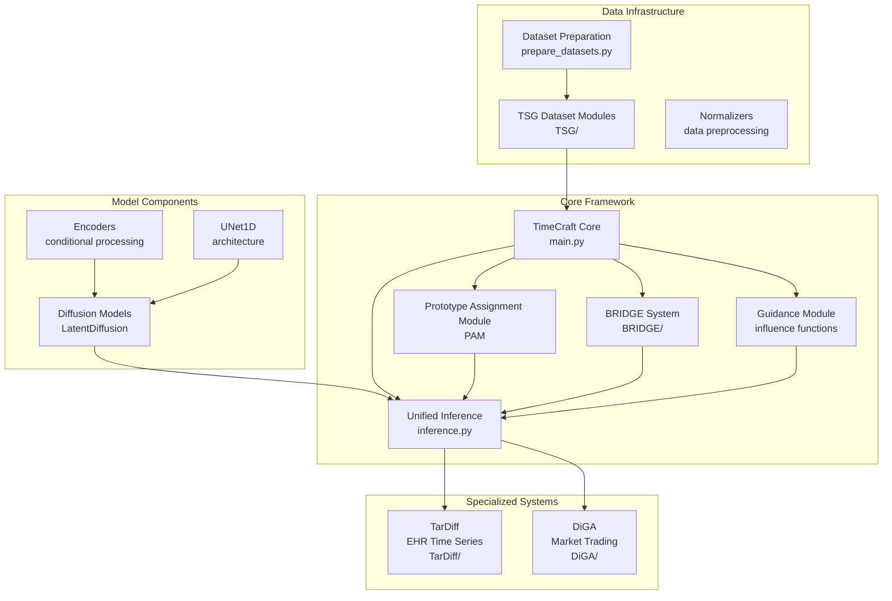
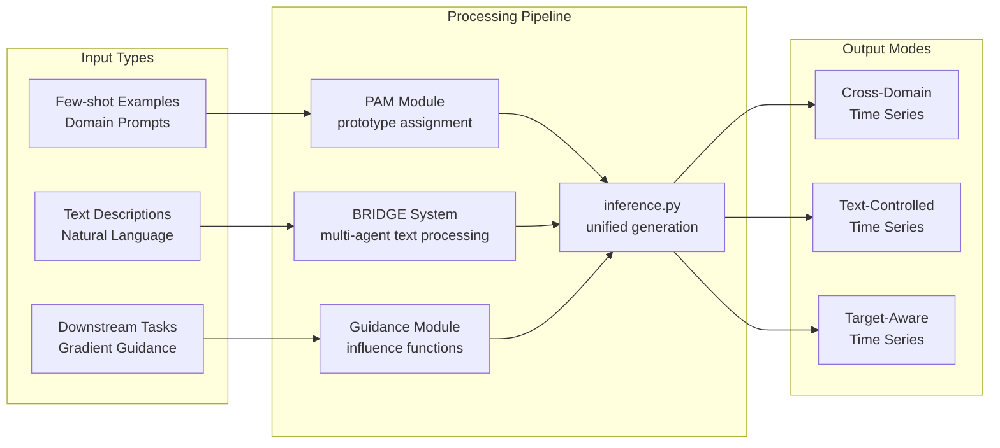
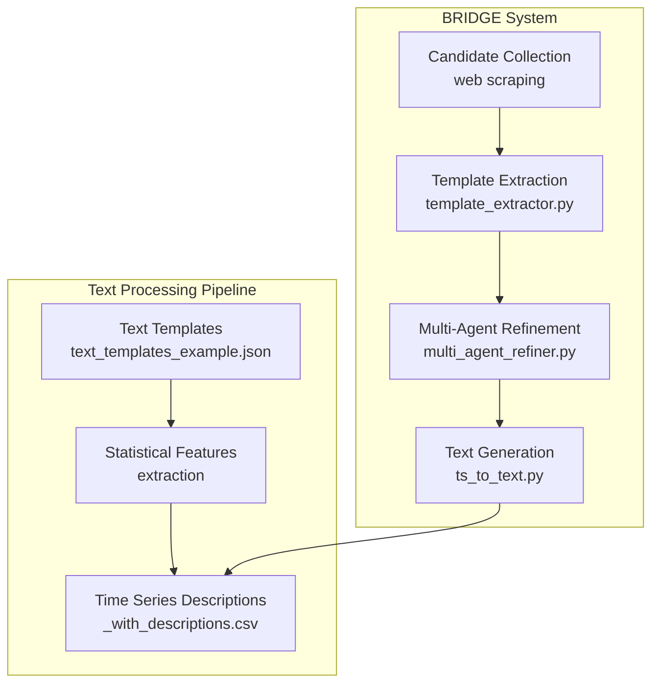
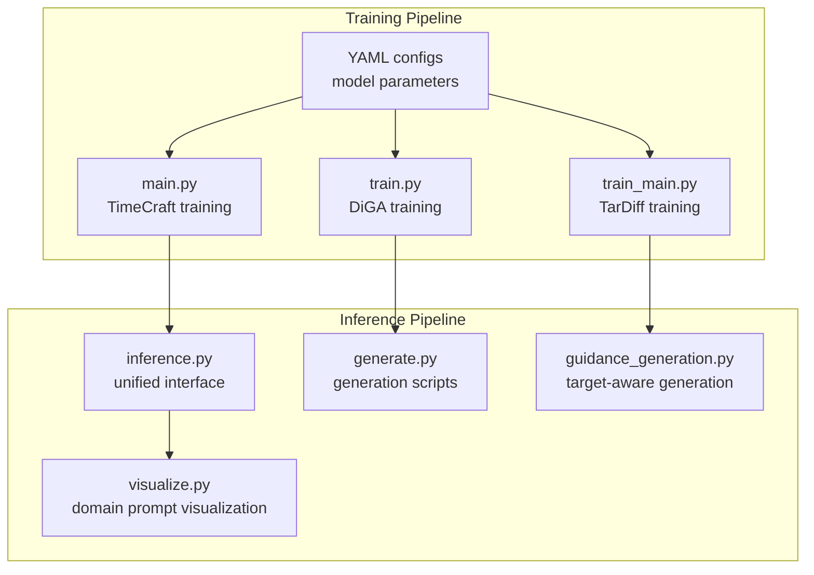
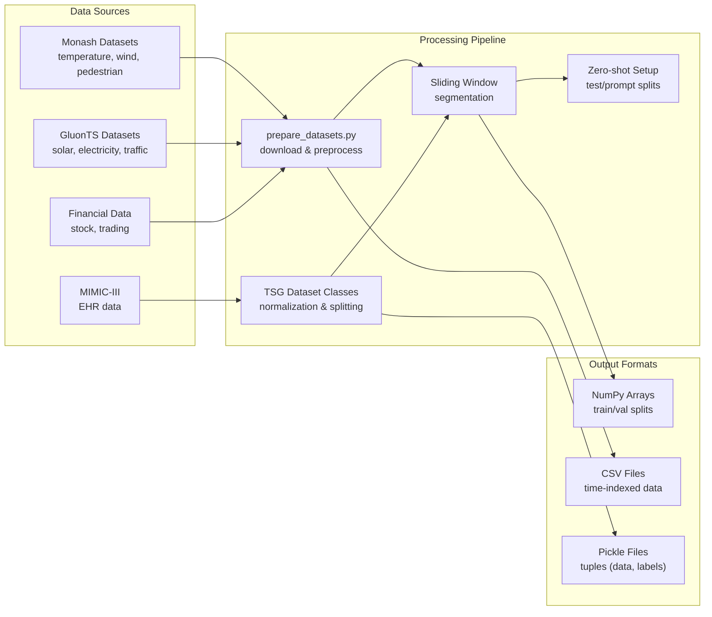

<!-- source: DeepWiki mcp.deepwiki.com · repo microsoft/TimeCraft · page 1 TimeCraft Overview · fetched 2026-10-26 -->

# TimeCraft Overview

<details>
<summary>Relevant source files</summary>

The following files were used as context for generating this wiki page:

- [BRIDGE/README.md](BRIDGE/README.md)
- [README.md](README.md)
- [figures/pt_like_word_newcolors.png](figures/pt_like_word_newcolors.png)

</details>


## Purpose and Scope

TimeCraft is a diffusion-based time series generation framework designed for real-world applications. This document provides a high-level overview of the system architecture, core capabilities, and key components. For detailed information about specific subsystems, see [Core Framework Architecture](#2), [Specialized Systems](#3), and [Data Infrastructure](#4).

The framework addresses three main challenges in time series generation: cross-domain generalization, text-based controllability, and target-aware adaptation for downstream tasks.

## System Architecture

TimeCraft follows a layered architecture with three primary tiers: the core framework, specialized implementations, and supporting infrastructure.

### Overall System Structure



**Sources:** [README.md:1-308]()

### Core Input-Output Flow



**Sources:** [README.md:26-37]()

## Core Capabilities

### 1. Cross-Domain Generalization

TimeCraft introduces semantic prototypes that act as reusable temporal patterns across domains. The `PAM` (Prototype Assignment Module) dynamically computes domain-specific weights using few-shot examples to construct domain prompts.

| Component | File/Module | Function |
|-----------|-------------|----------|
| Semantic Prototypes | Core framework | Learn domain-invariant features |
| PAM Module | `PAM` class | Compute domain-specific weights |
| Domain Prompts | Generated representations | Capture target domain characteristics |

### 2. Text-Based Control

The BRIDGE system enables natural language control over time series generation through a multi-agent framework.



**Sources:** [README.md:139-155](), [BRIDGE/README.md:1-92]()

### 3. Target-Aware Adaptation

TimeCraft optimizes synthetic sample generation for downstream task performance using influence-guided diffusion.

| Component | Purpose | Implementation |
|-----------|---------|----------------|
| Guidance Set | Approximate downstream distribution | Training set or custom subset |
| Downstream Model | Task-specific requirements | Any differentiable architecture |
| Guidance Module | Gradient injection | Influence function computation |

## Key Components and Files

### Training and Inference



**Sources:** [README.md:199-217]()

### Data Processing Architecture



**Sources:** [README.md:99-138]()

## Usage Patterns

### Command-Line Interface

The framework supports flexible input combinations through command-line arguments:

```bash
# Domain prompt generation
python inference.py --domain_prompt

# Text-controlled generation  
python inference.py --text_control

# Target-aware generation
python inference.py --guidance_mode
```

### Configuration Management

The system uses YAML configuration files with OmegaConf for parameter management, supporting:

- Model architecture parameters
- Training hyperparameters  
- Dataset specifications
- Inference modes

### Extensibility

TimeCraft's modular design allows for:

- Custom dataset integration via TSG modules
- New specialized systems (like TarDiff and DiGA)
- Additional guidance mechanisms
- Custom text processing pipelines

**Sources:** [README.md:92-223]()

---

